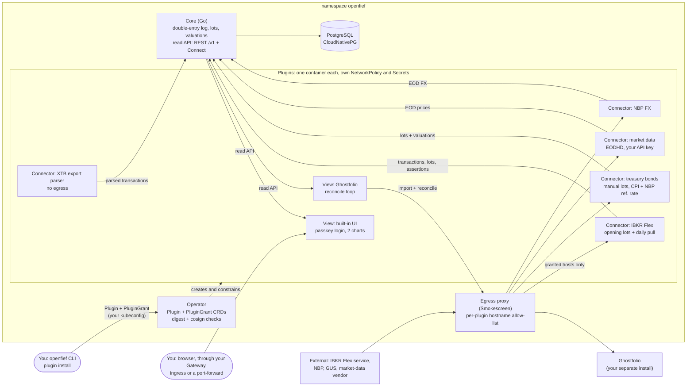
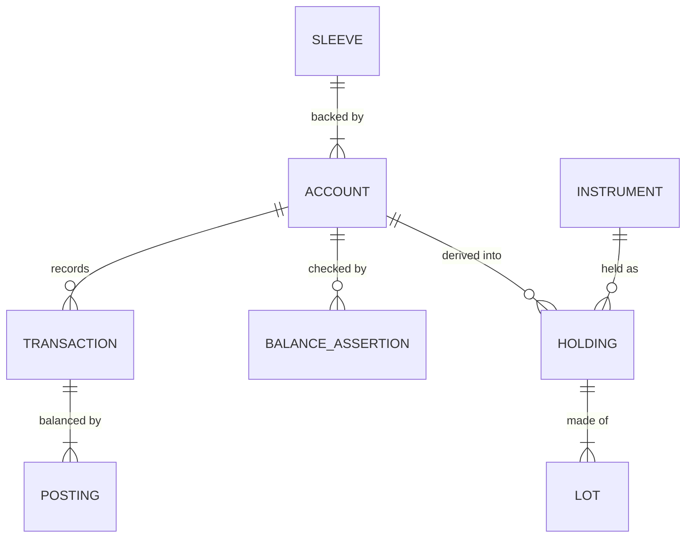

# OpenFief design

The current design: what is decided, as of now. Git holds the history.

- Proposals for later milestones, one file per area: [proposals/](proposals/)
- External research the design draws on: [research.md](research.md)
- Domain terms and abbreviations: [glossary.md](glossary.md)
- Requirements: kibi (`.kb/`), which cites the GR and D IDs below. People read them through its generated report.

Authority, highest first: ground rules (GR), then decisions (D), then kibi requirements. Tensions (T) and open questions (OQ) are unresolved. IDs are stable and never reused.

## 1. Ground rules

Written by the author and never edited. A conflict with a ground rule is recorded as a tension; the rule is never reworded to fit.

- **[GR-1]** Fully open source and self-hosted. It can eventually also be hosted for a subscription.
- **[GR-2]** Target users are people like me: technical individual investors. It is a niche, and that is fine.
- **[GR-3]** It starts as a typical portfolio summarizer: plugins for XTB, Interactive Brokers, Polish retail treasury bonds (obligacje skarbowe), etc., giving typical API access to what you hold, plus a couple of charts.
- **[GR-4]** There is a model strategy (model portfolio) to follow and adjust, with an agentic model that summarizes and maintains it. The model is configurable; I would use only my locally hosted model for this.
- **[GR-5]** For a thesis (for example a single company) you can spawn agents. Mainly long-term, but short-term is allowed. Agents do fundamental analysis, watch news, etc.
- **[GR-6]** Each thesis agent has a budget leased from the offensive part of the portfolio, with strong guarantees that the agent can never get more of the portfolio than its lease.
- **[GR-7]** Agents wake up on a schedule plus on events, and have tools to make transactions.
- **[GR-8]** Frontier models for thesis agents can be cloud-hosted.
- **[GR-9]** An orchestration layer runs the thesis agents. That orchestration layer is exactly what this project is; agents are separate products.
- **[GR-10]** Agents are plugins, so any agent can be used. The default is an agent I build or pfranczyk's per-thesis agents (github.com/Looted). Someone who trusts Interactive Brokers' agents and does not host models locally can choose those instead.
- **[GR-11]** All models are configurable per role, so the user chooses which model sees what.
- **[GR-12]** The privacy and security model comes first, designed per use case.
- **[GR-13]** Regulatory logic is pluggable too: jurisdiction plugins, Poland first.
- **[GR-14]** The project name is OpenFief.

## 2. Scope

- **[D-1]** The first iteration is M0 only: tracker and Polish imports, with no AI models and no agents.
- **[D-31]** M0 has no time-box. Its scope is everything decided in this document.
- **[D-5]** The core is licensed AGPL-3.0, the plugin contracts and SDK Apache-2.0, and contributions carry a DCO sign-off.

| Milestone | Scope | State |
|---|---|---|
| M0 | Tracker and Polish imports, optional model portfolio | Decided: this document |
| M1 | Control plane on paper trading | Proposed: [proposals/control-plane.md](proposals/control-plane.md) |
| M2 | Agents | Proposed: [proposals/agents-and-models.md](proposals/agents-and-models.md) |
| M3 | First small live fief | Proposed: [proposals/control-plane.md](proposals/control-plane.md) |

## 3. M0 architecture

Arrows show data flow, not which side starts a call.

### 3.1 System of record and views

Existing trackers can't hold what OpenFief has to get exactly right: FIFO tax lots priced in PLN, statutory bond values, and sleeve attribution that the later lease ledger reconciles against. So OpenFief owns the record, and trackers only display it.

- **[D-2]** OpenFief's own core is the system of record for transactions, tax lots and valuations. Trackers are plugins that show a one-way *view* of it.
- **[D-3]** M0 ships two view plugins: a very simple built-in UI as the default, and Ghostfolio auto-push.
- **[D-4]** The Ghostfolio plugin runs a reconcile loop. It owns only the Ghostfolio accounts it created, puts OpenFief's transaction ID in each activity's comment, deletes stale activities and imports missing ones. Manual edits inside its accounts are reverted on the next sync.
- **[D-64]** How the Ghostfolio plugin syncs, given how Ghostfolio behaves:
  - It creates its Ghostfolio accounts with UUIDs derived from the plugin instance and the OpenFief account (UUIDv5), so it knows which accounts it owns without storing anything: a plugin has no volume and no Kubernetes API access.
  - Each sync imports missing activities first, then deletes stale ones, because Ghostfolio deletes an asset and its price history along with its last activity. The one exception is a stale activity that Ghostfolio's duplicate check would match against an import: it is deleted first, or the sync would never settle. A bulk delete always carries an account filter; an unfiltered one deletes every activity the user has.
  - A bond is a `MANUAL` asset whose symbol is a UUID derived from the plugin instance and its series code, so two installs that share one Ghostfolio never collide; the code is its name. Every sync sends its full price history.
  - Edits are found by comparing fields, since a manually edited activity keeps its comment.
  - Imports aren't atomic, so every step is safe to repeat, and each import is first checked with `dryRun=true`.
  - It refuses to sync while Ghostfolio's "restricted view" setting is on: that setting blanks comments, so every activity would look stale.
  - Ghostfolio renames these internal endpoints within `/v1`, so the plugin supports a pinned range of Ghostfolio versions, checked by contract tests on recorded fixtures.
  - It runs its own sync timer, since the core schedules only connectors (D-49).
- **[D-108]** The Ghostfolio plugin books a dividend as quantity 1 at the gross amount, with the withheld tax as its fee, and a standalone fee against a manual "OpenFief fees" asset per currency. Each of its Ghostfolio accounts' cash balance follows OpenFief's cash, so Ghostfolio's totals include it. Listed instruments need the owner's mapping from ISIN to Ghostfolio's data source and symbol.
- **[D-6]** OpenFief's public API is read-only REST/JSON with an OpenAPI spec, versioned `/v1`, covering accounts, transactions, tax lots, holdings and valuations. Every view plugin, the built-in UI included, uses it. MCP access waits for M2, so that model access to holdings goes through the model router.
- **[D-50]** The read API (D-6) is defined in protobuf with HTTP annotations, like the plugin contracts (D-11). The core serves it both as Connect, for generated Go and TypeScript clients, and as REST under `/v1` through transcoding (Buf's Vanguard). The OpenAPI spec is generated from the same definitions.
- **[D-30]** The built-in UI draws three charts in M0: allocation (by asset class, currency, broker or sleeve), value over time, and performance (D-106). The time charts start at go-live (D-23).

### 3.2 Getting data in

XTB shut down its public API in 2025, and neither the treasury bond registry nor the bank that sells the bonds offers one, so both arrive as files or manual entry. Interactive Brokers' Flex Queries are expected to report positions per lot, with open date and cost (OQ-22 verifies this).

- **[D-7]** Reading of GR-3: connectors get data from each institution by whatever works (a broker API where one exists, files or other means otherwise; not necessarily REST), and OpenFief exposes its own read API (D-6). Data enters only through each connector's ingest path (upload, CLI, watched folder), never through the public API.
- **[D-8]** The core project ships only connectors that comply with the institution's terms. Third parties may build others; OpenFief does not ship or endorse them.
- **[D-9]** M0 data paths: XTB through uploaded xStation export files; treasury bonds through manual lot entry (series, quantity, purchase date) with valuation computed; an import of the bond service's own export is added if one exists (OQ-22).
- **[D-97]** The treasury bond connector reads each series' terms (first-period rate, margin and early-redemption fee) from the issuer's site, obligacjeskarbowe.pl, once its terms of use are confirmed to allow it (OQ-30, D-8). Until then the owner enters them with a lot, and the latest entry for a series wins.
- **[D-22]** Prices come from a market-data connector plugin where the user brings the API key (D-51); IBKR Flex prices serve as a cross-check.
- **[D-110]** A cross-check price is flagged when it differs from the stored price by more than 1% of it, in either direction. The owner can set a different threshold for a single instrument, such as a thinly traded Warsaw listing.
- **[D-111]** A cross-check price is compared with the latest stored price of the same instrument on or before its date. When the two are in different currencies, the pair is shown with its own status instead of being skipped, because the market-data connector may be pricing another listing than the one held.
- **[D-112]** Only a connector whose manifest declares it may send cross-check prices. The owner can acknowledge a flagged check, which is recorded append-only, and the UI shows the latest check per instrument with its history.
- **[D-51]** The first market-data connector uses EODHD. EODHD covers the Warsaw Stock Exchange, LSE, Xetra and Euronext, finds instruments by ISIN, includes end-of-day index history, and its terms allow storing the data for private use. Its closes are aggregated rather than each exchange's official close, which is one more reason for D-22's cross-check.
- **[D-96]** The EODHD connector identifies a market index by the name the owner gives it, such as WIG20. Its Euronext covers EODHD's Paris, Amsterdam, Brussels, Lisbon, Dublin, Milan and Oslo markets. An ISIN listed on several supported exchanges stays unpriced and is reported as ambiguous until the owner picks the exchange, and an instrument it can't price is reported again on every sync.
- **[D-93]** Each sync request to a market-data connector carries the instruments the owner holds and the model portfolio's targets, so a newly bought instrument is priced without configuration. An optional list in the instance's config adds instruments to watch.
- **[D-94]** The owner ranks the sources of each kind of market data (prices, exchange rates and index readings) in priority order, and for each date the highest-ranked source with a value wins. Every source's values are stored, so the lower-ranked ones serve as cross-checks (D-22). By default the first-party connector for each kind ranks first: NBP for exchange rates, EODHD for prices, and the treasury bond connector for CPI and the NBP reference rate.
- **[D-23]** Accounts are seeded from each broker's current lot-level positions (opening lots), with transactions from go-live. Full history backfill arrives with the tax pack.
- **[D-98]** A treasury bond lot bought before go-live is an opening lot at go-live, keeping its own purchase date and cost (D-23). A manually entered account may receive its opening lots one at a time, and each is idempotent per series and purchase date. A lot bought after go-live is a deposit of its cost and a buy on its purchase date.
- **[D-100]** Manual bond lots are cash purchases at 100 PLN or exchanges of maturing bonds at 99.90 PLN, whose 0.10 PLN discount is taxed with the interest on redemption. The owner can delete a lot as a correction, which supersedes it (D-18) and erases nothing.
- **[D-95]** When an account has already been seeded from opening lots, the core syncs it in transactions mode on its own; no manual step switches it.
- **[D-24]** XTB in M0 covers real stocks and ETFs only. Closed CFD results are imported as cash profit or loss so cash reconciles; open CFD positions are flagged as unsupported.
- **[D-72]** The owner creates accounts in the built-in UI, in an owner session (D-66): institution, name, sleeve, and the connector instance that feeds the account. A broker connector reports the broker accounts it saw on its last sync, and the UI offers them to pick from, so the owner never types a broker account number. Transactions for a broker account that isn't mapped to an OpenFief account are not booked, and the UI shows the broker account as unmapped.

### 3.3 Ledger and valuation

Double-entry keeps cash, withholding tax and currency conversion consistent by construction, and it gives a later lease a natural home as a sub-account.

- **[D-18]** The source of truth is an append-only, versioned transaction log. Holdings and tax lots are derived from it. Re-imports are idempotent, keyed by source plus the institution's own ID; a changed row creates a new version and supersedes the old one, which is never deleted. Broker position snapshots are stored as balance assertions; a mismatch is a flagged error.
- **[D-19]** Double-entry postings across cash, position, fee, withholding-tax and FX accounts.
- **[D-101]** The ledger has an interest transaction kind. Bond coupons, such as COI's yearly interest, are booked as interest, not as dividends.
- **[D-20]** Every amount keeps its original currency. In M0, NBP table A rates convert amounts to PLN, behind a swappable rate-provider interface with NBP as the default FX plugin. The Polish jurisdiction pack always uses NBP rates for tax, whatever the UI uses.
- **[D-62]** Totals, charts and the model comparison are shown in the reporting currency: a setting whose default comes from the jurisdiction pack, PLN for the Polish pack. Apart from the Polish pack's tax rules, no code assumes PLN.
- **[D-113]** The built-in UI writes amounts in a number format: a setting next to the reporting currency, whose default comes from the jurisdiction pack. The Polish pack's default groups thousands with a space and uses a decimal comma, as in `5 000,00 PLN`. The format changes only the separators, never the digits or the currency, and the charts' axes and tooltips use it too.
- **[D-70]** Reading of GR-13 for M0: a jurisdiction pack is a set of pure functions inside the core, behind one interface, so another jurisdiction is another implementation of it. It is not a plugin container and not a WebAssembly (WASM) module.
- **[D-21]** Prices are end of day in M0.
- **[D-33]** Besides D-19's accounts, each account has an equity ledger account per currency: the counterpart for deposits, withdrawals and opening lots.
- **[D-71]** Every sleeve has a sleeve kind, which gives it a default role: defensive (never available to agents) or offensive (fiefs are leased from it, GR-6). The built-in kinds are agent pool and satellite, which are offensive, and bonds, core, emergency fund and retirement, which are defensive. The owner can add kinds and rename any kind, but a kind's default role never changes, and a sleeve whose role differs from its kind's needs the owner's explicit choice. An install starts with three sleeves: bonds, core and satellite.
- **[D-34]** Selling part of a lot rounds the consumed cost to two decimal places, half-even, and the lot keeps the exact remainder, so consumed plus remaining cost always equals the original cost. In M0 fees go to the fee ledger account and are not added to lot cost.
- **[D-35]** An instrument needs an ISIN with a valid check digit plus a venue symbol. Within one date, acquisitions apply before disposals, because broker rows carry no reliable time of day.
- **[D-99]** Owners never see the registry's own ISIN for a treasury bond, so OpenFief derives one from the series code: `PL`, the series code, `00` and a check digit, such as `PLEDO0536000` for EDO0536. An import of the issuer's own export uses the same derivation, so one series is never held twice.
- **[D-36]** Valuations are stored rows derived from the transaction log, prices, FX rates and index readings, and can be rebuilt from them at any time. Any change to those inputs enqueues a revaluation in the same database transaction, through a PostgreSQL-backed job queue (River). Pending revaluations coalesce per account from the earliest affected date. The read API reports, per account, the date it is valued through and whether a revaluation is pending or running, and the UI shows it. Configurable: worker concurrency and the end-of-day schedule. Each stored valuation holds all three values of D-77. What triggers a revaluation is not configurable.
- **[D-37]** Where a treasury bond's issue letter and the issuer's published daily interest tables or worked examples disagree, OpenFief follows the tables and examples: the TOS yearly base is not rounded, and Belka tax is rounded half up to the grosz.
- **[D-102]** The treasury bond connector applies the reference-rate rule itself: the NBP reference rate in force on the tenth business day before a month is that month's reading, dated on the month's first day.
- **[D-103]** The Polish business-day calendar counts Saturdays, Sundays and the statutory public holidays year by year, including 6 January from 2011 and 24 December from 2025, with the Easter-based days computed. Epidemic days off are not modelled, and dates before 1991 are refused.
- **[D-104]** CPI readings use only GUS's final monthly values; preliminary, estimated and flash values are skipped. The first sync starts in January thirteen years back and fetches at most four years per sync, within GUS's anonymous limits. GUS indicator 1832 is used up to 2025 and 2728 from 2026.
- **[D-76]** Every account has a tax wrapper from the jurisdiction pack, which the owner sets when creating the account (D-72). The Polish pack's wrappers are a standard taxable account, IKE, IKZE and OKI (osobiste konto inwestycyjne). Inside OKI no Belka tax is due. Its yearly tax on the part of the average balance above the statutory limit, summed across all of the owner's OKI accounts, is computed from stored daily valuations only once the act is in force, with the limit and rate taken from the act.
- **[D-77]** Every holding, account and total has three values, computed by the jurisdiction pack for each kind of product and tax wrapper:
  - **Gross:** before any tax or fee; market value, or the accrued value of a bond or deposit.
  - **Net:** what the owner keeps at the planned exit (maturity, or a withdrawal from a wrapper once its conditions are met), after the taxes due then and without early-exit fees.
  - **Liquidation:** the cash in hand if everything were sold or redeemed and withdrawn today, after every tax and fee due today: early-redemption fees, early-withdrawal taxes and sale commissions.
  Tables show all three side by side. The allocation and value-over-time charts each have a switch between them that starts on gross, the value broker statements show, and the value-over-time chart (D-30) can draw all three lines. The performance chart is computed on gross value (D-106).
- **[D-78]** Liquidation value estimates a sale's commission with a fee rule the owner sets per account: a percentage with a minimum, plus a currency-conversion percentage for instruments in a foreign currency. The rule is zero until set. Withdrawing from IKZE before 65 is taxed as income at the owner's marginal PIT rate, a setting the owner enters once. Until it is set, an IKZE's liquidation value is shown as missing rather than guessed.

The terms are defined in [glossary.md](glossary.md).

### 3.4 Model portfolio

GR-4's model portfolio starts in M0 as something the owner enters by hand. From M2, its maintainer agent adjusts the same basket.

- **[D-52]** The model portfolio is optional and off by default; while it is off, it appears nowhere in the UI or the read API. It is a weighted basket for the whole portfolio: each target is an instrument (such as an index ETF or a stock) or an index, with a weight, and the weights sum to 100%. The owner enters it in the built-in UI, which hands it to the core like manual bond lots (D-49). When it is on, the read API serves it with its backtest and drawdowns.
- **[D-53]** The model's performance is a backtest: its value is computed from end-of-day prices as far back as every target has data, rebalanced to the target weights once a year. The performance chart (D-106) shows it as a second line from go-live, with both lines starting at 100. The portfolio's line is measured as D-61 says.
- **[D-54]** M0 shows the historical max drawdown of the model and of each target: the worst fall from a peak to a later trough over its whole history, with both dates. M0 has no stress tests and no statistical risk estimates.
- **[D-61]** Next to the model, the portfolio's line is its time-weighted return: daily returns from valuations, chained across deposits and withdrawals, so cash flows don't count as performance. Transfers between the owner's own accounts are not cash flows. Both lines are in the reporting currency (D-62). The model's backtest also needs exchange rates into that currency, so it starts no earlier than they do; NBP's rates begin on 2002-01-02.
- **[D-105]** Transfers between the owner's own accounts are identified by suggestion and confirmation. A withdrawal is suggested as a transfer to a deposit into another of the owner's accounts of the same amount and currency at most five calendar days apart, the nearest unmatched deposit first. The owner confirms or rejects each suggestion in the UI, and a confirmed link is stored in the ledger, append-only. Only confirmed transfers are left out of the time-weighted return's cash flows.
- **[D-106]** Value and performance are separate charts. The value-over-time chart shows money, cash included, with D-77's switch between gross, net and liquidation. The performance chart shows the time-weighted return (D-61) as an index from 100 at go-live, computed on gross value, next to the model portfolio (D-53). Valuation totals include cash.
- **[D-107]** Conventions as built: in the time-weighted return, cash flows count at the end of their day, each daily factor and the running product are rounded half-even to 12 decimal places, and opening lots count as inflows at their market value on their date. The model portfolio rebalances at the end of each 31 December. A target's drawdown is measured in the reporting currency over the span where it has both closes and exchange rates. Weights go in steps of 0.01%, with at most 50 targets, and while the model is off the read API answers 404 for it.

### 3.5 Runtime and plugins

Each plugin runs out of the core's process, with its own network policy, secrets and identity, so a broken or hostile plugin can reach only what it was granted. Standard NetworkPolicy matches IP addresses, not hostnames, so outbound traffic goes through a proxy that checks hostnames.

- **[D-10]** OpenFief is Kubernetes-oriented: it is built for, and deployed on, Kubernetes.
- **[D-11]** The core is written in Go. Each plugin runs in its own container and speaks protobuf contracts over Connect RPC. Each plugin ships a manifest that OpenFief compiles into NetworkPolicy, Secret mounts, RBAC and egress allow-list entries (D-32). SDKs come in TypeScript and Go.
- **[D-12]** Any conformant Kubernetes cluster; no reference platform. Tested on kind and k3d, with documented requirements: a CNI that enforces NetworkPolicy, and a storage class.
- **[D-13]** An operator manages plugins through a `Plugin` custom resource, from M0.
- **[D-55]** The operator manages plugin workloads only and never touches money. Fiefs, intents, approvals and the ledger live in PostgreSQL behind the core, never in custom resources or etcd: etcd is not a transactional ledger, and GR-6's guarantee must not depend on who has Kubernetes API access. The only custom resources are `Plugin` and `PluginGrant`.
- **[D-14]** PostgreSQL via CloudNativePG, and no NATS in M0.
- **[D-15]** The operator is namespace-scoped: a Role in the `openfief` namespace only. The CRDs are installed once by a cluster admin. Namespace-per-agent is revisited at M2.
- **[D-16]** Plugin permissions are split into the `Plugin` resource (what the vendor requests) and a `PluginGrant` (what the user approved). The operator enforces only what is in both. An upgrade that requests more waits for approval.
- **[D-17]** Plugin images must be pinned by digest, and their signatures are verified with cosign.
- **[D-32]** Plugin egress goes through an egress proxy built on Stripe's Smokescreen, embedded as a Go library. The operator compiles each `PluginGrant`'s hostnames into that plugin's allow-list. Plugins identify themselves with their projected ServiceAccount token, through a custom role function. NetworkPolicy lets plugins reach only the core and the proxy, with no DNS, and the proxy refuses private and internal address ranges. Plugins reach external hosts through `HTTPS_PROXY`.
- **[D-63]** The egress proxy embeds Smokescreen through `BuildProxy` inside OpenFief's own HTTP server; `StartWithConfig` would exit the process on errors and take over signals. Smokescreen allows every destination when no allow-list is set, so the proxy never runs without one and refuses all destinations for a plugin that has none. Compiled allow-lists are swapped atomically. A plugin sends its projected token as the password in the proxy URL, which Go's and Node's HTTP clients send as a `Proxy-Authorization` header; the role function checks it with Kubernetes' TokenReview API (audience `openfief-egress`) and caches the result. Projected tokens rotate, so the SDK builds the proxy URL (D-32's `HTTPS_PROXY`) from the token file on each request, using the proxy's ClusterIP because plugins have no DNS. Smokescreen is pinned to a commit after v0.1.0 until a release carries its later hardening fixes.
- **[D-74]** An exception to D-32 for services inside the cluster: a plugin's signed manifest may request one in-cluster service that the owner picks at install, such as a Ghostfolio running in the same cluster. The CLI asks for its namespace, service and port and shows them, and the grant approves exactly that service. The operator then adds a NetworkPolicy egress rule from the plugin to that service's pods on that port and gives the plugin the service's ClusterIP address, so no DNS is needed. This traffic doesn't pass through the egress proxy, and it may be plain HTTP, which the install warns about. When the service's namespace has its own NetworkPolicies, the CLI prints the ingress rule to add there.
- **[D-75]** Instead of a fixed host, a manifest may request "the host of config field X". The CLI reads that host from the instance's config (D-48) and shows it, the grant approves exactly that host, and the plugin reaches it through the egress proxy like any other host. It must be a single HTTPS host: no wildcard and no IP address.

### 3.6 Plugin distribution and installation

Few plugins are expected. Anyone can write and run their own; the ones the author has reviewed are listed as verified. Every image is signed, so the only question is whose signatures count.

- **[D-42]** A plugin's manifest is embedded in its image, as a label on the image config. One signature covers both the code and the permissions it asks for, and the manifest can be read from the registry without running the image.
- **[D-43]** One catalog, a file in this repository released with the product, lists the first-party and verified plugins. Any other plugin is installed directly by image reference and shown as unverified. There are no subscribable third-party catalogs.
- **[D-44]** A verified plugin is one whose version the author reviewed: its catalog entry pins the publisher's signed image digest and the publisher's signer identity. Each new version needs a new catalog entry.
- **[D-88]** The release workflow adds each first-party plugin to the catalog with the image digest it signed. The author starts every release by hand, and that release is the review D-44 requires, so first-party plugins show as verified.
- **[D-45]** The operator trusts three kinds of signer: OpenFief's CI, the publishers pinned in the catalog, and signers the owner adds. Owners sign their own plugins with their own CI identity or a local key, and those plugins show as unverified.
- **[D-46]** Plugins are installed with the `openfief` CLI. It reads the catalog or the image, verifies the signature, shows the requested permissions, and on the owner's confirmation applies the `Plugin` and `PluginGrant` with the owner's own kubeconfig, or prints them for GitOps. The core has no right to create or change grants; in M0 the UI only shows installed plugins.
- **[D-73]** First-run setup happens in the built-in UI. After the owner creates the first passkey (D-60), a first-run wizard walks them through creating accounts (D-72), sleeves, and binding the connector instances already installed. Installing plugins stays in the CLI (D-46), whose last step points to the wizard.
- **[D-47]** Plugin upgrades are always manual, even when the permissions are unchanged.
- **[D-90]** The CLI refuses a catalog name that matches several versions and lists them instead of picking one, and refuses to install over an existing instance. `openfief plugin upgrade <instance> <version>` verifies the new image, shows how its requested permissions differ, and applies the upgrade only when the owner confirms.
- **[D-48]** Each install is a separately named instance with its own config, secrets, grant and egress allow-list. The same image can be installed more than once, such as one instance per IBKR account.
- **[D-89]** A manifest names each Secret by its role, such as `flex-token`, and the operator mounts the Secret named `<instance>-<role>`, so two instances of one image never share a Secret.
- **[D-49]** The core calls connectors: a connector serves a Connect service for syncing and for importing files, and the core owns the schedules, retries and import batches. Views are clients of the read API. File uploads and manual bond-lot entries in the built-in UI go to the core, which hands them to the right connector.
- **[D-79]** What the owner enters by hand reaches the core through one service per kind of entry: bond lots, the model portfolio, accounts, statement uploads and any later kind. Each is owner-only, versioned on its own, and called only by a view plugin acting for an owner session (D-69). The read API (D-6) and script tokens (D-27) stay read-only.
- **[D-109]** A statement upload goes to the connector instance bound to the account. A statement that covers several accounts, such as an IBKR Flex statement of linked accounts, books every mapped account bound to that instance and reports the broker accounts that aren't mapped (D-72). The core chooses the mode, opening for an account not yet seeded and transactions after that (D-95), and the owner may override it; an opening upload seeds the account for scheduled syncs too. The owner's UI learns through its owner service (D-79) which accounts have a connector that takes files, and shows the upload form only there. The core accepts files up to 64 MiB.
- **[D-56]** The operator verifies every plugin image's signature itself before deploying it, so a `Plugin` applied through GitOps or plain `kubectl apply` is checked too. It uses a bundled trust root, so verification works offline. It records in the `Plugin`'s status whether the image is verified (D-44) or only signed by a trusted signer, and the UI shows that status. The CLI's check (D-46) is a preview of the same check.
- **[D-86]** The list of installed plugins, with their image digests and signers, is readable by any read API caller (D-83), including the demo's read-only visitors: anyone using OpenFief can see what runs in it and who signed it.
- **[D-87]** The operator records each plugin's signature trust in its status in full: verified, signed by OpenFief's CI, by a catalog publisher, by the owner, by a trusted signer of unknown kind, refused, or not checked. The UI groups them into four badges, with the exact signer in the details: *Verified* (in the catalog and reviewed, D-44), *Yours* (one of the owner's signers, D-45), *Unreviewed* (another trusted signer, not in the catalog) and *Blocked* (refused or not checked yet).
- **[D-57]** An image without a valid signature from a trusted signer is never deployed, and there is no override. A developer testing a plugin locally signs it with their own key, added as a trusted signer (D-45).
- **[D-58]** Uninstalling an instance deletes its workload, grant, secrets and egress allow-list. The data it brought in stays in the ledger (D-18), marked as coming from a removed instance; reinstalling under the same name continues from it.
- **[D-91]** Holdings and lots are marked as no longer updated when any transaction behind them comes from a removed instance. Like the transactions' own mark, it is worked out when the data is read, so the log stays append-only.

### 3.7 Security: tracking and imports

GR-12 puts the security model first, per use case. M0 has one use case, tracking and imports; the use cases of later milestones are in the proposal files.

- **Data seen:** every holding, transaction, statement file and account identifier, plus read-only broker credentials such as a Flex Query token.
- **Models:** none.
- **Threats:** theft of the data from the host or its backups; leaked read-only credentials, which still expose the full account history; malicious statement files; wrong valuations leading to wrong decisions.
- **Controls:** per-plugin isolation (D-11, D-16, D-17, D-32), where the XTB parser has no egress at all, and:
  - **[D-26]** People log in with passkeys (WebAuthn), built in. No external identity provider.
  - **[D-65]** OpenFief has a single user, the owner: no other users and no tenants. Authenticators only prove that a caller is the owner, and they are separate from the session that follows. In M0 the authenticators are passkeys (D-26) and, on a demo, D-68's demo authenticator.
  - **[D-66]** After authentication the core issues an opaque, revocable session token, not a JSON Web Token (JWT). It stores only the token's hash, and the session expires after a period of inactivity and after an absolute lifetime. Each session has a scope: `read` or `owner`.
  - **[D-69]** The built-in UI is a backend-for-frontend: the browser talks only to the UI view plugin, and the plugin calls the core's authentication service (`openfief.identity.v1`) for login and sessions. That service is offered to view plugins only, never on the public read-only API (D-6).
  - **[D-83]** The read API accepts sessions of either scope, script tokens, and view plugins' own tokens. It refuses connector tokens: the core calls connectors (D-49), and a connector never needs to read the owner's record.
  - **[D-84]** No build of OpenFief has a fixed token or any other way around authentication, not even for development. Local development of the UI runs against a local cluster such as kind or k3d.
  - **[D-85]** The session cookie uses the `__Host-` prefix everywhere, `localhost` included. Safari's acceptance of it on `http://localhost` is verified; only if Safari refuses it does `localhost`, and nothing else, fall back to a cookie without the prefix.
  - **[D-27]** Plugins authenticate to the core with projected ServiceAccount tokens (audience `openfief-core`). Scripts get separate, scoped, expiring, read-only personal tokens.
  - **[D-67]** Script tokens (D-27) are created only from an owner session in the UI, and no token is installed in advance as a Secret. `core token issue`, run in the core's pod, stays as a break-glass for an administrator.
  - **[D-68]** A demo authenticator issues `read` sessions without credentials, only when the database carries the marker of the synthetic demo dataset and the core runs with `--demo-sessions`. On a public demo anyone can browse read-only, and the owner logs in with a passkey for an `owner` session.
  - **[D-59]** Only the core may call a plugin. A plugin's NetworkPolicy admits ingress from the core alone, and the core presents a short-lived ServiceAccount token whose audience is that plugin instance, requested through Kubernetes' TokenRequest API as instances come and go. The SDK verifies it. Plugins can't reach the Kubernetes API, so the operator publishes the cluster's token-signing public keys in a ConfigMap the SDK reads.
  - **[D-81]** The core is the only entry point for browsers. It reverse-proxies the paths a browser-facing view plugin serves, such as the built-in UI's, to that plugin, so only the core ever calls a plugin (D-59), and whatever route the owner adds (D-28) needs to reach the core alone. A view plugin's manifest declares the path prefix it serves to browsers, and the grant approves it.
  - **[D-114]** In M0, at most one plugin instance holds a browser path (D-81). The core passes the browser's cookies, the owner's session among them, to the view that serves a path, and the owner services accept any view plugin, so a second browser-facing view could act as the owner. The `openfief` CLI refuses to install a plugin that declares a browser path while another instance holds one, and the operator doesn't run such a plugin applied another way, saying why in its status.
  - **[D-115]** The core listens on two ports. The browser port, which the Service's `http` port targets and a route points at, serves the front door (D-81), the read API (D-50) and the health endpoints. The plugin port, which the Service's `connect` port targets and only plugin pods may reach, serves the read API and the services only plugins call: the AuthService (D-69) and the owner services (D-79). No route reaches a plugin-only service.
  - **[D-82]** The core checks view plugins' tokens with Kubernetes' TokenReview API, which also confirms that the plugin's pod still exists. Its ClusterRole allows only creating TokenReviews; with the egress proxy's (D-63), it is one of the two cluster-wide permissions OpenFief holds.
  - **[D-92]** The core's NetworkPolicy allows the Kubernetes API on port 6443 at any address, because distributions such as k3s serve it on the node's own address, which differs per cluster. The docs explain the risk, that a compromised core could use the port to reach other hosts, and how an owner narrows the rule to their API server's address.
  - **[D-28]** OpenFief exposes nothing by default: every Service it creates is ClusterIP, the core's being the only way in (D-81), and it ships no tunnel. An optional kustomize component adds a Gateway API HTTPRoute to the core, which the owner points at their own Gateway and hostname. Any other way in, such as an Ingress or `kubectl port-forward`, is the owner's choice, and the docs explain what each exposes. Outside `localhost`, passkeys work only over HTTPS, so a route needs TLS.
  - **[D-60]** OpenFief installs with no hostname. A passkey works only on the hostname it was created on, so the CLI prints a one-time link for the first passkey: on the owner's own hostname, or on `localhost` through a port-forward while the owner has no route. A logged-in session issues a one-time link for creating a passkey on another hostname. Passkeys are kept per hostname.
  - **[D-80]** The `openfief` CLI has a command for the first passkey: it runs the core's enrollment command in the core's pod through Kubernetes exec, with the owner's kubeconfig, and prints D-60's one-time link. Given an origin, such as `https://fief.example.org`, the link is for that origin, which must be one the core allows; without one, the command forwards a local port to the core and the link is for `localhost`. The first-run wizard (D-73) follows.
  - **[D-29]** Credentials are Kubernetes Secrets, fed by whatever the user already runs (External Secrets Operator, Vault, SOPS and so on). The docs require etcd encryption at rest, encrypted disks and encrypted backups. No home-grown cryptography in M0.

## 4. Open for M0

Questions and tensions for later milestones live in their proposal files.

- **[T-12]** Reporting currency vs exchange rates. D-62 makes the reporting currency a setting, but D-20 converts amounts with NBP table A, which quotes every currency only against PLN. A reporting currency other than PLN needs cross rates through PLN or another FX plugin. Proposed: P-49.
- **[OQ-8]** Domain and trademark check for "OpenFief" (TMview, classes 9/36/42).
- **[OQ-22]** Verify the assumptions behind D-9, D-23 and D-24 against real accounts: IBKR Flex open positions report lots with open date and cost basis; the author's IBKR lot-matching method is FIFO; how far back one Flex request reaches; the xStation export's columns, and whether it separates CFDs from stocks; whether obligacjeskarbowe.pl offers any CSV export.
- **[OQ-30]** Do obligacjeskarbowe.pl's terms of use allow a connector to read series terms from the site automatically (D-97, D-8)?
