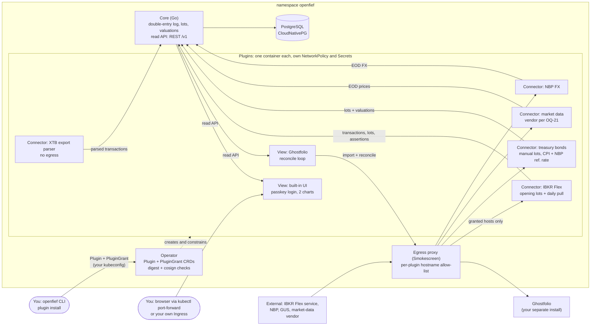
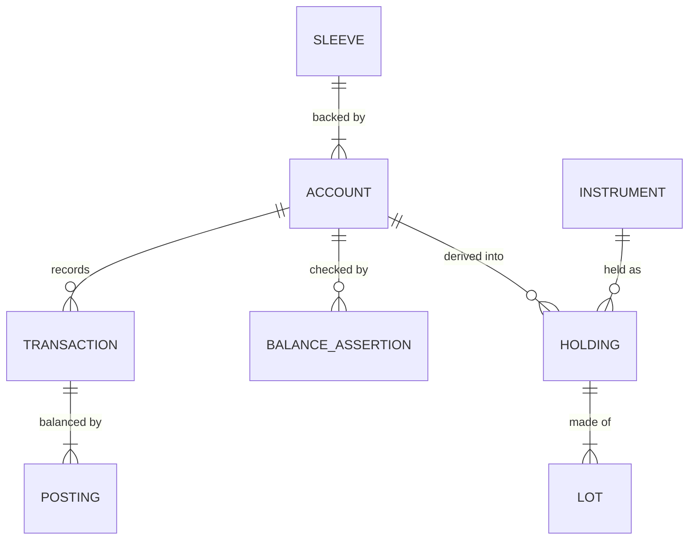

# OpenFief design

The current design: what is decided, as of now. Git holds the history.

- Proposals for later milestones, one file per area: [proposals/](proposals/)
- External research the design draws on: [research.md](research.md)
- Domain terms and abbreviations: [glossary.md](glossary.md)
- Requirements: kibi (`.kb/`), which cites the GR and D IDs below. People read them through its generated report.

Authority, highest first: ground rules (GR), then decisions (D), then kibi requirements. Tensions (T) and open questions (OQ) are unresolved. IDs are stable and never reused.

## 1. Ground rules

Written by the author and never edited. A conflict with a ground rule is recorded as a tension; the rule is never reworded to fit.

- **[GR-1]** Fully open source and self-hosted. It can eventually also be hosted for a subscription.
- **[GR-2]** Target users are people like me: technical individual investors. It is a niche, and that is fine.
- **[GR-3]** It starts as a typical portfolio summarizer: plugins for XTB, Interactive Brokers, Polish retail treasury bonds (obligacje skarbowe), etc., giving typical API access to what you hold, plus a couple of charts.
- **[GR-4]** There is a model strategy (model portfolio) to follow and adjust, with an agentic model that summarizes and maintains it. The model is configurable; I would use only my locally hosted model for this.
- **[GR-5]** For a thesis (for example a single company) you can spawn agents. Mainly long-term, but short-term is allowed. Agents do fundamental analysis, watch news, etc.
- **[GR-6]** Each thesis agent has a budget leased from the offensive part of the portfolio, with strong guarantees that the agent can never get more of the portfolio than its lease.
- **[GR-7]** Agents wake up on a schedule plus on events, and have tools to make transactions.
- **[GR-8]** Frontier models for thesis agents can be cloud-hosted.
- **[GR-9]** An orchestration layer runs the thesis agents. That orchestration layer is exactly what this project is; agents are separate products.
- **[GR-10]** Agents are plugins, so any agent can be used. The default is an agent I build or pfranczyk's per-thesis agents (github.com/Looted). Someone who trusts Interactive Brokers' agents and does not host models locally can choose those instead.
- **[GR-11]** All models are configurable per role, so the user chooses which model sees what.
- **[GR-12]** The privacy and security model comes first, designed per use case.
- **[GR-13]** Regulatory logic is pluggable too: jurisdiction plugins, Poland first.
- **[GR-14]** The project name is OpenFief.

## 2. Scope

- **[D-1]** The first iteration is M0 only: tracker and Polish imports, with no models and no agents.
- **[D-31]** M0 has no time-box. Its scope is everything decided in this document.
- **[D-5]** The core is licensed AGPL-3.0, the plugin contracts and SDK Apache-2.0, and contributions carry a DCO sign-off.

| Milestone | Scope | State |
|---|---|---|
| M0 | Tracker and Polish imports | Decided: this document |
| M1 | Control plane on paper trading | Proposed: [proposals/control-plane.md](proposals/control-plane.md) |
| M2 | Agents | Proposed: [proposals/agents-and-models.md](proposals/agents-and-models.md) |
| M3 | First small live fief | Proposed: [proposals/control-plane.md](proposals/control-plane.md) |

## 3. M0 architecture

Arrows show data flow, not which side starts a call.

### 3.1 System of record and views

Existing trackers can't hold what OpenFief has to get exactly right: FIFO tax lots priced in PLN, statutory bond values, and sleeve attribution that the later lease ledger reconciles against. So OpenFief owns the record, and trackers only display it.

- **[D-2]** OpenFief's own core is the system of record for transactions, tax lots and valuations. Trackers are plugins that show a one-way *view* of it.
- **[D-3]** M0 ships two view plugins: a very simple built-in UI as the default, and Ghostfolio auto-push.
- **[D-4]** The Ghostfolio plugin runs a reconcile loop. It owns only the Ghostfolio accounts it created, puts OpenFief's transaction ID in each activity's comment, deletes stale activities and imports missing ones. Manual edits inside its accounts are reverted on the next sync.
- **[D-6]** OpenFief's public API is read-only REST/JSON with an OpenAPI spec, versioned `/v1`, covering accounts, transactions, tax lots, holdings and valuations. Every view plugin, the built-in UI included, uses it. MCP access waits for M2, so that model access to holdings goes through the model router.
- **[D-30]** The built-in UI draws two charts in M0: allocation (by asset class, currency, broker or sleeve) and value over time, which starts at go-live (D-23).

### 3.2 Getting data in

XTB shut down its public API in 2025, and neither the treasury bond registry nor the bank that sells the bonds offers one, so both arrive as files or manual entry. Interactive Brokers' Flex Queries are expected to report positions per lot, with open date and cost (OQ-22 verifies this).

- **[D-7]** Reading of GR-3: connectors get data from each institution by whatever works (a broker API where one exists, files or other means otherwise; not necessarily REST), and OpenFief exposes its own read API (D-6). Data enters only through each connector's ingest path (upload, CLI, watched folder), never through the public API.
- **[D-8]** The core project ships only connectors that comply with the institution's terms. Third parties may build others; OpenFief does not ship or endorse them.
- **[D-9]** M0 data paths: XTB through uploaded xStation export files; treasury bonds through manual lot entry (series, quantity, purchase date) with valuation computed; an import of the bond service's own export is added if one exists (OQ-22).
- **[D-22]** Prices come from a market-data connector plugin where the user brings the API key. The vendor is chosen after checking Warsaw coverage and terms (OQ-21); IBKR Flex prices serve as a cross-check.
- **[D-23]** Accounts are seeded from each broker's current lot-level positions (opening lots), with transactions from go-live. Full history backfill arrives with the tax pack.
- **[D-24]** XTB in M0 covers real stocks and ETFs only. Closed CFD results are imported as cash profit or loss so cash reconciles; open CFD positions are flagged as unsupported.

### 3.3 Ledger and valuation

Double-entry keeps cash, withholding tax and currency conversion consistent by construction, and it gives a later lease a natural home as a sub-account.

- **[D-18]** The source of truth is an append-only, versioned transaction log. Holdings and tax lots are derived from it. Re-imports are idempotent, keyed by source plus the institution's own ID; a changed row creates a new version and supersedes the old one, which is never deleted. Broker position snapshots are stored as balance assertions; a mismatch is a flagged error.
- **[D-19]** Double-entry postings across cash, position, fee, withholding-tax and FX accounts.
- **[D-20]** Every amount keeps its original currency. In M0, NBP table A rates convert amounts to PLN, behind a swappable rate-provider interface with NBP as the default FX plugin. The Polish jurisdiction pack always uses NBP rates for tax, whatever the UI uses.
- **[D-21]** Prices are end of day in M0.
- **[D-25]** Which bond value counts in totals is configurable; the default is net-if-redeemed-today (after the early-redemption fee and Belka tax, no tax inside IKE).

The terms are defined in [glossary.md](glossary.md).

### 3.4 Runtime and plugins

Each plugin runs out of the core's process, with its own network policy, secrets and identity, so a broken or hostile plugin can reach only what it was granted. Standard NetworkPolicy matches IP addresses, not hostnames, so outbound traffic goes through a proxy that checks hostnames.

- **[D-10]** OpenFief is Kubernetes-oriented: it is built for, and deployed on, Kubernetes.
- **[D-11]** The core is written in Go. Each plugin runs in its own container and speaks protobuf contracts over Connect RPC. Each plugin ships a manifest that OpenFief compiles into NetworkPolicy, Secret mounts, RBAC and egress allow-list entries (D-32). SDKs come in TypeScript and Go.
- **[D-12]** Any conformant Kubernetes cluster; no reference platform. Tested on kind and k3d, with documented requirements: a CNI that enforces NetworkPolicy, and a storage class.
- **[D-13]** An operator manages plugins through a `Plugin` custom resource, from M0.
- **[D-14]** PostgreSQL via CloudNativePG, and no NATS in M0.
- **[D-15]** The operator is namespace-scoped: a Role in the `openfief` namespace only. The CRDs are installed once by a cluster admin. Namespace-per-agent is revisited at M2.
- **[D-16]** Plugin permissions are split into the `Plugin` resource (what the vendor requests) and a `PluginGrant` (what the user approved). The operator enforces only what is in both. An upgrade that requests more waits for approval.
- **[D-17]** Plugin images must be pinned by digest, and their signatures are verified with cosign.
- **[D-32]** Plugin egress goes through an egress proxy built on Stripe's Smokescreen, embedded as a Go library. The operator compiles each `PluginGrant`'s hostnames into that plugin's allow-list. Plugins identify themselves with their projected ServiceAccount token, through a custom role function. NetworkPolicy lets plugins reach only the core and the proxy, with no DNS, and the proxy refuses private and internal address ranges. Plugins reach external hosts through `HTTPS_PROXY`.

### 3.5 Plugin distribution and installation

Few plugins are expected. Anyone can write and run their own; the ones the author has reviewed are listed as verified. Every image is signed, so the only question is whose signatures count.

- **[D-42]** A plugin's manifest is embedded in its image, as a label on the image config. One signature covers both the code and the permissions it asks for, and the manifest can be read from the registry without running the image.
- **[D-43]** One catalog, a file in this repository released with the product, lists the first-party and verified plugins. Any other plugin is installed directly by image reference and shown as unverified. There are no subscribable third-party catalogs.
- **[D-44]** A verified plugin is one whose version the author reviewed: its catalog entry pins the publisher's signed image digest and the publisher's signer identity. Each new version needs a new catalog entry.
- **[D-45]** The operator trusts three kinds of signer: OpenFief's CI, the publishers pinned in the catalog, and signers the owner adds. Owners sign their own plugins with their own CI identity or a local key, and those plugins show as unverified.
- **[D-46]** Plugins are installed with the `openfief` CLI. It reads the catalog or the image, verifies the signature, shows the requested permissions, and on the owner's confirmation applies the `Plugin` and `PluginGrant` with the owner's own kubeconfig, or prints them for GitOps. The core has no right to create or change grants; in M0 the UI only shows installed plugins.
- **[D-47]** Plugin upgrades are always manual, even when the permissions are unchanged.
- **[D-48]** Each install is a separately named instance with its own config, secrets, grant and egress allow-list. The same image can be installed more than once, such as one instance per IBKR account.
- **[D-49]** The core calls connectors: a connector serves a Connect service for syncing and for importing files, and the core owns the schedules, retries and import batches. Views are clients of the read API. File uploads and manual bond-lot entries in the built-in UI go to the core, which hands them to the right connector.

### 3.6 Security: tracking and imports

GR-12 puts the security model first, per use case. M0 has one use case, tracking and imports; the use cases of later milestones are in the proposal files.

- **Data seen:** every holding, transaction, statement file and account identifier, plus read-only broker credentials such as a Flex Query token.
- **Models:** none.
- **Threats:** theft of the data from the host or its backups; leaked read-only credentials, which still expose the full account history; malicious statement files; wrong valuations leading to wrong decisions.
- **Controls:** per-plugin isolation (D-11, D-16, D-17, D-32), where the XTB parser has no egress at all, and:
  - **[D-26]** People log in with passkeys (WebAuthn), built in. No external identity provider.
  - **[D-27]** Plugins authenticate to the core with projected ServiceAccount tokens (audience `openfief-core`). Scripts get separate, scoped, expiring, read-only personal tokens.
  - **[D-28]** OpenFief ships no Ingress and no tunnel. The core and UI are ClusterIP services; the default way in is `kubectl port-forward`; anything else is the user's own Ingress, and the docs explain what it exposes.
  - **[D-29]** Credentials are Kubernetes Secrets, fed by whatever the user already runs (External Secrets Operator, Vault, SOPS and so on). The docs require etcd encryption at rest, encrypted disks and encrypted backups. No home-grown cryptography in M0.

## 4. Open for M0

Questions and tensions for later milestones live in their proposal files.

- **[T-11]** Passkeys vs the default access path. D-28's default access is a local `kubectl port-forward`, so the UI's origin is `localhost`. WebAuthn binds passkeys (D-26) to the origin's domain, so passkeys registered on `localhost` stop working once the user adds an Ingress with a real hostname. M1's phone approvals (P-16) also need an HTTPS origin the phone can reach. Proposed: P-4.
- **[OQ-8]** Domain and trademark check for "OpenFief" (TMview, classes 9/36/42).
- **[OQ-21]** Which market-data vendor (D-22)? Candidates: Twelve Data, EODHD, Alpha Vantage, and Stooq only if its terms allow automated use (D-8). Check Warsaw Stock Exchange coverage, end-of-day FX, terms of use and price.
- **[OQ-22]** Verify the assumptions behind D-9, D-23 and D-24 against real accounts: IBKR Flex open positions report lots with open date and cost basis; the author's IBKR lot-matching method is FIFO; how far back one Flex request reaches; the xStation export's columns, and whether it separates CFDs from stocks; whether obligacjeskarbowe.pl offers any CSV export.
- **[OQ-23]** Verify the Ghostfolio API calls D-4 relies on: creating accounts, listing activities per account, deleting activities, an import dry-run flag, the `MANUAL` scraper fields, and whether the import endpoint is meant to be stable.
- **[OQ-24]** What is OpenFief's canonical hostname, given that passkeys are bound to it and M1's phone approvals need it reachable over HTTPS? (T-11)
- **[OQ-25]** GR-4's model portfolio has no chart in M0 (D-30). Are model-portfolio targets entered in M0 anyway, or does the model portfolio arrive with the maintainer in M2?
- **[OQ-27]** Verify Smokescreen before building on D-32: its license, its maintenance status, and its library API for a custom role function and per-role allow-lists.
