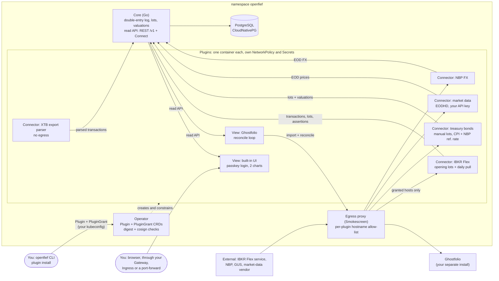
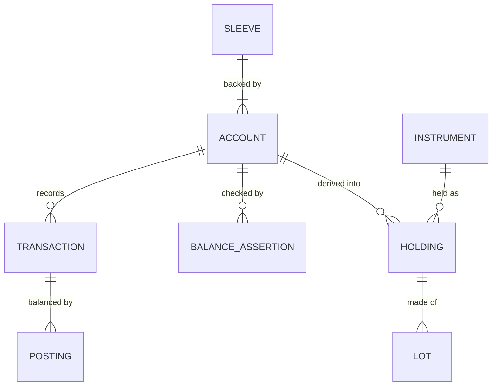

# OpenFief design

The current design: what is decided, as of now. Git holds the history.

- Proposals for later milestones, one file per area: [proposals/](proposals/)
- External research the design draws on: [research.md](research.md)
- Domain terms and abbreviations: [glossary.md](glossary.md)
- Requirements: kibi (`.kb/`), which cites the GR and D IDs below. People read them through its generated report.

Authority, highest first: ground rules (GR), then decisions (D), then kibi requirements. Tensions (T) and open questions (OQ) are unresolved. IDs are stable and never reused.

## 1. Ground rules

Written by the author and never edited. A conflict with a ground rule is recorded as a tension; the rule is never reworded to fit.

- **[GR-1]** Fully open source and self-hosted. It can eventually also be hosted for a subscription.
- **[GR-2]** Target users are people like me: technical individual investors. It is a niche, and that is fine.
- **[GR-3]** It starts as a typical portfolio summarizer: plugins for XTB, Interactive Brokers, Polish retail treasury bonds (obligacje skarbowe), etc., giving typical API access to what you hold, plus a couple of charts.
- **[GR-4]** There is a model strategy (model portfolio) to follow and adjust, with an agentic model that summarizes and maintains it. The model is configurable; I would use only my locally hosted model for this.
- **[GR-5]** For a thesis (for example a single company) you can spawn agents. Mainly long-term, but short-term is allowed. Agents do fundamental analysis, watch news, etc.
- **[GR-6]** Each thesis agent has a budget leased from the offensive part of the portfolio, with strong guarantees that the agent can never get more of the portfolio than its lease.
- **[GR-7]** Agents wake up on a schedule plus on events, and have tools to make transactions.
- **[GR-8]** Frontier models for thesis agents can be cloud-hosted.
- **[GR-9]** An orchestration layer runs the thesis agents. That orchestration layer is exactly what this project is; agents are separate products.
- **[GR-10]** Agents are plugins, so any agent can be used. The default is an agent I build or pfranczyk's per-thesis agents (github.com/Looted). Someone who trusts Interactive Brokers' agents and does not host models locally can choose those instead.
- **[GR-11]** All models are configurable per role, so the user chooses which model sees what.
- **[GR-12]** The privacy and security model comes first, designed per use case.
- **[GR-13]** Regulatory logic is pluggable too: jurisdiction plugins, Poland first.
- **[GR-14]** The project name is OpenFief.

## 2. Scope

- **[D-1]** The first iteration is M0 only: tracker and Polish imports, with no AI models and no agents.
- **[D-31]** M0 has no time-box. Its scope is everything decided in this document.
- **[D-200]** M0 is done when every criterion below holds. Each is an end-to-end scenario on the firm requirement it checks, and the whole set passes on both kind and k3d. The first is the exception: the owner checks it on a private install with real accounts, since no real data enters tests or CI (GR-12).
  1. **Consolidation.** The author's real IBKR, XTB (stocks and ETFs) and treasury bond holdings appear in one view. Every broker-reported position and cash balance is stored as a balance assertion and matches the derived value to 0.01 of the account currency. Open XTB CFDs appear only as flagged, unsupported items.
  2. **Double-entry.** Every transaction's postings sum to zero per currency, and a check over the whole log passes.
  3. **Idempotent, versioned imports.** Re-importing the same file adds nothing. A changed row creates a new version, and the old one remains, marked superseded.
  4. **Opening lots.** IBKR and XTB accounts are seeded from current lot-level positions, each lot with open date and cost, and PLN cost at the NBP table A rate from the day before the open date.
  5. **Bonds.** For every held series, the gross accrued value matches an open-source reference valuer on the same date to within 0.01 PLN, and net-if-redeemed matches a hand calculation for at least one series of each type held. Totals use the configured basis, net by default.
  6. **Prices and FX.** Every PLN figure uses NBP table A. End-of-day prices come from the market-data plugin; where IBKR Flex reports a price for the same instrument and date, a difference beyond a configured tolerance is flagged.
  7. **Read API.** `/v1` serves accounts, transactions, tax lots, holdings and valuations as its OpenAPI spec describes, rejects unauthenticated calls, and has no write endpoint. The Connect clients generated from the same definitions return the same data.
  8. **Built-in UI.** Passkey login works on `localhost`, and a passkey created for a second hostname through a one-time link works there. The allocation and value-over-time charts are drawn using only the read API.
  9. **Ghostfolio.** After a sync, Ghostfolio's OpenFief-owned accounts hold exactly the projected activities. A second sync changes nothing. A manually edited activity in an owned account is reverted, and accounts OpenFief did not create are untouched.
  10. **Plugin isolation.** Each plugin runs in its own pod. The XTB parser has no egress at all. A test plugin's request through the proxy for a host outside its grant is refused, and attempts to bypass the proxy (a direct connection, a DNS lookup) fail.
  11. **Operator.** A `Plugin` without a matching `PluginGrant` is not deployed. An upgrade requesting a new egress host stays on the old version until granted. An image referenced by tag, or without a valid cosign signature from a trusted signer, is rejected, including when applied with plain `kubectl`. The `Plugin`'s status shows verified only for an image the catalog pins.
  12. **Operator scope.** The operator's ServiceAccount cannot create or change anything outside the `openfief` namespace.
  13. **Exposure.** The default installation creates no route, no LoadBalancer or NodePort Service and no tunnel. With the HTTPRoute component, the core, and through it the UI, is reachable over HTTPS on the owner's hostname through their Gateway.
  14. **Secrets.** Credentials exist only as Kubernetes Secrets, mounted only into plugins granted them.
  15. **Portability.** The whole acceptance suite passes on both kind and k3d.
  16. **Egress.** Outbound traffic goes only to configured destinations (IBKR's Flex service, NBP, GUS, the market-data vendor, the user's Ghostfolio), verified from the egress proxy's logs.
  17. **Core-to-plugin.** A call to a connector from any pod other than the core fails, and a call from the core without a valid token for that instance is refused.
  18. **Uninstall.** Uninstalling a connector instance removes its pod, grant, secrets and allow-list; its imported transactions remain, marked as coming from a removed instance.
  19. **Model portfolio.** While off, the UI and the read API show nothing of it. When on, the backtest of a two-target basket over a synthetic price series matches a hand calculation across one yearly rebalance, and each max drawdown matches the series' known peak and trough dates.
- **[D-201]** M0 reports in PLN only. A reporting currency the pack can't convert to directly stays refused (D-180), and T-12 with its proposal P-49 moves past M0.
- **[D-202]** Once M0's exit work is running, the next slice is read-only models: a model behind the Ask box (D-203) and the model-portfolio maintainer (D-204), reached through model-provider plugins and a model router, with no trading tools and no leases. M1's control plane is designed alongside it.
- **[D-161]** Nothing stored before the first release is migrated: a change before it may need data entered again, and the demo is reseeded. From the first release on, every change to stored data ships with a migration of what is already stored.
- **[D-5]** The core is licensed AGPL-3.0, the plugin contracts and SDK Apache-2.0, and contributions carry a DCO sign-off.
- **[D-171]** The name stays OpenFief (GR-14). TMview lists no mark named OpenFief. Marks named Fief are registered for financial and software services in Switzerland, for software in France and for software services in the Benelux, so registering OpenFief as a mark, or offering a paid hosted service in those countries (GR-1), needs a trademark lawyer's view first.

| Milestone | Scope | State |
|---|---|---|
| M0 | Tracker and Polish imports, optional model portfolio | Decided: this document |
| Models | Read-only models: the Ask box and the model-portfolio maintainer (D-202) | Deciding: [proposals/agents-and-models.md](proposals/agents-and-models.md) |
| M1 | Control plane on paper trading | Proposed: [proposals/control-plane.md](proposals/control-plane.md) |
| M2 | Agents | Proposed: [proposals/agents-and-models.md](proposals/agents-and-models.md) |
| M3 | First small live fief | Proposed: [proposals/control-plane.md](proposals/control-plane.md) |

## 3. M0 architecture

Arrows show data flow, not which side starts a call.

### 3.1 System of record and views

Existing trackers can't hold what OpenFief has to get exactly right: FIFO tax lots priced in PLN, statutory bond values, and sleeve attribution that the later lease ledger reconciles against. So OpenFief owns the record, and trackers only display it.

- **[D-2]** OpenFief's own core is the system of record for transactions, tax lots and valuations. Trackers are plugins that show a one-way *view* of it.
- **[D-3]** M0 ships two view plugins: a very simple built-in UI as the default, and Ghostfolio auto-push.
- **[D-4]** The Ghostfolio plugin runs a reconcile loop. It owns only the Ghostfolio accounts it created, puts OpenFief's transaction ID in each activity's comment, deletes stale activities and imports missing ones. Manual edits inside its accounts are reverted on the next sync.
- **[D-64]** How the Ghostfolio plugin syncs, given how Ghostfolio behaves:
  - It creates its Ghostfolio accounts with UUIDs derived from the plugin instance and the OpenFief account (UUIDv5), so it knows which accounts it owns without storing anything: a plugin has no volume and no Kubernetes API access.
  - Each sync imports missing activities first, then deletes stale ones, because Ghostfolio deletes an asset and its price history along with its last activity. The one exception is a stale activity that Ghostfolio's duplicate check would match against an import: it is deleted first, or the sync would never settle. A bulk delete always carries an account filter; an unfiltered one deletes every activity the user has.
  - A bond is a `MANUAL` asset whose symbol is a UUID derived from the plugin instance and its series code, so two installs that share one Ghostfolio never collide. Its name is the code plus a suffix no earlier version used, because Ghostfolio's import reuses an existing `MANUAL` asset of the same name; so an import never lands on an asset left by an earlier version, and those are removed after the import like any stale one. Every sync sends its full price history.
  - Edits are found by comparing fields, since a manually edited activity keeps its comment.
  - Imports aren't atomic, so every step is safe to repeat, and each import is first checked with `dryRun=true`.
  - It refuses to sync while Ghostfolio's "restricted view" setting is on: that setting blanks comments, so every activity would look stale.
  - Ghostfolio renames these internal endpoints within `/v1`, so the plugin supports a pinned range of Ghostfolio versions, checked by contract tests on recorded fixtures.
  - It runs its own sync timer, since the core schedules only connectors (D-49).
- **[D-108]** The Ghostfolio plugin books a dividend as quantity 1 at the gross amount, with the withheld tax as its fee, and a standalone fee against a manual "OpenFief fees" asset per currency. Each of its Ghostfolio accounts' cash balance follows OpenFief's cash, so Ghostfolio's totals include it. Listed instruments need the owner's mapping from ISIN to Ghostfolio's data source and symbol.
- **[D-133]** Each currency of an account's cash other than its Ghostfolio account's gets an owned Ghostfolio account of its own, holding only that balance, with a UUID derived from the instance, the account and the currency, so Ghostfolio's totals include all of the account's cash.
- **[D-134]** The UUID symbols D-64 and D-108 derive for bond and fee assets also take the Ghostfolio user's ID, so two installs whose instances share a name never collide in one Ghostfolio.
- **[D-177]** Cash income (D-152) reaches Ghostfolio as an `INTEREST` activity on a manual asset per currency, so Ghostfolio counts it as return, as OpenFief does.
- **[D-188]** The Ghostfolio plugin checks that the Ghostfolio it talks to is a version it supports before it changes or deletes anything there, and never follows a redirect.
- **[D-6]** OpenFief's public API is read-only REST/JSON with an OpenAPI spec, versioned `/v1`, covering accounts, transactions, tax lots, holdings and valuations. Every view plugin, the built-in UI included, uses it. MCP access waits for M2, so that model access to holdings goes through the model router.
- **[D-50]** The read API (D-6) is defined in protobuf with HTTP annotations, like the plugin contracts (D-11). The core serves it both as Connect, for generated Go and TypeScript clients, and as REST under `/v1` through transcoding (Buf's Vanguard). The OpenAPI spec is generated from the same definitions.
- **[D-30]** The built-in UI draws three charts in M0: allocation (by asset class, currency, broker or sleeve), value over time, and performance (D-106). The time charts start on the charts' start date (D-138).
- **[D-138]** Every time chart, the portfolio's and each account's, starts on a date the owner can choose, and the performance index is 100 on it. The portfolio's default is the latest day before which some account's history is unknown because it was seeded from a starting balance (D-23); accounts with their whole history, or opened later, don't move it, and the chart marks where tracking began. An account's default is its own first day.
- **[D-167]** The charts' start the owner chooses (D-138) is a setting, stored for the portfolio and for each account, like the number format (D-113); going back to the default clears it.
- **[D-168]** The owner can mark an account as opened on its seeding day, so its seeding doesn't move the portfolio's default start (D-138). An account seeded from a starting balance and not so marked moves it, since its earlier history is unknown.
- **[D-130]** Every check that needs the owner raises an attention item in one append-only store: its kind, subject, state (open, acknowledged or resolved) and history. Flagged balance assertions and price checks, import problems, unmapped broker accounts, unconfirmed tickers, missing settings such as the PIT rate, broken transfer links and later checks all use it, and the UI lists them in one place. Each change is also published as an event from the core's outbox, so notifications and, in later milestones, agents can act on them.
- **[D-192]** The built-in UI has four places: Overview, Accounts, Inbox and Settings. No check has a page of its own: what needs the owner gathers in the Inbox, and each check's results live on the account or instrument it is about.
- **[D-193]** The overview opens with one sentence of status (the date everything is valued through, what needs the owner, any failing sync) and the Ask box, then the value with its three figures, one chart card that switches between value, performance and allocation, the top of the Inbox with its actions, the accounts grouped by sleeve, and recent activity: imports, syncs, coupons and corrections.
- **[D-194]** In M0 the Ask box understands a fixed set of commands and answers them from the read API alone: what needs the owner, show an account, sleeve or instrument, why a sync fails, the allocation by a dimension, performance over a period and the value on a date. Each answer is a card with a link to the place it summarizes, and anything else gets the commands it understands as suggestions. It never changes anything, the question never leaves the UI and is never logged (GR-12), and the box says it holds no AI model; in M2 an agent can take it over through the same answer cards (P-57).
- **[D-203]** With a model configured, the Ask box still answers its fixed commands itself, at once; anything else goes to the model, which may only call the same read-only answerers as tools and must show the answer cards it used. It never changes anything, and the question and answer are never logged (GR-12).
- **[D-195]** Every figure links down to what it is made of: the total to its accounts, an account to its holdings, a holding to its instrument, an allocation bar to the holdings behind it. An instrument has its own page: its price history and source, its holdings and lots across accounts, its transactions, its price checks, its ticker and ISIN, and its OKI class.
- **[D-196]** The Inbox lists open attention items (D-130) grouped by what the owner does about them: data coming in (tickers to confirm, unmapped broker accounts, failing syncs, import problems), numbers to check (balance mismatches, price differences) and decisions (transfers to confirm, missing settings). An item that one field or button settles, such as confirming an ISIN, acknowledging a price check, confirming a transfer or retrying a sync, is settled in place; any other links to its account or instrument. Acknowledged and done items sit behind their own views, the count shows in the navigation and on the overview, and an account's page shows its own items at the top. A connector sync that keeps failing raises an item that shows what happened.
- **[D-197]** An instrument has a display name: the first one a connector delivers for it, such as XTB's display name, IBKR's description or the market-data lookup's, which the owner can change. Pages show it before the ticker and ISIN.
- **[D-198]** A connector's sync keeps failing (D-196) after three failed attempts in a row since its last success, spanning at least 15 minutes; one success clears it. Every attempt is kept, with its error class and never its text (GR-12).

### 3.2 Getting data in

XTB shut down its public API in 2025, and neither the treasury bond registry nor the bank that sells the bonds offers one, so both arrive as files or manual entry. Interactive Brokers' Flex Queries are expected to report positions per lot, with open date and cost (OQ-22 verifies this).

- **[D-7]** Reading of GR-3: connectors get data from each institution by whatever works (a broker API where one exists, files or other means otherwise; not necessarily REST), and OpenFief exposes its own read API (D-6). Data enters only through each connector's ingest path (upload, CLI, watched folder), never through the public API.
- **[D-8]** The core project ships only connectors that comply with the institution's terms. Third parties may build others; OpenFief does not ship or endorse them.
- **[D-9]** M0 data paths: XTB through uploaded xStation export files; treasury bonds through manual lot entry (series, quantity, purchase date) with valuation computed; an import of the bond service's own export is added if one exists (OQ-22).
- **[D-116]** XTB's export names instruments by ticker and market suffix and carries no ISIN (D-35). For each new ticker the market-data connector looks up the ISIN by ticker and market and proposes it, and the owner confirms it once in the UI, or enters it when the lookup finds none. Rows of a ticker not confirmed yet wait as import problems.
- **[D-153]** A ticker's confirmed ISIN (D-116) holds for every account at the same institution. The owner can correct a wrong one, which supersedes the transactions it booked (D-18).
- **[D-166]** D-116's ISIN lookup goes only to the connectors D-123 allows, since a lookup also tells the connector what the owner holds.
- **[D-136]** An XTB account starts from an export covering its whole history, or from the open positions of a current export, which seed one opening lot per position at its open time and price, with the cash balance the owner enters once.
- **[D-159]** An XTB position's open price is in its instrument's trading currency, which the export doesn't name. It is the currency of the confirmed ticker's listing (D-116), or, when the listing gives none, the currency of the exchange its market suffix names, and the opening lot's cost is booked in it. A price quoted in a minor unit, such as London's pence, is converted to the major unit.
- **[D-170]** When the listing gives no currency and the exchange its market suffix names quotes in more than one, as London does in pence, pounds and dollars, the owner picks the trading currency when confirming the ticker's ISIN (D-116), and its positions wait until then; no currency is assumed.
- **[D-160]** An opening upload starts its account at once: the account's go-live is recorded with the upload, even when nothing can be booked yet. Positions waiting for their ticker's ISIN (D-116) join the opening when the owner confirms it, and later uploads are imported as transactions.
- **[D-155]** An XTB export's `Open Positions` sheet also asserts the account's holdings (D-18): for each ticker with a confirmed ISIN (D-116), the summed volume of its open positions on the report's date. A ticker not confirmed yet is asserted once the owner confirms it.
- **[D-178]** For each confirmed ticker the account holds that an export's `Open Positions` sheet doesn't list, the export asserts a holding of zero, since the sheet lists every open position.
- **[D-97]** The treasury bond connector reads each series' first-period rate and margin from the Ministry of Finance's published retail bond data (its spreadsheet on gov.pl, or the same dataset on dane.gov.pl), which the ministry lets anyone re-use when it is named as the source. Early-redemption fees come from a reviewed table per bond type with the dates each fee applies from, taken from the issue letters. The owner can override any series' terms, and the latest entry wins. The connector never reads obligacjeskarbowe.pl, whose pages carry no grant of use (D-8).
- **[D-22]** Prices come from a market-data connector plugin where the user brings the API key (D-51); IBKR Flex prices serve as a cross-check.
- **[D-110]** A cross-check price is flagged when it differs from the stored price by more than 1% of it, in either direction. The owner can set a different threshold for a single instrument, such as a thinly traded Warsaw listing.
- **[D-111]** A cross-check price is compared with the latest stored price of the same instrument on or before its date. When the two are in different currencies, the pair is shown with its own status instead of being skipped, because the market-data connector may be pricing another listing than the one held.
- **[D-112]** Only a connector whose manifest declares it may send cross-check prices. The owner can acknowledge a flagged check, which is recorded append-only, and the UI shows the latest check per instrument with its history.
- **[D-141]** Cross-check prices from a connector whose manifest doesn't declare them are dropped and raise an attention item (D-130); the rest of its delivery is imported.
- **[D-142]** An acknowledgement covers one flagged price check: those two prices on their dates, so a changed or newer price is checked anew. An instrument's threshold is a fraction greater than 0 and less than 1, and clearing it restores 1%.
- **[D-51]** The first market-data connector uses EODHD. EODHD covers the Warsaw Stock Exchange, LSE, Xetra and Euronext, finds instruments by ISIN, includes end-of-day index history, and its terms allow storing the data for private use. Its closes are aggregated rather than each exchange's official close, which is one more reason for D-22's cross-check.
- **[D-96]** The EODHD connector identifies a market index by the name the owner gives it, such as WIG20. Its Euronext covers EODHD's Paris, Amsterdam, Brussels, Lisbon, Dublin, Milan and Oslo markets. An ISIN listed on several supported exchanges stays unpriced and is reported as ambiguous until the owner picks the exchange, and an instrument it can't price is reported again on every sync.
- **[D-93]** Each sync request to a market-data connector carries the instruments the owner holds and the model portfolio's targets, so a newly bought instrument is priced without configuration. An optional list in the instance's config adds instruments to watch.
- **[D-123]** Only a connector whose manifest declares it a market-data connector, and whose grant approves that, receives D-93's list of held instruments and model targets, so the install shows the owner that the plugin will learn what they hold.
- **[D-179]** Only a connector whose signed manifest declares bond series terms, or market index levels, and whose grant approves that may deliver them; anything else it delivers of that kind is dropped with an attention item (D-130), as D-141 does for cross-check prices. Bond terms need a Polish (`PL`) ISIN, and every stored term and index level records the instance that delivered it.
- **[D-186]** D-179 also covers the index readings bond terms depend on, such as CPI and the NBP reference rate: only a connector whose manifest declares them and whose grant approves that may deliver them, and each stored reading records the instance that delivered it.
- **[D-94]** Each instrument, currency pair and index has exactly one source of its values: a connector instance, chosen from the owner's ranking of sources for that kind of data when it first needs a value, which the owner can change for that one instrument. A day without a value takes the latest earlier one, and a gap longer than a threshold the owner can set raises an attention item (D-130); a value never comes from another source on the days the chosen one lacks. Every other source's values are stored as cross-checks (D-22). By default the first-party connector of each kind ranks first: NBP for exchange rates, EODHD for prices, and the treasury bond connector for CPI and the NBP reference rate.
- **[D-124]** A source in D-94 is one connector instance. Cross-check prices, such as IBKR's mark prices, are never a source: they only check (D-22). Market index levels have no ranking; each index and date keeps the value delivered last.
- **[D-23]** Accounts are seeded from each broker's current lot-level positions (opening lots), with transactions from go-live. Full history backfill arrives with the tax pack.
- **[D-98]** A hand-entered treasury bond lot is booked on its real purchase date, as a deposit of its cost and a buy, so the account's history starts at its first purchase and every day since is valued from the series' terms and the published readings. Each lot is idempotent per series and purchase date, so lots can be entered one at a time and in any order.
- **[D-100]** Manual bond lots are cash purchases at 100 PLN or exchanges of maturing bonds at the exchange price the series' issue letter sets: 99.90 PLN, whose 0.10 PLN discount is taxed with the interest on redemption, or 100.00 PLN for OTS. The owner can delete a lot as a correction, which supersedes it (D-18) and erases nothing.
- **[D-154]** Deleting a bond lot as a correction also deletes the coupons booked for it, and with them their cash, since those coupons were never paid.
- **[D-118]** The core hands each bond lot to the connector together with the account the owner entered it on, so one treasury-bonds instance serves every bond account and its config names none.
- **[D-95]** When an account has already been seeded from opening lots, the core syncs it in transactions mode on its own; no manual step switches it.
- **[D-24]** XTB in M0 covers real stocks and ETFs only. Closed CFD results are imported as cash profit or loss so cash reconciles; open CFD positions are flagged as unsupported.
- **[D-72]** The owner creates accounts in the built-in UI, in an owner session (D-66): institution, name, sleeve, and the connector instance that feeds the account. A broker connector reports the broker accounts it saw on its last sync, and the UI offers them to pick from, so the owner never types a broker account number. Transactions for a broker account that isn't mapped to an OpenFief account are not booked, and the UI shows the broker account as unmapped.
- **[D-120]** The owner can delete a sleeve with no accounts, a sleeve kind no sleeve uses and an account with no transactions, and remap a broker account whose OpenFief account has no transactions from it. Nothing the ledger holds is ever deleted (D-18).
- **[D-156]** A broker account counts as having no transactions in its OpenFief account (D-120) while that account holds no version of a transaction from the connector instance that reports it; balance assertions don't count. The ledger doesn't record which broker account a transaction came from, so when one instance feeds several broker accounts into the same account the check refuses some remaps it could allow, and never allows an unsafe one.
- **[D-121]** Broker account numbers are listed only through the owner's account service, for setting up accounts. The read API never serves them, so read sessions, script tokens and plugins never see one.
- **[D-157]** The read API's `ListBrokerAccounts` method and its messages are removed from the contract, not kept as deprecated. The breaking-change check lets this one removal through as an exception the author approved, and stays on for every other change.

### 3.3 Ledger and valuation

Double-entry keeps cash, withholding tax and currency conversion consistent by construction, and it gives a later lease a natural home as a sub-account.

- **[D-18]** The source of truth is an append-only, versioned transaction log. Holdings and tax lots are derived from it. Re-imports are idempotent, keyed by source plus the institution's own ID; a changed row creates a new version and supersedes the old one, which is never deleted. Broker position snapshots are stored as balance assertions; a mismatch is a flagged error.
- **[D-19]** Double-entry postings across cash, position, fee, withholding-tax and FX accounts.
- **[D-101]** The ledger has an interest transaction kind. Bond coupons, such as COI's yearly interest, are booked as interest, not as dividends.
- **[D-152]** The ledger has a cash income kind for income that no holding produces, such as a broker's interest on uninvested cash or a closed CFD's result, booked with any tax withheld. Performance counts it as return, not as money paid in.
- **[D-158]** The owner can enter the cash balance an institution shows for an account on a date, such as the bond registry's or a bank's. It is stored as a balance assertion (D-18), and a mismatch with the derived cash raises an attention item (D-130). From it the owner can book the difference as an ordinary manual transaction: a deposit or withdrawal by default, so an unexplained difference never shows as return, or cash income (D-152) when it is income or a fee. Nothing overwrites the derived balance.
- **[D-117]** Each sync request to a connector carries the holdings and open lots of the accounts bound to that instance, as D-93's request carries the instruments to price. The treasury-bonds connector uses them to deliver the coupons that fell due (D-143) as interest (D-101), computed with the Polish pack's bond rules, so the core holds no bond logic.
- **[D-143]** Besides the holdings and open lots, a sync request carries each bound account's tax wrapper and the stored terms of the bond series among its lots. The treasury-bonds connector books every coupon due since each lot's purchase on every sync, keyed per lot and coupon date, so a sync stays idempotent and a lot entered late gets its earlier coupons.
- **[D-135]** Each hand-entered bond account has a payout setting matching the option the bond registry offers: coupons and maturities stay as the account's cash, or are paid out. When they are paid out, each is booked as interest or a redemption and then a withdrawal of the same amount, so the account's cash matches the registry and the payout still counts as return. The treasury-bonds connector books maturities as it books coupons.
- **[D-162]** An account's first payout setting covers its whole history. A change takes effect from a date the owner gives, today by default and possibly earlier, and the next sync books the coupons and maturities after that date anew, superseding the earlier ones (D-18, D-143).
- **[D-20]** Every amount keeps its original currency. In M0, NBP table A rates convert amounts to PLN, behind a swappable rate-provider interface with NBP as the default FX plugin. The Polish jurisdiction pack always uses NBP rates for tax, whatever the UI uses.
- **[D-62]** Totals, charts and the model comparison are shown in the reporting currency: a setting whose default comes from the jurisdiction pack, PLN for the Polish pack. Apart from the Polish pack's tax rules, no code assumes PLN.
- **[D-180]** Stored valuations name their currency and stored exchange rates their base currency, both taken from the jurisdiction pack; neither is assumed to be PLN. A reporting currency the pack can't convert to stays refused until T-12 is resolved.
- **[D-113]** The built-in UI writes amounts in a number format: a setting next to the reporting currency, whose default comes from the jurisdiction pack. The Polish pack's default groups thousands with a space and uses a decimal comma, as in `5 000,00 PLN`. The format changes only the separators, never the digits or the currency, and the charts' axes and tooltips use it too.
- **[D-70]** Reading of GR-13 for M0: a jurisdiction pack is a set of pure functions inside the core, behind one interface, so another jurisdiction is another implementation of it. It is not a plugin container and not a WebAssembly (WASM) module.
- **[D-21]** Prices are end of day in M0.
- **[D-33]** Besides D-19's accounts, each account has an equity ledger account per currency: the counterpart for deposits, withdrawals and opening lots.
- **[D-71]** Every sleeve has a sleeve kind, which gives it a default role: defensive (never available to agents) or offensive (fiefs are leased from it, GR-6). The built-in kinds are agent pool and satellite, which are offensive, and bonds, core, emergency fund and retirement, which are defensive. The owner can add kinds and rename any kind, but a kind's default role never changes, and a sleeve whose role differs from its kind's needs the owner's explicit choice. An install starts with three sleeves: bonds, core and satellite.
- **[D-34]** Selling part of a lot rounds the consumed cost to two decimal places, half-even, and the lot keeps the exact remainder, so consumed plus remaining cost always equals the original cost. In M0 fees go to the fee ledger account and are not added to lot cost.
- **[D-35]** An instrument needs an ISIN with a valid check digit plus a venue symbol. Within one date, acquisitions apply before disposals, because broker rows carry no reliable time of day.
- **[D-99]** Owners never see the registry's own ISIN for a treasury bond, so OpenFief derives one from the series code: `PL`, the series code, `00` and a check digit, such as `PLEDO0536000` for EDO0536. An import of the issuer's own export uses the same derivation, so one series is never held twice.
- **[D-36]** Valuations are stored rows derived from the transaction log, prices, FX rates and index readings, and can be rebuilt from them at any time. Any change to those inputs enqueues a revaluation in the same database transaction, through a PostgreSQL-backed job queue (River). Pending revaluations coalesce per account from the earliest affected date. The read API reports, per account, the date it is valued through and whether a revaluation is pending or running, and the UI shows it. Configurable: worker concurrency and the end-of-day schedule. Each stored valuation holds all three values of D-77. What triggers a revaluation is not configurable.
- **[D-37]** Where a treasury bond's issue letter and the issuer's published daily interest tables or worked examples disagree, OpenFief follows the tables and examples: the TOS yearly base is not rounded, and Belka tax is rounded half up to the grosz.
- **[D-102]** The treasury bond connector applies the reference-rate rule itself: the NBP reference rate in force on the tenth business day before a month is that month's reading, dated on the month's first day.
- **[D-103]** The Polish business-day calendar counts Saturdays, Sundays and the statutory public holidays year by year, including 6 January from 2011 and 24 December from 2025, with the Easter-based days computed. Epidemic days off are not modelled, and dates before 1991 are refused.
- **[D-104]** CPI readings use only GUS's final monthly values; preliminary, estimated and flash values are skipped. The first sync starts in January thirteen years back and fetches at most four years per sync, within GUS's anonymous limits. GUS indicator 1832 is used up to 2025 and 2728 from 2026.
- **[D-76]** Every account has a tax wrapper from the jurisdiction pack, which the owner sets when creating the account (D-72). The Polish pack's wrappers are a standard taxable account, IKE, IKZE and OKI (osobiste konto inwestycyjne). Inside OKI no Belka tax is due. Its yearly tax on the part of the average balance above the statutory limit, summed across all of the owner's OKI accounts, is computed from stored daily valuations only once the act is in force, with the limit and rate taken from the act.
- **[D-127]** OKI's yearly tax follows the act in force from 2027-01-01. Its base is the sum over the owner's OKI accounts of each account's average value: the sum of its end-of-day values over the tax year, plus each day's payments in up to that day's withdrawals, divided by the days of the year the account was held. Values count listed securities at market price, treasury savings bonds at nominal plus accrued indexation or capitalization, and cash, with foreign amounts at the NBP average rate of the last business day before. Up to 25,000 PLN of the average of savings assets (PLN cash, treasury savings bonds, PLN Treasury bills, the lowest-risk funds) and up to 100,000 PLN of investment assets (shares of companies with capital in PLN, PLN bonds, qualifying funds, PLN cash on a brokerage account) are exempt, at most 100,000 PLN together, savings first; other assets get no exemption. The rate is 0.85% for 2027, then 19% of the NBP reference rate in force on 31 October of the year before, at least 0.1%, rounded down to two decimal places; the exemptions rise with CPI from 2030. Income inside OKI is outside PIT, so no Belka tax is due.
- **[D-132]** When the pack can't tell whether an instrument is a savings asset, an investment asset or neither for D-127's exemptions, such as a fund whose policy it can't read, the instrument counts as neither, so the estimate errs high, and an attention item (D-130) asks the owner to classify it once; the owner's choice stays with the instrument.
- **[D-144]** OKI's tax base and tax are rounded to whole złoty, as the tax ordinance rounds bases and taxes; each account's average value is kept exact.
- **[D-145]** OKI's rate from 2028 and its exempt amounts from 2030 come from the finance minister's announcements, added to the act's data with each release; OpenFief never computes them, and the amounts never fall.
- **[D-146]** An OKI account counts as held from its first transaction, and the current year's tax is an estimate over the days so far.
- **[D-147]** The owner sets an OKI account's form when creating it: a bank account, a treasury bond account, a brokerage account or a fund register. The form decides whether its PLN cash is a savings or an investment asset.
- **[D-174]** Until an OKI account's form is set, its PLN cash counts as an investment asset, so the estimate errs high, and an attention item (D-130) asks for the form. The owner can change the form later, and every year's OKI tax follows it.
- **[D-148]** An unclassified instrument's attention item (D-132) is a check the attention store runs, so it resolves itself once the owner classifies the instrument.
- **[D-175]** D-148's check covers the instruments the OKI accounts held in the tax year, through the date they are valued through.
- **[D-77]** Every holding, account and total has three values, computed by the jurisdiction pack for each kind of product and tax wrapper:
  - **Gross:** before any tax or fee; market value, or the accrued value of a bond or deposit.
  - **Net:** what the owner keeps at the planned exit (maturity, or a withdrawal from a wrapper once its conditions are met), after the taxes due then and without early-exit fees.
  - **Liquidation:** the cash in hand if everything were sold or redeemed and withdrawn today, after every tax and fee due today: early-redemption fees, early-withdrawal taxes and sale commissions.
  Tables show all three side by side. The allocation and value-over-time charts each have a switch between them that starts on gross, the value broker statements show, and the value-over-time chart (D-30) can draw all three lines. The performance chart is computed on gross value (D-106).
- **[D-128]** A holding's net and liquidation values carry its own tax as if it alone were sold. Account and portfolio totals count the tax as PIT-38 does: the tax year's realized and unrealized gains and losses of every taxable account offset each other, and the base and the tax are rounded to whole złoty; a losses-offset line reconciles the rows with the total. Losses carried from earlier years are not counted. IKE and IKZE follow their own rules: an IKE's early return is taxed on what is withdrawn above what was paid in.
- **[D-149]** For an IKE whose earlier history is unknown (D-23), the owner enters its total payments in, which its early return is taxed above.
- **[D-176]** Until an IKE's earlier payments are entered (D-149), its early return's tax is shown as missing, never estimated, and an attention item asks for them.
- **[D-150]** The tax cost of a sale includes its buy fees, as PIT-38 deducts them, in each row's tax and in the totals alike. Dividends stay out of the netting, because Polish tax counts them as a separate source of income that capital losses don't offset.
- **[D-78]** Liquidation value estimates a sale's commission with a fee rule the owner sets per account: a percentage with a minimum, plus a currency-conversion percentage for instruments in a foreign currency. The rule is zero until set. Withdrawing from IKZE before 65 is taxed as income at the owner's marginal PIT rate, a setting the owner enters once. Until it is set, an IKZE's liquidation value is shown as missing rather than guessed.
- **[D-129]** D-78's minimum is an amount in any currency, converted at the valuation day's rate; the commission applies to holdings priced at market, not to bonds or cash; foreign means priced in another currency than the pack's; and the minimum applies to the commission before the currency-conversion percentage is added.

The terms are defined in [glossary.md](glossary.md).

### 3.4 Model portfolio

GR-4's model portfolio starts in M0 as something the owner enters by hand. From M2, its maintainer agent adjusts the same basket.

- **[D-52]** The model portfolio is optional and off by default; while it is off, it appears nowhere in the UI or the read API. It is a weighted basket for the whole portfolio: each target is an instrument (such as an index ETF or a stock) or an index, with a weight, and the weights sum to 100%. The owner enters it in the built-in UI, which hands it to the core like manual bond lots (D-49). When it is on, the read API serves it with its backtest and drawdowns.
- **[D-204]** The model-portfolio maintainer has no trading tools. OpenFief computes the weights and drift; the model writes a note about them weekly and whenever the owner asks, and may propose target changes, which land in the Inbox under decisions with the figures behind them for the owner to apply or dismiss.
- **[D-53]** The model's performance is a backtest: its value is computed from end-of-day prices as far back as every target has data, rebalanced to the target weights once a year. The performance chart (D-106) shows it as a second line from the charts' start (D-138), with both lines starting at 100. The portfolio's line is measured as D-61 says.
- **[D-54]** M0 shows the historical max drawdown of the model and of each target: the worst fall from a peak to a later trough over its whole history, with both dates. M0 has no stress tests and no statistical risk estimates.
- **[D-61]** Next to the model, the portfolio's line is its time-weighted return: daily returns from valuations, chained across deposits and withdrawals, so cash flows don't count as performance. Transfers between the owner's own accounts are not cash flows. Both lines are in the reporting currency (D-62). The model's backtest also needs exchange rates into that currency, so it starts no earlier than they do; NBP's rates begin on 2002-01-02.
- **[D-105]** Transfers between the owner's own accounts are identified by suggestion and confirmation. A withdrawal is suggested as a transfer to a deposit into another of the owner's accounts of the same amount and currency at most five calendar days apart, the nearest unmatched deposit first. The owner confirms or rejects each suggestion in the UI, and a confirmed link is stored in the ledger, append-only. Only confirmed transfers are left out of the time-weighted return's cash flows.
- **[D-131]** A confirmed transfer whose legs no longer match after a correction (D-18) stops counting and raises an attention item (D-130), so the owner confirms the corrected pair or rejects it; performance never changes silently.
- **[D-106]** Value and performance are separate charts. The value-over-time chart shows money, cash included, with D-77's switch between gross, net and liquidation. The performance chart shows the time-weighted return (D-61) as an index from 100 on the charts' start (D-138), computed on gross value, next to the model portfolio (D-53). Valuation totals include cash.
- **[D-107]** Conventions as built: in the time-weighted return, cash flows count at the end of their day, each daily factor and the running product are rounded half-even to 12 decimal places, and opening lots count as inflows at their market value on their date. The model portfolio rebalances at the end of each 31 December. A target's drawdown is measured in the reporting currency over the span where it has both closes and exchange rates. Weights go in steps of 0.01%, with at most 50 targets, and while the model is off the read API answers 404 for it.

### 3.5 Runtime and plugins

Each plugin runs out of the core's process, with its own network policy, secrets and identity, so a broken or hostile plugin can reach only what it was granted. Standard NetworkPolicy matches IP addresses, not hostnames, so outbound traffic goes through a proxy that checks hostnames.

- **[D-10]** OpenFief is Kubernetes-oriented: it is built for, and deployed on, Kubernetes.
- **[D-11]** The core is written in Go. Each plugin runs in its own container and speaks protobuf contracts over Connect RPC. Each plugin ships a manifest that OpenFief compiles into NetworkPolicy, Secret mounts, RBAC and egress allow-list entries (D-32). SDKs come in TypeScript and Go.
- **[D-12]** Any conformant Kubernetes cluster; no reference platform. Tested on kind and k3d, with documented requirements: a CNI that enforces NetworkPolicy, and a storage class.
- **[D-13]** An operator manages plugins through a `Plugin` custom resource, from M0.
- **[D-55]** The operator manages plugin workloads only and never touches money. Fiefs, intents, approvals and the ledger live in PostgreSQL behind the core, never in custom resources or etcd: etcd is not a transactional ledger, and GR-6's guarantee must not depend on who has Kubernetes API access. The only custom resources are `Plugin` and `PluginGrant`.
- **[D-14]** PostgreSQL via CloudNativePG, and no NATS in M0.
- **[D-172]** Tracing is off until the owner sets an OpenTelemetry (OTLP) endpoint, and every exporter passes an allow-list of span attributes, so no amount, identifier or token leaves. Plugins send their spans to the core, which applies the same allow-list and exports them; no plugin reaches the collector itself. Metrics go out over OTLP through the same allow-list; logs stay on standard output.
- **[D-173]** A call through the egress proxy is traced with its host, status and duration only, never its path or query, which can name what the owner holds. A database span carries the operation's name, never the statement text or its arguments.
- **[D-15]** The operator is namespace-scoped: a Role in the `openfief` namespace only. The CRDs are installed once by a cluster admin. Namespace-per-agent is revisited at M2.
- **[D-16]** Plugin permissions are split into the `Plugin` resource (what the vendor requests) and a `PluginGrant` (what the user approved). The operator enforces only what is in both. An upgrade that requests more waits for approval.
- **[D-17]** Plugin images must be pinned by digest, and their signatures are verified with cosign.
- **[D-32]** Plugin egress goes through an egress proxy built on Stripe's Smokescreen, embedded as a Go library. The operator compiles each `PluginGrant`'s hostnames into that plugin's allow-list. Plugins identify themselves with their projected ServiceAccount token, through a custom role function. NetworkPolicy lets plugins reach only the core and the proxy, with no DNS, and the proxy refuses private and internal address ranges. Plugins reach external hosts through `HTTPS_PROXY`.
- **[D-182]** A plugin's Secrets are named so they can never collide with the platform's, and a connector books only for the institutions its signed manifest declares. Every plugin pod runs with resource requests and limits, and the plugins' namespace has a LimitRange, so no plugin can starve the core.
- **[D-189]** The core runs one sync worker and one revaluation worker unless the owner raises them together with the core's memory limit, and the operator sets each plugin container's `GOMEMLIMIT` from its memory limit, so a Go plugin collects garbage before the kernel kills it.
- **[D-190]** A delivery is bounded in bytes and in items, so a connector sends a history larger than one delivery as several, each imported on its own.
- **[D-185]** The institutions a connector books for are a permission its grant approves, as its hostnames are (D-16): the signed manifest declares them and the core accepts only what both name. The install warns when another instance already books for an institution, naming that instance. A grant that names no institutions approves none.
- **[D-63]** The egress proxy embeds Smokescreen through `BuildProxy` inside OpenFief's own HTTP server; `StartWithConfig` would exit the process on errors and take over signals. Smokescreen allows every destination when no allow-list is set, so the proxy never runs without one and refuses all destinations for a plugin that has none. Compiled allow-lists are swapped atomically. A plugin sends its projected token as the password in the proxy URL, which Go's and Node's HTTP clients send as a `Proxy-Authorization` header; the role function checks it with Kubernetes' TokenReview API (audience `openfief-egress`) and caches the result. Projected tokens rotate, so the SDK builds the proxy URL (D-32's `HTTPS_PROXY`) from the token file on each request, using the proxy's ClusterIP because plugins have no DNS. Smokescreen is pinned to a commit after v0.1.0 until a release carries its later hardening fixes.
- **[D-74]** An exception to D-32 for services inside the cluster: a plugin's signed manifest may request one in-cluster service that the owner picks at install, such as a Ghostfolio running in the same cluster. The CLI asks for its namespace, service and port and shows them, and the grant approves exactly that service. The operator then adds a NetworkPolicy egress rule from the plugin to that service's pods on that port and gives the plugin the service's ClusterIP address, so no DNS is needed. This traffic doesn't pass through the egress proxy, and it may be plain HTTP, which the install warns about. When the service's namespace has its own NetworkPolicies, the CLI prints the ingress rule to add there.
- **[D-122]** For D-74's in-cluster service, the owner's install creates, in that service's namespace, a Role and RoleBinding that let the operator read that one Service, and uninstall deletes them. The operator's permissions otherwise stay inside `openfief` (D-15).
- **[D-75]** Instead of a fixed host, a manifest may request "the host of config field X". The CLI reads that host from the instance's config (D-48) and shows it, the grant approves exactly that host, and the plugin reaches it through the egress proxy like any other host. It must be a single HTTPS host: no wildcard and no IP address.

### 3.6 Plugin distribution and installation

Few plugins are expected. Anyone can write and run their own; the ones the author has reviewed are listed as verified. Every image is signed, so the only question is whose signatures count.

- **[D-42]** A plugin's manifest is embedded in its image, as a label on the image config. One signature covers both the code and the permissions it asks for, and the manifest can be read from the registry without running the image.
- **[D-43]** One catalog, a file in this repository released with the product, lists the first-party and verified plugins. Any other plugin is installed directly by image reference and shown as unverified. There are no subscribable third-party catalogs.
- **[D-44]** A verified plugin is one whose version the author reviewed: its catalog entry pins the publisher's signed image digest and the publisher's signer identity. Each new version needs a new catalog entry.
- **[D-88]** The release workflow adds each first-party plugin to the catalog with the image digest it signed. The author starts every release by hand, and that release is the review D-44 requires, so first-party plugins show as verified.
- **[D-45]** The operator trusts three kinds of signer: OpenFief's CI, the publishers pinned in the catalog, and signers the owner adds. Owners sign their own plugins with their own CI identity or a local key, and those plugins show as unverified.
- **[D-181]** OpenFief's CI signer (D-45) is pinned to the source repository and ref of the signing run, `arkadiuss/openfief` at `refs/heads/main`, not only to the workflow named in the certificate, because a reusable workflow can be called from any repository. The install guide's `cosign` commands pin the same.
- **[D-187]** Every signer identity GitHub issues, a catalog publisher's or one the owner adds (D-45), is pinned to its source repository and ref as OpenFief's CI is (D-181).
- **[D-46]** Plugins are installed with the `openfief` CLI. It reads the catalog or the image, verifies the signature, shows the requested permissions, and on the owner's confirmation applies the `Plugin` and `PluginGrant` with the owner's own kubeconfig, or prints them for GitOps. The core has no right to create or change grants; in M0 the UI only shows installed plugins.
- **[D-73]** First-run setup happens in the built-in UI. After the owner creates the first passkey (D-60), a first-run wizard walks them through creating accounts (D-72), sleeves, and binding the connector instances already installed. Installing plugins stays in the CLI (D-46), whose last step points to the wizard.
- **[D-47]** Plugin upgrades are always manual, even when the permissions are unchanged.
- **[D-90]** The CLI refuses a catalog name that matches several versions and lists them instead of picking one, and refuses to install over an existing instance. `openfief plugin upgrade <instance> <version>` verifies the new image, shows how its requested permissions differ, and applies the upgrade only when the owner confirms.
- **[D-48]** Each install is a separately named instance with its own config, secrets, grant and egress allow-list. The same image can be installed more than once, such as one instance per IBKR account.
- **[D-89]** A manifest names each Secret by its role, such as `flex-token`, and the operator mounts the Secret named `<instance>--<role>`, so two instances of one image never share a Secret. Neither an instance name nor a role may contain `--`, so a Secret's name reads only one way.
- **[D-49]** The core calls connectors: a connector serves a Connect service for syncing and for importing files, and the core owns the schedules, retries and import batches. Views are clients of the read API. File uploads and manual bond-lot entries in the built-in UI go to the core, which hands them to the right connector.
- **[D-79]** What the owner enters by hand reaches the core through one service per kind of entry: bond lots, the model portfolio, accounts, statement uploads and any later kind. Each is owner-only, versioned on its own, and called only by a view plugin acting for an owner session (D-69). The read API (D-6) and script tokens (D-27) stay read-only.
- **[D-109]** A statement upload goes to the connector instance bound to the account. A statement that covers several accounts, such as an IBKR Flex statement of linked accounts, books every mapped account bound to that instance and reports the broker accounts that aren't mapped (D-72). The core chooses the mode, opening for an account not yet seeded and transactions after that (D-95), and the owner may override it; an opening upload seeds the account for scheduled syncs too. The owner's UI learns through its owner service (D-79) which accounts have a connector that takes files, and shows the upload form only there. The core accepts files up to 64 MiB.
- **[D-139]** A connector that takes statement files says so in its signed manifest, as one sending cross-check prices does (D-112). It is a capability the owner sees, not a permission the grant approves.
- **[D-140]** An upload of a statement covering several accounts runs in the mode chosen for the account it was uploaded for, which the owner can override: an opening upload seeds only the accounts not seeded yet, and a transactions upload books every mapped account.
- **[D-56]** The operator verifies every plugin image's signature itself before deploying it, so a `Plugin` applied through GitOps or plain `kubectl apply` is checked too. It uses a bundled trust root, so verification works offline. It records in the `Plugin`'s status whether the image is verified (D-44) or only signed by a trusted signer, and the UI shows that status. The CLI's check (D-46) is a preview of the same check.
- **[D-169]** When the operator refuses an image signed by a signer it doesn't trust, the `Plugin`'s status names that signer's identity, distinct from an unsigned image, so the owner can trust the signer (D-45) or recognise a forgery.
- **[D-86]** The list of installed plugins, with their image digests and signers, is readable by any read API caller (D-83), including the demo's read-only visitors: anyone using OpenFief can see what runs in it and who signed it.
- **[D-87]** The operator records each plugin's signature trust in its status in full: verified, signed by OpenFief's CI, by a catalog publisher, by the owner, by a trusted signer of unknown kind, refused, or not checked. The UI groups them into four badges, with the exact signer in the details: *Verified* (in the catalog and reviewed, D-44), *Yours* (one of the owner's signers, D-45), *Unreviewed* (another trusted signer, not in the catalog) and *Blocked* (refused or not checked yet).
- **[D-57]** An image without a valid signature from a trusted signer is never deployed, and there is no override. A developer testing a plugin locally signs it with their own key, added as a trusted signer (D-45).
- **[D-58]** Uninstalling an instance deletes its workload, grant, secrets and egress allow-list. The data it brought in stays in the ledger (D-18), marked as coming from a removed instance; reinstalling under the same name continues from it.
- **[D-91]** Holdings and lots are marked as no longer updated when any transaction behind them comes from a removed instance. Like the transactions' own mark, it is worked out when the data is read, so the log stays append-only.

### 3.7 Security: tracking and imports

GR-12 puts the security model first, per use case. M0 has one use case, tracking and imports; the use cases of later milestones are in the proposal files.

- **Data seen:** every holding, transaction, statement file and account identifier, plus read-only broker credentials such as a Flex Query token.
- **Models:** none.
- **Threats:** theft of the data from the host or its backups; leaked read-only credentials, which still expose the full account history; malicious statement files; wrong valuations leading to wrong decisions.
- **Controls:** per-plugin isolation (D-11, D-16, D-17, D-32), where the XTB parser has no egress at all, and:
  - **[D-26]** People log in with passkeys (WebAuthn), built in. No external identity provider.
  - **[D-65]** One OpenFief serves one household, with no tenants. The owner holds every account and alone changes anything; from the second alpha the owner can enroll viewers, each with their own passkey, and grant each the accounts they may view. Authenticators only prove who a caller is, and they are separate from the session that follows. In M0 the authenticators are passkeys (D-26) and, on a demo, D-68's demo authenticator.
  - **[D-163]** Authorization is per account and relationship-based. Every read path and owner service of the core asks one authorization interface whether the caller may act on each account, and totals, the allocation and performance are computed over the accounts the caller may view. Until SpiceDB answers it (D-164), the interface's only implementation lets the owner act on every account and gives every other holder of read access (D-137) a view of every account.
  - **[D-164]** The authorization model is written as a SpiceDB schema, whose assertions CI checks. From the second alpha, SpiceDB answers the interface (D-163), with its datastore a database in the core's PostgreSQL cluster (D-14), and script tokens and view plugins are granted accounts as viewers are (D-65).
  - **[D-66]** After authentication the core issues an opaque, revocable session token, not a JSON Web Token (JWT). It stores only the token's hash, and the session expires after a period of inactivity and after an absolute lifetime. Each session has a scope: `read` or `owner`.
  - **[D-69]** The built-in UI is a backend-for-frontend: the browser talks only to the UI view plugin, and the plugin calls the core's authentication service (`openfief.identity.v1`) for login and sessions. That service is offered to view plugins only, never on the public read-only API (D-6).
  - **[D-151]** The installed app keeps only the last overview on the device for offline reading: totals, each account's values and the allocation's shares, with the time they're from. It is encrypted with a key the browser can't export and wiped on sign-out or when the session ends. Transactions, lots and account numbers are never kept.
  - **[D-83]** The read API accepts sessions of either scope, script tokens, and view plugins' own tokens. It refuses connector tokens: the core calls connectors (D-49), and a connector never needs to read the owner's record.
  - **[D-137]** Read access is everything the read API serves, named by kind of record: sleeves, accounts, transactions, lots, holdings, cash, valuations with their three values, the allocation, performance, the model portfolio while it is on, price checks, balance assertion checks, transfers, attention items, yearly taxes, the settings with each account's tax wrapper, and the installed plugins. It never includes a secret, credential, passkey, session or token, a broker account number (D-121), or any change of state. The owner, script tokens, view plugins and demo sessions hold it, and nothing else does; each reads only the accounts it may view (D-163).
  - **[D-165]** An attention item about something tied to no account, such as an unmapped broker account, names only its connector instance on the read API. Once viewers exist (D-65), only the owner sees such items.
  - **[D-199]** Once viewers exist (D-65), a viewer sees the syncs, sync attempts and import activity of the accounts they may view; anything tied to a connector instance and no account stays the owner's, as D-165 has for attention items.
  - **[D-84]** No build of OpenFief has a fixed token or any other way around authentication, not even for development. Local development of the UI runs against a local cluster such as kind or k3d.
  - **[D-85]** The session cookie uses the `__Host-` prefix everywhere, `localhost` included. Safari's acceptance of it on `http://localhost` is verified; only if Safari refuses it does `localhost`, and nothing else, fall back to a cookie without the prefix.
  - **[D-27]** Plugins authenticate to the core with projected ServiceAccount tokens (audience `openfief-core`). Scripts get separate, scoped, expiring, read-only personal tokens.
  - **[D-67]** Script tokens (D-27) are created only from an owner session in the UI, and no token is installed in advance as a Secret. `core token issue`, run in the core's pod, stays as a break-glass for an administrator.
  - **[D-183]** Enrolling or removing a passkey, issuing an enrollment link and creating a script token need a passkey check made in the same session within the last five minutes, not only an owner session, so a stolen session can't add a way in. The owner can sign out every session at once.
  - **[D-68]** A demo authenticator issues `read` sessions without credentials, only when the database carries the marker of the synthetic demo dataset and the core runs with `--demo-sessions`. On a public demo anyone can browse read-only, and the owner logs in with a passkey for an `owner` session.
  - **[D-191]** A demo shows no first-run wizard: until the demo dataset's marker exists, it shows that the demo data is loading, so nothing entered before the seed runs can stop it from loading. Once loaded, the owner can still sign in and change it (D-68) until the next reseed.
  - **[D-59]** Only the core may call a plugin. A plugin's NetworkPolicy admits ingress from the core alone, and the core presents a short-lived ServiceAccount token whose audience is that plugin instance, requested through Kubernetes' TokenRequest API as instances come and go. The SDK verifies it. Plugins can't reach the Kubernetes API, so the operator publishes the cluster's token-signing public keys in a ConfigMap the SDK reads.
  - **[D-184]** The database, the egress proxy and the operator each have a NetworkPolicy admitting only their callers. Pages the core proxies from a view plugin carry security headers the core sets: a content security policy, framing denied, no content sniffing and no referrer. The core bounds every request body and uploaded file before authenticating or parsing it, and every parser bounds what it allocates, so no unauthenticated request or small file can exhaust its memory.
  - **[D-81]** The core is the only entry point for browsers. It reverse-proxies the paths a browser-facing view plugin serves, such as the built-in UI's, to that plugin, so only the core ever calls a plugin (D-59), and whatever route the owner adds (D-28) needs to reach the core alone. A view plugin's manifest declares the path prefix it serves to browsers, and the grant approves it.
  - **[D-114]** In M0, at most one plugin instance holds a browser path (D-81). The core passes the browser's cookies, the owner's session among them, to the view that serves a path, and the owner services accept any view plugin, so a second browser-facing view could act as the owner. The `openfief` CLI refuses to install a plugin that declares a browser path while another instance holds one, and the operator doesn't run such a plugin applied another way, saying why in its status.
  - **[D-125]** When two plugins claim a browser path at once, the older Plugin, by creation time and then by name, keeps it; the other stops, with the reason in its status.
  - **[D-115]** The core listens on two ports. The browser port, which the Service's `http` port targets and a route points at, serves the front door (D-81), the read API (D-50) and the health endpoints. The plugin port, which the Service's `connect` port targets and only plugin pods may reach, serves the read API and the services only plugins call: the AuthService (D-69) and the owner services (D-79). No route reaches a plugin-only service.
  - **[D-82]** The core checks view plugins' tokens with Kubernetes' TokenReview API, which also confirms that the plugin's pod still exists. Its ClusterRole allows only creating TokenReviews; with the egress proxy's (D-63), it is one of the two cluster-wide permissions OpenFief holds.
  - **[D-92]** The core's NetworkPolicy allows the Kubernetes API on port 6443 at any address, because distributions such as k3s serve it on the node's own address, which differs per cluster. The docs explain the risk, that a compromised core could use the port to reach other hosts, and how an owner narrows the rule to their API server's address.
  - **[D-28]** OpenFief exposes nothing by default: every Service it creates is ClusterIP, the core's being the only way in (D-81), and it ships no tunnel. An optional kustomize component adds a Gateway API HTTPRoute to the core, which the owner points at their own Gateway and hostname. Any other way in, such as an Ingress or `kubectl port-forward`, is the owner's choice, and the docs explain what each exposes. Outside `localhost`, passkeys work only over HTTPS, so a route needs TLS.
  - **[D-60]** OpenFief installs with no hostname. A passkey works only on the hostname it was created on, so the CLI prints a one-time link for the first passkey: on the owner's own hostname, or on `localhost` through a port-forward while the owner has no route. A logged-in session issues a one-time link for creating a passkey on another hostname. Passkeys are kept per hostname.
  - **[D-80]** The `openfief` CLI has a command for the first passkey: it runs the core's enrollment command in the core's pod through Kubernetes exec, with the owner's kubeconfig, and prints D-60's one-time link. Given an origin, such as `https://fief.example.org`, the link is for that origin, which must be one the core allows; without one, the command forwards a local port to the core and the link is for `localhost`. The first-run wizard (D-73) follows.
  - **[D-126]** The origins the core accepts are one setting that serving and issuing enrollment links both read, so the core itself refuses an enrollment link for an origin it doesn't accept.
  - **[D-29]** Credentials are Kubernetes Secrets, fed by whatever the user already runs (External Secrets Operator, Vault, SOPS and so on). The docs require etcd encryption at rest, encrypted disks and encrypted backups. No home-grown cryptography in M0.

## 4. Open for M0

Questions and tensions for later milestones live in their proposal files.

- **[OQ-22]** Verify the assumptions behind D-9, D-23 and D-24 against real accounts: IBKR Flex open positions report lots with open date and cost basis; the author's IBKR lot-matching method is FIFO; how far back one Flex request reaches; the xStation export's columns, and whether it separates CFDs from stocks; whether obligacjeskarbowe.pl offers any CSV export.
