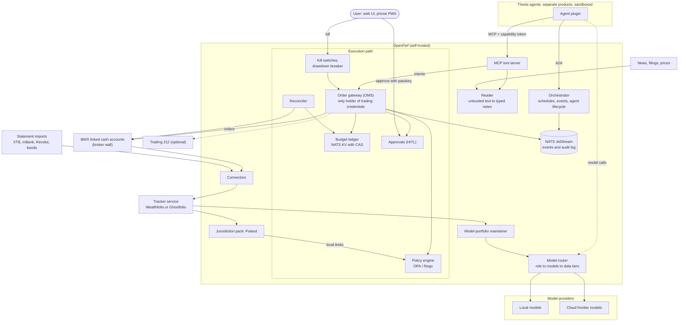
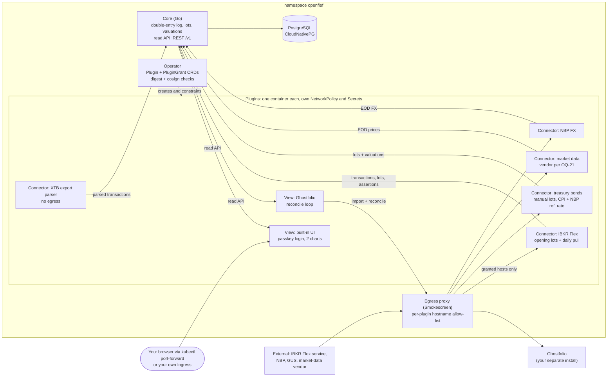

# OpenFief design

| | |
|---|---|
| Status | Draft. Design phase, no code. |
| Date | 2026-10-25; M0 decisions added 2026-10-27 |
| Ground rules | Arek (the author) |
| Drafted by | Claude Code, from the author's brief and a research session with Claude (AI assistant) on 2026-10-25 |
| Decisions | Arek, in a design review with Claude Code on 2026-10-27 (§10) |

This document keeps its sources visibly separate. Only ground rules and author decisions are decided. Everything else is evidence, a proposal or a question until the author accepts it.

## 1. Tag legend

| Tag | Source | Status |
|---|---|---|
| **[GR-n]** | Ground rule written by the author. | Decided. Highest authority. Only the author edits these; conflicts are recorded in §7. |
| **[D-n]** | Decision the author made in the 2026-10-27 design review (§10). | Decided. Below ground rules, above everything else. A decision never edits a ground rule. |
| **[AC-n]** | Author context: facts about the author that inform proposals. | Not a rule. |
| **[R-n]** | Research finding: an external fact. R-1 to R-9 were gathered on 2026-10-25 in a research session with Claude (AI assistant); R-10 onward were gathered by Claude Code on 2026-10-27. Source URL kept where one was recorded. | As of the date on each item, re-verify before relying. |
| **[P-n]** | Proposal: an inference or recommendation Claude made in that research session. | Not decided. The author may accept or reject it. |
| **[P-CC-n]** | Proposal added by Claude Code while writing these documents. | Not decided. |
| **[T-n]** | Tension between items, or an interpretation that needs the author's confirmation. T-1 to T-5 come from the author's brief. T-6 onward were added by Claude Code and each carries an [OQ-n] tag. | Unresolved. |
| **[OQ-n]** | Open question. OQ-1 to OQ-8 come from the author's brief. OQ-9 onward were added by Claude Code. | Unresolved. |

Untagged prose only restates or connects tagged items; it decides nothing. Glossary entries (§9) are explanations, not findings.

## 2. Ground rules

Written by the author. Wording kept as written. Do not edit; record conflicts in §7.

- **[GR-1]** Fully open source and self-hosted. It can eventually also be hosted for a subscription.
- **[GR-2]** Target users are people like me: technical individual investors. It is a niche, and that is fine.
- **[GR-3]** It starts as a typical portfolio summarizer: plugins for XTB, Interactive Brokers, Polish retail treasury bonds (obligacje skarbowe), etc., giving typical API access to what you hold, plus a couple of charts.
- **[GR-4]** There is a model strategy (model portfolio) to follow and adjust, with an agentic model that summarizes and maintains it. The model is configurable; I would use only my locally hosted model for this.
- **[GR-5]** For a thesis (for example a single company) you can spawn agents. Mainly long-term, but short-term is allowed. Agents do fundamental analysis, watch news, etc.
- **[GR-6]** Each thesis agent has a budget leased from the offensive part of the portfolio, with strong guarantees that the agent can never get more of the portfolio than its lease.
- **[GR-7]** Agents wake up on a schedule plus on events, and have tools to make transactions.
- **[GR-8]** Frontier models for thesis agents can be cloud-hosted.
- **[GR-9]** An orchestration layer runs the thesis agents. That orchestration layer is exactly what this project is; agents are separate products.
- **[GR-10]** Agents are plugins, so any agent can be used. The default is an agent I build or pfranczyk's per-thesis agents (github.com/Looted). Someone who trusts Interactive Brokers' agents and does not host models locally can choose those instead.
- **[GR-11]** All models are configurable per role, so the user chooses which model sees what.
- **[GR-12]** The privacy and security model comes first, designed per use case.
- **[GR-13]** Regulatory logic is pluggable too: jurisdiction plugins, Poland first.
- **[GR-14]** The project name is OpenFief.

Abbreviations above: XTB is X-Trade Brokers, a Polish broker. API is application programming interface.

## 3. Author context

- **[AC-1]** Primary stack: Go, GCP (Google Cloud Platform), Kubernetes, NATS (an open-source messaging system), Cloudflare. Not a rule; it informs proposals such as P-9.

## 4. Research findings

Every item below was gathered on 2026-10-25 in a research session with Claude. None of it has been independently verified since.

- **[R-1]** *As of 2026-10-25, re-verify before relying.* No existing product combines portfolio tracking with budget-leased, policy-gated agent execution and per-role model routing (a claim from the research session; no single source URL). The closest open-source pieces:
  - Wealthfolio: AGPL-3.0 (GNU Affero General Public License v3), Rust/Tauri, local-first, AI assistant plus an MCP (Model Context Protocol) server. https://github.com/wealthfolio/wealthfolio
  - Ghostfolio: AGPL-3.0, Angular/NestJS/Postgres, multi-user, sells a hosted Premium tier. https://github.com/ghostfolio/ghostfolio
  - TradingAgents: Apache-2.0, LangGraph multi-agent analysis, no execution, supports Ollama/vLLM (local model runtimes). https://github.com/TauricResearch/TradingAgents
  - virattt/ai-hedge-fund: MIT, paper trading by default, principle "the LLM (large language model) never touches the trade". https://github.com/virattt/ai-hedge-fund/blob/main/VISION.md
- **[R-2]** *As of 2026-10-25, re-verify before relying.* XTB disabled its public xAPI (its trading and data API) on 2025-03-14. The only options left are statement import or reverse-engineered clients that breach its terms. http://developers.xstore.pro/
- **[R-3]** *As of 2026-10-25, re-verify before relying.* Interactive Brokers (IBKR):
  - Access paths: TWS (Trader Workstation) API / IB Gateway, the Client Portal Web API, and Flex Queries for reporting. (No source URL recorded.)
  - Its official MCP server (July 2026) only drafts orders; the client reviews and submits them on IBKR's platform. https://www.interactivebrokers.com/en/general/about/mediaRelations/7-28-26.php
  - Linked accounts keep separate cash, positions and buying power. (No source URL recorded.)
  - TWS precautionary settings can be bypassed for API orders, so they are not a control. https://www.interactivebrokers.com/docs/third-party-integrations/general-third-party-frequently-asked-questions
- **[R-4]** *As of 2026-10-25, re-verify before relying.* Trading 212 public API: scoped keys (e.g. `orders:execute`), an optional IP allow-list, and live orders in the main account currency. https://helpcentre.trading212.com/hc/en-us/articles/14584770928157-Trading-212-API-key
- **[R-5]** *As of 2026-10-25, re-verify before relying.* Polish treasury bonds have no API from obligacjeskarbowe.pl or PKO BP (the bank that distributes them). Valuation is deterministic from series terms plus GUS CPI (Statistics Poland consumer price index data). Open-source valuers: https://github.com/maciekmm/obligacje (MIT) and https://github.com/krbob/edo-calculator
- **[R-6]** *As of 2026-10-25, re-verify before relying.* Prompt injection against agents that move money is documented in real incidents, e.g. the May 2026 Grok/Bankrbot wallet drain (no source URL recorded). There is research on adversarial news attacks against multi-agent trading systems: https://arxiv.org/pdf/2608.24069
- **[R-7]** *As of 2026-10-25, re-verify before relying.* Running agents that trade other people's money is portfolio management. Giving them personalised buy/sell recommendations is investment advice. Both need a KNF (Komisja Nadzoru Finansowego, the Polish Financial Supervision Authority) permit under art. 69 of the Polish Act on Trading in Financial Instruments. ESMA (European Securities and Markets Authority) treats automated client-facing advice as advice. Running your own software on your own account is not an investment service. This is not legal advice.
  - https://arslege.pl/dzialalnosc-maklerska/k384/a32931/
  - https://www.esma.europa.eu/sites/default/files/2023-07/ESMA35-43-3861_Supervisory_briefing_on_understanding_the_definition_of_advice_under_MiFID_II.pdf
- **[R-8]** *As of 2026-10-25, re-verify before relying.* ESMA's 2024 statement on AI in investment services expects records of decision processes, data sources and algorithms, and disclosure of chatbot use. https://www.esma.europa.eu/sites/default/files/2024-05/ESMA35-335435667-5924__Public_Statement_on_AI_and_investment_services.pdf
- **[R-9]** *As of 2026-10-25, re-verify before relying.* Polish tax (no source URL recorded for the rules themselves):
  - Foreign brokers (IBKR, Trading 212, Revolut) do not issue PIT-8C. Investors compute PIT-38 themselves: 19% "Belka" tax, FIFO (first in, first out), NBP (National Bank of Poland) table A exchange rate from the day before. They also file PIT/ZG per country.
  - Open-source references: https://github.com/volodymyr-kovtun/Pitly and https://klopit.co.pl/

Gathered by Claude Code on 2026-10-27 during the design review, through web search only. wealthfolio.app and ghostfol.io were unreachable from the session's network, so these rest on secondary sources.

- **[R-10]** *As of 2026-10-27, re-verify before relying.* Wealthfolio has a self-hosted web edition: one Rust service serves the React UI and a REST API on one origin, with embedded SQLite on a volume. Image `wealthfolio/wealthfolio`, port 8088, a `/data` volume, settings `WF_LISTEN_ADDR` and `WF_DB_PATH`. CSV import is documented only as a UI feature; no documented, stable HTTP API for writing activities was found. Community MCP servers write straight into its SQLite database and warn that the app may need a restart or recalculation afterwards.
  - https://railway.com/deploy/wealthfolio-tracker
  - https://dev.co/devops/open-source/wealthfolio
  - https://glama.ai/mcp/servers/@datamoc/WFmcp/blob/811e011a3a13a81f175a8907da99d1fe00cf6b2c/docs/WRITE_OPERATIONS.md
- **[R-11]** *As of 2026-10-27, re-verify before relying.* Ghostfolio: a user's security token is exchanged for a bearer token via `POST /api/v1/auth/anonymous` with `accessToken`, and activities are imported via `POST /api/v1/import` with an `activities` array (account, date, type, symbol, `dataSource`, quantity, unit price, fee, currency, comment). A community guide says the bearer token lasts about 6 months. Its `MANUAL` data source supports custom assets priced by a scraper that extracts values from HTML or, via JSONPath, from JSON (third-party summary). Prior art: `agusalex/ghostfolio-sync` syncs IBKR Flex Queries into Ghostfolio, maps symbols in a `mapping.yaml`, and warns that data outside the Flex date window is lost if it was never synced.
  - https://github.com/ghostfolio/ghostfolio
  - https://gethomepage.dev/widgets/services/ghostfolio/
  - https://deepwiki.com/ghostfolio/ghostfolio/5.2-market-data-sources
  - https://hub.docker.com/r/agusalex/ghostfolio-sync
- **[R-12]** *As of 2026-10-27, re-verify before relying.* OpenClaw plugins declare an `openclaw.plugin.json` manifest whose JSON Schema config is validated without running plugin code; the plugin itself is TypeScript loaded in-process via jiti and registers tools, channels, RPC methods, HTTP handlers, CLI commands and services through `register(api)`. Its docs say to treat plugins as trusted code. Its open skill registry, ClawHub, was hit by malware: Koi Security flagged 341 of 2,857 skills as malicious in late January 2026 (mostly the "ClawHavoc" campaign delivering the AMOS macOS stealer); later counts ranged from about 900 to over 1,100.
  - https://docs.openclaw.ai/plugins
  - https://thehackernews.com/2026/02/researchers-find-341-malicious-clawhub.html
  - https://www.bitdoze.com/openclaw-security-guide/
- **[R-13]** *As of 2026-10-27, re-verify before relying.* Hostname-based egress control for pods. Standard Kubernetes NetworkPolicy matches IP blocks, pods and namespaces, never hostnames. The upstream standard for domain names (`AdminNetworkPolicy` `domainNames`, NPEP-133) is still provisional, with few implementations. Domain policies exist in Cilium (`toFQDNs`), in GKE (`FQDNNetworkPolicy`, whose docs say it can't distinguish between multiple domains served by the same IP) and in Calico's commercial editions. Options independent of the CNI: `nais/fqdn-policy`, a fork of Google's controller that resolves DNS and writes standard NetworkPolicy `ipBlock`s; and Stripe's Smokescreen, a Go HTTP CONNECT proxy with per-client allow-lists that identifies clients by mTLS certificate or a role header through a replaceable function.
  - https://network-policy-api.sigs.k8s.io/npeps/npep-133/
  - https://docs.cloud.google.com/kubernetes-engine/docs/how-to/fqdn-network-policies
  - https://docs.tigera.io/calico-cloud/network-policy/domain-based-policy
  - https://github.com/nais/fqdn-policy
  - https://github.com/stripe/smokescreen

## 5. Proposed architecture

Nothing in this section is decided.

### 5.1 Proposals from the research session

- **[P-1]** Do not fork a tracker. Run Wealthfolio (local-first) or Ghostfolio (multi-user) as a separate service and talk to it over its API/MCP. This contains AGPL obligations and avoids fork drift.
  - *Status 2026-10-27: rejected as written by D-2. OpenFief's own core is the system of record; Wealthfolio and Ghostfolio become one-way view plugins. The "do not fork" intent is kept.*
- **[P-2]** Plugin types: connectors (brokers/data), agents, jurisdiction packs (tax, reporting, local limits) and model providers. IBKR's own AI counts as an agent choice; IBKR itself is a connector.
  - *Status 2026-10-27: extended by D-2 with a fifth plugin type, the view plugin.*
- **[P-3]** Agents run out-of-process and sandboxed, and see only data scoped to their lease. Use A2A (the Agent2Agent protocol) for agent to orchestrator, and MCP for the tools the orchestrator exposes. Agents send order intents plus a thesis plus invalidation conditions, never raw broker orders. Interpretation of GR-7: the "tool to make transactions" is the gateway API, gated by a capability token (see T-5).
- **[P-4]** Layered enforcement for GR-6:
  - (a) Broker wall: one IBKR linked cash account (no margin) per offensive sleeve.
  - (b) Only an order gateway holds broker credentials. Agents hold scoped capability tokens (Biscuit/macaroon style: instruments, side, max notional, expiry).
  - (c) A budget ledger reserves notional atomically before submission.
  - (d) A pre-trade policy engine (OPA/Rego, i.e. Open Policy Agent and its policy language): allow-lists, limit orders only, price bands, rate limits, no leverage, liquidity filters such as minimum ADV (average daily volume).
  - (e) Tiered human approval (HITL, human in the loop); a new thesis or a lease increase always needs approval.
  - (f) Kill switches per agent, per sleeve and global, plus a drawdown circuit breaker.
- **[P-5]** Prompt-injection defence: split a reader (untrusted text in, typed and validated research notes out) from a decider (sees only structured notes). Tag the source of every input. Require two independent sources before a thesis changes.
- **[P-6]** Data tiers enforced by a model router (role -> allowed models -> allowed tiers):
  - T0 holdings and amounts: local models only
  - T1 thesis and instrument list
  - T2 public data
- **[P-7]** Show a guarantee level per agent: "gateway + broker" or "broker wall only". An IBKR-native agent bypasses the gateway, so it only gets the broker wall.
- **[P-8]** Allocate capital by track record: paper trading, then a small live lease, then scale up or cut. This is the multi-manager "pod" model.
- **[P-9]** Control plane in Go, with NATS JetStream for events and KV (key-value store) CAS (compare-and-set) for the ledger. Basis: the author's stack (AC-1).
  - *Status 2026-10-27: Go core decided (D-11). M0 uses Postgres and no NATS (D-14); where the M1 ledger lives is revisited at M1.*
- **[P-10]** Execution venues: IBKR primary, Trading 212 optional. XTB, mBank, Revolut and bonds are read-only via import.
  - *Status 2026-10-27: read-only import for XTB and bonds decided (D-7, D-9). Execution venues not yet decided.*
- **[P-11]** A hosted subscription covers tracking, valuation, analytics and tax only. Agent execution is self-hosted on the user's own account (see R-7).
- **[P-12]** Polish jurisdiction pack v1: PIT-38 and PIT/ZG, bond valuation (COI/EDO etc.), IKE/IKZE rules.
- **[P-13]** Tagline: "Give your AI agents a fief, not the kingdom." Vocabulary: a "fief" is a revocable capital lease granted to an agent.

### 5.2 Additions by Claude Code

- **[P-CC-1] Lease accounting basis.** A fief's usage is the reserved notional of its open intents and orders, plus the cost basis of its open positions, plus fees. Market gains do not create buying power. Sale proceeds return to the fief's available balance up to the lease amount; anything above the lease is swept back to the offensive sleeve. Losses shrink what the agent can redeploy until a lease top-up is approved. Why: it gives GR-6 one number the ledger can enforce atomically. Whether market value should count instead is OQ-11.
- **[P-CC-2] Reserve before approval.** The ledger reserves an intent's notional as soon as the policy engine allows it, before any human approval, and releases it on denial, expiry, cancellation or kill. Why: the human only ever approves a trade that is already funded within the lease, and two approvals cannot race past it.
- **[P-CC-3] Fail closed.** If the ledger, the policy engine, the audit log or the reconciliation state is unavailable or stale, the gateway rejects every new intent. Cancellations still go through. Why: GR-6 has to hold during partial outages, not only on the happy path.
- **[P-CC-4] Reconciliation.** The gateway compares the ledger with the broker's cash, positions and open orders after every fill and on a schedule. Any unexplained difference (a manual trade, a corporate action, a fee, a missed fill) suspends the affected fief and emits a lease-breach event. Why: the ledger is a guarantee only while it matches the broker.
- **[P-CC-5] Authentic approvals.** Approvals happen in OpenFief's web UI, installable on a phone as a PWA (progressive web app), and need a passkey (WebAuthn) signature bound to the hash of the specific intent. Push, e-mail or chat notifications carry only a link, never an approve action. Approvals expire. Why: the approval channel is itself an attack surface (spoofed or replayed approvals, approval fatigue). *Status 2026-10-27: passkeys for login decided (D-26); approvals themselves are M1.*
- **[P-CC-6] Kill freezes, never liquidates.** A kill revokes capability tokens, cancels working orders and suspends every fief in its scope. Selling positions is a separate, explicit user action. Why: automatic liquidation, triggered in a panic or by an attacker, can do more damage than a freeze. Open: OQ-16.
- **[P-CC-7] Audit log.** An append-only, hash-chained log (each event carries the hash of the previous one) of every intent, policy decision with policy version, approval, order, fill, lease change and kill. Each decision also records the thesis version, input source tags, model and provider per role, and prompt and response hashes. Why: R-8 describes what regulators expect of investment firms. OpenFief used on one's own account is not one (R-7), but the same record is what the author needs to debug, or stop trusting, an agent.
- **[P-CC-8] Credentials at rest.** Broker credentials are encrypted at rest. Only the gateway can decrypt trading credentials and only connectors can decrypt read-only ones. Agents, models and the UI never see either. *Status 2026-10-27: the M0 mechanism is Kubernetes Secrets plus documented platform encryption (D-29), scoped per plugin by grants (D-16).*
- **[P-CC-9] Agents reach the world only through OpenFief.** Agent sandboxes have no direct network egress. Models are reached through the model router, which enforces P-6 tiers and meters model spend per agent. News and filings arrive through OpenFief's reader (P-5). Trades go through the gateway. Why: without this, P-5 and P-6 are advice to agent authors, not controls OpenFief can enforce.

Added in the 2026-10-27 design review, all not decided:

- **[P-CC-23] One contract language.** Define D-6's public read API in protobuf too, with HTTP annotations, and serve it as REST with a generated OpenAPI spec through transcoding (e.g. Buf's Vanguard). Plugins and the public API then share one source of truth.
- **[P-CC-24] Signature verification in the operator.** D-12 (any cluster) means no admission controller such as Kyverno or Sigstore's policy-controller can be assumed, so the operator verifies image signatures itself before creating any Deployment: `sigstore-go`, keyless signatures from the project's GitHub Actions identity, and a bundled trust root so verification also works offline.
- **[P-CC-25] Label each PLN figure's basis.** *Withdrawn 2026-10-27:* moot after D-20 (revised) made NBP the only basis in M0.
- **[P-CC-26] After-tax liquidation value.** D-25 puts bonds in totals net of tax while stocks are gross, so the total mixes two bases. When the tax pack arrives, "net" should become a portfolio-wide after-tax liquidation value: stocks also lose Belka tax on their unrealized PLN gain, per lot at NBP rates. Until then the UI marks the total as mixed.
- **[P-CC-27] Built-in UI stack.** Server-rendered Go templates with htmx, a small chart library served locally (no CDN), a strict CSP (Content Security Policy), and no JavaScript build chain.
- **[P-CC-28] Any Postgres.** Besides CloudNativePG (D-14), accept any PostgreSQL through a connection string, so D-12's "any conformant cluster" holds for managed databases too.
- **[P-CC-29] Canonical origin set at install.** WebAuthn binds each passkey to a domain (the RP ID, relying-party ID). The installer requires the canonical hostname up front; `localhost` (D-28's port-forward) is used only for bootstrap, and the docs warn that passkeys do not carry over between hostnames. See OQ-24.
- **[P-CC-30] Operator as the only DNS resolver.** *Withdrawn 2026-10-27:* proposed to make D-32's first version (plain IP allow-lists) reliable; superseded when the author revised D-32 to an egress proxy.
- **[P-CC-31] The operator never touches money.** The operator manages plugin workloads only. Fiefs, intents, the ledger and approvals live in Postgres behind the core, never in custom resources or etcd: etcd is not a transactional ledger, and GR-6's guarantee must not depend on who holds Kubernetes API access.
- **[P-CC-32] Bootstrap.** One small Helm chart or plain manifest installs the CRDs, the operator and the egress proxy. Everything after that is a `Plugin` and its `PluginGrant`.
- **[P-CC-33] Development rules marked (P).** Every rule marked **(P)** in `docs/dev/*.md` is a Claude Code proposal pending the author's approval. Notable ones: Taskfile targets as the command contract; lefthook as the hook manager; testcontainers-go for Postgres tests; go-cmp and no assertion framework; the golangci-lint v2 linter set; Conventional Commits; release tags without a `v` prefix (Go would read a root `v2026.11.0` as major version 2026 of the module); SDK tags `sdk/go/vX.Y.Z`; the bounded-context layout and the Go names in the ubiquitous language.
  - *Status 2026-10-27: the Taskfile is accepted by D-41. lefthook, the golangci-lint linter set and the vulnerability-check behaviour are implemented as proposed and still await the author's review.*

### 5.3 Component diagram

Claude Code's rendering of P-1 to P-10 and P-CC-1 to P-CC-9, from 2026-10-25. Nothing in it is decided. For M0, the decided architecture in §10.2 supersedes it; in particular, the tracker is no longer an external service of record (D-2).

## 6. Security and privacy model per use case

GR-12 puts this model first. The five use cases UC-1 to UC-5 were named in the author's brief. UC-0, the enforcement-layer table and all threat lists are Claude Code's analysis **[P-CC-10]**, built from the items each entry cites. The TF tier is **[P-CC-12]**.

### 6.1 Data tiers

| Tier | Contents | Default allowed models | Source |
|---|---|---|---|
| T0 | Whole-portfolio holdings and amounts, transactions, tax data | Local models only | P-6 |
| TF | One fief's own lease, cash, positions and working orders | The owning agent's configured models, cloud included | P-CC-12 |
| T1 | Thesis text and instrument list | Per user configuration | P-6 |
| T2 | Public data: prices, filings, news | Per user configuration | P-6 |

P-6 fixes only T0 as local-only. TF exists because a cloud-hosted thesis agent (GR-8) has to see its own budget to size orders (see T-6).

### 6.2 Enforcement layers for GR-6

| Layer | Stops | Does not stop | Source |
|---|---|---|---|
| Broker wall: linked cash account, no margin | Losses beyond that account's cash, even if the OpenFief host is fully compromised | Bad trades within that cash; several fiefs sharing one account (T-7) | P-4(a) |
| Capability token | Trading outside its instruments, side, max notional or expiry | Many small allowed orders adding up | P-4(b) |
| Budget ledger with CAS | Reservations plus positions exceeding the lease, including concurrent intents | Ledger drifting from the broker (handled by P-CC-4) | P-4(c), P-CC-1, P-CC-2 |
| Policy engine | Market orders, prices outside bands, rate abuse, leverage, illiquid instruments | Well-formed bad ideas | P-4(d) |
| Human approval | Autonomous surprises, new theses, lease increases | Approval fatigue; spoofed approvals (handled by P-CC-5) | P-4(e), P-CC-5 |
| Kill switches and drawdown breaker | Further damage once noticed or once the drawdown limit is hit | Losses before detection | P-4(f), P-CC-6 |
| Reconciliation | Silent drift between ledger and broker | Drift between two reconciliation runs | P-CC-4 |
| Fail closed | Trading while a control is down | Nothing extra beyond the layers above | P-CC-3 |

Only the broker wall survives a compromise of the OpenFief host. Every other layer runs on that host.

### 6.3 Use cases

#### UC-0 Tracking and imports (added by Claude Code [P-CC-10])

- **Data seen:** T0. All holdings, transactions, statement files and account identifiers; read-only broker credentials such as a Flex Query token.
- **Allowed models:** None needed. AI summaries belong to UC-1.
- **Threats:** Theft of the T0 dataset from the host or its backups. Leak of read-only credentials, which still expose the full account history. Malicious statement files (imports are untrusted input). Wrong valuations leading to wrong decisions.
- **Controls:** Data stays on the user's host (GR-1). Credentials encrypted at rest (P-CC-8). Import parsers treat files as untrusted and run without network access [P-CC-10]. Bond valuations cross-checked against the open-source valuers in R-5. The holdings API requires authentication and listens locally by default [P-CC-10].
- **Decided for M0 (2026-10-27):** plugin isolation through per-plugin containers, manifests, grants and signed, digest-pinned images (D-11, D-15 to D-17); passkey login (D-26); plugin identity via ServiceAccount tokens (D-27); no Ingress or tunnel shipped (D-28); Kubernetes Secrets plus documented platform encryption (D-29).
- **Traces to:** GR-1, GR-3, GR-12, R-5, P-1, P-10, P-CC-8, P-CC-10.

#### UC-1 Model-portfolio maintainer

- **Data seen:** T0 (full holdings, the model portfolio and its targets) and T2.
- **Allowed models:** Configurable (GR-4, GR-11). The author would use only a local model (GR-4). P-6 makes T0 local-only by default.
- **Threats:** T0 sent to a cloud provider through misconfiguration. Prompt injection through public data skewing summaries. The maintainer silently changing the model portfolio. Invented numbers in summaries.
- **Controls:** The router pins the role to local providers and denies by default (P-6). The maintainer has no transaction tools in v0, gets precomputed figures (weights, drift) from OpenFief, and outputs a summary plus a proposed change the user applies **[P-CC-11]**. Every call is logged with role, tier and model (P-CC-7).
- **Traces to:** GR-4, GR-11, GR-12, P-6, P-CC-7, P-CC-11. Open: OQ-12, OQ-6, OQ-18.

#### UC-2 Thesis agent: research

- **Data seen:** T1 (its own thesis and instruments), T2, and TF (its own fief). No T0 and no other fief.
- **Allowed models:** Per role, user-configured (GR-11). Cloud frontier models are allowed (GR-8). Reader and decider roles may use different models.
- **Threats:** Prompt injection through news and filings (R-6), including adversarial news aimed at multi-agent trading systems. Exposure of the thesis (T1) to a cloud provider, which reveals intent. A malicious or compromised agent plugin. Runaway model spend.
- **Controls:** Reader/decider split, source tags, two independent sources before a thesis changes (P-5). Out-of-process sandbox with lease-scoped data (P-3). No direct egress: models via the router with per-agent spend metering, text via the reader (P-CC-9). Tier enforcement in the router (P-6, P-CC-12). Research notes recorded in the audit log (P-CC-7).
- **Traces to:** GR-5, GR-8, GR-11, GR-12, R-6, P-3, P-5, P-6, P-CC-7, P-CC-9, P-CC-12.

#### UC-3 Thesis agent: execution

- **Data seen:** TF (its own lease, cash, positions, working orders), T1, and T2 through the reader.
- **Allowed models:** As in UC-2. The decider sees only structured notes (P-5).
- **Threats:** The agent, or text injected into it, tries to exceed its lease. Concurrent intents race the budget. The agent obtains broker credentials. Rapid-fire or manipulative orders. Thinly traded instruments that are easy to move. Spoofed approvals or approval fatigue. Gateway bugs. The ledger drifting from the broker after manual trades or corporate actions. Compromise of the OpenFief host.
- **Controls:** All of P-4 (a) to (f); the enforcement layers in §6.2; scoped capability tokens and no broker credentials in the agent (P-4(b), P-CC-8); reservation before approval (P-CC-2); fail closed (P-CC-3); reconciliation (P-CC-4); passkey approvals (P-CC-5); kill without liquidation (P-CC-6). The broker wall bounds the loss if the host is compromised.
- **Traces to:** GR-6, GR-7, GR-12, P-3, P-4, P-CC-1 to P-CC-6, P-CC-13. Open: T-5, T-7, T-8.

#### UC-4 Third-party or IBKR-native agent

- **Data seen:** Whatever the third-party platform sees. For an IBKR-native agent, that is every IBKR account it is connected to, on IBKR's side. OpenFief cannot scope it.
- **Allowed models:** Chosen by the third party. The user exercises GR-11 by choosing the agent, not the model behind it.
- **Threats:** The gateway, ledger and policy engine are bypassed. The agent's reach is whatever account access the platform grants. Holdings data flows to the third party. Per R-3, IBKR's official MCP server only drafts orders and the client submits them on IBKR's platform, so the human step lives outside OpenFief.
- **Controls:** Guarantee level shown as "broker wall only" (P-7). Connect such an agent only to its own dedicated linked account funded with exactly the fief, so the broker wall bounds that single fief **[P-CC-13]**. OpenFief observes the account through a read connector and reconciles; overshoot raises a lease-breach event, which detects but does not prevent (P-CC-4).
- **Traces to:** GR-6, GR-10, GR-11, GR-12, R-3, P-2, P-7, P-CC-4, P-CC-13. Open: T-3, T-10, OQ-3.

#### UC-5 Future hosted multi-user

- **Data seen by the operator:** T0 of every tenant: holdings, transactions, tax data.
- **Allowed models:** P-6 keeps T0 on local models; in a hosted setting "local" means operator-hosted, which moves the trust boundary from the user to the operator. Any model access to a tenant's T0 is opt-in per tenant (GR-11) **[P-CC-14]**.
- **Threats:** Cross-tenant data leaks. One breach exposing many portfolios. Drifting into portfolio management or investment advice (R-7). Obligations under R-8 if the service ever counts as an investment service.
- **Controls:** No agent execution in the hosted offering (P-11). No personalised buy/sell recommendations (R-7). Tenant isolation, per-tenant encryption keys, and full export and deletion **[P-CC-14]**. A legal opinion before launch (T-4, OQ-7).
- **Traces to:** GR-1, GR-11, GR-12, R-7, R-8, P-6, P-11, P-CC-14. Open: T-4, OQ-7, OQ-17.

#### Proposals introduced in this section

- **[P-CC-10]** The use case UC-0 and the threat analysis in §6.1 to §6.3, including the controls marked with this tag.
- **[P-CC-11]** The GR-4 maintainer has no transaction tools in v0. OpenFief computes the figures (weights, drift); the model narrates them and proposes model-portfolio changes; the user applies them.
- **[P-CC-12]** Add a TF tier for one fief's own data, visible to the owning agent's configured models, cloud included. Treat all tier rules as user-overridable defaults that warn loudly when loosened, so P-6 does not override the user's choice under GR-11.
- **[P-CC-13]** An agent with guarantee level "broker wall only" gets its own linked account (one fief per account), so the broker bounds that fief rather than a whole sleeve.
- **[P-CC-14]** Hosted tenants get isolation, per-tenant encryption keys, full export and deletion, and opt-in-only model access to their T0.

## 7. Tensions and interpretations

None of these is resolved. Ground rules stay as written; the author decides.

- **[T-1] GR-3 (XTB via API) vs R-2.** XTB disabled its public API on 2025-03-14; the only compliant path left is statement import. Proposed (not decided): XTB is import-only (P-10). *Resolved 2026-10-27 by D-7 and D-9.*
- **[T-2] GR-3 (bonds via API) vs R-5.** Neither obligacjeskarbowe.pl nor PKO BP offers an API. Proposed (not decided): holdings via import, valuation computed from series terms and CPI (P-10, P-12). *Resolved 2026-10-27 by D-7 and D-9.*
  - *Note on T-1 and T-2* **[OQ-10]**: GR-3's phrase "giving typical API access to what you hold" can also be read as OpenFief exposing an API over the consolidated holdings, not as connectors reaching brokers through broker APIs. Under that reading, import-based connectors already satisfy GR-3 and T-1 and T-2 mostly dissolve. *Answered 2026-10-27 by D-7: connectors use broker APIs where they exist and any other working means where they don't; OpenFief also exposes its own read API.*
- **[T-3] GR-6 (strong guarantees) vs GR-10 (user may pick IBKR's agents).** An IBKR-native agent bypasses the gateway, ledger and policy engine. Proposed (not decided): P-7, showing the weaker guarantee level. See also T-7 and P-CC-13: under P-4(a) the broker wall bounds a sleeve, not an agent.
- **[T-4] GR-1 (hosted subscription) vs R-7.** Executing agents for other people, or giving them personalised recommendations, needs a KNF permit. Proposed (not decided): P-11, plus a legal opinion before launch (OQ-7).
- **[T-5] GR-7 (agents make transactions) vs P-3 (agents send intents only).** This is an interpretation that needs the author's confirmation: P-3 reads "tools to make transactions" as the gateway's intent API, gated by a capability token, so agents never hold broker credentials or send raw broker orders. If GR-7 instead means agents place broker orders directly, P-4(b) to (d) no longer apply and only the broker wall remains.
- **[T-6] P-6 vs GR-8 and GR-11** **[OQ-14]**. *(Added by Claude Code.)* P-6 keeps "holdings and amounts" on local models only. A thesis agent on a cloud model (GR-8) needs at least its own budget and positions to size an order. Separately, if P-6 is a hard rule, it limits GR-11's "the user chooses which model sees what". Proposed (not decided): P-CC-12.
- **[T-7] P-4(a) vs GR-6 per agent** **[OQ-20]**. *(Added by Claude Code.)* P-4(a) puts one linked account per offensive sleeve. If several fiefs share that account, the broker caps the sleeve, not each agent; the per-agent guarantee then rests on the gateway and ledger alone, and a "broker wall only" agent (P-7) has no per-agent bound at all. Proposed (not decided): P-CC-13. Depends on OQ-3.
- **[T-8] Measuring GR-6 under price moves** **[OQ-11]**. *(Added by Claude Code.)* "Can never get more of the portfolio than its lease": if a position rises, its market value exceeds the lease without any new capital. Is that a breach? Proposed (not decided): P-CC-1 counts committed cost and sweeps proceeds above the lease.
- **[T-9] GR-9 vs GR-3 on project scope** **[OQ-15]**. *(Added by Claude Code.)* GR-9 says the orchestration layer "is exactly what this project is". GR-3 says the project "starts as a typical portfolio summarizer", the README description in the author's brief says "portfolio tracker and orchestrator", and P-1 puts the tracker in a separate service. Related: OQ-2. *Resolved 2026-10-27 by D-2: tracking is in scope as OpenFief's own core; external trackers are view plugins.*
- **[T-10] GR-10 vs R-3 on "Interactive Brokers' agents"** **[OQ-13]**. *(Added by Claude Code.)* GR-10 names IBKR's agents as an option. R-3 says IBKR's official MCP server only drafts orders and the client submits them on IBKR's platform. As of 2026-10-25 there may be no IBKR agent that executes by itself; if so, a human submits every IBKR-native order and T-3 is narrower than it looks.
- **[T-11] D-28 vs D-26 and P-CC-5** **[OQ-24]**. *(Added by Claude Code, 2026-10-27.)* D-28's default access is a local `kubectl port-forward`, so the UI's origin is `localhost`. WebAuthn binds passkeys (D-26) to the origin's domain, so passkeys registered on `localhost` stop working once the user adds an Ingress with a real hostname. P-CC-5's phone approvals (M1) also need an HTTPS origin the phone can reach, which a port-forward is not. Proposed (not decided): P-CC-29.

## 8. Open questions

From the author's brief:

- **[OQ-1]** License: AGPL-3.0 vs Apache-2.0/MIT, given the AGPL trackers and a future hosted offering. *Answered by D-5.*
- **[OQ-2]** Base tracker: Wealthfolio, Ghostfolio, or our own. *Answered by D-2: our own core; Ghostfolio (and later Wealthfolio) as view plugins.*
- **[OQ-3]** IBKR linked-account availability and behaviour for Polish residents (served by IB Ireland).
- **[OQ-4]** Default agent: the author's or pfranczyk's? Should the agent contract be co-designed with pfranczyk?
- **[OQ-5]** Do short-term strategies need a dedicated execution engine (e.g. NautilusTrader)?
- **[OQ-6]** Which local model to use for the GR-4 maintainer role on the author's hardware. (The brief says "the hardware above", but no hardware is listed; see OQ-18.)
- **[OQ-7]** Legal opinion before any hosted offering.
- **[OQ-8]** Domain and trademark check for "OpenFief" (TMview, classes 9/36/42).

Added by Claude Code:

- **[OQ-9]** The repository's initial commit already contains an Apache-2.0 `LICENSE` file. Is that the answer to OQ-1, or a placeholder? *Answered by D-5: a placeholder; the file is replaced when the author says so.*
- **[OQ-10]** How should GR-3's "giving typical API access to what you hold" be read: connectors reach brokers through broker APIs, or OpenFief exposes an API over what you hold? (Affects T-1, T-2.) *Answered by D-7: both.*
- **[OQ-11]** How is "more of the portfolio than its lease" (GR-6) measured: committed cost, current market value, or both? What happens to gains and losses: swept back to the sleeve, or kept by the fief? (T-8, P-CC-1.)
- **[OQ-12]** What authority does the GR-4 maintainer have? Does "maintains" include placing trades (for example rebalancing the defensive part), or only maintaining the model portfolio? Who sets the size of the offensive part: the user, the model portfolio, or the maintainer? (P-CC-11.)
- **[OQ-13]** What exactly are "Interactive Brokers' agents" in GR-10, given R-3? (T-10.)
- **[OQ-14]** May a cloud-hosted thesis agent see its own fief's amounts and positions? Is P-6 a hard rule or a default the user can override under GR-11? (T-6, P-CC-12.)
- **[OQ-15]** Is the portfolio tracker part of OpenFief's scope, or an integrated external dependency? (T-9; related to OQ-2.) *Answered by D-2: in scope.*
- **[OQ-16]** What does a kill do to open positions: freeze them, or liquidate? P-4(f) does not say. (P-CC-6.)
- **[OQ-17]** Does publishing a default agent (GR-10) that other people run on their own accounts raise investment-advice questions under R-7? Should the legal opinion in OQ-7 cover it?
- **[OQ-18]** What hardware is available for local models? OQ-6 depends on it.
- **[OQ-19]** Which IBKR path should execution use: TWS API / IB Gateway, or the Client Portal Web API? Flex Queries cover reporting only (R-3).
- **[OQ-20]** Broker-wall granularity: one linked account per offensive sleeve (P-4(a)) or per fief? Is there one offensive sleeve or several? (T-7, P-CC-13.)

Added by Claude Code in the 2026-10-27 design review:

- **[OQ-21]** Which market-data vendor (D-22)? Candidates: Twelve Data, EODHD, Alpha Vantage, and Stooq only if its terms allow automated use (D-8). Check Warsaw Stock Exchange coverage, end-of-day FX, terms of use and price.
- **[OQ-22]** Verify the assumptions behind D-9, D-23 and D-24 against real accounts: IBKR Flex open positions report lots with open date and cost basis; the author's IBKR lot-matching method is FIFO; how far back one Flex request reaches; the xStation export's columns, and whether it separates CFDs from stocks; whether obligacjeskarbowe.pl offers any CSV export.
- **[OQ-23]** Verify the Ghostfolio API details D-4 relies on, which are from memory or third-party summaries: creating accounts, listing activities per account, deleting activities, an import dry-run flag, the `MANUAL` scraper fields, and whether the import endpoint is meant to be stable.
- **[OQ-24]** What is OpenFief's canonical hostname, given that passkeys are bound to it and M1's phone approvals need it reachable over HTTPS? (T-11, P-CC-29.)
- **[OQ-25]** GR-4's model portfolio is a MUST (FR-10), but D-30 drops the drift chart from M0. Are model-portfolio targets entered in M0 anyway, or does the model portfolio arrive with the maintainer in M2?
- **[OQ-26]** D-9 includes uploading files in the UI, and bond lots are entered by hand, but D-2 says views never write back and D-7 says data enters only through connector ingest paths. Is the built-in UI more than a view (it forwards uploads and bond-lot forms to the connectors), or does each connector serve its own small form, with the UI only linking to it?
- **[OQ-27]** Verify Smokescreen before building on D-32: its license, its maintenance status, and its library API for a custom role function and per-role allow-lists.

## 9. Glossary

Explanations written by Claude Code. They define terms; they decide nothing and are not research findings. Re-verify product and regulatory details before relying on them.

| Term | Meaning |
|---|---|
| A2A | Agent2Agent protocol: an open protocol for agents to talk to each other and to orchestrators. Introduced by Google in 2025, now hosted by the Linux Foundation. MCP connects an agent to tools; A2A connects agents to agents. |
| ADV | Average daily volume: mean shares (or value) traded per day. A minimum ADV filter keeps agents out of instruments a small order could move. |
| AGPL-3.0 | GNU Affero General Public License v3: copyleft that also triggers on network use, so running modified code as a service obliges you to publish the source. |
| API | Application programming interface. |
| Belka tax | Poland's flat 19% tax on capital income, named after Marek Belka, the finance minister under whom it was introduced. |
| Capability token | A token that *is* the permission: holding it lets you do exactly what it encodes. Macaroons (Google, 2014) and Biscuit (Clever Cloud) let a holder attenuate a token, e.g. narrow instruments or lower the notional, but never widen it. The idea goes back to capability-based security (Dennis and Van Horn, 1966). |
| CAS | Compare-and-set (or compare-and-swap): write only if the stored value or revision is still what you read. Originally a CPU instruction (IBM System/370); NATS KV exposes it as an update with an expected revision. |
| Circuit breaker (drawdown) | An automatic stop that suspends trading once losses from a peak (the drawdown) pass a limit. |
| Client Portal Web API | IBKR's REST-style web API. |
| COI / EDO | Polish retail treasury bond series: COI 4-year and EDO 10-year, both inflation-indexed after the first year. |
| CPI | Consumer price index; the inflation measure published by GUS. |
| ESMA | European Securities and Markets Authority, the EU securities regulator. |
| Fief / lease | In feudal Europe, land a lord granted to a vassal in return for service, revocable on breach. In OpenFief (P-13): a revocable capital lease granted to one agent, with hard limits. |
| FIFO | First in, first out: the oldest lots are treated as sold first when computing gains. |
| Flex Query | IBKR's configurable reporting export (trades, positions, cash), retrievable through a web service with a token. |
| Frontier model | The most capable models from the large labs, typically cloud-hosted. |
| GUS | Główny Urząd Statystyczny, Statistics Poland. |
| HITL | Human in the loop: a person must approve before the system acts. |
| IB Gateway / TWS | Trader Workstation (TWS) is IBKR's desktop trading platform; IB Gateway is its headless variant. Both expose the TWS API. |
| IBKR | Interactive Brokers. |
| IKE / IKZE | Polish tax-advantaged retirement accounts with annual contribution limits. IKE: gains tax-exempt if withdrawal conditions are met. IKZE: contributions deductible, withdrawals taxed at a reduced flat rate. |
| Intent (order intent) | An agent's structured request to trade (instrument, side, size, limit price, thesis, invalidation conditions) sent to the gateway instead of a broker order (P-3). |
| Invalidation condition | A condition stated up front that would prove a thesis wrong, e.g. a price level or a fundamental change. |
| KNF | Komisja Nadzoru Finansowego, the Polish Financial Supervision Authority. |
| KV | Key-value store. NATS KV is built on JetStream. |
| Limit order | An order that executes only at a stated price or better. |
| Linked account | An IBKR account linked under one user with its own cash, positions and buying power (R-3). |
| LLM | Large language model. |
| MCP | Model Context Protocol: an open protocol, introduced by Anthropic in 2024, through which a model or agent calls tools and reads resources. |
| MiFID II | The EU Markets in Financial Instruments Directive (second version), which defines investment advice and portfolio management. |
| Model portfolio | A target allocation (a model strategy) the real portfolio follows and adjusts towards (GR-4). |
| Model router | The component that decides which model serves each role and which data tiers it may receive (P-6). |
| NATS / JetStream | NATS is an open-source messaging system; JetStream is its persistence layer (streams, KV, object store). |
| NBP table A | The National Bank of Poland's daily table of average exchange rates, used for converting foreign income for tax. |
| Notional | The money value of an order or position (quantity times price). |
| OMS | Order management system: the component that validates, routes and tracks orders. In OpenFief the order gateway plays this role. |
| OPA / Rego | Open Policy Agent, a CNCF policy engine; Rego is its Datalog-inspired policy language. |
| Paper trading | Trading against a simulated account with fake money. |
| PIT-8C | The annual statement of capital income that Polish brokers issue to clients and the tax office. |
| PIT-38 | The Polish annual tax return for capital gains (securities, derivatives). |
| PIT/ZG | The PIT attachment that declares foreign income, one per country. |
| PKO BP | PKO Bank Polski, the bank that distributes Polish retail treasury bonds. |
| Pod model | How multi-manager hedge funds (e.g. Millennium, Citadel) run: capital is allocated to independent teams (pods) with risk limits, increased on a good record and cut on drawdown (P-8). |
| Prompt injection | Text that a model reads as data but follows as instructions, e.g. a news article telling a trading agent to buy. |
| PWA | Progressive web app: a website installable on a phone like an app. |
| Reader / decider split | P-5: one model reads untrusted text and emits typed notes; a separate decider sees only those notes. |
| Sleeve | A part of a portfolio managed under its own mandate, as in "core-satellite" investing. Defensive sleeve: the core, not available to agents. Offensive sleeve: the part fiefs are leased from (GR-6). |
| Thesis | An investment idea with a horizon and invalidation conditions that one or more agents work on (GR-5). |
| TIF | Time in force: how long an order stays working (e.g. day, good-till-cancelled). |
| WebAuthn / passkey | The web standard for public-key authentication; a passkey is a WebAuthn credential stored on a device. |
| xAPI | XTB's former public trading API, disabled on 2025-03-14 (R-2). |
| XTB | X-Trade Brokers, a Polish broker. |

Terms added with the M0 decisions (2026-10-27):

| Term | Meaning |
|---|---|
| Balance assertion | A statement that an account held a given balance on a given date, checked against the balance derived from transactions; a mismatch is an error. The idea comes from plain-text accounting tools such as Beancount (D-18). |
| CFD | Contract for difference: a leveraged derivative that pays the price change of an instrument without ownership. XTB's main product (D-24). |
| ClusterIP / port-forward | A ClusterIP Service is reachable only inside the Kubernetes cluster; `kubectl port-forward` tunnels it to the user's own machine (D-28). |
| CloudNativePG (CNPG) | A Kubernetes operator that runs PostgreSQL, including backups to object storage (D-14). |
| CNI | Container Network Interface: the cluster's network plugin. NetworkPolicy works only if the CNI enforces it. |
| Connect RPC | A protocol by Buf: the same protobuf service can be called as gRPC or as plain HTTP with JSON (D-11). |
| cosign / Sigstore | Sigstore is an open project for signing software; cosign is its tool for signing and verifying container images. "Keyless" signing ties a signature to a CI identity instead of a long-lived key (D-17, P-CC-24). |
| CRD / operator | A CustomResourceDefinition adds a new resource type (here `Plugin`, `PluginGrant`) to Kubernetes; an operator is a controller that turns those resources into running workloads (D-13). |
| CSP | Content Security Policy: a browser header that restricts where a page may load scripts and data from (P-CC-27). |
| DCO | Developer Certificate of Origin: contributors certify they may submit their change by adding a `Signed-off-by` line, instead of signing a contributor license agreement (D-5). |
| Digest pinning | Referring to a container image by the hash of its content (`image@sha256:...`) rather than a mutable tag such as `:latest` (D-17). |
| Double-entry bookkeeping | Every transaction is recorded as postings that sum to zero across accounts, so money never appears or vanishes; documented by Luca Pacioli in 1494 (D-19). |
| Egress proxy | A proxy that all outbound traffic from a set of pods must pass through, so destinations can be allowed by hostname rather than IP (D-32). |
| End of day (EOD) | Prices or rates as of each trading day's close (D-21). |
| etcd | The key-value store that holds a Kubernetes cluster's state, including Secrets; it must be encrypted at rest (D-29). |
| HTTP CONNECT | The HTTP method a client uses to ask a proxy to open a tunnel to a named host and port; HTTPS then runs inside the tunnel, so the proxy sees the hostname but not the content. |
| htmx | A small JavaScript library that lets server-rendered HTML pages update parts of themselves without a front-end framework (P-CC-27). |
| Ingress | The Kubernetes resource that exposes an HTTP service outside the cluster. OpenFief ships none (D-28). |
| kind / k3d / k3s | kind and k3d run Kubernetes clusters in containers for testing; k3s is a lightweight Kubernetes distribution (D-12). |
| NetworkPolicy | A Kubernetes resource restricting which pods a pod may talk to and be reached from (D-11). |
| Opening lot | A tax lot seeded from a broker's current positions (open date, quantity, cost) instead of being rebuilt from full transaction history (D-23). |
| Projected ServiceAccount token | A short-lived token that Kubernetes mounts into a pod, scoped to one audience and verifiable against the cluster's issuer (D-27). |
| RBAC | Role-based access control: in Kubernetes, Roles and ClusterRoles define what an identity may do (D-15). |
| Reconcile loop | The Kubernetes controller pattern: repeatedly compare desired state with actual state and act to remove the difference (D-4). |
| RP ID | Relying-party ID: the domain a WebAuthn passkey is bound to (P-CC-29, OQ-24). |
| Smokescreen | Stripe's open-source egress proxy, written in Go, which checks each client's HTTP CONNECT destinations against a per-client allow-list (D-32, R-13). |
| View plugin | A plugin that presents OpenFief's canonical record somewhere else (the built-in UI, Ghostfolio) and never writes back (D-2). |

## 10. Decisions (M0 design review, 2026-10-27)

The author made these in a design review with Claude Code, run one question at a time with a recommendation on each, in the style of Matt Pocock's "grill-me" skill. Each decision paraphrases the option the author chose. A note marks where the author went against Claude Code's recommendation or gave their own answer. Decisions sit below ground rules; none of them edits one.

### 10.1 Decision log

**Scope**

- **[D-1]** Iteration 1 is M0 only: tracker and Polish imports, no models, no agents. Amended by D-31 (no time-box).
- **[D-31]** M0 has no time-box. Its scope is everything decided in this section. *Note: the author's choice among options with no recommendation.*

**System of record and views**

- **[D-2]** OpenFief's own core is the system of record for transactions, tax lots and valuations. Trackers are plugins that show a one-way *view* of it, a new plugin type next to P-2's four. *Settles:* OQ-2, OQ-15, T-9. *Rejects:* P-1 as written. *Note: the view-plugin idea is the author's refinement.*
- **[D-3]** M0 ships two view plugins: a very simple built-in UI as the default, and Ghostfolio auto-push. *Note: the author's own answer.*
- **[D-4]** The Ghostfolio plugin runs a reconcile loop. It owns only the Ghostfolio accounts it created, puts OpenFief's transaction ID in each activity's comment, deletes stale activities and imports missing ones. Manual edits inside its accounts are reverted on the next sync.

**License**

- **[D-5]** AGPL-3.0 for the core, Apache-2.0 for the plugin contracts and SDK, and DCO sign-off for contributions. *Settles:* OQ-1, OQ-9. The `LICENSE` file is replaced when the author gives the go.

**API and connectors**

- **[D-6]** OpenFief's public API is read-only REST/JSON with an OpenAPI spec, versioned `/v1`, covering accounts, transactions, tax lots, holdings and valuations. Every view plugin, the built-in UI included, uses it. MCP waits for M2's model router.
- **[D-7]** GR-3 reading: connectors get data from each institution by whatever works (a broker API where one exists, files or other means otherwise; not necessarily REST), and OpenFief exposes its own read API. Data enters only through each connector's ingest path (upload, CLI, watched folder), never through the public API. *Settles:* OQ-10, T-1, T-2. *Note: the author's own wording.*
- **[D-8]** The core project ships only connectors that comply with the institution's terms. Third parties may build others; OpenFief does not ship or endorse them.
- **[D-9]** M0 data paths: XTB through uploaded xStation export files; treasury bonds through manual lot entry (series, quantity, purchase date) with valuation computed; an import of the bond service's own export is added if one exists (OQ-22).
- **[D-22]** Prices come from a market-data connector plugin where the user brings the API key. The vendor is chosen after checking Warsaw coverage and terms (OQ-21); IBKR Flex prices serve as a cross-check.
- **[D-23]** Accounts are seeded from each broker's current lot-level positions (opening lots), with transactions from go-live. Full history backfill arrives with the tax pack.
- **[D-24]** XTB in M0 covers real stocks and ETFs only. Closed CFD results are imported as cash profit or loss so cash reconciles; open CFD positions are flagged as unsupported.

**Runtime and plugins**

- **[D-10]** Kubernetes-oriented. *Supersedes:* P-CC-16. *Note: the author's own direction.*
- **[D-11]** The core is written in Go. Each plugin runs in its own container and speaks protobuf contracts over Connect RPC. Each plugin ships a manifest (in the style of OpenClaw's, R-12) that OpenFief compiles into NetworkPolicy, Secret mounts and RBAC. SDKs come in TypeScript and Go. Egress hostnames are enforced by the egress proxy (D-32), because NetworkPolicy has no hostnames.
- **[D-12]** Any conformant Kubernetes cluster; no reference platform. Tested on kind and k3d, with documented requirements: a CNI that enforces NetworkPolicy, and a storage class. *Note: against Claude Code's recommendation (single-node k3s on a home box).*
- **[D-13]** An operator with a `Plugin` CRD from M0. *Note: against Claude Code's recommendation (Helm in M0, operator in M2).*
- **[D-14]** PostgreSQL via CloudNativePG, and no NATS in M0.
- **[D-15]** The operator is namespace-scoped: a Role in the `openfief` namespace only. The CRDs are installed once by a cluster admin. Namespace-per-agent is revisited at M2.
- **[D-16]** Plugin permissions are split into the `Plugin` resource (what the vendor requests) and a `PluginGrant` (what the user approved). The operator enforces only what is in both. An upgrade that requests more waits for approval.
- **[D-17]** Plugin images must be pinned by digest, and their signatures are verified with cosign from M0. *Note: against Claude Code's recommendation (cosign once third-party plugins exist).*
- **[D-32]** Plugin egress goes through an egress proxy built on Stripe's Smokescreen, embedded as a Go library. The operator compiles each `PluginGrant`'s hostnames into that plugin's allow-list. Plugins identify themselves with their projected ServiceAccount token, through a custom role function. NetworkPolicy lets plugins reach only the core and the proxy, with no DNS, and the proxy refuses private and internal address ranges. Plugins reach external hosts through `HTTPS_PROXY`. *Note: first decided as plain NetworkPolicy IP allow-lists; revised by the author after a check of existing solutions (R-13).*

**Data model**

- **[D-18]** The source of truth is an append-only, versioned transaction log. Holdings and tax lots are derived from it. Re-imports are idempotent, keyed by source plus the institution's own ID; a changed row creates a new version and supersedes the old one, which is never deleted. Broker position snapshots are stored as balance assertions; a mismatch is a flagged error.
- **[D-19]** Double-entry postings across cash, position, fee, withholding-tax and FX accounts.
- **[D-20]** NBP table A rates convert every amount to PLN in M0, behind a swappable rate-provider interface; NBP is the default FX data plugin. The Polish jurisdiction pack pins NBP for tax whatever the UI uses. Original currencies are always kept. *Note: first decided as "NBP for tax, market rates for the UI", then revised by the author.*
- **[D-21]** End-of-day prices in M0. *Note: implied by the author's revision of D-20.*
- **[D-25]** Which bond value counts in totals is configurable; the default is net-if-redeemed-today (after the early-redemption fee and Belka tax, no tax inside IKE). *Note: against Claude Code's recommendation (gross in totals). See P-CC-26.*

**Security (UC-0)**

- **[D-26]** People log in with passkeys (WebAuthn), built in. No external identity provider.
- **[D-27]** Plugins authenticate to the core with projected ServiceAccount tokens (audience `openfief-core`). Scripts get separate, scoped, expiring, read-only personal tokens.
- **[D-28]** OpenFief ships no Ingress and no tunnel. The core and UI are ClusterIP services; the default way in is `kubectl port-forward`; anything else is the user's own Ingress, and the docs explain what it exposes. *Note: the author's own answer, rejecting Claude Code's suggested opt-in tunnel.*
- **[D-29]** Credentials are Kubernetes Secrets, fed by whatever the user already runs (External Secrets Operator, Vault, SOPS and so on). The docs require etcd encryption at rest, encrypted disks and encrypted backups. No home-grown cryptography in M0.

**Built-in UI**

- **[D-30]** The built-in UI draws two charts in M0: allocation (by asset class, currency, broker or sleeve) and value over time (which starts at go-live, because of D-23). *Note: against Claude Code's recommendation (allocation plus drift against targets). See OQ-25.*

**Development process (2026-10-27)**

- **[D-33]** DESIGN.md keeps the rationale and provenance; kibi's `.kb/` is the enforced requirements model that code links to. The kibi bootstrap imports GR- and D-backed requirements as `firm`, citing their DESIGN.md IDs. After that, requirements change only through kibi, and SPEC.md §2 is frozen. See docs/dev/kibi.md.
- **[D-34]** kibi, pfranczyk's requirements layer for agents (github.com/Looted/kibi), is installed now: exact-pinned dev dependencies with the Go tree-sitter plugin, and git hooks off until the project's hook manager exists. *Note: the author asked for it; installing now rather than at M0 was Claude Code's recommendation.*
- **[D-35]** Tests: domain logic as pure functions with small, table-driven tests; integration tests with hypert record and replay; end-to-end tests running the full flow on a local k3s. Most tests are stable and runnable locally. See docs/dev/testing.md. *Note: the author's own rules.*
- **[D-36]** A local pipeline of tests, lint and vulnerability check runs on the pre-commit hook, matching CI. CI runs the tests and deploys to a demo and test environment on a Hetzner machine the author will provide. Releases are tagged through a separate release workflow. See docs/dev/sdlc.md. *Note: the author's own rules.*
- **[D-37]** Releases follow OpenClaw's model: calendar versions `YYYY.M.N` with `-beta.N`; a `beta` channel (deployed to demo) and a `stable` channel (GitHub release with signed images); a manually started release workflow with a dry-run step. Contracts and SDKs use SemVer.
- **[D-38]** Lint is strict, aimed at agents. See docs/dev/lint.md. *Note: the author's own rule.*
- **[D-39]** Code is organized by domain following DDD, with a defined ubiquitous language. See docs/dev/code-organization.md and docs/dev/ubiquitous-language.md. *Note: the author's own rule.*
- **[D-40]** Agent context is agent-native and cheap: the always-loaded files (`AGENTS.md`, `CLAUDE.md`) stay minimal and everything else is referenced lazily, by path or skill. The rules name no private projects. *Note: the author's own rule.*
- **[D-41]** `Taskfile.yml` is the single entry point for all tooling, kibi included, and everything is connected: git hooks and CI only call task targets. See docs/dev/sdlc.md. *Note: the author's own rule. The hook manager (lefthook), the pinned tool versions and the contents of `.golangci.yml` are Claude Code's choices within it (P-CC-33).*

### 10.2 M0 architecture (decided)

Drawn from D-2 to D-32. Arrows show data flow, not which side starts the call.

### 10.3 Still open before M0 can be built

- **OQ-21**: market-data vendor.
- **OQ-22**: verify broker export formats and IBKR lot data against real accounts.
- **OQ-23**: verify the Ghostfolio API calls D-4 needs.
- **OQ-24**: canonical hostname for passkeys (T-11, P-CC-29).
- **OQ-25**: whether model-portfolio targets exist in M0.
- **OQ-26**: where uploads and manual bond-lot entry live.
- **OQ-27**: verify Smokescreen (license, maintenance, library API).
- The author's go-ahead to replace the `LICENSE` file (D-5).
- The pending proposals touching M0: P-CC-23, P-CC-24, P-CC-26 to P-CC-29.

Not needed for M0: OQ-3, OQ-11, OQ-14, OQ-16, OQ-19, OQ-20 and T-5 (M1 onward); OQ-6 and OQ-18 (M2).
