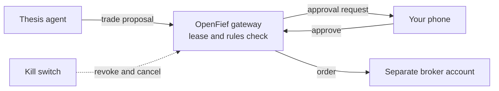

# OpenFief

**Give your AI agents a fief, not the kingdom.**

## The problem

AI agents are getting good at reading filings, following news and arguing an investment case. Letting one trade on your brokerage account is a different matter. A bad prompt, a poisoned news article or a model bug can spend money you never meant to risk, and that has already happened to agents controlling crypto wallets.

The tools are split. Portfolio trackers show what you own. Agent frameworks analyse stocks. Nothing in between gives an agent a fixed slice of capital and enforces that limit outside the model. And if you hold assets at several brokers plus Polish treasury bonds, just seeing everything in one place is a chore.

## What OpenFief is

A planned open-source, self-hosted system with two jobs:

1. **Portfolio tracker.** Pulls holdings from your brokers and statement files into one view, with an API (application programming interface) and a few charts.
2. **Orchestrator for AI investment agents.** Runs the agents you pick and gives each a *fief*: a revocable capital lease carved out of the riskier part of your portfolio. An order gateway, a budget ledger, policy rules and separate broker accounts enforce the limit. The agent cannot talk its way past them.

Agents are plugins, written by you or by others. OpenFief runs and constrains them.

## How it looks

A planned walkthrough for one user:

1. **Connect brokers.** Interactive Brokers through its official interfaces, XTB (a Polish broker) through statement files, treasury bonds valued from their terms and official inflation data.
2. **One dashboard.** All accounts consolidated, with charts and an API for your own scripts.
3. **Model portfolio.** You set a target allocation. A model running on your own machine summarizes drift and suggests adjustments. Your full holdings never leave your hardware.
4. **Spawn a thesis agent.** "Company X is undervalued; three-year horizon." Give it a fief of 5,000 PLN (Polish złoty). It may use a cloud model for research, but it sees only its thesis, public data and its own fief.
5. **The agent proposes a trade:** a limit order, its reasoning, and what would prove the thesis wrong. The gateway checks it against the lease and your rules.
6. **Approve it on your phone.** The order goes to a separate broker account holding only capital set aside for agents.
7. **Pull the kill switch** if something looks off. The agent loses its trading rights and its open orders are cancelled. The rest of your portfolio is untouched.

## What makes it different

- **Limits live outside the model.** Code and broker account separation enforce the lease, not a prompt.
- **You choose which model sees what.** A local model for your full holdings; cloud models only for what you allow.
- **Bring your own agents, models and brokers.** Agents, model providers, connectors and tax rules are all plugins.
- **Polish investors first.** XTB, Interactive Brokers, treasury bonds and Polish tax rules (such as the PIT-38 capital-gains return) in a swappable jurisdiction pack.
- **Fully open source and self-hosted.**

## What it is not

- **Not a robo-advisor.** You choose the strategy, the agents and the limits.
- **Not a hosted trading service.** Agents trade only your own accounts, on your own machines. A hosted version may come later; the current proposal limits it to tracking and analytics.
- **Not investment advice.** You use it at your own risk.

## Status and how to help

Design phase, no code yet. Useful now:

- Critique of the security model, especially the lease guarantees.
- Experience with the Interactive Brokers API or its linked accounts as a Polish resident.
- Polish tax tooling and treasury bond valuation.
- Agent authors who want to plug in.
- A legal view on Polish and EU rules for automated trading software.

Open an issue at github.com/arkadiuss/openfief.

What is decided versus only proposed: see [DESIGN.md](DESIGN.md).
