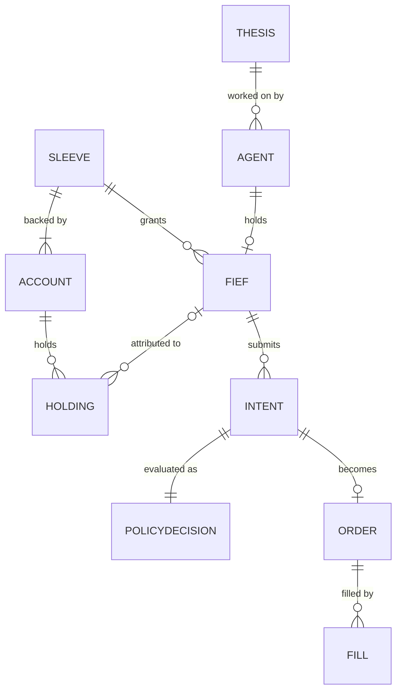
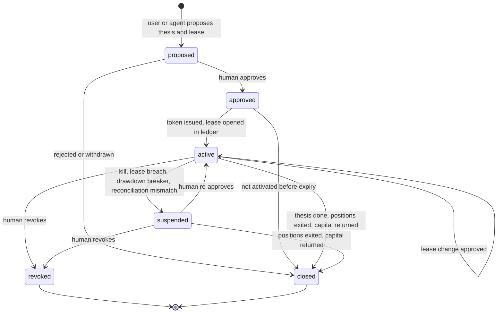
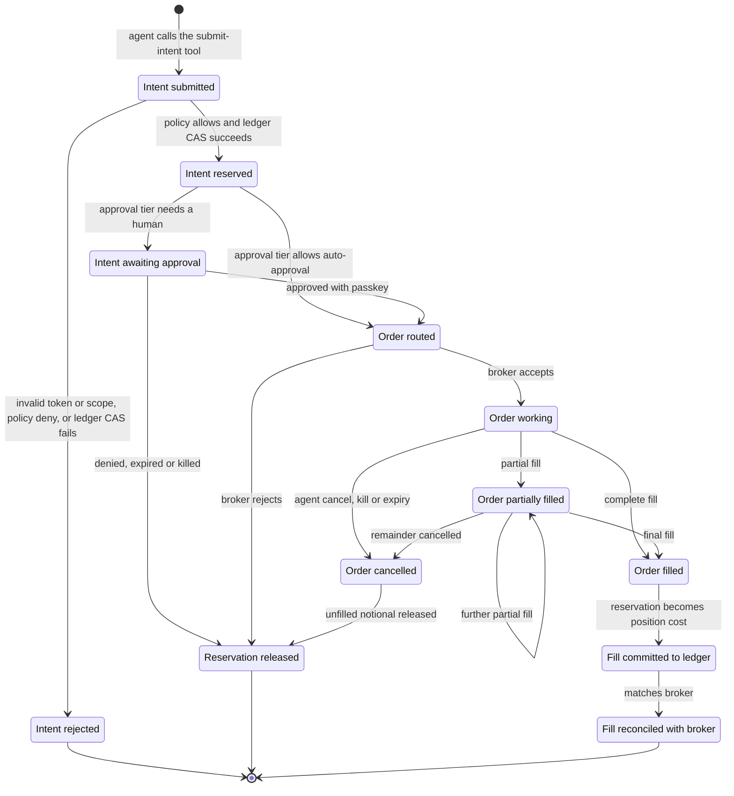

# OpenFief specification

| | |
|---|---|
| Status | Draft, derived from [DESIGN.md](DESIGN.md). Design phase, no code. |
| Date | 2026-10-25 |
| Authority | Ground rules in DESIGN.md §2 win over anything here. |

## 0. Tag legend

| Tag | Meaning |
|---|---|
| **[GR-n]** | Ground rule written by the author. Decided. |
| **[AC-n]** | Author context. Not a rule. |
| **[R-n]** | Research finding, as of 2026-10-25, re-verify before relying. URLs in DESIGN.md §4. |
| **[P-n]** | Proposal from the 2026-10-25 research session with Claude. Not decided. |
| **[P-CC-n]** | Proposal added by Claude Code. Not decided. |
| **[T-n]** | Tension or interpretation awaiting the author (DESIGN.md §7). |
| **[OQ-n]** | Open question (DESIGN.md §8). |
| **FR-n / NFR-n / SEC-n** | Functional, non-functional and security requirements in this document. Each lists what it traces to. |

Requirement keywords follow RFC 2119 (the IETF's 1997 "Key words for use in RFCs to Indicate Requirement Levels"):

- **MUST** is used only for requirements that trace to a ground rule.
- **SHOULD** marks requirements that trace only to proposals. Each is marked *pending author approval*.
- **MAY** marks something a ground rule permits but does not require.

P-CC-1 to P-CC-14 are defined in DESIGN.md §5.2 and §6. P-CC-15 to P-CC-22 are introduced here:

| Tag | Proposal | Where |
|---|---|---|
| P-CC-15 | v0 means M0 to M3, with the scope split in §1.2 and the v0 exclusions in §8 | §1.2, §8 |
| P-CC-16 | v0 runs on a single host as containers, Kubernetes optional, for a user who can operate it | NFR-4 |
| P-CC-17 | The IBKR connector reads through Flex Queries in M0 | FR-7 |
| P-CC-18 | Domain model attributes, relations and supporting entities | §3 |
| P-CC-19 | Lifecycle transitions and triggers | §4 |
| P-CC-20 | Plugin contract operations | §5 |
| P-CC-21 | Event emitters, consumers, payloads and effects, plus the "approval decided" and "policy denied" events | §6 |
| P-CC-22 | Milestone goals, preconditions and acceptance criteria | §7 |

The section structure, the entity names in §3, the lifecycle states of the fief in §4.1, the event names in §6 and the milestone names in §7 come from the author's brief for this document. They are not ground rules. Detail inside them (attributes, transitions, payloads, acceptance criteria) is tagged where it appears.

## 1. Scope

### 1.1 Product

- **Name:** OpenFief [GR-14].
- **Target users:** technical individual investors; a niche, and that is fine [GR-2].
- **What it is:** an orchestration layer that runs thesis agents; the agents are separate products [GR-9]. It starts as a typical portfolio summarizer [GR-3]. Whether the tracker is in scope or an external dependency is open [T-9, OQ-15].

### 1.2 v0 versus later [P-CC-15]

v0 means milestones M0 to M3 (§7). The split below is a proposal, pending author approval.

| Area | v0 (M0 to M3) | Later |
|---|---|---|
| Tracking | IBKR read, XTB statement import, treasury bond import and valuation, consolidated view, holdings API, charts | mBank and Revolut imports (P-10) |
| Execution | IBKR paper account, then one live IBKR linked cash account | Trading 212 as an optional venue (P-10, R-4); scaling across several live fiefs (P-8) |
| Control plane | Gateway, capability tokens, ledger, policy engine, approvals, kill switches, reconciliation, audit log | Automated track-record-based allocation (P-8) |
| Agents | Agent contract, one default agent (OQ-4), model router, maintainer (GR-4) | Short-term execution engine (OQ-5) |
| Jurisdiction | Plugin interface; Polish pack with bond valuation and IKE/IKZE account tagging | PIT-38 and PIT/ZG reports (P-12); other jurisdictions |
| Hosting | Self-hosted, single user | Hosted subscription, multi-user (P-11, after OQ-7) |

## 2. Requirements

Format: ID, statement, then **Traces to:**. SHOULD requirements are *pending author approval*.

### 2.1 Functional

**Portfolio tracking**

- **FR-1** OpenFief MUST work as a portfolio summarizer that consolidates what the user holds across connected accounts into one view. **Traces to:** GR-3.
- **FR-2** OpenFief MUST give typical API access to what the user holds. **Traces to:** GR-3. See OQ-10.
- **FR-3** OpenFief MUST provide a couple of charts over the portfolio. **Traces to:** GR-3.
- **FR-4** OpenFief MUST provide connector plugins for XTB, Interactive Brokers and Polish retail treasury bonds. **Traces to:** GR-3. How each connector obtains data is T-1 and T-2.
- **FR-5** *(pending author approval)* The XTB connector SHOULD be read-only via statement import and SHOULD NOT use reverse-engineered clients. **Traces to:** P-10 (context: R-2, T-1).
- **FR-6** *(pending author approval)* The treasury bond connector SHOULD import holdings and compute valuation from series terms and GUS CPI. **Traces to:** P-10, P-12 (context: R-5, T-2).
- **FR-7** *(pending author approval)* The IBKR connector SHOULD read holdings and transactions through Flex Queries in M0 [P-CC-17], and IBKR SHOULD be the primary execution venue. **Traces to:** P-10, P-CC-17 (context: R-3, OQ-19).
- **FR-8** *(pending author approval)* Trading 212 SHOULD be an optional execution venue; mBank and Revolut SHOULD be read-only via import. **Traces to:** P-10 (context: R-4).
- **FR-9** *(pending author approval)* OpenFief SHOULD run Wealthfolio or Ghostfolio as a separate service and use its API/MCP rather than fork it. **Traces to:** P-1 (context: OQ-2, OQ-15).

**Model portfolio**

- **FR-10** OpenFief MUST hold a model strategy (model portfolio) that the user can follow and adjust. **Traces to:** GR-4.
- **FR-11** OpenFief MUST provide an agentic model that summarizes and maintains the model portfolio. **Traces to:** GR-4.
- **FR-12** The maintainer's model MUST be configurable, and a locally hosted model MUST be a valid choice for it. **Traces to:** GR-4, GR-11.
- **FR-13** *(pending author approval)* The maintainer SHOULD have no transaction tools in v0. It SHOULD receive precomputed figures and output a summary and a proposed model-portfolio change for the user to apply. **Traces to:** P-CC-11 (context: OQ-12).

**Thesis agents and orchestration**

- **FR-14** The user MUST be able to spawn agents for a thesis, for example a single company. **Traces to:** GR-5.
- **FR-15** OpenFief MUST support long-term theses as the main case and MUST allow short-term ones. **Traces to:** GR-5.
- **FR-16** OpenFief MUST let thesis agents do fundamental analysis and watch news. **Traces to:** GR-5.
- **FR-17** OpenFief MUST be the orchestration layer that runs thesis agents. Agents are separate products and not part of this project. **Traces to:** GR-9.
- **FR-18** Agents MUST be plugins, so any agent that implements the agent contract (§5.2) can be used. **Traces to:** GR-10.
- **FR-19** The default agent MUST be either the author's agent or pfranczyk's per-thesis agents (github.com/Looted). Which one is OQ-4. **Traces to:** GR-10.
- **FR-20** The user MUST be able to choose a third-party agent instead, such as Interactive Brokers' agents. **Traces to:** GR-10. See T-3, T-10, OQ-13.
- **FR-21** *(pending author approval)* OpenFief SHOULD show each agent's guarantee level: "gateway + broker" or "broker wall only". **Traces to:** P-7.
- **FR-22** Agents MUST wake up on a schedule and on events (§6). **Traces to:** GR-7.
- **FR-23** Agents MUST have tools to make transactions. **Traces to:** GR-7. Interpretation pending: T-5.
- **FR-24** *(pending author approval)* The transaction tool SHOULD be the gateway's intent API, exposed as an MCP tool and gated by a capability token. Agents SHOULD send order intents with a thesis and invalidation conditions, never raw broker orders. **Traces to:** P-3 (context: T-5).
- **FR-25** *(pending author approval)* Agent-to-orchestrator traffic SHOULD use A2A; tools the orchestrator exposes SHOULD use MCP. **Traces to:** P-3.

**Fiefs**

- **FR-26** Each thesis agent MUST have a budget leased from the offensive part of the portfolio. **Traces to:** GR-6.
- **FR-27** *(pending author approval)* Fiefs SHOULD follow the lifecycle in §4.1. **Traces to:** P-4(e), P-CC-19.
- **FR-28** *(pending author approval)* A new thesis or a lease increase SHOULD always require human approval; other actions SHOULD use tiered approval. **Traces to:** P-4(e).
- **FR-29** *(pending author approval)* Capital SHOULD be allocated by track record: paper trading, then a small live lease, then scale up or cut. **Traces to:** P-8.
- **FR-30** *(pending author approval)* OpenFief SHOULD provide kill switches per agent, per sleeve and global, plus a drawdown circuit breaker. A kill SHOULD revoke tokens, cancel working orders and suspend fiefs, and SHOULD NOT liquidate positions automatically. **Traces to:** P-4(f), P-CC-6 (context: OQ-16).

**Models**

- **FR-31** Every model MUST be configurable per role. **Traces to:** GR-11.
- **FR-32** Thesis agent roles MUST accept cloud-hosted frontier models. **Traces to:** GR-8.

**Jurisdiction**

- **FR-33** Regulatory logic MUST be pluggable as jurisdiction plugins. **Traces to:** GR-13.
- **FR-34** Poland MUST be the first jurisdiction plugin. **Traces to:** GR-13.
- **FR-35** *(pending author approval)* The Polish pack v1 SHOULD cover PIT-38 and PIT/ZG, bond valuation (COI, EDO etc.) and IKE/IKZE rules. **Traces to:** P-12 (context: R-5, R-9).

**Hosting**

- **FR-36** OpenFief MAY eventually also be offered as a hosted subscription. **Traces to:** GR-1.
- **FR-37** *(pending author approval)* A hosted offering SHOULD cover tracking, valuation, analytics and tax only. Agent execution SHOULD stay self-hosted on the user's own account. A hosted offering SHOULD NOT launch before a legal opinion. **Traces to:** P-11 (context: R-7, T-4, OQ-7).

### 2.2 Non-functional

- **NFR-1** OpenFief MUST be fully open source. **Traces to:** GR-1. License: OQ-1, OQ-9.
- **NFR-2** OpenFief MUST be self-hosted: every OpenFief component runs on infrastructure the user controls. **Traces to:** GR-1.
- **NFR-3** OpenFief MUST target technical individual investors. **Traces to:** GR-2.
- **NFR-4** *(pending author approval)* v0 SHOULD run on a single host as containers, with Kubernetes optional, and SHOULD assume a user who can operate such a host and edit configuration files. **Traces to:** P-CC-16.
- **NFR-5** *(pending author approval)* The control plane SHOULD be written in Go, use NATS JetStream for events and NATS KV compare-and-set for the ledger. **Traces to:** P-9 (context: AC-1).
- **NFR-6** *(pending author approval)* Bond valuation and tax computations SHOULD be deterministic and reproducible from their inputs (series terms, CPI, NBP rates) and SHOULD record the rule version used. **Traces to:** P-12 (context: R-5, R-9).
- **NFR-7** *(pending author approval)* Every intent, policy decision, approval, order, fill, lease change and kill SHOULD be recorded in an append-only, hash-chained audit log, with source tags, models per role and prompt/response hashes. **Traces to:** P-5, P-CC-7 (context: R-8).

### 2.3 Security

- **SEC-1** The privacy and security model MUST come first and MUST be designed per use case. DESIGN.md §6 holds it. **Traces to:** GR-12.
- **SEC-2** OpenFief MUST provide strong guarantees that a thesis agent can never get more of the portfolio than its lease. **Traces to:** GR-6. See T-3, T-7, T-8.
- **SEC-3** The user MUST be able to choose which model sees what. **Traces to:** GR-11.
- **SEC-4** *(pending author approval)* SEC-2 SHOULD be enforced in layers that do not depend on any model's behaviour: broker wall, gateway with capability tokens, budget ledger, policy engine, human approval, kill switches (DESIGN.md §6.2). IBKR's TWS precautionary settings are not one of the layers (R-3). **Traces to:** P-4.
- **SEC-5** *(pending author approval)* Each offensive sleeve SHOULD be walled in its own IBKR linked cash account without margin. An agent with guarantee level "broker wall only" SHOULD get a dedicated linked account holding exactly its fief. **Traces to:** P-4(a), P-7, P-CC-13 (context: OQ-3, OQ-20).
- **SEC-6** *(pending author approval)* Only the order gateway SHOULD hold trading credentials, encrypted at rest. Agents SHOULD hold only capability tokens scoped to instruments, side, max notional and expiry. **Traces to:** P-4(b), P-CC-8.
- **SEC-7** *(pending author approval)* The budget ledger SHOULD reserve an intent's notional atomically with compare-and-set when the policy engine allows it, before approval and before submission, and SHOULD measure lease usage per P-CC-1. **Traces to:** P-4(c), P-9, P-CC-1, P-CC-2 (context: OQ-11).
- **SEC-8** *(pending author approval)* A pre-trade policy engine (OPA/Rego) SHOULD enforce allow-lists, limit orders only, price bands, rate limits, no leverage and liquidity filters such as minimum ADV. **Traces to:** P-4(d).
- **SEC-9** *(pending author approval)* The gateway SHOULD fail closed: if the ledger, policy engine, audit log or reconciliation state is unavailable or stale, it rejects new intents but still processes cancellations. **Traces to:** P-CC-3.
- **SEC-10** *(pending author approval)* The gateway SHOULD reconcile the ledger with the broker's cash, positions and open orders after every fill and on a schedule, and SHOULD suspend a fief on any unexplained difference. **Traces to:** P-CC-4.
- **SEC-11** *(pending author approval)* Approvals SHOULD require a passkey signature bound to the intent's hash, SHOULD expire, and SHOULD NOT be possible from a notification alone. **Traces to:** P-4(e), P-CC-5.
- **SEC-12** *(pending author approval)* Agents SHOULD run out-of-process and sandboxed, see only data scoped to their lease, and have no network egress except to OpenFief's model router, reader, MCP tools and A2A endpoint. **Traces to:** P-3, P-CC-9.
- **SEC-13** *(pending author approval)* Untrusted text SHOULD pass through a reader that emits typed, validated, source-tagged notes; deciders SHOULD see only those notes; a thesis SHOULD NOT change without two independent sources. **Traces to:** P-5 (context: R-6).
- **SEC-14** *(pending author approval)* A model router SHOULD map each role to allowed models and allowed data tiers (T0, TF, T1, T2), deny by default, keep T0 on local models by default, and let the user loosen a default only with an explicit warning. **Traces to:** P-6, P-CC-12 (context: T-6, OQ-14).
- **SEC-15** *(pending author approval)* A hosted offering SHOULD isolate tenants, use per-tenant encryption keys, support full export and deletion, and give models access to a tenant's T0 only on that tenant's opt-in. **Traces to:** P-11, P-CC-14.

## 3. Domain model

Entity names come from the author's brief. Attributes and relations are **[P-CC-18]**, pending author approval.

| Entity | What it is | Key attributes | Relations | Traces to |
|---|---|---|---|---|
| Account | Where assets are held: a broker account, an IBKR linked account, or a bond register reached by import. | Institution, connector, access mode (import, read API, execute), currency, tax wrapper (regular, IKE, IKZE), sleeve | Belongs to one Sleeve; has Holdings | GR-3, P-4(a), P-10, P-12 |
| Holding | A position in one instrument in one Account at a point in time. | Instrument (ISIN, the international securities identification number, plus venue symbol), quantity, tax lots, cost basis, market value, valuation source (market price or computed) | In one Account; may be attributed to a Fief | GR-3, R-5, R-9 |
| Sleeve | A part of the portfolio with one role. Defensive: not available to agents. Offensive: the part fiefs are leased from. | Kind (defensive or offensive), target weight from the model portfolio, drawdown limit, accounts | Has Accounts; an offensive Sleeve grants Fiefs | GR-4, GR-6, P-4(a), P-4(f); open: OQ-12, OQ-20 |
| Fief (lease) | A revocable capital lease from an offensive Sleeve to one Agent for one Thesis. | Lease amount and currency, used and available (per P-CC-1), state (§4.1), token scope (instruments, sides, max order notional, expiry), approval tier, stage (paper or live), guarantee level, backing account | Granted by one Sleeve; held by one Agent; funds one Thesis; has Intents | GR-6, P-4, P-7, P-8, P-13, P-CC-1 |
| Agent | One running instance of an agent plugin, spawned for one Thesis. | Plugin (publisher, version), model per role, data tiers granted, sandbox profile, subscribed events, guarantee level | Works on one Thesis; holds at most one active Fief | GR-5, GR-9, GR-10, GR-11, P-3, P-7 |
| Thesis | The investment idea agents work on. | Statement, instruments, horizon (long-term or short-term), invalidation conditions, sources, version history, status | Has Agents | GR-5, P-3, P-5 |
| Intent | An agent's request to trade, sent to the gateway instead of a broker order. | Fief, instrument, side, quantity or notional, limit price, time in force, thesis version, invalidation conditions, source references, token id | Under one Fief; has one PolicyDecision; becomes at most one Order | P-3, P-4(b) to (d) |
| Order | The broker order the gateway creates from an approved Intent. | Broker order id, account, limit price, quantity, state (§4.2) | From one Intent; has Fills | P-3, P-4(b) |
| PolicyDecision | The result of evaluating an Intent. | Allow, deny or needs approval; matched rule ids; policy version; ledger reservation id; inputs snapshot | For one Intent | P-4(c) to (e), R-8 |
| AuditEvent | One append-only record of a state change. | Sequence number, time, actor (user, agent or system), action, subject, payload hash, previous event hash | References any entity | R-8, P-CC-7 |

Supporting entities, also **[P-CC-18]**:

| Entity | What it is | Traces to |
|---|---|---|
| ModelPortfolio | Target weights per asset class or instrument, versioned; changes proposed by the maintainer and applied by the user. | GR-4, P-CC-11 |
| Fill | One execution against an Order: quantity, price, fees, time. | P-4(c), P-CC-4 |
| Approval | A human decision on an Intent or a Fief change, with the passkey assertion and expiry. | P-4(e), P-CC-5 |
| CapabilityToken | The scoped, attenuable token an Agent presents to the gateway. | P-4(b) |
| ResearchNote | A typed, source-tagged note emitted by the reader. | P-5 |

## 4. Lifecycles

### 4.1 Fief

States come from the author's brief. Transitions and triggers are **[P-CC-19]**, pending author approval.

- **proposed:** no token, no reservation. A new thesis always needs approval (P-4(e)).
- **active:** the only state in which the agent's token is valid.
- **suspended:** token invalid, working orders cancelled, positions kept (P-CC-6). Every transition out needs a human.
- **revoked:** authority withdrawn for good. Remaining positions pass to the user, outside any fief.
- **closed:** orderly end. Capital is back in the offensive sleeve.
- A lease increase keeps the fief active but needs approval (P-4(e)).

### 4.2 Intent, order, fill

**[P-CC-19]**, pending author approval. Reservation before approval follows P-CC-2.

Each fill, partial or final, moves its notional from reserved to committed in the ledger. On cancellation only the unfilled remainder is released. A reconciliation mismatch at any point raises a lease-breach event (§6).

## 5. Plugin contracts

Plugin types come from P-2. The operations below are interface outlines, not code, and are **[P-CC-20]**, pending author approval.

### 5.1 Connector

| Aspect | Outline |
|---|---|
| Purpose | Bring broker, registry or data-source data into OpenFief. Execution connectors also carry orders. IBKR is a connector; IBKR's own AI is an agent (P-2). |
| Manifest | Institution, version, capabilities (read holdings, read transactions, statement import with file formats, market data, execute live, execute paper), authentication method. |
| Read operations | List accounts. Get a holdings snapshot as of a date. Get transactions and tax lots since a date. Import a statement file into normalized transactions. Get quotes and reference data (data connectors). |
| Execute operations | Callable only by the gateway: place a limit order from an approved intent, cancel an order, get order status, stream fills, get cash and positions for reconciliation. |
| Normalization | Instruments by ISIN where available plus venue symbol. Every amount with its currency. Every record tagged with source and import id, so re-imports are idempotent. |
| Credentials | Encrypted at rest; trading credentials only in the gateway (P-4(b), P-CC-8). Never passed to agents or models. |
| Failure | Errors mark data as stale. An unavailable execution connector makes the gateway reject new intents (P-CC-3). |
| Traces to | GR-3, P-2, P-4(b), P-10, P-CC-3, P-CC-8, P-CC-20 |

### 5.2 Agent

| Aspect | Outline |
|---|---|
| Purpose | A thesis agent product that OpenFief runs (GR-9, GR-10). |
| Manifest | Publisher, version, roles it needs (e.g. reader, decider) with model requirements (tool use, context length), data tiers requested (T1, T2, TF), events it subscribes to, tools it needs, sandbox resources, guarantee mode (gateway-mediated or broker-native, P-7). |
| Transport | Agent and orchestrator over A2A; tools over MCP served by OpenFief (P-3). |
| Inbound | Wake with an event and a context: thesis, TF snapshot, typed research notes, recent decisions. Never T0. |
| Tools OpenFief offers | Read fief state. Read market data. Search news and filings through the reader (typed notes only). Register or clear price triggers. Submit an intent. Cancel an intent. Propose a thesis update. Request a lease change (always needs approval, P-4(e)). Call models through the router (P-CC-9). |
| Outbound | Intents with instrument, side, size, limit price, time in force, thesis reference, invalidation conditions and source references. Research notes. A status summary for the user. |
| Constraints | Out-of-process and sandboxed; egress only to OpenFief (P-3, P-CC-9). Capability token scoped to its fief (P-4(b)). No broker credentials. |
| Broker-native agents | For example IBKR's: they do not use the intent path. Registered with guarantee level "broker wall only" and connected only to a dedicated linked account (P-7, P-CC-13). OpenFief observes through a read connector. |
| Traces to | GR-5, GR-7, GR-9, GR-10, GR-11, P-2, P-3, P-5, P-7, P-CC-9, P-CC-13, P-CC-20 |

### 5.3 Jurisdiction pack

| Aspect | Outline |
|---|---|
| Purpose | All country-specific regulatory and tax logic (GR-13). |
| Manifest | Country, supported tax years, version, rule sources. |
| Operations | Classify accounts and tax wrappers (e.g. IKE, IKZE). Value instruments with statutory valuation (bonds from series terms and CPI, R-5). Compute realized gains per tax year (FIFO, NBP table A rate from the day before, R-9). Produce tax-form data (PIT-38, PIT/ZG per country). Supply local limits to the policy engine as policy data. Supply required disclosures. |
| Inputs | Normalized transactions and holdings (T0); reference data (CPI, exchange rates). |
| Outputs | Deterministic, reproducible results carrying the rule version (NFR-6). |
| Models | None. Deterministic code. |
| Traces to | GR-13, P-2, P-12, R-5, R-9, P-CC-20 |

### 5.4 Model provider

| Aspect | Outline |
|---|---|
| Purpose | Supply models to roles through the router (GR-11). |
| Manifest | Provider, location (local, or cloud with region), declared data retention and training use, models with capabilities (tool use, context window, structured output), pricing. |
| Operations | List models. Generate (chat with tools, structured output). Embeddings (optional). Report usage for metering. |
| Router binding | User configuration maps role to allowed models to allowed tiers; deny by default (P-6, P-CC-12). |
| Constraints | Local providers only for T0 by default (P-6). Never receives credentials. Every call logged with role, tier, model and hashes (P-CC-7). |
| Traces to | GR-4, GR-8, GR-11, P-2, P-6, P-CC-7, P-CC-12, P-CC-20 |

## 6. Event catalogue

The first six events come from the author's brief. Emitters, consumers, payloads and effects, and the last two events, are **[P-CC-21]**, pending author approval. Transport per P-9 (NATS JetStream).

| Event | Emitted by | Delivered to | Key payload | Effect | Traces to |
|---|---|---|---|---|---|
| Scheduled wake | Orchestrator scheduler | The agent | Agent, fief, schedule id, time | Agent runs with its current context | GR-7 |
| Price trigger | Orchestrator, from market data | The agent | Instrument, condition the agent registered (level, percentage move, invalidation price), observed price, time | Agent wakes; may submit or cancel intents | GR-7 |
| News trigger | Reader | The agent's decider | Typed research note: instrument, claim, source tags, number of independent sources, reader model | Agent wakes with a structured note, never raw text | GR-5, GR-7, P-5 |
| Fill | Gateway, from the connector | Agent, ledger, audit log, UI | Order id, intent id, quantity, price, fees, time | Ledger moves notional from reserved to committed; reconciliation runs; agent wakes | GR-7, P-4(c), P-CC-4 |
| Lease breach | Ledger, reconciler or drawdown breaker | User, gateway, agent | Fief, kind (over lease, unexplained broker difference, drawdown limit), amounts | Fief suspended; working orders cancelled; user notified | GR-6, P-4(f), P-CC-4 |
| Kill | User or drawdown breaker | Gateway, orchestrator, agents in scope | Scope (agent, sleeve, global), actor, reason | Tokens revoked; working orders cancelled; fiefs suspended; no liquidation | P-4(f), P-CC-6 |
| Approval decided | Approval service | Agent, gateway, audit log | Intent or fief change id, decision, approver, passkey assertion reference | Intent routed or reservation released | P-4(e), P-CC-5 |
| Policy denied | Policy engine through the gateway | Agent, audit log | Intent id, matched rule ids, policy version | Intent rejected; agent may revise it | P-4(d) |

## 7. Milestones

Milestone names and scope lines come from the author's brief. Goals, preconditions and acceptance criteria are **[P-CC-22]**, pending author approval. Amounts such as 5,000 PLN are examples, not a decision on base currency.

### M0: Tracker and Polish imports

Goal: the author sees every holding in one place. No models involved.

Acceptance criteria:

1. The author's real IBKR, XTB and treasury bond holdings appear in one consolidated view. Totals match broker statements to 0.01 of the account currency on a chosen date.
2. Bond valuation for every held series matches maciekmm/obligacje or krbob/edo-calculator (R-5) on the same date to within 0.01 PLN.
3. Re-importing the same statement creates no duplicate transactions.
4. The holdings API returns positions per account and consolidated, with a valuation source per holding, and requires authentication.
5. At least two charts, for example allocation and value over time.
6. Outbound traffic goes only to sources the user configured (brokers, CPI and exchange-rate data), verified from egress logs.
7. DESIGN.md §6 UC-0 accepted by the author before implementation starts (GR-12).

### M1: Control plane on paper trading

Goal: prove the GR-6 guarantees with no language model involved. Test agents are scripted. Execution uses an IBKR paper account through the same connector, plus an in-process simulated broker for deterministic tests.

Acceptance criteria:

1. A scripted agent with a 5,000 PLN fief sends 50 concurrent intents whose total exceeds the lease. Accepted notional never exceeds the lease, across repeated runs.
2. Intents outside the token's scope (instrument, side, notional, expiry) are rejected. Market orders are rejected. Intents breaching price bands, rate limits or minimum ADV are rejected. Each rejection has a PolicyDecision naming the rule.
3. The agent process holds no broker credentials and has no network route to the broker or the internet; attempts are tested and fail.
4. Stopping the ledger, the policy engine or the audit log makes the gateway reject all new intents, while cancellations still work.
5. Kill at agent, sleeve and global scope revokes tokens and sends cancellations for all working orders within 5 seconds, and sells nothing.
6. A manual trade placed directly in the paper account is caught by reconciliation and suspends the affected fief.
7. A new fief and a lease increase each require approval. Approval needs a passkey, a notification alone cannot approve, and approvals expire.
8. The audit log reconstructs intent, decision, approval, order and fill for every test case, and its hash chain verifies.
9. Every transition in §4.1 and §4.2 is exercised by a test.

### M2: Agents

Goal: real agent plugins on paper.

Acceptance criteria:

1. The default agent (OQ-4) runs one thesis end to end on paper: it wakes on schedule, price and news events and submits intents with thesis and invalidation conditions.
2. A second agent runs under the same contract without changes to OpenFief.
3. The maintainer runs on a local model, produces a summary and a proposed model-portfolio change, and has no transaction tool.
4. A thesis agent runs on a cloud model. A test that routes T0 data to a cloud-bound role is blocked and audited.
5. On a prompt-injection test set (for example adversarial news in the style of R-6), injected text never reaches a decider as raw text and no thesis changes on a single source. Where an injected intent is forced through, all M1 criteria still hold.
6. The UI shows each agent's guarantee level.
7. Each agent's paper track record (returns, drawdown, invalidation conditions hit) is recorded as input to P-8.

### M3: First small live fief

Goal: one real fief with real money, on the author's own account.

Preconditions: OQ-3 answered; T-5 and OQ-11 decided; the agent has passed M2 on paper for a period the author sets.

Acceptance criteria:

1. One IBKR linked cash account without margin, funded only with the fief amount. The gateway is the only holder of trading credentials for it.
2. Every live order goes through the gateway and needs human approval for the first period the author sets.
3. A live kill drill with a working order: the order is cancelled and the token revoked.
4. Reconciliation is clean every day for the first 30 days, or every difference is explained in the audit log.
5. The audit log is complete for every live order.
6. Router and egress logs show no T0 data sent to a cloud model.
7. Used only on the author's own account (R-7).

## 8. Out of scope

| Item | Traces to |
|---|---|
| Managing other people's money or giving them personalised buy/sell recommendations | R-7, P-11 |
| Agent execution in any hosted offering | P-11 |
| Building thesis agents inside this project | GR-9 |
| Reverse-engineered XTB clients, or any connector that breaches a broker's terms | R-2, P-10 |
| Margin and leverage | P-4(a), P-4(d) |
| Market orders | P-4(d) |
| Counting IBKR TWS precautionary settings as a control | R-3 |
| Latency-sensitive or high-frequency strategies in v0 | P-CC-15 (context: OQ-5) |
| Native mobile apps in v0 (approvals use the web UI) | P-CC-15, P-CC-5 |
| Jurisdictions other than Poland in v0 | GR-13, P-CC-15 |
