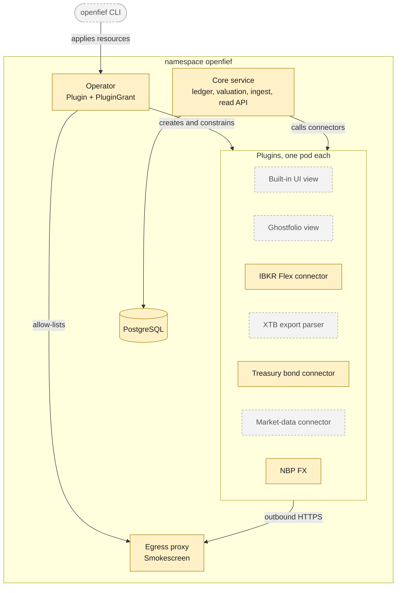
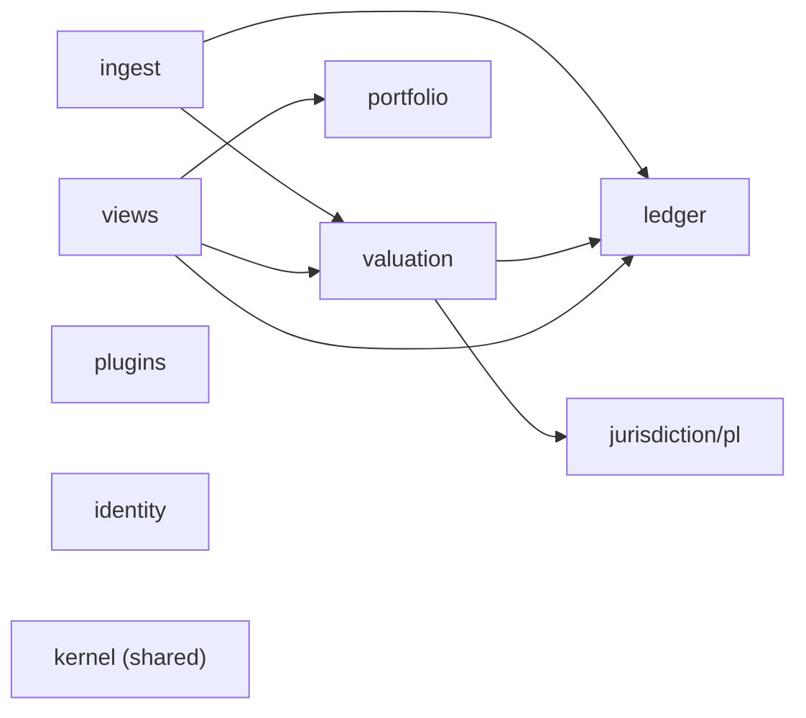
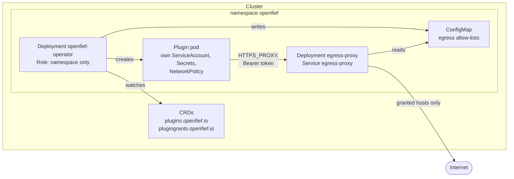

OpenFief runs in the owner's own Kubernetes cluster. A core written in Go owns the record of every holding and transaction. Everything that talks to the outside world is a plugin: its own container, with only the permissions the owner granted it. An operator turns plugin resources into running, isolated workloads, and an egress proxy is the only way out to the internet. This page shows the whole design for M0 (the first milestone, a tracker with Polish imports) and marks what is built today.

## The system and its neighbors

The owner reaches OpenFief through `kubectl port-forward` by default (D-28), and installs plugins with the `openfief` command-line tool using their own kubeconfig (D-46). OpenFief reaches out only through the egress proxy, and only to hosts a plugin's grant allows (D-32).

## Parts, as designed and as built

Green parts are built, amber parts are partly built, and gray parts are decided but not built yet. The table below says what exists in each.

| Part | Decided in | Built today | Explained in |
|---|---|---|---|
| Operator | D-13, D-15, D-16, D-17, D-56 | `cmd/operator` and the reconciler in `internal/plugins/operator`, plus install manifests in `deploy/`. It deploys no plugin yet: image signature verification (D-56) isn't built, and the placeholder verifier refuses every image | [Operator](concepts/operator.md) |
| Egress proxy | D-32, D-63 | `cmd/egress-proxy`, embedding Smokescreen. It differs from D-63: a Bearer token instead of the proxy-URL password, the `openfief-core` audience, and `StartWithConfig` instead of `BuildProxy` | [Egress](concepts/egress.md) |
| Plugin model | D-11, D-16, D-42 to D-49, D-59 | Manifests, grants, effective permissions and workload compilation in `internal/plugins` | [Plugins](concepts/plugins.md) |
| Ledger | D-18, D-19, D-23, D-33 to D-35 | Domain, use cases and the PostgreSQL store in `internal/ledger`; no service runs it yet | [Ledger](concepts/ledger.md) |
| Valuation and FX | D-20, D-21, D-25, D-36 | Prices, FX lookups, valuation bases and the NBP client in `internal/valuation`; stored valuations (D-36) are not built | [Valuation](concepts/valuation.md) |
| Treasury bonds | D-9, D-25, D-37 | Polish bond rules in `internal/jurisdiction/pl` | [Treasury bonds](concepts/treasury-bonds.md) |
| Ingest | D-7, D-8, D-23, D-49 | Import batches and the IBKR Flex mapping and pull in `internal/ingest`; as a package of the core, not yet a plugin | [Ingest](concepts/ingest.md) |
| Shared kernel | (code organization) | Money, currency, quantity and dates in `internal/kernel` | [Kernel](concepts/kernel.md) |
| Portfolio | D-52 to D-54, D-61 | Sleeves in `internal/portfolio`; the model portfolio is not built | [Portfolio](concepts/portfolio.md) |
| Core service, read API, UI, Ghostfolio view, CLI, XTB parser, market data | D-2 to D-6, D-30, D-46, D-50, D-51 | Not built | [Status](https://arkadiuss.github.io/openfief/status/) |

The [status page](https://arkadiuss.github.io/openfief/status/) gives the same picture decision by decision, from the requirements in kibi.

## Bounded contexts

The code is organized by domain, following domain-driven design (Eric Evans, 2003). Each bounded context owns its terms, types and data. In this designed map from [code-organization.md](dev/code-organization.md), arrows point from a context to the contexts it reads:

The [code map](https://arkadiuss.github.io/openfief/reference/code-map/) draws the same map from the actual imports on every build. Comparing the two is a quick architecture check. Today the code has an arrow the design lacks: `ledger` imports `portfolio` to attach accounts to sleeves. And two designed arrows don't exist yet: `views` isn't built, and `valuation` doesn't read the ledger.

## In the cluster

Everything lives in the `openfief` namespace. A cluster admin installs the custom resource definitions once. The operator's permissions are a Role in that namespace only (D-15). There is no Ingress, LoadBalancer or tunnel (D-28).

The install manifests are in `deploy/`: `crds/` for the definitions and the namespace, `operator/` and `egress-proxy/` for the two workloads. The [operator](concepts/operator.md) and [egress](concepts/egress.md) pages walk through them.

## Main flows

Each flow is drawn on the page that explains it:

- **Importing a broker statement:** the IBKR Flex pull, mapping, and one ledger transaction per import. See [Ingest](concepts/ingest.md).
- **Recording and deriving holdings:** versioned transactions, FIFO lots and balance assertions. See [Ledger](concepts/ledger.md).
- **Valuing a bond lot:** interest periods, indexation, early-redemption fee and Belka tax. See [Treasury bonds](concepts/treasury-bonds.md).
- **Running a plugin:** from a `Plugin` and its `PluginGrant` to an isolated pod. See [Operator](concepts/operator.md).
- **A plugin calling out:** token, allow-list and address checks in the proxy. See [Egress](concepts/egress.md).
- **From commit to release:** hooks, CI, signed images and the demo deploy. See [Delivery pipeline](dev/pipeline.md).
