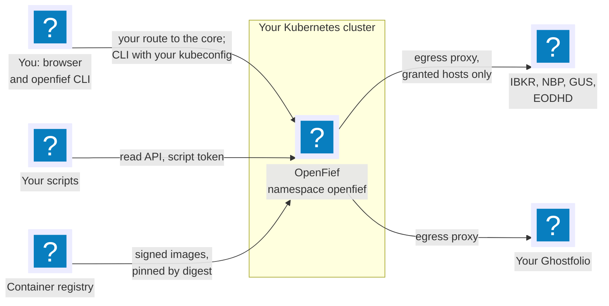
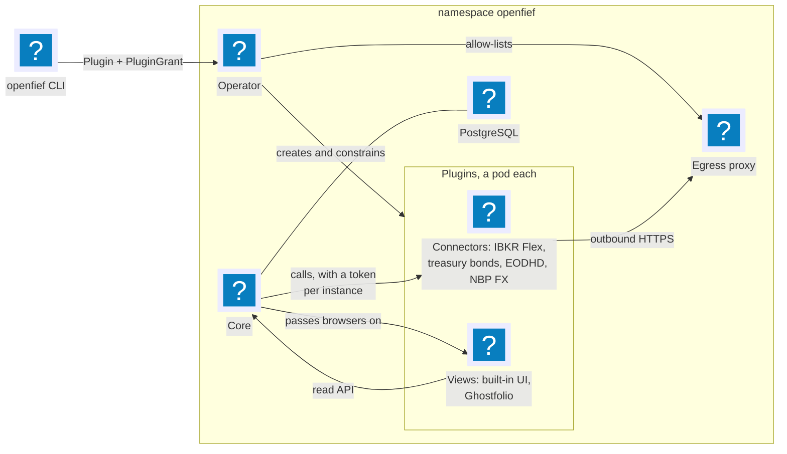
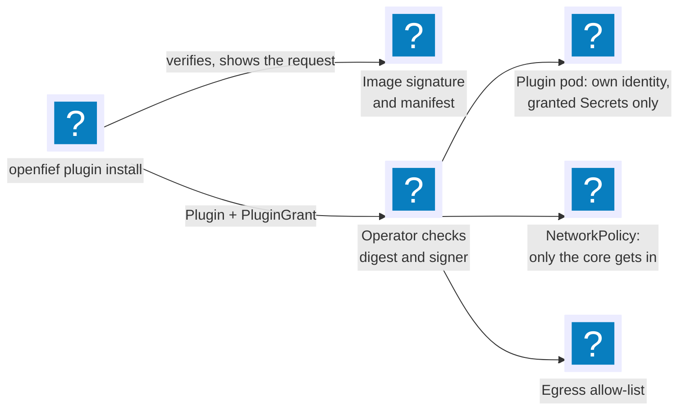
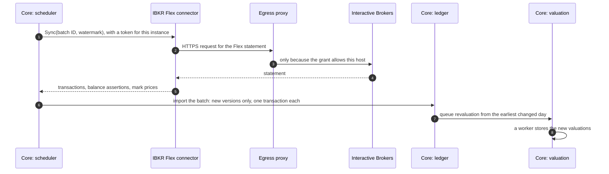
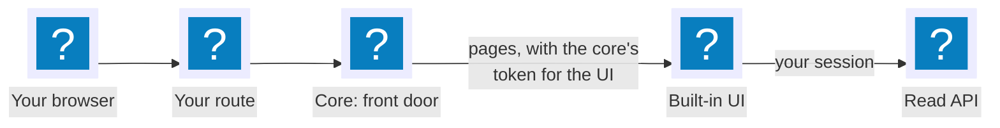
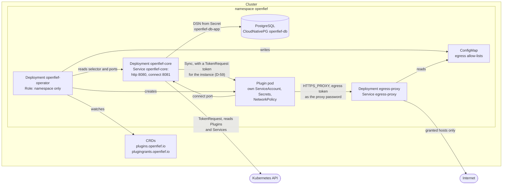
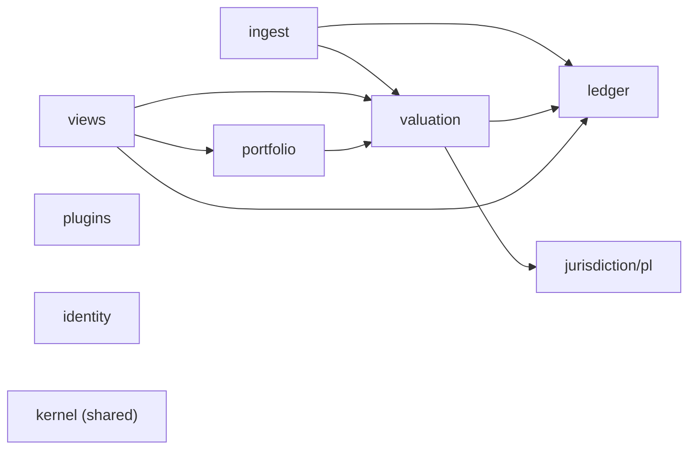
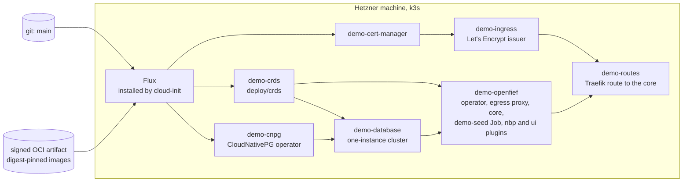

OpenFief runs in your own Kubernetes cluster and rests on one rule: the core owns the record, and everything that talks to the outside world is a plugin. The core is written in Go and holds every holding, transaction and valuation in PostgreSQL. Plugins run in their own containers with only the permissions you granted them: connectors bring data in, and views show it. An operator turns plugin resources into running, isolated workloads, and an egress proxy is the only way out to the internet. The agents of later milestones will be plugins too, under the same rule.

This page shows the parts, then follows them through three moments: installing a plugin, a statement coming in, and you opening the UI.

## The big picture

You reach OpenFief through one Service, the core's, exposed however you choose ([Expose OpenFief](guides/expose.md)). You manage plugins with the `openfief` command line and your own kubeconfig (D-46). OpenFief reaches out only through the egress proxy, and only to hosts a plugin's [grant](glossary.md) allows (D-32). It runs only images pinned by digest and signed by a signer you trust (D-17, D-56).

## The parts

| Part | What it does | Code | In depth |
|---|---|---|---|
| Core | Owns the record: the double-entry ledger, valuations of every holding on every day, and the read API. Schedules connector syncs, and is the only entry point for browsers and scripts | [`cmd/core`](../cmd/core/) | [Ledger](concepts/ledger.md), [Valuation](concepts/valuation.md), [Read API](concepts/read-api.md), [Identity](concepts/identity.md) |
| Operator | Turns `Plugin` and `PluginGrant` resources into isolated workloads, after checking that the image's digest is signed by a signer you trust | [`cmd/operator`](../cmd/operator/) | [Operator](concepts/operator.md) |
| Egress proxy | The only way out: each plugin reaches only the hosts its grant allows, and never a private address | [`cmd/egress-proxy`](../cmd/egress-proxy/) | [Egress](concepts/egress.md) |
| PostgreSQL | The record, one schema per bounded context, run by CloudNativePG (D-14) | | |
| Connectors | Bring data in: Interactive Brokers' Flex statements and mark prices, your treasury bond lots, end-of-day prices from EODHD, NBP's exchange rates | [`plugins/`](../plugins/) | [Ingest](concepts/ingest.md), [Treasury bonds](concepts/treasury-bonds.md), [Valuation](concepts/valuation.md) |
| Views | Show the record: the [built-in UI](concepts/ui.md) and the [Ghostfolio view](concepts/ghostfolio.md), which keeps your Ghostfolio in step with OpenFief | [`plugins/ui`](../plugins/ui/), [`plugins/ghostfolio`](../plugins/ghostfolio/) | [Built-in UI](concepts/ui.md), [Ghostfolio view](concepts/ghostfolio.md) |
| `openfief` CLI | Installs, upgrades (D-90), lists and removes plugins, with each instance's own Secrets (D-89), hosts from its config (D-75) and an in-cluster service it asks for (D-74), and prints the link for your first passkey, with your own kubeconfig | [`cmd/openfief`](../cmd/openfief/) | [Plugins](concepts/plugins.md#installing-with-the-cli), [Identity](concepts/identity.md#the-first-passkey) |
| Go SDK | What plugins are built on: the connector contract, the core's tokens and the proxy | [`sdk/go`](../sdk/go/) | [Build a plugin](guides/build-a-plugin.md) |

The money side lives inside the core, as bounded contexts: [kernel](concepts/kernel.md) types for exact decimals and money, the [ledger](concepts/ledger.md), [valuation](concepts/valuation.md), the Polish [treasury bond](concepts/treasury-bonds.md) rules and the [portfolio](concepts/portfolio.md)'s sleeves and model.

## Installing a plugin

A plugin starts as a request: its image's signed manifest says what it needs. You see that request and approve exactly it.

The CLI checks the image's signature the same way the operator will, shows the capabilities, hosts, Secrets and browser paths the manifest requests, and once you confirm, creates a `Plugin` and a `PluginGrant` that approves exactly those. The operator deploys only a digest signed by a trusted signer, compiles the approved permissions into a ServiceAccount, a Deployment, a NetworkPolicy and an egress allow-list, and keeps an upgrade that asks for more on the old version until you approve it. [Plugins](concepts/plugins.md) and [Operator](concepts/operator.md) explain each check.

## A statement comes in

Every six hours by default, and at once for a new instance, the core syncs each running connector. Here is one sync of the Interactive Brokers connector:

The import is idempotent: each transaction is keyed by its source and the institution's own ID, so the same statement twice changes nothing, and a changed row becomes a new version rather than an overwrite (D-18). The broker's own position snapshots are stored as balance assertions and checked against what the ledger derives. Revaluation runs in a queue inside PostgreSQL, so valuations catch up with every import, price and rate (D-36). [Ingest](concepts/ingest.md) and [Valuation](concepts/valuation.md) follow each step in the code.

Not every source is pulled. Treasury bond lots are typed in on an account's page and statements are uploaded there, and the core hands both to the connector bound to that account ([Ingest](concepts/ingest.md#statement-uploads)).

## You open the UI

Your browser only ever talks to the core. The core serves its own paths, the read API under `/v1` and its Connect services, and passes every other path on to the one view plugin with an approved browser path (D-81, D-114). Only that view ever sees your session cookie. The UI signs you in with a passkey through the core (D-26), then renders each page from the read API, with your session, exactly as your scripts would with a script token. [Built-in UI](concepts/ui.md) and [Identity](concepts/identity.md) explain the sign-in and the sessions.

## Security boundaries

Each line of defense holds even if the one before it fails:

- **Who may call whom.** Every plugin's NetworkPolicy admits the core alone, and the core presents a short-lived token whose audience is that one instance (D-59). Plugins call the core with their own projected ServiceAccount tokens (D-27).
- **Who may call out.** Plugins have no route to the internet except the egress proxy, which checks each request's token, the grant's hosts and the resolved address (D-32).
- **What may run.** Only digests signed by a trusted signer, checked offline against Sigstore's trust root (D-56). No setting turns this off.
- **What a plugin may read.** Only the Secrets its grant names. Connectors can't read your record at all (D-83).

One rule is wider than it should be. The core talks to the Kubernetes API, for example to request plugins' tokens. Kubernetes rewrites the API Service's address to the API server's own before NetworkPolicy sees a packet, and on k3s that is the node's address on port 6443, which differs per cluster. So the core's NetworkPolicy in [`deploy/core/networkpolicy.yaml`](../deploy/core/networkpolicy.yaml) allows port 6443 to any address (D-92). A compromised core could use that port to reach other hosts. To narrow it, add a kustomize overlay that sets the rule's `ipBlock` to your API server's addresses, listed by `kubectl get endpointslices -n default -l kubernetes.io/service-name=kubernetes`. A cluster whose API server listens on 443, as managed clusters do, patches the port too.

## In the cluster

Everything lives in the `openfief` namespace. A cluster admin installs the custom resource definitions once. The operator's permissions are a Role in that namespace only (D-15). Every Service is a ClusterIP Service, and nothing is exposed until you add a route (D-28).

The install manifests are in `deploy/`: `crds/` for the definitions and the namespace, `operator/`, `egress-proxy/` and `core/` for the three workloads. The core's Service `openfief-core` has two named ports on the same container port 8080: `http` (8080), the one a route points at, serving browsers, the read API and the health endpoints, and `connect` (8081), the port the operator hands to plugins (D-49). D-115 gives the plugin-only services, sign-in and the owner's entries, a container port of their own behind `connect`, so no route reaches them; today both Service ports still reach the one container port. Its NetworkPolicy admits plugin pods, and a route adds a policy admitting its proxy ([Expose OpenFief](guides/expose.md)). It lets the core reach only DNS, the database, plugin pods on their Connect port (8080) and the Kubernetes API server, as above.

The core's pods mount a Kubernetes API token. Its Role ([`deploy/core/rbac.yaml`](../deploy/core/rbac.yaml)) allows only `create` on its own `serviceaccounts/token` (resourceNames `openfief-core`) and `get`, `list` and `watch` on Plugins and Services, all in the `openfief` namespace. A ClusterRole allows it `create` on `tokenreviews` alone, with which it checks the tokens view plugins present (D-82). The database URL comes from CloudNativePG's Secret `openfief-db-app`, key `uri` (D-14, D-29). Every workload's pod sets `runAsNonRoot`, so each image (`cmd/<name>/Dockerfile`) runs as a numeric user, `65532:65532`, distroless's nonroot: the kubelet refuses to start a container whose image names its user, because it can't tell that a name isn't root.

## Bounded contexts

The code is organized by domain, following domain-driven design (Eric Evans, 2003). Each bounded context owns its terms, types and data. In this designed map from [code-organization.md](dev/code-organization.md), arrows point from a context to the contexts it reads:

The [code map](/reference/code-map/) draws the same map from the actual imports on every build. Comparing the two is a quick architecture check. Today the code has four arrows the design lacks: `ledger` imports `portfolio` to attach accounts to sleeves; `views` imports `jurisdiction/pl` to tell a treasury bond series from a listed instrument in the allocation; `ingest` imports `jurisdiction/pl` to check that a bond lot can be valued; and `portfolio` imports `ledger` to parse a model target's ISIN.

## The demo environment

[demo.openfief.dev](https://demo.openfief.dev), which the [Quickstart](quickstart.md) tours, runs this same install from `deploy/demo` on one Hetzner machine with k3s, holding synthetic data only (GR-12). Nothing pushes to it: cloud-init installs Flux, and Flux pulls each layer below, in dependency order. Five layers follow `main` in git. The `openfief` layer instead follows a signed OCI artifact that CI publishes after each push to `main`, with the images pinned to the digests whose signatures verified (D-17). Its route is an Ingress on k3s's bundled Traefik with a Let's Encrypt certificate, sending everything to Service `openfief-core`, which passes pages on to the [built-in UI](concepts/ui.md), and a demo-only NetworkPolicy lets Traefik reach the core. The demo's core accepts sign-ins from `https://demo.openfief.dev` and issues read-only demo sessions (`--demo-sessions`), which the UI offers as "View demo". Creating and destroying demos is in [demo.md](dev/demo.md).

Arrows between layers are Flux `dependsOn` edges. The CI side, from signed images to the published artifact, is on the [delivery pipeline](dev/pipeline.md) page. The synthetic data comes from `deploy/demo-data`, a Job that runs `cmd/demo-seed` against the demo database through the same ingest, ledger and valuation paths real data takes; [demo.md](dev/demo.md#demo-data) explains it.

## What is built

M0, the tracker, is being built in the open. Every part on this page exists in the code except the XTB statement parser (D-9, D-24). The `openfief` CLI is not packaged for release yet, and the Ghostfolio view can't name your Ghostfolio's host in its manifest yet, so it doesn't run from the first-party image. The [status page](/status/) shows every decision with the requirements, code and tests behind it, and each concept page ends with what is decided but not built in its area.
