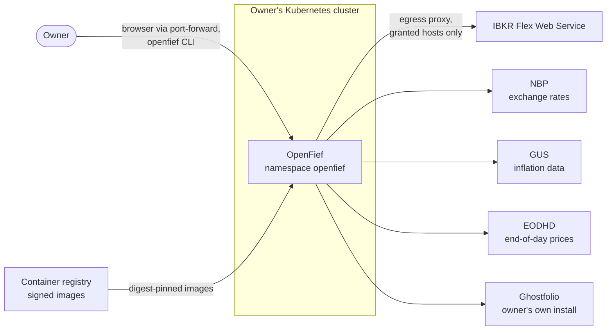
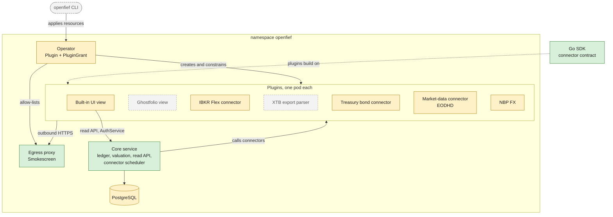
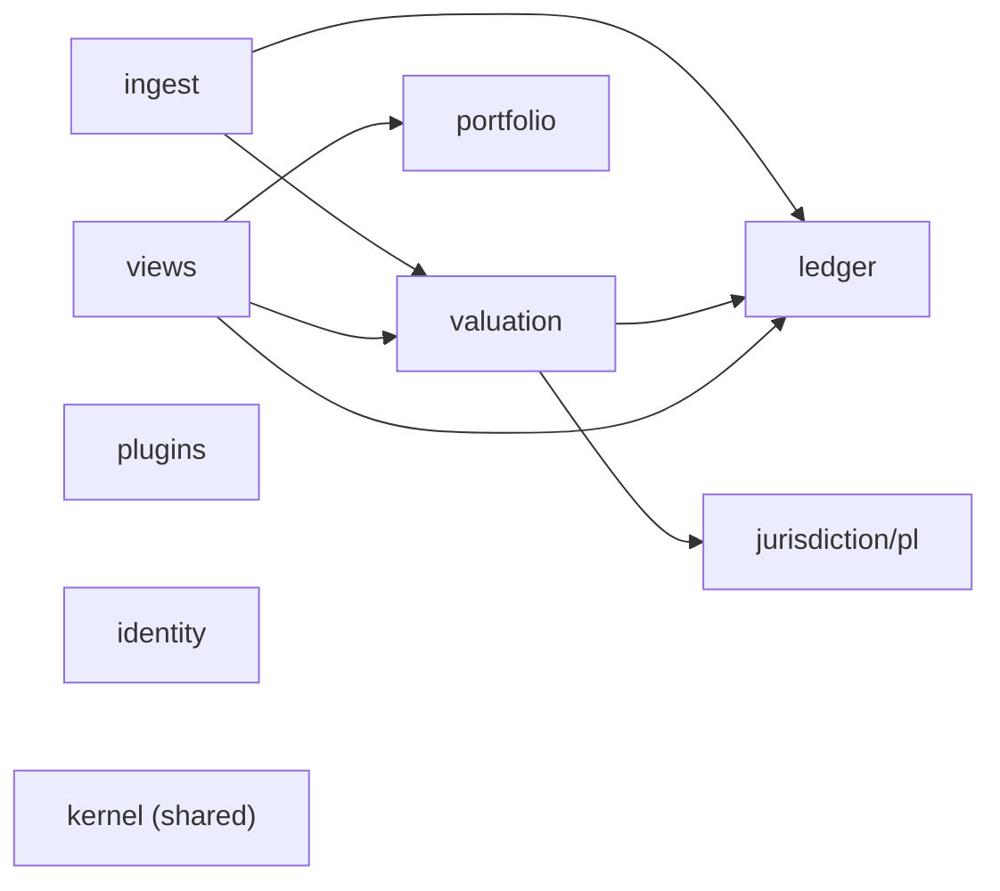
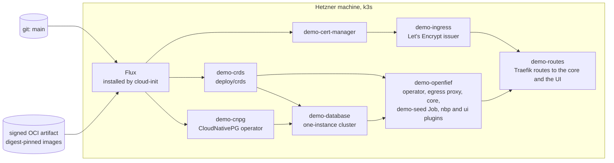

OpenFief runs in the owner's own Kubernetes cluster. A core written in Go owns the record of every holding and transaction. Everything that talks to the outside world is a plugin: its own container, with only the permissions the owner granted it. An operator turns plugin resources into running, isolated workloads, and an egress proxy is the only way out to the internet. This page shows the whole design for M0 (the first milestone, a tracker with Polish imports) and marks what is built today.

## The system and its neighbors

The owner reaches OpenFief through `kubectl port-forward` by default (D-28), and installs plugins with the `openfief` command-line tool using their own kubeconfig (D-46). OpenFief reaches out only through the egress proxy, and only to hosts a plugin's grant allows (D-32).

## Parts, as designed and as built

Green parts are built, amber parts are partly built, and gray parts are decided but not built yet. The table below says what exists in each.

| Part | Decided in | Built today | Explained in |
|---|---|---|---|
| Operator | D-13, D-15 to D-17, D-42 to D-45, D-56, D-57 | `cmd/operator` and the reconciler in `internal/plugins/operator`, plus install manifests in `deploy/`. It deploys an image only when a trusted signer signed its digest, checked offline with sigstore-go against a bundled Sigstore trust root (`internal/plugins/cosign`; `cmd/sigstore-trusted-root` refreshes the root). The trusted signers are OpenFief's CI, the publishers pinned in the plugin catalog (`internal/plugins/catalog`, empty today) and any the owner adds in a ConfigMap | [Operator](concepts/operator.md) |
| Egress proxy | D-32, D-63 | `cmd/egress-proxy`, embedding Smokescreen through `BuildProxy`. It checks each plugin's `openfief-egress` token with a TokenReview, caches accepted reviews, and allows only the hosts the grant names | [Egress](concepts/egress.md) |
| Plugin model | D-11, D-16, D-42 to D-49, D-59 | Manifests, grants, effective permissions and workload compilation in `internal/plugins`. The connector contract (`openfief.connector.v1`) and the Go SDK for plugin authors in `sdk/go` | [Plugins](concepts/plugins.md) |
| Ledger | D-18, D-19, D-23, D-33 to D-35 | Domain, use cases and the PostgreSQL store in `internal/ledger`, including the guard against seeding an account twice; the core service runs it | [Ledger](concepts/ledger.md) |
| Valuation and FX | D-20, D-21, D-25, D-36 | Prices, FX lookups, valuation bases and the NBP client in `internal/valuation`; stored valuations and the River revaluation queue (D-36) in `internal/valuation/postgres` | [Valuation](concepts/valuation.md) |
| Treasury bonds | D-9, D-25, D-37 | Polish bond rules in `internal/jurisdiction/pl` | [Treasury bonds](concepts/treasury-bonds.md) |
| Ingest | D-7, D-8, D-23, D-49, D-59 | Import batches and the IBKR Flex mapping and pull in `internal/ingest`, still a package of the core rather than a plugin. The core's side of connector plugins: the client in `internal/ingest/connectrpc`, the scheduler, watermarks and connector bindings in `internal/ingest/app` and `internal/ingest/postgres`, instance discovery in `internal/ingest/kube`, and the per-instance tokens (D-59) in `internal/identity/kube` | [Ingest](concepts/ingest.md) |
| Shared kernel | (code organization) | Money, currency, quantity and dates in `internal/kernel` | [Kernel](concepts/kernel.md) |
| Portfolio | D-52 to D-54, D-61 | Sleeves and sleeve kinds with their default roles and install defaults in `internal/portfolio`; the model portfolio is not built | [Portfolio](concepts/portfolio.md) |
| Demo dataset | GR-12 | A synthetic dataset in `internal/demo`, loaded by `cmd/demo-seed` through the same ingest, ledger and valuation paths real data takes. It refuses any database without its own demo marker | [Demo](dev/demo.md) |
| Read API | D-6, D-7, D-30, D-36, D-50, D-62 | The `openfief.views.v1.ReadService` protobuf service and its generated OpenAPI document; the queries, totals and allocation in `internal/views`; the Connect and REST `/v1` handler, through Vanguard, in `internal/views/connectapi`. The core service serves it | [Read API](concepts/read-api.md) |
| Core service | D-2, D-14, D-27, D-28, D-36, D-50 | `cmd/core`, installed by `deploy/core` (below). It migrates every context's schema, runs the River revaluation workers, and serves the read API on port 8080, accepting the owner's [sessions](concepts/identity.md) and script tokens from `internal/identity`, plus unauthenticated `/healthz` and `/readyz`. On the same port it serves view plugins the identity context's `AuthService`: passkey login and registration (D-26), sessions with a read or owner scope, read-only demo sessions behind `--demo-sessions`, script tokens and enrollment links (D-60), for the origins in `--auth-origin`. Next to it, admitted the same way, it serves the portfolio context's `ModelPortfolioService`, through which the built-in UI hands the owner's [model portfolio](concepts/portfolio.md) to the core (D-52). `core enroll-link` prints the one-time link for the first passkey; `core token issue`, `list` and `revoke` manage script tokens as a break-glass. In a cluster it syncs every running connector instance on a schedule (D-49), as the ingest page explains; `core connector bind` and `core connector sync` bind an instance to an account and sync one now. No connector plugin is installed on the demo yet, so its data enters through `cmd/demo-seed` | [Identity](concepts/identity.md), [Read API](concepts/read-api.md) |
| Built-in UI | D-3, D-6, D-26, D-30, D-60 | The view plugin `plugins/ui` on `internal/views/ui`: server-rendered pages with htmx and Chart.js, passkey and demo sign-in through the core's AuthService, the overview with the allocation chart and the value over time as the time-weighted return, with the model portfolio while it is on, accounts, flagged balance assertions, and the owner's settings. Against a real core it needs the core's `--auth-origin` to list its origin | [Built-in UI](concepts/ui.md) |
| Market data | D-22, D-51 | The `plugins/eodhd` connector on `internal/valuation/eodhd`: end-of-day closes of the instruments in its config, found by ISIN, and market index levels, on the owner's EODHD key. The core stores the closes as prices and the index levels for the model portfolio; no IBKR cross-check exists | [Valuation](concepts/valuation.md), [Plugins](concepts/plugins.md) |
| Ghostfolio view, CLI, XTB parser | D-3 to D-5, D-46 | Not built | [Status](/status/) |

The [status page](/status/) gives the same picture decision by decision, from the requirements in kibi.

## Bounded contexts

The code is organized by domain, following domain-driven design (Eric Evans, 2003). Each bounded context owns its terms, types and data. In this designed map from [code-organization.md](dev/code-organization.md), arrows point from a context to the contexts it reads:

The [code map](/reference/code-map/) draws the same map from the actual imports on every build. Comparing the two is a quick architecture check. Today the code has two arrows the design lacks: `ledger` imports `portfolio` to attach accounts to sleeves, and `views` imports `jurisdiction/pl` to tell a treasury bond series from a listed instrument in the allocation.

## In the cluster

Everything lives in the `openfief` namespace. A cluster admin installs the custom resource definitions once. The operator's permissions are a Role in that namespace only (D-15). The install ships no Ingress, LoadBalancer or tunnel (D-28); only the demo environment adds its own HTTPS route, below.

The install manifests are in `deploy/`: `crds/` for the definitions and the namespace, `operator/`, `egress-proxy/` and `core/` for the three workloads. The core's Service `openfief-core` is a ClusterIP with two named ports on the same container port 8080: `http` (8080), the read API and health endpoints, reached with `kubectl port-forward` by default (D-28), and `connect` (8081), the port the operator hands to plugins (D-49). Its NetworkPolicy admits plugin pods and lets the core reach only DNS, the database, plugin pods on their Connect port (8080) and the Kubernetes API server. A pod reaches the API server through Service `kubernetes`, which is translated to the API server's own address before NetworkPolicy applies, so the rule names that port: 6443, as on k3s, to any address; an overlay narrows it to the node's address or changes the port. The core's pods mount a Kubernetes API token, and its Role (`deploy/core/rbac.yaml`) allows only `create` on its own `serviceaccounts/token` (resourceNames `openfief-core`) and `get`, `list` and `watch` on Plugins and Services, all in the `openfief` namespace. A ClusterRole allows it `create` on `tokenreviews` alone, the cluster-scoped API with which it checks the projected tokens view plugins present to the `AuthService`, as the egress proxy does for its own audience. The database URL comes from CloudNativePG's Secret `openfief-db-app`, key `uri` (D-14, D-29). The [operator](concepts/operator.md) and [egress](concepts/egress.md) pages walk through them. Every workload's pod sets `runAsNonRoot`, so each image (`cmd/<name>/Dockerfile`) runs as a numeric user, `65532:65532`, distroless's nonroot: the kubelet refuses to start a container whose image names its user, because it can't tell that a name isn't root.

## The demo environment

`deploy/demo` runs the same install on one Hetzner machine with k3s, holding synthetic data only (GR-12). Nothing pushes to it: cloud-init installs Flux, and Flux pulls each layer below, in dependency order. Five layers follow `main` in git. The `openfief` layer instead follows a signed OCI artifact that CI publishes after each push to `main`, with the images pinned to the digests whose signatures verified (D-17). The HTTPS routes are the demo's own, at demo.openfief.dev on k3s's bundled Traefik with a Let's Encrypt certificate: `/v1` and `/openfief.views.v1.ReadService` to Service `openfief-core`, port `http`, and everything else to the [built-in UI](concepts/ui.md)'s Service `plugin-ui`; demo-only NetworkPolicies let Traefik reach the core and the UI. The demo's core accepts sign-ins from `https://demo.openfief.dev` besides `http://localhost:8080` and issues read-only demo sessions (`--demo-sessions`), which the UI offers as "View demo". Creating and destroying demos is in [demo.md](dev/demo.md).

Arrows between layers are Flux `dependsOn` edges. The CI side, from signed images to the published artifact, is on the [delivery pipeline](dev/pipeline.md) page.

The synthetic data comes from `deploy/demo-data`, a Job that runs `cmd/demo-seed` against the demo database; `demo-openfief` applies it next to the core. The demo runs the Job without `--reset-demo` and the core without its default sleeves, so the two can start together; [demo.md](dev/demo.md#demo-data) explains why and how to refresh the data.

## Main flows

Each flow is drawn on the page that explains it:

- **Importing a broker statement:** the IBKR Flex pull or a connector plugin's delivery, mapping, and one ledger transaction per import. See [Ingest](concepts/ingest.md).
- **Revaluing after an import:** the import queues revaluation jobs in the same transaction, and a River worker stores the new valuations. See [Valuation](concepts/valuation.md).
- **Recording and deriving holdings:** versioned transactions, FIFO lots and balance assertions. See [Ledger](concepts/ledger.md).
- **Valuing a bond lot:** interest periods, indexation, early-redemption fee and Belka tax. See [Treasury bonds](concepts/treasury-bonds.md).
- **Running a plugin:** from a `Plugin` and its `PluginGrant` to an isolated pod. See [Operator](concepts/operator.md).
- **A plugin calling out:** token, allow-list and address checks in the proxy. See [Egress](concepts/egress.md).
- **From commit to release:** hooks, CI, signed images and the demo deploy. See [Delivery pipeline](dev/pipeline.md).
