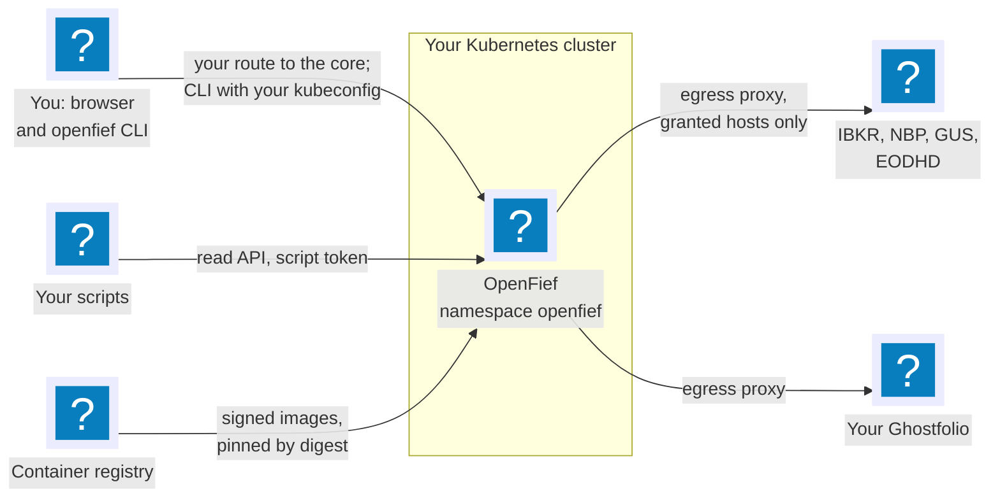
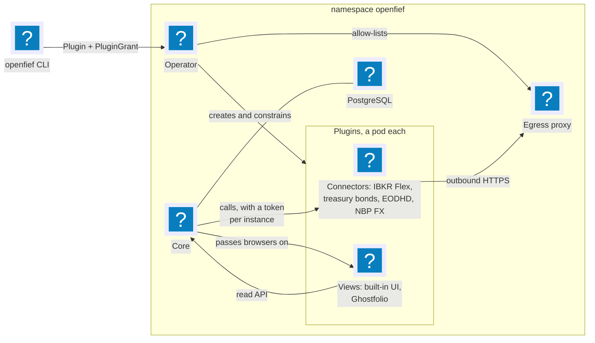
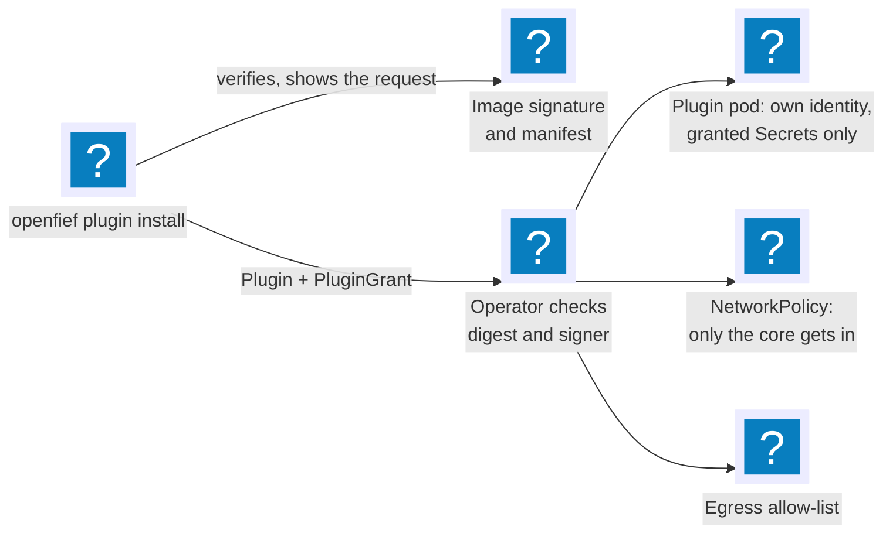
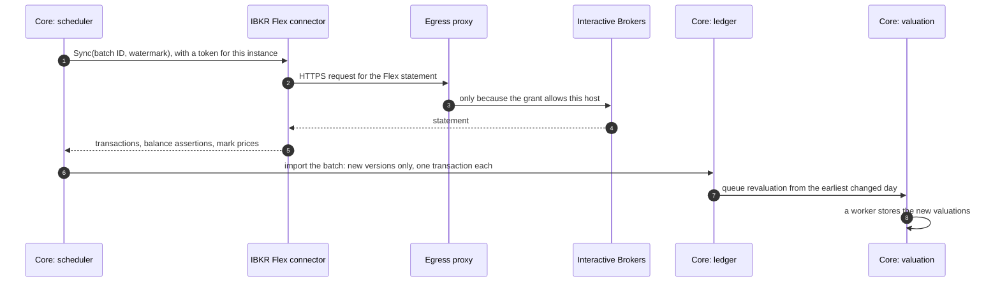
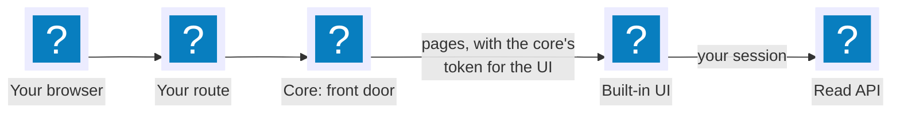
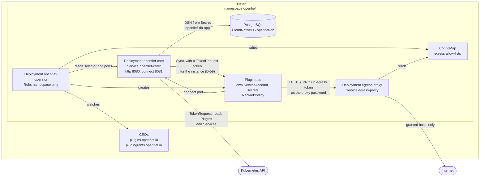
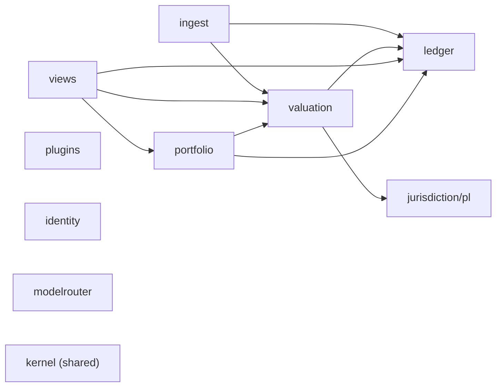
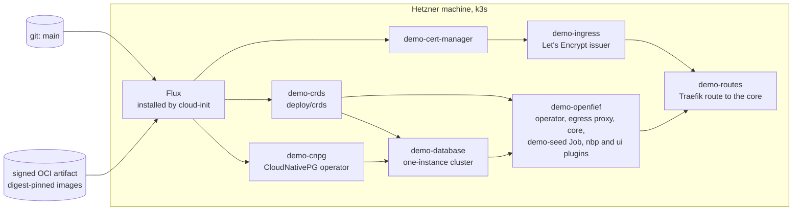

OpenFief runs in your own Kubernetes cluster and rests on one rule: the core owns the record, and everything that talks to the outside world is a plugin. The core is written in Go and holds every holding, transaction and valuation in PostgreSQL. Plugins run in their own containers with only the permissions you granted them: connectors bring data in, and views show it. An operator turns plugin resources into running, isolated workloads, and an egress proxy is the only way out to the internet. The agents of later milestones will be plugins too, under the same rule.

This page shows the parts, then follows them through three moments: installing a plugin, a statement coming in, and you opening the UI.

## The big picture

You reach OpenFief through one Service, the core's, exposed however you choose ([Expose OpenFief](guides/expose.md)). You manage plugins with the `openfief` command line and your own kubeconfig (D-46). OpenFief reaches out only through the egress proxy, and only to hosts a plugin's [grant](glossary.md) allows (D-32). It runs only images pinned by digest and signed by a signer you trust (D-17, D-56).

## The parts

| Part | What it does | Code | In depth |
|---|---|---|---|
| Core | Owns the record: the double-entry ledger, valuations of every holding on every day, and the read API. Schedules connector syncs, and is the only entry point for browsers and scripts. Its own commands, run in its pod with your kubeconfig, check every balance assertion (`core check balances`) and the whole transaction log (`core check ledger`, D-200). Its identity changes, and its own `core token` and `core enroll-link` commands, are recorded in an append-only audit log in the same transaction as the change (D-211). Its `--authz` flag picks who answers the authorization interface: `policy`, the default, or `spicedb` (D-164), which also writes the schema, the household, accounts and sleeve placements to SpiceDB and reconciles them at start, along with the owner's grants of view access (D-209), and on its first start with `spicedb` gives every script token and view plugin that has no grant the household grant, so none loses or gains access. [SpiceDB](concepts/identity.md#authorization) itself runs next to it, with its datastore a database of the core's PostgreSQL cluster, and the core stays on `policy` until the cutover | [`cmd/core`](../cmd/core/) | [Ledger](concepts/ledger.md), [Valuation](concepts/valuation.md), [Read API](concepts/read-api.md), [Identity](concepts/identity.md) |
| Operator | Turns `Plugin` and `PluginGrant` resources into isolated workloads, after checking that the image's digest is signed by a signer you trust | [`cmd/operator`](../cmd/operator/) | [Operator](concepts/operator.md) |
| Egress proxy | The only way out: each plugin reaches only the hosts its grant allows, and never a private address | [`cmd/egress-proxy`](../cmd/egress-proxy/) | [Egress](concepts/egress.md) |
| PostgreSQL | The record, one schema per bounded context, run by CloudNativePG (D-14) | | |
| Connectors | Bring data in: Interactive Brokers' Flex statements and mark prices, XTB's xStation exports, your treasury bond lots, end-of-day prices from EODHD, NBP's exchange rates | [`plugins/`](../plugins/) | [Ingest](concepts/ingest.md), [Treasury bonds](concepts/treasury-bonds.md), [Valuation](concepts/valuation.md) |
| Views | Show the record: the [built-in UI](concepts/ui.md) and the [Ghostfolio view](concepts/ghostfolio.md), which keeps your Ghostfolio in step with OpenFief | [`plugins/ui`](../plugins/ui/), [`plugins/ghostfolio`](../plugins/ghostfolio/) | [Built-in UI](concepts/ui.md), [Ghostfolio view](concepts/ghostfolio.md) |
| `openfief` CLI | Installs, upgrades (D-90), lists and removes plugins, with each instance's own Secrets, `<instance>--<role>` (D-89), hosts from its config (D-75), an in-cluster service it asks for (D-74) and an extra CA bundle it sets for a connector (`openfief plugin ca-bundle set`, stamping its checksum so the operator never reads the Secret), prints the link for your first passkey, on your own route's origin or on `localhost` through a port-forward (D-80), and checks every balance assertion for you (`openfief check balances`, D-200), with your own kubeconfig; the core refuses a link for an origin not in its one origins setting, `OPENFIEF_AUTH_ORIGINS` (D-126). `openfief version` names the release it was built for and its commit | [`cmd/openfief`](../cmd/openfief/) | [Plugins](concepts/plugins.md#installing-with-the-cli), [Identity](concepts/identity.md#the-first-passkey), [Read API](concepts/read-api.md#the-owners-balance-check) |
| Go SDK | What plugins are built on: the connector contract, the core's tokens and the proxy | [`sdk/go`](../sdk/go/) | [Build a plugin](guides/build-a-plugin.md) |

The money side lives inside the core, as bounded contexts: [kernel](concepts/kernel.md) types for exact decimals and money, the [ledger](concepts/ledger.md), [valuation](concepts/valuation.md), the Polish [treasury bond](concepts/treasury-bonds.md) rules and the [portfolio](concepts/portfolio.md)'s sleeves and model. The [attention items](concepts/attention.md) gather every check that needs the owner in one place, a transfer between two of the owner's accounts waiting to be confirmed among them, or a treasury bond's early-redemption fee carried forward past the reviewed fee table, which the owner confirms or overrides through the core's settings service (D-97), and the core publishes each change from its outbox (D-130). The read API serves each bond series' terms with where they came from, and the core's wiring hands the stored terms to the instrument views and the attention check. The [model router](concepts/models.md) is the one way to a language model: off until the owner turns on its switch (D-212), it sends a request only to the models the owner allowed for the data in it (D-206), through model-provider plugins (D-205), and writes an audit entry before every call and its result after it (D-211); a route that names a missing provider instance falls through to the next model and raises an attention item (D-196); nothing asks it for an answer yet.

## Installing a plugin

A plugin starts as a request: its image's signed manifest says what it needs. You see that request and approve exactly it.

The CLI checks the image's signature the same way the operator will, shows the capabilities, hosts, Secrets and browser paths the manifest requests, and once you confirm, creates a `Plugin` and a `PluginGrant` that approves exactly those. The operator deploys only a digest signed by a trusted signer, compiles the approved permissions into a ServiceAccount, a Deployment, a NetworkPolicy and an egress allow-list, and keeps an upgrade that asks for more on the old version until you approve it. [Plugins](concepts/plugins.md) and [Operator](concepts/operator.md) explain each check.

## A statement comes in

Every six hours by default, and at once for a new instance, the core syncs each running connector, one at a time unless you raise its sync workers together with its memory limit (D-189). Here is one sync of the Interactive Brokers connector:

The core picks the batch's mode from the ledger: an account already seeded from its opening lots syncs in transactions mode on its own, and a newly mapped account is seeded first (D-95). A market-data connector, one whose manifest declares it and whose grant approves that (D-123), is told in each sync what to price: every instrument you hold and the model portfolio's targets, so a new purchase is priced without configuring anything (D-93). A connector that feeds accounts is told in each sync what those accounts hold, their holdings and open lots, so the treasury-bonds connector books each coupon that fell due as interest with the Polish pack's rules while the core holds no bond logic (D-117).

When two connectors deliver the same kind of market data, every value is kept, but each instrument's prices, each currency's rates and each index's readings come from one source: the one you rank highest that has a value when it is first needed. A day it lacks takes its latest earlier value, never another source's, and the other sources only cross-check it. You rank sources and switch one instrument's source on the settings page, and a source silent for longer than the gap threshold you set raises an attention item (D-94). A broker's own prices, such as IBKR's mark prices, only cross-check: a connector whose manifest declares it sends them, and each is compared with the latest price on or before its day. One more than 1% off, or beyond the threshold you set for that instrument, is flagged on the price checks page, where you acknowledge it (D-110, D-111, D-112).

The import is idempotent: each transaction is keyed by its source and the institution's own ID, so the same statement twice changes nothing, and a changed row becomes a new version rather than an overwrite (D-18). The broker's own position snapshots are stored as balance assertions and checked against what the ledger derives. So is the cash you enter as a bank or the bond registry shows it, a cash checkpoint: a difference raises an attention item, from which you book it as a deposit or a withdrawal, and nothing overwrites the derived cash (D-158). Revaluation runs in a queue inside PostgreSQL, so valuations catch up with every import, price and rate (D-36); a revaluation also finds what needs the owner, such as an instrument to classify for OKI's yearly tax (D-132), and raises it as an [attention item](concepts/attention.md) (D-130). [Ingest](concepts/ingest.md) and [Valuation](concepts/valuation.md) follow each step in the code.

Not every source is pulled. Treasury bond lots are typed in on an account's page and statements are uploaded there, and the core hands both to the connector bound to that account ([Ingest](concepts/ingest.md#statement-uploads)). The upload form shows only where that connector takes files; the core picks the mode, seeding an account not yet seeded, which its syncs then continue, and a statement of linked accounts books every mapped one (D-109). An XTB account starts either from an export of its whole history or from a current export's open positions with the cash you enter once, and later exports add what came after its start (D-136). A bond lot, or its deletion as a correction, goes with the account's go-live date: the connector books a lot bought by then as an opening lot and a later one as a deposit and a buy, and the core adds the opening lots one at a time ([Ingest](concepts/ingest.md#treasury-bond-lots)). A series is its registry ISIN from the Ministry of Finance's data; one the data doesn't list yet is held under a provisional ISIN, and the sync that brings the registry's re-keys it in every store, the ledger last (D-214).

## You open the UI

Your browser only ever talks to the core, on its browser port. The core serves its own paths there, the read API under `/v1` and its Connect service, and passes every other path on to the one view plugin with an approved browser path (D-81, D-114). Only that view ever sees your session cookie. The UI signs you in with a passkey through the core's sign-in service, which sits on the core's plugin port, where no route reaches (D-26, D-115), then renders each page from the read API, with your session, exactly as your scripts would with a script token. What you enter or change by hand, such as an account, a deletion of an empty sleeve or account, a remap of a broker account (D-120) or a sync you retry from the Inbox (D-196), goes to the core's owner services on that same plugin port (D-79), and your broker account numbers come only from there, never from the read API (D-121). Every read and every change of an account asks one authorizer whether the caller may view or change it (D-163); today you may act on every account and every other reader views every one, and the model is a SpiceDB schema that CI checks ([Identity](concepts/identity.md#authorization)). [Built-in UI](concepts/ui.md) and [Identity](concepts/identity.md) explain the sign-in and the sessions.

## Security boundaries

Each line of defense holds even if the one before it fails:

- **Who may call whom.** Every plugin's NetworkPolicy admits the core alone, and the core presents a short-lived token whose audience is that one instance (D-59). Plugins call the core with their own projected ServiceAccount tokens (D-27).
- **Who may call out.** Plugins have no route to the internet except the egress proxy, which checks each request's token, the grant's hosts and the resolved address (D-32).
- **What may run.** Only digests signed by a trusted signer, checked offline against Sigstore's trust root (D-56). No setting turns this off.
- **What a plugin may read.** Only the Secrets its grant names. Connectors can't read your record at all (D-83).
- **Who may call the platform.** The database, the egress proxy, the operator and SpiceDB each have a NetworkPolicy admitting only their callers (D-184): SpiceDB ([`networkpolicy.yaml`](../deploy/spicedb/networkpolicy.yaml)) the core on gRPC 50051 alone, with its own way out only to the database on 5432 and DNS, and the core and the database each admitting it through a policy of that base; the database ([`networkpolicy-database.yaml`](../deploy/core/networkpolicy-database.yaml)) the core, its own instances and CloudNativePG's operator, so no plugin can open a connection to it; the egress proxy plugin pods alone, and its own way out leaves every private range out; the operator nothing at all. Pages the core proxies from a view plugin carry the core's security headers: a content security policy next to the view's own, framing denied, no sniffing and no referrer ([UI](concepts/ui.md)). On the browser port the core takes only sessions and script tokens, so nothing that arrives there makes it ask the API server; on the plugin port only token-shaped tokens are reviewed, and a refusal is remembered briefly ([Identity](concepts/identity.md#in-the-core)).
- **How much a request may cost (D-184).** The core bounds every request body before it checks a token or decodes a message: both ports refuse a compressed body (415), cap a body at 2 MiB, or 65 MiB for a statement upload (413), and give a request five minutes to arrive; every Connect service reads a message of at most 1 MiB. A connector's answer is read up to 16 MiB, and its messages are counted on the wire, at most 640,000, before it is decoded, then at most 200,000 items are translated, and the parsers of uploaded files bound what they allocate ([Ingest](concepts/ingest.md)).

One rule is wider than it should be. The core talks to the Kubernetes API, for example to request plugins' tokens. Kubernetes rewrites the API Service's address to the API server's own before NetworkPolicy sees a packet, and on k3s that is the node's address on port 6443, which differs per cluster. So the core's NetworkPolicy in [`deploy/core/networkpolicy.yaml`](../deploy/core/networkpolicy.yaml) allows port 6443 to any address (D-92). A compromised core could use that port to reach other hosts. To narrow it, add a kustomize overlay that sets the rule's `ipBlock` to your API server's addresses, listed by `kubectl get endpointslices -n default -l kubernetes.io/service-name=kubernetes`. A cluster whose API server listens on 443, as managed clusters do, patches the port too.

## In the cluster

Everything lives in the `openfief` namespace. A cluster admin installs the custom resource definitions once. The operator's permissions are a Role in that namespace only (D-15). Every Service is a ClusterIP Service, and nothing is exposed until you add a route (D-28).

The install manifests are in `deploy/`: `crds/` for the definitions and the namespace, `operator/`, `egress-proxy/` and `core/` for the three workloads, and `spicedb/` for the authorization database next to the core (D-164), with the Job that generates its credentials (D-216), which runs `core init-credentials` from the core's own image. The core listens on two ports (D-115), and its Service `openfief-core` names one for each: `http` (8080, the core's `--listen`), the browser port a route points at, serving the front door, the read API and the health endpoints; and `connect` (8081, the core's `--plugin-listen`), the plugin port the operator hands to plugins (D-49), serving the read API and the services only plugins call, sign-in and the owner's entries (D-79), such as the model portfolio, an instrument's display name (D-197), the confirmation of a transfer between two of the owner's accounts (D-105), the cash an institution shows for an account with the difference the owner books from it (D-158), or the confirmation of the ISIN of a ticker a broker named without one (D-116), which holds for every account at that institution and which the owner can correct, booking the ticker's rows and holdings anew (D-153, D-155), so no route reaches them. Its NetworkPolicy admits plugin pods to the plugin port alone; a route adds a policy admitting its proxy to the browser port, such as the optional Gateway component in [`deploy/gateway`](../deploy/gateway/kustomization.yaml) (D-28, [Expose OpenFief](guides/expose.md)). It lets the core reach only DNS, the database, plugin pods on their Connect port (8080) and the Kubernetes API server, as above. The database's policy, which `deploy/core` brings because the core is its one client, admits the core on 5432, the cluster's own instances on 5432 and 8000, and CloudNativePG's operator, in `cnpg-system` as its release manifest installs it, on 8000; an owner who runs that operator in another namespace patches the rule. The demo's loader brings its own policy that admits it ([`deploy/demo-data`](../deploy/demo-data/networkpolicy.yaml)).

The core's pods mount a Kubernetes API token. Its Role ([`deploy/core/rbac.yaml`](../deploy/core/rbac.yaml)) allows only `create` on its own `serviceaccounts/token` (resourceNames `openfief-core`) and `get`, `list` and `watch` on Plugins and Services, all in the `openfief` namespace. A ClusterRole allows it `create` on `tokenreviews` alone, with which it checks the tokens view plugins present (D-82). The database URL comes from CloudNativePG's Secret `openfief-db-app`, key `uri` (D-14, D-29). The database itself is a CloudNativePG cluster `openfief-db`: every release bundle brings the smallest one that works, from [`deploy/database`](../deploy/database/openfief-db.yaml), with its own requests (100m CPU, 256Mi) and memory limit (1Gi) (D-182), for the owner to size, with CloudNativePG's own release manifest pinned by sha256 ([Install a release](guides/install.md)); the demo runs its own, sized for its machine. Every workload's pod sets `runAsNonRoot`, so each image (`cmd/<name>/Dockerfile`) runs as a numeric user, `65532:65532`, distroless's nonroot: the kubelet refuses to start a container whose image names its user, because it can't tell that a name isn't root.

## Tracing

The core, the operator and plugins built on the Go SDK trace what they do with [OpenTelemetry](glossary.md#other-terms-and-abbreviations): each request to the core's two ports, each call between the core and a plugin, each query, each revaluation job from its queueing to its work, and each sync, upload and import, as one trace across processes. Tracing is off by default: until the standard `OTEL_*` variables name a collector, nothing is recorded or sent. The optional component [`deploy/tracing`](../deploy/tracing/kustomization.yaml) sets them for the core and the operator and lets the core reach the collector through its NetworkPolicy. A request on the browser port always starts a new trace, and no trace context leaves the cluster. Spans name operations, never amounts, holdings, account numbers, tokens or query arguments (GR-12), and an allow-list of attributes enforces it on export. [Send traces to a collector](guides/tracing.md) explains the variables and what each span says; plugins export nothing yet, and metrics and egress-proxy spans aren't built yet ([D-172, D-173](guides/tracing.md#not-built-yet)).

## Bounded contexts

The code is organized by domain, following domain-driven design (Eric Evans, 2003). Each bounded context owns its terms, types and data. In this designed map from [code-organization.md](dev/code-organization.md), arrows point from a context to the contexts it reads:

The [code map](/reference/code-map/) draws the same map from the actual imports on every build. Comparing the two is a quick architecture check. Today the code has three arrows the design lacks: `views` imports `jurisdiction/pl` to tell a treasury bond series from a listed instrument in the allocation; `ingest` imports `jurisdiction/pl` to check that a bond lot can be valued; and `ingest` imports `portfolio` to make an account's ID from its name and to name the sleeve the account goes in, which the portfolio context's `Registry` keeps (`cmd/core` wires it in). `portfolio` reads `ledger` as designed: it keeps which account is in which sleeve keyed by the ledger's account ID, and reads accounts through its `AccountReader` port. The ledger imports no other context, and keeps neither sleeves nor the payout setting, which is ingest's. The designed `jurisdiction/pl` node is two packages in the code: `jurisdiction`, the pack contract with the fee rule and number format (D-70), and `jurisdiction/pl`, the Polish pack behind it; `valuation` reaches the pack through the contract, and `ingest` and `views` use the contract's tax wrappers and settings. `cmd/core` picks the pack, `pl.NewPack()`, joins valuation's recorder and store into the account entries' terms, and hands the pack and the store to the read API for cash values, settings, the charts' start the owner stored (D-167) and yearly taxes.

## The demo environment

[demo.openfief.dev](https://demo.openfief.dev), which the [Quickstart](quickstart.md) tours, runs this same install from `deploy/demo` on one Hetzner machine with k3s, holding synthetic data only (GR-12). Nothing pushes to it: cloud-init installs Flux, and Flux pulls each layer below, in dependency order. Five layers follow `main` in git. The `openfief` layer instead follows a signed OCI artifact that CI publishes after each push to `main`, with the images pinned to the digests whose signatures verified (D-17). Its route is an Ingress on k3s's bundled Traefik with a Let's Encrypt certificate, sending everything to Service `openfief-core`, which passes pages on to the [built-in UI](concepts/ui.md), and a demo-only NetworkPolicy lets Traefik reach the core. The demo's core accepts sign-ins from `https://demo.openfief.dev` and issues read-only demo sessions (`--demo-sessions`), which the UI offers as "View demo"; until the demo dataset is loaded, it says the demo data is loading instead, and the first-run wizard never appears on the demo (D-191). Creating and destroying demos is in [demo.md](dev/demo.md).

Arrows between layers are Flux `dependsOn` edges. The CI side, from signed images to the published artifact, is on the [delivery pipeline](dev/pipeline.md) page. The synthetic data comes from `deploy/demo-data`, a Job that runs `cmd/demo-seed` against the demo database through the same ingest, ledger and valuation paths real data takes; [demo.md](dev/demo.md#demo-data) explains it.

## What is built

M0, the tracker, is being built in the open. Every part on this page exists in the code. The Ghostfolio view can't name your Ghostfolio's host in its manifest yet, so it doesn't run from the first-party image. The [status page](/status/) shows every decision with the requirements, code and tests behind it, and each concept page ends with what is decided but not built in its area.
