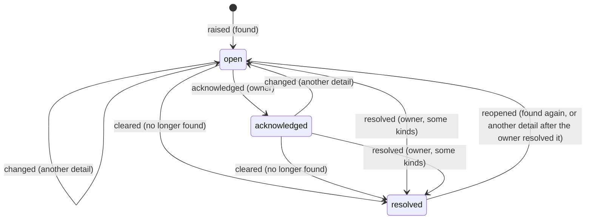
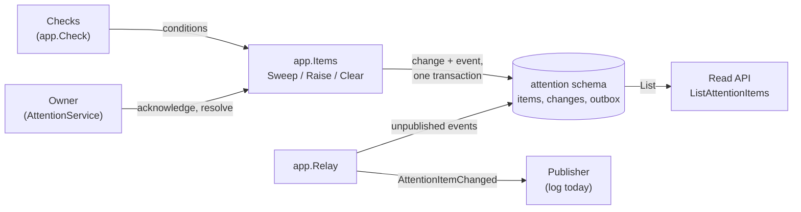

Several checks in OpenFief find something only the owner can settle: a balance assertion that doesn't match, a price check that is flagged, rows an import couldn't book, a broker account no OpenFief account is mapped to, a ticker whose ISIN nobody confirmed, a setting a value needs, or a transfer a correction broke. Each check keeps its own page, but the owner should not have to visit seven pages to learn whether anything needs them. An [attention item](../glossary.md) is the one place where every such finding lands (D-130), with its history, and each change to it is also an event that notifications and, in later milestones, agents can act on.

## Concepts

**An item per kind and subject.** An item's *kind* names the check that raised it, such as `price-check-flagged`, and its *subject* names what it is about, such as the instrument. At most one item stands for a kind and subject: when the same check finds the same thing again, the item is the same one. Kinds are lower-case words joined by hyphens, so a check in another context adds its own kind without changing this one, such as valuation's `instrument-unclassified` (D-132, below).

**Three states and an append-only history.** An item is *open* (it needs the owner), *acknowledged* (the owner has seen it and the condition still stands) or *resolved* (the condition cleared, or the owner resolved it). Every change is appended to the item's history with the state it moved to, why, the condition's detail then and when; nothing is changed in place, the way the ledger keeps every version of a transaction (D-18).

**Conditions, not commands.** A check doesn't open or close items. It reports the conditions it finds now, each with a short detail such as the difference found, and pure rules decide what changes ([rules.go](../../internal/attention/rules.go)):



A condition that keeps its detail changes nothing, so a check can run every minute without growing the history. An item the owner resolved stays resolved while the condition's detail stays the same, like a price check's acknowledgement (D-112), and opens again when it changes.

**Groups and scopes.** The Inbox groups items by what the owner does about them (D-196), and an item links to the account or instrument it is about. Both follow from an item's kind and subject alone, with pure functions in [scope.go](../../internal/attention/scope.go). `GroupOf` puts a kind in one of three groups: *data coming in* (`ticker-unconfirmed`, `broker-account-unmapped`, `connector-sync-failing`, `import-problems`, and the market data that stopped or was dropped: `market-data-gap`, `bond-terms-or-index-levels-undeclared`), *numbers to check* (`balance-assertion-flagged`, `price-check-flagged`) and *decisions* (`transfer-broken`, `transfer-suggested`, `setting-missing`, `instrument-unclassified`, and any kind the core doesn't know yet, since the owner decides what it means). `ScopeOf` reads what an item is about from its subject: the account and the instrument of a flagged balance assertion, the account and, for a prices series, the instrument of a market-data gap, the instrument of a price check or an unclassified instrument, and the connector instance of an unmapped broker account, an unconfirmed ticker, a failing sync, dropped deliveries or, from its detail, an import batch's problems. A missing setting names neither; a broken or suggested transfer's subject, a pair of transaction keys, names no account, so the read API looks its legs' accounts up in the ledger and ties the item to both (`views.PairAccounts`, `views.SuggestedPairAccounts`, [Read API](read-api.md#attention-items)). An item tied to no account names only its connector instance (D-165), never a broker account number.

**Who resolves what.** Most kinds resolve when their check clears, which happens on the page that check links to: mapping the broker account, confirming the ticker, setting the marginal rate, acknowledging the price check, rejecting the broken transfer, or confirming or rejecting the suggested one. Two kinds never clear on their own, so the owner resolves them by hand once dealt with: a flagged balance assertion the owner has explained, and an import batch's left-out rows (`attention.OwnerResolves`).

**A transactional outbox.** Chris Richardson's *transactional outbox* pattern (microservices.io, around 2018) solves a classic problem: a service that writes to its database and then publishes a message can crash between the two, so either the change happens unannounced or the announcement describes a change that never happened. Instead, the service writes the message to an *outbox* table in the same database transaction as the change, and a separate relay publishes the outbox's rows afterwards, at least once and in order. OpenFief writes each change's event that way; no message broker is needed.

## How it works



**The checks.** Each `app.Check` pairs a kind with a function that finds its conditions now ([checks.go](../../internal/attention/app/checks.go)). The core wires these, reading the other contexts through ports declared here:

| Kind | Found when | Subject | Resolves when |
|---|---|---|---|
| `balance-assertion-flagged` | a balance assertion's latest check is flagged (D-18) | account/date/ledger account | a correction makes it match, or the owner resolves it |
| `price-check-flagged` | an instrument's latest price check, by date then source, is flagged and not acknowledged (D-110..D-112) | the instrument | the owner acknowledges the check, or a later check matches |
| `import-problems` | a completed import batch left rows out because OpenFief can't book them yet (`ingest.ProblemUnsupported`) | the batch | the owner resolves it |
| `broker-account-unmapped` | a connector reported a broker account no OpenFief account is mapped to (D-72) | instance/broker account; the read API serves only the instance (`attention.ReadSubject`), since read access never includes a broker account number (D-121, D-137) | the owner maps it |
| `ticker-unconfirmed` | a ticker's ISIN isn't confirmed, so its rows wait (D-116) | instance/ticker | the owner confirms it |
| `setting-missing` | some account's tax wrapper can't have a liquidation value without the owner's marginal income tax rate (D-78) | `marginal-rate` | the owner sets it |
| `transfer-broken` | a confirmed transfer's legs no longer match after a correction (D-131) | the pair | a correction makes them match, or the owner rejects the pair |
| `transfer-suggested` | a withdrawal and a deposit are suggested as one transfer between the owner's own accounts and the owner has neither confirmed nor rejected the pair (D-105): the read side's rule, `views.SuggestTransfers`, over every account's current transactions, which the core runs for the check (`transferSuggestions` in [transfers.go](../../cmd/core/transfers.go)); its detail is a fixed sentence, so an acknowledged item stays acknowledged | the pair | the owner confirms or rejects the pair, or a correction ends the suggestion |
| `connector-sync-failing` | a connector instance's sync keeps failing (D-196): at least three attempts in a row failed since its latest success, spanning at least fifteen minutes from the first one's start to the latest one's end (`ingest.SyncStatus.KeepsFailing`, [Ingest](ingest.md)); the detail is when the failures began, to the minute in UTC, so it stays the same while the same run of failures goes on | the instance | the instance's next sync succeeds; a later run of failures raises it again |
| `cash-checkpoint-mismatch` | a cash checkpoint the owner entered doesn't match the derived cash (D-158); `balance-assertion-flagged` leaves these out | account/date/currency | the owner books the difference, or enters a checkpoint that matches |

Ingest raises one more kind itself, through its own port: `bond-terms-or-index-levels-undeclared`, for a connector instance that delivered bond terms or index levels (D-179), or index readings (D-186), that its signed manifest doesn't declare or its grant doesn't approve, which were dropped. The kind keeps its name from before index readings joined it, so an earlier item still resolves. Its subject is the instance; it stays one item while it keeps happening and resolves on the instance's next delivery that drops nothing.

`Items.Sweep` runs every check and reconciles its kind's items with what it found (`attention.Reconcile`), each kind in its own database transaction under an advisory lock, so a sweep, a push and an owner's action never interleave. One failing check doesn't stop the others. The core sweeps at start and then every minute, and publishes the outbox after each sweep ([attention.go](../../cmd/core/attention.go)).

**The port for other checks.** A check that finds one condition at a time, rather than listing all of them, raises and clears items directly: `Items.Raise(ctx, attention.Condition{Kind, Subject, Detail})` and `Items.Clear(ctx, kind, subject)`. Both are idempotent and follow the same rules. A package declares the port where it consumes it:

```go
type AttentionItems interface {
	Raise(ctx context.Context, cond attention.Condition) error
	Clear(ctx context.Context, kind attention.Kind, subject string) error
}
```

`*attention/app.Items` implements it. Valuation raises `instrument-unclassified`, subject the ISIN, for each holding of an account in a wrapper with a yearly tax that the pack can't classify and the owner hasn't, and clears it once the owner has (D-132). Through the same port it raises `market-data-gap`, subject the account and the market-data series, such as `acc-1/fx_rates/USD`, for each series a holding needs today whose source has had no value for longer than the kind's gap threshold, and clears it when values resume (D-94, [Valuation](valuation.md#one-source-per-series-as-built)). Its port, `valuation/app.AttentionRaiser`, takes plain strings, so the core adapts it to the items (`valuationAttention` in [unclassified.go](../../cmd/core/unclassified.go)) and neither context imports the other. Such an item resolves only when a revaluation of the account clears it; Raise and Clear run in the attention schema's own transaction, not the revaluation's. A check that can list all its conditions should rather be an `app.Check` in the core's wiring, so a condition that clears is resolved without anyone calling `Clear`.

**The store.** The `attention` schema ([0001_attention.sql](../../internal/attention/postgres/migrations/0001_attention.sql)) holds `items` (one row per kind and subject), `changes` (the history, numbered from 1 per item without gaps), `outbox` (one event per change) and `published` (one row per published event). Triggers refuse every update, delete and truncate, so all four are append-only; publishing an event adds a `published` row instead of marking the event. `Store.Append` writes the item, the change and its outbox event in one transaction, the caller's when inside `InTx`, so a change and its event commit together or not at all.

**The event.** Each outbox row's payload is `openfief.attention.v1.AttentionItemChanged` ([attention.proto](../../proto/openfief/attention/v1/attention.proto)) in its JSON form, without `eventId`, which is the row's ID:

| Field | Meaning |
|---|---|
| `eventId` | Numbers the events from 1, in the order they were written; consumers deduplicate on it |
| `itemId` | The item |
| `kind`, `subject` | The check and what the item is about, as read access sees it (`attention.ReadSubject`): an unmapped broker account's event names only its connector instance, never the broker account number, which only the item keeps for the owner (D-121, D-165) |
| `seq` | The change's number in the item's history |
| `state` | `open`, `acknowledged` or `resolved` |
| `reason` | `raised`, `changed`, `reopened` or `cleared` by a check, `acknowledged` or `resolved` by the owner |
| `detail` | The condition's detail at the change |
| `at` | When, RFC 3339 in UTC |

`app.Relay` reads unpublished events in order, hands each to an `app.Publisher` and records it published; on a failure it stops, and the next run starts with the same event, so delivery is at least once and in order. The only publisher today is `app.LogPublisher`, which logs the event's IDs, kind, state and reason, never its subject or detail, which may name a broker account or an amount (GR-12).

**The owner's actions and the read API.** The read API lists the items with their history, group and scope (`ListAttentionItems`, `GET /v1/attention-items`, [Read API](read-api.md)), by the Inbox's views (open, acknowledged, done) and filtered to an account, an instrument or a connector instance; an item tied to an account only a caller who may view the account sees (D-163), a transfer's only one who may view both legs' accounts, and an item tied to no account the owner and the other holders of read access, never a viewer (D-165). A failing sync's item shows what happened through the read API's sync history (`ListSyncAttempts`): each attempt with its error class, never its text (GR-12), and when the next is due. The owner acknowledges and resolves items through the `AttentionService`, one owner-only service on the core's plugin port that only view plugins call for an owner session (D-79, D-115); a read session is refused. The [built-in UI](ui.md) lists the items in its Inbox (D-192, D-196), by view and group, and counts the open ones in its navigation; it settles in place what one field or button settles, an acknowledgement, a ticker's ISIN, a price check, a suggested or broken transfer, a broker account's mapping, and *Retry now* on a failing sync, which reaches the core through the ingest context's `SyncService` ([Ingest](ingest.md#scheduling-syncs)). An account's page shows its own open items at the top.

## Decisions

- **GR-12**: its Connect services log a failure only through `kernel.LogSafe`: by the known errors in its chain, or else its innermost error's type, never its text, which may carry an amount, an ISIN or an account number; `TestFailuresLogNoValues` drives every sink with such failures against a deny-list. The core's attention sweep logs its failures the same way.
- **D-130**: one append-only store of attention items with kind, subject, state and history; every check that needs the owner raises one; each change is published from the core's outbox.
- **D-131**: a confirmed transfer whose legs no longer match after a correction stops counting and raises an item ([Ledger](ledger.md)).
- **D-105**, **D-130**: a suggested transfer the owner hasn't decided raises a `transfer-suggested` item, a decision, which clears once the pair is confirmed or rejected and is tied to both legs' accounts like a broken one; the design session asked for it so the Inbox's count and the overview's *Needs you* include the transfers waiting for the owner.
- **D-79, D-115**: the owner's actions go through one owner-only service on the plugin port.
- **D-112**: an owner-resolved item stays resolved while the condition's detail is unchanged, as a price check's acknowledgement does.
- **D-192**: no check has a page of its own; the UI's Inbox lists every item. **D-196**: items are grouped by what the owner does about them, data coming in, numbers to check and decisions; a connector sync that keeps failing raises an item that shows what happened. When a sync "keeps failing" is this context's reading: three failures in a row over at least fifteen minutes, so one plugin restart or a short outage at the institution is retried without bothering the owner (with the core's default retries, five minutes and doubling, the third failure ends about fifteen minutes after the first began).
- **D-165**: an item tied to no account names only its connector instance.
- **D-158**: a mismatched cash checkpoint raises an item, which the ledger raises at once through its port and this context's check keeps in step ([Ledger](ledger.md)). It is a number to check (D-196), tied to its account, and the Inbox links it to the account's Cash tab, where the owner books the difference.

The rest is this context's reading of D-130, listed in [implementation questions](../implementation-questions.md#attention-items): an item is reopened rather than a new one raised when its condition returns; the owner resolves by hand only flagged balance assertions and import problems; import problems count only rows OpenFief can't book yet, per batch; checks run every minute rather than inside each check's own transaction; the publisher only logs.

## Verification

| Behavior | Tests | kibi |
|---|---|---|
| The state rules: raise, change, reopen, clear, acknowledge, resolve, one item per subject | `TestObserve`, `TestReconcile`, `TestOwnerActions`, `TestConditionValidate` ([rules_test.go](../../internal/attention/rules_test.go)) | REQ-attention-reconcile, REQ-attention-owner-actions |
| An unmapped broker account's subject without its number for read access | `TestReadSubject` ([readsubject_test.go](../../internal/attention/readsubject_test.go)) | REQ-identity-read-access-no-broker-account-numbers |
| Sweeps deduplicate and clear; pushes; the owner's actions need the owner; a failed append keeps nothing; the relay publishes in order and resumes; the log names no subject | [app/items_test.go](../../internal/attention/app/items_test.go) | REQ-attention-sweep, REQ-attention-relay |
| Each check finds its conditions, a suggested transfer's among them | `TestChecks` ([app/checks_test.go](../../internal/attention/app/checks_test.go)) | REQ-attention-checks, REQ-attention-transfer-suggested-item |
| A sync that keeps failing raises one item, which stays acknowledged while the same failures go on, clears after a success and is raised again for a new run | `TestFailingSyncs`, `TestFailingSyncItem` ([app/syncs_test.go](../../internal/attention/app/syncs_test.go)) | REQ-attention-sync-keeps-failing-item, REQ-attention-sync-failing-check |
| Each kind's group, and the account, instrument and instance each subject names | `TestGroupOf`, `TestScopeOf` ([scope_test.go](../../internal/attention/scope_test.go)) | REQ-attention-inbox-groups, REQ-attention-group-of-kind, REQ-attention-item-scope |
| The store keeps history, writes each event in the change's transaction, and is append-only | [postgres/store_test.go](../../internal/attention/postgres/store_test.go) (`task test:pg`) | REQ-attention-outbox-same-transaction |
| No outbox row holds a broker account number: an unmapped broker account's event names only its instance, and the item keeps its full subject | `TestOutboxHoldsNoBrokerAccountNumber` in [postgres/outbox_test.go](../../internal/attention/postgres/outbox_test.go) (`task test:pg`) | REQ-attention-outbox-read-subject |
| The AttentionService admits only the owner's view and maps errors | [connectapi/attention_test.go](../../internal/attention/connectapi/attention_test.go), `TestAttentionService` ([cmd/core](../../cmd/core/attention_test.go)) | REQ-attention-owner-service |
| The core's checks raise items the read API lists, once | `TestAttentionChecksRaiseItems` ([cmd/core](../../cmd/core/attention_test.go)) | REQ-attention-checks |

## Not built yet

- A publisher that notifies the owner, such as a push notification or an email; and agents acting on items (P-57).
- Checks the decisions don't name yet.
- Retention: items, history and published events are kept for good.
