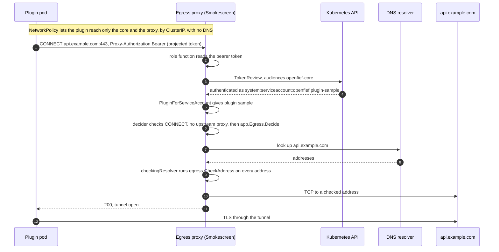
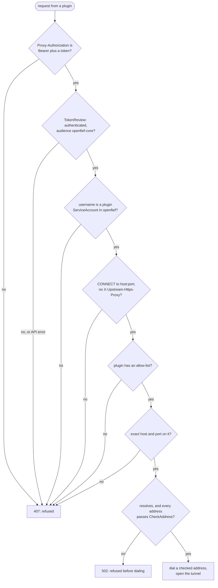

A connector that pulls IBKR Flex statements needs to reach IBKR's Flex service and nothing else. OpenFief makes that a rule of the network rather than a promise of the plugin: a plugin can't resolve names or reach the internet directly, and every outbound connection goes through an egress proxy that checks who is asking and where to. This page explains why that takes a proxy, how the proxy is built on Stripe's Smokescreen, and where the code differs from the decisions. The [Plugins](plugins.md) page covers how a plugin's grant becomes its allow-list.

## Concepts

**Why a proxy.** Kubernetes [NetworkPolicy](../glossary.md) allows traffic by pod, namespace and IP block, never by hostname (R-13). The owner approves hostnames, but the addresses behind a name change, and a CDN serves many unrelated sites from the same addresses, so an IP rule either goes stale or lets in more than intended. Hostname rules exist only in some network plugins (Cilium's `toFQDNs`, GKE's `FQDNNetworkPolicy`, Calico's commercial editions), and the upstream standard is still provisional, while OpenFief promises any conformant cluster (D-12). An [egress proxy](../glossary.md) works with any CNI that enforces NetworkPolicy: the policy only has to say "plugins may reach the proxy", and the proxy checks hostnames.

**HTTP CONNECT.** With [HTTP CONNECT](../glossary.md), a client asks the proxy for a tunnel to `api.example.com:443` and then runs TLS through it end to end. The proxy sees the hostname and port, never the content, so it holds no certificates and can't read the credentials a plugin sends to its institution.

**Smokescreen.** [Smokescreen](../glossary.md) is Stripe's CONNECT proxy, written in Go and open-sourced around 2016. Stripe built it against server-side request forgery (SSRF): a service that fetches URLs on someone else's behalf, such as one that sends webhooks, can be tricked into fetching the cloud metadata address `169.254.169.254` or an internal admin page. Smokescreen resolves names itself, refuses private and internal addresses, and checks each client against its own allow-list. A replaceable "role function" decides who the client is. R-14 records its state when OpenFief chose it, and D-32 embeds it as a Go library.

**Projected ServiceAccount tokens.** Kubernetes can mount into a pod a short-lived token issued for one audience and bound to that pod; the kubelet replaces the file before it expires. These [projected ServiceAccount tokens](../glossary.md) have been stable since Kubernetes 1.20 (2020). Any service can check one with the [TokenReview](../glossary.md) API, which answers whether it is valid, for which audiences, and whose it is (`system:serviceaccount:<namespace>:<name>`). That is how the proxy learns a request's [plugin identity](../glossary.md) without holding any secret per plugin.

**Per-plugin allow-lists.** Each plugin has its own [egress allow-list](../glossary.md): the [egress hosts](../glossary.md) of its effective permissions. An entry is one exact hostname and port. There are no wildcards, no subdomains and no IP literals, so `x.api.example.com` and `api.example.com.evil.example.net` don't match `api.example.com`.

**Refusing private and internal ranges.** An allowed hostname is still dangerous if it resolves to an address inside the cluster or to cloud metadata, through a mistake, a hijacked DNS record, or DNS rebinding (a name that answers with a public address once and a private one the next time). So the proxy resolves the name itself, checks every address it gets, and dials only an address it checked.

**Failing closed.** Every unknown is a refusal: no token, an unknown identity, a missing or unreadable allow-list, a forbidden address, an unreachable Kubernetes API. Smokescreen's own default is the opposite: with no allow-list configured it allows every destination (R-14), so OpenFief's proxy never runs without one (D-63).

## How it works

| Piece | Code | Job |
|---|---|---|
| Use case | [app/egress.go](../../internal/plugins/app/egress.go) | `app.Egress.Identify(ctx, token)` returns a plugin name; `Decide(plugin, host, port)` returns an [egress decision](../glossary.md), `app.EgressDecision` |
| Plugins package | [allowlist.go](../../internal/plugins/allowlist.go), [identity.go](../../internal/plugins/identity.go) | `EgressAllowList.Allows`, `PluginForServiceAccount` |
| Address check | [egress/address.go](../../internal/plugins/egress/address.go) | `ForbiddenPrefixes`, `CheckAddress` |
| Smokescreen adapter | [smokescreen/proxy.go](../../internal/plugins/smokescreen/proxy.go) | `NewConfig`: role function, `EgressACL`, deny ranges, checking resolver, dialer |
| Kubernetes adapter | [kube/tokenreview.go](../../internal/plugins/kube/tokenreview.go), [kube/allowlists.go](../../internal/plugins/kube/allowlists.go) | `TokenReviewer`, `WatchAllowLists` |
| Binary | [cmd/egress-proxy/main.go](../../cmd/egress-proxy/main.go) | Wiring, signals, logging |
| Install | [deploy/egress-proxy/](../../deploy/egress-proxy/) | Kustomize base: ServiceAccount, RBAC, Deployment, Service |

The `app` package declares two ports: `TokenReviewer` (token in, Kubernetes username out) and `AllowListSource` (plugin name in, its current list out). The `kube` package implements both; the tests use fakes.

### A request through the proxy

Smokescreen asks the role function first, then the decider, and resolves the name only when the decider allows it ([Smokescreen v0.1.0](https://github.com/stripe/smokescreen), `checkIfRequestShouldBeProxied`). An unlisted host is therefore never looked up.

### Where a request is refused

Smokescreen answers a refusal by identity or allow-list with `407 Proxy Authentication Required` and logs one decision line with the role, the host and the reason; the reason is `EgressDecision.Reason`. A forbidden address comes back as a `net.Error`, which Smokescreen answers with `502 Bad Gateway`. OpenFief's errors never contain the token.

### Identifying the plugin

`identify` in [proxy.go](../../internal/plugins/smokescreen/proxy.go) is the role function. It reads `Proxy-Authorization: Bearer <token>`, with the scheme matched case-insensitively as RFC 9110 allows. A missing header is `app.ErrNoToken`; any other scheme, such as `Basic`, or a token with spaces is `ErrBadProxyAuth`. `app.Egress.Identify` sends the token to the `TokenReviewer` and maps the username back to a plugin with `PluginForServiceAccount`, which accepts only `system:serviceaccount:openfief:plugin-<name>`. The core's own ServiceAccount, or one in another namespace, is `ErrNotAPlugin`.

`kube.TokenReviewer` creates a TokenReview that names the audience `openfief-core`, and accepts the answer only when it is authenticated *and* lists that audience. It caches nothing, so every CONNECT costs one TokenReview call. TokenReview is a cluster-scoped API, so the proxy has a ClusterRole that may only create TokenReviews, narrower than the usual `system:auth-delegator` ([rbac.yaml](../../deploy/egress-proxy/rbac.yaml)).

### Following the allow-lists

The operator publishes every running plugin's list in the ConfigMap `openfief-egress-allowlist` (format on the [Plugins](plugins.md#handing-allow-lists-to-the-egress-proxy) page). `kube.WatchAllowLists` watches that one ConfigMap with an informer limited to the `openfief` namespace and to that name, and the proxy's Role can read nothing else.

- On every add or update it decodes the data with `plugins.DecodeAllowLists` and swaps the whole map in with an `atomic.Pointer`, so a request sees either the old lists or the new ones.
- If the data doesn't decode, every list is dropped and the error is logged: "egress allow-lists refused; denying all egress until fixed". Deleting the ConfigMap drops every list too.
- It returns only after its first read. If that read does not finish before the context ends, it returns `ErrNotSynced` and the binary exits instead of serving.

`app.Egress.Decide` then gives one of three reasons. A plugin with no key at all has no list (`ReasonNoAllowList`). A plugin whose key is empty, such as the planned XTB parser, has a list with no hosts, and every destination is `ReasonNotListed`. Only an exact match is `ReasonListed`. `EgressAllowList.Allows` ignores ASCII case and one trailing dot, as DNS does. A host with any non-ASCII byte never matches, because Unicode case folding would let the Kelvin sign stand in for `k`, and an IP literal never matches because no entry is one. Smokescreen itself also refuses an IPv6 literal destination.

### Checking addresses

`egress.ForbiddenPrefixes` lists the ranges the proxy never dials:

- IPv4: `0.0.0.0/8`, private `10/8`, `172.16/12` and `192.168/16`, carrier-grade NAT `100.64/10`, loopback `127/8`, link-local `169.254/16` (cloud metadata), `192.0.0/24`, the three documentation ranges, `192.88.99/24`, benchmarking `198.18/15`, multicast `224/4` and reserved `240/4`.
- IPv6: `::/96` (unspecified, loopback, IPv4-compatible), local-use NAT64 `64:ff9b:1::/48`, discard `100::/64`, `2001::/23` (including Teredo), documentation `2001:db8::/32` and `3fff::/20`, unique-local `fc00::/7`, link-local `fe80::/10`, site-local `fec0::/10` and multicast `ff00::/8`.

`CheckAddress` refuses an invalid or zoned address. It checks the IPv4 address inside an IPv4-mapped (`::ffff:`), NAT64 (`64:ff9b::/96`) or 6to4 (`2002::/16`) address as IPv4, so a private address can't hide inside an IPv6 one. Anything that passes the list must still be global unicast.

`checkingResolver` wraps Smokescreen's resolver: if *any* address of a name fails `CheckAddress`, the whole name is refused, rather than dialed at its public address. The same prefixes are also handed to Smokescreen as deny ranges, a second layer. `NewConfig` sets Smokescreen's port from the listener, so the proxy refuses connections to itself, and `ProxyDialTimeout` dials exactly the address Smokescreen picked from the checked set.

### Refusing other uses of the proxy

The `decider` (Smokescreen's `EgressACL`) refuses anything that is not a CONNECT: Smokescreen can also forward plain HTTP requests, which would let the proxy read and alter them. It refuses a request that asks Smokescreen to chain through another proxy with `X-Upstream-Https-Proxy`. And `NewConfig` refuses to start when `HTTPS_PROXY` or `https_proxy` is set in the proxy's own environment, because Smokescreen's underlying goproxy would then send every CONNECT through that proxy and skip the resolver check.

### Running it

[main.go](../../cmd/egress-proxy/main.go) listens on `-listen` (default `:4750`), logs JSON, and uses in-cluster credentials. It starts the allow-list watch before it opens the listener, builds the config with a `/healthcheck` that answers 204, and runs `smokescreen.StartWithConfig`. Smokescreen handles SIGTERM itself, draining open tunnels; a `quit` channel also stops it when the watch's context ends.

The [Dockerfile](../../cmd/egress-proxy/Dockerfile) builds a static binary for amd64 and arm64 on digest-pinned base images, and runs it on distroless as non-root. The kustomize base runs one replica with a read-only root filesystem, no capabilities, no privilege escalation and the runtime's default seccomp profile, behind a ClusterIP Service on port 4750. The Service's `targetPort` is a number because the operator copies it into every plugin's NetworkPolicy. The base names the image without a digest; an overlay pins it. The base defines no NetworkPolicy for the proxy's own pod.

### The plugin's side

When a plugin has granted egress hosts, `plugins.Compile` gives it `HTTPS_PROXY=http://<proxy ClusterIP>:4750`, `NO_PROXY=<core ClusterIP>`, and a NetworkPolicy egress rule to the proxy's pod port. A plugin without egress hosts, such as the planned XTB parser, gets neither, so it can reach only the core. No plugin gets a DNS rule. The token file's path is in `OPENFIEF_TOKEN_FILE`.

`HTTPS_PROXY` carries no credentials. The proxy wants `Proxy-Authorization: Bearer <token>` on every CONNECT, read fresh from the rotating token file; in Go that takes, for example, `http.Transport.GetProxyConnectHeader`. A client that only follows `HTTPS_PROXY` sends no token and gets 407.

## Decisions

Implemented, fully or in the part named:

- **D-32** (part) Smokescreen embedded as a library, custom role function.
- **D-32** Granted hostnames compiled into per-plugin allow-lists.
- **D-32** Private and internal address ranges refused.
- **D-32** Plugins reach only core and proxy, no DNS.
- **D-63** (part) Never without an allow-list; lists swapped atomically.
- **D-27** The proxy reuses the plugin's `openfief-core` token.

Implemented differently. Each point is D-63 against the code:

- **Embedding.** D-63 says `BuildProxy` inside OpenFief's own HTTP server, because `StartWithConfig` exits the process on errors and takes over signals. The code calls `StartWithConfig` ([main.go](../../cmd/egress-proxy/main.go), line 76; [proxy.go](../../internal/plugins/smokescreen/proxy.go), line 57 says to).
- **How the token travels.** D-63 has the plugin put the token in the proxy URL as a password, which clients send as `Proxy-Authorization: Basic ...`. The code accepts only `Bearer` ([proxy.go](../../internal/plugins/smokescreen/proxy.go), lines 111 to 122), and `TestProxyConnect` expects `407` for "basic auth instead of bearer". A plugin built to D-63 would be refused.
- **Audience.** D-63 says `openfief-egress`. The code reviews and requires `openfief-core` ([tokenreview.go](../../internal/plugins/kube/tokenreview.go), lines 37 and 46), and `Compile` mounts only that one token. So a token the proxy sees is also valid at the core.
- **Caching.** D-63 says the TokenReview result is cached. Nothing caches it.
- **Pin.** D-63 pins Smokescreen to a commit after v0.1.0; [go.mod](../../go.mod), line 14, requires `v0.1.0`.
- **Proxy address.** The comment in [kustomization.yaml](../../deploy/egress-proxy/kustomization.yaml), lines 2 and 3, gives plugins the DNS name `egress-proxy.openfief.svc`; plugins have no DNS (D-32), and `Compile` uses the ClusterIP.

The kibi requirement REQ-plugins-egress-proxy-identifies-plugin, modeled by an agent and not yet reviewed by the author, describes the code (Bearer, `openfief-core`), so it conflicts with D-63, which outranks it.

## Verification

Run `task test` from the repository root. The egress packages need no cluster or network: `go test ./internal/plugins/egress/... ./internal/plugins/smokescreen/... ./internal/plugins/kube/... ./internal/plugins/app/...` runs them alone. The proxy test starts a real Smokescreen on `127.0.0.1` with a fake resolver (names map to `8.8.4.4` or `10.0.0.7`), a dialer that records each address and connects to a local TLS server instead, and synthetic tokens. The kube tests use client-go's fake clientset. Requirement IDs come from kibi (`node_modules/.bin/kibi search "<question>"`).

| Behavior | Tests | Requirement |
|---|---|---|
| Only a Bearer token that TokenReview accepts for `openfief-core` as a plugin identifies a request | [proxy_test.go](../../internal/plugins/smokescreen/proxy_test.go): `TestProxyConnect` ("no token", "token not accepted", "basic auth instead of bearer", "scheme in lower case"); [egress_test.go](../../internal/plugins/app/egress_test.go): `TestEgressIdentify`; [kube_test.go](../../internal/plugins/kube/kube_test.go): `TestTokenReviewerReviewToken` | REQ-plugins-egress-proxy-identifies-plugin |
| Only CONNECT, only to the plugin's list, no chaining | `TestProxyConnect` ("unlisted host", "upstream proxy requested", "plain HTTP proxying"); `TestEgressDecide` | REQ-plugins-egress-proxy-connect-only-allow-list |
| Exact host and port match | [allowlist_test.go](../../internal/plugins/allowlist_test.go): `TestEgressAllowListAllows` | REQ-plugins-allow-list-exact-match |
| The proxy resolves, refuses a name with any forbidden address, dials only checked ones | `TestProxyConnect` ("listed host resolves to a private address", "... public and private addresses"); `TestProxyDialsOnlyCheckedAddresses` | REQ-plugins-egress-proxy-checks-every-address |
| Private, internal and embedded IPv4 ranges refused | [address_test.go](../../internal/plugins/egress/address_test.go): `TestCheckAddress`, `TestCheckAddressInvalid`, `TestForbiddenPrefixes` | REQ-plugins-egress-forbidden-addresses |
| Lists follow the ConfigMap; missing, undecodable or deleted means none | `TestWatchAllowListsFollowsConfigMap`, `TestWatchAllowListsWithoutConfigMap`, `TestWatchAllowListsNotSynced` | REQ-plugins-egress-allow-lists-fail-closed |
| A plugin without a list reaches nothing | `TestEgressDecide` ("plugin without a list", "plugin with an empty list") | REQ-plugins-egress-fail-closed |
| No start with `HTTPS_PROXY` set, or without a listener | `TestNewConfigRefusesProxyEnvironment`, `TestNewConfigNeedsListener` | |

`TestProxyDialsOnlyCheckedAddresses` is the one to read first: it sends four CONNECTs (private, mixed, unlisted, allowed) and asserts that exactly one address was dialed, the public one.

Not covered by tests: `cmd/egress-proxy` and the deploy manifests, and anything that needs a real cluster, such as NetworkPolicy actually blocking a direct connection or a DNS query.

## Not built yet

- **The SDK side (D-63).** No SDK code reads the token file and attaches it to each CONNECT (REQ-plugins-sdk-token-per-request); the Go SDK is an empty module. Until it exists, every plugin has to attach the token itself.
- **The rest of D-63:** embedding through `BuildProxy`, the token as the proxy URL's password, the `openfief-egress` audience (which needs a second projected token in `Compile`), the TokenReview cache, and the post-v0.1.0 Smokescreen pin. See [Decisions](#decisions).
- **End-to-end checks.** There is no `test/e2e` suite. P-10's acceptance items 10 and 16 (a refused host, failed bypass attempts, destinations checked in the proxy's logs) are proposals, not decisions.
