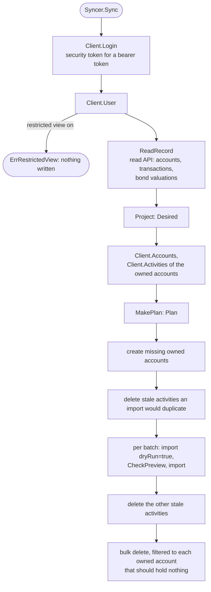

[Ghostfolio](https://github.com/ghostfolio/ghostfolio) is an open-source portfolio tracker. The Ghostfolio view is the second [view](../glossary.md) M0 ships (D-3): it shows the record in the owner's own Ghostfolio. OpenFief stays the system of record (D-2), so the view only pushes, and whatever the owner changes inside the accounts it owns is changed back on the next sync (D-4). This page explains the reconcile loop, how a transaction becomes Ghostfolio activities, how the view talks to Ghostfolio, and what is still missing.

## Concepts

**Reconcile loop.** Kubernetes controllers popularized the pattern: instead of sending changes, compare the state you want with the state there is, and change only the difference, again and again. A failed pass leaves nothing half-done that the next pass can't finish, as long as every step is safe to repeat. The view's desired state is the record's projection; the actual state is what its Ghostfolio accounts hold (D-4).

**Activities and owned accounts.** Ghostfolio records an [account](../glossary.md)'s history as *activities* (buy, sell, dividend, fee and a few more), each with a free-text comment. Activity is Ghostfolio's word and appears only inside this adapter; the record's word is [transaction](../glossary.md). The view writes only into its [owned accounts](../glossary.md): the Ghostfolio accounts it created, one per account of the record. Each is created with a UUID the view derives from its instance's name and the account's ID, so every sync finds the same accounts without storing anything, and an account the owner made is never touched (D-64). Each activity's comment is `openfief:` and the transaction's key, which is OpenFief's transaction ID (D-4).

**Ghostfolio's API.** Ghostfolio's documented public API covers only authentication, health, import, export and public pages; accounts, activities and market data are its web app's internal endpoints, renamed within `/v1` without notice (R-15). An import is not atomic, silently skips an activity it takes for a duplicate (same comment, currency, data source, date, fee, quantity, symbol, type and unit price, in any account), and deleting an asset's last activity deletes the asset and its price history (R-15). D-64 shapes the loop around these facts.

## How it works

The package is [internal/views/ghostfolio](../../internal/views/ghostfolio/):

| File | Contents |
|---|---|
| [model.go](../../internal/views/ghostfolio/model.go) | `Activity`, `Account`, `AssetProfile`, `Price`; the derived UUIDs `AccountUUID`, `BondSymbol` and `FeeSymbol`; the rounding to what a double holds |
| [project.go](../../internal/views/ghostfolio/project.go) | `Project`: from `Source` (the record plus the owner's `Listing`s) to `Desired`, and the `Problem`s it leaves out. Pure |
| [plan.go](../../internal/views/ghostfolio/plan.go) | `MakePlan`: from `Desired` and `Actual` to a `Plan`; `CheckPreview`, `Batches`. Pure |
| [record.go](../../internal/views/ghostfolio/record.go) | `ReadRecord`: the read API's accounts, transactions and bond valuations, through the `Record` port |
| [client.go](../../internal/views/ghostfolio/client.go) | `Client`, Ghostfolio's HTTP API; `SupportedVersions` |
| [sync.go](../../internal/views/ghostfolio/sync.go) | `Syncer.Sync`, one pass of the loop, through the `Ghostfolio` port |

### One pass

1. **Refuse while the restricted view is on.** Ghostfolio's "restricted view" setting blanks comments, fees and quantities in its responses, so every activity would look stale; the sync stops with `ErrRestrictedView` before reading anything (D-64).
2. **Read and project.** `ReadRecord` reads every account, every page of its current transactions, and, for an account that ever held a treasury bond, its stored valuations from its first bond transaction through its valued-through date, in ranges the read API accepts. `Project` turns them into the desired activities.
3. **Plan.** `MakePlan` keeps an activity of an owned account when a desired one agrees with it in every field, comment included. A manually edited activity keeps its comment, so only comparing fields finds the edit (D-64). Every desired activity nothing agrees with is imported; every other activity of an owned account is stale and deleted. So an edit is reverted by importing the right one and deleting the edited one.
4. **Import, then delete.** Imports go first, because deleting an asset's last activity would take its price history with it (D-64). The one exception is a stale activity the import would skip as a duplicate, such as one moved to another owned account: Ghostfolio's duplicate check ignores the account, so that one is deleted first, and the import brings back any asset it removed, prices included, since every import carries them. Each batch of at most `BatchSize` (500) activities is sent first with `dryRun=true`, and only when `CheckPreview` finds every activity stored as sent (none a duplicate, each in the same account under the same symbol) is it sent for real. An owned account that should hold nothing but does is emptied with one bulk delete filtered to it; the client refuses a bulk delete with no account filter, which in Ghostfolio deletes every activity the user has (D-64).

Every step is safe to repeat: accounts are created with the same UUIDs, an activity already imported is kept, a delete of an activity already gone counts as done. A pass that fails halfway is finished by the next one. Run once more, a pass after a complete one changes nothing but the prices it resends.

### From a transaction to activities

| Transaction kind | Activity |
|---|---|
| Buy, opening lot | `BUY` of the holding posting's quantity at its amount divided by the quantity; an opening lot is dated when the lot was first acquired |
| Sell | `SELL` at the proceeds divided by the quantity |
| Dividend | `DIVIDEND` of quantity 1 at the gross amount, the tax withheld as its fee |
| Fee | `FEE` against the fee asset of its currency |
| FX conversion, deposit, withdrawal | none |

Fees of a buy or sell in the activity's currency are its fee; a fee or withheld tax in another currency becomes a `FEE` of its own, commented `#fee:` and the currency after the transaction's comment. A treasury bond (an instrument the read API classes as `treasury_bond`) is a `MANUAL` asset: its symbol is `BondSymbol` of its series code and its name the code, and every sync sends its whole price history, each stored valuation divided by the quantity held at the end of that day (D-64). A fee asset is a `MANUAL` asset per currency, `FeeSymbol`. A listed instrument takes Ghostfolio's data source and symbol, such as `YAHOO` and its ticker, from the owner's listings by ISIN; an instrument with no listing is left out as a `ProblemUnlisted`, and the rest is still synced.

Ghostfolio stores numbers as IEEE 754 doubles, which print back any decimal of up to 15 significant digits unchanged, so every quantity, price and fee is rounded half to even to 15 significant digits before it is sent. Otherwise a value Ghostfolio can't hold exactly would never compare equal and would be reimported on every sync. Dates go as midnight UTC. A number with more than 15 integer digits, or a key too long for Ghostfolio's 2000-character comment, is left out as a problem.

### The plugin

[plugins/ghostfolio](../../plugins/ghostfolio/) is the [plugin](../glossary.md) image: a thin [main.go](../../plugins/ghostfolio/main.go) and [config.go](../../plugins/ghostfolio/config.go) on the SDK, a [manifest.json](../../plugins/ghostfolio/manifest.json) and a Dockerfile that CI builds and signs like every first-party plugin ([Plugins](plugins.md#first-party-plugins)). It serves nothing: views are clients of the read API (D-49), and the core schedules only connectors, so the plugin runs the loop on its own timer, at start and then every `interval`. A failed pass is logged and the next tick finishes it; logs carry only counts.

| Manifest | Value |
|---|---|
| Capabilities | `view` |
| Secrets | `ghostfolio-credentials` at `/etc/openfief/ghostfolio`, file `security-token`: the Ghostfolio user's security token, read on every login |
| Egress | none (see [Not built yet](#not-built-yet)) |
| Config | `url`, the owner's Ghostfolio as an https origin such as `https://ghostfolio.example.com` (required); `interval`, a Go duration of at least `5m`, `1h` by default; `listings`, each an `isin` with Ghostfolio's `dataSource` (not `MANUAL`) and `symbol` |

The plugin reads the read API with its own projected ServiceAccount token (audience `openfief-core`, D-27), which the core accepts from view plugins ([Identity](identity.md#in-the-core)), and reaches Ghostfolio only through the egress proxy with the SDK's egress client, which refuses plain http (D-32, D-63).

### The supported versions

`SupportedVersions` is `>=3.93.0 <3.94.0`: the versions the contract test's recordings come from (D-64). Ghostfolio only shows its version to administrators, so the view can't check it at run time; an owner on another version runs at their own risk, and the dry run stops an import that Ghostfolio would store differently.

## Decisions

- **D-3, D-4**: the view's reconcile loop over the accounts it created, with the transaction's key in each comment, stale activities deleted and missing ones imported, manual edits reverted.
- **D-64**: UUIDs for owned accounts; import first, bulk deletes always filtered; bonds as `MANUAL` assets with a UUID from the series code and the full price history every sync; edits found by comparing fields; dry runs; refusal under the restricted view; a pinned version range with contract tests.
- **D-6, D-27**: the view reads the record only through the read API, with the plugin's projected token.
- The owned accounts' UUIDs are derived from the instance's name and the account's ID rather than generated at random and stored: a plugin has a read-only file system and no volume, and a derived UUID makes creating an account safe to repeat. D-64 says the view generates and stores them; this is this package's reading, not the author's.
- Deleting a stale activity before the import it would block is this package's reading of D-64's "import first"; nothing else is deleted before the imports.
- What each transaction kind becomes, the fee assets, quantity 1 for dividends and the 15-digit rounding are this package's choices; no decision fixes them.

## Verification

| Behavior | Tests | kibi |
|---|---|---|
| Each kind's activities, fees in another currency, bond prices from valuations, the derived UUIDs, rounding, problems | `TestDerivedUUIDs`, `TestProject`, `TestProjectAccounts`, `TestProjectRejects` in [project_test.go](../../internal/views/ghostfolio/project_test.go) | REQ-views-ghostfolio-projection, REQ-views-ghostfolio-bond-assets, REQ-views-ghostfolio-owned-accounts, TEST-views-ghostfolio-project |
| Keep, import, revert, delete, clear, pre-delete; dry-run previews; batches | `TestMakePlan`, `TestCheckPreview`, `TestBatches` in [plan_test.go](../../internal/views/ghostfolio/plan_test.go) | REQ-views-ghostfolio-reconcile, REQ-views-ghostfolio-dry-run, TEST-views-ghostfolio-plan |
| Over 500 seeded random cases, applying a plan as Ghostfolio does and planning again gives an empty plan, and the owner's own activities stay | `TestPlanIsIdempotent` in [plan_property_test.go](../../internal/views/ghostfolio/plan_property_test.go) | REQ-views-ghostfolio-reconcile, TEST-views-ghostfolio-plan-properties |
| A pass's calls in order over a fake Ghostfolio and a paged fake read API; refusals write nothing | `TestSync`, `TestSyncRefuses` in [sync_test.go](../../internal/views/ghostfolio/sync_test.go) | REQ-views-ghostfolio-read-record, REQ-views-ghostfolio-reconcile, TEST-views-ghostfolio-sync |
| No unfiltered bulk delete or listing; error statuses without bodies | `TestClientNeverDeletesUnfiltered`, `TestClientErrors` in [client_test.go](../../internal/views/ghostfolio/client_test.go) | REQ-views-ghostfolio-client, TEST-views-ghostfolio-client |
| The manifest asks for the view capability and the token Secret only; the config is checked; the plugin refuses to start without the core, its instance name or the egress proxy; the timer loop | `TestManifest`, `TestConfigParse`, `TestReadSecretFile`, `TestNewSyncer`, `TestNewSyncerWith`, `TestLoop` in [main_test.go](../../plugins/ghostfolio/main_test.go) | REQ-plugins-ghostfolio-plugin, TEST-plugins-ghostfolio-main |
| The loop against a real Ghostfolio 3.93.0: first sync, an unchanged second sync, a reverted edit, a deletion, a cleared account, the restricted view, the owner's own activity untouched | `TestGhostfolioContract` in [contract_test.go](../../internal/views/ghostfolio/contract_test.go) | REQ-views-ghostfolio-version-range, REQ-views-ghostfolio-client, TEST-views-ghostfolio-contract |

These requirements refine the firm ones imported from D-3, D-4 and D-64. `TestGhostfolioContract` replays hypert recordings made against a fresh local `ghostfolio/ghostfolio:3.93.0` with a new anonymous user and the synthetic record of [fakes_test.go](../../internal/views/ghostfolio/fakes_test.go); replay checks each request's method, path, query, headers and JSON body. The security and bearer tokens never reach a recording; the test's comment says how to record again. Every other test runs offline over fakes.

## Not built yet

- **Cash.** Deposits, withdrawals and FX conversions have no activity, and owned accounts' balances are not set, so Ghostfolio shows holdings without cash.
- **Egress to the owner's Ghostfolio.** A manifest is the image's signed label (D-42), and the egress allow-list holds only hosts the manifest requests and the grant approves (D-16, D-32), so an image built before the owner chose a Ghostfolio host can't request it. The first-party manifest names no egress host; without one the operator sets no `HTTPS_PROXY`, and the plugin refuses to start. Until the author decides how an owner-chosen host enters the allow-list, an owner can build the image with their host in `manifest.json` and sign it as their own (D-45). The demo doesn't run the plugin.
- **The catalog (D-43).** The plugin is built and signed by CI but not in the catalog.
- **A version check at run time.** Ghostfolio shows its version only to administrators.
