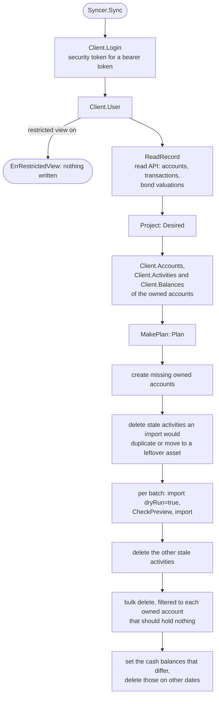
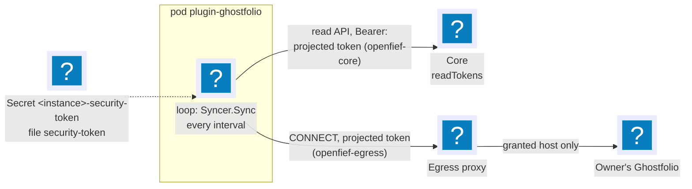

[Ghostfolio](https://github.com/ghostfolio/ghostfolio) is an open-source portfolio tracker. The Ghostfolio view is the second [view](../glossary.md) M0 ships (D-3): it shows the record in the owner's own Ghostfolio. OpenFief stays the system of record (D-2), so the view only pushes, and whatever the owner changes inside the accounts it owns is changed back on the next sync (D-4). This page explains the reconcile loop, how a transaction becomes Ghostfolio activities and the cash a balance, how the view talks to Ghostfolio, and what is still missing.

## Concepts

**Reconcile loop.** Kubernetes controllers popularized the pattern: instead of sending changes, compare the state you want with the state there is, and change only the difference, again and again. A failed pass leaves nothing half-done that the next pass can't finish, as long as every step is safe to repeat. The view's desired state is the record's projection; the actual state is what its Ghostfolio accounts hold (D-4).

**Activities and owned accounts.** Ghostfolio records an [account](../glossary.md)'s history as *activities* (buy, sell, dividend, fee and a few more), each with a free-text comment. Activity is Ghostfolio's word and appears only inside this adapter; the record's word is [transaction](../glossary.md). The view writes only into its [owned accounts](../glossary.md): the Ghostfolio accounts it created, one per account of the record. Each is created with a UUID the view derives from its instance's name and the account's ID, so every sync finds the same accounts without storing anything, and an account the owner made is never touched (D-64). Each activity's comment is `openfief:` and the transaction's key, which is OpenFief's transaction ID (D-4).

**Ghostfolio's API.** Ghostfolio's documented public API covers only authentication, health, import, export and public pages; accounts, account balances, activities and market data are its web app's internal endpoints, renamed within `/v1` without notice (R-15). An import is not atomic, silently skips an activity it takes for a duplicate (same comment, currency, data source, date, fee, quantity, symbol, type and unit price, in any account), and deleting an asset's last activity deletes the asset and its price history (R-15). Read from Ghostfolio 3.93.0's source: a `MANUAL` asset's symbol is unique across all of Ghostfolio's users, and an import of a `MANUAL` asset the user doesn't have yet reuses the user's `MANUAL` asset of the same name instead. An account's cash is a history of balances, one per date, and the latest one not in the future is its balance. D-64 and D-108 shape the loop around these facts.

## How it works

The package is [internal/views/ghostfolio](../../internal/views/ghostfolio/):

| File | Contents |
|---|---|
| [model.go](../../internal/views/ghostfolio/model.go) | `Activity`, `Account`, `AssetProfile`, `Price`, `Balance`; the derived UUIDs `AccountUUID`, `BondSymbol` and `FeeSymbol`; the rounding to what a double holds |
| [project.go](../../internal/views/ghostfolio/project.go) | `Project`: from `Source` (the record plus the owner's `Listing`s) to `Desired`, and the `Problem`s it leaves out. Pure |
| [plan.go](../../internal/views/ghostfolio/plan.go) | `MakePlan`: from `Desired` and `Actual` to a `Plan`; `CheckPreview`, `Batches`. Pure |
| [record.go](../../internal/views/ghostfolio/record.go) | `ReadRecord`: the read API's accounts, transactions and bond valuations, through the `Record` port |
| [client.go](../../internal/views/ghostfolio/client.go) | `Client`, Ghostfolio's HTTP API; `SupportedVersions` |
| [sync.go](../../internal/views/ghostfolio/sync.go) | `Syncer.Sync`, one pass of the loop, through the `Ghostfolio` port |

### One pass

1. **Refuse while the restricted view is on.** Ghostfolio's "restricted view" setting blanks comments, fees and quantities in its responses, so every activity would look stale; the sync stops with `ErrRestrictedView` before reading anything (D-64).
2. **Read and project.** `ReadRecord` reads every account, every page of its current transactions, and, for an account that ever held a treasury bond, its stored valuations from its first bond transaction through its valued-through date, in ranges the read API accepts. `Project` turns them into the desired activities and cash balances.
3. **Plan.** `MakePlan` keeps an activity of an owned account when a desired one agrees with it in every field, comment included. A manually edited activity keeps its comment, so only comparing fields finds the edit (D-64). Every desired activity nothing agrees with is imported; every other activity of an owned account is stale and deleted. So an edit is reverted by importing the right one and deleting the edited one. Cash balances are compared the same way, by account, date and value.
4. **Import, then delete.** Imports go first, because deleting an asset's last activity would take its price history with it (D-64). The one exception is a stale activity the import would skip as a duplicate, such as one moved to another owned account: Ghostfolio's duplicate check ignores the account, so that one is deleted first, and the import brings back any asset it removed, prices included, since every import carries them. When a sync imports onto a `MANUAL` asset, the stale activities on `MANUAL` assets it doesn't want go first too: Ghostfolio's import would otherwise put the new activities on a leftover asset of the same name, such as the bond asset an earlier version keyed by the series code alone, and the dry run would refuse them forever. No asset the view wants loses its prices; the old asset goes with its last activity. Strictly, D-64 allows only the duplicate exception ([implementation question 12](../implementation-questions.md#ghostfolio-view)). Each batch of at most `BatchSize` (500) activities is sent first with `dryRun=true`, and only when `CheckPreview` finds every activity stored as sent (none a duplicate, each in the same account under the same symbol) is it sent for real. An owned account that should hold nothing but does is emptied with one bulk delete filtered to it; the client refuses a bulk delete with no account filter, which in Ghostfolio deletes every activity the user has (D-64).
5. **Cash.** Each desired balance Ghostfolio lacks, or holds with another value, is set (Ghostfolio keeps one per account and date, so setting replaces), and every balance of an owned account on a date with no desired one is deleted (D-108).

Every step is safe to repeat: accounts are created with the same UUIDs, an activity already imported is kept, a delete of an activity already gone counts as done, and a balance set again is the same balance. A pass that fails halfway is finished by the next one. Run once more, a pass after a complete one changes nothing but the prices it resends.

### From a transaction to activities

| Transaction kind | Activity |
|---|---|
| Buy, opening lot | `BUY` of the holding posting's quantity at its amount divided by the quantity; an opening lot is dated when the lot was first acquired |
| Sell | `SELL` at the proceeds divided by the quantity |
| Dividend | `DIVIDEND` of quantity 1 at the gross amount, the tax withheld as its fee (D-108) |
| Interest, such as a bond's coupon (D-101) | `INTEREST`, shaped like a `DIVIDEND` |
| Fee | `FEE` against the fee asset of its currency (D-108) |
| FX conversion, deposit, withdrawal | none: they move only cash, which the balance follows |

Fees of a buy or sell in the activity's currency are its fee; a fee or withheld tax in another currency becomes a `FEE` of its own, commented `#fee:` and the currency after the transaction's comment. A treasury bond (an instrument the read API classes as `treasury_bond`) is a `MANUAL` asset: its symbol is `BondSymbol`, a UUID derived from the instance's name, the Ghostfolio user's ID and the series code, and its name the code, and every sync sends its whole price history, each stored valuation divided by the quantity held at the end of that day (D-64). A fee asset is a `MANUAL` asset per currency named "OpenFief fees" and the currency, `FeeSymbol` of the instance, the user and the currency (D-108). Symbols are unique across Ghostfolio's users, so keying them by the instance alone would still collide between two installs whose instances share a name ([implementation question 13](../implementation-questions.md#ghostfolio-view)). A listed instrument takes Ghostfolio's data source and symbol, such as `YAHOO` and its ticker, from the owner's listings by ISIN (D-108); an instrument with no listing is left out as a `ProblemUnlisted`, and the rest is still synced.

Interest, such as a bond's coupon (D-101), becomes an `INTEREST` activity, shaped like a `DIVIDEND`: quantity 1 at the gross amount, with the tax withheld as its fee.

### The cash balance

Each owned account is created in the Ghostfolio user's base currency, and its balance history follows the account's cash in that currency (D-108): `Project` sums the account's postings to its cash ledger account in that currency, and gives one balance at the end of each date the sum changes, starting from zero. A transaction left out as a problem still moves the cash. A Ghostfolio account has one balance, in its own currency, so cash in any other currency is left out as a `ProblemCashCurrency` per account and currency, and Ghostfolio's totals miss it ([implementation question 11](../implementation-questions.md#ghostfolio-view)). Ghostfolio reads the latest balance as the account's cash and carries it forward in its charts.

Ghostfolio stores numbers as IEEE 754 doubles, which print back any decimal of up to 15 significant digits unchanged, so every quantity, price and fee is rounded half to even to 15 significant digits before it is sent. Otherwise a value Ghostfolio can't hold exactly would never compare equal and would be reimported on every sync. Dates go as midnight UTC. A number with more than 15 integer digits, or a key too long for Ghostfolio's 2000-character comment, is left out as a problem; a balance too large leaves out the account's balances.

### The plugin

[plugins/ghostfolio](../../plugins/ghostfolio/) is the [plugin](../glossary.md) image: a thin [main.go](../../plugins/ghostfolio/main.go) and [config.go](../../plugins/ghostfolio/config.go) on the SDK, a [manifest.json](../../plugins/ghostfolio/manifest.json) and a Dockerfile that CI builds and signs like every first-party plugin ([Plugins](plugins.md#first-party-plugins)). It serves nothing: views are clients of the read API (D-49), and the core schedules only connectors, so the plugin runs the loop on its own timer, at start and then every `interval`. A failed pass is logged and the next tick finishes it; logs carry only counts.

| Manifest | Value |
|---|---|
| Capabilities | `view` |
| Secrets | role `security-token`, so the instance mounts `<instance>-security-token` (D-89), at `/etc/openfief/ghostfolio`, file `security-token`: the Ghostfolio user's security token, read on every login |
| Egress | no fixed host: `egressFromConfig: ["url"]`, the host of the config's `url`, which the install shows and the grant approves (D-75) |
| In-cluster service | `clusterService` ("a Ghostfolio running in this cluster"): the owner may pick one at install instead of a `url` (D-74) |
| Config | `url`, the owner's Ghostfolio as an https origin such as `https://ghostfolio.example.com`, unless it runs in the cluster; `interval`, a Go duration of at least `5m`, `1h` by default; `listings`, each an `isin` with Ghostfolio's `dataSource` (not `MANUAL`) and `symbol` |

The plugin reads the read API with its own projected ServiceAccount token (audience `openfief-core`, D-27), which the core accepts from view plugins ([Identity](identity.md#in-the-core)). It reaches Ghostfolio one of two ways, and refuses to start with both or neither:

- **An external Ghostfolio**, at the config's `url`: the install shows that host, the grant approves exactly it, and the plugin reaches it through the egress proxy with the SDK's egress client, which refuses plain http (D-32, D-63, D-75).
- **A Ghostfolio in the same cluster**, picked at install as the in-cluster service: the operator passes its ClusterIP and port in `OPENFIEF_CLUSTER_SERVICE_ADDRESS`, and the plugin calls `http://<that address>` directly, without the proxy, so the security token travels unencrypted inside the cluster, as the install warns (D-74).

### The supported versions

`SupportedVersions` is `>=3.93.0 <3.94.0`: the versions the contract test's recordings come from (D-64). Ghostfolio only shows its version to administrators, so the view can't check it at run time; an owner on another version runs at their own risk, and the dry run stops an import that Ghostfolio would store differently.

## Decisions

- **D-3, D-4**: the view's reconcile loop over the accounts it created, with the transaction's key in each comment, stale activities deleted and missing ones imported, manual edits reverted.
- **D-64**: UUIDs for owned accounts; import first, bulk deletes always filtered; bonds as `MANUAL` assets with a UUID from the instance and the series code and the full price history every sync; edits found by comparing fields; dry runs; refusal under the restricted view; a pinned version range with contract tests.
- **D-108**: dividends of quantity 1 at the gross amount with the tax withheld as the fee; a standalone fee against a `MANUAL` "OpenFief fees" asset per currency; the owned accounts' cash balance following OpenFief's cash; the owner's ISIN listings.
- **D-6, D-27**: the view reads the record only through the read API, with the plugin's projected token.
- **D-74, D-75**: an external Ghostfolio is reached at the host of the config's `url` through the egress proxy; one in the same cluster at the in-cluster service the owner picked, directly. Calling an in-cluster Ghostfolio over plain `http` is this plugin's reading of D-74's "may be plain HTTP"; the manifest has no way to say a service speaks TLS.
- The owned accounts' UUIDs are derived from the instance's name and the account's ID rather than generated at random and stored: a plugin has a read-only file system and no volume, and a derived UUID makes creating an account safe to repeat. D-64 says the view generates and stores them; this is this package's reading, not the author's.
- Deleting a stale activity before the import it would block is this package's reading of D-64's "import first"; nothing else is deleted before the imports.
- What buys, sells and opening lots become, splitting off fees in another currency and the 15-digit rounding are this package's choices; no decision fixes them.
- Three readings are open questions ([implementation questions 11 to 13](../implementation-questions.md#ghostfolio-view)): cash in another currency than the owned account's is left out; stale activities on `MANUAL` assets the view no longer wants are deleted before an import onto a `MANUAL` asset, which D-64's import-first rule doesn't list as an exception; the asset symbols also derive from the Ghostfolio user's ID.

## Verification

| Behavior | Tests | kibi |
|---|---|---|
| Each kind's activities, fees in another currency, bond prices from valuations, the derived UUIDs, rounding, problems; the cash balances, cash in another currency | `TestDerivedUUIDs`, `TestProject`, `TestProjectAccounts`, `TestProjectBalances`, `TestProjectRejects` in [project_test.go](../../internal/views/ghostfolio/project_test.go) | REQ-views-ghostfolio-projection, REQ-views-ghostfolio-asset-keys, REQ-views-ghostfolio-cash-balances, REQ-views-ghostfolio-owned-accounts, TEST-views-ghostfolio-project |
| Keep, import, revert, delete, clear, pre-delete of duplicates and leftover assets; balances set and deleted; dry-run previews; batches | `TestMakePlan`, `TestCheckPreview`, `TestBatches` in [plan_test.go](../../internal/views/ghostfolio/plan_test.go) | REQ-views-ghostfolio-reconcile-cash, REQ-views-ghostfolio-dry-run, TEST-views-ghostfolio-plan |
| Over 500 seeded random cases, applying a plan as Ghostfolio does (assets go with their last activity, an import reuses a `MANUAL` asset of the same name) and planning again gives an empty plan; every bond keeps its asset, even from an earlier version's keys; the owner's own activities and balances stay | `TestPlanIsIdempotent` in [plan_property_test.go](../../internal/views/ghostfolio/plan_property_test.go) | REQ-views-ghostfolio-reconcile-cash, TEST-views-ghostfolio-plan-properties |
| A pass's calls in order over a fake Ghostfolio and a paged fake read API; refusals write nothing | `TestSync`, `TestSyncRefuses` in [sync_test.go](../../internal/views/ghostfolio/sync_test.go) | REQ-views-ghostfolio-read-record, REQ-views-ghostfolio-reconcile-cash, TEST-views-ghostfolio-sync |
| No unfiltered bulk delete or listing; error statuses without bodies | `TestClientNeverDeletesUnfiltered`, `TestClientErrors` in [client_test.go](../../internal/views/ghostfolio/client_test.go) | REQ-views-ghostfolio-client, TEST-views-ghostfolio-client |
| The manifest asks for the view capability, the token Secret, the host of `url` and an in-cluster service; the config is checked; the plugin refuses to start without the core, its instance name, or a Ghostfolio, with both a `url` and an in-cluster service, or with a `url` and no egress proxy; the timer loop | `TestManifest`, `TestConfigParse`, `TestReadSecretFile`, `TestNewSyncer`, `TestNewSyncerWith`, `TestLoop` in [main_test.go](../../plugins/ghostfolio/main_test.go) | REQ-plugins-ghostfolio-plugin, TEST-plugins-ghostfolio-main |
| The loop against a real Ghostfolio 3.93.0: a first sync that moves an earlier version's bond to its new asset and sets the balances, an unchanged second sync, a reverted edit, reverted balances, a deletion with its balance, a cleared account, the restricted view, the owner's own activity and balance untouched | `TestGhostfolioContract` in [contract_test.go](../../internal/views/ghostfolio/contract_test.go) | REQ-views-ghostfolio-version-range, REQ-views-ghostfolio-client, REQ-views-ghostfolio-cash-balances, TEST-views-ghostfolio-contract |

These requirements refine the firm ones imported from D-3, D-4 and D-64. `TestGhostfolioContract` replays hypert recordings made against a fresh local `ghostfolio/ghostfolio:3.93.0` with a new anonymous user, its base currency set to PLN, and the synthetic record of [fakes_test.go](../../internal/views/ghostfolio/fakes_test.go); replay checks each request's method, path, query, headers and JSON body. The security and bearer tokens never reach a recording; the test's comment says how to record again. Every other test runs offline over fakes.

## Not built yet

- **Cash in other currencies** than the Ghostfolio user's base currency is left out of the balances (implementation question 11).
- **Interest.** The read API has no interest kind yet (D-101), so there is no `INTEREST` activity.
- **The demo doesn't run the plugin**, and no end-to-end test reaches a Ghostfolio, in the cluster or outside it.
- **The catalog (D-43).** The plugin is built and signed by CI but not in the catalog.
- **A version check at run time.** Ghostfolio shows its version only to administrators.
