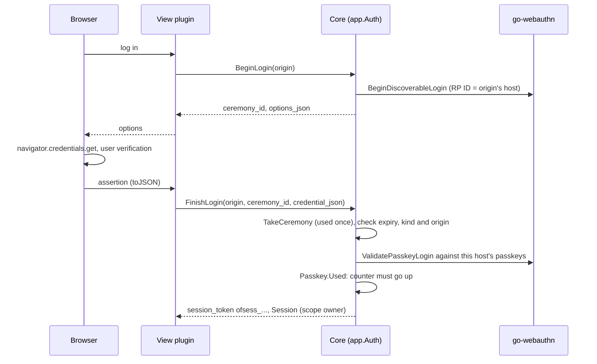
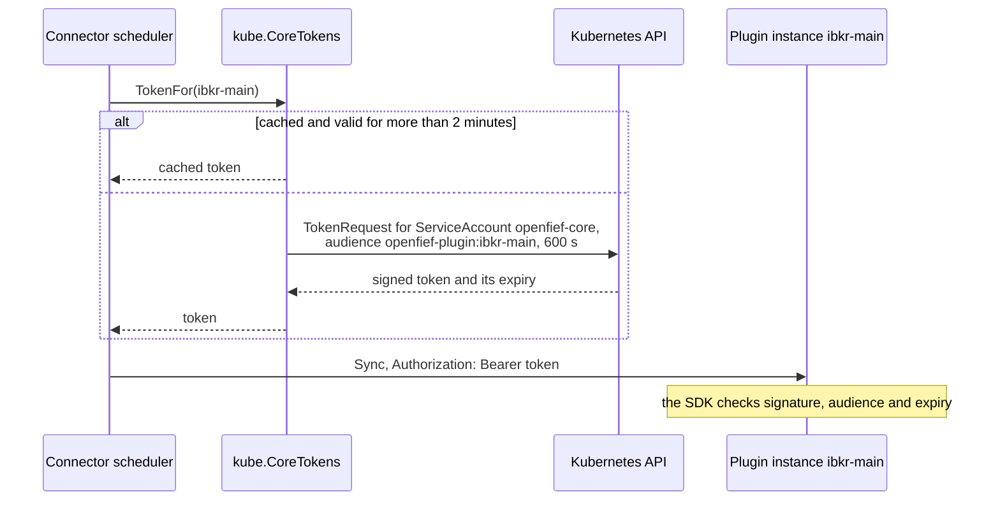
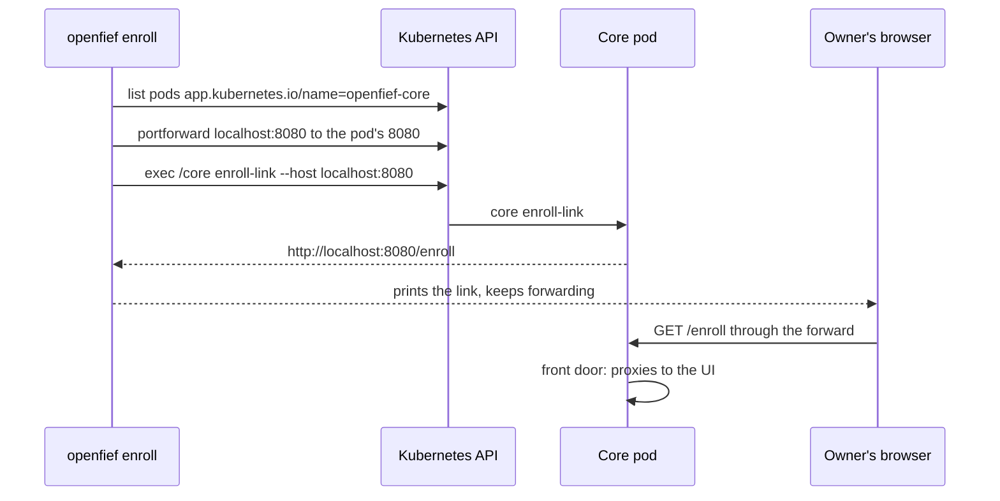

The identity context decides who may use OpenFief. An installation has exactly one person, the [owner](../glossary.md) (GR-2), so it holds no users and no tenants. It answers three questions: is the person at the browser the owner, and what may they do (passkeys and [sessions](../glossary.md)); may this script read (script tokens, D-27); and how does the core prove itself to a plugin (D-59). All of it is built: the core serves the authentication contract to view plugins, such as the built-in UI, on the port only plugins reach (D-115).

## Concepts

**Authentication is split from the session.** Following the author's decision on the auth split, an [authenticator](../glossary.md) proves who is at the browser and with which [session scope](../glossary.md); the core then issues a session, the same kind whichever authenticator succeeded. M0 has two authenticators. A [passkey](../glossary.md) gives an `owner` session. The demo authenticator gives a `read` session without any credential, and only when both the core runs with `--demo-sessions` and the database carries the demo marker that `cmd/demo-seed` writes (author decision, demo read-only sessions). Both resolve to the single owner. There is no external identity provider (D-26). A core with `--demo-sessions` on a database without the marker yet is a demo whose data is still loading: the login page says so instead of offering the demo, and the core refuses the first-run wizard's writes until the loader has marked the database (D-191, [Demo](../dev/demo.md)).

**Passkeys.** WebAuthn (W3C, 2019; Level 3 in 2025) lets a browser create a key pair on an authenticator, such as a phone, a laptop's secure chip or a password manager, and sign a server's challenge with it, after the person unlocks it. The server keeps only the public key. A credential is bound to a relying party ID, a domain, so a passkey made for one host can't sign for another, which defeats phishing. OpenFief keeps passkeys per host (D-60): the host of the origin the browser used is the relying party ID. Passkeys here are discoverable (the authenticator remembers the account, so the login page asks for nothing first) and always verify the user (PIN or biometrics). Every WebAuthn check is done by the [go-webauthn](https://github.com/go-webauthn/webauthn) library, pinned in `go.mod`, so OpenFief writes no cryptography of its own (D-29).

**Clone detection.** Each authenticator may keep a signature counter that goes up with every login. If the counter in an assertion is not above the stored one, two copies of the key may exist, and the login is refused (WebAuthn §6.1.1). Synced passkeys keep the counter at zero; two zeros are accepted.

**Sessions are opaque.** A session token is `ofsess_`, the session's ID, `_` and 32 random bytes in unpadded base64url, like a script token secret. The core stores only the SHA-256 hash of the random part, compares hashes in constant time, and can revoke a session at once by marking its row. A session is not a JWT: a JWT carries its own claims and stays valid until it expires, which is what OpenFief must not depend on. A session expires after 12 hours unused (`--session-idle`) and 7 days after it was issued in any case (`--session-max`), and works only on the host it was issued on. Its use is stored at most once a minute, so a burst of requests writes once.

**Scopes.** A `read` session may use the read API, `WhoAmI` and `Logout`. An `owner` session may also manage passkeys, script tokens and enrollment links. The core enforces this; a view plugin can't widen it.

**Passkey checks.** An owner session alone isn't enough to add a way in: enrolling or removing a passkey, issuing an enrollment link and creating a script token need a [passkey check](../glossary.md) made in the same session within the last five minutes (D-183), so a stolen session cookie can't mint a lasting credential. This is what other systems call step-up authentication or "sudo mode" (GitHub asks for it before changing security settings). Signing in with a passkey counts as the session's first check, and so does creating a passkey from an enrollment code, which signs the owner in; afterwards `BeginPasskeyCheck` and `FinishPasskeyCheck` run an assertion like a login's, against the passkeys of the session's host, in a ceremony of its own kind, and record its time on the session. Without a recent check the core refuses with `ErrPasskeyCheckRequired`, which the API sends as `FAILED_PRECONDITION` with a `PasskeyCheckRequired` error detail; the built-in UI then asks the owner to confirm with their passkey and posts the action again ([UI](ui.md#signing-in)). Listing passkeys and tokens, revoking a token and signing out need no check: they add no way in. A demo session has `read` scope, so it can take none of these actions, nor begin a check.

**Ending sessions.** Each session records the passkey that signed it in. Removing a passkey revokes every session it signed in, in the same transaction, so a lost or stolen passkey's sessions end with it; if that includes the caller's own, `RemovePasskey` says so and the UI signs out. `SignOutEverywhere` revokes every session, on every host and of either scope, the caller's own included (D-183); it needs an owner session but no passkey check, since it only takes ways in away. Script tokens are not sessions: they stay until revoked or expired.

**Enrollment codes.** OpenFief installs with no hostname (D-60), so the first passkey is created through a one-time link: the owner runs `openfief enroll` (D-80, [below](#the-first-passkey)), which has the core's own `core enroll-link` print it, such as `http://localhost:8080/enroll#code=ofenroll_...`. An [enrollment code](../glossary.md) works once, on the one [origin](../glossary.md) it was issued for, within its lifetime (15 minutes by default, 24 hours at most); only its key's hash is stored. The code sits in the URL fragment, which a browser never sends to a server or in a `Referer`. When the owner adds a route on their own hostname ([Expose OpenFief](../guides/expose.md)), a logged-in owner session issues a link for that host the same way (`CreateEnrollmentLink`). Creating a passkey with a code also logs the owner in and opens the overview, which sends an owner whose install has no account yet to the built-in UI's first-run wizard (D-73, [UI](ui.md#pages)); a demo has no wizard (D-191).

**Allowed origins.** The core serves the owner only on origins on an explicit allow-list: its container's `OPENFIEF_AUTH_ORIGINS`, origins separated by commas, `http://localhost:8080` when unset. It is one setting that serving and issuing enrollment links both read (D-126): `IssueEnrollmentLink` refuses a link for an origin not on it, storing nothing, so `core enroll-link`, a `kubectl exec` in the same container, refuses one too. An origin is `https://` and a lowercase DNS name with an optional port, or `http://localhost`, the one host browsers treat as secure without TLS. IP addresses are refused, because a WebAuthn relying party ID must be a domain. Every call names its origin, and the browser's signed client data must name the same one.

**Script tokens.** D-27 gives scripts their own tokens, apart from people and plugins. A [script token](../glossary.md) is personal, scoped, expiring and read-only: the only scope is `read`, since the public API only reads (D-6). It lives at most a year; the default is 30 days. Its [secret](../glossary.md) is `ofs_`, the token's ID, `_` and 32 random bytes, of which only the SHA-256 hash is stored, so a database dump can't be replayed against the API. SHA-256 is enough without a slow password hash because the key is 256 random bits, not something a person chose. The owner creates script tokens from an owner session (author decision, auth split); `core token issue` stays as the administrator's way in when no session is at hand.

**Bearer tokens on the read API.** A client sends `Authorization: Bearer <token>`, the scheme of RFC 6750: whoever holds the token may use it. The read API accepts a session of any scope or a read-scoped script token, both as the owner, and a view plugin's projected ServiceAccount token (audience `openfief-core`, D-27), such as the [Ghostfolio view](ghostfolio.md)'s, which reads on its own schedule with no owner at hand. The read API only reads, so a view plugin's token can only read.

**The audit log.** D-211 asks for a record of every change of state and every access event, one that nothing can quietly rewrite. The [audit log](../glossary.md) is a table, `identity.audit_log`, that the core only appends to. Each [entry](../glossary.md) names who (an actor kind and ID), what (an action from a closed list), which records (kind and ID pairs), when, and the outcome (`ok`, `refused` or `failed`). It has no free-text field, so there is nowhere to put an amount, a secret or the text of a question (GR-12): every value is a member of a closed set, a time, or an ID of a fixed shape, and a reference that looks like a token, a name or a sentence is refused. The owner is named by the ID of the session that acted; a person who holds only an enrollment code, by the code's ID; the core's own commands, by `core`; a caller who proved nothing, such as a refused sign-in, by nothing. Entries are kept forever.

Two things make it dependable. The log is append-only in the database itself: the core's role holds no `UPDATE`, `DELETE` or `TRUNCATE` on the table, and a trigger refuses them for any role that still does. And it fails closed: a change and its entry are written in one database transaction, so if the entry can't be written the change doesn't happen. This is the write-ahead idea of a transaction log applied to accountability, and the reason a security log should not be best-effort. There is no hash chain yet: it would make tampering by the database's own administrator evident, which P-18 leaves undecided, and one can start later from a genesis entry. Reading the read API is not an entry, and neither is reading the log.

## Authorization

Authentication says who a caller is; authorization says what that caller may do. OpenFief decides it per account, and relationship-based (D-163): who may view or change an account follows from the caller's relationship to it, as [ReBAC](../glossary.md#other-terms-and-abbreviations) does, rather than from a role. Google's Zanzibar paper (2019) described one relationship graph and one permission check behind all of Google's products; [SpiceDB](../glossary.md#other-terms-and-abbreviations), by Authzed, is an open-source database modeled on it.

**One question, asked everywhere.** Every read path and owner service of the core asks one [authorizer](../glossary.md), `identityapp.Authorizer` in [access.go](../../internal/identity/app/access.go), whether the [caller](../glossary.md) may do an [account action](../glossary.md), view or change, on each account (D-163). The read API lists only the accounts the caller may view, and computes totals, the allocation, performance, transfers and yearly taxes over those; a query about one account the caller may not view is answered exactly as one about an account that isn't stored, so a caller can't learn which accounts exist. An owner service that changes an account asks for the change first, before it reads anything about the account, and refuses with permission denied. A caller the request carries no caller for may do nothing.

**Until SpiceDB answers.** The interface's only implementation now is `identityapp.Policy`, over the pure rule `identity.MayAct`: the owner may view and change every account, and every other holder of [read access](../glossary.md) (D-137), that is a script token, a view plugin or a demo session, views every account and changes none. From the second alpha, SpiceDB answers the same interface, with its datastore a database in the core's PostgreSQL cluster, and script tokens and view plugins are granted accounts as viewers are (D-164, D-65). The callers, the actions and the code that asks don't change then; only the implementation does.

**The model as a schema.** The authorization model is written as a SpiceDB schema, [authz/schema.zed](../../authz/schema.zed) (D-164). A `household` has one `owner`, a `person`, and `reader`s: the script tokens, view plugins and demo sessions. An `account` belongs to the household; its `change` permission is the household's owner, and its `view` permission is `change`, its own `viewer`s (a person, a script token or a view plugin granted that account, from the second alpha) and the household's readers. [authz/validation.yaml](../../authz/validation.yaml) holds synthetic relationships and assertions: the owner views and changes every account; every reader views every account and changes none; a viewer views only the account granted to it and changes nothing; a stranger views nothing. `task authz:validate` runs `zed validate` on it offline, as part of `task check` in CI ([pipeline](../dev/pipeline.md#the-taskfile)), with zed, SpiceDB's CLI, pinned in the Taskfile.

**Who the caller is.** The read API's verifier returns the caller its bearer token stands for, and the API's interceptor hands it to the views through the request's context (`identityapp.WithCaller`, `CallerFrom`). An owner-scoped session is the owner; a read-scoped session from the demo authenticator is a demo session (`Principal.Caller`); a script token and a view plugin are themselves. The built-in UI reads the read API with the owner's session, so its pages show what the owner may view. The owner services already admit only an owner-scoped session; `cmd/core`'s `ownerSessions` then asks the authorizer which of the accounts a change names that owner may change (`Changeable` on each context's `Owners` port).

## How it works

The built-in UI, a view plugin, is the backend for the owner's browser. It calls the core's `AuthService` with its own projected ServiceAccount token (audience `openfief-core`, D-27) and passes on the browser's origin and WebAuthn payloads; it keeps the session token for the browser and presents it to the read API.

A passkey login, with the ceremony state kept by the core so the browser can't change it, and each ceremony used once:

The pure rules are in package `identity`:

| Name | What it does |
|---|---|
| `Origin`, `ParseOrigin`, `Origins` | An origin, its RP ID, and the allow-list ([origin.go](../../internal/identity/origin.go)). |
| `Session`, `NewSession`, `Session.Check`, `Session.Touched` | Sessions, their scope, idle and absolute expiry, host and revocation, in that order of checks ([session.go](../../internal/identity/session.go)). |
| `Session.SignedInWithPasskey`, `Session.PasskeyChecked`, `Session.CheckRecentPasskey`, `Session.SignedInBy`, `PasskeyCheckWindow` | The passkey that signed a session in, its last passkey check, which never moves back, and D-183's five-minute window; only a passkey session has either. |
| `SessionScope`, `Authenticator`, `Authenticator.Scope` | `read` and `owner`; an authenticator grants at most its scope. |
| `Owner`, `Passkey`, `Passkey.Used`, `Passkey.CheckHost` | The owner's random 32-byte WebAuthn user handle, passkeys, and the counter rule ([passkey.go](../../internal/identity/passkey.go)). |
| `EnrollmentCode`, `EnrollmentURL`, `Ceremony` | One-time codes, the link, and ceremonies between begin and finish, 5 minutes at most ([enrollment.go](../../internal/identity/enrollment.go)). |
| `ScriptToken`, `FormatSecret`, `ParseSecret`, `HashKey`, `KeyMatches` | Script tokens, their secrets, the stored hash and the constant-time comparison ([token.go](../../internal/identity/token.go)). |

The use cases are in [identity/app](../../internal/identity/app/auth.go): `Auth` with `Login` (any `Authenticator`), `BeginRegistration` and `FinishRegistration`, `BeginLogin`, `Session`, `Logout`, `WhoAmI`, `Passkeys`, `RemovePasskey` (never the last one; revokes the sessions it signed in), `BeginPasskeyCheck` and `FinishPasskeyCheck`, `SignOutEverywhere`, `CreateScriptToken`, `ScriptTokens`, `RevokeScriptToken`, `CreateEnrollmentLink`, `IssueEnrollmentLink` (the CLI's), `Authenticate` (the read API's), `LoginMethods`, which says whether a passkey exists for the origin's host, whether demo sessions work, and whether the demo data is still loading, and `DemoLoading`, which `cmd/core` asks before the wizard's writes. The two demo answers are the pure rules `identity.DemoSessionsAvailable` and `identity.DemoLoading` ([demo.go](../../internal/identity/demo.go)) over the flag and the marker. Every error wraps one class, which the API maps to a Connect code: `ErrInvalidSession` and `ErrAuthenticationFailed` are unauthenticated; `ErrForbidden` (an origin off the list, a scope, a code, demo sessions off) is permission denied; `ErrCeremony`, `ErrLastPasskey` and `ErrPasskeyCheckRequired` are failed precondition, the last with the `PasskeyCheckRequired` detail; `ErrRegistrationFailed` and `ErrInvalidRequest` are invalid argument; `ErrNotFound` is not found. The script token use cases `Tokens.Issue`, `Verify`, `Revoke` and `List` are in [tokens.go](../../internal/identity/app/tokens.go).

The adapters:

- [identity/webauthn](../../internal/identity/webauthn/ceremonies.go) runs each ceremony on go-webauthn with the origin as the only accepted origin and its host as the RP ID: resident key and user verification required, attestation `none`, existing passkeys of the host excluded at registration. [virtual](../../internal/identity/webauthn/virtual/virtual.go) is a software ES256 authenticator that only tests use.
- [identity/postgres](../../internal/identity/postgres/auth.go) keeps the `identity` schema: `owner` (one row), `passkeys`, `enrollment_codes`, `ceremonies` and `sessions` next to `script_tokens`, with the ledger's migration runner copied under its own lock. Taking a ceremony deletes it; using a code is one conditional `UPDATE`, so it succeeds once under concurrent calls; removing a passkey locks the table so the last one can't go, and revokes the sessions whose `passkey_id` is that passkey in the same transaction; a demo session can't have owner scope, a passkey or a passkey check by table checks. Migration `0003_passkey_check.sql` adds `sessions.passkey_id` and `sessions.passkey_checked_at` and the `passkey-check` ceremony kind; sessions issued before it have no check, so their first protected action asks for one.
- [identity/connectapi](../../internal/identity/connectapi/handler.go) serves the generated `AuthService` handler. An interceptor, `CallerInterceptor`, admits only callers the `Callers` port accepts; tokens and WebAuthn payloads are never logged. `cmd/core` puts the same interceptor (`NewCallerInterceptor`) in front of the portfolio context's `ModelPortfolioService`, which checks the owner's session through `Auth.Session` with owner scope ([Portfolio](portfolio.md)), and of the ingest context's `BondLotService` and `StatementService` ([Ingest](ingest.md#statement-uploads)). It checks unary calls and streams alike: a statement upload is a client stream, refused before its handler reads a byte when its caller isn't a view plugin.
- [identity/kube](../../internal/identity/kube/coretokens.go) requests the core's tokens for plugins (below), and [`CoreAccess`](../../internal/identity/kube/firstpasskey.go) reaches the core's pod with the owner's kubeconfig for `openfief enroll`, and runs any other core command there for the owner (`Exec`), such as `core check balances` for `openfief check balances` ([Read API](read-api.md#the-owners-balance-check)). Either fails with `ErrNoCorePod`, running nothing, while no core pod is ready.
- [identity/cli](../../internal/identity/cli/enroll.go) is `openfief enroll`, the first passkey (below).

The contract is [auth.proto](../../proto/openfief/identity/v1/auth.proto), generated into `sdk/go/gen/openfief/identity/v1`.

### The core's tokens to plugins

Only the core may call a plugin (D-59), and the plugin has to tell the core's calls apart from anyone else's. The core proves who it is with a token of its own ServiceAccount, `openfief-core`, that Kubernetes issues through the TokenRequest API: a signed JWT whose subject is `system:serviceaccount:openfief:openfief-core` and whose audience is the one plugin instance it is meant for, `openfief-plugin:<instance>` (`openfief.InstanceAudience` in the Go SDK). A token for one instance is useless at another. `kube.CoreTokens` requests a token valid for 10 minutes and caches it per instance until 2 minutes before it expires; a failed request is not cached, an empty instance name is refused, and errors never contain a token.

### The first passkey

`openfief enroll [--origin https://HOST | --port 8080] [--ttl 15m] [--kubeconfig PATH] [--context NAME]` is the owner's command for the first passkey (D-80). With the owner's own kubeconfig, `CoreAccess` finds a running, ready pod labelled `app.kubernetes.io/name=openfief-core` in `openfief`, forwards `localhost:8080` (127.0.0.1 and ::1) to its port 8080 as `kubectl port-forward` does, and, once the forward listens, runs `/core enroll-link --host localhost:8080 --ttl 15m` in the pod's `core` container through Kubernetes exec. The core's container already holds the database's DSN, so the owner needs none. The command prints the link with what to do next, pointing to the built-in UI's first-run wizard (D-73), and keeps forwarding until Ctrl-C, so the owner signs in on `http://localhost:8080` right away. The forward reaches the core, not the UI: the core is the only entry point for browsers and proxies the UI (D-81, [Built-in UI](ui.md#the-front-door)). The core allows `http://localhost:8080` by default; for another `--port`, the core refuses the link unless `OPENFIEF_AUTH_ORIGINS` lists that origin, and the command stops the forward and passes the refusal on. The owner needs `get` and `list` on pods and `create` on `pods/exec` and `pods/portforward` in `openfief`.

With `--origin`, such as `https://fief.example.org` behind the owner's own route ([Expose OpenFief](../guides/expose.md)), there is no port-forward: the command runs `/core enroll-link --host <origin>` the same way, prints the link for that origin and the wizard's pointer, and exits. It checks no origin itself: the core refuses an origin it doesn't accept (D-126), naming the setting to add it to, because a passkey made there could never sign in, and the command passes that refusal on. `--origin` and `--port` exclude each other.

### The audit log

Every use case that changes identity state runs its store calls inside `Atomic.Atomically`, a function that runs in one transaction and hands the store a context carrying it: each store method called with that context joins it, and a nested call opens a savepoint. Next to the change it calls `Auth.record`, which builds an `identity.AuditEntry` (validated by `NewAuditEntry`) and appends it through the `Auditor` port; `*postgres.Store` implements both. The entries are:

| Event | Action | Written with |
|---|---|---|
| A session is issued (passkey, enrollment code, demo) | `sign_in`, `ok` | the session row |
| A sign-in is refused: credential, ceremony or origin | `sign_in`, `refused` | nothing, see below |
| Logout, or sign out everywhere | `sign_out`, `sign_out_everywhere` | the revocation |
| A passkey is created, by a code or in a session | `passkey_added` | the passkey row; with a code also `enrollment_link_used` and the code's use |
| A passkey is removed | `passkey_removed` | the removal and the sessions it revokes |
| An enrollment link is issued, by a session or `core enroll-link` | `enrollment_link_issued` | the code row |
| A script token is created or revoked, by a session or `core token` | `script_token_created`, `script_token_revoked` | the token row |

A registration begun in an owner session remembers that session (`identity.ceremonies.session_id`), so the passkey it creates is recorded under the right sign-in; one begun before that column existed is refused at its finish and begun again.

A refused sign-in has no change of state to share a transaction with, so its entry is written on its own, and the sign-in is refused whether or not the write succeeds: refusing is the safe outcome either way. A failed write is joined to the refusal's error, so the caller can see it. The cost is that anyone who can reach the sign-in call can add refused entries; limiting that is the same rate limiting every login needs, and is not built.

`AuthService.ListAuditEntries` returns a page, newest first, filtered by actor kind and ID, action and a time range. It needs an owner session, so a demo session, a script token and the read API never see the log (D-137). The page token is the cursor of the last entry, so a page doesn't skip entries added meanwhile; the sequence is a database `bigserial`, so two transactions that commit out of order can show their entries in the other order.

### In the core

`cmd/core` serves the `AuthService` at `/openfief.identity.v1.AuthService/` on its plugin port alone (8081, `--plugin-listen`; Service port `connect`), which only plugin pods reach, next to the read API; its browser port (8080, Service port `http`), where routes and port-forwards arrive, answers 404 there (D-115). In a cluster it admits a caller when a TokenReview accepts its token for audience `openfief-core`, the username is a plugin's ServiceAccount, and that Plugin resource lists `view` among its effective capabilities; accepted reviews are cached for 5 minutes, as the egress proxy does. The core's ClusterRole for TokenReviews is in `deploy/core/rbac.yaml`. Outside a cluster, where there are no ServiceAccount tokens to review, every caller is refused: no build has a fixed token or any other way around authentication, not even for development (D-84), so the UI is developed against a local cluster such as kind or k3d. The tests of `cmd/core` run the same check against a fake cluster whose TokenReview accepts a synthetic token. The read API's verifier, `readTokens` in [core.go](../../cmd/core/core.go), asks `Auth.Authenticate` first and, on the plugin port, for a token it doesn't know, the same callers as the `AuthService`: a view plugin in a cluster, no one outside one. On the browser port, where anyone with a route or a port-forward arrives, it takes sessions and script tokens alone (`browserReadTokens`), so no request there reaches a TokenReview; on the plugin port the review cache sends only JWT-shaped tokens to the API server and remembers a refusal for ten seconds (D-184, [Egress](egress.md#identifying-the-plugin)). A token neither accepts is refused as invalid; a check that can't be made, such as a TokenReview the API server doesn't answer, fails the call as internal. The commands are `core enroll-link [--host localhost:8080] [--ttl 15m]` and `core token issue|list|revoke`; the flags are `--session-idle`, `--session-max` and `--demo-sessions`, and `OPENFIEF_AUTH_ORIGINS` is the allow-list both `serve` and `enroll-link` read (D-126). See [Architecture](../architecture.md).

## Decisions

- **GR-12**: its Connect services log a failure only through `kernel.LogSafe`: by the known errors in its chain, or else its innermost error's type, never its text, which may carry an amount, an ISIN or an account number; `TestFailuresLogNoValues` drives every sink with such failures against a deny-list. A denied auth call logs its error class only.
- D-26: people log in with passkeys, built in, with no external identity provider.
- D-27: plugins authenticate with projected ServiceAccount tokens (audience `openfief-core`); scripts get separate, scoped, expiring, read-only tokens.
- D-29: no home-grown cryptography: go-webauthn, `crypto/rand`, `crypto/sha256`, `crypto/subtle`.
- D-59: only the core may call a plugin, with a short-lived TokenRequest token whose audience is that instance.
- D-60: no hostname at install; the one-time link for the first passkey, on the owner's hostname or on localhost; a session's link for another host; passkeys per host.
- D-80: `openfief enroll` runs `core enroll-link` in the core's pod through exec with the owner's kubeconfig and prints the link; given an origin the core allows, the link is for that origin and nothing is forwarded; with no origin given, it forwards a local port to the core, which proxies the UI (D-81), and the link is for `localhost`. The first-run wizard (D-73) is what the output points to; it is not built yet.
- D-6: the public API is read-only, so `read` is the only script token scope.
- D-84: no fixed token and no bypass in any build. The core once accepted a token from `OPENFIEF_AUTH_CALLER_TOKEN` outside a cluster; that path is gone, and so is the UI's matching variable.
- D-211: the audit log of the identity context: sign-ins (refused ones too) and sign-outs, passkeys, enrollment links and script tokens; the entry content; append-only in the database; fail closed. Grants, settings, the owner's entries, decisions on attention items, plugin installs and upgrades, and model and MCP calls come with their contexts.
- D-183: enrolling or removing a passkey, issuing an enrollment link and creating a script token need a passkey check in the same session within five minutes; the owner can sign out every session at once. Which sessions removing a passkey revokes, those it signed in, is this implementation's reading.
- Author decisions given in chat, not yet in DESIGN.md: the auth split (authenticators, opaque sessions, script tokens from a session, the UI as backend-for-frontend), and demo read-only sessions (scopes, the demo authenticator).

## Verification

- TEST-identity-domain and TEST-identity-auth-domain: table tests of script tokens, origins, sessions and their checks, scopes, passkeys and the counter rule, enrollment codes and ceremonies.
- TEST-identity-app: script tokens over an in-memory store.
- TEST-identity-demo-loading: the demo rules as a table of the flag and the marker: demo sessions only with both, the demo data loading with the flag alone. TEST-identity-auth-app checks that `LoginMethods` and `DemoLoading` report it, and TEST-core-demo-loading that the core refuses the SleeveService's and AccountService's changes while the demo data loads and serves their reads (REQ-demo-no-wizard-until-loaded, REQ-demo-owner-changes-after-load, REQ-identity-demo-loading-no-wizard).
- TEST-identity-auth-app: enrollment, login, per-host refusal, clone detection, ceremonies used once, session expiry and logout, read scope refused every owner action, script tokens from a session, and demo sessions only with both the flag and the marker, over the real go-webauthn adapter and a software authenticator.
- TEST-identity-webauthn: registration options, a full ceremony, and refusal of another origin, another RP ID, a stranger's user handle and an unknown credential.
- TEST-identity-postgres and TEST-identity-auth-postgres: under `task test:pg`, the stores, a code used once under eight concurrent uses, the last passkey kept, and no key in any column.
- TEST-identity-auth-connectapi: callers refused, read sessions refused, and error codes over Connect; `TestCallerInterceptorStreams` checks the same admission for a client stream.
- TEST-identity-passkey-check-domain, TEST-identity-passkey-check-app and TEST-identity-passkey-check-connectapi: D-183's five-minute window at its edges; each protected action refused without a recent check and allowed after a login, an enrollment or a passkey check; check ceremonies of their own kind, refused for a read session or an assertion for another host; `FAILED_PRECONDITION` with the `PasskeyCheckRequired` detail over Connect; signing out everywhere (REQ-identity-protected-actions-recent-passkey-check, REQ-identity-sign-out-everywhere, REQ-identity-passkey-check-required-error). TEST-identity-auth-app and TEST-identity-auth-postgres: removing a passkey revokes the sessions it signed in and no other (REQ-identity-remove-passkey-revokes-sessions).
- TEST-identity-audit-domain: table tests of the entry: closed actions, outcomes and reference kinds, IDs of a fixed shape for each actor and reference, no secret, name, amount or sentence accepted in any position, and the filter and its page size (REQ-identity-audit-entry-content, REQ-identity-audit-no-amount-secret-text).
- TEST-identity-audit-app: each event's entry over an in-memory store; every change failing, and leaving nothing behind, when its entry can't be written; a refused sign-in recorded, and still refused when the log is down; the log read by owner sessions only (REQ-identity-audit-every-change, REQ-identity-audit-owner-view).
- TEST-identity-audit-postgres: under `task test:pg`, `UPDATE`, `DELETE` and `TRUNCATE` refused to the app role by privilege and to a superuser by the trigger, the table's own checks against free text, filters and paging, a state change and its entry rolled back together, and the entries of a full run of use cases with no secret in the log (REQ-identity-audit-append-only, REQ-identity-audit-every-change).
- TEST-identity-audit-connectapi: `ListAuditEntries` over Connect refused for a demo session, a script token's secret, no session and a caller that is no view plugin, and filtered and paged for an owner (REQ-identity-audit-owner-view). TEST-core-read-api adds that the core's own `token issue` and `token revoke` leave their entries.
- TEST-identity-auth-contract: the generated client reaches the generated handler.
- TEST-identity-kube: the core's tokens to plugins with the client-go fake clientset, and `CoreAccess.CorePod` choosing a running, ready core pod.
- TEST-identity-cli: `openfief enroll` forwards first, then asks for the link for that port, prints it with the wizard's pointer, stops the forward on Ctrl-C, and prints nothing after a failure; with `--origin` it prints the link the core issues and forwards nothing, passes on the core's refusal of an origin it doesn't accept, and refuses `--origin` with `--port` and a host without a scheme without asking the core. The end-to-end suite runs it against a real cluster and a browser ([Built-in UI](ui.md#verification)).
- TEST-core-read-tokens: the read API's verifier accepts the owner's tokens and view plugins' tokens, returning the caller each stands for, refuses others as invalid, and fails as such when a check can't be made.
- TEST-identity-access and TEST-identity-app-access: the rule until SpiceDB answers, as a table of every holder and action; `Policy` for any account; the caller in a request's context; a session, a demo session and a script token as callers (REQ-identity-authz-owner-acts-every-account, REQ-identity-authz-readers-view-every-account, REQ-identity-authz-one-interface).
- TEST-core-owner-sessions: the owner services' port asks the authorizer about the owner of the session for a change of each account, changes nothing without an authorizer, and refuses a read session, no session and an origin off the list (REQ-identity-authz-one-interface).
- TEST-identity-authz-schema: `zed validate` of the schema against its relationships and assertions (REQ-identity-authz-spicedb-schema, REQ-identity-authz-schema-assertions-ci). How the read API and the owner services use the authorizer is tested in [Read API](read-api.md#verification), [Ingest](ingest.md) and [Ledger](ledger.md), each with a fake authorizer that denies some accounts.
- TEST-core-auth: under `task test:pg`, `core enroll-link`, a passkey enrollment and login over the core's HTTP server, the read API with a session and with a script token created from it, logout, and demo sessions refused without the marker or without the flag; and the caller check with a fake TokenReview; outside a cluster every caller is refused (`TestCallersOutsideACluster`).

## Not built yet

- Viewers (D-65), SpiceDB answering the authorizer, and accounts granted to script tokens and view plugins (D-164): the second alpha. Until then nobody is denied an account the rule above allows.
- Attention items carry no account, so the read API lists them to every holder of read access as before; per-account filtering of the items about an account, and the owner-only items D-165 names, come with viewers.

- The rest of D-211's list: grants, settings, the owner's entries and corrections, decisions on attention items, plugin installs and upgrades the operator applies (the core records them when it observes them, keyed by plugin name and generation, idempotently, retrying until written), and model and MCP calls (refused when their entry can't be written). Persons are never hard-deleted, which comes with viewers.
- Settings showing the log to the owner (REQ-identity-audit-owner-view stays open until the page exists), and an end-to-end scenario: the owner signs in, creates a script token and `ListAuditEntries` shows both with no secret in them. The end-to-end suite creates tokens with the core's CLI and has no page for the log yet; the pieces are tested under `task test:pg` and over Connect.
- A hash chain over the entries (P-18), and rate limiting of refused sign-ins.

- Listing and revoking single sessions other than the current one; signing out everywhere revokes them all.
- Scopes for script tokens other than `read`; they wait for a write API, which M0 doesn't have.
