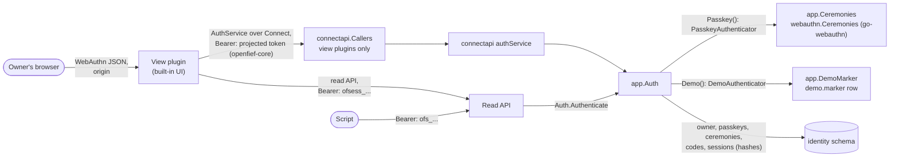
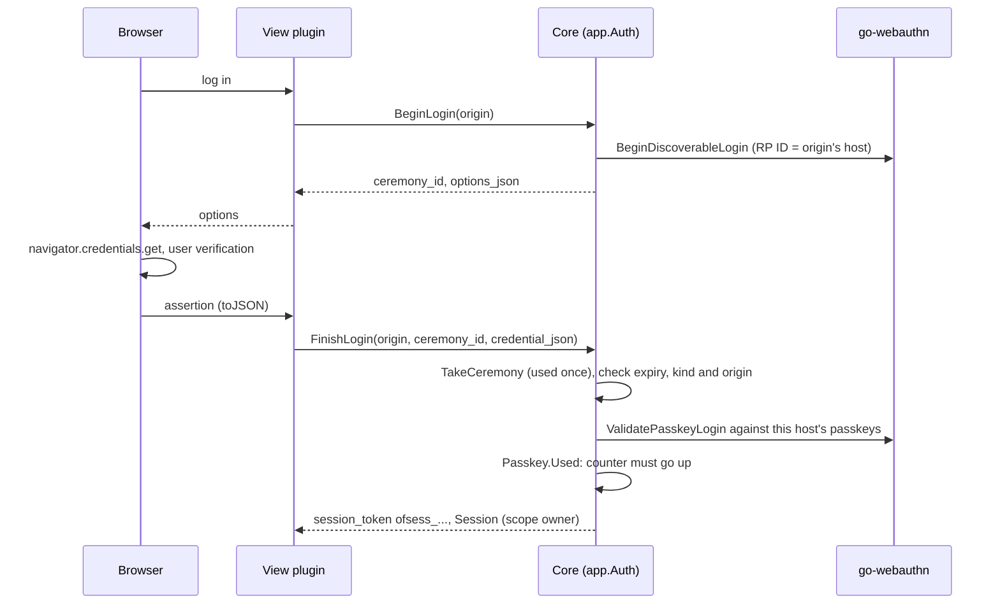
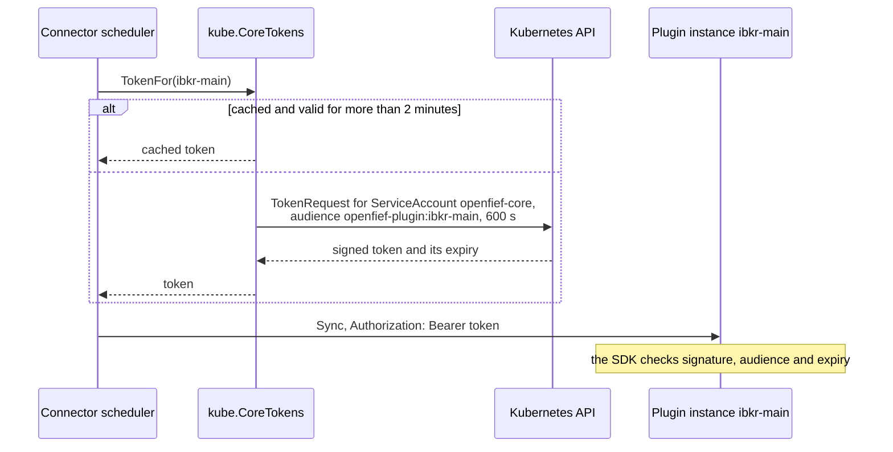
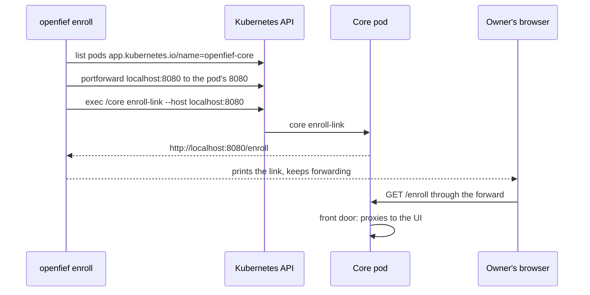

The identity context decides who may use OpenFief. An installation has exactly one person, the [owner](../glossary.md) (GR-2), so it holds no users and no tenants. It answers three questions: is the person at the browser the owner, and what may they do (passkeys and [sessions](../glossary.md)); may this script read (script tokens, D-27); and how does the core prove itself to a plugin (D-59). All of it is built: the core serves the authentication contract to view plugins, such as the built-in UI, next to the read API.

## Concepts

**Authentication is split from the session.** Following the author's decision on the auth split, an [authenticator](../glossary.md) proves who is at the browser and with which [session scope](../glossary.md); the core then issues a session, the same kind whichever authenticator succeeded. M0 has two authenticators. A [passkey](../glossary.md) gives an `owner` session. The demo authenticator gives a `read` session without any credential, and only when both the core runs with `--demo-sessions` and the database carries the demo marker that `cmd/demo-seed` writes (author decision, demo read-only sessions). Both resolve to the single owner. There is no external identity provider (D-26).

**Passkeys.** WebAuthn (W3C, 2019; Level 3 in 2025) lets a browser create a key pair on an authenticator, such as a phone, a laptop's secure chip or a password manager, and sign a server's challenge with it, after the person unlocks it. The server keeps only the public key. A credential is bound to a relying party ID, a domain, so a passkey made for one host can't sign for another, which defeats phishing. OpenFief keeps passkeys per host (D-60): the host of the origin the browser used is the relying party ID. Passkeys here are discoverable (the authenticator remembers the account, so the login page asks for nothing first) and always verify the user (PIN or biometrics). Every WebAuthn check is done by the [go-webauthn](https://github.com/go-webauthn/webauthn) library, pinned in `go.mod`, so OpenFief writes no cryptography of its own (D-29).

**Clone detection.** Each authenticator may keep a signature counter that goes up with every login. If the counter in an assertion is not above the stored one, two copies of the key may exist, and the login is refused (WebAuthn §6.1.1). Synced passkeys keep the counter at zero; two zeros are accepted.

**Sessions are opaque.** A session token is `ofsess_`, the session's ID, `_` and 32 random bytes in unpadded base64url, like a script token secret. The core stores only the SHA-256 hash of the random part, compares hashes in constant time, and can revoke a session at once by marking its row. A session is not a JWT: a JWT carries its own claims and stays valid until it expires, which is what OpenFief must not depend on. A session expires after 12 hours unused (`--session-idle`) and 7 days after it was issued in any case (`--session-max`), and works only on the host it was issued on. Its use is stored at most once a minute, so a burst of requests writes once.

**Scopes.** A `read` session may use the read API, `WhoAmI` and `Logout`. An `owner` session may also manage passkeys, script tokens and enrollment links. The core enforces this; a view plugin can't widen it.

**Enrollment codes.** OpenFief installs with no hostname (D-60), so the first passkey is created through a one-time link: the owner runs `openfief enroll` (D-80, [below](#the-first-passkey)), which has the core's own `core enroll-link` print it, such as `http://localhost:8080/enroll#code=ofenroll_...`. An [enrollment code](../glossary.md) works once, on the one [origin](../glossary.md) it was issued for, within its lifetime (15 minutes by default, 24 hours at most); only its key's hash is stored. The code sits in the URL fragment, which a browser never sends to a server or in a `Referer`. When the owner adds a route on their own hostname ([Expose OpenFief](../guides/expose.md)), a logged-in owner session issues a link for that host the same way (`CreateEnrollmentLink`). Creating a passkey with a code also logs the owner in.

**Allowed origins.** The core serves the owner only on origins on an explicit allow-list (`--auth-origin`, repeated; `http://localhost:8080` by default). An origin is `https://` and a lowercase DNS name with an optional port, or `http://localhost`, the one host browsers treat as secure without TLS. IP addresses are refused, because a WebAuthn relying party ID must be a domain. Every call names its origin, and the browser's signed client data must name the same one.

**Script tokens.** D-27 gives scripts their own tokens, apart from people and plugins. A [script token](../glossary.md) is personal, scoped, expiring and read-only: the only scope is `read`, since the public API only reads (D-6). It lives at most a year; the default is 30 days. Its [secret](../glossary.md) is `ofs_`, the token's ID, `_` and 32 random bytes, of which only the SHA-256 hash is stored, so a database dump can't be replayed against the API. SHA-256 is enough without a slow password hash because the key is 256 random bits, not something a person chose. The owner creates script tokens from an owner session (author decision, auth split); `core token issue` stays as the administrator's way in when no session is at hand.

**Bearer tokens on the read API.** A client sends `Authorization: Bearer <token>`, the scheme of RFC 6750: whoever holds the token may use it. The read API accepts a session of any scope or a read-scoped script token, both as the owner, and a view plugin's projected ServiceAccount token (audience `openfief-core`, D-27), such as the [Ghostfolio view](ghostfolio.md)'s, which reads on its own schedule with no owner at hand. The read API only reads, so a view plugin's token can only read.

## How it works

The built-in UI, a view plugin, is the backend for the owner's browser. It calls the core's `AuthService` with its own projected ServiceAccount token (audience `openfief-core`, D-27) and passes on the browser's origin and WebAuthn payloads; it keeps the session token for the browser and presents it to the read API.

A passkey login, with the ceremony state kept by the core so the browser can't change it, and each ceremony used once:

The pure rules are in package `identity`:

| Name | What it does |
|---|---|
| `Origin`, `ParseOrigin`, `Origins` | An origin, its RP ID, and the allow-list ([origin.go](../../internal/identity/origin.go)). |
| `Session`, `NewSession`, `Session.Check`, `Session.Touched` | Sessions, their scope, idle and absolute expiry, host and revocation, in that order of checks ([session.go](../../internal/identity/session.go)). |
| `SessionScope`, `Authenticator`, `Authenticator.Scope` | `read` and `owner`; an authenticator grants at most its scope. |
| `Owner`, `Passkey`, `Passkey.Used`, `Passkey.CheckHost` | The owner's random 32-byte WebAuthn user handle, passkeys, and the counter rule ([passkey.go](../../internal/identity/passkey.go)). |
| `EnrollmentCode`, `EnrollmentURL`, `Ceremony` | One-time codes, the link, and ceremonies between begin and finish, 5 minutes at most ([enrollment.go](../../internal/identity/enrollment.go)). |
| `ScriptToken`, `FormatSecret`, `ParseSecret`, `HashKey`, `KeyMatches` | Script tokens, their secrets, the stored hash and the constant-time comparison ([token.go](../../internal/identity/token.go)). |

The use cases are in [identity/app](../../internal/identity/app/auth.go): `Auth` with `Login` (any `Authenticator`), `BeginRegistration` and `FinishRegistration`, `BeginLogin`, `Session`, `Logout`, `WhoAmI`, `Passkeys`, `RemovePasskey` (never the last one), `CreateScriptToken`, `ScriptTokens`, `RevokeScriptToken`, `CreateEnrollmentLink`, `IssueEnrollmentLink` (the CLI's) and `Authenticate` (the read API's). Every error wraps one class, which the API maps to a Connect code: `ErrInvalidSession` and `ErrAuthenticationFailed` are unauthenticated; `ErrForbidden` (an origin off the list, a scope, a code, demo sessions off) is permission denied; `ErrCeremony` and `ErrLastPasskey` are failed precondition; `ErrRegistrationFailed` and `ErrInvalidRequest` are invalid argument; `ErrNotFound` is not found. The script token use cases `Tokens.Issue`, `Verify`, `Revoke` and `List` are in [tokens.go](../../internal/identity/app/tokens.go).

The adapters:

- [identity/webauthn](../../internal/identity/webauthn/ceremonies.go) runs each ceremony on go-webauthn with the origin as the only accepted origin and its host as the RP ID: resident key and user verification required, attestation `none`, existing passkeys of the host excluded at registration. [virtual](../../internal/identity/webauthn/virtual/virtual.go) is a software ES256 authenticator that only tests use.
- [identity/postgres](../../internal/identity/postgres/auth.go) keeps the `identity` schema: `owner` (one row), `passkeys`, `enrollment_codes`, `ceremonies` and `sessions` next to `script_tokens`, with the ledger's migration runner copied under its own lock. Taking a ceremony deletes it; using a code is one conditional `UPDATE`, so it succeeds once under concurrent calls; removing a passkey locks the table so the last one can't go; a demo session can't have owner scope by a table check.
- [identity/connectapi](../../internal/identity/connectapi/handler.go) serves the generated `AuthService` handler. An interceptor, `CallerInterceptor`, admits only callers the `Callers` port accepts; tokens and WebAuthn payloads are never logged. `cmd/core` puts the same interceptor (`NewCallerInterceptor`) in front of the portfolio context's `ModelPortfolioService`, which checks the owner's session through `Auth.Session` with owner scope ([Portfolio](portfolio.md)), and of the ingest context's `BondLotService` and `StatementService` ([Ingest](ingest.md#statement-uploads)). It checks unary calls and streams alike: a statement upload is a client stream, refused before its handler reads a byte when its caller isn't a view plugin.
- [identity/kube](../../internal/identity/kube/coretokens.go) requests the core's tokens for plugins (below), and [`CoreAccess`](../../internal/identity/kube/firstpasskey.go) reaches the core's pod with the owner's kubeconfig for `openfief enroll`.
- [identity/cli](../../internal/identity/cli/enroll.go) is `openfief enroll`, the first passkey (below).

The contract is [auth.proto](../../proto/openfief/identity/v1/auth.proto), generated into `sdk/go/gen/openfief/identity/v1`.

### The core's tokens to plugins

Only the core may call a plugin (D-59), and the plugin has to tell the core's calls apart from anyone else's. The core proves who it is with a token of its own ServiceAccount, `openfief-core`, that Kubernetes issues through the TokenRequest API: a signed JWT whose subject is `system:serviceaccount:openfief:openfief-core` and whose audience is the one plugin instance it is meant for, `openfief-plugin:<instance>` (`openfief.InstanceAudience` in the Go SDK). A token for one instance is useless at another. `kube.CoreTokens` requests a token valid for 10 minutes and caches it per instance until 2 minutes before it expires; a failed request is not cached, an empty instance name is refused, and errors never contain a token.

### The first passkey

`openfief enroll [--port 8080] [--ttl 15m] [--kubeconfig PATH] [--context NAME]` is the owner's command for the first passkey (D-80). With the owner's own kubeconfig, `CoreAccess` finds a running, ready pod labelled `app.kubernetes.io/name=openfief-core` in `openfief`, forwards `localhost:8080` (127.0.0.1 and ::1) to its port 8080 as `kubectl port-forward` does, and, once the forward listens, runs `/core enroll-link --host localhost:8080 --ttl 15m` in the pod's `core` container through Kubernetes exec. The core's container already holds the database's DSN, so the owner needs none. The command prints the link with what to do next, pointing to the built-in UI's first-run wizard (D-73), and keeps forwarding until Ctrl-C, so the owner signs in on `http://localhost:8080` right away. The forward reaches the core, not the UI: the core is the only entry point for browsers and proxies the UI (D-81, [Built-in UI](ui.md#the-front-door)). The core allows `http://localhost:8080` by default (`--auth-origin`); another `--port` needs that origin added, which the command says. The owner needs `get` and `list` on pods and `create` on `pods/exec` and `pods/portforward` in `openfief`.

### In the core

`cmd/core` serves the `AuthService` at `/openfief.identity.v1.AuthService/` on the same port as the read API (8080; Service ports `http` and `connect`). In a cluster it admits a caller when a TokenReview accepts its token for audience `openfief-core`, the username is a plugin's ServiceAccount, and that Plugin resource lists `view` among its effective capabilities; accepted reviews are cached for 5 minutes, as the egress proxy does. The core's ClusterRole for TokenReviews is in `deploy/core/rbac.yaml`. Outside a cluster, where there are no ServiceAccount tokens to review, every caller is refused: no build has a fixed token or any other way around authentication, not even for development (D-84), so the UI is developed against a local cluster such as kind or k3d. The tests of `cmd/core` run the same check against a fake cluster whose TokenReview accepts a synthetic token. The read API's verifier, `readTokens` in [core.go](../../cmd/core/core.go), asks `Auth.Authenticate` first and, for a token it doesn't know, the same callers as the `AuthService`: a view plugin in a cluster, no one outside one. A token neither accepts is refused as invalid; a check that can't be made, such as a TokenReview the API server doesn't answer, fails the call as internal. The commands are `core enroll-link [--host localhost:8080] [--ttl 15m]` and `core token issue|list|revoke`; the flags are `--auth-origin`, `--session-idle`, `--session-max` and `--demo-sessions`. See [Architecture](../architecture.md).

## Decisions

- D-26: people log in with passkeys, built in, with no external identity provider.
- D-27: plugins authenticate with projected ServiceAccount tokens (audience `openfief-core`); scripts get separate, scoped, expiring, read-only tokens.
- D-29: no home-grown cryptography: go-webauthn, `crypto/rand`, `crypto/sha256`, `crypto/subtle`.
- D-59: only the core may call a plugin, with a short-lived TokenRequest token whose audience is that instance.
- D-60: no hostname at install; the one-time link for the first passkey, on the owner's hostname or on localhost; a session's link for another host; passkeys per host.
- D-80: `openfief enroll` runs `core enroll-link` in the core's pod through exec with the owner's kubeconfig and prints the link; with no origin given, it forwards a local port to the core, which proxies the UI (D-81), and the link is for `localhost`. The first-run wizard (D-73) is what the output points to; it is not built yet.
- D-6: the public API is read-only, so `read` is the only script token scope.
- D-84: no fixed token and no bypass in any build. The core once accepted a token from `OPENFIEF_AUTH_CALLER_TOKEN` outside a cluster; that path is gone, and so is the UI's matching variable.
- Author decisions given in chat, not yet in DESIGN.md: the auth split (authenticators, opaque sessions, script tokens from a session, the UI as backend-for-frontend), and demo read-only sessions (scopes, the demo authenticator).

## Verification

- TEST-identity-domain and TEST-identity-auth-domain: table tests of script tokens, origins, sessions and their checks, scopes, passkeys and the counter rule, enrollment codes and ceremonies.
- TEST-identity-app: script tokens over an in-memory store.
- TEST-identity-auth-app: enrollment, login, per-host refusal, clone detection, ceremonies used once, session expiry and logout, read scope refused every owner action, script tokens from a session, and demo sessions only with both the flag and the marker, over the real go-webauthn adapter and a software authenticator.
- TEST-identity-webauthn: registration options, a full ceremony, and refusal of another origin, another RP ID, a stranger's user handle and an unknown credential.
- TEST-identity-postgres and TEST-identity-auth-postgres: under `task test:pg`, the stores, a code used once under eight concurrent uses, the last passkey kept, and no key in any column.
- TEST-identity-auth-connectapi: callers refused, read sessions refused, and error codes over Connect; `TestCallerInterceptorStreams` checks the same admission for a client stream.
- TEST-identity-auth-contract: the generated client reaches the generated handler.
- TEST-identity-kube: the core's tokens to plugins with the client-go fake clientset, and `CoreAccess.CorePod` choosing a running, ready core pod.
- TEST-identity-cli: `openfief enroll` forwards first, then asks for the link for that port, prints it with the wizard's pointer, warns about `--auth-origin` on another port, stops the forward on Ctrl-C, and prints nothing after a failure. The end-to-end suite runs it against a real cluster and a browser ([Built-in UI](ui.md#verification)).
- TEST-core-read-tokens: the read API's verifier accepts the owner's tokens and view plugins' tokens, refuses others as invalid, and fails as such when a check can't be made.
- TEST-core-auth: under `task test:pg`, `core enroll-link`, a passkey enrollment and login over the core's HTTP server, the read API with a session and with a script token created from it, logout, and demo sessions refused without the marker or without the flag; and the caller check with a fake TokenReview; outside a cluster every caller is refused (`TestCallersOutsideACluster`).

## Not built yet

- `openfief enroll --origin`, which prints the first passkey's link for the owner's own hostname with no port-forward (D-80). Until it exists, the first passkey is made on `localhost` and a session issues the link for another host.
- Listing and revoking other sessions than the current one.
- Scopes for script tokens other than `read`; they wait for a write API, which M0 doesn't have.
