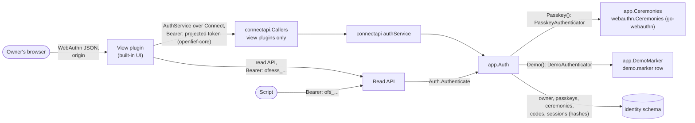
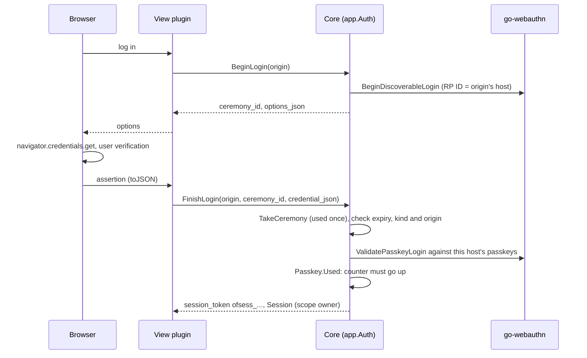
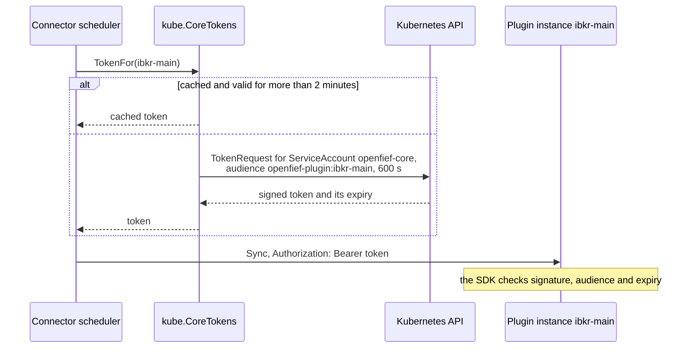
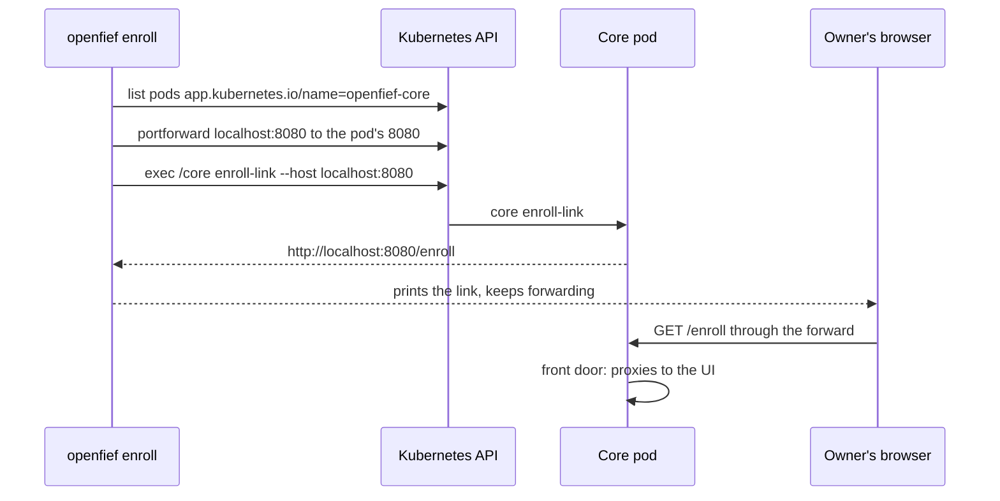

The identity context decides who may use OpenFief. An installation has exactly one person, the [owner](../glossary.md) (GR-2), so it holds no users and no tenants. It answers three questions: is the person at the browser the owner, and what may they do (passkeys and [sessions](../glossary.md)); may this script read (script tokens, D-27); and how does the core prove itself to a plugin (D-59). All of it is built: the core serves the authentication contract to view plugins, such as the built-in UI, on the port only plugins reach (D-115).

## Concepts

**Authentication is split from the session.** Following the author's decision on the auth split, an [authenticator](../glossary.md) proves who is at the browser and with which [session scope](../glossary.md); the core then issues a session, the same kind whichever authenticator succeeded. M0 has two authenticators. A [passkey](../glossary.md) gives an `owner` session. The demo authenticator gives a `read` session without any credential, and only when both the core runs with `--demo-sessions` and the database carries the demo marker that `cmd/demo-seed` writes (author decision, demo read-only sessions). Both resolve to the single owner. There is no external identity provider (D-26). A core with `--demo-sessions` on a database without the marker yet is a demo whose data is still loading: the login page says so instead of offering the demo, and the core refuses the first-run wizard's writes until the loader has marked the database (D-191, [Demo](../dev/demo.md)).

**Passkeys.** WebAuthn (W3C, 2019; Level 3 in 2025) lets a browser create a key pair on an authenticator, such as a phone, a laptop's secure chip or a password manager, and sign a server's challenge with it, after the person unlocks it. The server keeps only the public key. A credential is bound to a relying party ID, a domain, so a passkey made for one host can't sign for another, which defeats phishing. OpenFief keeps passkeys per host (D-60): the host of the origin the browser used is the relying party ID. Passkeys here are discoverable (the authenticator remembers the account, so the login page asks for nothing first) and always verify the user (PIN or biometrics). Every WebAuthn check is done by the [go-webauthn](https://github.com/go-webauthn/webauthn) library, pinned in `go.mod`, so OpenFief writes no cryptography of its own (D-29).

**Clone detection.** Each authenticator may keep a signature counter that goes up with every login. If the counter in an assertion is not above the stored one, two copies of the key may exist, and the login is refused (WebAuthn §6.1.1). Synced passkeys keep the counter at zero; two zeros are accepted.

**Sessions are opaque.** A session token is `ofsess_`, the session's ID, `_` and 32 random bytes in unpadded base64url, like a script token secret. The core stores only the SHA-256 hash of the random part, compares hashes in constant time, and can revoke a session at once by marking its row. A session is not a JWT: a JWT carries its own claims and stays valid until it expires, which is what OpenFief must not depend on. A session expires after 12 hours unused (`--session-idle`) and 7 days after it was issued in any case (`--session-max`), and works only on the host it was issued on. Its use is stored at most once a minute, so a burst of requests writes once.

**Scopes.** A `read` session may use the read API, `WhoAmI` and `Logout`; a demo session and a viewer's session (see People and viewers, below) are `read` sessions. An `owner` session may also manage passkeys, script tokens and enrollment links. The core enforces this; a view plugin can't widen it.

**Passkey checks.** An owner session alone isn't enough to add a way in: enrolling or removing a passkey, issuing an enrollment link and creating a script token need a [passkey check](../glossary.md) made in the same session within the last five minutes (D-183), so a stolen session cookie can't mint a lasting credential. This is what other systems call step-up authentication or "sudo mode" (GitHub asks for it before changing security settings). Signing in with a passkey counts as the session's first check, and so does creating a passkey from an enrollment code, which signs the owner in; afterwards `BeginPasskeyCheck` and `FinishPasskeyCheck` run an assertion like a login's, against the passkeys of the session's host, in a ceremony of its own kind, and record its time on the session. Without a recent check the core refuses with `ErrPasskeyCheckRequired`, which the API sends as `FAILED_PRECONDITION` with a `PasskeyCheckRequired` error detail; the built-in UI then asks the owner to confirm with their passkey and posts the action again ([UI](ui.md#signing-in)). Listing passkeys and tokens, revoking a token and signing out need no check: they add no way in. A demo session has `read` scope, so it can take none of these actions, nor begin a check.

**Ending sessions.** Each session records the passkey that signed it in. Removing a passkey revokes every session it signed in, in the same transaction, so a lost or stolen passkey's sessions end with it; if that includes the caller's own, `RemovePasskey` says so and the UI signs out. `SignOutEverywhere` revokes every session, on every host and of either scope, the caller's own included (D-183); it needs an owner session but no passkey check, since it only takes ways in away. Script tokens are not sessions: they stay until revoked or expired.

**Enrollment codes.** OpenFief installs with no hostname (D-60), so the first passkey is created through a one-time link: the owner runs `openfief enroll` (D-80, [below](#the-first-passkey)), which has the core's own `core enroll-link` print it, such as `http://localhost:8080/enroll#code=ofenroll_...`. An [enrollment code](../glossary.md) works once, on the one [origin](../glossary.md) it was issued for, within its lifetime (15 minutes by default, 24 hours at most); only its key's hash is stored. The code sits in the URL fragment, which a browser never sends to a server or in a `Referer`. When the owner adds a route on their own hostname ([Expose OpenFief](../guides/expose.md)), a logged-in owner session issues a link for that host the same way (`CreateEnrollmentLink`). Creating a passkey with a code also logs the owner in and opens the overview, which sends an owner whose install has no account yet to the built-in UI's first-run wizard (D-73, [UI](ui.md#pages)); a demo has no wizard (D-191).

**Allowed origins.** The core serves the owner only on origins on an explicit allow-list: its container's `OPENFIEF_AUTH_ORIGINS`, origins separated by commas, `http://localhost:8080` when unset. It is one setting that serving and issuing enrollment links both read (D-126): `IssueEnrollmentLink` refuses a link for an origin not on it, storing nothing, so `core enroll-link`, a `kubectl exec` in the same container, refuses one too. An origin is `https://` and a lowercase DNS name with an optional port, or `http://localhost`, the one host browsers treat as secure without TLS. IP addresses are refused, because a WebAuthn relying party ID must be a domain. Every call names its origin, and the browser's signed client data must name the same one.

**Script tokens.** D-27 gives scripts their own tokens, apart from people and plugins. A [script token](../glossary.md) is personal, scoped, expiring and read-only: the only scope is `read`, since the public API only reads (D-6). It lives at most a year; the default is 30 days. Its [secret](../glossary.md) is `ofs_`, the token's ID, `_` and 32 random bytes, of which only the SHA-256 hash is stored, so a database dump can't be replayed against the API. SHA-256 is enough without a slow password hash because the key is 256 random bits, not something a person chose. The owner creates script tokens from an owner session (author decision, auth split); `core token issue` stays as the administrator's way in when no session is at hand.

**Bearer tokens on the read API.** A client sends `Authorization: Bearer <token>`, the scheme of RFC 6750: whoever holds the token may use it. The read API accepts a session of any scope or a read-scoped script token, both as the owner, and a view plugin's projected ServiceAccount token (audience `openfief-core`, D-27), such as the [Ghostfolio view](ghostfolio.md)'s, which reads on its own schedule with no owner at hand. The read API only reads, so a view plugin's token can only read.

**The audit log.** D-211 asks for a record of every change of state and every access event, one that nothing can quietly rewrite. The [audit log](../glossary.md) is a table, `identity.audit_log`, that the core only appends to. Each [entry](../glossary.md) names who (an actor kind and ID), what (an action from a closed list), which records (kind and ID pairs), when, and the outcome (`ok`, `refused` or `failed`). It has no free-text field, so there is nowhere to put an amount, a secret or the text of a question (GR-12): every value is a member of a closed set, a time, or an ID of a fixed shape, and a reference that looks like a token, a name or a sentence is refused. The owner is named by the ID of the session that acted; a person who holds only an enrollment code, by the code's ID; the core's own commands, by `core`; a caller who proved nothing, such as a refused sign-in, by nothing. Entries are kept forever.

Two things make it dependable. The log is append-only in the database itself: the core's role holds no `UPDATE`, `DELETE` or `TRUNCATE` on the table, and a trigger refuses them for any role that still does. And it fails closed: a change and its entry are written in one database transaction, so if the entry can't be written the change doesn't happen. This is the write-ahead idea of a transaction log applied to accountability, and the reason a security log should not be best-effort. There is no hash chain yet: it would make tampering by the database's own administrator evident, which P-18 leaves undecided, and one can start later from a genesis entry. Reading the read API is not an entry, and neither is reading the log.

## Authorization

Authentication says who a caller is; authorization says what that caller may do. OpenFief decides it per account, and relationship-based (D-163): who may view or change an account follows from the caller's relationship to it, as [ReBAC](../glossary.md#other-terms-and-abbreviations) does, rather than from a role. Google's Zanzibar paper (2019) described one relationship graph and one permission check behind all of Google's products; [SpiceDB](../glossary.md#other-terms-and-abbreviations), by Authzed, is an open-source database modeled on it.

**One question, asked everywhere.** Every read path and owner service of the core asks one [authorizer](../glossary.md), `identityapp.Authorizer` in [access.go](../../internal/identity/app/access.go), whether the [caller](../glossary.md) may do an [account action](../glossary.md), view or change, on each account (D-163). The read API lists only the accounts the caller may view, and computes totals, the allocation, performance, transfers and yearly taxes over those; a query about one account the caller may not view is answered exactly as one about an account that isn't stored, so a caller can't learn which accounts exist. An owner service that changes an account asks for the change first, before it reads anything about the account, and refuses with permission denied. A caller the request carries no caller for may do nothing.

**Policy, or SpiceDB.** The core's `--authz` flag chooses who answers the interface: `policy`, the default, is `identityapp.Policy`, over the pure rule `identity.MayAct`, and behaves exactly as before: the owner may view and change every account, and every other holder of [read access](../glossary.md) (D-137), that is a script token, a view plugin or a demo session, views every account and changes none. `spicedb` has SpiceDB answer the same interface, with its datastore a database in the core's PostgreSQL cluster, so that script tokens and view plugins are granted accounts as viewers are (D-164, D-65, D-209). The callers, the actions and the code that asks don't change; only the implementation does. SpiceDB's address comes from `--spicedb-endpoint` or `OPENFIEF_SPICEDB_ENDPOINT`, the connection is TLS unless `--spicedb-insecure` says the in-cluster Service behind its network policy is plaintext, and the preshared key is read from the file `--spicedb-key-file` names (`/var/run/openfief/spicedb/key`, where the install mounts the Secret) or, when it is set, from `OPENFIEF_SPICEDB_PRESHARED_KEY`, which wins: never a flag, and never logged. A core that has no key yet does not exit: it starts, answers `/healthz`, refuses every authorization check, closed (no one views anything, the owner included), reports not ready on `/readyz`, and looks for the file every two seconds, logging once that it waits and never the value, until the file holds a key. Then it connects, reconciles and runs the cutover. An empty file, or one with only whitespace, is no key.

**Ready at the start, and only then.** With `spicedb`, `/readyz` answers 200 once the key is there, SpiceDB has answered once and its schema is written, which is the start's reconcile having succeeded (with the key in the environment too), and the database answers; until then it answers 503, saying which of them it waits for. That gate is the start's alone. After it a SpiceDB outage does not flip `/readyz`: every Service endpoint would drop out at once, the whole API with it, for what only the checks need. The checks fail closed instead, as the next paragraph says. `/healthz` stays liveness and nothing else. The `core token` commands, which can't wait, need the key at once. [SpiceDB is deployed](#authorization) with the install, and the flag stays at `policy` by default: the demo and an install that doesn't opt in keep it. With `spicedb`, the core's start runs the cutover to it once (see Grants, below).

**SpiceDB fails closed.** `spicedb.Authorizer` (in [internal/identity/spicedb](../../internal/identity/spicedb/authorizer.go)) asks SpiceDB for the account's `view` or `change` permission of the caller's subject, fully consistent, within a timeout (3 seconds by default, `--spicedb-timeout`). An error, a timeout, an empty ID or an answer that is not a plain yes is a refusal, returned with its error, and never the owner's view: with SpiceDB down the owner views nothing either. For a list, it asks once what the caller may view (`LookupResources`), and the views filter every list, total and allocation by that one answer. An error or a timeout from SpiceDB, and a core still without its key, is reported as `kernel.ErrAuthzUnavailable`, which says that the model can't tell now, not that anyone was refused. The read API and the owner services map it to unavailable over Connect and 503 over REST, with the fixed text `authorization is unavailable` and nothing of the account asked for, so a client knows to try again and never reads a 500 or a 403 into it. An empty ID, which SpiceDB was never asked about, is not an outage. The core watches the answers (`authzMonitor` in [authzmonitor.go](../../cmd/core/authzmonitor.go)) and logs the change from available to unavailable once, and the way back once, however many requests fail in between; while it is unavailable it asks SpiceDB every five seconds, so the way back is seen with no request to see it. The same changes are the metrics `openfief.authz.available`, a gauge of 1 or 0 that is absent before the first check, and `openfief.authz.availability.changes`, a counter by the state it went to, instruments of OpenTelemetry's global meter: they record nothing until the core installs a metrics provider, which is not built yet (D-172). IDs SpiceDB can't take as they are, such as an account named `IKE (PL)` or a plugin named `ui.v2`, are escaped byte by byte (`=` and two hex digits), so no two IDs share an object. The owner is the one `person`, `owner`; a demo session is the subject of the household's wildcard grant.

**What the core writes to SpiceDB.** SpiceDB holds relationships, and the ledger and the portfolio stay the sources of which accounts exist and which sleeve each is in. `spicedb.Syncer` writes the household's owner, the demo sessions' grant, each account's `household` and `sleeve`, and the owner's grants, which the identity context's table is the source of. The portfolio's registry tells it of every placement and removal of an account (`PlacementObserver`), after the database committed it, so a failed write leaves the change stored with an error that says it is not in SpiceDB yet; a retry, which is idempotent, or the reconcile the core runs at every start repairs it. The reconcile makes SpiceDB hold exactly what the ledger, the portfolio and the grants table hold, removing the relationships of deleted accounts and those of a grant the table no longer holds (an ended one, or one written by hand). Until the reconcile has run, every check is refused, since no account has a household yet; the core keeps retrying in the background. Taking an account out of its sleeve removes its `sleeve` relationship and keeps its household, so the owner never loses an account the ledger still holds.

**The model as a schema.** The authorization model is written as a SpiceDB schema, [authz/schema.zed](../../authz/schema.zed) (D-164, D-209). A `household` has one `owner`, a `person`, and `reader`s, which are the household grant: a person, a script token or a view plugin the owner gave the whole household, and every demo session. A `sleeve` has `viewer`s. An `account` belongs to the household and may be in a sleeve; its `change` permission is the household's owner, and its `view` permission is `change`, its own `viewer`s, the `viewer`s of its sleeve and the household's readers. So a grant of a sleeve covers the accounts placed in it later, a household grant covers every account added later, and a grant only ever lets its holder view. [authz/validation.yaml](../../authz/validation.yaml) holds synthetic relationships and assertions: the owner views and changes every account; a household grant views every account, one added later too, and changes none; a sleeve grant views the accounts in the sleeve, one placed there later too, and stops when the account's sleeve relationship is removed; an account grant views that account only; a stranger views nothing. `task authz:validate` runs `zed validate` on it offline, as part of `task check` in CI ([pipeline](../dev/pipeline.md#the-taskfile)), with zed, SpiceDB's CLI, pinned in the Taskfile.

**Grants (D-209).** The owner grants a script token or a view plugin, and from the second alpha a viewer, the view of one account, one sleeve or the whole household. A grant (`identity.Grant`, [grant.go](../../internal/identity/grant.go)) is a holder (a kind and an ID), a target (a kind and an ID), the time it was made and the time it ended; the IDs have fixed shapes, so what reaches the audit log is an identifier and never a name, and a message never quotes one. A grant only ever lets its holder view: it has no field for anything else, and the schema feeds a grant into `view` and never into `change`. The table `identity.grants` ([migration 0006](../../internal/identity/postgres/migrations/0006_grants.sql)) is the source of truth. Revoking sets `revoked_at` and keeps the row, so the history of who could view what stays; one grant of a target to a holder is in force at a time, which a partial unique index decides. SpiceDB holds a projection: a household grant is a `reader` of the household, an account's or a sleeve's a `viewer`. The change commits first, and `ProjectGrants` writes the relationship after it; a failed write leaves the grant stored and recorded and is returned as `ErrGrantNotProjected` (unavailable over Connect), and granting again, which is idempotent, or the reconcile repairs it. A revocation goes the other way round, so SpiceDB is never ahead of what the owner ended: the relationship is removed first, and only then does the row end, with its entry; if SpiceDB can't take the removal nothing changes and the owner sees the error.

**People and viewers (D-65, D-209, D-210).** `identity.persons` holds the owner, a row the migration made, and each viewer; a person is never deleted, so a revoked viewer keeps their ID and the history that names them. Every passkey and session belongs to a person (`person_id`), and what existed before viewers is the owner's. The owner invites a viewer with `InviteViewer`: a one-time, expiring link, issued in an owner session with a recent passkey check (D-183), that carries the name the owner gave and the grants the viewer starts with (accounts, sleeves or the household, checked to exist) and is the same enrollment code the owner's own links are, with a name and grants added. Opening it, the viewer enrolls their own passkey as the owner does (D-26): the core makes the viewer's ID and WebAuthn user handle when the ceremony begins, so the passkey carries the viewer's handle, and when it finishes, one transaction uses the code up, creates the person, stores the passkey under them, makes the grants and signs the viewer in; the grants reach SpiceDB afterwards, and a failed write there is logged and repaired as any grant's. A spent or expired link is refused plainly and recorded. A login names the person by the handle the passkey carries, and a revoked viewer's passkeys are disabled, so they sign nobody in.

A viewer's session has `read` scope, which is the one central check: every call that changes something, the identity service's and every other service's, needs an owner session and refuses a viewer with permission denied, a viewer's passkey can't confirm the owner's session in a passkey check, and sign-out is all a viewer changes. What a viewer reads is what their grants cover (D-163): the core's caller for their session is the `viewer` holder, whose ID is the person's, and under `--authz=spicedb` that is the subject `person:<id>`, granted by the household's `reader`, a sleeve's or an account's `viewer`; under `--authz=policy` `identityapp.GrantPolicy` answers instead, from the grants table and the portfolio's placements, and fails closed. What no account holds, the items and syncs tied to no account, stays the owner's and the holders of read access (D-165, D-199). The read API lists a viewer only the sleeves that hold an account they may view, and only those sleeves' kinds. The owner lists the people with `ListPeople` (the owner first, each viewer with their grants in force, the passkeys that work and the sessions still valid) and revokes a viewer with `RevokePerson`: their grants leave SpiceDB first, so a failure changes nothing, and then one transaction revokes the person, ends their sessions, disables their passkeys and ends their grants, with an entry for each. Revoking needs no passkey check: it only takes access away.

**The owner's calls.** `AuthService.CreateGrant`, `RevokeGrant` and `ListGrants` are for an owner session alone: a demo session is refused with permission denied, and they are not on the read API, so no script token reads or changes a grant. The holder and the target must exist, as `identityapp.Directory` says (a script token that may still be used, an installed view plugin, a stored account or sleeve, which `cmd/core` answers from the ledger, the portfolio and the plugin watch); an unknown one is not found, and a person holder is an active viewer (see People and viewers, below). Granting what is granted returns the grant in force and records nothing. Each grant and revocation writes `grant_created` or `grant_revoked` in the same transaction, naming the holder, then the target, by kind and ID, so with the audit log down no grant is made or ended. A view plugin's grant is separate from its `PluginGrant`, which approves what the plugin may do in the cluster; this one says which accounts it may view. Under `--authz=policy` a grant is stored and has no effect, since every holder of read access views every account then.

**The Access page's calls (D-210).** `CreateScriptToken` also takes the token's grants (accounts, sleeves or the household) and whether it may use MCP (D-213), a flag that is stored with the token (`script_tokens.mcp_allowed`) and changes nothing until MCP is served. It follows the order of `core token issue`: every target is checked to exist and, under SpiceDB, SpiceDB is asked once whether it answers, before anything is stored; then the token, its grants and the audit entry of each (`script_token_created`, `grant_created`) are stored in one transaction; then the grants are written to SpiceDB, and if that fails the token is revoked with its own entry, no secret is returned and the call is unavailable (`Grants.IssueTokenWith`). `UpdateGrants` adds and removes the grants of one script token or view plugin in one call: the holder and each target to add are checked first, then removals and additions are made with an entry each, and it returns the grants held. `ListScriptTokens` carries each token's grants in force and its flag, and `ListViewPlugins` the installed view plugins that read with their own identity with theirs: those that hold or ask for the view capability, less the one that serves browsers, which reads with the signed-in person's session, and any being removed. All three are for an owner session; a demo session is refused. Both lists say whether grants are enforced, which they are while SpiceDB answers.

**Grants end with what they name.** Revoking a script token ends its grants in the same transaction, one entry each. When a view plugin instance is uninstalled, the core's watch of the `Plugin` resources (`kube.Plugins.OnRemoved`) sees it deleted and ends the instance's grants, as the core. Deleting a sleeve, which only an empty one can be, or an account ends its grants through the registry's placement observer, so a sleeve created later under the same ID, which comes from its name, inherits nothing. A crash or an outage between a deletion and its clean-up is repaired by the sweep at start, which ends the grants of a token that is unknown or revoked, a plugin that is not installed and an account or sleeve that is not stored, and leaves alone anything the core can't tell yet, such as the plugins before their cache has synced.

**The cutover.** D-209 says that when SpiceDB takes over, every script token and view plugin then holding read access is given the household grant, so none loses or gains access silently. With `--authz=spicedb` the core does it once, in the background once the installed plugins are read: each script token that may still be used, and each view plugin that holds or asks for the `view` capability, that has no grant at all, gets exactly one household grant with its own audit entry, as the core, and the relationship is written to SpiceDB. Revoked and expired tokens, and holders that already have a grant, even an ended one, get none. `identity.grant_cutover` records that it ran, so a token created afterwards, which has no grant, is not given one by a later start, and a second start writes nothing; it is not recorded while the plugins can't be read, and the core retries. Under the policy nothing is granted. `core token issue --grant-household` makes a token and its household grant, and with `--authz=spicedb --spicedb-insecure` (and the endpoint and key in the environment, as in the core's pod) it is atomic as the owner sees it, as `core token revoke` passes on the grants it ends; without the flags they change the database only, and a running core's SpiceDB learns of it at its next start. Under SpiceDB, `token issue --grant-household` first waits for SpiceDB to answer, up to `--spicedb-wait` (a minute by default), and if it doesn't, issues nothing and exits with an error saying so: no token, no grant, no audit entry. Then the token, its grant and the entries of both are stored in one transaction, and the grant is written to SpiceDB. If that write still fails, which only a SpiceDB that went away in between does, the command revokes the token at once, with its own entry, prints no secret and exits with an error saying that the token was issued and revoked because its grant could not reach SpiceDB. A token with no `--grant-household` needs nothing of SpiceDB and is issued whether it answers or not. The reconcile at the core's start stays the general safety net for a change that did not reach SpiceDB; it is not part of what the command promises. The owner's token creation over the AuthService gives no grant, so it writes nothing to SpiceDB; a call that will, such as one from the UI, is to follow the same order.

**A view plugin installed later.** The cutover gives the household grant only to the holders it finds when SpiceDB takes over, and a fresh install has none, so a view plugin installed afterwards, such as Ghostfolio, starts with no grant and reads nothing: the owner grants it accounts. The core tells the owner: with `--authz=spicedb`, every installed view plugin that is Ready, holds the `view` capability and holds no grant in force raises an [attention item](attention.md) `view-plugin-ungranted`, "`<instance>` can't read anything until you grant it accounts", among the Inbox's decisions (D-196), which clears once a grant of any target exists or the plugin is uninstalled; the same sweep as every other check runs it (`ungrantedViewPlugins`, [viewgrants.go](../../cmd/core/viewgrants.go)). The Inbox offers the owner one button, *Grant the whole household*, which is the existing `CreateGrant` of the household to the instance, audited as any grant, and the Access page, when it exists, the narrower grants. The built-in UI is exempt: it reads with the signed-in person's session token, never its plugin identity, so its own token needs no grant; the plugin that holds the browser path (`status.effective.browserPaths`) is the one the core takes for it. Under `--authz=policy` no item is raised, since every holder of read access views every account. `openfief plugin install` of a view plugin ends its summary with "If OpenFief runs with SpiceDB authorization, grant it accounts in Settings → Access.", since the command can't tell which authorization the core runs with.

**Deploying SpiceDB.** [deploy/spicedb](../../deploy/spicedb/kustomization.yaml) is a base next to the core's, in the install bundle and the demo, so SpiceDB runs, idle, whichever `--authz` the core has (D-164). One pod, replaced rather than rolled (`Recreate`), runs the image the Taskfile's `SPICEDB_VERSION` builds for the contract test, pinned by tag and digest; it is non-root with a read-only root filesystem, no capabilities, no ServiceAccount token and a 256 MiB memory limit. Its init container runs `spicedb migrate head` against the datastore, and `serve` then answers gRPC on 50051 of the Service `openfief-spicedb`, with its usage report, release check, metrics and HTTP listener off, so nothing leaves the pod. Its datastore is a PostgreSQL database `spicedb` of the core's own CloudNativePG cluster `openfief-db`, owned by a role `spicedb` of its own, which the cluster's `managed` roles and a CloudNativePG `Database` make ([deploy/database](../../deploy/database/openfief-db.yaml)); the core's role can't read it and SpiceDB's can't read the ledger. An install whose Cluster you edited adds the role and the `Database` there too ([Install](../guides/install.md#5-apply-the-crds-the-database-and-the-install)).

The two credentials are generated in the cluster, once. CloudNativePG generates a password for the owner of the database it creates and for no other role, so a Job in the base makes them (D-216): it runs `core init-credentials` from the core's own signed image and creates `openfief-spicedb-key`, the preshared key SpiceDB and the core share, and `openfief-db-spicedb`, the password of SpiceDB's role, each 32 random bytes as hex. The Job's ServiceAccount may create Secrets in the namespace and nothing else, not even read one, and its Role is the only one in the install that may create a Secret; a Secret that exists is kept as it is, so an owner who feeds either one from their own tooling first (D-29) keeps theirs and running the Job again rotates nothing; and it logs which Secrets it made or kept and no value. The Job is named for the release (`openfief-init-credentials-<version>`, or the core image's short digest on a demo or test deploy), under the stable label `app.kubernetes.io/name=openfief-init-credentials`, since a Job's pod template can't change and the image does: an upgrade runs a new Job, and Flux prunes the old one. SpiceDB's pods wait for the Secrets and start by themselves once they exist. The core's Deployment does not: it starts at once, because a core that exited for the missing key would crash-loop with a growing back-off on a fresh install, so it mounts `openfief-spicedb-key` as an optional, read-only volume at `/var/run/openfief/spicedb`, which the kubelet fills within about a minute of the Secret's creation, and the core waits for the file as above. The Deployment reads `OPENFIEF_SPICEDB_ENDPOINT` and mounts that volume in every install, but only `--authz=spicedb` (with `--spicedb-insecure`, the plaintext gRPC of the Service behind its policy) uses them, and neither the base nor the demo sets it; the end-to-end suite's overlay does, so the whole suite runs under SpiceDB.

SpiceDB's NetworkPolicy admits the core on 50051 and nothing else, so no plugin, however it were granted, can reach it, and lets it out to the database on 5432 and to DNS only; the policies of the core and of the database stay as they are, and two small policies of the base add the other side of each connection (D-184, [Architecture](../architecture.md#security-boundaries)). **If SpiceDB is unreachable, the core fails closed**: with `--authz=spicedb` every check is refused while it is down, the owner's included, and the core answers again as soon as it is back, from the relationships that PostgreSQL kept. Because a new SpiceDB holds no schema, the core writes `authz/schema.zed`, embedded in its binary, before it reconciles at every start (`spicedb.WithSchema`); writing the schema it already holds changes nothing, and a core upgraded with a changed schema brings SpiceDB along with it.

**The contract.** `task test:authz` builds the pinned SpiceDB, runs it in testing mode (in memory, loopback) and runs the contract test with the `spicedb` build tag: with the household grants written for the holders of read access that exist today, SpiceDB answers every holder's every action on every account as `identity.MayAct` does, and lists the same accounts. It is not part of `task check`: building SpiceDB takes minutes.

**Who the caller is.** The read API's verifier returns the caller its bearer token stands for, and the API's interceptor hands it to the views through the request's context (`identityapp.WithCaller`, `CallerFrom`). An owner-scoped session is the owner; a read-scoped session from the demo authenticator is a demo session (`Principal.Caller`); a script token and a view plugin are themselves. The built-in UI reads the read API with the owner's session, so its pages show what the owner may view. The owner services already admit only an owner-scoped session; `cmd/core`'s `ownerSessions` then asks the authorizer which of the accounts a change names that owner may change (`Changeable` on each context's `Owners` port).

## How it works

The built-in UI, a view plugin, is the backend for the owner's browser. It calls the core's `AuthService` with its own projected ServiceAccount token (audience `openfief-core`, D-27) and passes on the browser's origin and WebAuthn payloads; it keeps the session token for the browser and presents it to the read API.

A passkey login, with the ceremony state kept by the core so the browser can't change it, and each ceremony used once:

The pure rules are in package `identity`:

| Name | What it does |
|---|---|
| `Origin`, `ParseOrigin`, `Origins` | An origin, its RP ID, and the allow-list ([origin.go](../../internal/identity/origin.go)). |
| `Session`, `NewSession`, `Session.Check`, `Session.Touched` | Sessions, their scope, idle and absolute expiry, host and revocation, in that order of checks ([session.go](../../internal/identity/session.go)). |
| `Session.SignedInWithPasskey`, `Session.PasskeyChecked`, `Session.CheckRecentPasskey`, `Session.SignedInBy`, `PasskeyCheckWindow` | The passkey that signed a session in, its last passkey check, which never moves back, and D-183's five-minute window; only a passkey session has either. |
| `SessionScope`, `Authenticator`, `Authenticator.Scope` | `read` and `owner`; an authenticator grants at most its scope. |
| `Owner`, `Passkey`, `Passkey.Used`, `Passkey.CheckHost` | The owner's random 32-byte WebAuthn user handle, passkeys, and the counter rule ([passkey.go](../../internal/identity/passkey.go)). |
| `EnrollmentCode`, `EnrollmentURL`, `Ceremony` | One-time codes, the link, and ceremonies between begin and finish, 5 minutes at most ([enrollment.go](../../internal/identity/enrollment.go)). |
| `ScriptToken`, `FormatSecret`, `ParseSecret`, `HashKey`, `KeyMatches` | Script tokens, their secrets, the stored hash and the constant-time comparison ([token.go](../../internal/identity/token.go)). |

The use cases are in [identity/app](../../internal/identity/app/auth.go): `Auth` with `Login` (any `Authenticator`), `BeginRegistration` and `FinishRegistration`, `BeginLogin`, `Session`, `Logout`, `WhoAmI`, `Passkeys`, `RemovePasskey` (never the last one; revokes the sessions it signed in), `BeginPasskeyCheck` and `FinishPasskeyCheck`, `SignOutEverywhere`, `CreateScriptToken`, `ScriptTokens`, `RevokeScriptToken`, `CreateEnrollmentLink`, `IssueEnrollmentLink` (the CLI's), `Authenticate` (the read API's), `LoginMethods`, which says whether a passkey exists for the origin's host, whether demo sessions work, and whether the demo data is still loading, and `DemoLoading`, which `cmd/core` asks before the wizard's writes. The two demo answers are the pure rules `identity.DemoSessionsAvailable` and `identity.DemoLoading` ([demo.go](../../internal/identity/demo.go)) over the flag and the marker. Every error wraps one class, which the API maps to a Connect code: `ErrInvalidSession` and `ErrAuthenticationFailed` are unauthenticated; `ErrForbidden` (an origin off the list, a scope, a code, demo sessions off) is permission denied; `ErrCeremony`, `ErrLastPasskey` and `ErrPasskeyCheckRequired` are failed precondition, the last with the `PasskeyCheckRequired` detail; `ErrRegistrationFailed` and `ErrInvalidRequest` are invalid argument; `ErrNotFound` is not found. The script token use cases `Tokens.Issue`, `Verify`, `Revoke` and `List` are in [tokens.go](../../internal/identity/app/tokens.go).

The adapters:

- [identity/webauthn](../../internal/identity/webauthn/ceremonies.go) runs each ceremony on go-webauthn with the origin as the only accepted origin and its host as the RP ID: resident key and user verification required, attestation `none`, existing passkeys of the host excluded at registration. [virtual](../../internal/identity/webauthn/virtual/virtual.go) is a software ES256 authenticator that only tests use.
- [identity/postgres](../../internal/identity/postgres/auth.go) keeps the `identity` schema: `owner` (one row), `passkeys`, `enrollment_codes`, `ceremonies` and `sessions` next to `script_tokens`, with the ledger's migration runner copied under its own lock. Taking a ceremony deletes it; using a code is one conditional `UPDATE`, so it succeeds once under concurrent calls; removing a passkey locks the table so the last one can't go, and revokes the sessions whose `passkey_id` is that passkey in the same transaction; a demo session can't have owner scope, a passkey or a passkey check by table checks. Migration `0003_passkey_check.sql` adds `sessions.passkey_id` and `sessions.passkey_checked_at` and the `passkey-check` ceremony kind; sessions issued before it have no check, so their first protected action asks for one.
- [identity/connectapi](../../internal/identity/connectapi/handler.go) serves the generated `AuthService` handler. An interceptor, `CallerInterceptor`, admits only callers the `Callers` port accepts; tokens and WebAuthn payloads are never logged. `cmd/core` puts the same interceptor (`NewCallerInterceptor`) in front of the portfolio context's `ModelPortfolioService`, which checks the owner's session through `Auth.Session` with owner scope ([Portfolio](portfolio.md)), and of the ingest context's `BondLotService` and `StatementService` ([Ingest](ingest.md#statement-uploads)). It checks unary calls and streams alike: a statement upload is a client stream, refused before its handler reads a byte when its caller isn't a view plugin.
- [identity/kube](../../internal/identity/kube/coretokens.go) requests the core's tokens for plugins (below), and [`CoreAccess`](../../internal/identity/kube/firstpasskey.go) reaches the core's pod with the owner's kubeconfig for `openfief enroll`, and runs any other core command there for the owner (`Exec`), such as `core check balances` for `openfief check balances` ([Read API](read-api.md#the-owners-balance-check)). Either fails with `ErrNoCorePod`, running nothing, while no core pod is ready.
- [identity/cli](../../internal/identity/cli/enroll.go) is `openfief enroll`, the first passkey (below).

The contract is [auth.proto](../../proto/openfief/identity/v1/auth.proto), generated into `sdk/go/gen/openfief/identity/v1`.

### The core's tokens to plugins

Only the core may call a plugin (D-59), and the plugin has to tell the core's calls apart from anyone else's. The core proves who it is with a token of its own ServiceAccount, `openfief-core`, that Kubernetes issues through the TokenRequest API: a signed JWT whose subject is `system:serviceaccount:openfief:openfief-core` and whose audience is the one plugin instance it is meant for, `openfief-plugin:<instance>` (`openfief.InstanceAudience` in the Go SDK). A token for one instance is useless at another. `kube.CoreTokens` requests a token valid for 10 minutes and caches it per instance until 2 minutes before it expires; a failed request is not cached, an empty instance name is refused, and errors never contain a token.

### The first passkey

`openfief enroll [--origin https://HOST | --port 8080] [--ttl 15m] [--kubeconfig PATH] [--context NAME]` is the owner's command for the first passkey (D-80). With the owner's own kubeconfig, `CoreAccess` finds a running, ready pod labelled `app.kubernetes.io/name=openfief-core` in `openfief`, forwards `localhost:8080` (127.0.0.1 and ::1) to its port 8080 as `kubectl port-forward` does, and, once the forward listens, runs `/core enroll-link --host localhost:8080 --ttl 15m` in the pod's `core` container through Kubernetes exec. The core's container already holds the database's DSN, so the owner needs none. The command prints the link with what to do next, pointing to the built-in UI's first-run wizard (D-73), and keeps forwarding until Ctrl-C, so the owner signs in on `http://localhost:8080` right away. The forward reaches the core, not the UI: the core is the only entry point for browsers and proxies the UI (D-81, [Built-in UI](ui.md#the-front-door)). The core allows `http://localhost:8080` by default; for another `--port`, the core refuses the link unless `OPENFIEF_AUTH_ORIGINS` lists that origin, and the command stops the forward and passes the refusal on. The owner needs `get` and `list` on pods and `create` on `pods/exec` and `pods/portforward` in `openfief`.

With `--origin`, such as `https://fief.example.org` behind the owner's own route ([Expose OpenFief](../guides/expose.md)), there is no port-forward: the command runs `/core enroll-link --host <origin>` the same way, prints the link for that origin and the wizard's pointer, and exits. It checks no origin itself: the core refuses an origin it doesn't accept (D-126), naming the setting to add it to, because a passkey made there could never sign in, and the command passes that refusal on. `--origin` and `--port` exclude each other.

### The audit log

Every use case that changes identity state runs its store calls inside `Atomic.Atomically`, a function that runs in one transaction and hands the store a context carrying it: each store method called with that context joins it, and a nested call opens a savepoint. Next to the change it calls `Auth.record`, which builds an `identity.AuditEntry` (validated by `NewAuditEntry`) and appends it through the `Auditor` port; `*postgres.Store` implements both. The entries are:

| Event | Action | Written with |
|---|---|---|
| A session is issued (passkey, enrollment code, demo) | `sign_in`, `ok` | the session row |
| A sign-in is refused: credential, ceremony or origin | `sign_in`, `refused` | nothing, see below |
| Logout, or sign out everywhere | `sign_out`, `sign_out_everywhere` | the revocation |
| A passkey is created, by a code or in a session | `passkey_added` | the passkey row; with a code also `enrollment_link_used` and the code's use |
| A viewer enrolls with the owner's link | `enrollment_link_used`, `person_created`, `passkey_added`, a `grant_created` for each grant, `sign_in` by the viewer | the person, the passkey, the grants and the session, all in one transaction; the entries name the link by ID as their actor, and the viewer by ID |
| A link that was spent, expired or used on another origin is refused | `enrollment_link_used`, `refused` | nothing: written on its own, only for a link whose key was right |
| A viewer is revoked | `person_revoked`, a `passkey_removed` for each passkey, a `grant_revoked` for each grant | the person, their sessions, their passkeys and their grants, in one transaction |
| A passkey is removed | `passkey_removed` | the removal and the sessions it revokes |
| An enrollment link is issued, by a session or `core enroll-link` | `enrollment_link_issued` | the code row |
| A script token is created or revoked, by a session or `core token` | `script_token_created`, `script_token_revoked` | the token row |
| A model is called, or the model router refuses a call (D-205, [Models](models.md)) | `model_call`, `sent`, then `model_call_result`, `ok`, `failed` or `refused`; a call refused before a model was chosen has the result entry alone | nothing: the router writes `model_call` first and sends the call only if it was written; both entries name the role (`model_role`), the model (`model`, `provider/model`) and a call ID that links them (`model_call`), a failure its class (`model_error`), never the request, the answer or a token count |

A registration begun in an owner session remembers that session (`identity.ceremonies.session_id`), so the passkey it creates is recorded under the right sign-in; one begun before that column existed is refused at its finish and begun again.

A refused sign-in has no change of state to share a transaction with, so its entry is written on its own, and the sign-in is refused whether or not the write succeeds: refusing is the safe outcome either way. A failed write is joined to the refusal's error, so the caller can see it. The cost is that anyone who can reach the sign-in call can add refused entries; limiting that is the same rate limiting every login needs, and is not built.

`AuthService.ListAuditEntries` returns a page, newest first, filtered by actor kind and ID, action and a time range. It needs an owner session, so a demo session, a script token and the read API never see the log (D-137). The page token is the cursor of the last entry, so a page doesn't skip entries added meanwhile; the sequence is a database `bigserial`, so two transactions that commit out of order can show their entries in the other order.

### In the core

`cmd/core` serves the `AuthService` at `/openfief.identity.v1.AuthService/` on its plugin port alone (8081, `--plugin-listen`; Service port `connect`), which only plugin pods reach, next to the read API; its browser port (8080, Service port `http`), where routes and port-forwards arrive, answers 404 there (D-115). In a cluster it admits a caller when a TokenReview accepts its token for audience `openfief-core`, the username is a plugin's ServiceAccount, and that Plugin resource lists `view` among its effective capabilities; accepted reviews are cached for 5 minutes, as the egress proxy does. The core's ClusterRole for TokenReviews is in `deploy/core/rbac.yaml`. Outside a cluster, where there are no ServiceAccount tokens to review, every caller is refused: no build has a fixed token or any other way around authentication, not even for development (D-84), so the UI is developed against a local cluster such as kind or k3d. The tests of `cmd/core` run the same check against a fake cluster whose TokenReview accepts a synthetic token. The read API's verifier, `readTokens` in [core.go](../../cmd/core/core.go), asks `Auth.Authenticate` first and, on the plugin port, for a token it doesn't know, the same callers as the `AuthService`: a view plugin in a cluster, no one outside one. On the browser port, where anyone with a route or a port-forward arrives, it takes sessions and script tokens alone (`browserReadTokens`), so no request there reaches a TokenReview; on the plugin port the review cache sends only JWT-shaped tokens to the API server and remembers a refusal for ten seconds (D-184, [Egress](egress.md#identifying-the-plugin)). A token neither accepts is refused as invalid; a check that can't be made, such as a TokenReview the API server doesn't answer, fails the call as internal. The commands are `core enroll-link [--host localhost:8080] [--ttl 15m]` and `core token issue [--grant-household]|list|revoke`; the flags are `--session-idle`, `--session-max` and `--demo-sessions`, and `OPENFIEF_AUTH_ORIGINS` is the allow-list both `serve` and `enroll-link` read (D-126). See [Architecture](../architecture.md).

## Decisions

- **GR-12**: its Connect services log a failure only through `kernel.LogSafe`: by the known errors in its chain, or else its innermost error's type, never its text, which may carry an amount, an ISIN or an account number; `TestFailuresLogNoValues` drives every sink with such failures against a deny-list. A denied auth call logs its error class only.
- D-26: people log in with passkeys, built in, with no external identity provider.
- D-27: plugins authenticate with projected ServiceAccount tokens (audience `openfief-core`); scripts get separate, scoped, expiring, read-only tokens.
- D-29: no home-grown cryptography: go-webauthn, `crypto/rand`, `crypto/sha256`, `crypto/subtle`.
- D-59: only the core may call a plugin, with a short-lived TokenRequest token whose audience is that instance.
- D-60: no hostname at install; the one-time link for the first passkey, on the owner's hostname or on localhost; a session's link for another host; passkeys per host.
- D-80: `openfief enroll` runs `core enroll-link` in the core's pod through exec with the owner's kubeconfig and prints the link; given an origin the core allows, the link is for that origin and nothing is forwarded; with no origin given, it forwards a local port to the core, which proxies the UI (D-81), and the link is for `localhost`. The first-run wizard (D-73) is what the output points to; it is not built yet.
- D-6: the public API is read-only, so `read` is the only script token scope.
- D-84: no fixed token and no bypass in any build. The core once accepted a token from `OPENFIEF_AUTH_CALLER_TOKEN` outside a cluster; that path is gone, and so is the UI's matching variable.
- D-196, D-209: a view plugin installed after the cutover starts with no grant, so under SpiceDB it raises the attention item `view-plugin-ungranted` until the owner grants it accounts, which the Inbox does for the whole household in one button, or the Access page for narrower grants; the design session after the cutover asked for it.
- D-209: the grants of an account, a sleeve or the household to a script token or a view plugin, a sleeve's covering the accounts added to it later and the household's every account, a grant only ever letting its holder view, and the cutover that gives each existing token and view plugin the household grant when SpiceDB takes over. Viewers are built (below); the Access page shows the grants of script tokens and view plugins, and its People section (the owner's invitations, each viewer's grants and revoking one) is not built yet, though the core's calls for it, `InviteViewer`, `ListPeople`, `RevokePerson` and `UpdateGrants` of a person, are.
- D-211: the audit log of the identity context: sign-ins (refused ones too) and sign-outs, passkeys, enrollment links, script tokens and grants; the entry content; append-only in the database; fail closed. Settings, the owner's entries, decisions on attention items, plugin installs and upgrades, and model and MCP calls come with their contexts.
- D-183: enrolling or removing a passkey, issuing an enrollment link and creating a script token need a passkey check in the same session within five minutes; the owner can sign out every session at once. Which sessions removing a passkey revokes, those it signed in, is this implementation's reading.
- Author decisions given in chat, not yet in DESIGN.md: the auth split (authenticators, opaque sessions, script tokens from a session, the UI as backend-for-frontend), and demo read-only sessions (scopes, the demo authenticator).

## Verification

- TEST-identity-domain and TEST-identity-auth-domain: table tests of script tokens, origins, sessions and their checks, scopes, passkeys and the counter rule, enrollment codes and ceremonies.
- TEST-identity-app: script tokens over an in-memory store.
- TEST-identity-demo-loading: the demo rules as a table of the flag and the marker: demo sessions only with both, the demo data loading with the flag alone. TEST-identity-auth-app checks that `LoginMethods` and `DemoLoading` report it, and TEST-core-demo-loading that the core refuses the SleeveService's and AccountService's changes while the demo data loads and serves their reads (REQ-demo-no-wizard-until-loaded, REQ-demo-owner-changes-after-load, REQ-identity-demo-loading-no-wizard).
- TEST-identity-auth-app: enrollment, login, per-host refusal, clone detection, ceremonies used once, session expiry and logout, read scope refused every owner action, script tokens from a session, and demo sessions only with both the flag and the marker, over the real go-webauthn adapter and a software authenticator.
- TEST-identity-webauthn: registration options, a full ceremony, and refusal of another origin, another RP ID, a stranger's user handle and an unknown credential.
- TEST-identity-postgres and TEST-identity-auth-postgres: under `task test:pg`, the stores, a code used once under eight concurrent uses, the last passkey kept, and no key in any column.
- TEST-identity-auth-connectapi: callers refused, read sessions refused, and error codes over Connect; `TestCallerInterceptorStreams` checks the same admission for a client stream.
- TEST-identity-passkey-check-domain, TEST-identity-passkey-check-app and TEST-identity-passkey-check-connectapi: D-183's five-minute window at its edges; each protected action refused without a recent check and allowed after a login, an enrollment or a passkey check; check ceremonies of their own kind, refused for a read session or an assertion for another host; `FAILED_PRECONDITION` with the `PasskeyCheckRequired` detail over Connect; signing out everywhere (REQ-identity-protected-actions-recent-passkey-check, REQ-identity-sign-out-everywhere, REQ-identity-passkey-check-required-error). TEST-identity-auth-app and TEST-identity-auth-postgres: removing a passkey revokes the sessions it signed in and no other (REQ-identity-remove-passkey-revokes-sessions).
- TEST-identity-audit-domain: table tests of the entry: closed actions, outcomes and reference kinds, IDs of a fixed shape for each actor and reference, no secret, name, amount or sentence accepted in any position, and the filter and its page size (REQ-identity-audit-entry-content, REQ-identity-audit-no-amount-secret-text).
- TEST-identity-audit-app: each event's entry over an in-memory store; every change failing, and leaving nothing behind, when its entry can't be written; a refused sign-in recorded, and still refused when the log is down; the log read by owner sessions only (REQ-identity-audit-every-change, REQ-identity-audit-owner-view).
- TEST-identity-audit-postgres: under `task test:pg`, `UPDATE`, `DELETE` and `TRUNCATE` refused to the app role by privilege and to a superuser by the trigger, the table's own checks against free text, filters and paging, a state change and its entry rolled back together, and the entries of a full run of use cases with no secret in the log (REQ-identity-audit-append-only, REQ-identity-audit-every-change).
- TEST-identity-audit-connectapi: `ListAuditEntries` over Connect refused for a demo session, a script token's secret, no session and a caller that is no view plugin, and filtered and paged for an owner (REQ-identity-audit-owner-view). TEST-core-read-api adds that the core's own `token issue` and `token revoke` leave their entries.
- TEST-identity-auth-contract: the generated client reaches the generated handler.
- TEST-identity-kube: the core's tokens to plugins with the client-go fake clientset, and `CoreAccess.CorePod` choosing a running, ready core pod.
- TEST-identity-cli: `openfief enroll` forwards first, then asks for the link for that port, prints it with the wizard's pointer, stops the forward on Ctrl-C, and prints nothing after a failure; with `--origin` it prints the link the core issues and forwards nothing, passes on the core's refusal of an origin it doesn't accept, and refuses `--origin` with `--port` and a host without a scheme without asking the core. The end-to-end suite runs it against a real cluster and a browser ([Built-in UI](ui.md#verification)).
- TEST-core-read-tokens: the read API's verifier accepts the owner's tokens and view plugins' tokens, returning the caller each stands for, refuses others as invalid, and fails as such when a check can't be made.
- TEST-identity-access and TEST-identity-app-access: the rule until SpiceDB answers, as a table of every holder and action; `Policy` for any account; the caller in a request's context; a session, a demo session and a script token as callers (REQ-identity-authz-owner-acts-every-account, REQ-identity-authz-readers-view-every-account, REQ-identity-authz-one-interface).
- TEST-core-owner-sessions: the owner services' port asks the authorizer about the owner of the session for a change of each account, changes nothing without an authorizer, and refuses a read session, no session and an origin off the list (REQ-identity-authz-one-interface).
- TEST-identity-spicedb-authorizer: the question each holder's check puts to SpiceDB, only a plain yes allowing, no failure or timeout of SpiceDB allowing anyone, the owner included, and the list answer from one lookup (REQ-identity-authz-spicedb-answers). TEST-identity-spicedb-syncer: placement, move, removal and reconcile over an in-memory SpiceDB, with the grants of the table written as relationships, an ended or hand-written one removed and a second reconcile writing nothing; TEST-portfolio-app-registry-observer: the registry tells the observer of each stored change and reports one it could not pass on (REQ-identity-authz-spicedb-answers). TEST-core-authz-flags: `--authz`, the endpoint, the key from the environment alone and out of every output. TEST-core-authz-sync: the core's placements reach SpiceDB as the account's household and sleeve, and the start's reconcile writes the owner and every account. TEST-views-app-authz-list: the views list the viewable accounts in one call when the authorizer can, and refuse when it can't. TEST-identity-spicedb-contract: under `task test:authz`, SpiceDB against `identity.MayAct` for every holder kind and action, and the schema's sleeve, household and viewer grants through the adapters (REQ-identity-authz-spicedb-answers, REQ-identity-authz-tokens-plugins-granted-accounts).
- TEST-identity-spicedb-syncer also checks the schema: every reconcile writes the embedded schema first, a schema SpiceDB refuses stops it before any relationship is written, and without one nothing is written (REQ-identity-authz-spicedb-schema). TEST-authz-schema-embedded: the embedded schema is `authz/schema.zed` as it stands.
- TEST-deploy-network-policies: SpiceDB admits only the core on 50051, reaches only the database on 5432 and DNS, the database and the core each admit it through a policy of the base, and the credentials Job reaches only the API server and DNS. TEST-tooling-release-bundle: the bundle ships SpiceDB's third-party image as the base pins it, in the same digest as the Taskfile's SpiceDB version, the credentials Job on the core's pinned image with `init-credentials`, its Role the only one in the install that may create a Secret (SCEN-deploy-credentials-job-core-image-create-only), and the Database and role with the cluster (REQ-identity-authz-spicedb-answers).
- TEST-identity-platform-credentials, TEST-identity-app-platform-credentials, TEST-identity-kube-secret-creator and TEST-core-init-credentials: the credentials are 32 random bytes as hex, `core init-credentials` needs no database and creates exactly the preshared key's Secret and the role's, only ever with a `create` call on the API server, keeps one that exists, an owner's own included, and logs names and `created` or `kept`, never a value (SCEN-identity-credentials-created-when-missing, SCEN-identity-credentials-owner-fed-kept).
- TEST-e2e-spicedb, on kind and k3d: SpiceDB runs from the install with its Secrets generated by a Job of the core's own image, which keeps both when it runs a second time, its database applied and its role reconciled, a hardened pod and no credential in any log (SCEN-e2e-spicedb-deployed); with the core on SpiceDB, which the suite's overlay makes it for the whole suite, a script token with no grant lists no account where the policy lists them all, a stopped SpiceDB makes the read API refuse with 503 and `authorization is unavailable` while the core's `/healthz` and `/readyz` still answer 200, and a started one makes it answer again (SCEN-e2e-spicedb-down-fails-closed). TEST-e2e-isolation adds that no plugin pod, no client pod and no outsider can open a connection to SpiceDB's port while the core's pod can (SCEN-e2e-spicedb-unreachable-from-plugins).
- TEST-core-token-issue-atomic, under `task test:pg`: `core token issue --grant-household` under SpiceDB waits for it and with SpiceDB down stores nothing and prints nothing (no token, grant, entry or write), is issued once SpiceDB answers, writes the grant with the token and its entries on the happy path and prints the secret first, and when the write of the grant fails after the store revokes the token and ends its grant, each with its entry, prints no secret and names the token in an error that says it was issued and revoked; a token without the grant needs nothing of SpiceDB (SCEN-core-token-issue-atomic-under-spicedb, REQ-core-token-commands, REQ-identity-grants-household-covers-every-account, REQ-identity-audit-every-change). TEST-core-authz-outage: `/readyz` is 503 until the key is there and the start's reconcile succeeded and stays 200 through a SpiceDB outage and after it, each change of availability is logged once with the probe seeing the way back, the gauge and the counter say it, and the key-less core and a failing SpiceDB refuse as unavailable (SCEN-core-authz-outage-fails-closed-ready-at-start, REQ-identity-authz-spicedb-answers, REQ-identity-authz-one-interface); TEST-identity-spicedb-authorizer also checks that a failing, slow or pinged-in-vain SpiceDB is unavailable and an empty ID or a client that went away is not.
- TEST-core-view-grants: the check of view plugins without a grant (under SpiceDB, Ready, `view`, no browser path, no grant of any target), and that it never guesses when the plugin cache or the grants can't be read. TEST-core-grants adds, under `task test:pg`, that the owner's household grant of such a plugin is one audit entry and clears the item.
- TEST-identity-access-grants-app: a script token created with the MCP flag and grants, atomically (an unknown or malformed target and a model that doesn't answer store nothing; a model whose write fails revokes the token, with an entry and no secret), `UpdateGrants` with its checks first, and the view plugin list leaving out the built-in UI, owner only.
- TEST-identity-access-connectapi: `UpdateGrants` and `ListViewPlugins` over Connect, refused to a demo session, no session and a caller that is no view plugin.
- TEST-identity-grant-domain: the grant's holder and target by IDs of fixed shapes, none a secret, a sentence or a name, an ending never before the grant, and a grant's audit entry naming its holder, then its target, and nothing else (REQ-identity-grants-per-account-sleeve-household, REQ-identity-grants-viewers-tokens-plugins). TEST-identity-grants-app: the owner's grant, revocation and list over in-memory fakes, each with its entry in one transaction and none when the audit log is down, a revocation that changes nothing when SpiceDB can't take it, an owner session only, a token's revocation ending its grants, the cutover once and waiting for the plugins, and the sweep (SCEN-identity-grants-per-target, SCEN-identity-grants-owner-only, SCEN-identity-grants-cutover). TEST-identity-grants-postgres, under `task test:pg`: one grant in force per holder and target and the history kept, the table refusing what the domain refuses, the audit log taking the two grant actions, and the use cases' entries and cutover over the real store. TEST-identity-grants-connectapi: the three calls over Connect, refused to a demo session, no session and a caller that is no view plugin, with the codes of what can't be granted. TEST-core-grants, under `task test:pg`: the core ending the grants of an uninstalled plugin, a deleted sleeve or account and a revoked token, the start's cutover once and never under the policy, and `core token issue --grant-household` (SCEN-identity-grants-end-with-their-records). TEST-identity-spicedb-contract adds, against a real SpiceDB, that a projected grant covers what D-209 says and only lets its holder view, and that a revocation ends it (SCEN-identity-spicedb-grants-cover-later-accounts).
- TEST-e2e-grants, on kind and k3d: with the core on SpiceDB, a script token with no grant lists nothing and each account answers 404; granted the defensive sleeve it lists that sleeve's account alone and its allocation by sleeve holds that sleeve alone, an account created in the sleeve afterwards is listed too and every other account answers 404; revoked, it lists nothing; the UI plugin, installed before the core started on SpiceDB, still lists every demo account; and the audit log names each grant and revocation by kind and ID (SCEN-e2e-grants-limit-what-a-script-token-views).
- TEST-identity-authz-schema: `zed validate` of the schema against its relationships and assertions (REQ-identity-authz-spicedb-schema, REQ-identity-authz-schema-assertions-ci). How the read API and the owner services use the authorizer is tested in [Read API](read-api.md#verification), [Ingest](ingest.md) and [Ledger](ledger.md), each with a fake authorizer that denies some accounts.
- TEST-core-auth: under `task test:pg`, `core enroll-link`, a passkey enrollment and login over the core's HTTP server, the read API with a session and with a script token created from it, logout, and demo sessions refused without the marker or without the flag; and the caller check with a fake TokenReview; outside a cluster every caller is refused (`TestCallersOutsideACluster`).

## Not built yet

- Viewers (D-65), SpiceDB answering the authorizer by default, and the people and the history on the Access page (D-164, D-209, D-210): the second alpha. The Access page's script tokens and view plugins are built, with their grants, expiry and MCP flag. The SpiceDB-backed authorizer, its syncer, the `--authz` flag, SpiceDB's deployment, the grants and the cutover are built; the flag stays at `policy` by default and in the demo, and nobody is denied an account the policy allows until it is switched. A grant is made through the `AuthService` calls, the Access page and `core token issue --grant-household`; a new script token has none unless the owner chose some, so under SpiceDB it views nothing until the owner grants it something. The end-to-end suite runs under SpiceDB.
- Granting a viewer (the person holder is refused until viewers exist), and a passkey check for granting, which D-183 doesn't name.
- Attention items carry no account, so the read API lists them to every holder of read access as before; per-account filtering of the items about an account, and the owner-only items D-165 names, come with viewers.

- The rest of D-211's list: grants, settings, the owner's entries and corrections, decisions on attention items, plugin installs and upgrades the operator applies (the core records them when it observes them, keyed by plugin name and generation, idempotently, retrying until written), and model and MCP calls (refused when their entry can't be written). Persons are never hard-deleted, which comes with viewers.
- Settings showing the log to the owner (REQ-identity-audit-owner-view stays open until the page exists), and an end-to-end scenario: the owner signs in, creates a script token and `ListAuditEntries` shows both with no secret in them. The end-to-end suite creates tokens with the core's CLI and has no page for the log yet; the pieces are tested under `task test:pg` and over Connect.
- A hash chain over the entries (P-18), and rate limiting of refused sign-ins.

- Listing and revoking single sessions other than the current one; signing out everywhere revokes them all.
- Scopes for script tokens other than `read`; they wait for a write API, which M0 doesn't have.
