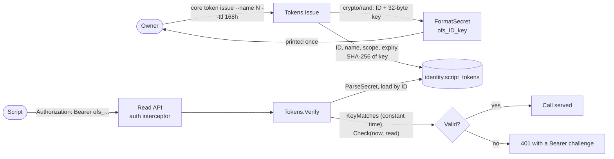

The identity context decides who may use OpenFief. In M0 it will hold the [owner](../glossary.md)'s passkeys (D-26), the [plugin identities](../glossary.md) the core accepts (D-27) and [script tokens](../glossary.md). Only script tokens are built today: the owner's scripts present one to the read API, and every read API call needs one.

## Concepts

**Script tokens.** D-27 gives scripts their own tokens, apart from people (passkeys) and plugins (projected ServiceAccount tokens). A script token is personal, scoped, expiring and read-only. The public API only reads (D-6), so the only scope is `read`. A token lives at most a year; the default is 30 days.

**Bearer tokens.** A script sends its token in the `Authorization: Bearer <token>` header, the scheme OAuth 2.0 defined in RFC 6750 (2012): whoever holds the token may use it. So the token is a secret, and the core treats it like a password.

**Store a hash, never the secret.** A [script token secret](../glossary.md) is `ofs_`, the token's ID, `_`, and 32 random bytes in unpadded base64url. The core stores only the SHA-256 hash of the random part. A database dump or backup can't be replayed against the API, and the secret can't be shown again, so `core token issue` prints it once. SHA-256 is enough without a slow password hash because the key is 256 random bits, not something a person chose. The `ofs_` prefix makes a leaked token easy to recognize, as GitHub's `ghp_` prefixes do for secret scanners.

**Standard primitives only.** D-29 forbids home-grown cryptography. The random bytes come from `crypto/rand`, the hash is `crypto/sha256`, and hashes are compared with `crypto/subtle.ConstantTimeCompare`, so a response's timing doesn't reveal how much of a guess was right.

**IDs are not secret.** The ID in a secret lets the core find the token's row without searching by hash. `core token list` shows IDs, and `core token revoke <id>` takes one. Logs may name an ID, never a secret or a hash.

## How it works

Package `identity` ([token.go](../../internal/identity/token.go)) is pure: the clock and the random bytes come in as parameters.

| Name | What it does |
|---|---|
| `ScriptToken` | `ID`, `Name`, `Scope`, `CreatedAt`, `ExpiresAt` and `RevokedAt` (zero while not revoked). |
| `NewScriptToken` | Checks the ID (16 lowercase hex digits), the name (1 to 64 letters, digits, `.`, `_` or `-`), the scope and a lifetime above zero and at most `MaxTTL`. |
| `ScriptToken.Check` | At a time and for a scope: `ErrTokenRevoked`, then `ErrTokenExpired` (at or after the expiry), then `ErrScopeNotGranted`. |
| `FormatSecret`, `ParseSecret` | Write and read a secret; parse errors never contain the secret. |
| `HashKey`, `KeyMatches` | The SHA-256 hash that is stored, and the constant-time comparison. |

The use cases are in [identity/app](../../internal/identity/app/tokens.go): `Issue` returns the token and its secret once; `Verify` answers `ErrInvalidToken` for a malformed, unknown, mismatched, expired, revoked or out-of-scope token, and a different error when the store fails; `Revoke` keeps the first revocation's time; `List` returns every token, expired and revoked ones too. The PostgreSQL adapter [identity/postgres](../../internal/identity/postgres/store.go) keeps them in its own `identity` schema, with the ledger's migration runner copied under its own lock. Its table checks the ID, name, scope and hash length, and that a token expires after it was created.

`cmd/core` wires `Verify` into the read API as its token verifier and offers the commands `core token issue`, `core token list` and `core token revoke`. See [Architecture](../architecture.md) for the core and [demo.md](../dev/demo.md#use-the-read-api) for getting a token on the demo.

## Decisions

- D-27: scripts get separate, scoped, expiring, read-only personal tokens; plugins authenticate with projected ServiceAccount tokens.
- D-29: no home-grown cryptography in M0.
- D-6: the public API is read-only, so `read` is the only scope.

## Verification

- TEST-identity-domain: table tests of token creation, expiry and revocation checks, scopes, secret parsing and the constant-time hash comparison.
- TEST-identity-app: issue, verify, revoke and list over an in-memory store with a fixed clock, including that a store failure is never reported as an invalid token and that errors never contain the secret.
- TEST-identity-postgres: under `task test:pg`, the round trip through PostgreSQL, that no column holds the key, and that the table refuses bad rows.

## Not built yet

- Passkeys for people (D-26) and the owner.
- The core accepting plugins' projected ServiceAccount tokens with audience `openfief-core` (D-27). Plugins can reach the core's `connect` port, but the read API accepts script tokens only.
- Scopes other than `read`; they wait for a write API, which M0 doesn't have.
