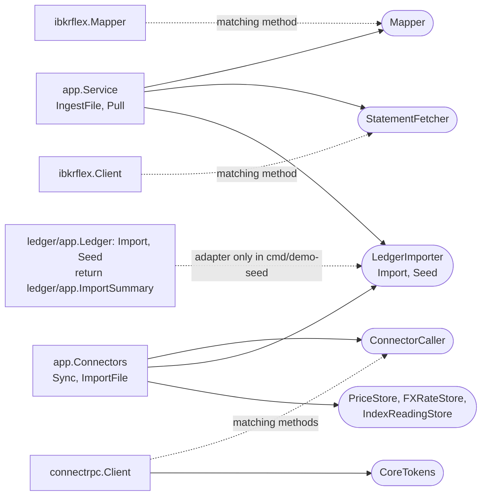
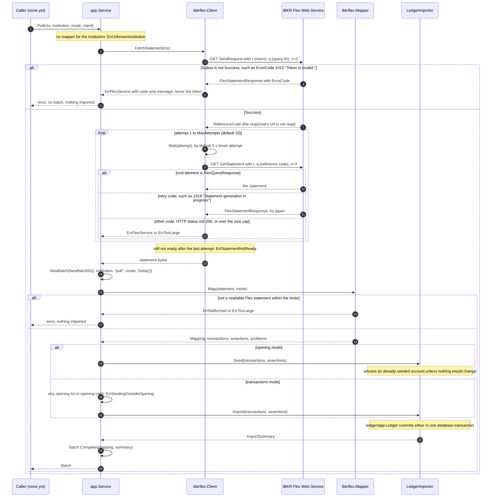
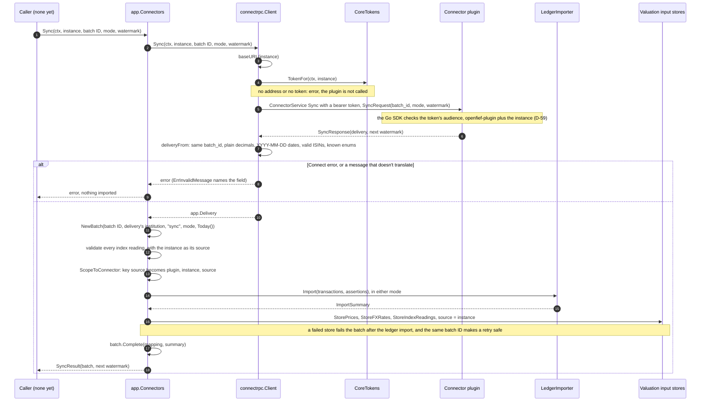
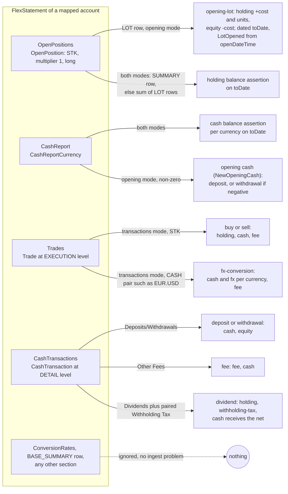

The ingest context is the only way data gets into OpenFief's ledger (D-7). A connector reads what an institution reports, translates it into ledger transactions and balance assertions, and lists every row it could not book. The core runs that either with a mapper compiled into it, as for IBKR Flex Query statements today, or by calling a connector plugin over its Connect contract (D-49). This page explains the concepts, shows what `internal/ingest` actually does, and points to the tests that prove it.

## Concepts

An [institution](../glossary.md) is a broker, bank or registry that holds assets: IBKR, XTB, the treasury bond registry. A [connector](../glossary.md) is the plugin that brings one institution's data in, by whatever the institution allows: a documented web service, an exported file, or manual entry (D-7). The core project ships only connectors that comply with the institution's terms (D-8).

What an institution reports about an account is a [statement](../glossary.md), such as an IBKR Flex Query or an xStation export. The way a statement reaches OpenFief is an *ingest path*: a file (uploaded, passed to the CLI, or dropped in a watched folder), a pull from the institution, or a sync with a connector plugin. D-7 makes these the only way in. The public read API never writes.

One run of an ingest path is an [import batch](../glossary.md). It records which institution the statement came from, by which path, when, in which [ingest mode](../glossary.md), and what came of it.

A [mapping](../glossary.md) is what a connector makes of one statement: [transactions](../glossary.md), [balance assertions](../glossary.md) and [ingest problems](../glossary.md). An ingest problem is a statement row the mapping left out of the ledger, with its reason. It is `unsupported` when OpenFief can't book the row yet, such as an option trade, and `skipped` when the row is left out on purpose, such as a summary row. A problem is not an error: the rest of the statement is still imported. An unsupported row's effect is missing from the ledger, though, so a balance assertion may fail until that row type is supported.

**Idempotent re-import.** Statements overlap: a daily pull re-reads days that were already imported. So every transaction carries a key: its source plus the institution's own ID for it, such as IBKR's `tradeID` (D-18). Importing the same content again changes nothing. Changed content under the same key becomes a new version that supersedes the old one, which is kept. The ledger does the versioning; the connector's job is to produce stable keys.

**Seeding, then transactions.** OpenFief does not replay an account's full history (D-23). At go-live, an `opening` batch [seeds](../glossary.md) the account from the institution's current state: one opening [lot](../glossary.md) per broker lot, with its original open date and cost, plus the [opening cash](../glossary.md), a deposit (or a withdrawal for a negative balance) against equity, keyed `opening-cash:<currency>:<date>` (D-33). An account whose current transactions include either is seeded, and the ledger refuses to seed it again unless nothing would change. After that, `transactions` batches import transactions from go-live on. Both modes import balance assertions.

**The connector contract.** A connector plugin serves the [connector contract](../glossary.md), `openfief.connector.v1.ConnectorService` in [connector.proto](../../proto/openfief/connector/v1/connector.proto). `Sync` pulls what the institution reported since a [watermark](../glossary.md) the connector returned last time. `ImportFile` maps one statement file. Each call is one import batch, with a batch ID the core generates and reuses on a retry. The answer is a [delivery](../glossary.md): the mapping, plus any end-of-day prices, FX rates and [index readings](../glossary.md) (CPI and the NBP reference rate, for treasury bonds). The core authenticates each call with a short-lived token whose audience is that plugin instance (D-59). It prefixes every delivered transaction's key source with `plugin:<instance>:`, so that no instance can write or supersede another's transactions (D-48).

**Anti-corruption layer.** Eric Evans described this pattern in *Domain-Driven Design* (2003): a translation layer at the boundary, so that a foreign model never leaks into your own. Here there are two boundaries. Each in-core adapter, such as `ibkrflex`, parses the institution's format and keeps IBKR words (position, trade, conid, Flex section and attribute names) to itself. The `connectrpc` adapter translates the contract's protobuf messages, so no generated type reaches the domain or the use cases ([code-organization.md](../dev/code-organization.md)).

**IBKR Flex Queries and the Flex Web Service.** A Flex Query is a query the account owner sets up in IBKR's portal: which sections (trades, open positions, cash) and which fields. IBKR returns the result as XML, `FlexQueryResponse > FlexStatements > FlexStatement`, with one `FlexStatement` per account and period and one element per row. The Flex Web Service fetches it with a read-only token, in two steps. `SendRequest` with the token and the query ID returns a reference code. `GetStatement` with that code returns the statement once IBKR has generated it; until then, it answers with an error code that means "try again". R-3 lists Flex Queries among IBKR's access paths.

## How it works

### Packages

| Package | What it holds |
|---|---|
| `internal/ingest` | Domain types: `Institution`, `Batch`, `Mode`, `Mapping`, `Problem`, `ImportSummary`, `IndexReading`, and key scoping (`ConnectorKeySource`, `ScopeToConnector`). Pure functions, no I/O. [batch.go](../../internal/ingest/batch.go), [problem.go](../../internal/ingest/problem.go), [index.go](../../internal/ingest/index.go), [scope.go](../../internal/ingest/scope.go) |
| `internal/ingest/app` | `Service`, which runs in-core mappers ([ingest.go](../../internal/ingest/app/ingest.go)), and `Connectors`, which calls connector plugins ([connectors.go](../../internal/ingest/app/connectors.go)), with the ports they need |
| `internal/ingest/connectrpc` | The core's client of the connector contract and the translation of its messages: [client.go](../../internal/ingest/connectrpc/client.go), [mapping.go](../../internal/ingest/connectrpc/mapping.go) |
| `internal/ingest/ibkrflex` | The IBKR adapter: bounded XML decoding ([decode.go](../../internal/ingest/ibkrflex/decode.go)), the `Mapper` ([mapper.go](../../internal/ingest/ibkrflex/mapper.go), [positions.go](../../internal/ingest/ibkrflex/positions.go), [cashreport.go](../../internal/ingest/ibkrflex/cashreport.go), [trades.go](../../internal/ingest/ibkrflex/trades.go), [cashtx.go](../../internal/ingest/ibkrflex/cashtx.go), [fields.go](../../internal/ingest/ibkrflex/fields.go)) and the Flex Web Service `Client` ([webservice.go](../../internal/ingest/ibkrflex/webservice.go)) |

The domain types, as declared in `internal/ingest`:

`NewBatch` refuses a batch without an ID, an institution, a source, a known mode or a start date (`ErrInvalidBatch`); the zero `Mode` is not a mode. `Batch.Complete` records the mapping's counts, the ledger's summary and a copy of the problems. `IndexReading.Validate` requires a known index, a date and a source, and a CPI reading dated on the first of its month (`ErrInvalidIndexReading`). `ScopeToConnector` returns copies of transactions whose key source is `plugin:<instance>:<source>`; an empty source stays empty, so the ledger still rejects it.

The ports are declared in `app`, by their consumer. Some adapters have the matching methods. The ledger is connected only in `cmd/demo-seed`, whose `importer` turns the ledger's summary into `ingest.ImportSummary`; no product binary connects it, and nothing connects the stores:

Nothing implements `CoreTokens` or the three stores yet.

### Running an in-core mapper

`Service` holds a `LedgerImporter`, a `Mappers` map from `InstitutionID` to `Mapper`, and injected `Today` and `NewBatchID` functions, so it never reads the clock. `IngestFile` takes an `io.Reader` and records the source `file` (`SourceFile`). `Pull` checks that the institution has a mapper, calls the `StatementFetcher`, and ingests the bytes with the source `pull` (`SourcePull`). Then both look up the mapper (`ErrUnknownInstitution` if none), start the batch with `NewBatch`, and `Map` the statement. `importMapping` then imports it by mode:

- An opening batch goes to `LedgerImporter.Seed`. The ledger refuses to seed an account that is already seeded (`ledger.ErrAlreadySeeded`), unless every incoming transaction of it is unchanged; then the summary lists it in `AlreadySeeded`.
- A transactions batch is refused with `ErrSeedingOutsideOpening` if any transaction seeds (`ledger.IsSeeding`: an opening lot, or a deposit or withdrawal keyed `opening-cash:`). Otherwise it goes to `LedgerImporter.Import`.

Last, `Complete` fills in the batch, which is returned to the caller. A failed fetch, map or import returns an error and no batch, and nothing reaches the ledger before the map succeeds.

The pull path end to end, with the IBKR adapter:

### Calling a connector plugin

`Connectors` runs connector plugins' ingest paths. Its caller supplies the instance name, the batch ID and, for a sync, the last watermark, and owns the schedule and the retries: a failed batch is retried with the same batch ID. `connectrpc.Client` resolves the instance's address with a `baseURL` function, such as its ClusterIP Service, asks `CoreTokens` for a fresh token, and calls the plugin over HTTP/2 without TLS (`H2CClient`). `ImportFile` streams a `FileHeader` (batch ID, mode, the owner's file name as a hint, media type) and then the file in 64 KiB chunks (`ChunkSize`). A sync, end to end:

The translation in [mapping.go](../../internal/ingest/connectrpc/mapping.go) refuses, with `ErrInvalidMessage` naming the field: a decimal with an exponent, grouping or a plus sign; a date that isn't `YYYY-MM-DD`; a malformed currency; an ISIN with a wrong check digit or an instrument without a symbol (D-35); a missing amount or delivery; any unspecified enum; a price or FX rate that isn't positive; and a delivery whose `batch_id` isn't the one asked for. The client never scopes keys; `Connectors` does. Every price, FX rate and index reading gets the instance as its source, overwriting what the plugin sent.

### The Flex Web Service client

`ibkrflex.Client` sends the token only as the `t` query parameter, next to `q` and `v=3`, and only to `SendRequestURL` and `GetStatementURL`, which default to IBKR's documented endpoints. `serviceResponse` has no field for the statement URL in IBKR's reply, so the token never follows it elsewhere. Errors name the request path, never the URL that carries the token. `SendRequest` is not retried. `GetStatement` is retried only on the codes in `retryCode` (1001, 1004 to 1009, 1018, 1019, 1021). A `SendRequest` response is capped at 64 KiB, and a `GetStatement` response at `MaxBytes`, by default the parser's 64 MiB. `Wait` is injectable, so tests never sleep, and a cancelled context stops the wait. The `HTTP` field's comment says it should reach IBKR through the egress proxy (D-32); the client doesn't check that.

### Mapping a Flex statement

`ibkrflex.Mapper` has two fields: `Accounts`, which maps an IBKR account ID to the ledger account it feeds, and `Limits`. `Map` refuses an unknown mode (`ErrUnknownMode`), decodes the XML, then maps each `FlexStatement`. A statement for an account not in `Accounts` becomes one skipped problem. A statement without a readable `toDate` fails the whole map with `ErrMalformed`. The `toDate`, the statement's last day, dates every balance assertion; in opening mode it is also the go-live date. Four sections are read, in this order:

In opening mode every `Trades` and `CashTransactions` row becomes a skipped problem, because the opening lots and opening cash already hold its effect. Only instruments that appear in `OpenPositions` get a holding balance assertion. A zero cash balance still gets a cash assertion but no opening cash transaction.

The keys the adapter writes. Every source is `SourcePrefix` plus the ledger account ID, such as `ibkr-flex:acc-ibkr`, never the IBKR account number:

| Transaction kind | External ID | Date |
|---|---|---|
| buy, sell, fx-conversion | `tradeID` | `tradeDate`, else `dateTime` |
| deposit, withdrawal, fee, dividend | `transactionID`; a withholding row is booked under its dividend's | `dateTime`, else `reportDate` |
| opening-lot | `opening-lot:<ISIN>:<open date>:<originatingTransactionID>`, or `n1`, `n2` in row order among that instrument's lots opened that day | `toDate` |
| opening cash (deposit or withdrawal) | `ledger.OpeningCashID`: `opening-cash:<currency>:<toDate>` | `toDate` |

Withholding tax is paired with its dividend by `pairWithholding`: the same `actionID` when both rows have one, otherwise the same ISIN, currency and date. Several withholding rows of one dividend add up. A withholding row with no dividend, more than one, or a zero or positive amount becomes an unsupported problem.

Rows the mapper won't book become problems, never errors. Unsupported: asset categories other than `STK` (and `CASH` in `Trades`); a contract multiplier other than 1; short or zero holdings; transaction types other than `ExchTrade`, `BookTrade`, `FracShare` or none; a side that disagrees with the quantity's sign; commission or tax credits; commission and taxes in two currencies; cash transaction types other than the four above; fee refunds; dividend reversals; a missing or unreadable attribute (named, its value not kept); and a transaction the ledger rejects, whose reason is cut to "not a valid ledger transaction" because ledger errors can carry amounts. Skipped: an unexpected element in a section (such as `Order` or `Lot` in `Trades`), a level of detail that isn't read (such as `CLOSED_LOT` in `OpenPositions` or `SUMMARY` in `CashTransactions`), and opening-mode activity rows. A problem's `Ref` names the statement, section, 1-based row and the IBKR ID when there is one, such as `FlexStatement#1/Trades#8[tradeID=9000106]`. It never holds an amount or an account number (GR-12).

Dates are read as `yyyyMMdd` or `yyyy-MM-dd`, optionally followed by `;`, `,`, space or `T` and a time, which is dropped without any time zone conversion. Amounts and quantities are exact decimals in plain notation, at most 40 digits. Exponents are refused, and nothing goes through `float64`.

### Hostile statements

DESIGN §3.7 lists malicious statement files as a threat. `decode` reads with `encoding/xml` in strict mode and refuses any `DOCTYPE` or other directive, undeclared entities, non-UTF-8 input and any root other than `FlexQueryResponse`. Anything malformed is `ErrMalformed`. Anything over a limit is `ErrTooLarge`, and either way the map fails before anything is imported. The limits are fields of `Limits`; a zero field takes its default: `MaxBytes` 64 MiB, `MaxDepth` 16, `MaxElements` 500,000, `MaxAttrs` 512 per element, `MaxAttrLen` 4,096 bytes.

## Decisions

- **D-7** Only connector ingest paths: `Service` (file, pull) and `Connectors` (sync, file).
- **D-11** Connector contract in protobuf, called over Connect RPC.
- **D-18** Keys from source plus institution IDs; reported balances become assertions.
- **D-19** Double-entry postings, built by the ledger's constructors.
- **D-20** Amounts keep their currency; IBKR's `ConversionRates` are ignored.
- **D-23** Opening batches seed; a seeded account isn't seeded twice.
- **D-33** Opening cash is booked against the equity ledger account.
- **D-34** Trade fees go to the fee ledger account.
- **D-35** Instruments need a valid ISIN and a venue symbol.
- **D-48** Each instance's transaction keys are scoped to `plugin:<instance>:`.
- **D-49** Partly: the core calls connectors, one batch per call.
- **D-59** A fresh core token per call, with the instance as audience.
- **D-32** Partly: the Flex client expects the egress proxy, but doesn't enforce it.

Where the code differs from a decision, a requirement or the glossary:

- **D-23, the plugin path skips the seeding guard.** `Connectors.deliver` ([connectors.go](../../internal/ingest/app/connectors.go)) calls `LedgerImporter.Import` in both modes. An opening delivery for an already seeded account is not refused, and a transactions delivery may carry opening lots or opening cash. Only `Service` seeds through `Seed`. REQ-ingest-app-seed-opening-only says every opening import batch must.
- **D-23, transactions from go-live.** `transactions` mode books every row in the statement. Nothing compares row dates with go-live, so a statement whose period overlaps the opening statement's would book those rows on top of the opening lots. [problem.go](../../internal/ingest/problem.go) gives "a transaction before go-live" as an example of a skipped row, but no code produces one.
- **D-49.** The core's side of the contract is built, but nothing calls `Service` or `Connectors`: there is no scheduler, retry loop, or store for batches and watermarks. The IBKR code is still a package inside the core, `internal/ingest/ibkrflex`, not a plugin.
- **Ingest problems.** The glossary and [doc.go](../../internal/ingest/ibkrflex/doc.go) say rows that aren't booked become ingest problems. Rows in sections the mapper doesn't read, and the `BASE_SUMMARY` cash row, are dropped silently.
- **Glossary names.**
  - There is no `ingest.Connector` type.
  - `ImportSummary` exists twice, in `ingest` and `ledger/app`, with different fields.
  - The glossary defines "Index reading" twice, as `ingest.IndexReading` and `valuation.IndexReading`.
  - The comment on `Batch.Source` gives `upload` and `flex-web-service` as examples, but the constants are `file`, `pull` and `sync`.

## Verification

Run every test with `task test`, or only this context with `go test ./internal/ingest/...`. All of these run offline.

| Behavior | Tests | kibi |
|---|---|---|
| Batches, institutions and index readings validate; `Complete` copies the problems | [batch_test.go](../../internal/ingest/batch_test.go): `TestNewBatch`, `TestBatchComplete`, `TestInstitutionValidate`; [index_test.go](../../internal/ingest/index_test.go): `TestIndexReadingValidate` | REQ-ingest-batch-record, REQ-ingest-index-reading-valid |
| Keys are scoped to the instance | [scope_test.go](../../internal/ingest/scope_test.go): `TestConnectorKeySource`, `TestScopeToConnector` | REQ-ingest-instance-scoped-keys, TEST-ingest-scope |
| An in-core path maps once and imports once; failures import nothing | [ingest_test.go](../../internal/ingest/app/ingest_test.go): `TestIngestFile`, `TestIngestFileFailures`, `TestPull`, `TestPullFailures` | REQ-ingest-app-ingest-path, TEST-ingest-app |
| Opening batches seed, transactions batches with seeding transactions are refused | ingest_test.go: `TestIngestSeedsOnlyInOpeningMode` | REQ-ingest-app-seed-opening-only, TEST-ingest-app |
| Sync and file import through a plugin: scoped keys, sourced inputs, failures | [connectors_test.go](../../internal/ingest/app/connectors_test.go): `TestConnectorsSync`, `TestConnectorsImportFile`, `TestConnectorsFailures` | REQ-ingest-connector-batches, TEST-ingest-app-connectors |
| The client calls a real Connect server over h2c with a fresh bearer token; streams files in chunks | [client_test.go](../../internal/ingest/connectrpc/client_test.go): `TestClientSync`, `TestClientImportFile`, `TestClientFailures` | REQ-ingest-core-authenticates-to-connector, TEST-ingest-connectrpc-client |
| Contract messages translate, malformed ones are refused | [mapping_test.go](../../internal/ingest/connectrpc/mapping_test.go): `TestDeliveryFrom`, `TestDeliveryFromRejects`, `TestValuationInputsFrom`, `TestValuationInputsFromRejects`, `TestPlainDecimal`, `TestModeTo` | REQ-ingest-connector-contract-translation, TEST-ingest-connectrpc-mapping |
| Flex statements in both modes: lots, cash, transactions, assertions, problems | [golden_test.go](../../internal/ingest/ibkrflex/golden_test.go): `TestMapGolden`, `TestMapValidTransactions` | REQ-ibkrflex-opening, REQ-ibkrflex-transactions, REQ-ibkrflex-assertions, TEST-ibkrflex-golden |
| Single Flex rows: dates, signs, fees, withholding pairing | [rows_test.go](../../internal/ingest/ibkrflex/rows_test.go): `TestMapTradeRows`, `TestMapCashTransactionRows`, `TestMapOpenPositionRows`, `TestMapCashReportRows` | REQ-ibkrflex-withholding-pairing, TEST-ibkrflex-rows |
| Hostile Flex input is refused; input at each limit is accepted | [hostile_test.go](../../internal/ingest/ibkrflex/hostile_test.go): `TestMapRefusesHostileInput`, `TestMapAtTheLimits`, `TestMapReadFailure` | REQ-ibkrflex-hostile-input, TEST-ibkrflex-hostile |
| Flex Web Service: two steps, retry, invalid token, size cap, no token in errors | [webservice_test.go](../../internal/ingest/ibkrflex/webservice_test.go): `TestFetchStatement`, `TestFetchStatementTokenInvalid`, `TestFetchStatementFailures`, `TestFetchStatementStopsWhenCancelled` | REQ-ibkrflex-web-service-pull, TEST-ibkrflex-webservice |

All the ingest requirements above are `default` firmness and say the author hasn't reviewed them yet. The firm D-49 requirements (REQ-ingest-core-calls-connectors, REQ-ingest-core-owns-schedules, REQ-ingest-uploads-through-core) have no test yet. The ledger side is verified there: the one-transaction import by `TestImportHooksRunInTheImportTransaction` in [hook_test.go](../../internal/ledger/app/hook_test.go) (REQ-ledger-app-import-atomic), and the re-seed refusal by TEST-ledger-app-seed (REQ-ledger-seed-refuse-reseed).

The Flex golden files sit next to their fixtures, `opening.xml` and `activity.xml`, in [testdata](../../internal/ingest/ibkrflex/testdata/). To rewrite them after an intended change, run `go test ./internal/ingest/ibkrflex -run TestMapGolden -update` and review the diff line by line.

**The hypert recordings.** `TestFetchStatement` replays three exchanges from `testdata/TestFetchStatement/`: a successful `SendRequest` whose `Url` points to `elsewhere.example`, a `GetStatement` answering 1019 (still generating), and a `GetStatement` returning a one-trade statement. `TestFetchStatementTokenInvalid` replays a single `SendRequest` answering 1015. Replay checks each request's path, method, query parameters, scheme and headers, including `User-Agent`; the token is replaced with `SANITIZED` before comparing. No IBKR paper credentials exist, so these files were written by hand in hypert's format, with a fake account (`U0000000`), fake IDs and synthetic ISINs, and `recordMode` is a `false` constant. They follow IBKR's public documentation, not a real response (OQ-22). To record real fixtures, follow the [hypert-recording skill](../../.claude/skills/hypert-recording/SKILL.md) and [testing.md](../dev/testing.md). The connector client's tests use an in-process Connect server instead, with synthetic tokens.

**Known gaps.** These behaviors have no test, and the first two are bugs:

- In `pairWithholding` ([cashtx.go](../../internal/ingest/ibkrflex/cashtx.go)), a dividend's second withholding row in a different currency resets the dividend's withholding to zero. The first, valid row then vanishes with no problem of its own, and the dividend is booked as if nothing was withheld.
- An opening delivery from a plugin isn't seeded through `Seed` (see above). `TestConnectorsImportFile` runs an opening batch but doesn't check which ledger call it makes.
- Rows in sections the Flex mapper doesn't read produce no ingest problem, and `transactions` mode has no go-live cutoff.
- Nothing checks at compile time that `ibkrflex.Mapper`, `*ibkrflex.Client` and `*connectrpc.Client` satisfy the `app` ports.

## Not built yet

- **XTB export parser.** Uploaded xStation files (D-9), stocks and ETFs only, with closed CFD results as cash and open CFDs flagged (D-24).
- **Treasury bonds.** Manual lot entry in the built-in UI, handed to the core (D-9, D-49), and an import of the bond service's own export if one exists (D-9, OQ-22). The connector contract has only `Sync` and `ImportFile`, no call for manual entries.
- **Connector plugins.** The contract, the core's client and the Go SDK exist, but no connector plugin does. The IBKR code would move into one (D-11, D-49).
- **Core-owned scheduling.** The daily sync's schedule, retries, and stored import batches and watermarks (D-49).
- **Entry points.** Upload, CLI and watched folder (D-7). Only `cmd/demo-seed` builds a `Service`, to load the demo dataset; no product binary builds `Service` or `Connectors`.
- **Adapters for the ports.**
  - `LedgerImporter`, over `ledger/app.Ledger.Import` and `Seed`, turning flagged checks into `FailedAssertions`.
  - `CoreTokens`, over Kubernetes' TokenRequest API (D-59).
  - The price, FX rate and index reading stores.
- **IBKR prices as a cross-check** for the market-data connector (D-22). A delivery can carry prices, but the Flex mapper doesn't read `tradePrice` or position prices.
- **Verification against a real account** of the Flex schema, lot-level open dates and cost basis, and how far back one request reaches (OQ-22).
- **Full history backfill**, which arrives with the tax pack (D-23).
