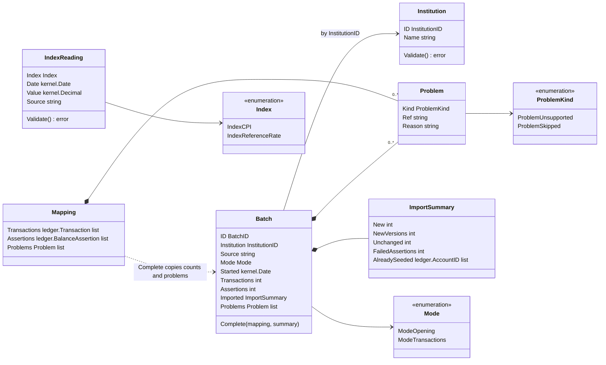
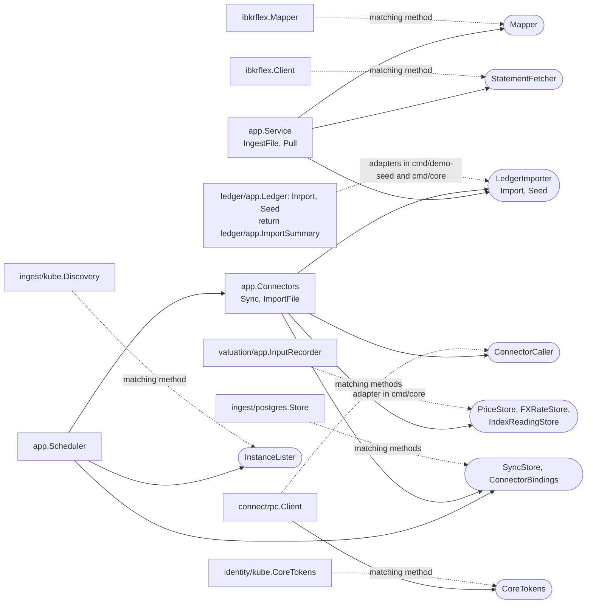
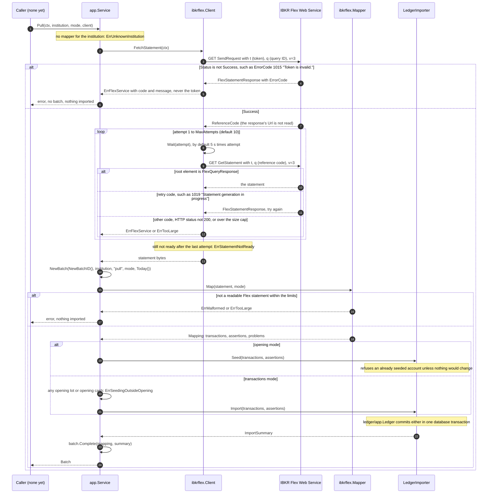
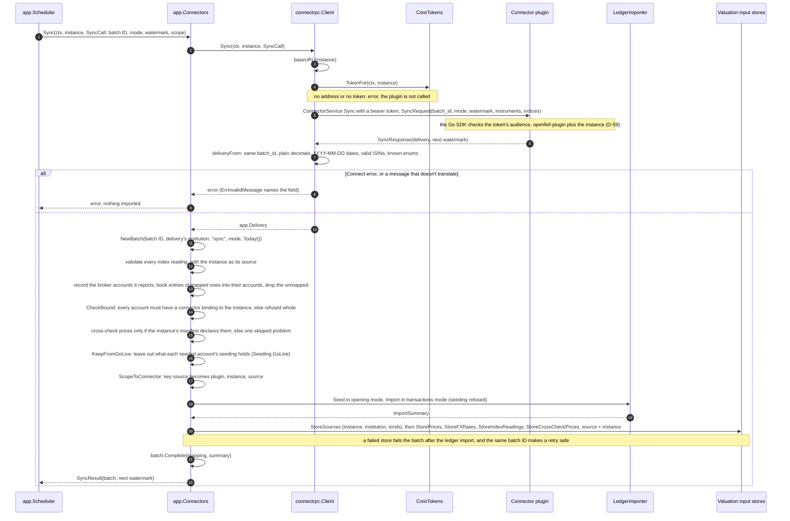
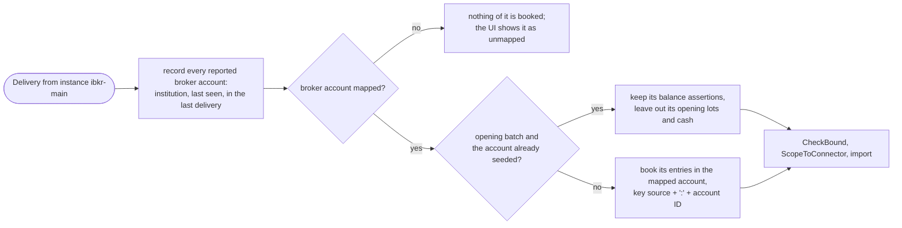
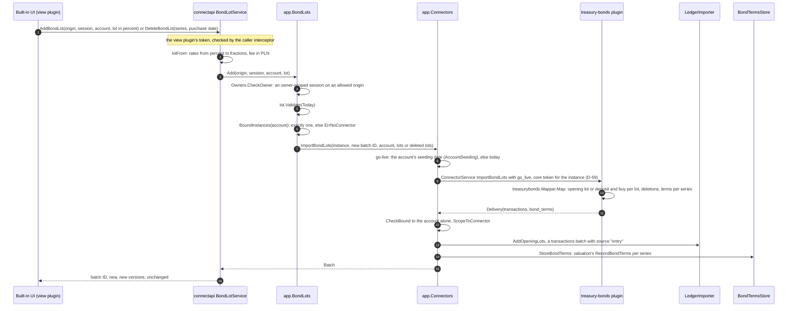
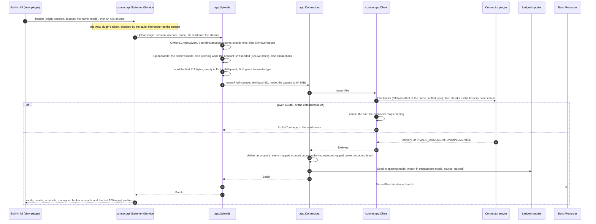
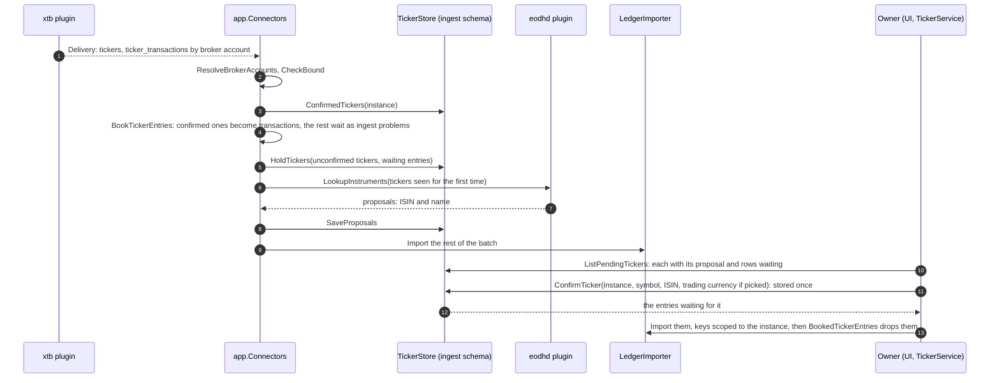
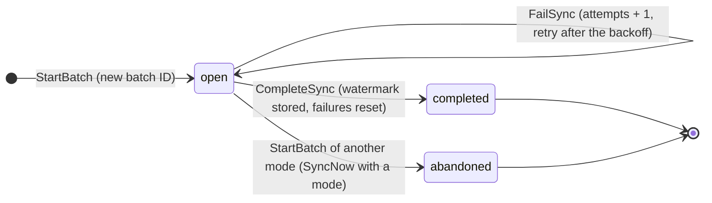
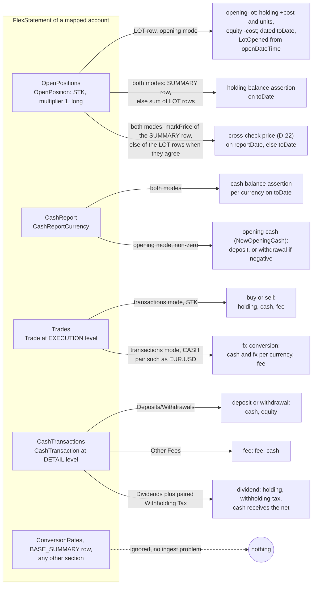

The ingest context is the only way data gets into OpenFief's ledger (D-7). A connector reads what an institution reports, translates it into ledger transactions and balance assertions, and lists every row it could not book. The core runs that either with a mapper compiled into it, as for IBKR Flex Query statements today, or by calling a connector plugin over its Connect contract (D-49). This page explains the concepts, shows what `internal/ingest` actually does, and points to the tests that prove it.

## Concepts

An [institution](../glossary.md) is a broker, bank or registry that holds assets: IBKR, XTB, the treasury bond registry. A [connector](../glossary.md) is the plugin that brings one institution's data in, by whatever the institution allows: a documented web service, an exported file, or manual entry (D-7). The core project ships only connectors that comply with the institution's terms (D-8).

What an institution reports about an account is a [statement](../glossary.md), such as an IBKR Flex Query or an xStation export. The way a statement reaches OpenFief is an *ingest path*: a file (uploaded, passed to the CLI, or dropped in a watched folder), a pull from the institution, or a sync with a connector plugin. D-7 makes these the only way in. The public read API never writes.

One run of an ingest path is an [import batch](../glossary.md). It records which institution the statement came from, by which path, when, in which [ingest mode](../glossary.md), and what came of it.

A [mapping](../glossary.md) is what a connector makes of one statement: [transactions](../glossary.md), [balance assertions](../glossary.md) and [ingest problems](../glossary.md). An ingest problem is a statement row the mapping left out of the ledger, with its reason. It is `unsupported` when OpenFief can't book the row yet, such as an option trade, and `skipped` when the row is left out on purpose, such as a summary row. A problem is not an error: the rest of the statement is still imported. An unsupported row's effect is missing from the ledger, though, so a balance assertion may fail until that row type is supported.

**Idempotent re-import.** Statements overlap: a daily pull re-reads days that were already imported. So every transaction carries a key: its source plus the institution's own ID for it, such as IBKR's `tradeID` (D-18). Importing the same content again changes nothing. Changed content under the same key becomes a new version that supersedes the old one, which is kept. The ledger does the versioning; the connector's job is to produce stable keys.

**Seeding, then transactions.** OpenFief does not replay an account's full history (D-23). At go-live, an `opening` batch [seeds](../glossary.md) the account from the institution's current state: one opening [lot](../glossary.md) per broker lot, with its original open date and cost, plus the [opening cash](../glossary.md), a deposit (or a withdrawal for a negative balance) against equity, keyed `opening-cash:<currency>:<date>` (D-33). An account whose current transactions include either is seeded, and the ledger refuses to seed it again unless nothing would change; its go-live date is the date of its latest seeding transaction (`ledger.GoLive`). After that, `transactions` batches import transactions from go-live on, and the core syncs a seeded account in transactions mode on its own (D-95). Both modes import balance assertions.

**The connector contract.** A connector plugin serves the [connector contract](../glossary.md), `openfief.connector.v1.ConnectorService` in [connector.proto](../../proto/openfief/connector/v1/connector.proto). `Sync` pulls what the institution reported since a [watermark](../glossary.md) the connector returned last time. `ImportFile` maps one statement file. Each call is one import batch, with a batch ID the core generates and reuses on a retry. The answer is a [delivery](../glossary.md): the mapping, plus any end-of-day prices, FX rates, [index readings](../glossary.md) (CPI and the NBP reference rate, for treasury bonds) and [index levels](../glossary.md) (market indices such as WIG20). The core authenticates each call with a short-lived token whose audience is that plugin instance (D-59). It prefixes every delivered transaction's key source with `plugin:<instance>:`, so that no instance can write or supersede another's transactions (D-48).

**Anti-corruption layer.** Eric Evans described this pattern in *Domain-Driven Design* (2003): a translation layer at the boundary, so that a foreign model never leaks into your own. Here there are two boundaries. Each in-core adapter, such as `ibkrflex`, parses the institution's format and keeps IBKR words (position, trade, conid, Flex section and attribute names) to itself. The `connectrpc` adapter translates the contract's protobuf messages, so no generated type reaches the domain or the use cases ([code-organization.md](../dev/code-organization.md)).

**IBKR Flex Queries and the Flex Web Service.** A Flex Query is a query the account owner sets up in IBKR's portal: which sections (trades, open positions, cash) and which fields. IBKR returns the result as XML, `FlexQueryResponse > FlexStatements > FlexStatement`, with one `FlexStatement` per account and period and one element per row. The Flex Web Service fetches it with a read-only token, in two steps. `SendRequest` with the token and the query ID returns a reference code. `GetStatement` with that code returns the statement once IBKR has generated it; until then, it answers with an error code that means "try again". R-3 lists Flex Queries among IBKR's access paths.

## How it works

### Packages

| Package | What it holds |
|---|---|
| `internal/ingest` | Domain types: `Institution`, `Batch`, `Mode`, `Mapping`, `Problem`, `ImportSummary`, `IndexReading`, key scoping (`ConnectorKeySource`, `ScopeToConnector`), the [sync policy](../glossary.md), a sync's modes and what an account's seeding already holds (`PlanSync`, `KeepFromGoLive`), what market-data connectors price (`MarketDataScope`), [connector bindings](../glossary.md) (`CheckBound`, `ValidateInstanceName`), [broker accounts](../glossary.md) (`BrokerAccountID`, `BrokerAccount`, `BrokerEntries`, `ResolveBrokerAccounts`) an uploaded file's name hint (`FileNameHint`), and what a connector's manifest declares and an upload's mode (`Declarations`, `UndeclaredCrossCheckPrices`, `UploadMode`), and instruments named by ticker only (`Ticker`, `TickerEntry`, `TickerConfirmation`, `ISINProposal`, `PendingTicker`, `BookTickerEntries`, D-116). Pure functions, no I/O. [batch.go](../../internal/ingest/batch.go), [brokeraccount.go](../../internal/ingest/brokeraccount.go), [problem.go](../../internal/ingest/problem.go), [index.go](../../internal/ingest/index.go), [scope.go](../../internal/ingest/scope.go), [schedule.go](../../internal/ingest/schedule.go), [binding.go](../../internal/ingest/binding.go), [file.go](../../internal/ingest/file.go), [golive.go](../../internal/ingest/golive.go), [marketdata.go](../../internal/ingest/marketdata.go), [declarations.go](../../internal/ingest/declarations.go), [ticker.go](../../internal/ingest/ticker.go) |
| `internal/ingest/app` | `Service`, which runs in-core mappers ([ingest.go](../../internal/ingest/app/ingest.go)), `Connectors`, which calls connector plugins ([connectors.go](../../internal/ingest/app/connectors.go)), `Scheduler`, which owns their syncs ([scheduler.go](../../internal/ingest/app/scheduler.go)), `PricingScope`, what market-data connectors price ([pricing.go](../../internal/ingest/app/pricing.go)), `HoldingsScope`, what a sync tells a connector bound to accounts ([held.go](../../internal/ingest/app/held.go)), `Bind` ([bindings.go](../../internal/ingest/app/bindings.go)), the broker accounts' port `BrokerAccountStore` ([brokers.go](../../internal/ingest/app/brokers.go)), `Accounts`, the owner's account entries ([accounts.go](../../internal/ingest/app/accounts.go)), and `BondLots` and `Uploads`, which hand the owner's entries and files to a connector ([bondlots.go](../../internal/ingest/app/bondlots.go), [uploads.go](../../internal/ingest/app/uploads.go)), `Tickers`, the owner's ISIN confirmations, with the `TickerStore` and `InstrumentLookup` ports ([tickers.go](../../internal/ingest/app/tickers.go)), with the ports they need |
| `internal/ingest/kube` | `Discovery`: the running connector instances and their Services' addresses, and what each running version's manifest declares (`Declarations`, D-112, D-109), from the operator's `Plugin` resources and Services through informers ([discovery.go](../../internal/ingest/kube/discovery.go)) |
| `internal/ingest/postgres` | The `ingest` schema: each instance's watermark and sync state, the import batch history, the connector bindings, the broker accounts, and the tickers without an ISIN with their entries waiting ([store.go](../../internal/ingest/postgres/store.go), [brokers.go](../../internal/ingest/postgres/brokers.go), [tickers.go](../../internal/ingest/postgres/tickers.go), [migrations](../../internal/ingest/postgres/migrations/)) |
| `internal/ingest/connectrpc` | The core's client of the connector contract and the translation of its messages: [client.go](../../internal/ingest/connectrpc/client.go), [mapping.go](../../internal/ingest/connectrpc/mapping.go), and tickers, their entries and the ISIN lookup ([tickers.go](../../internal/ingest/connectrpc/tickers.go)) |
| `internal/ingest/delivery` | The connector plugins' side of the contract, the reverse of `connectrpc`'s translation: `FromMapping` writes a mapping as a `Delivery`, `FXRates` writes FX rates, `Price` an end-of-day close of an instrument, `IndexLevel` a market index's closing level, `IndexReadings` monthly [index readings](../glossary.md) dated on their month's first day, and `Mode` reads a request's ingest mode ([delivery.go](../../internal/ingest/delivery/delivery.go)). The first-party plugins under [plugins/](../../plugins/) use it ([Plugins](plugins.md#first-party-plugins)) |
| `internal/ingest/treasurybonds` | The treasury bond connector's logic: `Mapper` turns the owner's [bond lots](../glossary.md) into deposits and buys, and `Instrument` derives a series' instrument ([mapper.go](../../internal/ingest/treasurybonds/mapper.go)); `IndexSync` picks the CPI and NBP reference-rate readings a sync delivers after its `IndexWatermark`, from the `CPISource` and `ReferenceRateSource` ports ([indices.go](../../internal/ingest/treasurybonds/indices.go), [Plugins](plugins.md#first-party-plugins)). The plugin [plugins/treasury-bonds](../../plugins/treasury-bonds/) serves it |
| `internal/ingest/connectapi` | The core's `openfief.ingest.v1.BondLotService` ([bond_lots.proto](../../proto/openfief/ingest/v1/bond_lots.proto)) `StatementService` ([statements.proto](../../proto/openfief/ingest/v1/statements.proto)) `AccountService` ([accounts.proto](../../proto/openfief/ingest/v1/accounts.proto)) and `TickerService` ([tickers.proto](../../proto/openfief/ingest/v1/tickers.proto)), which the built-in UI calls with the owner's lots, statement files, accounts and ISIN confirmations ([service.go](../../internal/ingest/connectapi/service.go), [statements.go](../../internal/ingest/connectapi/statements.go), [accounts.go](../../internal/ingest/connectapi/accounts.go), [tickers.go](../../internal/ingest/connectapi/tickers.go)) |
| `internal/ingest/ibkrflex` | The IBKR adapter: bounded XML decoding ([decode.go](../../internal/ingest/ibkrflex/decode.go)), the `Mapper` ([mapper.go](../../internal/ingest/ibkrflex/mapper.go), [positions.go](../../internal/ingest/ibkrflex/positions.go), [cashreport.go](../../internal/ingest/ibkrflex/cashreport.go), [trades.go](../../internal/ingest/ibkrflex/trades.go), [cashtx.go](../../internal/ingest/ibkrflex/cashtx.go), [fields.go](../../internal/ingest/ibkrflex/fields.go)) and the Flex Web Service `Client` ([webservice.go](../../internal/ingest/ibkrflex/webservice.go)) |
| `internal/ingest/xtb` | The XTB adapter: a bounded reader of the xStation `.xlsx` export with the standard library ([xlsx.go](../../internal/ingest/xtb/xlsx.go)), its sheets' layout (R-24, [sheets.go](../../internal/ingest/xtb/sheets.go)) and the `Mapper` ([mapper.go](../../internal/ingest/xtb/mapper.go), [cash.go](../../internal/ingest/xtb/cash.go), [positions.go](../../internal/ingest/xtb/positions.go)); `xtbtest` writes synthetic exports for tests ([xtbtest.go](../../internal/ingest/xtb/xtbtest/xtbtest.go)). The plugin [plugins/xtb](../../plugins/xtb/) serves it |

The domain types, as declared in `internal/ingest`:

`NewBatch` refuses a batch without an ID, an institution, a source, a known mode or a start date (`ErrInvalidBatch`); the zero `Mode` is not a mode. `Batch.Complete` records the mapping's counts, the ledger's summary and a copy of the problems. `IndexReading.Validate` requires a known index, a date and a source, and a CPI reading dated on the first of its month (`ErrInvalidIndexReading`). `ScopeToConnector` returns copies of transactions whose key source is `plugin:<instance>:<source>`; an empty source stays empty, so the ledger still rejects it.

The ports are declared in `app`, by their consumer. `cmd/core` connects them for connector plugins: its `ledgerImporter` turns the ledger's summary into `ingest.ImportSummary` (as `cmd/demo-seed`'s `importer` does for `Service`), and its `valuationInputs` records prices, FX rates and index readings through valuation's `InputRecorder`, each index reading as the reading for the month of its date:

`identity/kube.CoreTokens` implements `CoreTokens` with the TokenRequest API ([Identity](identity.md)); `connectrpc.Client` gets each instance's address from `Discovery.BaseURL`.

### Running an in-core mapper

`Service` holds a `LedgerImporter`, a `Mappers` map from `InstitutionID` to `Mapper`, and injected `Today` and `NewBatchID` functions, so it never reads the clock. `IngestFile` takes an `io.Reader` and records the source `file` (`SourceFile`). `Pull` checks that the institution has a mapper, calls the `StatementFetcher`, and ingests the bytes with the source `pull` (`SourcePull`). Then both look up the mapper (`ErrUnknownInstitution` if none), start the batch with `NewBatch`, and `Map` the statement. `importMapping` then imports it by mode:

- An opening batch goes to `LedgerImporter.Seed`. The ledger refuses to seed an account that is already seeded (`ledger.ErrAlreadySeeded`), unless every incoming transaction of it is unchanged; then the summary lists it in `AlreadySeeded`.
- A transactions batch is refused with `ErrSeedingOutsideOpening` if any transaction seeds (`ledger.IsSeeding`: an opening lot, or a deposit or withdrawal keyed `opening-cash:`). Otherwise it goes to `LedgerImporter.Import`.

Last, `Complete` fills in the batch, which is returned to the caller. A failed fetch, map or import returns an error and no batch, and nothing reaches the ledger before the map succeeds.

The pull path end to end, with the IBKR adapter:

### Calling a connector plugin

`Connectors` runs connector plugins' ingest paths. Its caller supplies the instance name, the batch ID and, for a sync, a `SyncCall` with the mode, the last watermark and what a market-data connector is to price, and owns the schedule and the retries: a failed batch is retried with the same batch ID. `connectrpc.Client` resolves the instance's address with a `baseURL` function, such as its ClusterIP Service, asks `CoreTokens` for a fresh token, and calls the plugin over HTTP/2 without TLS (`H2CClient`). `ImportFile` streams a `FileHeader` (batch ID, mode, the owner's file name as a hint, media type) and then the file in 64 KiB chunks (`ChunkSize`). A file that can't be read to its end, such as an upload that broke off or passed its limit, cancels the call, so the connector never sees the end of the file and nothing is mapped. Like `ImportBondLots`, it answers a connector's `INVALID_ARGUMENT` with `ErrEntryRefused` and its reason, `UNIMPLEMENTED` with `ErrNoEntries`, and an instance it can't reach with `ErrConnectorUnavailable`. A sync, end to end:

The translation in [mapping.go](../../internal/ingest/connectrpc/mapping.go) refuses, with `ErrInvalidMessage` naming the field: a decimal with an exponent, grouping or a plus sign; a date that isn't `YYYY-MM-DD`; a malformed currency; an ISIN with a wrong check digit or an instrument without a symbol (D-35); a missing amount or delivery; any unspecified enum; a price or FX rate that isn't positive; and a delivery whose `batch_id` isn't the one asked for. Errors name the field, never its value (GR-12). Before any of that, the client reads a connector's answer up to `MaxDeliveryBytes` (16 MiB), past which the call fails `RESOURCE_EXHAUSTED`. Its codec ([codec.go](../../internal/ingest/connectrpc/codec.go)) then walks the answer's wire bytes without allocating and counts every message, nested ones included, and every element of a repeated field; past `MaxDeliveryMessages` (640,000) the answer is refused with `ErrDeliveryTooLarge` before it is decoded, because an empty message costs two bytes on the wire and about 90 bytes decoded, so the byte cap alone let 32 MiB of empty postings grow the core's heap by 1.8 GiB. A decoded delivery of more than `MaxDeliveryItems` (200,000) items, postings counted with the rest, is refused whole the same way. The worst answers within those caps grow the heap by about 31 MiB (the byte cap filled with empty messages), 71 MiB (the most empty messages decoded) and 140 MiB (200,000 valid prices decoded and translated), against the core's 256 MiB memory limit, under which `GOMEMLIMIT` holds Go's heap at 200 MiB; `TestAnswerHeap` measures each in its own process. A backfill larger than 800 instrument-years of daily prices is refused whole: deliveries aren't paged yet. Every ledger transaction kind crosses the contract, `interest` (D-101) and `deletion` (D-100) included; a deletion carries no postings, and the ledger refuses one of a key it never recorded. The client never scopes keys; `Connectors` does. Every price, FX rate, index reading and index level gets the instance as its source, overwriting what the plugin sent. A delivery's `index_levels` become `valuation.IndexLevel` values, keyed by the index's name exactly as the connector sends it (`IndexLevel.index`, such as `WIG20`); a level without a name, a date or a positive value is refused like a bad price. `Connectors` hands them to its `IndexLevelStore` port, which `cmd/core` implements with valuation's `InputRecorder.RecordIndexLevels`; storing them enqueues no revaluation, since no holding is valued from an index.

Before the values, `Connectors` records the instance, with the institution its delivery names, as a source of each kind of market data it carries (prices, FX rates, index readings) through its `SourceStore` port, which `cmd/core` implements with valuation's `Rankings.RecordSources`: the owner ranks these sources, the institution gives a source its default place, and each series takes its one source from the ranking when it first needs a value (D-94, [Valuation](valuation.md#one-source-per-series-as-built)). Without the port no source is recorded.

A delivery's `cross_check_prices` are [cross-check prices](../glossary.md): an institution's own end-of-day prices, translated with the same rules as `prices` (`crossCheckPriceFrom`) but kept in their own field of `app.Delivery`, `CrossCheckPrices`. `Connectors` gives each the instance as its source and hands them to its `CrossCheckPriceStore` port, never to `PriceStore`, so they can't replace a market-data connector's price or value a holding (D-22). `cmd/core` implements the port with valuation's `CrossChecks.RecordCrossCheckPrices` ([Valuation](valuation.md#cross-checking-prices)). Only an instance whose manifest declares `crossCheckPrices` may send them (D-112): `Connectors` asks its `ConnectorDeclarations` port (`ingest/kube.Discovery.Declarations`, which reads the running version's manifest from the Plugin resource's `status.deployed.manifest`) and otherwise stores none of them and adds one skipped ingest problem, `UndeclaredCrossCheckPrices`, to the batch, which imports the rest. A `Connectors` without that port treats every instance as declaring nothing. A `Connectors` without a store refuses a delivery that carries declared ones (`ErrNoCrossCheckStore`) rather than drop them; the bond-lot path has none, since bond lots carry no prices.

Every delivery names its [institution](../glossary.md), and a connector books only for the institutions its signed manifest declares in `institutions` (D-182) and its grant approves (D-185): the core reads them from the Plugin's `status.effective.institutions`, which the operator writes. Before anything of a delivery is admitted, `Connectors.deliver` reads the instance's declarations once and `Declarations.CheckInstitution` refuses the whole delivery when its institution isn't among them (`ErrUndeclaredInstitution`): no transaction is booked, no price, rate or reading stored, and the instance isn't recorded as a market-data source. The batch fails, and an upload or bond-lot entry answers `failed_precondition` with the reason. So a connector can't book as another institution, and the default ranking of market-data sources (D-94), which puts the sources of `eodhd`, `nbp` and `treasury-bonds` first, can only put a source first whose manifest declares that institution. A `Connectors` without declarations refuses every delivery.

### What market-data connectors price

D-93 has every sync request to a market-data connector carry what the owner holds and what the model portfolio targets, so a newly bought instrument is priced without configuration. A market-data connector is an instance whose manifest declares `marketData` and whose grant approves it (D-123, [Plugins](plugins.md#concepts)): the scheduler asks its `ConnectorDeclarations` port (`Declarations.MarketData`) on each attempt, and only such an instance gets the scope, bound to accounts or not, so no other connector, such as a broker's or nbp-fx, learns what is held. Without that port no instance gets it. `PricingScope.MarketDataScope` builds it on each attempt:

- **Held instruments.** Every instrument in a non-zero holding of any account today (`Holdings`, the ledger's `Accounts` and `HoldingsOn`), except treasury bonds with stored series terms (`BondSeries`, the valuation store's `BondTerms`), which have no market price.
- **The model portfolio's targets** while it is on (`ModelTargets`, `portfolio/app.Models.MarketDataTargets`): its instruments, and its market indices by the name the owner gave them (D-96).
- `ingest.NewMarketDataScope` keeps each instrument once, in ISIN then symbol order, and each index name once. `connectrpc` writes them into `SyncRequest.instruments` and `indices`. The connector adds what its own config lists to watch ([Plugins](plugins.md#first-party-plugins)).

A newly bought instrument is held from the day its buy is booked, so the next sync of a market-data connector asks for it and the purchase is priced from then on; the closes before that come from the connector's own start, as for any instrument it hasn't priced yet.

### What a sync tells a bound connector

D-117 has every sync request to a connector carry the holdings and open lots of the accounts bound to its instance, as D-93's request carries the instruments to price, so a connector that books what a holding pays needs no storage of its own. `HoldingsScope.HeldAccounts` ([held.go](../../internal/ingest/app/held.go)) builds it on each attempt of an instance bound to accounts, and `Scheduler.plan` puts it on every batch of the attempt (`SyncCall.Held`, `SyncCall.BondTerms`):

- **Each bound account once, in ID order**, as an `ingest.HeldAccount` ([held.go](../../internal/ingest/held.go)): its go-live date from `AccountSeeding` (zero while it is not seeded), its [payout setting](../glossary.md) from the ingest store (`PayoutSettingReader`, D-135), its tax wrapper from the valuation store (`TaxWrappers`, the pack's default when none is recorded), its non-zero holdings and its open lots today (`AccountHoldings`, the ledger's `HoldingsOn` and `LotsOn`).
- **The series terms** of every instrument among the lots that has stored bond terms (`BondSeries`), each once in ISIN order, so the connector can compute a series' rate without storing the terms the owner entered.
- `connectrpc` writes them into `SyncRequest.accounts` and `bond_terms` ([held.go](../../internal/ingest/connectrpc/held.go)); a plugin reads them back with `delivery.Held` ([held.go](../../internal/ingest/delivery/held.go)), which refuses anything malformed with `ErrMalformedHoldings` naming the field.

The core holds no bond logic: what fell due is the connector's to compute. The treasury-bonds connector books each coupon that fell due on or before today on each open lot of a coupon series (ROR, DOR, COI) as interest (D-101), using the Polish pack's `pl.CouponDates` and `pl.Terms.Coupon` ([Treasury bonds](treasury-bonds.md#coupons)) and `pl.BelkaTax` for the account's wrapper (`treasurybonds.DueCoupons`, `BookCoupons`, `CouponSync`, [coupons.go](../../internal/ingest/treasurybonds/coupons.go)). It books maturities as it books coupons (D-135): each open lot whose maturity (`pl.Maturity`) fell on or before today is a [redemption](../glossary.md) at the redemption value `pl.ValueLot` gives it at maturity, with Belka tax on its interest and purchase discount (D-100) withheld (`DueMaturities`, `BookMaturities`, [maturities.go](../../internal/ingest/treasurybonds/maturities.go)); the last period's interest comes with it. Coupons are keyed `lot:<series>:<purchase date>:coupon:<due date>` and redemptions `lot:<series>:<purchase date>:redemption` under the lot's own source, so each is idempotent: the connector delivers everything due on every sync, and what is booked once is unchanged after. When the account's payout setting pays out what falls due that day, each is followed by a withdrawal of the cash it brought on the same day, keyed with `:payout` appended (`PayoutWithdrawal`), so the account's cash matches the registry while the coupon or redemption still counts as return: the time-weighted return takes the withdrawal as a cash flow ([Read API](read-api.md)). An account's first setting covers its whole history; a change takes effect from a day the owner gives, today or earlier (D-162), and the sync request carries every setting with the day it took effect (`AccountHoldings.bond_payout_earlier`), so what fell due on a day follows the setting in force on it (`ledger.PayoutSetting.On`). When the owner changes the setting, the core supersedes the payout withdrawals booked from that day on that the new setting no longer makes, with deletions (`ingest.StalePayouts`, imported by `Accounts.Update`), and the next sync books the coupons and maturities from that day anew: unchanged ones stay, and a newly paid-out one gets its withdrawal. An account whose lots are deposits and buys on their purchase dates holds its whole history, so everything since purchase is due (D-98); in an account seeded with opening lots before that rule, only what fell due after its go-live is, since the opening lots hold the rest. Such accounts are never seeded, so the scheduler syncs their instance in opening mode (`PlanSync`): the connector books the accounts never seeded in an opening batch and those seeded in a transactions batch (`AccountsBookedIn`), so each is booked once and none is seeded twice. A deleted lot (D-100) is no longer open, so nothing more falls due on it. A coupon or redemption whose index reading isn't published yet, or whose CPI year is left for a later sync (at most four years of CPI per sync, as for the index sync), waits as a skipped ingest problem and is booked by a later sync.

### Connector bindings

A connector instance writes only to the accounts the owner bound it to. A [connector binding](../glossary.md) pairs an instance name with a ledger account ID, and `app.Bind` adds one after checking the name (`ValidateInstanceName`: a Plugin's name, a lower-case DNS label of at most 56 characters) and that the account is stored. Before anything is imported, `Connectors.deliver` loads the instance's bindings and `CheckBound` refuses the whole delivery, with an `*UnboundAccountsError` (`ErrAccountNotBound`) naming every other account, if any transaction or balance assertion is in an account the instance isn't bound to. A delivery with only prices, FX rates or index readings, such as a market-data connector's, needs no binding. Key scoping (D-48) keeps instances from overwriting each other's transactions; the binding keeps an instance from writing into an account at all.

### Broker accounts

A broker connector doesn't know OpenFief's accounts; it knows the institution's own, such as the IBKR accounts a Flex Query reports. D-72 has it report those [broker accounts](../glossary.md) and lets the owner map each to an OpenFief account in the built-in UI, so the owner never types a broker account number into a plugin's config. The contract carries that as additions ([connector.proto](../../proto/openfief/connector/v1/connector.proto)): a transaction or balance assertion may set `broker_account` instead of `account_id`, never both, and a delivery lists every broker account it saw in `broker_accounts`, including those with nothing to book. The key source of an entry named by broker account names no account; the core appends `:` and the OpenFief account ID, so the keys stay per account, the same keys a connector that knew the account would write.

- **Translation.** `connectrpc` puts the entries named by broker account apart in `Mapping.ByBrokerAccount` (`BrokerEntries`: the broker account, its transactions and assertions, in no account yet) and the listed accounts in `Mapping.BrokerAccounts`. A broker account must be 1 to 64 printable characters without spaces (`BrokerAccountID.Validate`); an entry naming both accounts, or a malformed broker account, refuses the delivery with `ErrInvalidMessage`. `delivery.FromMapping` writes them the same way on the plugin's side.
- **Resolution.** `Connectors` first records every broker account the delivery reports through its `BrokerAccountStore` port, with the delivery's institution and today's date, so a delivery refused later still shows them; then `ingest.ResolveBrokerAccounts` books the entries of each mapped broker account into its OpenFief account and drops those of an unmapped one (D-72). Only then do `CheckBound` and, for an upload or a bond lot, the check that every entry is in the owner's account run. A `Connectors` without the store refuses a delivery that names broker accounts (`ErrNoBrokerAccountStore`) rather than drop it.
- **Seeding.** A connector usually syncs before the owner maps its broker accounts, and an opening batch then seeds nothing. Mapping one binds its account to the instance, unseeded, so the next sync runs an opening batch that seeds it and then a transactions batch for the accounts seeded before ([Scheduling syncs](#scheduling-syncs)). `MarkSeeded` records the newly seeded broker accounts, and in a later opening batch the opening lots and opening cash of broker accounts already seeded are left out while their balance assertions are kept, because the ledger refuses to seed an account again with changed content.
- **Storage.** `postgres.Store` keeps them in `ingest.broker_accounts` ([0003_broker_accounts.sql](../../internal/ingest/postgres/migrations/0003_broker_accounts.sql)): instance, broker account, institution, the mapped account and when, last seen, in the last delivery, seeded. `MapBrokerAccount` maps one only if its instance reported it (`ErrUnknownBrokerAccount`) and it isn't mapped to another account (`ErrBrokerAccountMapped`). Unlike the rest of the schema this holds account numbers: they are shown to the owner and never logged.

### The owner's accounts

D-72 has the owner create accounts in the built-in UI: institution, name, sleeve, and the connector instance that feeds the account, with, for a broker connector, the broker account it is, picked from those the connector reported. D-76 adds the account's [tax wrapper](../glossary.md), one of the jurisdiction pack's, and D-78 the [fee rule](../glossary.md) its broker charges a sale. D-79 makes accounts their own owner service: `openfief.ingest.v1.AccountService` ([accounts.proto](../../proto/openfief/ingest/v1/accounts.proto)), served to view plugins only with the `BondLotService`'s conventions.

| Method | What it does |
|---|---|
| `CreateAccount` | An account whose ID is made from its name (`portfolio.KeyFromName`), in a stored sleeve, with its tax wrapper (the pack's default, `taxable`, when none is given) and its fee rule (the zero rule when none is given); with a connector instance, a connector binding to it (`Bind`); with a broker account, its mapping to the new account. An empty institution takes the broker account's |
| `UpdateAccount` | A new name or sleeve, and a new tax wrapper or fee rule when one is given; ID and institution stay |
| `BindAccount` | What `core connector bind` does, from the UI, with a broker account mapped too when one is picked |
| `ListBrokerAccounts` | Every [broker account](../glossary.md) the instances reported, in instance then ID order, with the account it is mapped to, the institution, the day last seen and whether the last reporting delivery had it; `unmapped` keeps only those not mapped. The only place broker account numbers are listed (D-121): the read API serves none |
| `DeleteAccount` | Deletes an account that holds no transactions (D-120) with its bindings, broker account mappings, payout setting, tax wrapper, fee rule, stored valuations and the sleeve it is in; one with transactions or balance assertions is `FAILED_PRECONDITION`. Deleting it again changes nothing |
| `RemapBrokerAccount` | Maps a broker account to another stored account, or leaves it unmapped, while the account it is mapped to holds no transaction from its instance (D-120), and binds the instance to the new account; the broker account is no longer seeded, so the next opening batch seeds the new account from it |

`app.Accounts` ([accounts.go](../../internal/ingest/app/accounts.go)) checks the owner, then everything it can before it stores anything: a free ID, a stored sleeve, a wrapper its `Pack` has and a fee rule that passes `FeeRule.Validate`, a valid instance name (`ValidateInstanceName`), and that the instance reported the broker account and it isn't mapped to another account. It then saves the account through its `AccountLedger` port (`*ledgerapp.Ledger`), puts it in its sleeve through its `AccountSleeves` port (the portfolio context's `*portfolioapp.Registry`, which keeps which account is in which sleeve), stores a given payout setting through its `PayoutSettings` port (the ingest store, below), records the wrapper and fee rule through its `AccountTerms` port, which `cmd/core` joins from valuation's `InputRecorder` and store, so each revalues the account ([Valuation](valuation.md#account-terms-and-the-owners-settings)), then binds and maps through the ingest store. Every method answers the account with its sleeve, payout setting, wrapper and fee rule (`AccountEntry`), each read from the context that keeps it. The writes are separate and each is idempotent, so a failure between them leaves nothing a retry can't finish.

**The payout setting is ingest's.** A hand-entered bond account's [payout setting](../glossary.md) is an account setting the treasury-bonds connector reads, so the ingest context keeps it ([code-organization.md](../dev/code-organization.md)): the domain type is `ingest.PayoutSetting`, with `PayoutPeriod` and `Payout` ([payoutsetting.go](../../internal/ingest/payoutsetting.go)), and the ingest schema keeps one row per account in `ingest.payout_settings`, keyed by the ledger's account ID, with the setting in force, the day it took effect and the earlier settings as JSON ([0011_payout_settings.sql](../../internal/ingest/postgres/migrations/0011_payout_settings.sql), [payouts.go](../../internal/ingest/postgres/payouts.go)). An account without a row keeps its payouts as cash; `ForgetAccount` deletes the row with a deleted account. The ledger knows nothing of it. Nothing was copied from the ledger columns that held it before: what was stored before the first release is entered again (D-161). An account's first setting covers its whole history; a change takes effect from a day the owner gives, which may be earlier than today, replacing the settings from that day on (`PayoutSetting.Changed`), and what falls due on a day follows the setting in force on it (`PayoutSetting.On`, `PaidOut`). `connectapi.NewAccounts` ([accounts.go](../../internal/ingest/connectapi/accounts.go)) maps a malformed entry, an unknown sleeve, a wrapper the pack lacks or a fee rule that isn't one (including a rate that isn't a decimal) to `INVALID_ARGUMENT`, a taken ID to `ALREADY_EXISTS`, an unknown account to `NOT_FOUND`, a broker account never reported or mapped elsewhere to `FAILED_PRECONDITION`; its texts never carry the broker account number.

Every owner service here that changes an existing account asks the core's [authorizer](../glossary.md) first (D-163, [Identity](identity.md#authorization)), before it reads anything about the account: `UpdateAccount`, `BindAccount`, `DeleteAccount`, `AddBondLot`, `DeleteBondLot` and `UploadStatement` for their account, and `RemapBrokerAccount` for the account it maps to and, once it has read the mapping, the account it maps from. The `Owners` port's `Changeable` answers which of the accounts the owner's session may change ([access.go](../../internal/ingest/app/access.go)); one it may not is `PERMISSION_DENIED`, whether the account is stored or not. `ListStatementAccounts` lists only accounts the owner may change. Under today's rule the owner may change every account, so nothing is refused yet; `CreateAccount` names no existing account and asks only for the owner.

D-120's removals ([accountchanges.go](../../internal/ingest/app/accountchanges.go)) never touch what the ledger holds (D-18). `Accounts.Delete` asks the ledger first (`AccountDeletions`, `ledgerapp.Ledger.DeleteAccount`), which checks and deletes in one statement and refuses an account any transaction version or balance assertion is in (`ledger.ErrAccountHasTransactions`); only then do the ingest store (`AccountConnections.ForgetAccount`: its bindings go, its broker accounts are left unmapped) and the valuation store (`TermsForgetter`) forget it. Deleting an account not stored still runs the clean-up, so a retry after a failure between the steps finishes it. `Accounts.Remap` reads "no transactions from it" as none whose key source starts with the instance's scope (`ingest.ConnectorKeySource(instance, "")`, `HasTransactionsFrom`), since every transaction a broker account brings is scoped to its instance (D-48) and a mapping names its account; `ErrBrokerAccountHasTransactions` is `FAILED_PRECONDITION` (D-156).

### Treasury bond lots

Neither the treasury bond registry nor the bank that sells the bonds offers an API (R-5), so D-9 makes manual entry the bonds' ingest path: the owner types each [bond lot](../glossary.md), its series code, quantity and purchase date, in the built-in UI. D-49 sends it through the core to the right connector, so it enters the ledger like any other delivery, as an import batch of a connector instance with keys scoped to it. Valuing a lot needs its series' [terms](../glossary.md) (first-period rate, margin, early-redemption fee) as well, which D-9 doesn't list; the owner enters them with the lot, from the series' issue letter ([Treasury bonds](treasury-bonds.md#series-terms)). D-100 adds how the bonds were bought, for cash at 100 PLN or by exchange of maturing bonds at 99.90 PLN, and lets the owner delete a lot as a correction. D-98 decides how a lot is booked: on its real purchase date, as a deposit of its cost and a buy, so the account's history starts at its first purchase.

- **The rules of a lot** are `ingest.BondLot.Validate` ([bondlot.go](../../internal/ingest/bondlot.go)), pure and shared by the core and the connector: a purchase date no later than today, a purchase that is `PurchaseCash` or `PurchaseExchange` (D-100), a margin of zero or more, and a lot that `pl.ValueLot` can value on its purchase date at its price: the 100 PLN nominal for cash, `pl.ExchangePrice` (99.90 PLN, 100 PLN for OTS, as its issue letter sets) for an exchange. `BondLot.Cost` is that price times the quantity, so a lot of 40 bonds bought by exchange costs 3996.00 PLN, and valuation, which prices a lot at its cost over its quantity, sees the 0.10 PLN discount per bond and taxes it with the interest ([Treasury bonds](treasury-bonds.md#belka-tax)). That last one refuses an unknown bond type, a purchase date whose maturity misses the series' month, a quantity that isn't a positive whole number, and a negative rate or fee. The core checks it before calling the connector, so the owner gets the reason even when the connector is down, and the connector checks it again before mapping.
- **The right connector** is the one instance bound to the lot's account ([connector binding](../glossary.md)): `app.BondLots` asks `AccountBindings.BoundInstances` (`postgres.Store.BoundInstances`) and refuses an account with none or several (`ErrNoConnector`). The delivery must stay in that one account, or nothing is imported.
- **The owner only.** `BondLotService` follows the model portfolio's `ModelPortfolioService` ([Portfolio](portfolio.md)): served to view plugins only, with the owner's session and the browser's origin in the request, checked through the `Owners` port, which `cmd/core` implements over the identity context.
- **Go-live.** A hand-entered bond account has none: its lots are booked on their purchase dates (D-98), so it is never seeded. `Connectors.ImportBondLots` sends a go-live date with the lots (`ImportBondLotsRequest.go_live`, `ingest.BondLotEntries.GoLive`) only for an account seeded with opening lots before D-98 was rewritten, the date its seeding holds from `AccountSeeding`, so those lots keep their keys.
- **The mapping** (`treasurybonds.Mapper.Map`) books each lot in the account the core sends with it (`ImportBondLotsRequest.account_id`, `ingest.BondLotEntries.Account`, D-118) on its purchase date (D-98): two transactions, a deposit of its cost against equity and the buy of the bonds for that cost, keyed `lot:<series>:<purchase date>:deposit` and `:buy`. The account's cash stays at zero, and the money counts as entering the portfolio when the lot did, for the time-weighted return (D-61). Lots may come in any order. Only in an account with a go-live, a lot bought on or before it is booked as the opening lot it was, dated on go-live, keeping its own purchase date (`LotOpened`) and cost, keyed `lot:<series>:<purchase date>`. The keys are under the source `treasury-bonds:<account>`, so each lot is idempotent per series and purchase date: entering it again unchanged changes nothing, and with another quantity, purchase or terms is a new version that supersedes it (D-18). One series twice on one day, added or deleted, or with two sets of terms, in one batch is refused.
- **Opening lots one at a time.** A delivery from the owner's entry is imported with `LedgerImporter.AddOpeningLots` (`ledger/app.Ledger.AddOpeningLots`), not `Seed`: the account receives its opening lots one per entry, each on its go-live date, and the ledger refuses one on another date, or the first lot of an account that already has a transaction on or before that date, which it would count twice ([Ledger](ledger.md#how-it-works)). A sync never runs that path; it keeps refusing seeding outside an opening batch.
- **Deleting a lot.** `BondLotService.DeleteBondLot` names a lot by its series and purchase date (`ingest.BondLotKey`); `app.BondLots.Delete` checks the owner and the key and hands it to the same connector as a deleted lot (`ImportBondLotsRequest.deleted`). The mapper answers with a [deletion](../glossary.md) of each transaction the lot was booked as, keyed and dated as adding it was, and the ledger keeps the superseded versions (D-18, D-100). Deleting it again changes nothing, entering it again brings it back, and deleting a lot never entered is refused (`ledger.ErrNothingToDelete`).
- **The instrument.** The owner enters only the series code, and the issuer's offer pages and interest tables name series by code, so `treasurybonds.Instrument` derives the instrument: the series code as its venue symbol, and as its ISIN `PL`, the code, `00` and the check digit that makes it valid, such as `PLEDO0536000`. It is stable, so every lot of a series is one holding, and its `PL` prefix and series symbol make the views count it as a treasury bond. It is not the ISIN the registry may have assigned (see [Decisions](#decisions)).
- **Valuation.** The delivery's `bond_terms` reach valuation's `InputRecorder.RecordBondTerms` through the `BondTermsStore` port, so holdings of the instrument are valued as bonds by the existing rules (`ValueBondHolding`, [Valuation](valuation.md#valuing-one-holding)), and their accounts revalued from their first transaction. Recording a series' terms again replaces them.
- **Errors** reach the owner as Connect codes: no valid session `UNAUTHENTICATED`; a read-scoped session or another origin `PERMISSION_DENIED`; a broken rule, the connector's own refusal (`ErrEntryRefused`, with its reason), or deleting a lot never entered, `INVALID_ARGUMENT`; a lot the ledger can't add one at a time (`ErrBookedBeforeGoLive`, `ErrGoLiveMismatch`) `FAILED_PRECONDITION`; an account without its one connector, or a connector that takes no bond lots (`ErrNoEntries`, its `UNIMPLEMENTED`), `FAILED_PRECONDITION`; a connector that can't be reached (`ErrConnectorUnavailable`) `UNAVAILABLE`; anything else `INTERNAL`, logged without amounts and shown without its cause.

### Statement uploads

D-49 sends the files the owner uploads in the built-in UI through the core to the right connector, so a statement enters the ledger as an import batch of a connector instance, through its ingest path (D-7). The connector decides which files it takes: the IBKR Flex connector maps Flex Query statements, and one that takes no files answers `UNIMPLEMENTED`.

- **Streamed end to end.** The UI reads the browser's multipart body in chunks and streams them to the core over Connect (a client stream works over the HTTP/1.1 the UI uses); `connectapi` hands the stream to the use case as a reader that receives chunk after chunk, and `connectrpc.Client` streams it on to the plugin. No file is stored on disk, and no hop holds more than a chunk or two, until the plugin, which reads the whole statement to map it.
- **Limits.** A file may be up to 64 MiB (`DefaultMaxUploadBytes`), the IBKR Flex parser's own limit and the largest any connector takes today; one stream message at most 1 MiB, as for every ingest service, read before the caller is checked. The cap counts bytes as they are read, so a larger file is cut off at the first byte past it, whatever the browser declared.
- **What the connector learns of the file.** Its bytes, the mode, the opening cash the owner entered with it, if any, the last element of its name cleaned by `ingest.FileNameHint` (no directories, control characters or invalid UTF-8, at most 255 bytes), and a media type sniffed from its first 512 bytes (`http.DetectContentType` in `cmd/core`) in place of the one the browser declared. Both are hints the connector may ignore; the ibkr-flex plugin reads the content only.
- **The right connector** is the one instance bound to the account, as for bond lots (D-109). A statement that covers several accounts, such as an IBKR Flex statement of linked accounts, books every mapped account bound to that instance: the delivery may name any account bound to it (`CheckBound`), or nothing is imported. Its broker accounts are resolved as a sync's ([Broker accounts](#broker-accounts)): the batch lists the accounts it booked into (`Batch.Accounts`) and the broker accounts that aren't mapped (`Batch.Unmapped`), and the answer carries both, so the owner can map them.
- **The mode** is the core's choice (D-109, `ingest.StartMode` over `ingest.UploadMode`): `opening` for an account that hasn't started, `transactions` once it has, unless the owner's header names one. An account starts in one of two ways (D-136): seeded at go-live from its institution's current positions (D-23), which makes it seeded, as the ledger's go-live says (D-95); or from a statement of its whole history, uploaded in `transactions` mode, which leaves it holding transactions but never seeded. The core asks the ledger for both (`AccountSeeding`, and `AccountHistory`, `ledger/app.Ledger.HasTransactionsFrom`): an account that holds transactions but isn't seeded takes `transactions`, and an opening upload for it fails with `ingest.ErrStartedFromHistory`, since seeding it would count its holdings twice. `opening` seeds the account at go-live, and the ledger refuses to seed a seeded account again unless nothing would change; `transactions` refuses opening lots and opening cash. An opening upload starts its account at once (D-160): the core records its go-live with the upload in `ingest.account_starts` (`ingest.OpeningStarts`, the latest date of the account's seeding transactions and opening-lot ticker entries, booked or waiting; `AccountStarts`, [0008_account_starts.sql](../../internal/ingest/postgres/migrations/0008_account_starts.sql)), even when every position waits for its ticker's ISIN and no opening cash was entered, so nothing reaches the ledger yet. `Connectors.GoLiveDates` answers the ledger's go-live for a seeded account and the recorded one otherwise, so the next upload, and the scheduler's next sync of the instance, run in transactions mode. The first opening upload's date stays; deleting the account forgets it.
- **Continuing from the start.** A `transactions` upload of a started account books only what is dated after its go-live, as a sync does (`ingest.KeepFromGoLive`, D-23): a statement that reaches back before the start, such as a later xStation export of a whole year, adds only what came after it, and each row left out is a `skipped` ingest problem. Ticker entries are kept out the same way before they are booked or held, so none waits for a ticker only to be booked twice. An opening upload is kept whole for the ledger to decide.
- **Opening cash.** The header's `opening_cash` and `opening_cash_currency` carry the cash balance the owner enters once, with the opening upload of a statement that holds none, such as an xStation export's open positions (D-136). The core passes it to the connector in the file's header (`NamedFile.OpeningCash`, `FileHeader.opening_cash`), which books it as the account's opening cash. `ingest.CheckOpeningCash` refuses it with any upload but the opening one of an account not started yet: with a transactions upload `INVALID_ARGUMENT`, for a started account `FAILED_PRECONDITION`, so it is entered once. The ibkr-flex plugin refuses any, since a Flex statement holds the cash.
- **Which accounts take files.** `Uploads.FileAccounts` answers `ListStatementAccounts`, the UI's question (D-109): the accounts bound to exactly one running instance (`InstanceLister`, the scheduler's port) whose manifest declares `statementFiles` (`ConnectorDeclarations`), in account order, each with the mode its next upload takes. Before the core has found the cluster's instances, and outside a cluster, no account takes files.
- **Errors** reach the owner as Connect codes: no valid session `UNAUTHENTICATED`; a read-scoped session or another origin `PERMISSION_DENIED`; no header first, a second header, an empty file, opening lots in a transactions upload, opening cash that isn't an exact amount with its currency or comes with a transactions upload, the connector's own refusal (with its reason), a connector's answer that doesn't translate (`app.ErrInvalidDelivery`, which `connectrpc.ErrInvalidMessage` also is) or a transaction the ledger refuses `INVALID_ARGUMENT`; a file over 64 MiB or a message over 1 MiB `RESOURCE_EXHAUSTED`; an account without its one connector, a connector that takes no files, an account already seeded, opening cash for a seeded account, or an opening upload for an account started from its whole history `FAILED_PRECONDITION`; a connector that can't be reached `UNAVAILABLE`; anything else `INTERNAL`, shown without its cause and logged without its values.

**Logging without values (GR-12).** An error's text is written for the owner, who may see his own amounts, ISINs and account numbers in it; a log line may not hold them. So every log line of the ingest context, the sync scheduler's and the services' failures, describes an error with `app.LogSafe` ([logsafe.go](../../internal/ingest/app/logsafe.go)): the texts of the known errors in its chain, which name a rule or a refusal and never a value (`ErrInvalidTransaction`, `ErrEntryRefused`, `ErrInvalidDelivery`, `ErrAccountNotBound`, `context.Canceled` and the rest of `loggableErrors`), or, for any other error, only the Go type of the innermost one, such as `*pgconn.PgError`, whose text may quote a row. The ledger's refusals of a transaction name what is wrong, never the amount or quantity. A test drives failures carrying a synthetic amount, ISIN and account number through the scheduler and a statement upload and checks the log against a deny-list regex.

**The batch history.** `postgres.Store.RecordBatch` records each completed upload and bond lot entry in `import_batches` with the source `upload` or `entry`, its mode, institution and counts, started and finished at the time it is recorded, after one attempt; the second migration widens the table's source check for them. Recording a batch ID twice fails, and a recorded batch never touches the instance's sync state (watermark, seeded flag, open batch). A refused or failed upload or entry imports nothing and is not recorded.

### Tickers without an ISIN

D-35 identifies an instrument by its ISIN plus its venue symbol, but XTB's export names instruments only by ticker and market suffix, such as `TESTA.PL` (R-24). D-116 has the market-data connector look the ISIN up by ticker and market and propose it, the owner confirm it once in the UI, or type it when the lookup found none, and the ticker's rows wait as ingest problems until then.

- **The contract.** A delivery may list `tickers` (the symbol at the institution, the code and the ISO 3166 country of its market, the display name) and `ticker_transactions`: buys, sells, dividends and opening lots of those tickers (D-136), with what the core needs to book them, a kind, date, quantity, amount, charge (fee or withheld tax), an opening lot's `lot_opened`, key and the row's `ref`. An opening lot whose institution gives its open price in the instrument's trading currency without naming it carries `open_price` instead of an amount (D-159). They carry `account_id` or `broker_account` like a transaction. `connectrpc` refuses a ticker transaction that names no listed ticker or books no valid transaction (`TickerEntry.Validate` builds it with a placeholder ISIN of no country, `XX0000000002`). `LookupInstruments` is the connector's lookup; one that can't look up answers `UNIMPLEMENTED`.
- **Booking.** `Connectors.admit` resolves ticker entries by broker account like transactions, checks they are in bound accounts, then `bookTickers` books each whose symbol the owner confirmed for the instance, as a transaction with the instrument `ISIN/symbol`, and holds the others, each an ingest problem `waits for the owner to confirm the ISIN of <symbol>`. Confirmations are per connector instance, like everything an instance delivers (D-48).
- **Proposals.** For the tickers `HoldTickers` sees for the first time, the core asks the running market-data connectors ([What market-data connectors price](#what-market-data-connectors-price)), in name order, and keeps the first proposal for each ticker. A connector that fails or can't look up is passed over; the upload never fails for a lookup. The eodhd plugin searches EODHD for the code on the supported exchange of the market's country and proposes the one ISIN listed there, with the currency the listing trades in as EODHD names it, such as `GBX` for pence (`InstrumentProposal.currency`, D-159; [Plugins](plugins.md#first-party-plugins)).
- **The trading currency** (D-159, D-170). The owner's confirmation settles the ticker's listing (`ingest.ListingOf`): the confirmed ISIN, and the currency of the proposed listing when the owner confirmed its ISIN and it names one, or else of the exchange the ticker's market names when it quotes in only one (`ingest.ExchangeCurrencies`: PLN for `PL`, EUR for the euro markets, USD for `US`, and so on), or else the one the owner picked from that exchange's, or none. London quotes in pence (`GBX`), pounds and dollars, so a `GB` ticker whose listing names no currency, because the lookup found none or the owner typed another ISIN, takes the owner's pick (`ingest.CurrencyChoices`); no currency is assumed. An opening lot priced by its open price is booked in that currency: its quantity times the price, a price in a minor unit such as pence divided by 100 first (`Listing.Price`), rounded half to even to the currency's minor unit (`TickerEntry.Transaction`). One whose listing has no currency is an unsupported ingest problem; the XTB connector refuses an open position on a market with no known exchange up front.
- **Confirming.** `Tickers.Confirm`, behind `TickerService.ConfirmTicker` on the core's plugin port (D-79, D-115), stores the owner's ISIN once: confirming the same ISIN again books whatever still waits, another ISIN or another picked trading currency is `FAILED_PRECONDITION`, an unknown ticker `NOT_FOUND`, an ISIN with a wrong check digit `INVALID_ARGUMENT`. The request's optional `currency` is the owner's pick (D-170): `ingest.ConfirmListing` requires one of the exchange's currencies when the listing names none and the exchange quotes in more than one, and refuses a pick where there is nothing to pick; either refusal is `INVALID_ARGUMENT` naming the choices (`ingest.TradingCurrencyChoiceError`), records nothing, and leaves the ticker's entries waiting. `ListPendingTickers` gives each ticker the proposal's currency and, on such an exchange, its `currency_choices`. The waiting entries are imported as transactions, their keys scoped to the instance, and dropped once the ledger holds them; a retry imports them again with no effect (D-18). Waiting opening lots join their account's opening one at a time on its go-live date, the one the opening upload recorded (D-160; `LedgerImporter.AddOpeningLots`, the path hand-entered bond lots take today). The ledger still refuses opening lots dated after a transaction the account already holds (`ledger.ErrBookedBeforeGoLive`), but the ingest path no longer reaches it: a started account's later uploads are transactions, and they book nothing dated on or before its go-live. A later upload books the ticker's rows at once. An opening batch of a broker account already seeded leaves out its opening-lot ticker entries, as it does its seeding transactions (`ResolveBrokerAccounts`).
- **Storage.** `ingest.tickers` holds each instance's tickers with the proposal and the confirmed ISIN, and `ingest.ticker_entries` the waiting entries, keyed as delivered ([0005_tickers.sql](../../internal/ingest/postgres/migrations/0005_tickers.sql)), an opening lot with its `lot_opened` date ([0007_opening_lot_entries.sql](../../internal/ingest/postgres/migrations/0007_opening_lot_entries.sql)), and one priced by its open price with that price and no amount or currency, next to the proposal's `proposed_currency` ([0009_trading_currency.sql](../../internal/ingest/postgres/migrations/0009_trading_currency.sql)), and the owner's picked `currency`, `''` for none ([0010_picked_trading_currency.sql](../../internal/ingest/postgres/migrations/0010_picked_trading_currency.sql)). They hold amounts and dates, never a statement row's comment.

### Mapping an xStation export

`xtb.Mapper.Map` reads one xStation "Historia operacji" export, one account per file (R-24). It reads the `.xlsx` itself, bounding what it allocates (D-184): the zip's parts are capped (16 MiB file, 128 MiB a part and 256 MiB in all uncompressed, 1,000 parts, 200,000 rows a sheet), and the parts are counted from the zip's central directory signatures before the zip is opened, because opening it reads every entry. Only the workbook, its relationships, the shared strings and the sheets are read, streamed token by token through `encoding/xml`, never held whole, and each sheet once: a workbook that lists two sheets on one part, or one sheet name twice, is refused with `ErrNotWorkbook`. What the reader keeps is bounded too: a row keeps only its cells with a value, so a cell in column XFD costs one entry rather than 16,384, and a row without one isn't kept at all; at most 500,000 such cells and 500,000 shared strings, 16 MiB of their text, 100 sheets; no XML token, such as a start tag with all its attributes or a text, longer than 256 KiB as written, counted from the decoder's input offset since a `>` may sit inside an attribute's value; and no elements nested deeper than 32. Past any of them the file is refused with `ErrTooLarge` before anything is mapped. The caps come from the xtb plugin's memory: the operator gives every plugin container a 256 MiB limit ([Operator](operator.md)), and the namespace's LimitRange default of 1 GiB applies only to a container without its own limit, so it never raises a plugin's. Within the caps the largest workbook the reader keeps grows its heap by about 70 MiB, next to the file itself, and the hostile files of the second security review (a 120 MiB attribute of `>`, 100 sheets on one part of 200,000 empty rows, 150,000 zip entries) by under 16 MiB, where they took 372 MiB, 1.5 GiB and 32 MiB before; `TestWorkbookHeap` measures each in its own process. Number cells keep the decimal string the file holds; nothing goes through `float64`.

- **Layout.** The `Cash Operations` sheet is required in transactions mode and `Open Positions`, with its report date and the columns an opening lot needs, in opening mode (`ErrOpeningMode`); the other sheets are read when present. Each table's header is the first of rows 1 to 20 holding the labels the mapper reads (row 5, or row 9 in `Open Positions`), and its data rows run to a row whose first cell starts with `Total`. Row 1 of every sheet holds `Account number` and the account; the sheets, and the file name when it is xStation's `<currency>_<account>_<from>_<to>.xlsx`, must agree (`ErrLayout`). The account currency comes from the file name or `Open Positions`' summary, which must agree (`ErrCurrency`). The account is the [broker account](../glossary.md) every entry is named by (D-72), with keys under the source `xtb` and the operation's `ID`.
- **Rows.** Cash Operations are mapped oldest first (the sheet lists them newest first), dated by the UTC date of `Time`: `Deposit` and `Withdrawal` as transactions; `Stock purchase` and `Stock sell` as ticker entries, the volume filled taken from the comment (`OPEN BUY 10/10 @ …`, `CLOSE BUY 3/10 @ …`) and the cost or proceeds from the amount in the account currency; `Dividend` as a ticker entry with the `Withholding tax` rows of its ticker and date as the tax withheld. Other types, free-funds interest among them, and rows whose category isn't a stock or ETF are unsupported ingest problems (D-24). Closed and open positions of anything but a stock or ETF are flagged unsupported (D-24); a stock's or ETF's purchase and sale are already in Cash Operations.
- **Amounts.** Each amount is rounded half-even to the account currency's minor unit, which takes away the binary float artifacts in its 13th to 15th decimal; one that differs from its rounding by more than 1e-9 is refused as an ingest problem rather than rounded.
- **Comments.** The comment of a deposit or withdrawal names the sending bank or the XTB account (R-24) and is never read: those transactions are described as `deposit` and `withdrawal`. Only a purchase's or sale's comment is read, for its volume. Problems name a row by sheet, row number and operation ID, never an amount or a comment.
- **Two starts** (D-136). An export of the account's whole history is mapped in transactions mode as above. A current export is mapped in opening mode: each open stock or ETF position of `Open Positions` becomes an opening-lot ticker entry dated on the account's go-live, the UTC date of the sheet's `Data as of report generated`, its quantity the `Volume`, first acquired on the UTC date of `Open time (UTC)`, with its `Open price` per unit (a price that differs from its 8-decimal rounding only by a float artifact is rounded first). The open price is in the instrument's trading currency, which the export doesn't name (R-24), so the lot carries the price and no cost: the core books its cost, the volume times the price, in the trading currency of the ticker's confirmed listing (D-159, [Tickers without an ISIN](#tickers-without-an-isin)). A position whose market suffix names no exchange the core knows is an unsupported ingest problem. A lot is keyed `open-position:` plus the sheet's position ID when it gives one, else the ticker, open time and its count among positions of both. The opening cash the owner entered is booked as `ledger.NewOpeningCash`, keyed `opening-cash:<currency>:<go-live>`; one in another currency than the account's, with more decimals than its minor unit, or sent with a transactions batch is refused (`ErrOpeningCash`), and none or zero books nothing. Cash Operations and Closed Positions aren't read in opening mode: the lots and the cash hold their effect. The same export mapped again gives the same keys and amounts, so a re-upload changes nothing.

### Scheduling syncs

The core owns the schedules, retries and import batches (D-49). `Scheduler` syncs each running connector instance when it is due:

- `InstanceLister` names the instances that run now. An instance that is uninstalled is no longer listed, so it is no longer synced, and its watermark, batches and bindings stay, so reinstalling it under the same name continues from them (D-58).
- The [sync policy](../glossary.md) (`ingest.SyncPolicy`) sets when: every `Interval` after a success, plus a random jitter of up to `Jitter`, and after a failure again after `RetryFirst`, doubled for each consecutive failure, up to `RetryMax`. An instance that was never synced is due at once.
- One sync per instance at a time: in the process, `Scheduler` tracks the instances it is syncing; across core replicas, `SyncStore.ClaimSync` claims the instance until the attempt's timeout plus a minute, so a crashed attempt's claim lapses.
- **The mode follows the ledger** (D-23, D-95). Before each attempt the scheduler asks the ledger which of the instance's bound accounts are seeded (`Connectors.GoLiveDates`, through the `AccountSeeding` port, `ledger/app.Ledger.GoLive`), and `ingest.PlanSync` picks the batches: one `transactions` batch when every bound account is seeded, or none is bound; one `opening` batch when none is seeded; and when some are and some aren't, such as a broker account mapped after the others were seeded, an `opening` batch that seeds the rest, then a `transactions` batch for the seeded ones. Both of those ask from the watermark the instance had before them, so no seeded account misses a transaction even when a connector moves its watermark on an opening batch, and the instance is claimed again for the second. An account seeded by an uploaded opening statement counts like one seeded by a sync. No manual step switches the mode.
- **A sync books nothing twice** (`ingest.KeepFromGoLive`, in `Connectors` for syncs and for uploads in transactions mode): an opening batch leaves out the seeding of accounts already seeded, opening-lot ticker entries included, and a transactions batch leaves out a seeded account's transactions and ticker entries dated on or before its go-live date, since its opening lots and opening cash already hold their effect; each left-out one is a `skipped` ingest problem named by its key. Opening uploads and bond lots are booked as the owner sent them.
- A failed attempt leaves its import batch open, and the next attempt retries it with the same batch ID and mode, as the connector contract requires, followed by a transactions batch when an opening one was retried and the plan has one. `SyncNow` runs one attempt at once and returns its last batch; it can ask for a mode, which runs one batch in it and abandons an open batch of the other mode.
- Each attempt has a timeout for the call and the import together. Its outcome is recorded even when the context ended meanwhile.

**Two transactions, in a safe order.** The ledger import and the valuation inputs are stored in separate database transactions, the ledger first. If storing the inputs fails, the batch fails with the transactions already imported. The retry delivers the same batch again: the ledger finds every transaction unchanged (D-18), and prices, FX rates and index readings replace the rows stored under the same key. The watermark is stored only by `CompleteSync`, after both steps, in the same database transaction that marks the batch completed, so a sync is never skipped.

**Finding the instances.** `kube.Discovery` watches, with client-go informers in the `openfief` namespace, the `Plugin` resources (read as unstructured data, so ingest doesn't depend on the operator's Go types) and the Services labelled `app.kubernetes.io/name: openfief-plugin`. An instance runs when its `Plugin` is not being deleted, its `Ready` condition is `True`, its `status.effective.capabilities` include `connector`, and its Service, found by the label `openfief.io/plugin: <name>`, has a ClusterIP and a port named `connect`. The core calls `http://<ClusterIP>:<port>`, with no DNS lookup. `Declarations` reads `crossCheckPrices` and `statementFiles` from the Plugin's `status.deployed.manifest`, the version that runs, `institutions` from `status.effective.institutions`, those the manifest declares and the grant approves (D-182, D-185), and `MarketData` from `status.effective.marketData`, which the operator sets only when the manifest declares it and the grant approves it (D-123); a missing Plugin or field declares nothing. The names are the operator's runtime contract; a test checks them against `internal/plugins/operator`.

**In the core.** `cmd/core serve` runs the scheduler when `--connectors` is on, by default inside a cluster: it starts the informers and the scheduler in the background, ticks every minute, and stops with the process, recording what was in flight. Discovery that can't reach the API server, or a sync that fails, never affects `/readyz`. The flags are `--sync-every` (6h), `--sync-jitter` (30m), `--sync-retry-first` (5m), `--sync-retry-max` (1h), `--sync-timeout` (5m) and `--service-account` (`openfief-core`). `core connector bind --instance NAME --account ID` adds a connector binding, as the UI's `BindAccount` does; `core connector sync --instance NAME [--mode opening|transactions]` syncs one instance now, as the scheduler would, and prints the batch's counts. Batch IDs are `b-` and 16 random hex digits.

`internal/ingest/postgres` keeps this in the `ingest` schema, migrated by its own runner and advisory lock: `connector_instances` (watermark, failures, next sync, claim, open batch; its seeded flag was dropped by [0004_seeding_from_the_ledger.sql](../../internal/ingest/postgres/migrations/0004_seeding_from_the_ledger.sql), since the ledger says which accounts are seeded), `import_batches` (instance, source, mode, state, attempts, and the completed batch's counts; syncs, and the uploads and entries `RecordBatch` adds; since [0006_unsupported_rows.sql](../../internal/ingest/postgres/migrations/0006_unsupported_rows.sql) also how many of its problems are rows OpenFief can't book yet, `ingest.CountUnsupported`, which `UnsupportedBatches` lists for the [attention items](attention.md) of kind `import-problems`, D-130), `connector_bindings` and `broker_accounts` ([Broker accounts](#broker-accounts)). Apart from the broker accounts it holds IDs, counts and times only, never an amount or an account number.

### The Flex Web Service client

`ibkrflex.Client` sends the token only as the `t` query parameter, next to `q` and `v=3`, and only to `SendRequestURL` and `GetStatementURL`, which default to IBKR's documented endpoints. `serviceResponse` has no field for the statement URL in IBKR's reply, so the token never follows it elsewhere. Errors name the request path, never the URL that carries the token. `SendRequest` is not retried. `GetStatement` is retried only on the codes in `retryCode` (1001, 1004 to 1009, 1018, 1019, 1021). A `SendRequest` response is capped at 64 KiB, and a `GetStatement` response at `MaxBytes`, by default the parser's 64 MiB. `Wait` is injectable, so tests never sleep, and a cancelled context stops the wait. The `HTTP` field's comment says it should reach IBKR through the egress proxy (D-32); the client doesn't check that.

### Mapping a Flex statement

`ibkrflex.Mapper` has two fields: `Accounts`, which maps an IBKR account ID to the ledger account it feeds, and `Limits`. `Map` refuses an unknown mode (`ErrUnknownMode`), decodes the XML, then maps each `FlexStatement`. A statement for an account not in `Accounts` becomes one skipped problem. A statement without a readable `toDate` fails the whole map with `ErrMalformed`. The `toDate`, the statement's last day, dates every balance assertion; in opening mode it is also the go-live date. Four sections are read, in this order:

In opening mode every `Trades` and `CashTransactions` row becomes a skipped problem, because the opening lots and opening cash already hold its effect. Only instruments that appear in `OpenPositions` get a holding balance assertion.

Each instrument in `OpenPositions` also gives IBKR's own price of it, its `markPrice`, as a [cross-check price](../glossary.md) in the mapping's `CrossCheckPrices` (D-22), in the row's `currency` and dated by its `reportDate`, or the statement's `toDate` without one. The SUMMARY row's mark wins; without one, the LOT rows' marks must all be equal, or the instrument gets no cross-check price and a skipped problem (`OpenPositions[isin=…]`). A row without `markPrice` gives none, and one whose `markPrice` is unreadable or not positive gives a skipped problem; either way the position is still asserted. The mapper reads no other price: not `tradePrice`, not `costBasisPrice`, not `closePrice`. `delivery.FromMapping` writes the cross-check prices into the delivery's `cross_check_prices`, never into its `prices`. A zero cash balance still gets a cash assertion but no opening cash transaction.

The keys the adapter writes. Every source is `SourcePrefix` plus the ledger account ID, such as `ibkr-flex:acc-ibkr`, never the IBKR account number:

| Transaction kind | External ID | Date |
|---|---|---|
| buy, sell, fx-conversion | `tradeID` | `tradeDate`, else `dateTime` |
| deposit, withdrawal, fee, dividend | `transactionID`; a withholding row is booked under its dividend's | `dateTime`, else `reportDate` |
| opening-lot | `opening-lot:<ISIN>:<open date>:<originatingTransactionID>`, or `n1`, `n2` in row order among that instrument's lots opened that day | `toDate` |
| opening cash (deposit or withdrawal) | `ledger.OpeningCashID`: `opening-cash:<currency>:<toDate>` | `toDate` |

Withholding tax is paired with its dividend by `pairWithholding`: the same `actionID` when both rows have one, otherwise the same ISIN, currency and date. Several withholding rows of one dividend add up. A withholding row with no dividend, more than one, or a zero or positive amount becomes an unsupported problem.

Rows the mapper won't book become problems, never errors. Unsupported: asset categories other than `STK` (and `CASH` in `Trades`); a contract multiplier other than 1; short or zero holdings; transaction types other than `ExchTrade`, `BookTrade`, `FracShare` or none; a side that disagrees with the quantity's sign; commission or tax credits; commission and taxes in two currencies; cash transaction types other than the four above; fee refunds; dividend reversals; a missing or unreadable attribute (named, its value not kept); and a transaction the ledger rejects, whose reason is cut to "not a valid ledger transaction" because ledger errors can carry amounts. Skipped: an unexpected element in a section (such as `Order` or `Lot` in `Trades`), a level of detail that isn't read (such as `CLOSED_LOT` in `OpenPositions` or `SUMMARY` in `CashTransactions`), and opening-mode activity rows. A problem's `Ref` names the statement, section, 1-based row and the IBKR ID when there is one, such as `FlexStatement#1/Trades#8[tradeID=9000106]`. It never holds an amount or an account number (GR-12).

Dates are read as `yyyyMMdd` or `yyyy-MM-dd`, optionally followed by `;`, `,`, space or `T` and a time, which is dropped without any time zone conversion. Amounts and quantities are exact decimals in plain notation, at most 40 digits. Exponents are refused, and nothing goes through `float64`.

### Hostile statements

DESIGN §3.7 lists malicious statement files as a threat. `decode` reads with `encoding/xml` in strict mode and refuses any `DOCTYPE` or other directive, undeclared entities, non-UTF-8 input and any root other than `FlexQueryResponse`. Anything malformed is `ErrMalformed`. Anything over a limit is `ErrTooLarge`, and either way the map fails before anything is imported. The limits are fields of `Limits`; a zero field takes its default: `MaxBytes` 64 MiB, `MaxDepth` 16, `MaxElements` 500,000, `MaxAttrs` 512 per element, `MaxAttrLen` 4,096 bytes.

## Decisions

- **GR-12**: `app.LogSafe` is `kernel.LogSafe` with ingest's known errors (`loggableErrors`), which the other contexts' sinks now share.
- **D-7** Only connector ingest paths: `Service` (file, pull) and `Connectors` (sync, upload, entry).
- **D-11** Connector contract in protobuf, called over Connect RPC.
- **D-18** Keys from source plus institution IDs; reported balances become assertions.
- **D-19** Double-entry postings, built by the ledger's constructors.
- **D-20** Amounts keep their currency; IBKR's `ConversionRates` are ignored.
- **D-23** Opening batches seed; a seeded account isn't seeded twice; a sync's transactions batch books a seeded account's transactions from after its go-live date.
- **D-93** Each sync of a market-data connector carries the instruments held and the model portfolio's targets (`PricingScope`).
- **D-123** Only a connector whose manifest declares `marketData` and whose grant approves it is a market-data connector (`Declarations.MarketData`, `Connectors.marketData`); the scope and the ticker lookups go to it alone.
- **D-180** A delivery's FX rate names its base currency (`FxRate.base`, written by `delivery.FXRates`); `fxRateFrom` refuses one without a base or quoted in its own currency, so the core never assumes PLN.
- **D-179** Bond series terms and market index levels are stored only from an instance whose signed manifest declares them and whose grant approves that (`Declarations.BondTerms`, `Declarations.IndexLevels`, from `status.effective`). `Connectors.declaredDeliveries` drops the others, adds one skipped ingest problem per kind (`ingest.UndeclaredDeliveries`) and raises the instance's one attention item (`bond-terms-or-index-levels-undeclared`, subject the instance) through the `AttentionRaiser` port, with a detail naming only the kinds, so it stays one item while it keeps happening; the instance's next delivery that drops nothing clears it. The rest of the delivery is imported. Bond terms need a Polish (`PL`) ISIN, or the delivery is refused as invalid (`bondTermsFrom`, `pl.CheckBondISIN`), and every stored term and level carries the instance that delivered it (`BondTerms.Source`, `IndexLevel.Source`).
- **D-117** Each sync of an instance bound to accounts carries what each holds today, with its go-live date, tax wrapper, payout setting and the terms of its treasury bonds (`HoldingsScope`); the treasury-bonds connector books the coupons and maturities from it (`treasurybonds.CouponSync`).
- **D-118** A bond lot reaches the connector with the account the owner entered it on (`ImportBondLotsRequest.account_id`), so one treasury-bonds instance serves every bond account.
- **D-98** Each hand-entered bond lot is a deposit and a buy on its purchase date, idempotent per series and date, in any order (`treasurybonds.Mapper.Map`); the core sends no go-live for an account never seeded (`Connectors.ImportBondLots`).
- **D-135** A hand-entered bond account's payout setting is set through `AccountService` (`Accounts.Create`, `Accounts.Update`, `ingest.CheckPayout`), carried with every sync, and the connector books maturities as redemptions and pays out each coupon and redemption with a withdrawal (`BookMaturities`, `PayoutWithdrawal`).
- **D-162** An account's first payout setting covers its whole history (`Accounts.Create`); a change takes effect from the day the owner gives, today by default and never later (`UpdateAccountRequest.bond_payout_from`, `ingest.CheckPayoutFrom`, `PayoutSetting.Changed`), the payout withdrawals from that day on that it no longer makes are superseded (`ingest.StalePayouts`), and the next sync books the coupons and maturities from that day under the setting then in force.
- **D-120** The owner deletes an account with no transactions and remaps a broker account whose account holds none from it (`Accounts.Delete`, `Accounts.Remap`).
- **D-121** Broker account numbers are listed only through `AccountService.ListBrokerAccounts` (`Accounts.BrokerAccounts`), for the owner.
- **D-95** The mode of a sync follows the ledger's seeding of the bound accounts (`PlanSync`).
- **D-33** Opening cash is booked against the equity ledger account.
- **D-34** Trade fees go to the fee ledger account.
- **D-35** Instruments need a valid ISIN and a venue symbol.
- **D-48** Each instance's transaction keys are scoped to `plugin:<instance>:`, and each instance writes only to the accounts it is bound to.
- **D-49** The core calls connectors, one batch per call, and `Scheduler` owns their schedules and retries, with the batches and watermarks in the `ingest` schema. Manual bond lots and uploaded statement files go through the core to the connector bound to their account (`BondLots`, `ImportBondLots`; `Uploads`, `ImportFile`), and are recorded in the batch history.
- **D-9** Treasury bonds through manual lot entry, with valuation computed: the lot's series, quantity and purchase date, plus its series' terms. XTB through uploaded xStation exports (`xtb.Mapper`).
- **D-24** XTB covers stocks and ETFs; open CFD positions are flagged unsupported. Closed CFD results are flagged too, not booked yet: D-152 books them as cash income.
- **D-136** An XTB account starts from an export of its whole history, mapped in transactions mode, or from a current export's open positions, one opening lot each, and the cash the owner enters once (`xtb.Mapper` in opening mode, `ingest.StartMode`, `ingest.CheckOpeningCash`); later uploads continue it from its go-live (`KeepFromGoLive`).
- **D-159** An XTB opening lot's cost is its volume times its open price in the trading currency of its ticker's confirmed listing, or of the exchange its market names, pence converted to pounds (`ingest.ListingOf`, `TickerEntry.Transaction`).
- **D-170** When the listing names no currency and the exchange quotes in more than one, as London does, the owner picks the trading currency when confirming the ticker, which waits until then; none is assumed (`ingest.ConfirmListing`, `ingest.CurrencyChoices`).
- **D-160** An opening upload records its account's go-live at once (`ingest.OpeningStarts`, `AccountStarts`), so later uploads are transactions and waiting positions join the opening on that date when their ticker is confirmed.
- **D-116** Tickers without an ISIN: proposed by the market-data connector, confirmed once by the owner, their rows waiting as ingest problems until then (`BookTickerEntries`, `Tickers`).
- **D-58** An uninstalled instance is no longer synced; its state and data stay.
- **D-59** A fresh core token per call, with the instance as audience.
- **D-32** Partly: the Flex client expects the egress proxy, but doesn't enforce it.

Where the code differs from a decision, a requirement or the glossary:

- **D-23, transactions from go-live.** A sync's `transactions` batch, and an uploaded `transactions` statement, leave out a seeded account's transactions dated on or before its go-live date: go-live is a date, so a trade later on the go-live day than the opening statement's snapshot is left out too. An account started from its whole history is never seeded, so nothing of it is left out.
- **D-93, held today.** Held instruments are those held today: a holding sold before a revaluation's start gets no new prices.
- **D-123, ticker lookups.** D-123 names the scope; the core also asks only market-data connectors to look up a ticker's ISIN (D-116), since a ticker tells what is held too.
- **D-49, D-109, uploads.** These are this context's narrow readings, not decisions, and the author hasn't reviewed them:
  - The right connector is the one instance bound to the account; with none or several the upload is refused.
  - The core chooses the mode from the uploaded account's seeding alone, even for a statement of several accounts; an opening upload of linked accounts leaves out the seeding of broker accounts already seeded, as a sync does.
  - A connector takes files when its manifest declares `statementFiles`, as D-139 decides.
  - The stream is a client stream rather than one bounded message.
  - Only completed uploads and entries are recorded in the batch history. An opening upload records the account's start in the ingest schema (D-160), which the scheduler reads with the ledger's go-live, so it records nothing more for the instance's syncs.
- **D-112, cross-check prices.** A delivery with undeclared cross-check prices is imported without them, with one skipped ingest problem, rather than refused: refusing would stop a broker's syncs over a price that only cross-checks. The declaration is the manifest's, signed with the image, and not a permission the grant approves.
- **D-9, bond lots.** These are this context's narrow readings, not decisions, and the author hasn't reviewed them:
  - A lot also carries its series' terms, since D-9's three fields can't be valued without them; the owner re-enters them with each lot of a series, and the last entered replace the earlier.
  - Accounts seeded with opening lots before D-98 was rewritten keep them: the core sends their go-live, and a lot bought on or before it is still booked as that opening lot, under its old key. Deleting every opening lot of such an account leaves it unseeded, so its lots entered again are booked on their purchase dates; nothing migrates them on its own: data stored before the first release isn't migrated (D-161).
  - An OTS lot bought by exchange costs the 100.00 PLN its issue letter sets, as D-100 (amended) now says.
  - The instrument's ISIN is derived from the series code, not the one the registry may assign, so a later import of the bond service's own export (OQ-22) must use the same derivation or hold the same series twice. D-35 asks for "an ISIN with a valid check digit", which the derived one has.
  - Re-entering a lot of the same series and day replaces it, and deleting one supersedes its transactions (D-100).
- **Index readings.** Valuation keeps one reading per index and month, and `cmd/core` records each reading for the month of its date. The treasury-bonds connector dates each reference-rate reading on the first day of the month whose interest periods it sets, holding the rate in force on that month's reference-rate day, so the mapping is exact; the contract's comment on `IndexReading.date` says so. A connector that sent the day a rate takes effect instead would make it the reading of that whole month.
- **IBKR.** The IBKR code stays a package, `internal/ingest/ibkrflex`; the plugin [plugins/ibkr-flex](../../plugins/ibkr-flex/) serves it to the core.
- **Ingest problems.** The glossary and [doc.go](../../internal/ingest/ibkrflex/doc.go) say rows that aren't booked become ingest problems. Rows in sections the mapper doesn't read, and the `BASE_SUMMARY` cash row, are dropped silently.
- **Glossary names.**
  - There is no `ingest.Connector` type.
  - `ImportSummary` exists twice, in `ingest` and `ledger/app`, with different fields.
  - The glossary defines "Index reading" twice, as `ingest.IndexReading` and `valuation.IndexReading`.

## Verification

Run every test with `task test`, or only this context with `go test ./internal/ingest/...`. All of these run offline.

| Behavior | Tests | kibi |
|---|---|---|
| Each owner service that changes an account is refused, before it changes or hands anything over, when the authorizer denies the owner that account; statement accounts list only changeable ones; over Connect, `UpdateAccount`, `BindAccount`, `AddBondLot` and `UploadStatement` into a denied account are `PERMISSION_DENIED` | [access_test.go](../../internal/ingest/app/access_test.go): `TestOwnerServicesNeedTheChange`, `TestFileAccountsOnlyChangeable`; the denied-account cases of `TestAccountServiceErrors`, `TestAddBondLotRefusals` and `TestUploadStatementRefusals` in [connectapi](../../internal/ingest/connectapi/) | REQ-identity-authz-one-interface, REQ-core-authz-change-refused, TEST-ingest-app-authz |
| Batches, institutions and index readings validate; `Complete` copies the problems | [batch_test.go](../../internal/ingest/batch_test.go): `TestNewBatch`, `TestBatchComplete`, `TestInstitutionValidate`; [index_test.go](../../internal/ingest/index_test.go): `TestIndexReadingValidate` | REQ-ingest-batch-record, REQ-ingest-index-reading-valid |
| Keys are scoped to the instance | [scope_test.go](../../internal/ingest/scope_test.go): `TestConnectorKeySource`, `TestScopeToConnector` | REQ-ingest-instance-scoped-keys, TEST-ingest-scope |
| An in-core path maps once and imports once; failures import nothing | [ingest_test.go](../../internal/ingest/app/ingest_test.go): `TestIngestFile`, `TestIngestFileFailures`, `TestPull`, `TestPullFailures` | REQ-ingest-app-ingest-path, TEST-ingest-app |
| Opening batches seed, transactions batches with seeding transactions are refused | ingest_test.go: `TestIngestSeedsOnlyInOpeningMode` | REQ-ingest-app-seed-opening-only, TEST-ingest-app |
| Sync and file import through a plugin: scoped keys, sourced inputs, cross-check prices kept apart, failures | [connectors_test.go](../../internal/ingest/app/connectors_test.go): `TestConnectorsSync`, `TestConnectorsCrossCheckPrices`, `TestConnectorsImportFile`, `TestConnectorsFailures` | REQ-ingest-connector-batches, REQ-ingest-cross-check-prices, TEST-ingest-app-connectors |
| A delivery naming an unbound account is refused whole; plugin opening batches seed | [bound_test.go](../../internal/ingest/app/bound_test.go): `TestConnectorsRefuseUnboundAccounts`, `TestConnectorsSeedOnlyInOpeningMode`; [binding_test.go](../../internal/ingest/binding_test.go): `TestCheckBound`, `TestValidateInstanceName` | REQ-ingest-connector-binding, TEST-ingest-app-bound, TEST-ingest-binding |
| Syncs run when due, retry the same batch with a backoff, one at a time, only for listed instances | [scheduler_test.go](../../internal/ingest/app/scheduler_test.go): `TestSchedulerSyncsWhenDue`, `TestSchedulerRetriesWithTheSameBatch`, `TestSchedulerSyncsOnlyListedInstances`, `TestSchedulerSingleFlight`, `TestSchedulerSyncNow`, `TestSchedulerTimeout`; [schedule_test.go](../../internal/ingest/schedule_test.go): `TestSyncPolicyNextSync` | REQ-ingest-scheduler-when-due, REQ-ingest-scheduler-retry, REQ-ingest-scheduler-single-flight, TEST-ingest-app-scheduler, TEST-ingest-schedule |
| The mode follows the bound accounts' seeding: transactions when all are seeded, opening then transactions when some are, both from the old watermark; a sync leaves out what a seeding holds | [golive_test.go](../../internal/ingest/golive_test.go): `TestPlanSync`, `TestKeepFromGoLive`; scheduler_test.go: `TestSchedulerFollowsTheLedgersSeeding`, `TestSchedulerRetriesAnOpeningBatchThenSyncsTransactions`; connectors_test.go: `TestConnectorsSyncKeepsFromGoLive`, `TestConnectorsUploadKeepsFromGoLive`; golive_test.go: `TestKeepFromGoLiveTickerEntries`; `TestGoLive` in [seed_test.go](../../internal/ledger/seed_test.go) and [app/seed_test.go](../../internal/ledger/app/seed_test.go) | REQ-ingest-seeded-account-transactions-mode, REQ-ingest-sync-mode-from-ledger, REQ-ingest-keeps-from-go-live-uploads, TEST-ingest-golive, TEST-ingest-app-scheduler |
| A market-data connector, declared and approved (D-123), is asked for the held instruments, bonds left out, and the model's targets; any other connector for nothing | [marketdata_test.go](../../internal/ingest/marketdata_test.go): `TestNewMarketDataScope`; [pricing_test.go](../../internal/ingest/app/pricing_test.go): `TestPricingScope`; scheduler_test.go: `TestSchedulerAsksMarketDataConnectorsForTheScope`; discovery_test.go: `TestDeployedDeclarations`; `TestMarketDataTargets` in [models_test.go](../../internal/portfolio/app/models_test.go) | REQ-ingest-market-data-sync-instruments, REQ-ingest-new-instrument-priced, REQ-ingest-market-data-scope, TEST-ingest-marketdata, TEST-ingest-app-pricing |
| A sync of an instance bound to accounts carries each one's go-live, tax wrapper, holdings and open lots and its bonds' terms; a market-data connector gets none; they reach a plugin intact, and a malformed one is refused | [held_test.go](../../internal/ingest/app/held_test.go): `TestHoldingsScope`, `TestSchedulerSendsWhatBoundAccountsHold`; [connectrpc held_test.go](../../internal/ingest/connectrpc/held_test.go): `TestClientSyncSendsHoldings`; [delivery held_test.go](../../internal/ingest/delivery/held_test.go): `TestHeld`, `TestHeldRefuses` | REQ-ingest-sync-carries-holdings, TEST-ingest-app-held, TEST-ingest-connectrpc-held, TEST-ingest-delivery-held |
| The treasury-bonds connector books each coupon due as interest (after go-live only in an account seeded with opening lots), with Belka by wrapper, keyed per lot and coupon date; a missing reading waits; at most four CPI years a sync; through the real core and PostgreSQL the coupons are booked once | [coupons_test.go](../../internal/ingest/treasurybonds/coupons_test.go): `TestDueCoupons`, `TestCouponSyncCoupons`, `TestCouponSyncWaitsAndFails`, `TestAccountsBookedIn`; [cmd/core coupons_test.go](../../cmd/core/coupons_test.go): `TestSyncBooksBondCoupons`; `TestSyncBooksAccountsNeverSeeded` in [connector_test.go](../../plugins/treasury-bonds/connector_test.go) | REQ-treasurybonds-coupons-as-interest, REQ-treasurybonds-payouts-from-purchase, TEST-treasurybonds-coupons, TEST-core-bond-coupons |
| A matured lot is a redemption at its redemption value with Belka on interest and discount, keyed per lot; a paid-out coupon or redemption is followed by a withdrawal of its cash on the same day, from the day the setting took effect | [maturities_test.go](../../internal/ingest/treasurybonds/maturities_test.go): `TestDueMaturities`, `TestBookMaturities`, `TestBookMaturitiesWaits`, `TestPayoutWithdrawal` | REQ-treasurybonds-maturity-redemption, REQ-treasurybonds-payout-withdrawal, TEST-treasurybonds-maturities |
| Only a hand-entered bond account may pay out; a first setting covers the whole history, a change takes effect from today or the earlier day given and supersedes the payout withdrawals it no longer makes, and every setting is carried with every sync | `TestCheckPayoutFrom`, `TestStalePayouts` in [payout_test.go](../../internal/ingest/payout_test.go); `TestAccountServiceBondPayout`, `TestAccountServiceErrors` in [accounts_test.go](../../internal/ingest/connectapi/accounts_test.go); `TestHoldingsScope` in [held_test.go](../../internal/ingest/app/held_test.go); `TestClientSyncSendsHoldings` in [held_test.go](../../internal/ingest/connectrpc/held_test.go); `TestHeldRefuses` in [held_test.go](../../internal/ingest/delivery/held_test.go) | REQ-ingest-bond-payout-change-from-day, REQ-ingest-sync-carries-payout-history |
| A payout setting keeps the settings in force before a change, and what falls due follows the one in force on its day; the ingest schema keeps it per account, the default as cash, and forgets it with a deleted account | `TestPayoutSettingPaidOut`, `TestPayoutSettingChanged`, `TestPayoutKeys`, `TestPayoutSettingValidate` in [payoutsetting_test.go](../../internal/ingest/payoutsetting_test.go); `TestPayoutSettingRoundTrip` in [payouts_test.go](../../internal/ingest/postgres/payouts_test.go) (`task test:pg`) | REQ-ingest-payout-setting-history, REQ-ingest-pg-payout-settings |
| A bond lot reaches the connector with its account, which books it there (D-118) | `TestBondLotsAdd` in [bondlots_test.go](../../internal/ingest/app/bondlots_test.go); `TestClientImportBondLots` in [bonds_test.go](../../internal/ingest/connectrpc/bonds_test.go); `TestBondLotService` in [cmd/core bondlots_test.go](../../cmd/core/bondlots_test.go) | REQ-plugins-treasury-bonds-serves-every-account |
| The owner deletes an account with no transactions and remaps a broker account its account holds nothing from; each refusal changes nothing; broker account numbers only for the owner; through the real core and PostgreSQL | [accountchanges_test.go](../../internal/ingest/app/accountchanges_test.go): `TestAccountsDelete`, `TestAccountsRemap`, `TestAccountsBrokerAccounts`; `TestOnboardingServices` in [cmd/core onboarding_test.go](../../cmd/core/onboarding_test.go) with [removals_test.go](../../cmd/core/removals_test.go) | REQ-ingest-delete-unused-account, REQ-ingest-remap-unused-broker-account, REQ-ingest-broker-accounts-owner-only, TEST-ingest-app-account-changes |
| Running instances and their addresses come from Plugins and Services, and changes are watched | [discovery_test.go](../../internal/ingest/kube/discovery_test.go): `TestDiscovery`, `TestServiceAddress`, `TestOperatorContract` | REQ-ingest-discovery, TEST-ingest-kube |
| The core binds, syncs through a real Connect server with its token, refuses an unbound instance, and runs the scheduler on serve (`task test:pg`) | [connectors_test.go](../../cmd/core/connectors_test.go): `TestConnectorBindAndSync`, `TestServeSchedulesConnectors` | REQ-core-connector-commands, TEST-core-connectors |
| Broker accounts validate; mapped ones are booked with the account in the key, unmapped ones are not, and an opening batch seeds a newly mapped one only | [brokeraccount_test.go](../../internal/ingest/brokeraccount_test.go): `TestBrokerAccountIDValidate`, `TestResolveBrokerAccounts`, `TestReportedBrokerAccounts` | REQ-ingest-broker-account-resolve, REQ-ingest-broker-account-seeding, REQ-ingest-unmapped-broker-account, TEST-ingest-broker-accounts |
| Connectors record the reported broker accounts and book only the mapped ones, from a sync or an upload | [brokers_test.go](../../internal/ingest/app/brokers_test.go): `TestConnectorsResolveBrokerAccounts`, `TestConnectorsBrokerAccountsNeedAStore`, `TestConnectorsImportFileByBrokerAccount` | REQ-ingest-broker-account-record, REQ-ingest-broker-account-choice, TEST-ingest-app-brokers |
| Entries named by broker account cross the contract apart; both accounts or a malformed one refused | [brokers_test.go](../../internal/ingest/connectrpc/brokers_test.go): `TestDeliveryFromByBrokerAccount`; `TestDeliveryFromRejects`; `TestFromMappingByBrokerAccount` in [delivery_test.go](../../internal/ingest/delivery/delivery_test.go) | REQ-connector-broker-accounts, TEST-ingest-connectrpc-brokers |
| A Flex statement mapped by IBKR account resolves to exactly what the configured mapper books | [brokers_test.go](../../internal/ingest/ibkrflex/brokers_test.go): `TestMapByBrokerAccount` | REQ-ingest-ibkrflex-by-broker-account, TEST-ingest-ibkrflex-brokers |
| Broker accounts, their mapping and seeding in PostgreSQL (`task test:pg`) | [brokers_test.go](../../internal/ingest/postgres/brokers_test.go): `TestBrokerAccountStore` | REQ-ingest-broker-account-record, TEST-ingest-postgres-brokers |
| The owner's accounts: IDs from names, sleeve and instance checks, tax wrappers and fee rules recorded and checked, broker accounts reported and free, binding and mapping, owner only, each failure with its code | [accounts_test.go](../../internal/ingest/app/accounts_test.go): `TestAccountsCreate`, `TestAccountsUpdateAndBind`, `TestAccountsOwnerOnly`; [connectapi accounts_test.go](../../internal/ingest/connectapi/accounts_test.go): `TestAccountServiceRoundTrip`, `TestAccountServiceErrors`; `TestOnboardingServices` in [cmd/core](../../cmd/core/onboarding_test.go) (`task test:pg`) | REQ-ingest-account-service, REQ-ingest-owner-creates-accounts, TEST-ingest-app-accounts, TEST-ingest-connectapi-accounts, TEST-core-onboarding |
| Watermarks, claims, batch history and bindings in PostgreSQL (`task test:pg`) | [store_test.go](../../internal/ingest/postgres/store_test.go): `TestSyncStoreLifecycle`, `TestSyncStoreClaimExpires`, `TestSyncStoreStartBatchAbandonsTheOpenOne`, `TestBindingStore` | REQ-ingest-sync-store, TEST-ingest-postgres |
| The client calls a real Connect server over h2c with a fresh bearer token; streams files in chunks | [client_test.go](../../internal/ingest/connectrpc/client_test.go): `TestClientSync`, `TestClientImportFile`, `TestClientFailures` | REQ-ingest-core-authenticates-to-connector, TEST-ingest-connectrpc-client |
| Contract messages translate, malformed ones are refused | [mapping_test.go](../../internal/ingest/connectrpc/mapping_test.go): `TestDeliveryFrom`, `TestDeliveryFromRejects`, `TestValuationInputsFrom`, `TestValuationInputsFromRejects`, `TestPlainDecimal`, `TestModeTo` | REQ-ingest-connector-contract-translation, REQ-ingest-cross-check-prices, TEST-ingest-connectrpc-mapping |
| A plugin's mapping, FX rates, prices, index levels, cross-check prices and mode are written as contract messages with exact decimal strings; values without a contract form are refused | [delivery_test.go](../../internal/ingest/delivery/delivery_test.go): `TestFromMapping`, `TestFromMappingRefuses`, `TestFromMappingIBKRStatement`, `TestFXRates`, `TestPriceAndIndexLevel`, `TestIndexReadings`, `TestMode` | REQ-ingest-delivery-contract-messages, REQ-ingest-delivery-market-data, REQ-ibkrflex-cross-check-prices, REQ-treasurybonds-index-sync, TEST-ingest-delivery |
| A bond lot is booked only when it can be valued on its purchase date, no later than today, bought for cash at 100 PLN or by exchange at 99.90 PLN | [bondlot_test.go](../../internal/ingest/bondlot_test.go): `TestBondLotValidate`, `TestBondLotCost`, `TestBondLotCostByPurchase`, `TestBondLotKeyValidate` | REQ-ingest-bond-lot-rules, REQ-ingest-bond-lot-purchase-kinds, TEST-ingest-bondlot |
| A lot is a deposit and a buy of its cost on its purchase date, in any order; only in an account with a go-live is one bought on or before it the opening lot it was; deleted lots become deletions; keyed by series and day; terms once per series; a derived, stable instrument | [mapper_test.go](../../internal/ingest/treasurybonds/mapper_test.go): `TestInstrument`, `TestMap`, `TestMapKeepsKeysAcrossReEntry`, `TestMapRefuses`; [connector_test.go](../../plugins/treasury-bonds/connector_test.go): `TestImportBondLotsBeforeGoLiveAndDeleted` | REQ-treasurybonds-lot-mapping, REQ-treasurybonds-lot-on-purchase-date, TEST-treasurybonds-mapper |
| The index sync delivers CPI and reference-rate readings after each index's watermark | [indices_test.go](../../internal/ingest/treasurybonds/indices_test.go): `TestIndexWatermark`, `TestReferenceReadings`, `TestIndexSyncReadings`, `TestIndexSyncReadingsFails` | REQ-treasurybonds-index-sync, TEST-treasurybonds-indices |
| The owner's lot, or its deletion, goes to the account's one bound connector, with a go-live only for an account seeded with opening lots, and is imported as a transactions batch; every refusal imports nothing | [bondlots_test.go](../../internal/ingest/app/bondlots_test.go): `TestBondLotsAdd`, `TestBondLotsAddRefuses`, `TestBondLotsDelete`; `TestBoundInstances` in [store_test.go](../../internal/ingest/postgres/store_test.go) (`task test:pg`) | REQ-ingest-bond-lot-handoff, TEST-ingest-app-bondlots, TEST-ingest-postgres |
| Bond lots and terms cross the contract exactly; a refusal, no support and an unreachable connector stay apart | [bonds_test.go](../../internal/ingest/connectrpc/bonds_test.go): `TestClientImportBondLots`, `TestClientImportBondLotsRefusals`; `TestDeliveryFrom`, `TestDeliveryFromRejects`; [delivery bonds_test.go](../../internal/ingest/delivery/bonds_test.go): `TestBondLots`, `TestBondLotsRefuses`, `TestBondTerms` | REQ-ingest-bond-lot-messages, TEST-ingest-connectrpc-bonds, TEST-ingest-delivery-bonds |
| `BondLotService` takes the owner's lot from view plugins only, in percent, by cash or exchange, deletes one by series and date, and answers each failure with its own code | [service_test.go](../../internal/ingest/connectapi/service_test.go): `TestAddBondLot`, `TestAddBondLotRefusals`, `TestAddBondLotByExchange`, `TestDeleteBondLot`, `TestDeleteBondLotRefusals` | REQ-ingest-bond-lot-service, TEST-ingest-connectapi |
| An owner's statement goes whole to the account's one bound connector and is imported as an upload batch; every refusal imports nothing | [uploads_test.go](../../internal/ingest/app/uploads_test.go): `TestUploadsUpload`, `TestUploadsUploadRefuses` | REQ-ingest-statement-upload-bound-instance, TEST-ingest-app-uploads |
| The core chooses an upload's mode from the account's seeding, the owner may override it; the accounts that take files are those of one running instance declaring statement files | [fileaccounts_test.go](../../internal/ingest/app/fileaccounts_test.go): `TestUploadsChooseTheMode`, `TestUploadsFileAccounts`; [declarations_test.go](../../internal/ingest/declarations_test.go): `TestUploadMode` | REQ-ingest-statement-mode-chosen-by-core, REQ-ui-statement-upload-file-connectors-only, TEST-ingest-app-file-accounts, TEST-ingest-declarations |
| A statement of linked accounts books every mapped account bound to the instance and lists the unmapped broker accounts | `TestConnectorsImportFileByBrokerAccount` in [brokers_test.go](../../internal/ingest/app/brokers_test.go) | REQ-ingest-statement-multi-account, TEST-ingest-app-brokers |
| A delivery naming an institution its connector's manifest doesn't declare is refused whole, nothing booked or stored (D-182) | `TestConnectorsUndeclaredInstitution` in [connectors_test.go](../../internal/ingest/app/connectors_test.go); `TestCheckInstitution` in [declarations_test.go](../../internal/ingest/declarations_test.go); `TestDeployedDeclarations` in [discovery_test.go](../../internal/ingest/kube/discovery_test.go) | REQ-ingest-delivery-declared-institution |
| Cross-check prices are stored only from an instance whose manifest declares them, else one skipped problem; the declarations come from the running version's manifest | `TestConnectorsCrossCheckPrices`, `TestConnectorsUndeclaredCrossCheckPrices` in [connectors_test.go](../../internal/ingest/app/connectors_test.go); `TestDeployedDeclarations`, `TestDiscovery` in [discovery_test.go](../../internal/ingest/kube/discovery_test.go) | REQ-ingest-cross-check-prices-declared-only, REQ-ingest-cross-check-prices, TEST-ingest-app-connectors, TEST-ingest-kube |
| Through the real core: an upload with no mode seeds an unseeded account, which then takes transactions and whose next sync plans transactions only (`task test:pg`) | `TestStatementService` in [uploads_test.go](../../cmd/core/uploads_test.go) | REQ-ingest-opening-upload-seeds-syncs, REQ-ingest-statement-mode-chosen-by-core, TEST-core-statements |
| An upload is checked before a connector reads it, stopped past 64 MiB, and its name and type are only hints | uploads_test.go; [file_test.go](../../internal/ingest/file_test.go): `TestFileNameHint`; [files_test.go](../../internal/ingest/connectrpc/files_test.go): `TestClientImportFileRefusals`, `TestClientImportFileStopsOnReadError` | REQ-ingest-statement-upload-checks, REQ-ingest-statement-upload-size-limit, TEST-ingest-file, TEST-ingest-connectrpc-files |
| `StatementService` takes the owner's upload stream from view plugins only, answers each failure with its own code, and lists the accounts that take files | [statements_test.go](../../internal/ingest/connectapi/statements_test.go): `TestUploadStatement`, `TestListStatementAccounts`, `TestUploadStatementRefusals` | REQ-ingest-statement-service, TEST-ingest-connectapi-statements |
| Completed uploads and entries are in the batch history (`task test:pg`) | `TestRecordBatch` in [store_test.go](../../internal/ingest/postgres/store_test.go); `TestBondLotsAdd`, uploads_test.go | REQ-ingest-recorded-batches, TEST-ingest-postgres |
| An xStation export maps to deposits, withdrawals and ticker entries, oldest first, with CFDs flagged and float artifacts rounded; an inline-string export with no totals maps the same | [mapper_test.go](../../internal/ingest/xtb/mapper_test.go): `TestMapGolden`, `TestMapCurrencyFromSummary`, `TestMapAmounts` | REQ-ingest-xtb-export-mapping, REQ-ingest-xtb-cfd-flagged, TEST-ingest-xtb-mapper |
| A transfer's comment never reaches the mapping, and the account number only names the broker account; a file of another account, two currencies, an opening batch without open positions as of a report date, opening cash it can't take, or a non-workbook is refused | mapper_test.go: `TestMapNeverKeepsTransferComments`, `TestMapRefuses` | REQ-ingest-xtb-no-transfer-comments, REQ-ingest-xtb-start-open-positions, TEST-ingest-xtb-mapper |
| A current export in opening mode seeds one opening lot per stock or ETF position, at its open date and volume, priced by its open price in its trading currency, on the report's date, with the owner's opening cash; CFDs are problems; Cash Operations isn't read; the same export maps the same again | [opening_test.go](../../internal/ingest/xtb/opening_test.go): `TestMapOpeningGolden`, `TestMapOpeningAgain`, `TestMapOpeningSkipsHistory`, `TestMapOpeningPositionKeys` | REQ-ingest-xtb-start-from-open-positions, REQ-ingest-xtb-open-positions-owner-cash, REQ-ingest-xtb-opening-lot-trading-currency, REQ-ingest-opening-cash-entered-once, TEST-ingest-xtb-opening |
| A confirmed ticker's listing trades in the proposed listing's currency, its one-currency exchange's or the owner's pick, never an assumed one, and an opening lot priced by its open price costs its quantity times it in that currency, pence converted to pounds; a confirmation on London without a pick, or with one where there is nothing to pick, is refused naming the choices | [listing_test.go](../../internal/ingest/listing_test.go): `TestListingOf`, `TestConfirmListing`, `TestExchangeCurrencies`, `TestOpeningLotTradingCurrency`, `TestParseTradingCurrency` | REQ-ingest-ticker-currency-picked, REQ-ingest-ticker-currency-pick-required, TEST-ingest-listing |
| An opening upload whose positions all wait starts the account at once: its go-live is recorded, the next upload is in transactions mode and books nothing dated on or before it; through the real core and Postgres, each confirmation adds its position to the opening on that date, in its listing's trading currency, a London ticker only once the owner picks one | [app/starts_test.go](../../internal/ingest/app/starts_test.go): `TestUploadsOpeningStartsAccount`; golive_test.go: `TestOpeningStarts`; [xtbopening_test.go](../../cmd/core/xtbopening_test.go): `TestXTBOpeningUpload` | REQ-ingest-opening-upload-starts-account, REQ-ingest-ticker-currency-picked, REQ-ingest-ticker-currency-pick-required, TEST-ingest-app-starts, TEST-core-xtb-opening |
| An account that holds transactions but isn't seeded started from its whole history and takes transactions; opening cash goes only with the opening upload of an account not seeded yet | [start_test.go](../../internal/ingest/start_test.go): `TestStartMode`, `TestCheckOpeningCash`; [app/start_test.go](../../internal/ingest/app/start_test.go): `TestUploadsStart`, `TestUploadsStartHistoryUnreadable`; statements_test.go: `TestUploadStatementOpeningCash` | REQ-ingest-xtb-start-from-full-history, REQ-ingest-start-from-whole-history, REQ-ingest-opening-cash-entered-once, TEST-ingest-start, TEST-ingest-app-start |
| Waiting opening lots join the account's seeding one at a time once their ticker is confirmed, and an opening batch of a seeded broker account leaves them out | app/start_test.go: `TestTickersConfirmOpeningLots`; ticker_test.go: `TestResolveBrokerAccountsReseedingTickerEntries` | REQ-ingest-ticker-opening-lots, TEST-ingest-app-start, TEST-ingest-ticker |
| An XTB account through the real core and Postgres starts from a current export's open positions and the cash entered once, takes the same export again without change, refuses cash entered again, books the lot when its ticker is confirmed, and continues from a later export with what came after go-live; an account started from its whole history refuses an opening upload (`task test:pg`) | [xtbstart_test.go](../../cmd/core/xtbstart_test.go): `TestXTBStartFromOpenPositions`; xtb_test.go: `TestXTBUpload` | REQ-ingest-xtb-start-from-open-positions, REQ-ingest-xtb-open-positions-owner-cash, REQ-ingest-xtb-start-from-full-history, REQ-ingest-keeps-from-go-live-uploads, TEST-core-xtb-start |
| Ticker entries book with a confirmed ISIN, wait as ingest problems otherwise, resolve by broker account, and refuse a kind other than a buy, sell, dividend or opening lot, and an opening lot without its open date or with a charge | [ticker_test.go](../../internal/ingest/ticker_test.go): `TestTickerEntryTransaction`, `TestBookTickerEntries`, `TestTickerValidate`, `TestResolveBrokerAccountsTickerEntries` | REQ-ingest-ticker-entries-wait, TEST-ingest-ticker |
| Tickers and ticker transactions cross the contract unchanged; an invalid one refuses the delivery; a lookup's proposals must name an asked ticker and a valid ISIN | [tickers_test.go](../../internal/ingest/connectrpc/tickers_test.go): `TestTickersRoundTrip`, `TestTickersRefused`; [lookup_test.go](../../internal/ingest/connectrpc/lookup_test.go): `TestClientLookupInstruments` | REQ-ingest-ticker-contract, TEST-ingest-connectrpc-tickers |
| An XTB upload through the real core and Postgres: unmapped, then mapped, the stock rows waiting, the market-data proposal listed, the owner's confirmations booking them, the refusals, a re-upload booking at once, and no transfer comment in any column | [xtb_test.go](../../cmd/core/xtb_test.go): `TestXTBUpload` | REQ-ingest-ticker-confirmation, REQ-ingest-ticker-isin-lookup, REQ-ingest-xtb-no-transfer-comments, TEST-core-xtb-upload |
| Flex statements in both modes: lots, cash, transactions, assertions, cross-check prices, problems | [golden_test.go](../../internal/ingest/ibkrflex/golden_test.go): `TestMapGolden`, `TestMapValidTransactions` | REQ-ibkrflex-opening, REQ-ibkrflex-transactions, REQ-ibkrflex-assertions, REQ-ibkrflex-cross-check-prices, TEST-ibkrflex-golden |
| Single Flex rows: dates, signs, fees, withholding pairing, mark prices | [rows_test.go](../../internal/ingest/ibkrflex/rows_test.go): `TestMapTradeRows`, `TestMapCashTransactionRows`, `TestMapOpenPositionRows`, `TestMapCashReportRows` | REQ-ibkrflex-withholding-pairing, REQ-ibkrflex-cross-check-prices, TEST-ibkrflex-rows |
| Hostile Flex input is refused; input at each limit is accepted | [hostile_test.go](../../internal/ingest/ibkrflex/hostile_test.go): `TestMapRefusesHostileInput`, `TestMapAtTheLimits`, `TestMapReadFailure` | REQ-ibkrflex-hostile-input, TEST-ibkrflex-hostile |
| Flex Web Service: two steps, retry, invalid token, size cap, no token in errors | [webservice_test.go](../../internal/ingest/ibkrflex/webservice_test.go): `TestFetchStatement`, `TestFetchStatementTokenInvalid`, `TestFetchStatementFailures`, `TestFetchStatementStopsWhenCancelled` | REQ-ibkrflex-web-service-pull, TEST-ibkrflex-webservice |

All the ingest requirements above are `default` firmness and say the author hasn't reviewed them yet. Of the firm D-49 requirements, REQ-ingest-core-owns-schedules is verified by the scheduler and store tests; REQ-ingest-uploads-through-core is verified, for bond lots, by TEST-ingest-app-bondlots and TEST-ingest-connectapi, and for statement files by TEST-ingest-app-uploads and TEST-ingest-connectapi-statements; REQ-ingest-core-calls-connectors has no test of its own yet. Of the firm D-9 requirements, TEST-ingest-bondlot and TEST-treasurybonds-mapper validate REQ-AUTO-FD50BCD71546E83F (manual lot entry), and TEST-plugins-treasury-bonds validates REQ-AUTO-FD618A602F7F9106 (a treasury bonds connector). The ledger side is verified there: the one-transaction import by `TestImportHooksRunInTheImportTransaction` in [hook_test.go](../../internal/ledger/app/hook_test.go) (REQ-ledger-app-import-atomic), and the re-seed refusal by TEST-ledger-app-seed (REQ-ledger-seed-refuse-reseed).

The Flex golden files sit next to their fixtures, `opening.xml` and `activity.xml`, in [testdata](../../internal/ingest/ibkrflex/testdata/). To rewrite them after an intended change, run `go test ./internal/ingest/ibkrflex -run TestMapGolden -update` and review the diff line by line.

**The hypert recordings.** `TestFetchStatement` replays three exchanges from `testdata/TestFetchStatement/`: a successful `SendRequest` whose `Url` points to `elsewhere.example`, a `GetStatement` answering 1019 (still generating), and a `GetStatement` returning a one-trade statement. `TestFetchStatementTokenInvalid` replays a single `SendRequest` answering 1015. Replay checks each request's path, method, query parameters, scheme and headers, including `User-Agent`; the token is replaced with `SANITIZED` before comparing. No IBKR paper credentials exist, so these files were written by hand in hypert's format, with a fake account (`U0000000`), fake IDs and synthetic ISINs, and `recordMode` is a `false` constant. They follow IBKR's public documentation, not a real response (OQ-22). To record real fixtures, follow the [hypert-recording skill](../../.claude/skills/hypert-recording/SKILL.md) and [testing.md](../dev/testing.md). The connector client's tests use an in-process Connect server instead, with synthetic tokens.

**Known gaps.** These behaviors have no test, and the first two are bugs:

- In `pairWithholding` ([cashtx.go](../../internal/ingest/ibkrflex/cashtx.go)), a dividend's second withholding row in a different currency resets the dividend's withholding to zero. The first, valid row then vanishes with no problem of its own, and the dividend is booked as if nothing was withheld.
- Rows in sections the Flex mapper doesn't read produce no ingest problem, and an uploaded `transactions` statement has no go-live cutoff.
- Nothing checks at compile time that `ibkrflex.Mapper`, `*ibkrflex.Client` and `*connectrpc.Client` satisfy the `app` ports.

## Not built yet

- **XTB's remaining rows.** Closed CFD results and free-funds interest as cash income (D-152) and holding assertions from `Open Positions` (D-155). Starting from open positions (D-136, D-159, D-160) is built.
- **Treasury bonds.** An import of the bond service's own export, if one exists (D-9, OQ-22), and fetching series terms; the owner enters the terms with each lot. CPI and the NBP reference rate are fetched ([Plugins](plugins.md#first-party-plugins)).
- **More connector plugins.** `ibkr-flex`, `xtb`, `nbp-fx`, `eodhd` and `treasury-bonds` exist ([Plugins](plugins.md#first-party-plugins)); the bond service's export has none yet.
- **More entry points for files.** The CLI and the watched folder (D-7); uploads in the built-in UI are built. Only `cmd/demo-seed` builds a `Service`, to load the demo dataset.
- **Verification against a real account** of the Flex schema, lot-level open dates and cost basis, and how far back one request reaches (OQ-22).
- **Full history backfill**, which arrives with the tax pack (D-23).
- **Paged deliveries.** A connector's answer is one message, so a history larger than `MaxDeliveryItems` is refused whole rather than split across several syncs.
