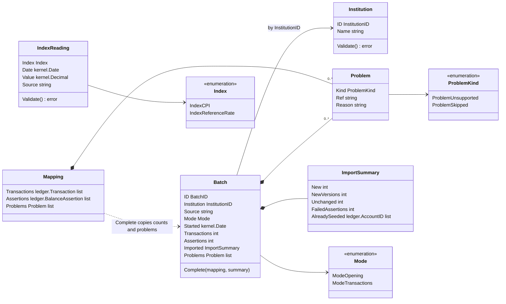
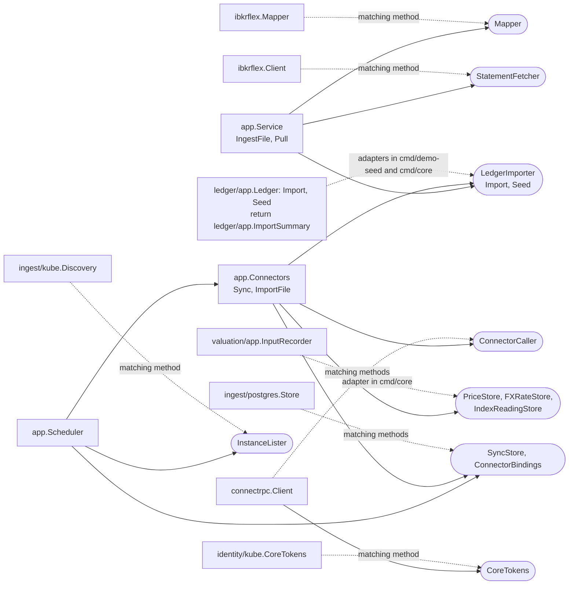
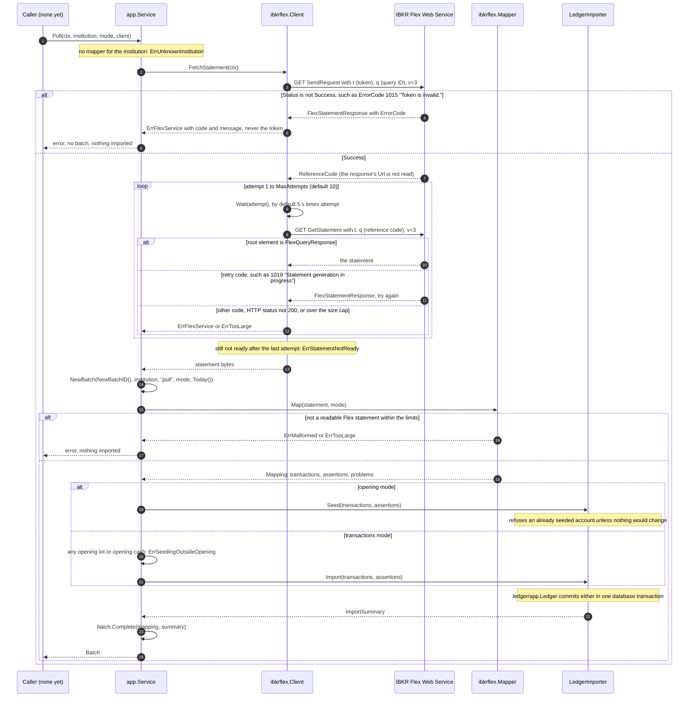
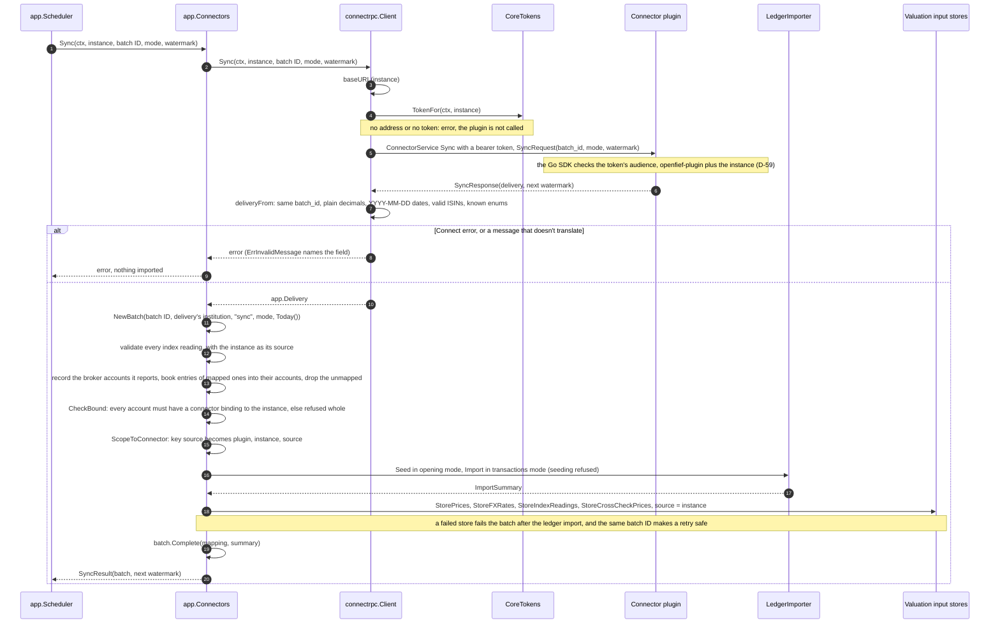
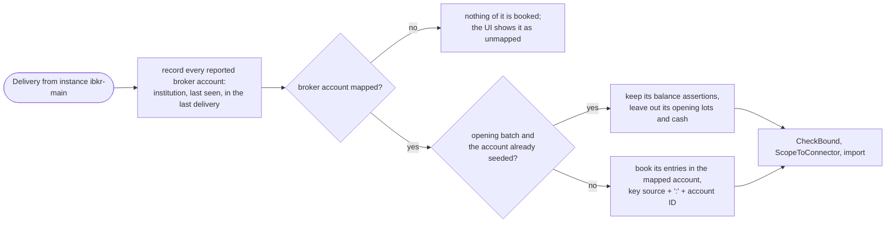
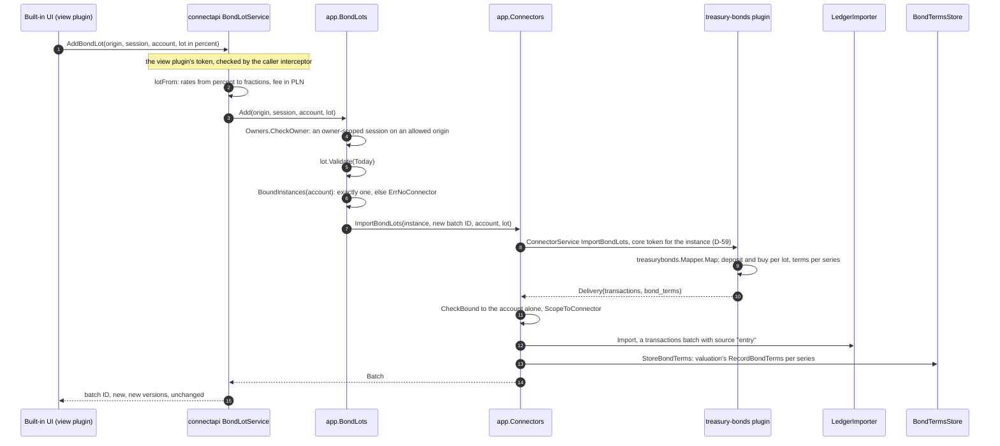
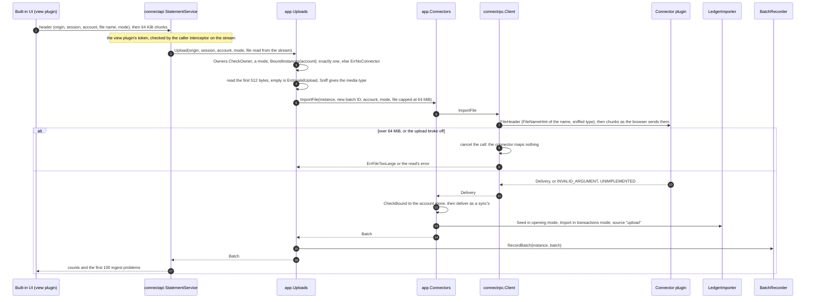
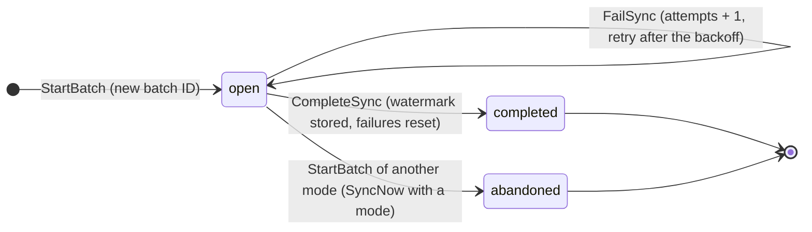
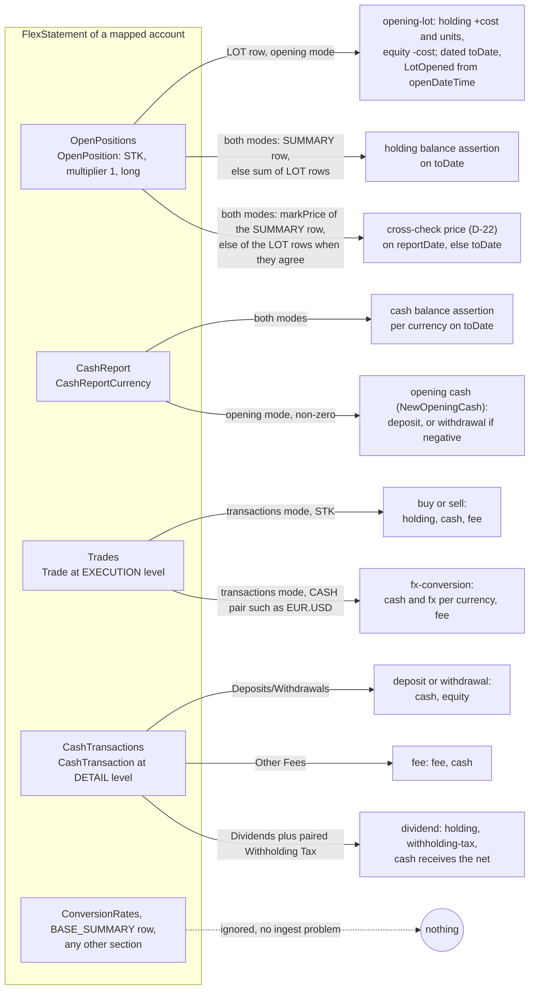

The ingest context is the only way data gets into OpenFief's ledger (D-7). A connector reads what an institution reports, translates it into ledger transactions and balance assertions, and lists every row it could not book. The core runs that either with a mapper compiled into it, as for IBKR Flex Query statements today, or by calling a connector plugin over its Connect contract (D-49). This page explains the concepts, shows what `internal/ingest` actually does, and points to the tests that prove it.

## Concepts

An [institution](../glossary.md) is a broker, bank or registry that holds assets: IBKR, XTB, the treasury bond registry. A [connector](../glossary.md) is the plugin that brings one institution's data in, by whatever the institution allows: a documented web service, an exported file, or manual entry (D-7). The core project ships only connectors that comply with the institution's terms (D-8).

What an institution reports about an account is a [statement](../glossary.md), such as an IBKR Flex Query or an xStation export. The way a statement reaches OpenFief is an *ingest path*: a file (uploaded, passed to the CLI, or dropped in a watched folder), a pull from the institution, or a sync with a connector plugin. D-7 makes these the only way in. The public read API never writes.

One run of an ingest path is an [import batch](../glossary.md). It records which institution the statement came from, by which path, when, in which [ingest mode](../glossary.md), and what came of it.

A [mapping](../glossary.md) is what a connector makes of one statement: [transactions](../glossary.md), [balance assertions](../glossary.md) and [ingest problems](../glossary.md). An ingest problem is a statement row the mapping left out of the ledger, with its reason. It is `unsupported` when OpenFief can't book the row yet, such as an option trade, and `skipped` when the row is left out on purpose, such as a summary row. A problem is not an error: the rest of the statement is still imported. An unsupported row's effect is missing from the ledger, though, so a balance assertion may fail until that row type is supported.

**Idempotent re-import.** Statements overlap: a daily pull re-reads days that were already imported. So every transaction carries a key: its source plus the institution's own ID for it, such as IBKR's `tradeID` (D-18). Importing the same content again changes nothing. Changed content under the same key becomes a new version that supersedes the old one, which is kept. The ledger does the versioning; the connector's job is to produce stable keys.

**Seeding, then transactions.** OpenFief does not replay an account's full history (D-23). At go-live, an `opening` batch [seeds](../glossary.md) the account from the institution's current state: one opening [lot](../glossary.md) per broker lot, with its original open date and cost, plus the [opening cash](../glossary.md), a deposit (or a withdrawal for a negative balance) against equity, keyed `opening-cash:<currency>:<date>` (D-33). An account whose current transactions include either is seeded, and the ledger refuses to seed it again unless nothing would change. After that, `transactions` batches import transactions from go-live on. Both modes import balance assertions.

**The connector contract.** A connector plugin serves the [connector contract](../glossary.md), `openfief.connector.v1.ConnectorService` in [connector.proto](../../proto/openfief/connector/v1/connector.proto). `Sync` pulls what the institution reported since a [watermark](../glossary.md) the connector returned last time. `ImportFile` maps one statement file. Each call is one import batch, with a batch ID the core generates and reuses on a retry. The answer is a [delivery](../glossary.md): the mapping, plus any end-of-day prices, FX rates, [index readings](../glossary.md) (CPI and the NBP reference rate, for treasury bonds) and [index levels](../glossary.md) (market indices such as WIG20). The core authenticates each call with a short-lived token whose audience is that plugin instance (D-59). It prefixes every delivered transaction's key source with `plugin:<instance>:`, so that no instance can write or supersede another's transactions (D-48).

**Anti-corruption layer.** Eric Evans described this pattern in *Domain-Driven Design* (2003): a translation layer at the boundary, so that a foreign model never leaks into your own. Here there are two boundaries. Each in-core adapter, such as `ibkrflex`, parses the institution's format and keeps IBKR words (position, trade, conid, Flex section and attribute names) to itself. The `connectrpc` adapter translates the contract's protobuf messages, so no generated type reaches the domain or the use cases ([code-organization.md](../dev/code-organization.md)).

**IBKR Flex Queries and the Flex Web Service.** A Flex Query is a query the account owner sets up in IBKR's portal: which sections (trades, open positions, cash) and which fields. IBKR returns the result as XML, `FlexQueryResponse > FlexStatements > FlexStatement`, with one `FlexStatement` per account and period and one element per row. The Flex Web Service fetches it with a read-only token, in two steps. `SendRequest` with the token and the query ID returns a reference code. `GetStatement` with that code returns the statement once IBKR has generated it; until then, it answers with an error code that means "try again". R-3 lists Flex Queries among IBKR's access paths.

## How it works

### Packages

| Package | What it holds |
|---|---|
| `internal/ingest` | Domain types: `Institution`, `Batch`, `Mode`, `Mapping`, `Problem`, `ImportSummary`, `IndexReading`, key scoping (`ConnectorKeySource`, `ScopeToConnector`), the [sync policy](../glossary.md), [connector bindings](../glossary.md) (`CheckBound`, `ValidateInstanceName`), [broker accounts](../glossary.md) (`BrokerAccountID`, `BrokerAccount`, `BrokerEntries`, `ResolveBrokerAccounts`) and an uploaded file's name hint (`FileNameHint`). Pure functions, no I/O. [batch.go](../../internal/ingest/batch.go), [brokeraccount.go](../../internal/ingest/brokeraccount.go), [problem.go](../../internal/ingest/problem.go), [index.go](../../internal/ingest/index.go), [scope.go](../../internal/ingest/scope.go), [schedule.go](../../internal/ingest/schedule.go), [binding.go](../../internal/ingest/binding.go), [file.go](../../internal/ingest/file.go) |
| `internal/ingest/app` | `Service`, which runs in-core mappers ([ingest.go](../../internal/ingest/app/ingest.go)), `Connectors`, which calls connector plugins ([connectors.go](../../internal/ingest/app/connectors.go)), `Scheduler`, which owns their syncs ([scheduler.go](../../internal/ingest/app/scheduler.go)), `Bind` ([bindings.go](../../internal/ingest/app/bindings.go)), the broker accounts' port `BrokerAccountStore` ([brokers.go](../../internal/ingest/app/brokers.go)), `Accounts`, the owner's account entries ([accounts.go](../../internal/ingest/app/accounts.go)), and `BondLots` and `Uploads`, which hand the owner's entries and files to a connector ([bondlots.go](../../internal/ingest/app/bondlots.go), [uploads.go](../../internal/ingest/app/uploads.go)), with the ports they need |
| `internal/ingest/kube` | `Discovery`: the running connector instances and their Services' addresses, from the operator's `Plugin` resources and Services through informers ([discovery.go](../../internal/ingest/kube/discovery.go)) |
| `internal/ingest/postgres` | The `ingest` schema: each instance's watermark and sync state, the import batch history, the connector bindings and the broker accounts ([store.go](../../internal/ingest/postgres/store.go), [brokers.go](../../internal/ingest/postgres/brokers.go), [migrations](../../internal/ingest/postgres/migrations/)) |
| `internal/ingest/connectrpc` | The core's client of the connector contract and the translation of its messages: [client.go](../../internal/ingest/connectrpc/client.go), [mapping.go](../../internal/ingest/connectrpc/mapping.go) |
| `internal/ingest/delivery` | The connector plugins' side of the contract, the reverse of `connectrpc`'s translation: `FromMapping` writes a mapping as a `Delivery`, `FXRates` writes FX rates, `Price` an end-of-day close of an instrument, `IndexLevel` a market index's closing level, `IndexReadings` monthly [index readings](../glossary.md) dated on their month's first day, and `Mode` reads a request's ingest mode ([delivery.go](../../internal/ingest/delivery/delivery.go)). The first-party plugins under [plugins/](../../plugins/) use it ([Plugins](plugins.md#first-party-plugins)) |
| `internal/ingest/treasurybonds` | The treasury bond connector's logic: `Mapper` turns the owner's [bond lots](../glossary.md) into deposits and buys, and `Instrument` derives a series' instrument ([mapper.go](../../internal/ingest/treasurybonds/mapper.go)); `IndexSync` picks the CPI and NBP reference-rate readings a sync delivers after its `IndexWatermark`, from the `CPISource` and `ReferenceRateSource` ports ([indices.go](../../internal/ingest/treasurybonds/indices.go), [Plugins](plugins.md#first-party-plugins)). The plugin [plugins/treasury-bonds](../../plugins/treasury-bonds/) serves it |
| `internal/ingest/connectapi` | The core's `openfief.ingest.v1.BondLotService` ([bond_lots.proto](../../proto/openfief/ingest/v1/bond_lots.proto)) `StatementService` ([statements.proto](../../proto/openfief/ingest/v1/statements.proto)) and `AccountService` ([accounts.proto](../../proto/openfief/ingest/v1/accounts.proto)), which the built-in UI calls with the owner's lots, statement files and accounts ([service.go](../../internal/ingest/connectapi/service.go), [statements.go](../../internal/ingest/connectapi/statements.go), [accounts.go](../../internal/ingest/connectapi/accounts.go)) |
| `internal/ingest/ibkrflex` | The IBKR adapter: bounded XML decoding ([decode.go](../../internal/ingest/ibkrflex/decode.go)), the `Mapper` ([mapper.go](../../internal/ingest/ibkrflex/mapper.go), [positions.go](../../internal/ingest/ibkrflex/positions.go), [cashreport.go](../../internal/ingest/ibkrflex/cashreport.go), [trades.go](../../internal/ingest/ibkrflex/trades.go), [cashtx.go](../../internal/ingest/ibkrflex/cashtx.go), [fields.go](../../internal/ingest/ibkrflex/fields.go)) and the Flex Web Service `Client` ([webservice.go](../../internal/ingest/ibkrflex/webservice.go)) |

The domain types, as declared in `internal/ingest`:

`NewBatch` refuses a batch without an ID, an institution, a source, a known mode or a start date (`ErrInvalidBatch`); the zero `Mode` is not a mode. `Batch.Complete` records the mapping's counts, the ledger's summary and a copy of the problems. `IndexReading.Validate` requires a known index, a date and a source, and a CPI reading dated on the first of its month (`ErrInvalidIndexReading`). `ScopeToConnector` returns copies of transactions whose key source is `plugin:<instance>:<source>`; an empty source stays empty, so the ledger still rejects it.

The ports are declared in `app`, by their consumer. `cmd/core` connects them for connector plugins: its `ledgerImporter` turns the ledger's summary into `ingest.ImportSummary` (as `cmd/demo-seed`'s `importer` does for `Service`), and its `valuationInputs` records prices, FX rates and index readings through valuation's `InputRecorder`, each index reading as the reading for the month of its date:

`identity/kube.CoreTokens` implements `CoreTokens` with the TokenRequest API ([Identity](identity.md)); `connectrpc.Client` gets each instance's address from `Discovery.BaseURL`.

### Running an in-core mapper

`Service` holds a `LedgerImporter`, a `Mappers` map from `InstitutionID` to `Mapper`, and injected `Today` and `NewBatchID` functions, so it never reads the clock. `IngestFile` takes an `io.Reader` and records the source `file` (`SourceFile`). `Pull` checks that the institution has a mapper, calls the `StatementFetcher`, and ingests the bytes with the source `pull` (`SourcePull`). Then both look up the mapper (`ErrUnknownInstitution` if none), start the batch with `NewBatch`, and `Map` the statement. `importMapping` then imports it by mode:

- An opening batch goes to `LedgerImporter.Seed`. The ledger refuses to seed an account that is already seeded (`ledger.ErrAlreadySeeded`), unless every incoming transaction of it is unchanged; then the summary lists it in `AlreadySeeded`.
- A transactions batch is refused with `ErrSeedingOutsideOpening` if any transaction seeds (`ledger.IsSeeding`: an opening lot, or a deposit or withdrawal keyed `opening-cash:`). Otherwise it goes to `LedgerImporter.Import`.

Last, `Complete` fills in the batch, which is returned to the caller. A failed fetch, map or import returns an error and no batch, and nothing reaches the ledger before the map succeeds.

The pull path end to end, with the IBKR adapter:

### Calling a connector plugin

`Connectors` runs connector plugins' ingest paths. Its caller supplies the instance name, the batch ID and, for a sync, the last watermark, and owns the schedule and the retries: a failed batch is retried with the same batch ID. `connectrpc.Client` resolves the instance's address with a `baseURL` function, such as its ClusterIP Service, asks `CoreTokens` for a fresh token, and calls the plugin over HTTP/2 without TLS (`H2CClient`). `ImportFile` streams a `FileHeader` (batch ID, mode, the owner's file name as a hint, media type) and then the file in 64 KiB chunks (`ChunkSize`). A file that can't be read to its end, such as an upload that broke off or passed its limit, cancels the call, so the connector never sees the end of the file and nothing is mapped. Like `ImportBondLots`, it answers a connector's `INVALID_ARGUMENT` with `ErrEntryRefused` and its reason, `UNIMPLEMENTED` with `ErrNoEntries`, and an instance it can't reach with `ErrConnectorUnavailable`. A sync, end to end:

The translation in [mapping.go](../../internal/ingest/connectrpc/mapping.go) refuses, with `ErrInvalidMessage` naming the field: a decimal with an exponent, grouping or a plus sign; a date that isn't `YYYY-MM-DD`; a malformed currency; an ISIN with a wrong check digit or an instrument without a symbol (D-35); a missing amount or delivery; any unspecified enum; a price or FX rate that isn't positive; and a delivery whose `batch_id` isn't the one asked for. The client never scopes keys; `Connectors` does. Every price, FX rate, index reading and index level gets the instance as its source, overwriting what the plugin sent. A delivery's `index_levels` become `valuation.IndexLevel` values, keyed by the index's name exactly as the connector sends it (`IndexLevel.index`, such as `WIG20`); a level without a name, a date or a positive value is refused like a bad price. `Connectors` hands them to its `IndexLevelStore` port, which `cmd/core` implements with valuation's `InputRecorder.RecordIndexLevels`; storing them enqueues no revaluation, since no holding is valued from an index.

A delivery's `cross_check_prices` are [cross-check prices](../glossary.md): an institution's own end-of-day prices, translated with the same rules as `prices` (`crossCheckPriceFrom`) but kept in their own field of `app.Delivery`, `CrossCheckPrices`. `Connectors` gives each the instance as its source and hands them to its `CrossCheckPriceStore` port, never to `PriceStore`, so they can't replace a market-data connector's price or value a holding (D-22). `cmd/core` implements the port with valuation's `CrossChecks.RecordCrossCheckPrices` ([Valuation](valuation.md#cross-checking-prices)). A `Connectors` without that store refuses a delivery that carries some (`ErrNoCrossCheckStore`) rather than drop them; the bond-lot path has none, since bond lots carry no prices.

### Connector bindings

A connector instance writes only to the accounts the owner bound it to. A [connector binding](../glossary.md) pairs an instance name with a ledger account ID, and `app.Bind` adds one after checking the name (`ValidateInstanceName`: a Plugin's name, a lower-case DNS label of at most 56 characters) and that the account is stored. Before anything is imported, `Connectors.deliver` loads the instance's bindings and `CheckBound` refuses the whole delivery, with an `*UnboundAccountsError` (`ErrAccountNotBound`) naming every other account, if any transaction or balance assertion is in an account the instance isn't bound to. A delivery with only prices, FX rates or index readings, such as a market-data connector's, needs no binding. Key scoping (D-48) keeps instances from overwriting each other's transactions; the binding keeps an instance from writing into an account at all.

### Broker accounts

A broker connector doesn't know OpenFief's accounts; it knows the institution's own, such as the IBKR accounts a Flex Query reports. D-72 has it report those [broker accounts](../glossary.md) and lets the owner map each to an OpenFief account in the built-in UI, so the owner never types a broker account number into a plugin's config. The contract carries that as additions ([connector.proto](../../proto/openfief/connector/v1/connector.proto)): a transaction or balance assertion may set `broker_account` instead of `account_id`, never both, and a delivery lists every broker account it saw in `broker_accounts`, including those with nothing to book. The key source of an entry named by broker account names no account; the core appends `:` and the OpenFief account ID, so the keys stay per account, the same keys a connector that knew the account would write.

- **Translation.** `connectrpc` puts the entries named by broker account apart in `Mapping.ByBrokerAccount` (`BrokerEntries`: the broker account, its transactions and assertions, in no account yet) and the listed accounts in `Mapping.BrokerAccounts`. A broker account must be 1 to 64 printable characters without spaces (`BrokerAccountID.Validate`); an entry naming both accounts, or a malformed broker account, refuses the delivery with `ErrInvalidMessage`. `delivery.FromMapping` writes them the same way on the plugin's side.
- **Resolution.** `Connectors` first records every broker account the delivery reports through its `BrokerAccountStore` port, with the delivery's institution and today's date, so a delivery refused later still shows them; then `ingest.ResolveBrokerAccounts` books the entries of each mapped broker account into its OpenFief account and drops those of an unmapped one (D-72). Only then do `CheckBound` and, for an upload or a bond lot, the check that every entry is in the owner's account run. A `Connectors` without the store refuses a delivery that names broker accounts (`ErrNoBrokerAccountStore`) rather than drop it.
- **Seeding.** A connector usually syncs before the owner maps its broker accounts, and an opening batch then seeds nothing. So an instance counts as seeded only while every broker account mapped for it is seeded too: mapping one makes the next sync an opening batch again (D-23). That batch seeds it, `MarkSeeded` records it, and in a later opening batch the opening lots and opening cash of broker accounts already seeded are left out while their balance assertions are kept, because the ledger refuses to seed an account again with changed content.
- **Storage.** `postgres.Store` keeps them in `ingest.broker_accounts` ([0003_broker_accounts.sql](../../internal/ingest/postgres/migrations/0003_broker_accounts.sql)): instance, broker account, institution, the mapped account and when, last seen, in the last delivery, seeded. `MapBrokerAccount` maps one only if its instance reported it (`ErrUnknownBrokerAccount`) and it isn't mapped to another account (`ErrBrokerAccountMapped`). Unlike the rest of the schema this holds account numbers: they are shown to the owner and never logged. `ClaimSync` works the seeding out in SQL.

### The owner's accounts

D-72 has the owner create accounts in the built-in UI: institution, name, sleeve, and the connector instance that feeds the account, with, for a broker connector, the broker account it is, picked from those the connector reported. D-79 makes accounts their own owner service: `openfief.ingest.v1.AccountService` ([accounts.proto](../../proto/openfief/ingest/v1/accounts.proto)), served to view plugins only with the `BondLotService`'s conventions.

| Method | What it does |
|---|---|
| `CreateAccount` | An account whose ID is made from its name (`portfolio.KeyFromName`), in a stored sleeve; with a connector instance, a connector binding to it (`Bind`); with a broker account, its mapping to the new account. An empty institution takes the broker account's |
| `UpdateAccount` | A new name or sleeve; ID and institution stay |
| `BindAccount` | What `core connector bind` does, from the UI, with a broker account mapped too when one is picked |

`app.Accounts` ([accounts.go](../../internal/ingest/app/accounts.go)) checks the owner, then everything it can before it stores anything: a free ID, a stored sleeve, a valid instance name (`ValidateInstanceName`), and that the instance reported the broker account and it isn't mapped to another account. It then saves the account through its `AccountLedger` port (`*ledgerapp.Ledger`), binds and maps through the ingest store. The three writes are separate and each is idempotent, so a failure between them leaves nothing a retry can't finish. `connectapi.NewAccounts` ([accounts.go](../../internal/ingest/connectapi/accounts.go)) maps a malformed entry or an unknown sleeve to `INVALID_ARGUMENT`, a taken ID to `ALREADY_EXISTS`, an unknown account to `NOT_FOUND`, a broker account never reported or mapped elsewhere to `FAILED_PRECONDITION`; its texts never carry the broker account number.

### Treasury bond lots

Neither the treasury bond registry nor the bank that sells the bonds offers an API (R-5), so D-9 makes manual entry the bonds' ingest path: the owner types each [bond lot](../glossary.md), its series code, quantity and purchase date, in the built-in UI. D-49 sends it through the core to the right connector, so it enters the ledger like any other delivery, as an import batch of a connector instance with keys scoped to it. Valuing a lot needs its series' [terms](../glossary.md) (first-period rate, margin, early-redemption fee) as well, which D-9 doesn't list; the owner enters them with the lot, from the series' issue letter ([Treasury bonds](treasury-bonds.md#series-terms)).

- **The rules of a lot** are `ingest.BondLot.Validate` ([bondlot.go](../../internal/ingest/bondlot.go)), pure and shared by the core and the connector: a purchase date no later than today, a margin of zero or more, and a lot that `pl.ValueLot` can value on its purchase date as a cash purchase. That last one refuses an unknown bond type, a purchase date whose maturity misses the series' month, a quantity that isn't a positive whole number, and a negative rate or fee. The core checks it before calling the connector, so the owner gets the reason even when the connector is down, and the connector checks it again before mapping.
- **The right connector** is the one instance bound to the lot's account ([connector binding](../glossary.md)): `app.BondLots` asks `AccountBindings.BoundInstances` (`postgres.Store.BoundInstances`) and refuses an account with none or several (`ErrNoConnector`). The delivery must stay in that one account, or nothing is imported.
- **The owner only.** `BondLotService` follows the model portfolio's `ModelPortfolioService` ([Portfolio](portfolio.md)): served to view plugins only, with the owner's session and the browser's origin in the request, checked through the `Owners` port, which `cmd/core` implements over the identity context.
- **The mapping** (`treasurybonds.Mapper.Map`) books each lot as two transactions on its purchase date in the account the instance's config names: a deposit of its cost against equity, quantity times the 100 PLN nominal, and the buy of the bonds for that cost. The account's cash stays at zero, and the money counts as entering the portfolio on the day the bonds were bought, as a deposit does for the time-weighted return (D-61). The keys are `lot:<series>:<purchase date>:deposit` and `:buy` under the source `treasury-bonds:<account>`, so entering a lot of the same series and day again with another quantity is a new version that supersedes it (D-18). One series twice on one day, or with two sets of terms, in one batch is refused.
- **The instrument.** The owner enters only the series code, and the issuer's offer pages and interest tables name series by code, so `treasurybonds.Instrument` derives the instrument: the series code as its venue symbol, and as its ISIN `PL`, the code, `00` and the check digit that makes it valid, such as `PLEDO0536000`. It is stable, so every lot of a series is one holding, and its `PL` prefix and series symbol make the views count it as a treasury bond. It is not the ISIN the registry may have assigned (see [Decisions](#decisions)).
- **Valuation.** The delivery's `bond_terms` reach valuation's `InputRecorder.RecordBondTerms` through the `BondTermsStore` port, so holdings of the instrument are valued as bonds by the existing rules (`ValueBondHolding`, [Valuation](valuation.md#valuing-one-holding)), and their accounts revalued from their first transaction. Recording a series' terms again replaces them.
- **Errors** reach the owner as Connect codes: no valid session `UNAUTHENTICATED`; a read-scoped session or another origin `PERMISSION_DENIED`; a broken rule, or the connector's own refusal (`ErrEntryRefused`, with its reason), `INVALID_ARGUMENT`; an account without its one connector, or a connector that takes no bond lots (`ErrNoEntries`, its `UNIMPLEMENTED`), `FAILED_PRECONDITION`; a connector that can't be reached (`ErrConnectorUnavailable`) `UNAVAILABLE`; anything else `INTERNAL`, logged without amounts and shown without its cause.

### Statement uploads

D-49 sends the files the owner uploads in the built-in UI through the core to the right connector, so a statement enters the ledger as an import batch of a connector instance, through its ingest path (D-7). The connector decides which files it takes: the IBKR Flex connector maps Flex Query statements, and one that takes no files answers `UNIMPLEMENTED`.

- **Streamed end to end.** The UI reads the browser's multipart body in chunks and streams them to the core over Connect (a client stream works over the HTTP/1.1 the UI uses); `connectapi` hands the stream to the use case as a reader that receives chunk after chunk, and `connectrpc.Client` streams it on to the plugin. No file is stored on disk, and no hop holds more than a chunk or two, until the plugin, which reads the whole statement to map it.
- **Limits.** A file may be up to 64 MiB (`DefaultMaxUploadBytes`), the IBKR Flex parser's own limit and the largest any connector takes today; one stream message at most 1 MiB. The cap counts bytes as they are read, so a larger file is cut off at the first byte past it, whatever the browser declared.
- **What the connector learns of the file.** Its bytes, the mode the owner picked, the last element of its name cleaned by `ingest.FileNameHint` (no directories, control characters or invalid UTF-8, at most 255 bytes), and a media type sniffed from its first 512 bytes (`http.DetectContentType` in `cmd/core`) in place of the one the browser declared. Both are hints the connector may ignore; the ibkr-flex plugin reads the content only.
- **The right connector** is the one instance bound to the account, as for bond lots, and the delivery must stay in that account (`CheckBound`), or nothing is imported.
- **The mode** is the owner's: `opening` seeds the account at go-live (D-23), and the ledger refuses to seed a seeded account again unless nothing would change; `transactions` refuses opening lots and opening cash.
- **Errors** reach the owner as Connect codes: no valid session `UNAUTHENTICATED`; a read-scoped session or another origin `PERMISSION_DENIED`; no header first, a second header, no mode, an empty file, opening lots in a transactions upload, or the connector's own refusal (with its reason) `INVALID_ARGUMENT`; a file over 64 MiB or a message over 1 MiB `RESOURCE_EXHAUSTED`; an account without its one connector, a connector that takes no files, or an account already seeded `FAILED_PRECONDITION`; a connector that can't be reached `UNAVAILABLE`; anything else `INTERNAL`, logged and shown without its cause.

**The batch history.** `postgres.Store.RecordBatch` records each completed upload and bond lot entry in `import_batches` with the source `upload` or `entry`, its mode, institution and counts, started and finished at the time it is recorded, after one attempt; the second migration widens the table's source check for them. Recording a batch ID twice fails, and a recorded batch never touches the instance's sync state (watermark, seeded flag, open batch). A refused or failed upload or entry imports nothing and is not recorded.

### Scheduling syncs

The core owns the schedules, retries and import batches (D-49). `Scheduler` syncs each running connector instance when it is due:

- `InstanceLister` names the instances that run now. An instance that is uninstalled is no longer listed, so it is no longer synced, and its watermark, batches and bindings stay, so reinstalling it under the same name continues from them (D-58).
- The [sync policy](../glossary.md) (`ingest.SyncPolicy`) sets when: every `Interval` after a success, plus a random jitter of up to `Jitter`, and after a failure again after `RetryFirst`, doubled for each consecutive failure, up to `RetryMax`. An instance that was never synced is due at once.
- One sync per instance at a time: in the process, `Scheduler` tracks the instances it is syncing; across core replicas, `SyncStore.ClaimSync` claims the instance until the attempt's timeout plus a minute, so a crashed attempt's claim lapses.
- A failed attempt leaves its import batch open, and the next attempt retries it with the same batch ID and mode, as the connector contract requires. The first batch of an instance is an `opening` batch; once one completes, the instance is seeded and later batches are `transactions` batches (D-23). `SyncNow` runs one attempt at once and can ask for a mode, which abandons an open batch of the other mode.
- Each attempt has a timeout for the call and the import together. Its outcome is recorded even when the context ended meanwhile.

**Two transactions, in a safe order.** The ledger import and the valuation inputs are stored in separate database transactions, the ledger first. If storing the inputs fails, the batch fails with the transactions already imported. The retry delivers the same batch again: the ledger finds every transaction unchanged (D-18), and prices, FX rates and index readings replace the rows stored under the same key. The watermark is stored only by `CompleteSync`, after both steps, in the same database transaction that marks the batch completed, so a sync is never skipped.

**Finding the instances.** `kube.Discovery` watches, with client-go informers in the `openfief` namespace, the `Plugin` resources (read as unstructured data, so ingest doesn't depend on the operator's Go types) and the Services labelled `app.kubernetes.io/name: openfief-plugin`. An instance runs when its `Plugin` is not being deleted, its `Ready` condition is `True`, its `status.effective.capabilities` include `connector`, and its Service, found by the label `openfief.io/plugin: <name>`, has a ClusterIP and a port named `connect`. The core calls `http://<ClusterIP>:<port>`, with no DNS lookup. The names are the operator's runtime contract; a test checks them against `internal/plugins/operator`.

**In the core.** `cmd/core serve` runs the scheduler when `--connectors` is on, by default inside a cluster: it starts the informers and the scheduler in the background, ticks every minute, and stops with the process, recording what was in flight. Discovery that can't reach the API server, or a sync that fails, never affects `/readyz`. The flags are `--sync-every` (6h), `--sync-jitter` (30m), `--sync-retry-first` (5m), `--sync-retry-max` (1h), `--sync-timeout` (5m) and `--service-account` (`openfief-core`). `core connector bind --instance NAME --account ID` adds a connector binding, as the UI's `BindAccount` does; `core connector sync --instance NAME [--mode opening|transactions]` syncs one instance now, as the scheduler would, and prints the batch's counts. Batch IDs are `b-` and 16 random hex digits.

`internal/ingest/postgres` keeps this in the `ingest` schema, migrated by its own runner and advisory lock: `connector_instances` (watermark, seeded, failures, next sync, claim, open batch), `import_batches` (instance, source, mode, state, attempts, and the completed batch's counts; syncs, and the uploads and entries `RecordBatch` adds), `connector_bindings` and `broker_accounts` ([Broker accounts](#broker-accounts)). Apart from the broker accounts it holds IDs, counts and times only, never an amount or an account number. An instance's claim counts it as seeded only while every broker account mapped for it is seeded.

### The Flex Web Service client

`ibkrflex.Client` sends the token only as the `t` query parameter, next to `q` and `v=3`, and only to `SendRequestURL` and `GetStatementURL`, which default to IBKR's documented endpoints. `serviceResponse` has no field for the statement URL in IBKR's reply, so the token never follows it elsewhere. Errors name the request path, never the URL that carries the token. `SendRequest` is not retried. `GetStatement` is retried only on the codes in `retryCode` (1001, 1004 to 1009, 1018, 1019, 1021). A `SendRequest` response is capped at 64 KiB, and a `GetStatement` response at `MaxBytes`, by default the parser's 64 MiB. `Wait` is injectable, so tests never sleep, and a cancelled context stops the wait. The `HTTP` field's comment says it should reach IBKR through the egress proxy (D-32); the client doesn't check that.

### Mapping a Flex statement

`ibkrflex.Mapper` has two fields: `Accounts`, which maps an IBKR account ID to the ledger account it feeds, and `Limits`. `Map` refuses an unknown mode (`ErrUnknownMode`), decodes the XML, then maps each `FlexStatement`. A statement for an account not in `Accounts` becomes one skipped problem. A statement without a readable `toDate` fails the whole map with `ErrMalformed`. The `toDate`, the statement's last day, dates every balance assertion; in opening mode it is also the go-live date. Four sections are read, in this order:

In opening mode every `Trades` and `CashTransactions` row becomes a skipped problem, because the opening lots and opening cash already hold its effect. Only instruments that appear in `OpenPositions` get a holding balance assertion.

Each instrument in `OpenPositions` also gives IBKR's own price of it, its `markPrice`, as a [cross-check price](../glossary.md) in the mapping's `CrossCheckPrices` (D-22), in the row's `currency` and dated by its `reportDate`, or the statement's `toDate` without one. The SUMMARY row's mark wins; without one, the LOT rows' marks must all be equal, or the instrument gets no cross-check price and a skipped problem (`OpenPositions[isin=…]`). A row without `markPrice` gives none, and one whose `markPrice` is unreadable or not positive gives a skipped problem; either way the position is still asserted. The mapper reads no other price: not `tradePrice`, not `costBasisPrice`, not `closePrice`. `delivery.FromMapping` writes the cross-check prices into the delivery's `cross_check_prices`, never into its `prices`. A zero cash balance still gets a cash assertion but no opening cash transaction.

The keys the adapter writes. Every source is `SourcePrefix` plus the ledger account ID, such as `ibkr-flex:acc-ibkr`, never the IBKR account number:

| Transaction kind | External ID | Date |
|---|---|---|
| buy, sell, fx-conversion | `tradeID` | `tradeDate`, else `dateTime` |
| deposit, withdrawal, fee, dividend | `transactionID`; a withholding row is booked under its dividend's | `dateTime`, else `reportDate` |
| opening-lot | `opening-lot:<ISIN>:<open date>:<originatingTransactionID>`, or `n1`, `n2` in row order among that instrument's lots opened that day | `toDate` |
| opening cash (deposit or withdrawal) | `ledger.OpeningCashID`: `opening-cash:<currency>:<toDate>` | `toDate` |

Withholding tax is paired with its dividend by `pairWithholding`: the same `actionID` when both rows have one, otherwise the same ISIN, currency and date. Several withholding rows of one dividend add up. A withholding row with no dividend, more than one, or a zero or positive amount becomes an unsupported problem.

Rows the mapper won't book become problems, never errors. Unsupported: asset categories other than `STK` (and `CASH` in `Trades`); a contract multiplier other than 1; short or zero holdings; transaction types other than `ExchTrade`, `BookTrade`, `FracShare` or none; a side that disagrees with the quantity's sign; commission or tax credits; commission and taxes in two currencies; cash transaction types other than the four above; fee refunds; dividend reversals; a missing or unreadable attribute (named, its value not kept); and a transaction the ledger rejects, whose reason is cut to "not a valid ledger transaction" because ledger errors can carry amounts. Skipped: an unexpected element in a section (such as `Order` or `Lot` in `Trades`), a level of detail that isn't read (such as `CLOSED_LOT` in `OpenPositions` or `SUMMARY` in `CashTransactions`), and opening-mode activity rows. A problem's `Ref` names the statement, section, 1-based row and the IBKR ID when there is one, such as `FlexStatement#1/Trades#8[tradeID=9000106]`. It never holds an amount or an account number (GR-12).

Dates are read as `yyyyMMdd` or `yyyy-MM-dd`, optionally followed by `;`, `,`, space or `T` and a time, which is dropped without any time zone conversion. Amounts and quantities are exact decimals in plain notation, at most 40 digits. Exponents are refused, and nothing goes through `float64`.

### Hostile statements

DESIGN §3.7 lists malicious statement files as a threat. `decode` reads with `encoding/xml` in strict mode and refuses any `DOCTYPE` or other directive, undeclared entities, non-UTF-8 input and any root other than `FlexQueryResponse`. Anything malformed is `ErrMalformed`. Anything over a limit is `ErrTooLarge`, and either way the map fails before anything is imported. The limits are fields of `Limits`; a zero field takes its default: `MaxBytes` 64 MiB, `MaxDepth` 16, `MaxElements` 500,000, `MaxAttrs` 512 per element, `MaxAttrLen` 4,096 bytes.

## Decisions

- **D-7** Only connector ingest paths: `Service` (file, pull) and `Connectors` (sync, upload, entry).
- **D-11** Connector contract in protobuf, called over Connect RPC.
- **D-18** Keys from source plus institution IDs; reported balances become assertions.
- **D-19** Double-entry postings, built by the ledger's constructors.
- **D-20** Amounts keep their currency; IBKR's `ConversionRates` are ignored.
- **D-23** Opening batches seed; a seeded account isn't seeded twice.
- **D-33** Opening cash is booked against the equity ledger account.
- **D-34** Trade fees go to the fee ledger account.
- **D-35** Instruments need a valid ISIN and a venue symbol.
- **D-48** Each instance's transaction keys are scoped to `plugin:<instance>:`, and each instance writes only to the accounts it is bound to.
- **D-49** The core calls connectors, one batch per call, and `Scheduler` owns their schedules and retries, with the batches and watermarks in the `ingest` schema. Manual bond lots and uploaded statement files go through the core to the connector bound to their account (`BondLots`, `ImportBondLots`; `Uploads`, `ImportFile`), and are recorded in the batch history.
- **D-9** Treasury bonds through manual lot entry, with valuation computed: the lot's series, quantity and purchase date, plus its series' terms.
- **D-58** An uninstalled instance is no longer synced; its state and data stay.
- **D-59** A fresh core token per call, with the instance as audience.
- **D-32** Partly: the Flex client expects the egress proxy, but doesn't enforce it.

Where the code differs from a decision, a requirement or the glossary:

- **D-23, transactions from go-live.** `transactions` mode books every row in the statement. Nothing compares row dates with go-live, so a statement whose period overlaps the opening statement's would book those rows on top of the opening lots. [problem.go](../../internal/ingest/problem.go) gives "a transaction before go-live" as an example of a skipped row, but no code produces one.
- **D-49, uploads.** These are this context's narrow readings, not decisions, and the author hasn't reviewed them:
  - The right connector is the one instance bound to the account; with none or several the upload is refused, and the delivery must stay in that account.
  - The owner picks the mode of each upload; nothing infers whether a statement seeds the account.
  - The limit is 64 MiB, and the stream a client stream rather than one bounded message.
  - Only completed uploads and entries are recorded in the batch history, and recording an opening upload doesn't mark the instance seeded for its syncs.
- **D-9, bond lots.** These are this context's narrow readings, not decisions, and the author hasn't reviewed them:
  - A lot also carries its series' terms, since D-9's three fields can't be valued without them; the owner re-enters them with each lot of a series, and the last entered replace the earlier.
  - A lot is a deposit and a buy on its purchase date, not an opening lot at go-live (D-23): the ledger refuses to seed an account twice, so lots entered one by one can't each be opening lots. A lot bought before the portfolio's first other transaction therefore moves go-live, and the value-over-time line, back to it.
  - A lot is bought for cash at the nominal. A purchase by exchange at 99.90 PLN, whose discount is taxed (see the [exchange price](../glossary.md)), can't be entered yet.
  - The instrument's ISIN is derived from the series code, not the one the registry may assign, so a later import of the bond service's own export (OQ-22) must use the same derivation or hold the same series twice. D-35 asks for "an ISIN with a valid check digit", which the derived one has.
  - Re-entering a lot of the same series and day replaces it; there is no way to remove a lot.
- **Index readings.** Valuation keeps one reading per index and month, and `cmd/core` records each reading for the month of its date. The treasury-bonds connector dates each reference-rate reading on the first day of the month whose interest periods it sets, holding the rate in force on that month's reference-rate day, so the mapping is exact; the contract's comment on `IndexReading.date` says so. A connector that sent the day a rate takes effect instead would make it the reading of that whole month.
- **IBKR.** The IBKR code stays a package, `internal/ingest/ibkrflex`; the plugin [plugins/ibkr-flex](../../plugins/ibkr-flex/) serves it to the core.
- **Ingest problems.** The glossary and [doc.go](../../internal/ingest/ibkrflex/doc.go) say rows that aren't booked become ingest problems. Rows in sections the mapper doesn't read, and the `BASE_SUMMARY` cash row, are dropped silently.
- **Glossary names.**
  - There is no `ingest.Connector` type.
  - `ImportSummary` exists twice, in `ingest` and `ledger/app`, with different fields.
  - The glossary defines "Index reading" twice, as `ingest.IndexReading` and `valuation.IndexReading`.

## Verification

Run every test with `task test`, or only this context with `go test ./internal/ingest/...`. All of these run offline.

| Behavior | Tests | kibi |
|---|---|---|
| Batches, institutions and index readings validate; `Complete` copies the problems | [batch_test.go](../../internal/ingest/batch_test.go): `TestNewBatch`, `TestBatchComplete`, `TestInstitutionValidate`; [index_test.go](../../internal/ingest/index_test.go): `TestIndexReadingValidate` | REQ-ingest-batch-record, REQ-ingest-index-reading-valid |
| Keys are scoped to the instance | [scope_test.go](../../internal/ingest/scope_test.go): `TestConnectorKeySource`, `TestScopeToConnector` | REQ-ingest-instance-scoped-keys, TEST-ingest-scope |
| An in-core path maps once and imports once; failures import nothing | [ingest_test.go](../../internal/ingest/app/ingest_test.go): `TestIngestFile`, `TestIngestFileFailures`, `TestPull`, `TestPullFailures` | REQ-ingest-app-ingest-path, TEST-ingest-app |
| Opening batches seed, transactions batches with seeding transactions are refused | ingest_test.go: `TestIngestSeedsOnlyInOpeningMode` | REQ-ingest-app-seed-opening-only, TEST-ingest-app |
| Sync and file import through a plugin: scoped keys, sourced inputs, cross-check prices kept apart, failures | [connectors_test.go](../../internal/ingest/app/connectors_test.go): `TestConnectorsSync`, `TestConnectorsCrossCheckPrices`, `TestConnectorsImportFile`, `TestConnectorsFailures` | REQ-ingest-connector-batches, REQ-ingest-cross-check-prices, TEST-ingest-app-connectors |
| A delivery naming an unbound account is refused whole; plugin opening batches seed | [bound_test.go](../../internal/ingest/app/bound_test.go): `TestConnectorsRefuseUnboundAccounts`, `TestConnectorsSeedOnlyInOpeningMode`; [binding_test.go](../../internal/ingest/binding_test.go): `TestCheckBound`, `TestValidateInstanceName` | REQ-ingest-connector-binding, TEST-ingest-app-bound, TEST-ingest-binding |
| Syncs run when due, retry the same batch with a backoff, one at a time, only for listed instances | [scheduler_test.go](../../internal/ingest/app/scheduler_test.go): `TestSchedulerSyncsWhenDue`, `TestSchedulerRetriesWithTheSameBatch`, `TestSchedulerSyncsOnlyListedInstances`, `TestSchedulerSingleFlight`, `TestSchedulerSyncNow`, `TestSchedulerTimeout`; [schedule_test.go](../../internal/ingest/schedule_test.go): `TestSyncPolicyNextSync` | REQ-ingest-scheduler-due, REQ-ingest-scheduler-retry, REQ-ingest-scheduler-single-flight, TEST-ingest-app-scheduler, TEST-ingest-schedule |
| Running instances and their addresses come from Plugins and Services, and changes are watched | [discovery_test.go](../../internal/ingest/kube/discovery_test.go): `TestDiscovery`, `TestServiceAddress`, `TestOperatorContract` | REQ-ingest-discovery, TEST-ingest-kube |
| The core binds, syncs through a real Connect server with its token, refuses an unbound instance, and runs the scheduler on serve (`task test:pg`) | [connectors_test.go](../../cmd/core/connectors_test.go): `TestConnectorBindAndSync`, `TestServeSchedulesConnectors` | REQ-core-connector-commands, TEST-core-connectors |
| Broker accounts validate; mapped ones are booked with the account in the key, unmapped ones are not, and an opening batch seeds a newly mapped one only | [brokeraccount_test.go](../../internal/ingest/brokeraccount_test.go): `TestBrokerAccountIDValidate`, `TestResolveBrokerAccounts`, `TestReportedBrokerAccounts` | REQ-ingest-broker-account-resolve, REQ-ingest-broker-account-seeding, REQ-ingest-unmapped-broker-account, TEST-ingest-broker-accounts |
| Connectors record the reported broker accounts and book only the mapped ones, from a sync or an upload | [brokers_test.go](../../internal/ingest/app/brokers_test.go): `TestConnectorsResolveBrokerAccounts`, `TestConnectorsBrokerAccountsNeedAStore`, `TestConnectorsImportFileByBrokerAccount` | REQ-ingest-broker-account-record, REQ-ingest-broker-account-choice, TEST-ingest-app-brokers |
| Entries named by broker account cross the contract apart; both accounts or a malformed one refused | [brokers_test.go](../../internal/ingest/connectrpc/brokers_test.go): `TestDeliveryFromByBrokerAccount`; `TestDeliveryFromRejects`; `TestFromMappingByBrokerAccount` in [delivery_test.go](../../internal/ingest/delivery/delivery_test.go) | REQ-connector-broker-accounts, TEST-ingest-connectrpc-brokers |
| A Flex statement mapped by IBKR account resolves to exactly what the configured mapper books | [brokers_test.go](../../internal/ingest/ibkrflex/brokers_test.go): `TestMapByBrokerAccount` | REQ-ingest-ibkrflex-by-broker-account, TEST-ingest-ibkrflex-brokers |
| Broker accounts, their mapping and seeding in PostgreSQL; a newly mapped account makes the instance unseeded (`task test:pg`) | [brokers_test.go](../../internal/ingest/postgres/brokers_test.go): `TestBrokerAccountStore`, `TestBrokerAccountsReseedTheInstance` | REQ-ingest-broker-account-record, REQ-ingest-broker-account-seeding, TEST-ingest-postgres-brokers |
| The owner's accounts: IDs from names, sleeve and instance checks, broker accounts reported and free, binding and mapping, owner only, each failure with its code | [accounts_test.go](../../internal/ingest/app/accounts_test.go): `TestAccountsCreate`, `TestAccountsUpdateAndBind`, `TestAccountsOwnerOnly`; [connectapi accounts_test.go](../../internal/ingest/connectapi/accounts_test.go): `TestAccountServiceRoundTrip`, `TestAccountServiceErrors`; `TestOnboardingServices` in [cmd/core](../../cmd/core/onboarding_test.go) (`task test:pg`) | REQ-ingest-account-service, REQ-ingest-owner-creates-accounts, TEST-ingest-app-accounts, TEST-ingest-connectapi-accounts, TEST-core-onboarding |
| Watermarks, claims, batch history and bindings in PostgreSQL (`task test:pg`) | [store_test.go](../../internal/ingest/postgres/store_test.go): `TestSyncStoreLifecycle`, `TestSyncStoreClaimExpires`, `TestSyncStoreStartBatchAbandonsTheOpenOne`, `TestBindingStore` | REQ-ingest-sync-store, TEST-ingest-postgres |
| The client calls a real Connect server over h2c with a fresh bearer token; streams files in chunks | [client_test.go](../../internal/ingest/connectrpc/client_test.go): `TestClientSync`, `TestClientImportFile`, `TestClientFailures` | REQ-ingest-core-authenticates-to-connector, TEST-ingest-connectrpc-client |
| Contract messages translate, malformed ones are refused | [mapping_test.go](../../internal/ingest/connectrpc/mapping_test.go): `TestDeliveryFrom`, `TestDeliveryFromRejects`, `TestValuationInputsFrom`, `TestValuationInputsFromRejects`, `TestPlainDecimal`, `TestModeTo` | REQ-ingest-connector-contract-translation, REQ-ingest-cross-check-prices, TEST-ingest-connectrpc-mapping |
| A plugin's mapping, FX rates, prices, index levels, cross-check prices and mode are written as contract messages with exact decimal strings; values without a contract form are refused | [delivery_test.go](../../internal/ingest/delivery/delivery_test.go): `TestFromMapping`, `TestFromMappingRefuses`, `TestFromMappingIBKRStatement`, `TestFXRates`, `TestPriceAndIndexLevel`, `TestIndexReadings`, `TestMode` | REQ-ingest-delivery-contract-messages, REQ-ingest-delivery-market-data, REQ-ibkrflex-cross-check-prices, REQ-treasurybonds-index-sync, TEST-ingest-delivery |
| A bond lot is booked only when it can be valued on its purchase date, no later than today | [bondlot_test.go](../../internal/ingest/bondlot_test.go): `TestBondLotValidate`, `TestBondLotCost` | REQ-ingest-bond-lot-rules, TEST-ingest-bondlot |
| A bond lot becomes a deposit and a buy of its cost, keyed by series and day; terms once per series; a derived, stable instrument | [mapper_test.go](../../internal/ingest/treasurybonds/mapper_test.go): `TestInstrument`, `TestMap`, `TestMapKeepsKeysAcrossReEntry`, `TestMapRefuses` | REQ-treasurybonds-lot-mapping, TEST-treasurybonds-mapper |
| The index sync delivers CPI and reference-rate readings after each index's watermark | [indices_test.go](../../internal/ingest/treasurybonds/indices_test.go): `TestIndexWatermark`, `TestReferenceReadings`, `TestIndexSyncReadings`, `TestIndexSyncReadingsFails` | REQ-treasurybonds-index-sync, TEST-treasurybonds-indices |
| The owner's lot goes to the account's one bound connector and is imported as a transactions batch; every refusal imports nothing | [bondlots_test.go](../../internal/ingest/app/bondlots_test.go): `TestBondLotsAdd`, `TestBondLotsAddRefuses`; `TestBoundInstances` in [store_test.go](../../internal/ingest/postgres/store_test.go) (`task test:pg`) | REQ-ingest-bond-lot-handoff, TEST-ingest-app-bondlots, TEST-ingest-postgres |
| Bond lots and terms cross the contract exactly; a refusal, no support and an unreachable connector stay apart | [bonds_test.go](../../internal/ingest/connectrpc/bonds_test.go): `TestClientImportBondLots`, `TestClientImportBondLotsRefusals`; `TestDeliveryFrom`, `TestDeliveryFromRejects`; [delivery bonds_test.go](../../internal/ingest/delivery/bonds_test.go): `TestBondLots`, `TestBondLotsRefuses`, `TestBondTerms` | REQ-ingest-bond-lot-messages, TEST-ingest-connectrpc-bonds, TEST-ingest-delivery-bonds |
| `BondLotService` takes the owner's lot from view plugins only, in percent, and answers each failure with its own code | [service_test.go](../../internal/ingest/connectapi/service_test.go): `TestAddBondLot`, `TestAddBondLotRefusals` | REQ-ingest-bond-lot-service, TEST-ingest-connectapi |
| An owner's statement goes whole to the account's one bound connector and is imported as an upload batch; every refusal imports nothing | [uploads_test.go](../../internal/ingest/app/uploads_test.go): `TestUploadsUpload`, `TestUploadsUploadRefuses` | REQ-ingest-statement-upload-handoff, TEST-ingest-app-uploads |
| An upload is checked before a connector reads it, stopped past 64 MiB, and its name and type are only hints | uploads_test.go; [file_test.go](../../internal/ingest/file_test.go): `TestFileNameHint`; [files_test.go](../../internal/ingest/connectrpc/files_test.go): `TestClientImportFileRefusals`, `TestClientImportFileStopsOnReadError` | REQ-ingest-statement-upload-limits, TEST-ingest-file, TEST-ingest-connectrpc-files |
| `StatementService` takes the owner's upload stream from view plugins only and answers each failure with its own code | [statements_test.go](../../internal/ingest/connectapi/statements_test.go): `TestUploadStatement`, `TestUploadStatementRefusals` | REQ-ingest-statement-service, TEST-ingest-connectapi-statements |
| Completed uploads and entries are in the batch history (`task test:pg`) | `TestRecordBatch` in [store_test.go](../../internal/ingest/postgres/store_test.go); `TestBondLotsAdd`, uploads_test.go | REQ-ingest-recorded-batches, TEST-ingest-postgres |
| Flex statements in both modes: lots, cash, transactions, assertions, cross-check prices, problems | [golden_test.go](../../internal/ingest/ibkrflex/golden_test.go): `TestMapGolden`, `TestMapValidTransactions` | REQ-ibkrflex-opening, REQ-ibkrflex-transactions, REQ-ibkrflex-assertions, REQ-ibkrflex-cross-check-prices, TEST-ibkrflex-golden |
| Single Flex rows: dates, signs, fees, withholding pairing, mark prices | [rows_test.go](../../internal/ingest/ibkrflex/rows_test.go): `TestMapTradeRows`, `TestMapCashTransactionRows`, `TestMapOpenPositionRows`, `TestMapCashReportRows` | REQ-ibkrflex-withholding-pairing, REQ-ibkrflex-cross-check-prices, TEST-ibkrflex-rows |
| Hostile Flex input is refused; input at each limit is accepted | [hostile_test.go](../../internal/ingest/ibkrflex/hostile_test.go): `TestMapRefusesHostileInput`, `TestMapAtTheLimits`, `TestMapReadFailure` | REQ-ibkrflex-hostile-input, TEST-ibkrflex-hostile |
| Flex Web Service: two steps, retry, invalid token, size cap, no token in errors | [webservice_test.go](../../internal/ingest/ibkrflex/webservice_test.go): `TestFetchStatement`, `TestFetchStatementTokenInvalid`, `TestFetchStatementFailures`, `TestFetchStatementStopsWhenCancelled` | REQ-ibkrflex-web-service-pull, TEST-ibkrflex-webservice |

All the ingest requirements above are `default` firmness and say the author hasn't reviewed them yet. Of the firm D-49 requirements, REQ-ingest-core-owns-schedules is verified by the scheduler and store tests; REQ-ingest-uploads-through-core is verified, for bond lots, by TEST-ingest-app-bondlots and TEST-ingest-connectapi, and for statement files by TEST-ingest-app-uploads and TEST-ingest-connectapi-statements; REQ-ingest-core-calls-connectors has no test of its own yet. Of the firm D-9 requirements, TEST-ingest-bondlot and TEST-treasurybonds-mapper validate REQ-AUTO-FD50BCD71546E83F (manual lot entry), and TEST-plugins-treasury-bonds validates REQ-AUTO-FD618A602F7F9106 (a treasury bonds connector). The ledger side is verified there: the one-transaction import by `TestImportHooksRunInTheImportTransaction` in [hook_test.go](../../internal/ledger/app/hook_test.go) (REQ-ledger-app-import-atomic), and the re-seed refusal by TEST-ledger-app-seed (REQ-ledger-seed-refuse-reseed).

The Flex golden files sit next to their fixtures, `opening.xml` and `activity.xml`, in [testdata](../../internal/ingest/ibkrflex/testdata/). To rewrite them after an intended change, run `go test ./internal/ingest/ibkrflex -run TestMapGolden -update` and review the diff line by line.

**The hypert recordings.** `TestFetchStatement` replays three exchanges from `testdata/TestFetchStatement/`: a successful `SendRequest` whose `Url` points to `elsewhere.example`, a `GetStatement` answering 1019 (still generating), and a `GetStatement` returning a one-trade statement. `TestFetchStatementTokenInvalid` replays a single `SendRequest` answering 1015. Replay checks each request's path, method, query parameters, scheme and headers, including `User-Agent`; the token is replaced with `SANITIZED` before comparing. No IBKR paper credentials exist, so these files were written by hand in hypert's format, with a fake account (`U0000000`), fake IDs and synthetic ISINs, and `recordMode` is a `false` constant. They follow IBKR's public documentation, not a real response (OQ-22). To record real fixtures, follow the [hypert-recording skill](../../.claude/skills/hypert-recording/SKILL.md) and [testing.md](../dev/testing.md). The connector client's tests use an in-process Connect server instead, with synthetic tokens.

**Known gaps.** These behaviors have no test, and the first two are bugs:

- In `pairWithholding` ([cashtx.go](../../internal/ingest/ibkrflex/cashtx.go)), a dividend's second withholding row in a different currency resets the dividend's withholding to zero. The first, valid row then vanishes with no problem of its own, and the dividend is booked as if nothing was withheld.
- Rows in sections the Flex mapper doesn't read produce no ingest problem, and `transactions` mode has no go-live cutoff.
- Nothing checks at compile time that `ibkrflex.Mapper`, `*ibkrflex.Client` and `*connectrpc.Client` satisfy the `app` ports.

## Not built yet

- **XTB export parser.** Uploaded xStation files (D-9), stocks and ETFs only, with closed CFD results as cash and open CFDs flagged (D-24).
- **Treasury bonds.** An import of the bond service's own export, if one exists (D-9, OQ-22), and fetching series terms; the owner enters the terms with each lot. CPI and the NBP reference rate are fetched ([Plugins](plugins.md#first-party-plugins)).
- **More connector plugins.** `ibkr-flex`, `nbp-fx`, `eodhd` and `treasury-bonds` exist ([Plugins](plugins.md#first-party-plugins)); the XTB parser and the bond service's export has none yet.
- **More entry points for files.** The CLI and the watched folder (D-7); uploads in the built-in UI are built. Only `cmd/demo-seed` builds a `Service`, to load the demo dataset.
- **Verification against a real account** of the Flex schema, lot-level open dates and cost basis, and how far back one request reaches (OQ-22).
- **Full history backfill**, which arrives with the tax pack (D-23).
