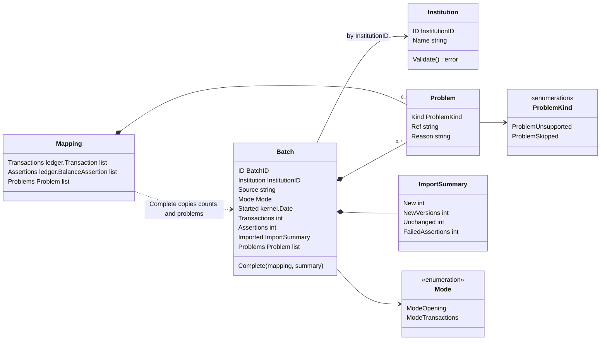
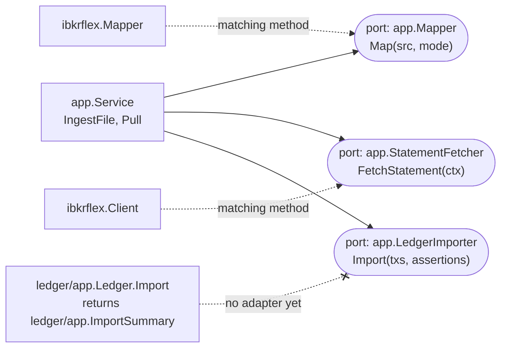
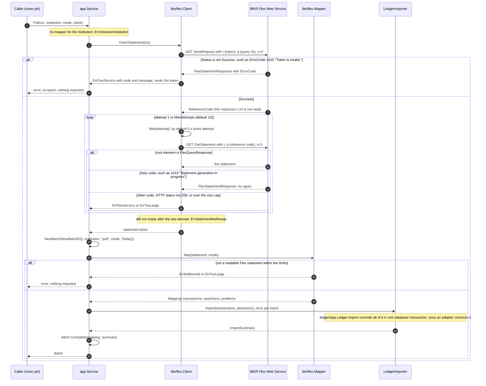
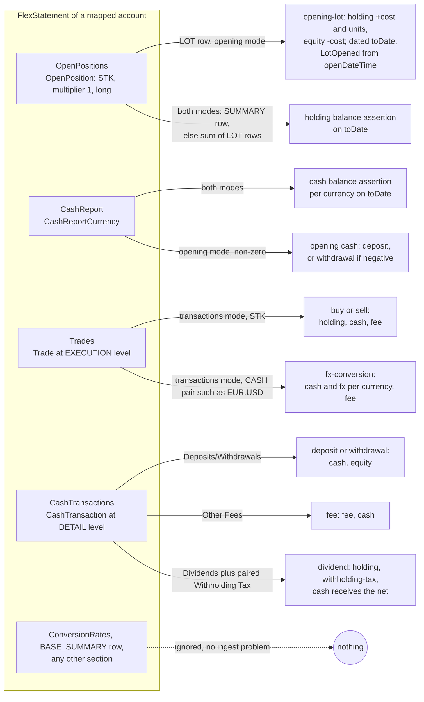

The ingest context is the only way data gets into OpenFief's ledger (D-7). A connector reads what an institution reports, translates it into ledger transactions and balance assertions, and lists every row it could not book. This page explains the concepts, shows what `internal/ingest` actually does today, and points to the tests that prove it. The one connector built so far reads Interactive Brokers (IBKR) Flex Query statements.

## Concepts

An [institution](../glossary.md) is a broker, bank or registry that holds assets: IBKR, XTB, the treasury bond registry. A [connector](../glossary.md) is the plugin that brings one institution's data in, by whatever the institution allows: a documented web service, an exported file, or manual entry (D-7). The core project ships only connectors that comply with the institution's terms (D-8).

What an institution reports about an account is a [statement](../glossary.md), such as an IBKR Flex Query or an xStation export. The way a statement reaches OpenFief is an *ingest path*: a file (uploaded, passed to the CLI, or dropped in a watched folder) or a pull from the institution. D-7 makes these the only way in. The public read API never writes.

One run of an ingest path is an [import batch](../glossary.md). It records which institution the statement came from, by which path, when, in which [ingest mode](../glossary.md), and what came of it.

A [mapping](../glossary.md) is what a connector makes of one statement: [transactions](../glossary.md), [balance assertions](../glossary.md) and [ingest problems](../glossary.md). An ingest problem is a statement row the mapping left out of the ledger, with its reason. It is `unsupported` when OpenFief can't book the row yet, such as an option trade, and `skipped` when the row is left out on purpose, such as a summary row. A problem is not an error: the rest of the statement is still imported. An unsupported row's effect is missing from the ledger, though, so a balance assertion may fail until that row type is supported.

**Idempotent re-import.** Statements overlap: a daily pull re-reads days that were already imported. So every transaction carries a key: its source plus the institution's own ID for it, such as IBKR's `tradeID` (D-18). Importing the same content again changes nothing. Changed content under the same key becomes a new version that supersedes the old one, which is kept. The ledger does the versioning; the connector's job is to produce stable keys.

**Opening lots, then transactions.** OpenFief does not replay an account's full history (D-23). At go-live, an `opening` batch seeds the account from the institution's current lot-level holdings: one opening [lot](../glossary.md) per broker lot, with its original open date and cost, plus the opening cash. After that, `transactions` batches import transactions from go-live on. Both modes import balance assertions, so the ledger can check that what it derives matches what the institution reports.

**Anti-corruption layer.** Eric Evans described this pattern in *Domain-Driven Design* (2003): a translation layer at the boundary, so that a foreign model never leaks into your own. Here, each connector's adapter parses the institution's format and translates it. IBKR words (position, trade, conid, Flex section and attribute names) stay inside `ibkrflex`. The domain only sees ledger transactions, balance assertions and ingest problems ([code-organization.md](../dev/code-organization.md)).

**IBKR Flex Queries and the Flex Web Service.** A Flex Query is a query the account owner sets up in IBKR's portal: which sections (trades, open positions, cash) and which fields. IBKR returns the result as XML, `FlexQueryResponse > FlexStatements > FlexStatement`, with one `FlexStatement` per account and period and one element per row. The Flex Web Service fetches it with a read-only token, in two steps. `SendRequest` with the token and the query ID returns a reference code. `GetStatement` with that code returns the statement once IBKR has generated it; until then, it answers with an error code that means "try again". R-3 lists Flex Queries among IBKR's access paths.

## How it works

### Packages

| Package | What it holds |
|---|---|
| `internal/ingest` | Domain types: `Institution`, `Batch`, `Mode`, `Mapping`, `Problem`, `ImportSummary`. Pure functions, no I/O. [batch.go](../../internal/ingest/batch.go), [problem.go](../../internal/ingest/problem.go) |
| `internal/ingest/app` | `Service`, the use case that runs an ingest path, and its ports `Mapper`, `StatementFetcher` and `LedgerImporter`. [ingest.go](../../internal/ingest/app/ingest.go) |
| `internal/ingest/ibkrflex` | The IBKR adapter: bounded XML decoding ([decode.go](../../internal/ingest/ibkrflex/decode.go)), the `Mapper` ([mapper.go](../../internal/ingest/ibkrflex/mapper.go), [positions.go](../../internal/ingest/ibkrflex/positions.go), [cashreport.go](../../internal/ingest/ibkrflex/cashreport.go), [trades.go](../../internal/ingest/ibkrflex/trades.go), [cashtx.go](../../internal/ingest/ibkrflex/cashtx.go), [fields.go](../../internal/ingest/ibkrflex/fields.go)) and the Flex Web Service `Client` ([webservice.go](../../internal/ingest/ibkrflex/webservice.go)) |

The domain types, as declared in `internal/ingest`:

`NewBatch` refuses a batch without an ID, an institution, a source, a known mode or a start date (`ErrInvalidBatch`); the zero `Mode` is not a mode. `Batch.Complete` records the mapping's counts, the ledger's summary and a copy of the problems, so later changes to the mapping don't alter the batch. `Institution.Validate` requires an ID and a name; `Service` itself only uses `InstitutionID`.

The ports are declared in `app`, by their consumer. The adapter types have the matching methods, but no code wires them together yet:

### Running an ingest path

`Service` holds a `LedgerImporter`, a `Mappers` map from `InstitutionID` to `Mapper`, and injected `Today` and `NewBatchID` functions, so it never reads the clock. `IngestFile` takes an `io.Reader` and records the source `file` (`SourceFile`). `Pull` checks that the institution has a mapper, calls the `StatementFetcher`, and ingests the bytes with the source `pull` (`SourcePull`). From there both run the same steps: look up the mapper (`ErrUnknownInstitution` if none), start the batch with `NewBatch`, `Map` the statement in the batch's mode, pass all transactions and assertions to `LedgerImporter.Import` in one call, then `Complete` the batch and return it. A failed fetch, map or import returns an error and no batch, and nothing reaches the ledger before the map succeeds. The returned batch isn't stored anywhere yet.

The pull path end to end, with the IBKR adapter:

### The Flex Web Service client

`ibkrflex.Client` sends the token only as the `t` query parameter, next to `q` and `v=3`, and only to `SendRequestURL` and `GetStatementURL`, which default to IBKR's documented endpoints. `serviceResponse` has no field for the statement URL in IBKR's reply, so the token never follows it elsewhere. Errors name the request path, never the URL that carries the token. `SendRequest` is not retried. `GetStatement` is retried only on the codes in `retryCode` (1001, 1004 to 1009, 1018, 1019, 1021). A `SendRequest` response is capped at 64 KiB, and a `GetStatement` response at `MaxBytes`, by default the parser's 64 MiB. `Wait` is injectable, so tests never sleep, and a cancelled context stops the wait. The `HTTP` field's comment says it should reach IBKR through the egress proxy (D-32); the client doesn't check that.

### Mapping a Flex statement

`ibkrflex.Mapper` has two fields: `Accounts`, which maps an IBKR account ID to the ledger account it feeds, and `Limits`. `Map` refuses an unknown mode (`ErrUnknownMode`), decodes the XML, then maps each `FlexStatement`. A statement for an account not in `Accounts` becomes one skipped problem. A statement without a readable `toDate` fails the whole map with `ErrMalformed`. The `toDate`, the statement's last day, dates every balance assertion; in opening mode it is also the go-live date. Four sections are read, in this order:

In opening mode every `Trades` and `CashTransactions` row becomes a skipped problem, because the opening lots and opening cash already hold its effect. Only instruments that appear in `OpenPositions` get a holding balance assertion. A zero cash balance still gets a cash assertion but no opening cash transaction.

The keys the adapter writes. Every source is `SourcePrefix` plus the ledger account ID, such as `ibkr-flex:acc-ibkr`, never the IBKR account number:

| Transaction kind | External ID | Date |
|---|---|---|
| buy, sell, fx-conversion | `tradeID` | `tradeDate`, else `dateTime` |
| deposit, withdrawal, fee, dividend | `transactionID`; a withholding row is booked under its dividend's | `dateTime`, else `reportDate` |
| opening-lot | `opening-lot:<ISIN>:<open date>:<originatingTransactionID>`, or `n1`, `n2` in row order among that instrument's lots opened that day | `toDate` |
| deposit or withdrawal for opening cash | `opening-cash:<currency>:<toDate>` | `toDate` |

Withholding tax is paired with its dividend by `pairWithholding`: the same `actionID` when both rows have one, otherwise the same ISIN, currency and date. Several withholding rows of one dividend add up. A withholding row with no dividend, more than one, or a zero or positive amount becomes an unsupported problem.

Rows the mapper won't book become problems, never errors. Unsupported: asset categories other than `STK` (and `CASH` in `Trades`); a contract multiplier other than 1; short or zero holdings; transaction types other than `ExchTrade`, `BookTrade`, `FracShare` or none; a side that disagrees with the quantity's sign; commission or tax credits; commission and taxes in two currencies; cash transaction types other than the four above; fee refunds; dividend reversals; a missing or unreadable attribute (named, its value not kept); and a transaction the ledger rejects, whose reason is cut to "not a valid ledger transaction" because ledger errors can carry amounts. Skipped: an unexpected element in a section (such as `Order` or `Lot` in `Trades`), a level of detail that isn't read (such as `CLOSED_LOT` in `OpenPositions` or `SUMMARY` in `CashTransactions`), and opening-mode activity rows. A problem's `Ref` names the statement, section, 1-based row and the IBKR ID when there is one, such as `FlexStatement#1/Trades#8[tradeID=9000106]`. It never holds an amount or an account number (GR-12).

Dates are read as `yyyyMMdd` or `yyyy-MM-dd`, optionally followed by `;`, `,`, space or `T` and a time, which is dropped without any time zone conversion. Amounts and quantities are exact decimals in plain notation, at most 40 digits. Exponents are refused, and nothing goes through `float64`.

### Hostile statements

DESIGN §3.7 lists malicious statement files as a threat. `decode` reads with `encoding/xml` in strict mode and refuses any `DOCTYPE` or other directive, undeclared entities, non-UTF-8 input and any root other than `FlexQueryResponse`. Anything malformed is `ErrMalformed`. Anything over a limit is `ErrTooLarge`, and either way the map fails before anything is imported. The limits are fields of `Limits`; a zero field takes its default:

| Limit | Default |
|---|---|
| `MaxBytes` | 64 MiB |
| `MaxDepth` | 16 levels |
| `MaxElements` | 500,000 |
| `MaxAttrs` per element | 512 |
| `MaxAttrLen` | 4,096 bytes |

## Decisions

- **D-7** Data enters only through connector ingest paths: `Service.IngestFile` and `Service.Pull`.
- **D-18** Keys from source plus IBKR's IDs; reported balances become assertions. The ledger does versioning and flagged checks.
- **D-19** Double-entry postings, built by the ledger's constructors (`NewBuy`, `NewDividend` and the rest).
- **D-20** Amounts keep their currency; IBKR's `ConversionRates` are ignored.
- **D-23** Opening lots at go-live, then transactions: `ModeOpening`, `ModeTransactions`.
- **D-34** Trade fees go to the fee ledger account, not lot cost.
- **D-35** Rows need a valid ISIN and a symbol, or are unsupported.
- **D-32** Partly: the client expects the egress proxy, but doesn't enforce it.

Where the code differs from a decision or the glossary:

- **D-23, transactions from go-live.** `transactions` mode books every row in the statement. Nothing compares row dates with go-live. A `transactions` statement whose period overlaps the opening statement's would book those rows on top of the opening lots. [problem.go](../../internal/ingest/problem.go) gives "a transaction before go-live" as an example of a skipped row, but no code produces one.
- **D-18 and D-23, a second opening run.** The opening cash key includes `toDate`. Running opening mode again on a later statement adds a second opening deposit, while the opening lots get new versions under their existing keys. Nothing stops a second opening run.
- **D-49 and D-11.** The core is meant to own import batches, schedules and retries, and call connectors over a Connect service in their own containers. Today `Service` returns the batch without storing it, and the IBKR code is a package inside the core, `internal/ingest/ibkrflex`, not a plugin.
- **Ingest problems.** The glossary and [doc.go](../../internal/ingest/ibkrflex/doc.go) say rows that aren't booked become ingest problems. Rows in sections the mapper doesn't read (anything other than the four above) and the `BASE_SUMMARY` cash row are dropped silently.
- **Glossary names.** There is no `ingest.Connector` type; the connector's role is `app.Mapper` plus `app.StatementFetcher`. `ImportSummary` exists twice, in `ingest` and `ledger/app`, with different fields. The comment on `Batch.Source` gives `upload` and `flex-web-service` as examples, but the constants are `file` and `pull`.

## Verification

Run every test with `task test`, or only this context with `go test ./internal/ingest/...`. All of these run offline.

| Behavior | Tests | kibi |
|---|---|---|
| Batches and institutions validate; `Complete` copies the problems | [batch_test.go](../../internal/ingest/batch_test.go): `TestNewBatch`, `TestBatchComplete`, `TestInstitutionValidate`, `TestEnumStrings` | REQ-ingest-batch-record, TEST-ingest-batch |
| One ingest path maps once and imports once; unknown institution, unreadable statement or failed fetch imports nothing | [ingest_test.go](../../internal/ingest/app/ingest_test.go): `TestIngestFile`, `TestIngestFileFailures`, `TestPull`, `TestPullFailures` | REQ-ingest-app-ingest-path (refines firm REQ-AUTO-41A1F4D687DAA771, D-7), TEST-ingest-app |
| Both modes on synthetic statements: opening lots, opening cash, transactions, assertions, problems | [golden_test.go](../../internal/ingest/ibkrflex/golden_test.go): `TestMapGolden` (four golden files), `TestMapValidTransactions` | REQ-ibkrflex-opening, REQ-ibkrflex-transactions, REQ-ibkrflex-assertions, REQ-ingest-problems-not-errors, TEST-ibkrflex-golden |
| Single rows: dates, signs, fees, withholding pairing, positions | [rows_test.go](../../internal/ingest/ibkrflex/rows_test.go): `TestMapTradeRows`, `TestMapCashTransactionRows`, `TestMapOpenPositionRows`, `TestMapCashReportRows` | REQ-ibkrflex-withholding-pairing, TEST-ibkrflex-rows |
| Hostile input is refused; input at each limit is accepted | [hostile_test.go](../../internal/ingest/ibkrflex/hostile_test.go): `TestMapRefusesHostileInput`, `TestMapAtTheLimits`, `TestMapUnknownMode`, `TestMapReadFailure` | REQ-ibkrflex-hostile-input, TEST-ibkrflex-hostile |
| Two-step fetch, retry while generating, invalid token, size cap, no token in errors, cancellation | [webservice_test.go](../../internal/ingest/ibkrflex/webservice_test.go): `TestFetchStatement`, `TestFetchStatementTokenInvalid`, `TestFetchStatementFailures`, `TestFetchStatementStopsWhenCancelled` | REQ-ibkrflex-web-service-pull, TEST-ibkrflex-webservice |

The ingest requirements above are `default` firmness and not yet reviewed by the author. The D-49 requirements (REQ-ingest-core-calls-connectors, REQ-ingest-core-owns-schedules, REQ-ingest-uploads-through-core) are `firm` and have no test yet. The ledger's one-transaction import is verified on the ledger side, by `TestImportHooksRunInTheImportTransaction` in [hook_test.go](../../internal/ledger/app/hook_test.go) (REQ-ledger-app-import-atomic, TEST-ledger-app-hook).

The golden files sit next to their fixtures, `opening.xml` and `activity.xml`, in [testdata](../../internal/ingest/ibkrflex/testdata/). To rewrite them after an intended change, run `go test ./internal/ingest/ibkrflex -run TestMapGolden -update` and review the diff line by line.

**The hypert recordings.** `TestFetchStatement` replays three exchanges from `testdata/TestFetchStatement/`: a successful `SendRequest` whose `Url` points to `elsewhere.example`, a `GetStatement` answering 1019 (still generating), and a `GetStatement` returning a one-trade statement. `TestFetchStatementTokenInvalid` replays a single `SendRequest` answering 1015. Replay checks each request's path, method, query parameters, scheme and headers, including `User-Agent`; the token is replaced with `SANITIZED` before comparing. No IBKR paper credentials exist, so these files were written by hand in hypert's format, with a fake account (`U0000000`), fake IDs and synthetic ISINs, and `recordMode` is a `false` constant. They follow IBKR's public documentation, not a real response (OQ-22). To record real fixtures, follow the [hypert-recording skill](../../.claude/skills/hypert-recording/SKILL.md) and [testing.md](../dev/testing.md).

**Known gaps.** These behaviors have no test, and the first is a bug:

- In `pairWithholding` ([cashtx.go](../../internal/ingest/ibkrflex/cashtx.go)), a dividend's second withholding row in a different currency resets the dividend's withholding to zero. The first, valid row then vanishes with no problem of its own, and the dividend is booked as if nothing was withheld.
- Rows in sections the mapper doesn't read produce no ingest problem.
- No go-live cutoff in `transactions` mode, and nothing guards against a second opening run.
- Nothing checks at compile time that `ibkrflex.Mapper` and `*ibkrflex.Client` satisfy the `app` ports.

## Not built yet

- **XTB export parser.** Uploaded xStation files (D-9), stocks and ETFs only, with closed CFD results as cash and open CFDs flagged (D-24).
- **Treasury bonds.** Manual lot entry in the built-in UI, handed to the core (D-9, D-49), and an import of the bond service's own export if one exists (D-9, OQ-22).
- **The connector Connect service.** Each connector serves a Connect service, in its own container, that the core calls for pulls and file imports (D-11, D-49). The IBKR code would move into such a plugin.
- **Core-owned scheduling.** The daily pull's schedule, retries and stored import batches (D-49).
- **Entry points.** Upload, CLI and watched folder (D-7); only `IngestFile(io.Reader)` exists. No binary in `cmd/` builds a `Service`.
- **The ledger adapter.** Something that implements `LedgerImporter` with `ledger/app.Ledger.Import` and turns its flagged checks into `FailedAssertions`.
- **IBKR prices as a cross-check** for the market-data connector (D-22). The mapper doesn't read `tradePrice` or position prices.
- **Verification against a real account** of the Flex schema, lot-level open dates and cost basis, and how far back one request reaches (OQ-22).
- **Full history backfill**, which arrives with the tax pack (D-23).
