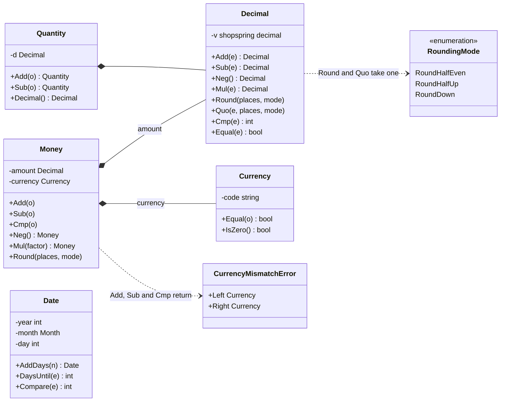
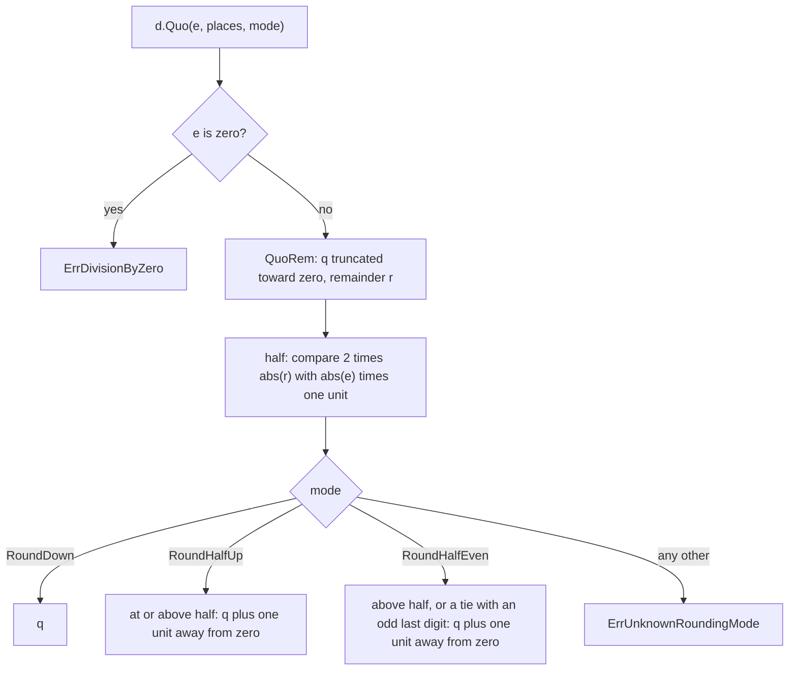

The kernel, `internal/kernel`, holds the few value types that every bounded context needs: exact decimal numbers, currencies, money, quantities and calendar dates. It exists so that no code anywhere does money arithmetic in `float64`, every amount carries its currency, and a date never drifts with a time zone. It is pure: no I/O, no clock, no logging.

## Concepts

**Shared kernel.** In domain-driven design (Eric Evans, 2003), a shared kernel is a small model that several bounded contexts agree to use together, so they don't each invent their own money type. OpenFief's [code organization](../dev/code-organization.md) names `internal/kernel` as that shared kernel. Today the [ledger](ledger.md), [valuation](valuation.md), [ingest](ingest.md) and `jurisdiction/pl` contexts use it.

**Exact decimals.** Binary floating point can't represent most decimal fractions: in `float64`, 0.1 + 0.2 is 0.30000000000000004. That is fine for physics and wrong for money. `Decimal` wraps [shopspring/decimal](https://github.com/shopspring/decimal), an arbitrary-precision base-10 number, so adding, subtracting and multiplying never lose a digit. Only two operations drop digits, rounding and division, and both make the caller say how.

**Rounding modes.** A rounding mode says what happens to the digits that are dropped. The kernel has three:

- *Half-even* rounds to the nearest value and sends a tie to the even digit: 2.345 becomes 2.34, 2.355 becomes 2.36. Also called banker's rounding, and the default of IEEE 754 floating point, it avoids drifting upward over many roundings. The ledger uses it to split a [lot](../glossary.md)'s cost (D-34).
- *Half-up* rounds to the nearest value and sends a tie away from zero: 2.345 becomes 2.35 and -2.345 becomes -2.35. The Polish [jurisdiction pack](../glossary.md) uses it for Belka tax (D-37).
- *Down* drops the digits, toward zero: 2.349 and -2.349 become 2.34 and -2.34.

The kernel never picks a mode or a number of places on its own. Tax rules, NBP tables and broker statements each round their own way, so that choice belongs to the caller.

**Divide last, round once.** A quotient is rarely exact (1 / 3), so `Quo` always takes a number of places and a rounding mode. Callers keep the numerator exact and divide last, so a result is rounded exactly once. For example, a bond's accrued interest of 100 × 5.35% × 100 days / 365 is computed as 535 / 365 and rounded half-up to 1.47.

**[Currency](../glossary.md).** An ISO 4217 alphabetic code such as PLN or USD. The kernel checks the format (three upper-case ASCII letters), not membership in the current ISO list, so a new or historic code in a broker statement doesn't stop an import.

**[Money](../glossary.md).** An exact amount in one currency. Money keeps its original currency (D-20): nothing in the kernel converts. Adding, subtracting or comparing amounts in two currencies is an error, not a silently wrong number. Converting is an explicit FX step in [valuation](valuation.md), with a rate and a date.

**[Quantity](../glossary.md).** An exact number of units of an instrument: shares, fund units or bonds. It may be fractional, and the type allows negative values, which the ledger uses for units leaving a holding.

**[Date](../glossary.md).** A calendar date with no time of day and no time zone, written YYYY-MM-DD. Prices are end of day (D-21), and broker rows carry a trade date, not an instant. Using Go's `time.Time` for these invites off-by-one-day bugs when a time zone or a daylight-saving change slips in.

## How it works

Each type is a small struct with unexported fields, so its contents can only be set through its constructors, and every operation returns a new value.

| File | What it holds |
|---|---|
| [decimal.go](../../internal/kernel/decimal.go) | `Decimal`, `ParseDecimal`, `NewDecimal`, `RoundingMode` and `Round` |
| [quotient.go](../../internal/kernel/quotient.go) | `Decimal.Quo`, division rounded once |
| [currency.go](../../internal/kernel/currency.go) | `Currency`, `ParseCurrency` |
| [money.go](../../internal/kernel/money.go) | `Money`, `NewMoney`, `ParseMoney`, `CurrencyMismatchError` |
| [quantity.go](../../internal/kernel/quantity.go) | `Quantity`, `NewQuantity`, `ParseQuantity` |
| [date.go](../../internal/kernel/date.go) | `Date`, `NewDate`, `ParseDate` |

**Decimal.** `Add`, `Sub`, `Neg` and `Mul` are exact and can't fail. `Round(places, mode)` returns an error only for a mode outside the three constants (`ErrUnknownRoundingMode`). `Equal` and `Cmp` compare numerically, so 1.50 equals 1.5, and `String` drops trailing zeros. `ParseDecimal` accepts a plain decimal such as `-12.345` and rejects a comma separator (`ErrInvalidDecimal`).

**Quo.** `Quo` rounds the exact quotient itself, in one step, with the same tie rules as `Round`. It takes the quotient truncated toward zero at the requested places (`QuoRem`), then compares twice the remainder with the divisor times one unit at that place, which tells whether the dropped part is below, at or above half a unit:

**Currency and money.** `ParseCurrency` is the only way to make a `Currency`; the zero value means no currency. `Money.Add`, `Sub` and `Cmp` return a `*CurrencyMismatchError` naming both currencies when they differ, including when one side has no currency. `Money.Equal` returns false across currencies instead of failing. `Money.Mul` multiplies by a unitless `Decimal`, typically `Quantity.Decimal()` for a price times a quantity, and keeps the currency; round the product with `Money.Round` when a rule says to.

**Zero values.** A zero `Decimal` or `Quantity` is 0. A zero `Currency` or `Date` means "none" and reports `IsZero`. A zero `Money` is 0 with no currency; the ledger's transaction constructors read any zero amount as "no fee" or "no withholding tax".

**Date.** `NewDate` rejects a date that doesn't exist, such as 2026-02-30, instead of rolling it into March as Go's `time.Date` would. `ParseDate` accepts only `YYYY-MM-DD`: no time, no day-first form. Arithmetic (`AddDays`, `DaysUntil`, `Compare`) runs on midnight UTC, so a daylight-saving change in Europe never shifts a day. Dates compare with `==`.

**Errors.** Parse failures wrap sentinel errors (`ErrInvalidDecimal`, `ErrInvalidCurrency`, `ErrInvalidDate`), so callers test them with `errors.Is`. Division by zero is `ErrDivisionByZero`. Nothing in the kernel panics.

## Decisions

- **D-20**: amounts keep their original currency; money never converts.
- **D-21**: end-of-day data, so dates carry no time of day.
- **D-34**: the half-even mode the ledger's lot-cost split uses.
- **D-37**: the half-up mode the Polish pack's Belka tax uses.
- **D-62**: no code assumes PLN; the kernel has no default currency.

The kernel follows all of these. It provides the rounding modes; the rules that pick one live with their callers. [code-organization.md](../dev/code-organization.md) lists money, currency, quantity and date as the kernel's contents; the kernel also holds `Decimal`, `RoundingMode` and `Quo`, which those types are built on.

## Verification

The kernel's tests are table tests in package `kernel_test`, so they use only its public API. Each row below names the behavior, the test that proves it, and the kibi requirement it verifies.

| Behavior | Test | kibi |
|---|---|---|
| Add, subtract and multiply are exact; long numbers keep every digit | `TestDecimalArithmeticIsExact`, `TestParseDecimal` in [decimal_test.go](../../internal/kernel/decimal_test.go) | REQ-kernel-decimal-exact, SCEN-kernel-decimal-exact, TEST-kernel-decimal |
| Each rounding mode handles ties and negatives as described above; an unknown mode fails | `TestDecimalRound` in [decimal_test.go](../../internal/kernel/decimal_test.go), `TestMoneyMulAndRound` in [money_test.go](../../internal/kernel/money_test.go) | REQ-kernel-decimal-exact |
| A quotient is rounded once to the caller's places and mode; dividing by zero fails | `TestDecimalQuo` in [quotient_test.go](../../internal/kernel/quotient_test.go) | REQ-kernel-decimal-quotient, SCEN-kernel-decimal-quotient-rounded-once, TEST-kernel-decimal-quo |
| Only three upper-case ASCII letters make a currency | `TestParseCurrency` in [currency_test.go](../../internal/kernel/currency_test.go) | REQ-kernel-currency-code, SCEN-kernel-currency-code, TEST-kernel-currency |
| Money never mixes currencies, and every result keeps its currency | `TestMoneyNeverMixesCurrencies`, `TestMoneyKeepsOriginalCurrency`, `TestMoneyEqualNeedsSameCurrency` in [money_test.go](../../internal/kernel/money_test.go) | REQ-kernel-money-currency-mismatch, SCEN-kernel-money-mixed-currencies, TEST-kernel-money |
| Dates reject impossible days and times, and day arithmetic survives leap days and daylight saving | `TestParseDate`, `TestNewDate`, `TestDateArithmetic`, `TestDateCompare`, `TestDateZeroValue` in [date_test.go](../../internal/kernel/date_test.go) | REQ-kernel-calendar-date, SCEN-kernel-calendar-date, TEST-kernel-date |
| Quantities are exact and may be fractional | `TestQuantityArithmetic`, `TestQuantityCompare`, `TestParseQuantity` in [quantity_test.go](../../internal/kernel/quantity_test.go) | TEST-kernel-quantity |

Run them with `task test` (all unit tests), or `go test ./internal/kernel/...` for this package alone. The kernel has no database code, so `task test:pg` doesn't cover it. To trace a requirement, run `node_modules/.bin/kibi search "<question>"` from the repository root.

When reviewing a change here, check three things the tests pin down: no operation rounds unless it takes a `RoundingMode`; no `Money` method returns a result for two currencies; and no `Date` path goes through local time.

## Not built yet

Nothing. Converting between currencies and choosing the reporting currency (D-20, D-62) are decided, but they belong to valuation, not the kernel.
