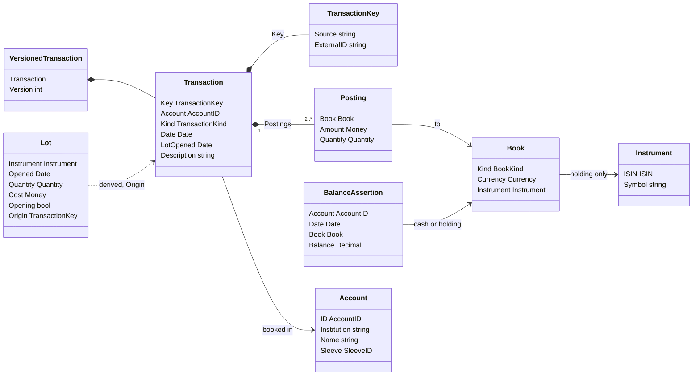
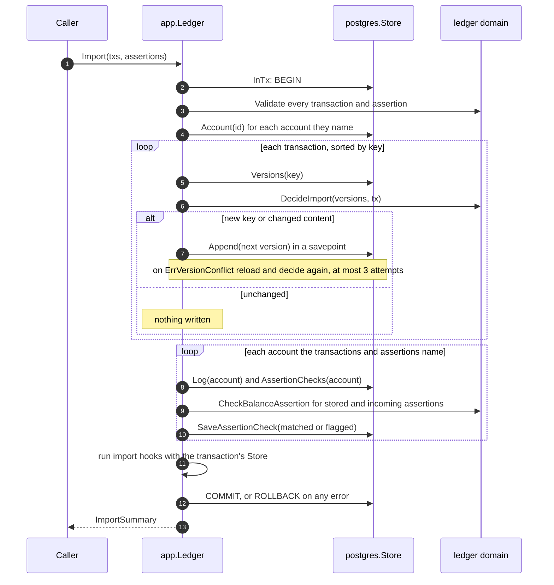
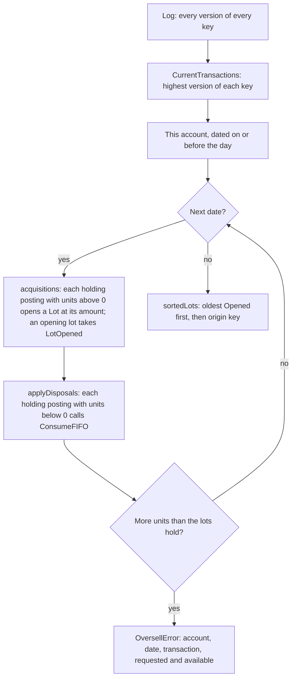
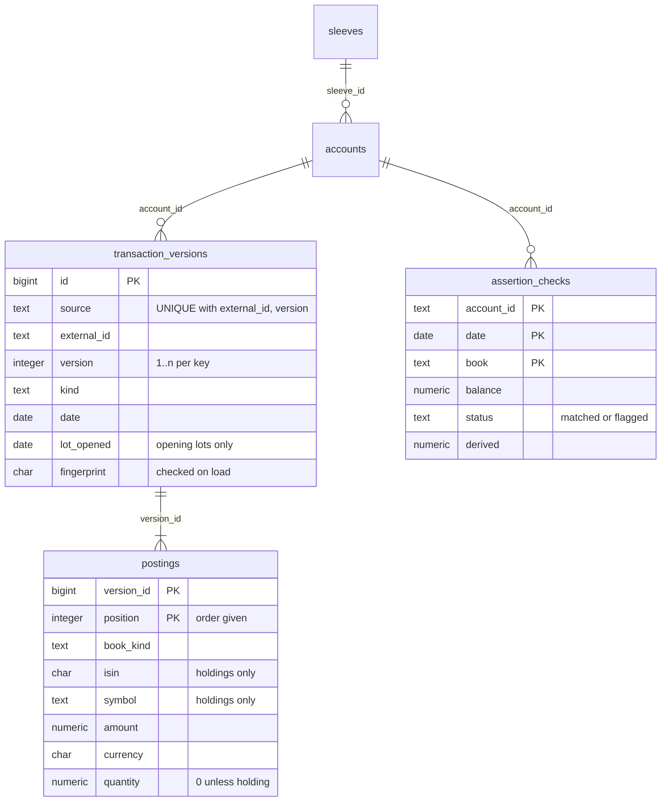

The ledger is OpenFief's record of what happened in each account: the core's system of record for transactions and tax lots (D-2). Connectors hand it transactions and the balances the broker reports ([Ingest](ingest.md)). It keeps every version of every transaction for good, and derives holdings, lots and cash from the current versions. It exists because existing trackers can't hold what OpenFief must get exactly right, such as FIFO tax lots ([DESIGN.md](../DESIGN.md) §3.1).

## Concepts

**Accounts and sleeves.** An [account](../glossary.md) is one account at an institution, such as one IBKR linked account. Each belongs to exactly one [sleeve](../glossary.md), the part of the portfolio it serves.

**Double-entry bookkeeping.** Documented by Luca Pacioli in 1494, double-entry records every event as [postings](../glossary.md) that sum to zero, so money never appears or vanishes. Here each [transaction](../glossary.md) is booked inside one account, to [ledger accounts](../glossary.md) of six kinds: cash per currency, a holding per instrument, and fee, withholding-tax, FX and equity per currency (D-19, D-33). Equity is the counterpart of what crosses the account's edge: deposits, withdrawals and opening lots. Postings must sum to zero *in every currency separately*. A currency exchange therefore goes through an FX ledger account in each currency, and no exchange rate is stored; the two amounts imply it. A posting's sign is from its ledger account's side: positive means that ledger account received something (cash in, units in, a fee paid, tax withheld).

**[Instruments](../glossary.md).** Something that can be held, identified by an ISIN (ISO 6166) whose check digit is valid plus the symbol it is listed under on its venue (D-35). The check digit is the Luhn mod 10 sum, with letters counted as 10 to 35, so most typos, such as one wrong or two swapped digits, are caught at the boundary. The same ISIN on two venues is two instruments.

**An append-only, versioned log.** Accountants correct a book by recording the correction, never by erasing what was written; event sourcing applies the same idea to software, keeping the history of changes rather than only the latest state. The ledger keys each transaction by its source plus the institution's own ID for it (D-18). A key's first import is version 1. Re-importing the same content changes nothing, so imports are idempotent. Changed content, such as a broker's corrected amount, becomes the next version, which supersedes the current one; the old one is kept. Only current versions count toward anything.

**Holdings and cash.** A [holding](../glossary.md) is the number of units of one instrument in one account at the end of a date. It is never stored: it is the sum of the holding postings of the account's current transactions up to that date. Cash per currency is derived the same way.

**[Lots](../glossary.md) and FIFO.** A lot is a quantity acquired on a date at a cost. A sale consumes lots first in, first out: the oldest first. That is the order Polish capital-gains tax uses (R-9). An *opening lot* is one the broker reported as held at go-live, with its original open date and cost (D-23). Selling part of a lot splits its cost: the sold part's cost is rounded half-even to two decimal places, and the lot keeps the exact rest, so the two always add up to the original (D-34). Three single-unit sales from a lot of 3 units costing 100.00 take 33.33, 33.34 and 33.33. Fees are not lot cost; they go to the fee ledger account. Broker rows carry no reliable time of day, so within one date acquisitions apply before disposals (D-35).

**[Balance assertions](../glossary.md).** A broker-reported balance of cash in one currency, or units of one instrument, at the end of a date. Plain-text accounting tools such as Ledger and Beancount use the same device to catch import mistakes. The ledger checks each one against the balance it derives. A mismatch is a flagged [assertion check](../glossary.md) for the owner to resolve; the import that found it is kept (D-18).

## How it works

Three packages, following the [layout](../dev/code-organization.md):

- `ledger` ([doc.go](../../internal/ledger/doc.go)): the domain, as pure functions over values.
- `ledger/app` ([doc.go](../../internal/ledger/app/doc.go)): the use cases in `app.Ledger`, and the `Store` port they need.
- `ledger/postgres` ([doc.go](../../internal/ledger/postgres/doc.go)): `postgres.Store`, the PostgreSQL adapter, and `Migrate` with the embedded schema.

**Ledger accounts.** `Book` is the Go name for a ledger account, kept comparable so it can be a map key ([account.go](../../internal/ledger/account.go)). A holding has an instrument and no currency; every other kind has a currency and no instrument. Ledger accounts aren't stored rows: a posting names its own. `BookKind.String` gives the stored names: `cash`, `holding`, `fee`, `withholding-tax`, `fx`, `equity`.

**Booking events.** Connectors build transactions with the constructors in [events.go](../../internal/ledger/events.go), which take a `TransactionHeader` (key, account, date) and return a validated `Transaction`:

| Constructor | Kind | Postings (ledger account: amount) |
|---|---|---|
| `NewBuy` | `buy` | holding: +cost and +units; cash: −cost |
| `NewSell` | `sell` | holding: −proceeds and −units; cash: +proceeds |
| `NewDividend` | `dividend` | holding: −gross, no units; withholding tax: +withheld; cash: +net, left out when zero |
| `NewFee` | `fee` | fee: +fee; cash: −fee |
| `NewFXConversion` | `fx-conversion` | cash: −sold; FX of the sold currency: +sold; FX of the bought currency: −bought; cash: +bought |
| `NewDeposit` | `deposit` | cash: +amount; equity: −amount |
| `NewWithdrawal` | `withdrawal` | cash: −amount; equity: +amount |
| `NewOpeningLot` | `opening-lot` | holding: +cost and +units; equity: −cost; `LotOpened` set to the broker's open date |

A buy, sell or FX conversion with a non-zero fee adds fee: +fee and cash: −fee, in the fee's own currency, which may differ from the cost's. Units must be positive, a dividend's withholding must be in the gross amount's currency and not exceed it, and an FX conversion needs two different currencies. `Transaction.Validate` ([transaction.go](../../internal/ledger/transaction.go)) then checks the header (a key, an account, a known kind and a date; only an opening lot has a `LotOpened`, on or before `Date`), at least two postings, each posting against its ledger account, and the sums per currency. An unbalanced transaction returns an `*UnbalancedError` with the first currency, in code order, that is off and by how much; anything else malformed wraps `ErrInvalidTransaction`.

**Versions.** `DecideImport` ([version.go](../../internal/ledger/version.go)) takes every stored version of a key and the incoming transaction, and returns an `ImportResult`: `ImportNew` as version 1, `ImportUnchanged` with the current version, or `ImportNewVersion` with the next number and the version it supersedes. Content is compared by `Fingerprint`: a SHA-256 over every field, each prefixed with its length, with postings sorted and numbers in canonical form. Posting order and trailing zeros (1.50 against 1.5) don't change it; the description or account does. Changing a row back to earlier content is one more version. A key's stored versions must be numbered 1..n, or the log is refused with `ErrInvalidLog`. `CurrentTransactions` keeps the highest version of each key, in date order, then by key.

**Importing.** `Ledger.Import` ([import.go](../../internal/ledger/app/import.go)) runs in one database transaction through `Store.InTx`, so it commits whole or not at all:

Transactions are appended in key order so two concurrent imports never wait on each other's keys in a cycle. If another import appended the same version first, the store returns `ErrVersionConflict` and `Import` reloads; after `MaxAppendAttempts` (3) it fails with a `*VersionConflictError`, and nothing is kept. Incoming assertions replace stored ones with the same date and ledger account. Each result is stored as an `AssertionCheck` with status `AssertionMatched` or `AssertionFlagged` and the derived balance ([check.go](../../internal/ledger/app/check.go)). The `ImportSummary` counts `Unchanged`, `New` and `NewVersions`, lists the `Checks` (`Flagged()` filters them), and gives `EarliestAffected`: per account, the earliest date whose current transactions changed, including the date and account of a superseded version. That is what a revaluation would start from (D-36). An `ImportHook` runs last, inside the transaction; its error rolls the import back.

**Deriving holdings, lots and cash.** Every derivation in [holding.go](../../internal/ledger/holding.go), [assertion.go](../../internal/ledger/assertion.go) and [lot.go](../../internal/ledger/lot.go) starts from the current versions in one account, dated on or before the day asked about. `HoldingOn`, `HoldingsOn` (non-zero only) and `CashOn` sum units or amounts. `CheckBalanceAssertion` compares that sum with the reported balance and returns an `*AssertionMismatchError` carrying both. `LotsOn` builds lots:

`ConsumeFIFO` takes units oldest first, by open date and then by the acquiring transaction's key. A lot taken in part gives up cost × units taken ÷ units held, rounded half-even to `LotCostPlaces` (2), and keeps the exact rest; a lot taken whole gives up all its remaining cost. An oversell consumes nothing. A lot's cost is the amount on the acquiring holding posting, so fees never enter it. A dividend's holding posting carries no units, so it never touches lots.

**Queries.** `app.Ledger` ([query.go](../../internal/ledger/app/query.go)) answers `CurrentTransactions`, `HoldingsOn`, `LotsOn`, `CashOn` and `AssertionChecks` per account, and `Sleeves`, `Accounts` and `Account`. Each per-account query refuses an account that isn't stored with `ErrUnknownAccount`. `Store.Log` returns every version of every key that has *any* version in the account, so a correction that moves a transaction to another account still supersedes it there. `SaveAccount` refuses an account whose sleeve isn't stored (`ErrUnknownSleeve`).

**PostgreSQL.** `Migrate` applies the SQL files embedded from [migrations/](../../internal/ledger/postgres/migrations/0001_ledger.sql) in one transaction, under an advisory lock, and records them in `ledger.schema_migrations`. The schema it creates:

The database enforces the log's rules for every role, with triggers rather than `REVOKE`, because in M0 the core connects as the schema's owner ([0001_ledger.sql](../../internal/ledger/postgres/migrations/0001_ledger.sql)). An `UPDATE`, `DELETE` or `TRUNCATE` of versions or postings fails with SQLSTATE `OFA01`. A version whose predecessor is missing fails with `OFA02`. Postings can be added only to the version the same transaction just inserted. If a trigger is switched off and a row changed anyway, the stored fingerprint no longer matches and loading fails with `ErrCorruptLog`. `Store.Append` ([log.go](../../internal/ledger/postgres/log.go)) writes a version and its postings in a savepoint, so a refused append leaves the import's transaction usable, and maps the unique `(source, external_id, version)` violation to `app.ErrVersionConflict`. Amounts and quantities are `numeric`, read back as text into `kernel.Decimal`. `Store.WithTx` hands the open `pgx.Tx` to work that must commit with the import, such as inserting a River job (D-36). Sleeves are stored in this schema too, because the portfolio context has no store in M0.

## Decisions

- **D-2**: the core is the system of record for transactions and lots.
- **D-14, D-55**: the ledger lives in PostgreSQL, in its own schema.
- **D-18**: append-only versioned log, idempotent re-imports, flagged balance assertions.
- **D-19**: double-entry postings across cash, holding, fee, withholding-tax and FX.
- **D-20**: amounts keep their original currency; conversion is in [valuation](valuation.md).
- **D-23**: opening lots at go-live with the broker's open date.
- **D-33**: an equity ledger account per currency as counterpart.
- **D-34**: half-even two-place cost split, exact remainder, fees outside cost.
- **D-35**: ISIN with check digit plus venue symbol; acquisitions first.
- **D-36**: only the seam: `EarliestAffected`, import hooks and `Store.WithTx`.

Where the code differs from DESIGN.md's wording: D-19 calls the holding ledger account "position"; the code uses `BookHolding`, the glossary's term. The ER diagram in DESIGN.md §3.3 shows holdings and lots as entities; the code stores neither and computes both from the log on every query. One more, against a proposal rather than a decision: [code-organization.md](../dev/code-organization.md) proposes that each context owns its schema, but the ledger imports `portfolio` and stores its sleeves.

## Verification

| Behavior | Tests | kibi |
|---|---|---|
| Postings sum to zero per currency; an unbalanced transaction names the currency and amount | `TestTransactionValidate` ([transaction_test.go](../../internal/ledger/transaction_test.go)), `TestPropertyPostingsSumToZeroPerCurrency` ([property_test.go](../../internal/ledger/property_test.go)) | REQ-ledger-postings-zero-sum, REQ-ledger-posting-ledger-account |
| Each event books the postings in the table above, fees to the fee ledger account | `TestTransactionConstructors` ([events_test.go](../../internal/ledger/events_test.go)) | REQ-ledger-event-postings, REQ-ledger-opening-lot-entry, REQ-decision-d33-2-equity-counterpart, REQ-decision-d34-3-fees-not-in-lot-cost |
| Accounts, ledger accounts and instruments validate; ISIN check digits | `TestAccountValidate`, `TestBookValidate` ([account_test.go](../../internal/ledger/account_test.go)), `TestParseISIN`, `TestInstrumentValidate` ([instrument_test.go](../../internal/ledger/instrument_test.go)) | REQ-ledger-account-sleeve, REQ-ledger-isin, REQ-decision-d35-1-instrument-isin-symbol |
| Re-imports are idempotent; changed content supersedes; every field counts | `TestDecideImport`, `TestFingerprintCoversEveryField`, `TestCurrentTransactions` ([version_test.go](../../internal/ledger/version_test.go)), `TestImportAppendsVersions` ([import_test.go](../../internal/ledger/app/import_test.go)) | REQ-ledger-import-idempotent, REQ-ledger-import-supersede, REQ-ledger-current-versions, REQ-ledger-app-import-append |
| Holdings and cash come from current versions only | `TestHoldingOn`, `TestHoldingsOn`, `TestHoldingsOnInvalidLog` ([holding_test.go](../../internal/ledger/holding_test.go)), `TestCashOn` ([assertion_test.go](../../internal/ledger/assertion_test.go)) | REQ-ledger-holding-derivation |
| FIFO order, same-day acquisitions first, cost split, oversell | `TestConsumeFIFO`, `TestConsumeFIFOCostSplitAddsUp`, `TestLotsOn`, `TestLotsOnOversell` ([lot_test.go](../../internal/ledger/lot_test.go)), `TestPropertyFIFOConsumesOldestFirstAndConservesCost`, `TestPropertyOversellConsumesNothing`, `TestPropertyLotsMatchHolding` ([property_test.go](../../internal/ledger/property_test.go)) | REQ-ledger-fifo, REQ-ledger-lot-cost-split, REQ-ledger-oversell, REQ-decision-d35-2-acquisitions-before-disposals |
| Assertions are checked, flagged and re-checked after a correction | `TestCheckBalanceAssertion` ([assertion_test.go](../../internal/ledger/assertion_test.go)), `TestImportFlagsAssertionMismatches` ([check_test.go](../../internal/ledger/app/check_test.go)) | REQ-ledger-assertion-mismatch, REQ-ledger-app-assertion-flag |
| An import is atomic, hooks included; racing imports append one version | `TestImportHooksRunInTheImportTransaction` ([hook_test.go](../../internal/ledger/app/hook_test.go)), `TestImportRetriesVersionConflicts`, `TestConcurrentImportsAppendOneVersion` ([import_test.go](../../internal/ledger/app/import_test.go)) | REQ-ledger-app-import-atomic, REQ-ledger-app-version-conflict |
| Registry and queries; unknown accounts are refused | `TestSaveSleeve`, `TestSaveAccount` ([ledger_test.go](../../internal/ledger/app/ledger_test.go)), `TestPositionsOnADate`, `TestQueriesOfAnUnknownAccount` ([query_test.go](../../internal/ledger/app/query_test.go)) | REQ-ledger-app-registry, REQ-ledger-app-queries |
| The database refuses changes; fingerprints catch tampering | `TestAppendRefusesAStoredVersion`, `TestLogIsAppendOnlyInTheDatabase`, `TestLoadDetectsAChangedVersion`, `TestImportOverPostgres` ([appendonly_test.go](../../internal/ledger/postgres/appendonly_test.go)) | REQ-ledger-pg-append-only |
| Migrations, round trips, hooks on a real transaction | `TestMigrateIsIdempotentAndOwnsTheLedgerSchema`, `TestLogRoundTrip`, `TestAssertionChecksRoundTrip` ([store_test.go](../../internal/ledger/postgres/store_test.go)), `TestImportHookEnqueuesInTheSameTransaction` ([hook_test.go](../../internal/ledger/postgres/hook_test.go)) | REQ-ledger-pg-store, REQ-ledger-app-import-atomic |

`task test` runs the domain and `app` tests; the `app` tests use an in-memory store with the same rules ([memstore_test.go](../../internal/ledger/app/memstore_test.go)). The PostgreSQL tests skip unless `OPENFIEF_PG_DSN` is set, so run `task test:pg`: it starts a throwaway PostgreSQL from local binaries (or uses that DSN) and gives each test a fresh, migrated database. One test: `task test:pg -- -run TestLogIsAppendOnlyInTheDatabase -v`. kibi registers each test file as a TEST entry named after it (TEST-ledger-lot, TEST-ledger-app-import and so on), except that [appendonly_test.go](../../internal/ledger/postgres/appendonly_test.go) is TEST-ledger-pg-log and [property_test.go](../../internal/ledger/property_test.go) is TEST-ledger-properties. To find what governs a behavior, run `node_modules/.bin/kibi search "<question>"` from the repository root.

Behaviors the tests don't pin down, worth knowing when reviewing:

- `Import` doesn't derive lots, so a sale of more units than held is stored. The `*OversellError` appears when lots are derived (`LotsOn`), while `HoldingsOn` reports a negative holding.
- Assertion checks rerun only for accounts that the incoming transactions and assertions name. When a correction moves a transaction out of an account, that account is in `EarliestAffected`, but its stored checks aren't rerun.
- A buy, sell or opening lot with zero cost or proceeds passes the constructors' sign checks, but its cash or equity posting is then empty, so `Validate` rejects the transaction with `ErrInvalidTransaction`.

## Not built yet

- **D-36**: no hook enqueues a revaluation, and River isn't a dependency yet. The seam is in place and tested with a stand-in jobs table.
- **D-6, D-50**: the read API that would serve these queries.
- **D-58**: marking data that came from a removed plugin instance.
- **D-49**: nothing wires `app.Ledger` to `postgres.Store` in a binary (`cmd/` holds only the operator and the egress proxy). The ingest side's `LedgerImporter` returns `ingest.ImportSummary`, not `app.ImportSummary`, so an adapter between them is still missing.
