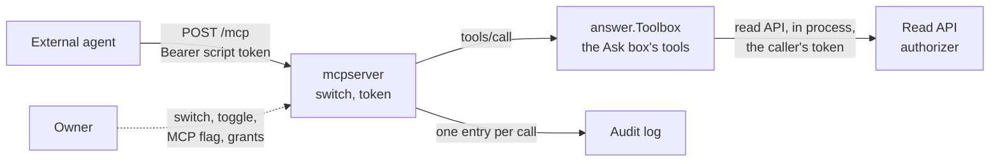

The core can serve [MCP](../glossary.md) at `/mcp` on its browser port, so that an external agent, such as a coding assistant or a personal agent of the owner's, can ask OpenFief what the Ask box can ask it. It offers the Ask box's read-only tools, reads as the script token the agent presents, never changes anything, and enters every call in the audit log as usage. With the one switch for agents and models off, or the MCP toggle under it off, nothing answers (D-213, D-212).

## Concepts

**The door.** `/mcp` is a path the core serves itself on the browser port ([Plugins](plugins.md): no view plugin's browser path can claim it). Each request is checked in this order, before the protocol is read:

| Request | Answer |
|---|---|
| The one switch or the MCP toggle is off | `404`, as for a path nothing serves, whatever the token; read from the settings at every request, so turning either off stops the answers at once |
| The switch cannot be read, or the authorizer does not enforce script token grants | `503` |
| No `Authorization: Bearer` header | `401` with `WWW-Authenticate: Bearer` |
| A token that is malformed, unknown, expired, revoked, not read-scoped or a session's | `401` with `error="invalid_token"` |
| A valid script token the owner did not allow to use MCP | `403`, and an audit entry of the refusal by that token |
| A token that may | MCP over Streamable HTTP |

No refusal says what the tools are and none reaches a tool. The `403` is an audit entry (`mcp_call`, `refused`, the token as actor, no tool named); a `401` writes none, since anyone can send one, and is counted by the metric `openfief.mcp.unauthenticated`; a `404` and a `503` write nothing. The core has no rate limit on script tokens to put in front.

**The token.** A client authenticates with a [script token](identity.md) whose MCP flag the owner set when creating it (Settings, Access, D-210). The flag is fixed at creation, so allowing an existing token means issuing another. Revoking the token, or letting it expire, ends its access as for the read API.

**The tools.** The server offers exactly the tools the Ask box's model is offered ([Built-in UI](ui.md), D-203): `what_needs_me`, `show`, `sync_status`, `allocation`, `performance` and `value`, each marked read-only and not destructive, with the same descriptions and JSON Schemas. They are the same table and the same answerers: the package [answer](../../internal/views/app/answer/doc.go) holds them and exports a `Toolbox` over that table, the page's Ask box and the core both import it, and the core wires it to the read API in process, not a second copy. A test holds the page's model to it: the tools it is offered in a conversation (D-224) equal the toolbox's, by name, description and schema (`TestTheBoxsToolsAreTheMCPServersToolbox`). The package imports only the kernel and the read API's generated contract, never the UI, so the core links none of the page's templates, assets or design system (an architecture test keeps `cmd/core` from importing `internal/views/ui`). A card holds data, not markup: the page draws it as HTML with links to its own pages, and the tools' cards, which draw no page, have none. A call returns the card as the model gets it, a JSON text with an `id`, a title, text and rows, amounts in the owner's number format. The data tiers of D-206 are for requests the router sends a model and do not apply to MCP: the core calls no model, and the agent that holds the token may pass what it reads to the model its client uses. The owner's per-token MCP flag and the token's grants are the controls, and the Access page says so beside each token: whatever this token can read may be sent to the model its client uses.

**The grants.** Every tool reads the read API with the calling token as the bearer, the way the Ask box reads with the asking person's session, never with the core's own identity. So whatever limits that token on the read API limits every tool: its grants (D-209), enforced by `GrantPolicy` under `--authz=policy` and by SpiceDB under `--authz=spicedb` ([Identity](identity.md)). The server asks the authorizer `EnforcesTokenGrants` at every request and answers 503 when it does not, so MCP is never served where a token's grants are ignored. What is tied to no account, an unmapped broker account's attention item or a connector's syncs, is the owner's alone (D-165, D-199): no script token sees it, over MCP or the read API, whatever it is granted, so `what_needs_me` lists a token only the items of accounts it may view.

**The audit entry.** Each tool call is one entry of the action `mcp_call` whose actor is the script token (actor kind `script_token`, its ID, never its secret) and that names the tool (`mcp_tool`, a lower-case word such as `allocation`) and how the call ended: `ok`; `refused` when the arguments were not accepted; `failed` when the data could not be read or the read API no longer accepted the token. There is nowhere in an entry for an argument, a result or an amount (GR-12). The tool runs first and the entry is written before the result goes back, so a call the log can't record shows the agent an error and none of the card ([Identity](identity.md#the-audit-log)). A call of a tool the server does not offer is a protocol error with no entry.

## How it works

The package [mcpserver](../../internal/views/mcpserver/server.go) is the protocol's adapter, built on the [official Go SDK](https://github.com/modelcontextprotocol/go-sdk) (v1.8.0, Apache-2.0 licensed, `govulncheck` clean) and its Streamable HTTP handler in stateless mode: each request stands alone, answers as JSON, and `GET` and `DELETE` are `405`, so the core holds no session or stream for an agent. The handler makes a server per request whose tools close over the caller's token. It declares its ports in [ports.go](../../internal/views/mcpserver/ports.go): the `Gate`, the `Tokens`, the `Toolbox` and the `Auditor`.

[cmd/core/mcp.go](../../cmd/core/mcp.go) wires them. The gate reads the models switch (`Switch.Allows(FeatureMCP)`); the tokens are `Tokens.VerifyMCP`, which verifies the secret as the read API does and then requires the flag (`ErrMCPNotAllowed` is a `403`, `ErrInvalidToken` a `401`); the toolbox is [answer.Toolbox](../../internal/views/app/answer/toolbox.go) over a read client whose transport calls the browser port's read API handler in this process, so every call goes through the same interceptors, token check and authorizer as an HTTP call to `/v1`; the auditor appends the entry through the identity context's log, as the router's model entries do ([internal/identity/auditmcp.go](../../internal/identity/auditmcp.go) holds the closed shapes: `ActorScriptToken`, `ActionMCPCall`, `RefMCPTool`). Migration 0016 adds the action and the actor kind to the log's closed sets.

No rate limit applies to script tokens today, so none applies to MCP; a call is bounded by the Ask box's 20-second limit on one tool and by the request body limit of the core's own paths (2 MiB, D-184).

## Decisions

- D-213: the MCP server at `/mcp`, the same read-only answerers as tools, a script token the owner allowed to use MCP, the token's grants, no change, a usage entry per call.
- D-212: the switch and the MCP toggle, with no endpoint answering when either is off.
- D-211: the audit entry names who, what and the outcome, never an amount or a text.
- D-209: the token's grants limit what every tool sees.
- D-6: the public API is read-only, and MCP is served only as D-213 allows.

## Verification

| Behavior | Tests | Requirement |
|---|---|---|
| The door answers `404` with the switch or the toggle off whatever the token, `503` when the switch can't be read, `401` for no or an invalid token with the right challenge, `403` for a token without the flag, none with a tool list, and reads the switch at every request | `TestEndpointRefusesBeforeAnyTool`, `TestTurningOffStopsAnswersAtOnce` ([server_test.go](../../internal/views/mcpserver/server_test.go)), `TestMCPGate` ([mcp_test.go](../../cmd/core/mcp_test.go)) | REQ-views-mcp-door |
| A client speaks MCP JSON-RPC and the SDK's own client works: initialize, tools/list, tools/call, no stream and no session | `TestMCPSession`, `TestTheSDKsOwnClientWorks`, `TestOnlyPostIsAnswered` ([server_test.go](../../internal/views/mcpserver/server_test.go)) | REQ-views-mcp-door |
| Over the real core and database: off by default, the switch alone is not enough, the door's statuses, the Ask box's tools, a card through the read API, a revoked token and a toggle turned off refused at once | `TestMCPServedOnTheBrowserPort`, `TestMCPPathBelongsToTheCore` ([mcp_test.go](../../cmd/core/mcp_test.go)) | REQ-views-mcp-door, REQ-views-mcp-only-as-d213-allows |
| Only a valid, read-scoped script token the owner allowed to use MCP passes, a valid one without the flag is told apart from an invalid one, and a store failure from both | `TestVerifyMCP` ([tokens_test.go](../../internal/identity/app/tokens_test.go)), `TestMCPTokens` ([mcp_test.go](../../cmd/core/mcp_test.go)) | REQ-views-mcp-door |
| The tools are the Ask box's table, each marked read-only, read with the caller's own token only, and an unknown tool, refused arguments or a token the read API refuses read nothing and quote nothing | `TestToolboxOffersTheAskBoxsTools`, `TestToolboxCallsReadWithTheCallersOwnToken`, `TestToolboxCallOutcomes` ([toolbox_test.go](../../internal/views/app/answer/toolbox_test.go)), `TestEachCallReadsAsItsOwnToken` ([server_test.go](../../internal/views/mcpserver/server_test.go)) | REQ-views-mcp-tools-are-ask-box-tools |
| The core and its tests import no UI package, so the core links none of the page's templates, assets or design system | `TestRules` (the rule `core-no-ui`, [rules_test.go](../../tools/archtest/rules_test.go)), `TestArchitecture` ([repo_test.go](../../tools/archtest/repo_test.go)) | REQ-tooling-archtest-core-no-ui |
| Each call is one entry by the script token naming the tool, with the outcome and nothing a client sent, a call the log can't record shows nothing, and the database's closed sets take the new action and actor and refuse a script token named other than by its ID | `TestMCPCallEntry`, `TestMCPToolRefIsAName` ([auditmcp_test.go](../../internal/identity/auditmcp_test.go)), `TestCallOutcomesAreAudited`, `TestACallTheLogCannotRecordShowsNothing` ([server_test.go](../../internal/views/mcpserver/server_test.go)), `TestMCPAuditEntry` ([mcp_test.go](../../cmd/core/mcp_test.go)), `TestAuditLogTakesEveryDomainAction` ([auditchange_test.go](../../internal/identity/postgres/auditchange_test.go)) | REQ-identity-audit-mcp-calls |
| A token granted one account reads that account and nothing else, over the read API and over MCP; the household's token reads both; a token's or plugin's grants decide under the policy as a viewer's do | `TestGrantPolicy` ([grantpolicy_test.go](../../internal/identity/app/grantpolicy_test.go)), `TestMCPServedOnTheBrowserPort` ([mcp_test.go](../../cmd/core/mcp_test.go)), and on a cluster, with the core restarted on the policy, `TestPolicyModeGrantsLimitTokensAndKeepThePagesWorking` ([policygrants_test.go](../../test/e2e/policygrants_test.go)), which also checks that no token is listed an item of no account and that the UI still renders for the owner and a demo session | REQ-identity-grants-limit-tokens-under-policy |
| The cutover runs once, under the policy too: a database where it never ran gives each token and plugin the household grant once, audited once per grant, and a token made afterwards with no grant or one account's grant keeps exactly that across restarts | `TestGrantsStartupCutsOverOnce`, `TestCutoverIsOneShotAndTheGrantsStayAsMade` ([grants_test.go](../../cmd/core/grants_test.go)) | REQ-identity-grants-limit-tokens-under-policy |
| The MCP server answers `503` while the authorizer does not enforce script token grants, with the switch and the toggle on, and `404` while they are off whatever the authorizer says | `TestMCPGate` ([mcp_test.go](../../cmd/core/mcp_test.go)) | REQ-views-mcp-needs-grant-enforcement |
| What is tied to no account is the owner's alone: a script token is listed none of it, nor counted it, with or without grants | `TestRESTAttentionItemsOfNoAccountAreTheOwnersAlone` ([attention_test.go](../../internal/views/connectapi/attention_test.go)) | REQ-views-unbound-items-owner-only |
| A valid token without the MCP flag is refused `403` with an entry by that token naming no tool, a `401` is counted and writes none, and a `404` or `503` writes nothing | `TestEndpointRefusesBeforeAnyTool` ([server_test.go](../../internal/views/mcpserver/server_test.go)), `TestMCPCallEntry` ([auditmcp_test.go](../../internal/identity/auditmcp_test.go)) | REQ-identity-audit-mcp-not-allowed |

## Not built yet

- `/mcp` is checked on a cluster only through a port-forward to the core, by the policy-mode end-to-end test, with no route in front; an agent's real client is not part of the suite.
- MCP offers tools only: no resources, prompts, sampling or notifications, and no OAuth, since a script token is the whole of authentication (D-213).
- No limit on how often a token calls, beyond the one tool's time limit; script tokens have no rate limit either.
- The token's MCP flag is fixed at creation (D-210): allowing or forbidding MCP for an existing token means issuing another.
- A `401` is counted, not entered, and the count has no alert or dashboard yet (D-172).
