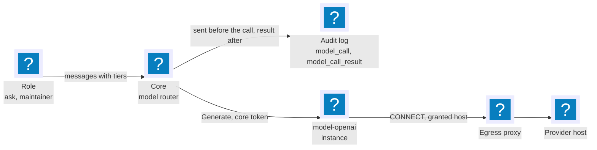
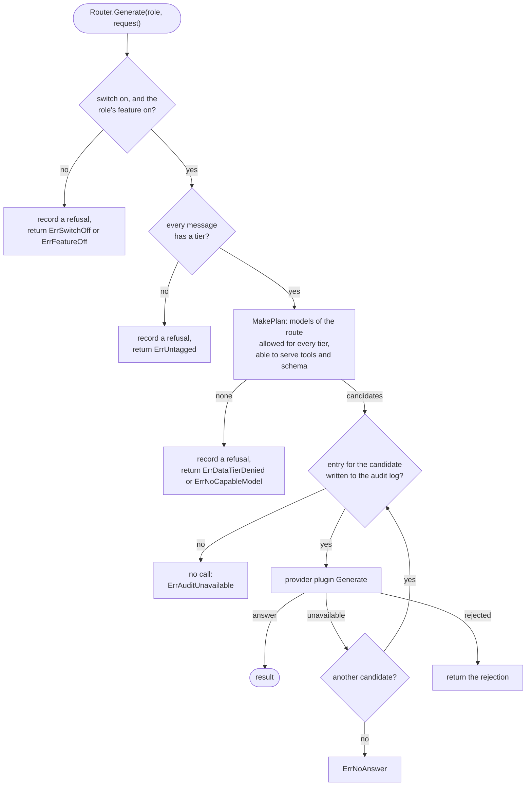

OpenFief can ask a language model questions, and it never does so unless the owner says it may. This page explains the plumbing that makes that safe: the one switch that is off by default, the model-provider plugins that are the only way to a model, the data tiers that decide which model may see which data, and the audit entry written before every call. The Ask box's answers beyond its commands (D-203) and the model-portfolio maintainer's weekly note (D-204) are built on top of this; the [Plugins](plugins.md) page covers what a plugin is.

## Concepts

**One switch.** [Agents and models](../glossary.md) are off by default, behind one switch in Settings, with a toggle under it for each feature: the Ask box's model, the maintainer and the MCP server (D-212). The switch and the toggles are stored with the owner's other settings in the `modelrouter` schema and only the owner changes them. With the switch off nothing calls a model, whatever the toggles say; with it on, a feature still runs only if its own toggle is on.

**Model-provider plugin.** A [model provider](../glossary.md) is a plugin with the `model-provider` capability (D-205). It holds its provider's key, reaches only its provider's host through the [egress proxy](egress.md) like any network plugin, says where its models run and what the provider keeps of what it receives, lists its models, and generates. It never sees a role, a data tier or who asked: it sends what the core hands it.

**Three layers.** Configuration follows OpenClaw's: a *wire protocol* (OpenAI-compatible chat first; Anthropic's and Gemini's later), a *provider instance* (base URL, the Secret with its key, a timeout, and where its models run) and *model entries* (id, price per million tokens, context and output limits, and flags for tool calling and structured output). A plugin image speaks one protocol; installing it once per provider gives one instance each, so OpenAI, OpenRouter, Ollama, vLLM and LM Studio are instances of the same `model-openai` image, each with its own grant.

**Model router and roles.** The core holds the [model router](../glossary.md). Each *role*, the Ask box (`ask`) or the maintainer (`maintainer`), has a route: a primary model and ordered fallbacks, written `provider/model` where the provider is an instance name and the model is the entry's id at it, which may itself hold slashes (`openrouter/openai/gpt-oss-120b`). A model that is down, slow or refuses its key passes the request to the next one; a model that rejects the request itself ends the call, since the next would reject it too.

**Data tiers.** Every message of a request carries a [data tier](../glossary.md): T0 for whole-portfolio holdings, amounts, transactions and tax data; TF for one fief's own lease, cash, positions and working orders; T1 for a thesis; T2 for public data (D-206). The owner lists, per tier, the models allowed to receive it. The router sends a request only to a model allowed for every tier in it, and denies by default: a tier with no models listed allows none, and a message nobody tagged is not sent. A fallback never widens the tiers: it is checked like the primary.

**The Ask box's door.** With the switch on, the Ask box's toggle on and a model on its route, the built-in UI sends the Ask box's questions that are not one of its fixed commands to the model (D-203). The router is the core's, so the UI reaches it through `AskModelService` ([ask.proto](../../proto/openfief/models/v1/ask.proto)), served to view plugins only: it can ask for the `ask` role and no other, and every round of the conversation goes through the switch, the route, the data tiers and the audit log like any other call. The tool loop runs in the UI, since the tools are its own read-only answerers and it reads with the asking person's session; what the model may do and what the page shows are in [Built-in UI](ui.md). The question is the owner's own words, which may carry amounts or holdings, so the UI tags it T0 like a tool's result: a route none of whose models may receive T0 is refused by the router before anything is sent, with the result entry `refused` in the audit log, and the box says so and keeps its commands.

**Fail closed.** Each call is two entries of the audit log (D-211) linked by a call ID: `model_call`, outcome `sent`, written before the call is sent, and `model_call_result` after it. If the first can't be written the call isn't made. A call the router refuses before it chooses a model, by the switch or the data tiers, has only the result entry, `refused`. The entries name who asked, the role, the provider instance and model by name, and an error class for a failure, and nothing else: no question, no answer, no amount and no token count, which the budget keeps (D-208).

## How it works

The context is called `modelrouter`, since no package may be named `models` ([Code organization](../dev/code-organization.md#architecture-tests)); its schema has the same name. Its root package ([internal/modelrouter](../../internal/modelrouter/doc.go)) is pure. `Switch` holds the switch and its toggles; its zero value is off, and `Switch.Allows` is true only with the switch and the feature's toggle on. `Ref` parses `provider/model`, `Route` is a role's models in order, `DataTier`, `DataTierSet` and `DataTierPolicy` are the data tiers, a request's distinct tiers and the owner's lists (`DataTierPolicy.Denied` names the tiers a model may not receive), `ProviderInstance` is what a provider instance declares about itself and `ModelEntry` is one model it offers, and `MakePlan` decides, for one request, which models of a route are candidates and why the others are skipped.

The router ([app/router.go](../../internal/modelrouter/app/router.go)) reads the settings first and fails closed when it can't: without them it can't know the switch is on. A refusal is checked before the request is validated or any provider is reached, and it is recorded, but a refusal that can't be recorded still stands. It keeps each provider's listed entries for five minutes, to skip models whose entry lacks tools or structured output; a provider that can't list its entries contributes none, and its models then answer for themselves.

**The settings** ([app/settings.go](../../internal/modelrouter/app/settings.go), [postgres](../../internal/modelrouter/postgres/store.go), [connectapi](../../internal/modelrouter/connectapi/settings.go)). The owner's session, of owner scope on an allowed origin, is checked by the same port the other owner services use; `ModelSettingsService` ([settings.proto](../../proto/openfief/models/v1/settings.proto)) is served on the plugin port to view plugins only, like the other settings, and nothing stores its answers. The tables are in the `modelrouter` schema; the switch has no row until it is saved, which reads as off.

**The provider contract** ([provider.proto](../../proto/openfief/models/v1/provider.proto)). `ModelProviderService` has `Describe` (protocol, where the models run, retention), `ListModels` and `Generate`, which doesn't stream in M1. Prices are exact decimal strings, never floating point. The core calls it with a short-lived ServiceAccount token whose audience is the instance, and the SDK's `ServeModelProvider` accepts only the core ([serve.go](../../sdk/go/openfief/serve.go), [models.go](../../sdk/go/openfief/models.go)). The core's client ([connectrpc](../../internal/modelrouter/connectrpc/client.go)) classifies a failed call by its Connect code, never its text: a rejected request is not retried elsewhere, and everything else, a provider that is down, slow or refusing the key, is unavailable. In the cluster, `cmd/core` finds an instance only while it runs with the `model-provider` capability (`Discovery.ModelProviderBaseURL`, [discovery.go](../../internal/ingest/kube/discovery.go)), so a route that names a connector sends it nothing.

**The `model-openai` plugin** ([plugins/model-openai](../../plugins/model-openai/main.go)) speaks the OpenAI-compatible chat completions API at its configured base URL, with tools as `tools`, structured output as a strict `json_schema` response format and the entry's output limit as `max_tokens`. Its manifest asks for the capability, the host of its `baseUrl` config field (D-75) and two optional Secrets, the instance's `api-key` and the usual `ca-bundle`; there is no fixed egress host, since every provider differs. On OpenRouter (a base URL whose host is `openrouter.ai`) a request that sends tools also sets `provider.require_parameters`, so the router only picks a host that supports every parameter, tools included, and not one that drops them and answers without a call; other servers never get the member, since OpenAI's own API refuses one it doesn't know. Pinning hosts (`order`, `allow_fallbacks`) is not configurable yet. A local provider such as Ollama is reached through an approved in-cluster service (D-74) and needs no key. It refuses a request that names a model it has no entry for, tools or a schema for an entry without those flags, or a limit above the entry's, before it calls the provider. It reads its key on every call, keeps no request or answer, logs none, and its errors name an HTTP status, never the provider's reply; when it stops, it logs the rule that failed through the SDK's `LogSafe` ([logsafe.go](../../sdk/go/openfief/logsafe.go)), never the error's text.

**The Ask box's door** ([app/ask.go](../../internal/modelrouter/app/ask.go), [connectapi/ask.go](../../internal/modelrouter/connectapi/ask.go)). `Ask` checks the asking person's session through the `Askers` port, which `cmd/core` answers over the identity context: any valid session on an allowed origin, a read-scoped one included, since the demo's visitors ask too (D-207) and what the model sees is limited by what the session reads. It has three calls. `Available` says whether the switch and the Ask box's toggle are on and the route names a model (`Settings.HasModel`), and writes no audit entry, so the Ask box asks it without a trace; with it false the box behaves as it did before there was a model. `Permits` says whether a model of the route may receive data of every one of some tiers together and serves tools (`Router.Permits`, a dry run of the same plan `Generate` makes): the UI asks it before a tool's result joins the conversation, so a result above what the route allows is named and withheld; the question itself, being T0, is refused by `Generate`. It calls no model and writes no entry, and a route that may not is the answer false, not an error. `Generate` is `Router.Generate` for `RoleAsk` with the asking session's ID as the actor, the request's output limit (`max_output_tokens`) passed to the model and the tokens the answer used (`output_tokens`) passed back, so the UI can stop a question at its token limit while the budget and the cost stay in the core (D-208), so the two entries of each call name the session, the role, the model and the call ID, and no question, answer, tool argument or tool result. Every message carries its tier: one without a tier is refused (`ErrUntagged`) and recorded as a refusal. The Connect service maps the router's errors by kind and never its text: no session is `UNAUTHENTICATED`; a request that breaks the contract, or that the provider rejected, `INVALID_ARGUMENT`; a tier no model may receive, or a model that can't serve tools, `PERMISSION_DENIED`; the switch, the toggle or the route gone, `FAILED_PRECONDITION`; every model down or too slow, `UNAVAILABLE`; anything else is logged by its safe text and answered `INTERNAL`. A conversation is at most 64 messages and 16 tools.

**The maintainer's door** ([cmd/core/maintainer.go](../../cmd/core/maintainer.go)). The maintainer (D-204, [Portfolio](portfolio.md#the-maintainer)) calls `Router.Generate` for `RoleMaintainer` through `maintainerAsker`, with no tools and a strict response schema: the instructions go as public data (T2) and the figures, the model portfolio's weights and drift, as whole-portfolio data (T0), so the route needs a model allowed for both and able to serve structured output, and one that isn't is a refusal like any other. The actor is the owner's session when the owner asked and the core itself for the weekly run, and each call is the router's usual pair of entries. Before it asks anything the maintainer checks `Switch.Allows(FeatureMaintainer)` itself, so with the switch or its toggle off nothing runs and not even a refusal is recorded; a run that the router then refuses ends as `denied`, one that no model answered as `unavailable`, `rejected`, `canceled` or `misconfigured`, always by the class and never by the router's text.

**The audit entries.** `cmd/core` writes each call as two entries ([modelrouter.go](../../cmd/core/modelrouter.go)), the two audit actions the models slice adds to the identity context's log. `model_call` has the outcome `sent` and names the role (`model_role`), the model (`model`, as `provider/model`) and a call ID (`model_call`, 16 hex digits the core makes); `model_call_result` names the same, with the outcome `ok`, `failed` or `refused`. A failure also names its class (`model_error`): `unavailable` (the provider can't be reached, is slow or refused the plugin's key), `rejected` (the provider or its plugin rejected the request), `canceled`, `misconfigured` (the route names a provider instance that is missing or is no model provider) or `internal`. A refusal before a model was chosen names no model. Each model the router tries has its own pair under its own call ID, so a fallback shows as a failed pair and then the pair that answered; a `sent` entry with no result is a call that never came back. If the result of an answered call can't be written, the router withholds the answer: the log fails closed on both sides.

**The owner's settings and their page.** `ModelSettingsService` ([settings.proto](../../proto/openfief/models/v1/settings.proto)) is the owner's door to the switch, the toggles, the routes and the tier lists, and the built-in UI's Models page ([Built-in UI](ui.md)) is its only client. Besides the setters it lists the model-provider instances that run (`ListModelProviders`): `Discovery.ModelProviderInstances` names them, and `Settings.Providers` asks each for where it says its models run, its retention terms and its models, within ten seconds, so an instance that does not answer is listed as unavailable without models. `GetModelSettings` also names the entries of every route, in use or not, whose provider instance is missing or is no model provider (`Settings.BrokenRoutes`, the same finding as `RouteProblems`, which counts only the routes in use), so the page marks them broken; before the core has found the plugins it names none. Every change is an audit entry of the action `model_settings_changed` ([identity](identity.md)), naming the owner's session and the one setting (`switch:on`, `feature:ask:off`, `route:maintainer`, `tier:T0`; never the models listed), written by `cmd/core`'s `settingsAudit` inside the transaction that stores the change (`SettingsStore`'s `within`): a change the log can't record is not made.

**Broken routes.** A route entry can name a provider instance no plugin has, or a plugin that is not a model provider, such as a connector. The core tells these apart from a provider that is only down: `Discovery.ModelProviderBaseURL` answers `ErrNoSuchInstance` and `ErrNotModelProvider` for the two mistakes and `ErrNotRunning` for a model provider that doesn't run now, and `cmd/core` names them `ErrProviderMissing`, `ErrNotModelProvider` and `ErrProviderUnavailable` for the router. A call that meets a mistake records a failed result of class `misconfigured`, tries the route's next model and raises one attention item for the entry, of the kind `model-route-broken` in the Inbox's decisions (D-196); a timeout or a 5xx falls through and raises none. The attention check `RouteProblems` ([app/routes.go](../../internal/modelrouter/app/routes.go)) runs every minute with the other checks over the routes in use, which are those of a role whose toggle is on under the switch: it raises the same items, one per broken entry, subject `<role>/<provider>/<model>` and a detail that names the route and the instance, and it resolves them when the owner fixes or removes the entry. Before the core has found the plugins it can't tell, so the check fails that round and clears nothing.

**An unrecorded change is unavailable.** A change of the settings whose entry the log can't take is not made, and `ModelSettingsService` answers it as unavailable (`kernel.ErrAuditUnavailable`), as every owner service does (D-211, [Identity](identity.md#the-audit-log)).

## Decisions

D-205 (model-provider plugins in three layers, the router), D-206 (data tiers), D-211 (every model call is an audit event) and D-212 (the switch), and D-203, the Ask box's model, built on them. The tier of what the Ask box sends is the UI's reading ([Built-in UI](ui.md)); the maintainer's, the figures T0 and the instructions T2, is the portfolio context's ([Portfolio](portfolio.md#the-maintainer)). D-204, the maintainer, is built on the same router.

## Verification

| Behavior | Tests | kibi |
|---|---|---|
| The switch and every toggle are off until the owner turns them on, and the store keeps them | `TestSwitchAllows`, `TestSwitchChanges` ([modelrouter_test.go](../../internal/modelrouter/modelrouter_test.go)), `TestSettingsDefaultsAreOff` ([app/settings_test.go](../../internal/modelrouter/app/settings_test.go)), [postgres/store_test.go](../../internal/modelrouter/postgres/store_test.go) (`task test:pg`) | REQ-models-switch-default-off |
| With the switch or the toggle off the router calls no provider, and refuses even an invalid request | `TestRouterSwitchOffCallsNothing`, `TestRouterSwitchOffRefusesEvenAnInvalidRequest`, `TestRouterFailsClosedWithoutSettings` ([app/router_test.go](../../internal/modelrouter/app/router_test.go)) | REQ-models-switch-gates-calls |
| Only the owner changes the settings | `TestSettingsOnlyTheOwnerChangesThem` ([app/settings_test.go](../../internal/modelrouter/app/settings_test.go)), `TestOnlyTheOwnerMayCall` ([connectapi/settings_test.go](../../internal/modelrouter/connectapi/settings_test.go)) | REQ-models-settings-owner-only |
| Routes: primary, fallbacks, unavailable and rejected providers | `TestRouterFallsBackOnUnavailable`, `TestRouterNoAnswerWhenEveryModelIsDown`, `TestRouterRejectionEndsTheCall` ([app/router_test.go](../../internal/modelrouter/app/router_test.go)), `TestRoutesAndTiersRoundTrip` | REQ-models-router-roles-fallbacks |
| A request goes only to models allowed for every tier it holds, denying by default | `TestDataTierPolicyDenied`, `TestMakePlan` ([modelrouter_test.go](../../internal/modelrouter/modelrouter_test.go)), `TestRouterTiers`, `TestRouterDeniesByDefault`, `TestRouterFallbackStaysWithinTheTiers` | REQ-models-data-tiers-deny-by-default |
| A call is recorded before it is sent, refused when it can't be, and the records hold no text | `TestRouterAuditsBeforeCalling`, `TestRouterRefusesWhenTheEntryCannotBeWritten`, `TestRouterKeepsTextOutOfRecordsAndErrors`, `TestModelAuditRecordsCallsAsAuditEntries` ([cmd/core](../../cmd/core/modelrouter_test.go)), `TestNewAuditEntry` ([identity](../../internal/identity/audit_test.go)) | REQ-models-calls-audited-fail-closed |
| A call is two audit entries under one call ID, `sent` before it and its result after, a refusal before a model was chosen only the result, and an answer whose result can't be recorded is withheld | `TestRouterLinksEachAttemptsEntries`, `TestRouterRefusalHasOnlyTheResultEntry`, `TestRouterWithholdsAnAnswerItCannotRecord`, `TestRouterRecordsTheResultOfACanceledCall` ([app/router_test.go](../../internal/modelrouter/app/router_test.go)), `TestModelAuditRecordsCallsAsAuditEntries` ([cmd/core](../../cmd/core/modelrouter_test.go)), `TestNewAuditEntry` ([identity](../../internal/identity/audit_test.go)), `TestAuditLogKeepsModelCalls` ([identity/postgres](../../internal/identity/postgres/audit_test.go), `task test:pg`) | REQ-models-calls-two-entries-linked |
| A route entry naming a missing provider instance, or a plugin that is no model provider, falls through and raises one attention item that clears when fixed; a provider that is only down raises none | `TestRouterRaisesAnItemForABrokenRouteEntry`, `TestRouterFallsThroughWhenTheItemCannotBeRaised` ([app/router_test.go](../../internal/modelrouter/app/router_test.go)), `TestRouteProblems` ([app/routes_test.go](../../internal/modelrouter/app/routes_test.go)), `TestRouteCheckFindsBrokenEntries`, `TestProviderAddressNamesTheDiscoverysErrors` ([cmd/core](../../cmd/core/modelrouter_test.go)), `TestInstanceTellsABrokenRouteFromADownProvider` ([connectrpc](../../internal/modelrouter/connectrpc/client_test.go)), `TestModelProviderBaseURL` ([ingest/kube](../../internal/ingest/kube/modelprovider_test.go)) | REQ-models-route-broken-attention |
| The Ask box's door: any valid session may ask, the role is the Ask box's and the actor the asking session, availability and the tier check write no entry and call no model, a message without a tier is refused, and no question or answer text reaches an error or a log | `TestAskAvailable`, `TestAskNeedsAValidSession`, `TestAskPermits`, `TestAskPermitsNeedsAModelThatServesTools`, `TestAskGenerateIsTheAskRolesCallForTheSession`, `TestAskGenerateRefusesDataTheTiersDeny`, `TestRouterPermitsCallsNothing` ([app/ask_test.go](../../internal/modelrouter/app/ask_test.go)), `TestSettingsHasModel` ([settings_test.go](../../internal/modelrouter/settings_test.go)), `TestAskServiceGeneratesThroughTheRouter`, `TestAskServiceRefusalsAndFailuresByKind`, `TestAskServiceRefusesTooMuch`, `TestGetAskModel`, `TestCheckAskTiers` ([connectapi/ask_test.go](../../internal/modelrouter/connectapi/ask_test.go)), `TestAskSessionsAdmitAnyValidSession` ([cmd/core](../../cmd/core/askmodel_test.go)) | REQ-models-ask-box-model-through-router, REQ-models-ask-box-tool-results-tiered |
| The maintainer's request goes through the router as T2 and T0 with a strict schema and no tools, for the owner's session or the system, and a refusal or failure is a class, never text; the maintainer's gate is the switch and its toggle | `TestMaintainerAskerSendsFiguresAsT0AndInstructionsAsT2`, `TestMaintainerAskerNamesTheAskingSession`, `TestMaintainerAskerNamesTheSystemWhenTheScheduleAsks`, `TestMaintainerAskerFailuresAreClassesAndNoText`, `TestAskClass`, `TestMaintainerGateIsTheSwitchAndTheToggle` ([cmd/core](../../cmd/core/maintainer_test.go)), `TestMaintainerOffRunsNothingOnARealCore`, `TestMaintainerRunsOnARealCore` ([cmd/core](../../cmd/core/maintainer_core_test.go), `task test:pg`) | REQ-maintainer-sends-figures-through-router, REQ-maintainer-off-runs-nothing |
| Every change of the settings is an audit entry naming the owner's session and the setting, inside the transaction that stores it, and a change the log can't record is not made | `TestSettingsEveryChangeIsAuditedWithTheOwnersSession`, `TestSettingsAChangeTheLogCannotRecordIsNotMade`, `TestSettingsARefusedChangeWritesNoEntry` ([app/settings_audit_test.go](../../internal/modelrouter/app/settings_audit_test.go)), `TestSettingsAChangeWhoseHookFailsStoresNothing` ([postgres/store_test.go](../../internal/modelrouter/postgres/store_test.go), `task test:pg`), `TestSettingsAuditRecordsAChangeAsAnEntryNamingTheSetting`, `TestOwnerSessionNamesTheOwnersSessionForTheAuditEntry` ([cmd/core](../../cmd/core/modelsettings_test.go)), `TestNewAuditEntry` ([identity](../../internal/identity/audit_test.go)) | REQ-models-settings-changes-audited |
| The owner is told the model providers that run with their declared terms and models, one that does not answer as unavailable, and the broken entries of every route, and no other session is | `TestSettingsProvidersListTermsAndModelsForTheOwner`, `TestSettingsProvidersMarkAnInstanceThatDoesNotAnswerUnavailable`, `TestSettingsProvidersAreTheOwnersAndEmptyBeforeThePluginsAreFound`, `TestSettingsBrokenRoutesCountEveryRouteInUseOrNot` ([app/settings_audit_test.go](../../internal/modelrouter/app/settings_audit_test.go)), `TestListModelProvidersShowsTermsAndModels`, `TestListModelProvidersIsTheOwnersAlone`, `TestGetModelSettingsNamesTheBrokenRouteEntries` ([connectapi/providers_test.go](../../internal/modelrouter/connectapi/providers_test.go)), `TestModelProviderInstances` ([ingest/kube](../../internal/ingest/kube/modelprovider_test.go)), `TestModelProvidersWaitForDiscovery` ([cmd/core](../../cmd/core/modelsettings_test.go)) | REQ-models-providers-listed-to-owner |
| The contract is served to the core only, translated both ways, and an instance is reached only as a model provider | [connectrpc/client_test.go](../../internal/modelrouter/connectrpc/client_test.go), `TestModelProviderServerIsForTheCoreOnly` ([sdk](../../sdk/go/openfief/models_test.go)), `TestModelProviderBaseURL` ([ingest/kube](../../internal/ingest/kube/modelprovider_test.go)) | REQ-models-provider-plugin-contract |
| The plugin speaks the OpenAI-compatible protocol to its configured host only | [chat_test.go](../../plugins/model-openai/chat_test.go) (`TestRequestBodyRequiresParametersOnOpenRouterWithTools`), [provider_test.go](../../plugins/model-openai/provider_test.go), [config_test.go](../../plugins/model-openai/config_test.go), `TestModelProviderManifest` ([operator](../../internal/plugins/operator/model_provider_test.go)) | REQ-models-openai-compatible-plugin |

## Not built yet

- The Models page ([Built-in UI](ui.md)) reads a provider's terms and models on each visit, with no cache and no refresh button, and it can't install a provider: that is the Plugins page's.
- A change of the settings is audited by what it changed, not to what: the entry names `route:ask` and not the models the route now holds.
- The Ask box's guards (D-208): no daily token budget, no per-session or per-IP rate limit, no cap on calls at once and no Turnstile; only the loop's own bounds, D-208's defaults in `ui.AskLimits` (five rounds that may call tools and a last without, ten tool calls, 800 output tokens and two minutes for a question; a call to the core and a tool have timeouts too).
- The MCP server (D-213) and its toggle's effect: the toggle is stored, and no endpoint exists to answer.
- A demo configuration that allows its cloud model for every tier (D-206).
- Spend and token budgets (D-208): the router keeps no usage, and the provider plugin only reports it.
- Streaming, the Anthropic and Gemini wire protocols, and the model entries' prices in any decision.
- An end-to-end test of a role's request through a provider plugin on a cluster; the pieces are tested against fakes, the Ask box's model included: the UI's page and tool loop against a fake `AskModelService`, the service over a real router with fake providers, and the browser checks over the UI's fakes. A cluster test needs a fake model provider image in the suite's registry answering a scripted tool call.
