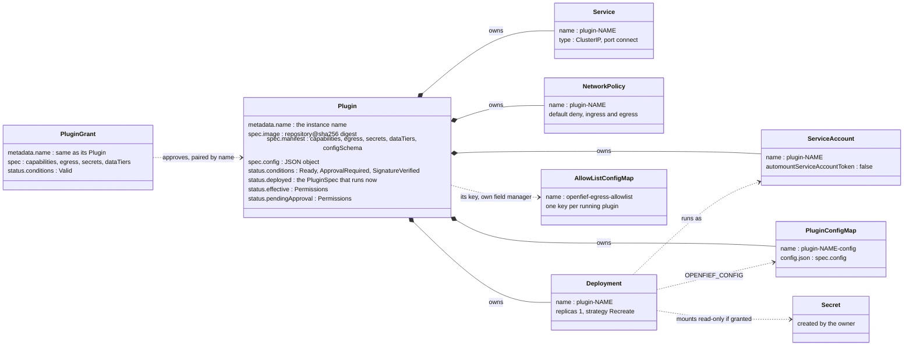
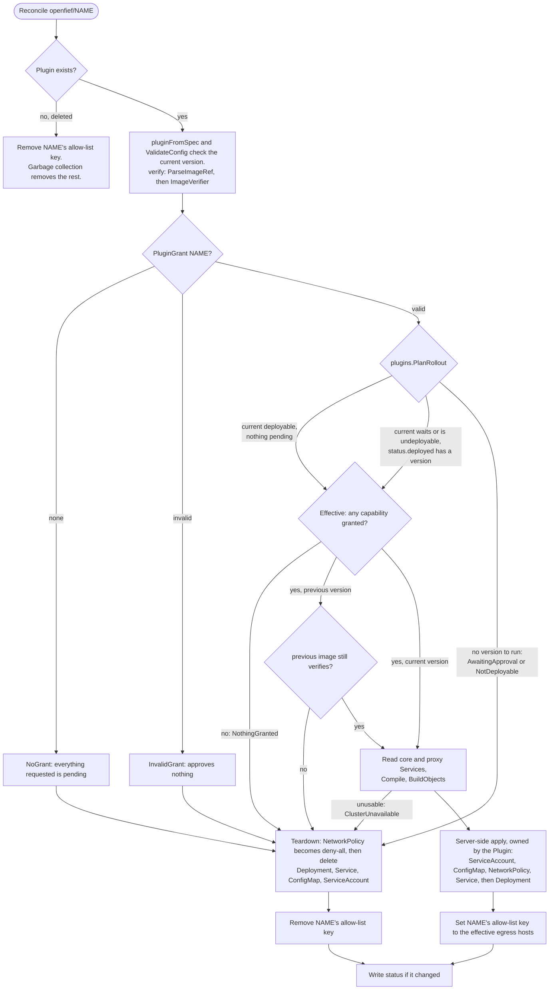
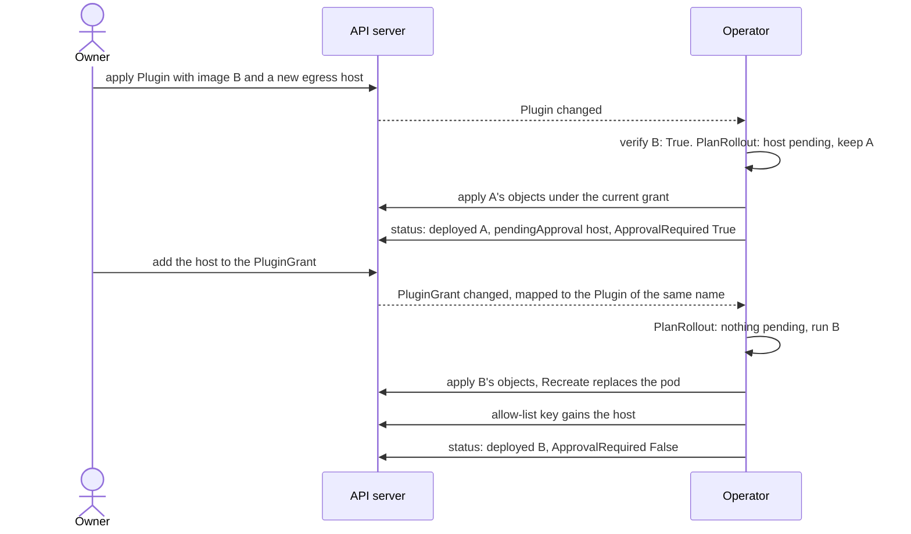
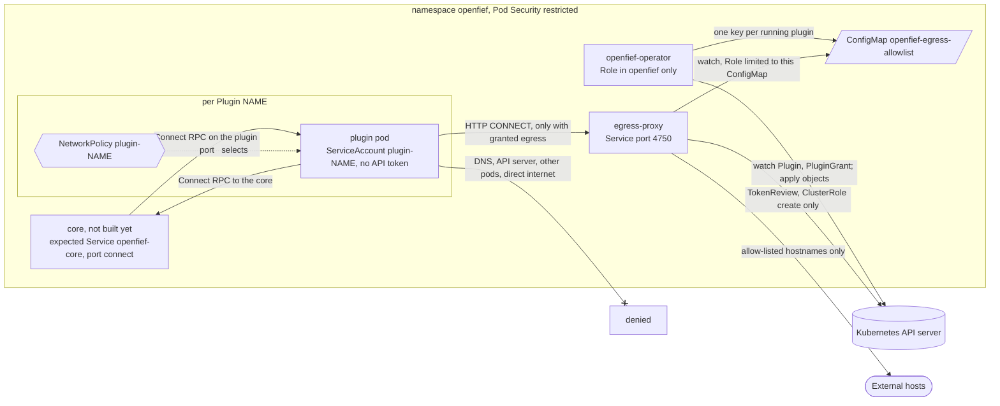

The operator runs OpenFief's plugins on Kubernetes (D-13). It watches two custom resources in the `openfief` namespace, `Plugin` and `PluginGrant`, and runs each plugin with only what both allow, as a locked-down [workload](../glossary.md). The operator makes no decisions of its own: the `internal/plugins` package decides, and the operator maps each decision onto Kubernetes objects. Today it deploys no plugin at all, because cosign signature verification isn't built and the default verifier refuses every image.

## Concepts

**Custom resources and CRDs.** Kubernetes stores objects of built-in types such as Pods and Services. A CustomResourceDefinition (CRD) adds a new type to the API server, with an OpenAPI schema that the server checks on every write. CRDs replaced ThirdPartyResources in Kubernetes 1.7 (2017) and reached `apiextensions.k8s.io/v1` in 1.16. OpenFief defines exactly two, `Plugin` and `PluginGrant`, in group `openfief.io`, version `v1alpha1` (D-55). The Go types are the source of truth. controller-gen, from the Kubebuilder project, reads markers in their comments and generates the CRD YAML, the deepcopy code and the operator's Role.

**The operator pattern and the reconcile loop.** CoreOS introduced operators in 2016: a controller that encodes how to run one piece of software, driven by its own custom resources. The loop underneath comes from Google's Borg and Omega, as described in "Borg, Omega, and Kubernetes" (Burns et al., 2016). Controllers repeatedly compare the desired state with the observed state and act to remove the difference. The loop is *level-triggered*: it reacts to the current state, not to the event that changed it. A missed or repeated event does no harm, because the next pass looks at everything again. So `Reconcile` gets only a name, re-reads everything and is safe to run any number of times.

**Desired and observed state.** By convention, `spec` holds what someone wants and `status` holds what the controller saw and did. Here the vendor's request (image, [manifest](../glossary.md), config) is the `Plugin`'s spec. The owner's approval is a separate object, the `PluginGrant`, so editing the vendor's half can't change what the owner consented to (D-16). The `Plugin`'s status records which version actually runs and with which [effective permissions](../glossary.md).

**Owner references and garbage collection.** An object can name its owners in `metadata.ownerReferences`. When an owner is deleted, the cluster's garbage collector deletes what it owns, whether or not the operator is running. The operator makes each `Plugin` the controlling owner of every object it creates for it. controller-runtime also uses these references to route an event on an owned object back to its `Plugin`.

**Status conditions.** A condition is one typed status line: `type`, `status` (`True`, `False` or `Unknown`), a CamelCase `reason`, a readable `message`, the `observedGeneration` it describes and when it last changed. Kubernetes standardized this shape as `metav1.Condition` in 1.19. `kubectl get plugins` shows a `Plugin`'s three conditions as columns.

**Namespace-scoped RBAC and least privilege.** Kubernetes RBAC grants verbs on resources to an identity, through a Role (one namespace) or a ClusterRole (the whole cluster). Least privilege (Saltzer and Schroeder, 1975) gives each part only the rights its job needs. D-15 limits the operator to a Role in `openfief`, so it can't see or change anything elsewhere. Installing CRDs is a cluster-wide act, so a cluster admin does it once. Plugins get even less: a ServiceAccount with no Kubernetes API token at all.

**Server-side apply.** The operator writes objects with server-side apply. It sends only the fields it wants, and the API server records which *field manager* owns each field. A later apply by the same manager with fewer fields removes the ones it dropped. The operator uses this to own its objects outright, and to give each plugin's entry in the shared allow-list ConfigMap its own manager.

## How it works

### Packages and binaries

| Path | What it holds |
|---|---|
| `internal/plugins/operator/v1alpha1` | The API: `Plugin`, `PluginGrant`, `Manifest`, `Permissions`, `PluginStatus` and the condition names ([types.go](../../internal/plugins/operator/v1alpha1/types.go), [groupversion.go](../../internal/plugins/operator/v1alpha1/groupversion.go)); generated deepcopy code |
| `internal/plugins/operator` | The adapter: `PluginReconciler` ([reconciler.go](../../internal/plugins/operator/reconciler.go)), watches and `GrantReconciler` ([setup.go](../../internal/plugins/operator/setup.go)), status ([status.go](../../internal/plugins/operator/status.go)), resource-to-domain conversion ([convert.go](../../internal/plugins/operator/convert.go)), `BuildObjects` ([objects.go](../../internal/plugins/operator/objects.go)), `ClusterFromServices` ([cluster.go](../../internal/plugins/operator/cluster.go)), `ValidateConfig` ([config.go](../../internal/plugins/operator/config.go)), the `ImageVerifier` seam ([verify.go](../../internal/plugins/operator/verify.go)) |
| `internal/plugins` | The pure domain it calls: `PlanRollout`, `Effective`, `NeedsApproval`, `Compile`, `ParseImageRef`, `EncodeAllowLists` |
| `internal/plugins/kube` | The egress proxy's Kubernetes adapter: `AllowLists` follows the ConfigMap the operator writes ([allowlists.go](../../internal/plugins/kube/allowlists.go)); `TokenReviewer` checks plugin tokens ([tokenreview.go](../../internal/plugins/kube/tokenreview.go)) |
| `cmd/operator` | Wiring: flags, a controller-runtime manager whose cache sees only `openfief`, leader election through a Lease ([main.go](../../cmd/operator/main.go)); a distroless, non-root image ([Dockerfile](../../cmd/operator/Dockerfile)) |
| `deploy/crds`, `deploy/operator` | Install manifests: the namespace and CRDs; the operator's ServiceAccount, Role, RoleBinding and Deployment |

One reconcile converts the resources into `plugins.Plugin` and `plugins.Grant`, asks `plugins.PlanRollout` which version runs, has `plugins.Compile` turn its effective permissions into a `plugins.Workload`, and only then builds Kubernetes objects with `BuildObjects`.

### The resources and what the operator owns

The CRD schema rejects bad input before the operator sees it. Names must be lower-case DNS labels of at most 56 characters starting with a letter, so `plugin-<name>` fits a 63-character Service name. `spec.image` must match `^[^@]+@sha256:[0-9a-f]{64}$`. Capabilities are `connector` or `view`; egress lists hold at most 64 [egress hosts](../glossary.md). The operator then validates everything again in the domain, where rules such as "no wildcard hosts" live, because a CRD schema can't express them all.

The operator never creates a Secret (D-29) and its Role can't even read one: it only names the owner's Secrets in the pod spec. The allow-list ConfigMap has no owner reference; each plugin's key is applied by its own field manager, `openfief-operator/allowlist/<name>`.

What `BuildObjects` puts in the pod ([objects.go](../../internal/plugins/operator/objects.go)):

- **Identity.** The ServiceAccount mounts no API token. The only token is a projected one with audience `openfief-core`, valid for 3600 seconds, at `/var/run/secrets/openfief/token` (D-27), named by `OPENFIEF_TOKEN_FILE`. That ServiceAccount is the [plugin identity](../glossary.md).
- **Addresses.** `OPENFIEF_CORE_ADDRESS` is the core Service's ClusterIP and port, because plugins have no DNS (D-32). `OPENFIEF_LISTEN_PORT` is the plugin port (8080 by default). Only when an egress host is granted, `HTTPS_PROXY` points at the egress proxy's ClusterIP and `NO_PROXY` at the core.
- **Hardening.** Non-root, read-only root filesystem, every Linux capability dropped, no privilege escalation, seccomp `RuntimeDefault`, no service links. These settings meet the `restricted` Pod Security Standard the namespace enforces.
- **Rollouts.** One replica with the `Recreate` strategy, so an old pod never runs beside a new one with other permissions. A SHA-256 of the config in a pod annotation makes a config change replace the pod.

The NetworkPolicy denies both directions by default. It admits ingress only from the core's pods on the plugin port, allows egress to the core's pods, and allows egress to the proxy's pods only when an egress host is granted. It never allows DNS. The peers are selected by the core's and the proxy's Service selectors. `ClusterFromServices` refuses a Service with no selector, a selector that would also match plugin pods (`ErrSelectorOverlap`, which would let a plugin pass for the core), or a named `targetPort`, because NetworkPolicy matches pod port numbers.

### One reconcile pass

"Deployable" means the spec is valid, its config passes the manifest's JSON Schema, and the verifier returned `True`. `ValidateConfig` treats a missing config as `{}` and gives the schema a loader that refuses every `$ref` outside the schema itself, so a schema can't make the operator read a file or reach the network.

Three cases are worth tracing:

- **No grant.** `PlanRollout` returns `RolloutNoGrant` and puts everything the manifest requests into [pending approval](../glossary.md). The operator tears down, which leaves one owned object: a deny-all NetworkPolicy. Status: `Ready=False/NoGrant`, `ApprovalRequired=True/PermissionsPending`. Deleting a grant from a running plugin takes this same path, so revocation is immediate.
- **An upgrade that requests more.** The new spec asks for an egress host the grant lacks. `NeedsApproval` returns exactly that host. Because `status.deployed` still holds the running version, the [rollout](../glossary.md) keeps it (`RolloutPrevious`), limited to what the *current* grant approves, so a narrowed grant takes effect at once. The old image must still verify. Status: `pendingApproval` lists the host and `ApprovalRequired=True`; `Ready` becomes `True/RunningPreviousVersion` once the Deployment is available. With no earlier version, nothing runs (`AwaitingApproval`).
- **A tag-referenced image.** `repo:1.0` alone fails the CRD pattern, so the API server refuses the write and the operator never sees it. `repo:1.0@sha256:…` passes the pattern, but `plugins.ParseImageRef` refuses a tag next to a digest. The current version is then invalid: `SignatureVerified=False/InvalidImage` and `ApprovalRequired=Unknown/InvalidSpec`. As with an upgrade, an earlier verified version keeps running if there is one; otherwise nothing runs and `Ready=False/InvalidSpec`.

`Ready`'s reason gives the first cause: `Running`, `RunningPreviousVersion`, `Progressing` (Deployment not yet available), `NoGrant`, `InvalidGrant`, `InvalidPreviousVersion`, `ClusterUnavailable`, `AwaitingApproval`, `NothingGranted`, `InvalidSpec`, `InvalidConfig` or `SignatureNotVerified` ([status.go](../../internal/plugins/operator/status.go)). Messages are capped at 1024 bytes. `GrantReconciler` separately sets each `PluginGrant`'s `Valid` condition.

An upgrade, as the envtest suite plays it with a verifier that accepts both images:

### What triggers a reconcile

`SetupWithManager` ([setup.go](../../internal/plugins/operator/setup.go)) runs `PluginReconciler` on changes to a `Plugin` and to the five objects it owns, so a hand edit to one of them is followed by a re-apply of the operator's fields. A `PluginGrant` maps to the `Plugin` of the same name. A change to the core's or the proxy's Service, or to the allow-list ConfigMap, reconciles every `Plugin`. Requests outside `openfief` are ignored.

### The egress allow-list hand-off

The operator compiles each running plugin's effective egress hosts into the [egress allow-list](../glossary.md) and writes them to the `openfief-egress-allowlist` ConfigMap (D-32). A running plugin with no egress gets an empty value, meaning "none"; a plugin that doesn't run has no key. On the proxy's side, `kube.WatchAllowLists` follows that one ConfigMap with an informer and swaps the decoded lists in atomically. It fails closed: while the ConfigMap is missing or doesn't decode, no plugin has a list. `kube.TokenReviewer` asks the TokenReview API whether a plugin's token is valid for audience `openfief-core` and returns its username. The proxy's own behavior is documented with the egress proxy.

### What runs in the openfief namespace

Only plugin pods get NetworkPolicies from the operator; the install manifests give none to the operator or the proxy. The core has no binary or manifest yet. The operator's flags name its Service (`--core-service=openfief-core`, `--core-port=connect`), and until that Service exists, any plugin that would run gets `ClusterUnavailable`.

Install order ([deploy/crds/kustomization.yaml](../../deploy/crds/kustomization.yaml), [deploy/operator/kustomization.yaml](../../deploy/operator/kustomization.yaml)): a cluster admin runs `kubectl apply -k deploy/crds`, which creates the `openfief` namespace with `pod-security.kubernetes.io/enforce: restricted` and both CRDs. Then `kubectl apply -k deploy/operator` installs the operator, after an overlay pins its image by digest. Its [role.yaml](../../deploy/operator/role.yaml) is generated from the `+kubebuilder:rbac` markers in [reconciler.go](../../internal/plugins/operator/reconciler.go): read `plugins` and `plugingrants`; update their status; update `plugins/finalizers`, which owner references with `blockOwnerDeletion` need; full control of ServiceAccounts, ConfigMaps, Services, Deployments and NetworkPolicies; create and patch events; manage Leases for leader election. All of it is limited to `openfief`, but within the namespace it isn't limited to the operator's own objects: Kubernetes RBAC can't restrict `create` by name.

## Decisions

- **D-10**: Kubernetes-oriented; the operator is a controller-runtime manager.
- **D-11**: manifest compiled into NetworkPolicy, Secret mounts, RBAC and allow-list. The config is also checked against the manifest's JSON Schema.
- **D-13**: an operator manages plugins through a `Plugin` resource.
- **D-15**: Role in `openfief` only; CRDs installed by a cluster admin.
- **D-16**: requested and approved permissions split; only both enforced; upgrades wait.
- **D-17**: digest pinning is built (CRD pattern and `ParseImageRef`). **Cosign verification is not:** `cmd/operator` wires `UnimplementedVerifier`, which answers `Unknown/NotImplemented` for every image, so the operator deploys nothing.
- **D-27**: projected token with audience `openfief-core` mounted in every plugin.
- **D-28**: no Ingress; plugins get ClusterIP Services only.
- **D-29**: Secrets are the owner's; the operator only mounts them.
- **D-32**: allow-list, NetworkPolicy to the core and proxy only, no DNS, `HTTPS_PROXY` by ClusterIP. **Difference:** D-32 says the operator compiles each grant's hostnames; the code publishes the effective hosts, the intersection of manifest and grant. That's narrower and matches D-16.
- **D-48**: each `Plugin` name is an instance with its own ServiceAccount, config, grant and allow-list key. **Gap:** Secret names come from `spec.manifest.secrets`, so two instances of one image share Secrets unless their `Plugin` resources name different ones.
- **D-55**: `Plugin` and `PluginGrant` are the only custom resources; no money.
- **D-56**: **not built.** The verification call exists for the current and the previous image, but there is no cosign check, no bundled trust root, and no status that tells a verified plugin from one only signed by a trusted signer.
- **D-57**: nothing deploys without a `True` verification, and there is no override.
- **D-58**: **partly.** Deleting a `Plugin` removes its workload (by garbage collection) and its allow-list key. Its `PluginGrant` and Secrets stay.
- **D-59**: **partly.** Ingress is admitted only from the core. The ConfigMap of token-signing public keys is not built.
- **D-63**: allow-lists swapped atomically and fail closed in `kube.AllowLists`. **Difference:** D-63 says the proxy checks tokens for audience `openfief-egress`; `kube.TokenReviewer` checks `openfief-core`, and plugins have only that one token, so the token sent to the proxy is also valid for the core.
- **D-42**: **not followed yet.** The operator takes the manifest from `spec.manifest`, not from the image's label, so nothing ties the requested permissions to the signed image.

## Verification

| Behavior | Tests | kibi |
|---|---|---|
| No grant: nothing runs, everything pending, deny-all NetworkPolicy | `TestReconcile/plugin_without_a_grant_runs_nothing` in [reconciler_test.go](../../internal/plugins/operator/reconciler_test.go); `TestPlanRollout` in [rollout_test.go](../../internal/plugins/rollout_test.go) | REQ-operator-runs-only-granted, REQ-plugins-rollout-no-grant |
| Upgrade requesting more keeps the old version; approval rolls out the new one | `TestReconcile/granted_plugin_runs,_and_an_upgrade_waits_for_approval`; `TestPlanRollout` | REQ-operator-upgrade-status, REQ-plugins-rollout-upgrade-waits |
| Deleting the grant tears the plugin down | `TestReconcile/revoking_the_grant_removes_the_plugin` | REQ-operator-runs-only-granted |
| Unverified image never deployed; `NotImplemented` reported | `TestReconcile/unverified_image_is_never_deployed` | REQ-operator-signature-required |
| Config checked against its schema, which loads nothing | `TestValidateConfig` in [config_test.go](../../internal/plugins/operator/config_test.go); `TestReconcile/config_its_schema_rejects_is_never_deployed` | REQ-operator-config-schema |
| Invalid grant marked and enforced as no grant | `TestReconcile/invalid_grant_is_marked_and_enforced_as_no_grant` | REQ-operator-grant-validity |
| Allow-list key set while running, removed after deletion | the upgrade subtest; `TestDeletedPluginLeavesTheAllowList`; `TestAllowListConfigMap` | REQ-operator-allow-list-publish |
| Exact objects for a workload | `TestBuildObjects`, `TestDenyAllNetworkPolicy` in [objects_test.go](../../internal/plugins/operator/objects_test.go) | REQ-operator-workload-objects |
| Peers only from usable Services | `TestClusterFromServices` in [cluster_test.go](../../internal/plugins/operator/cluster_test.go), `TestBuildObjectsRefuses` | REQ-operator-cluster-peers |
| Image references by digest only | `TestParseImageRef` in [image_test.go](../../internal/plugins/image_test.go) | REQ-plugins-image-digest-only |
| No ClusterRole for the operator, no Ingress anywhere | `TestManifests` in [manifests_test.go](../../internal/plugins/operator/manifests_test.go) | TEST-operator-manifests (D-15, D-28) |
| Proxy side: token audience, ConfigMap followed fail-closed | `TestTokenReviewerReviewToken`, `TestWatchAllowLists*` in [kube_test.go](../../internal/plugins/kube/kube_test.go) | REQ-plugins-egress-proxy-identifies-plugin, REQ-plugins-egress-allow-lists-fail-closed |
| Flags, API types, controller setup | `TestParseFlags` in [main_test.go](../../cmd/operator/main_test.go); `TestAddToScheme`, `TestDeepCopyIsIndependent`; `TestSetupWithManager` | TEST-operator-cmd, TEST-operator-api |

The reconciler tests use envtest: a real `kube-apiserver` and `etcd` with the CRDs from `deploy/crds`, and no other controllers. Run everything with `task test`, which installs envtest 1.36.2 into `.bin/envtest` and sets `KUBEBUILDER_ASSETS`. A plain `go test ./internal/plugins/operator/...` fails those tests fast without it. `task gen:check` fails if the CRDs, `role.yaml` or the deepcopy code differ from what `task gen` generates from the Go markers.

What the tests don't show:

- envtest has no Deployment controller and no garbage collector. `Ready` never reaches `Running` or `RunningPreviousVersion` in a test, and the cascade on `Plugin` deletion is untested.
- The CRD's image pattern is not exercised by a test; only `ParseImageRef` is.
- From reading the code: if the operator is down when a `Plugin` is deleted, nothing removes that plugin's allow-list key afterwards, because no event arrives for an object that no longer exists. A reinstall under the same name overwrites the key.
- From server-side apply's rules, not a test: a re-apply restores the fields the operator owns, but keeps fields another field manager added, such as an extra container, volume or environment variable added with `kubectl edit`. NetworkPolicy rule lists are atomic, so they are restored whole.
- There is no end-to-end suite (`test/e2e` doesn't exist), so no test checks that a real CNI enforces the NetworkPolicies.

## Not built yet

- **D-17, D-45, D-56, D-57**: the cosign `ImageVerifier`, the bundled trust root, the trusted-signer list, and a status that tells verified from only signed.
- **D-42**: reading the manifest from the image label and checking it against `spec.manifest`.
- **D-43, D-44, D-46**: the catalog and the `openfief` CLI. Today `Plugin` and `PluginGrant` are applied by hand.
- **D-58**: deleting the grant and Secrets on uninstall, and marking the ledger data of a removed instance.
- **D-59**: the ConfigMap of the cluster's token-signing public keys, and the core's per-instance tokens.
- **D-63**: a separate projected token with audience `openfief-egress`.
- **D-12**: end-to-end tests on kind or k3d.
- The core's Deployment and Service, which the operator expects as `openfief-core`.
