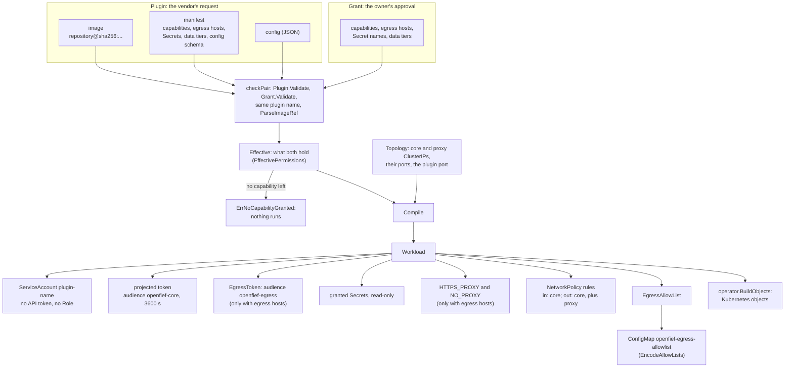
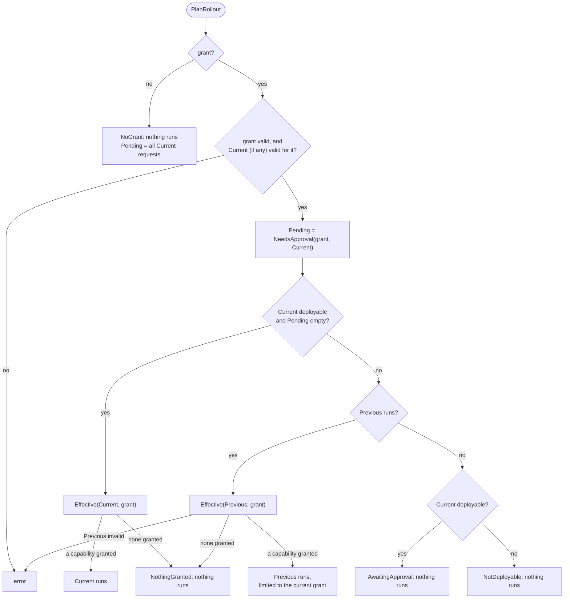
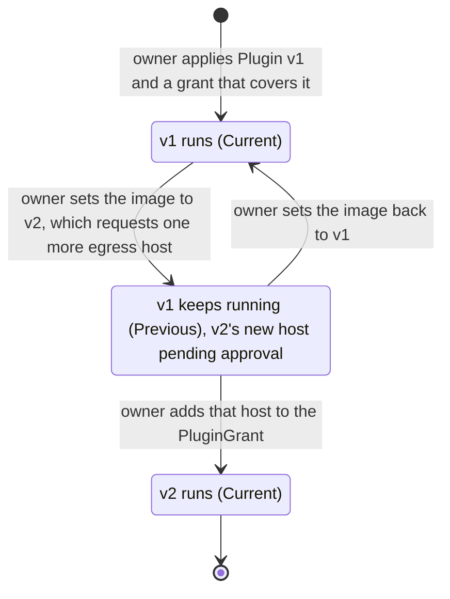
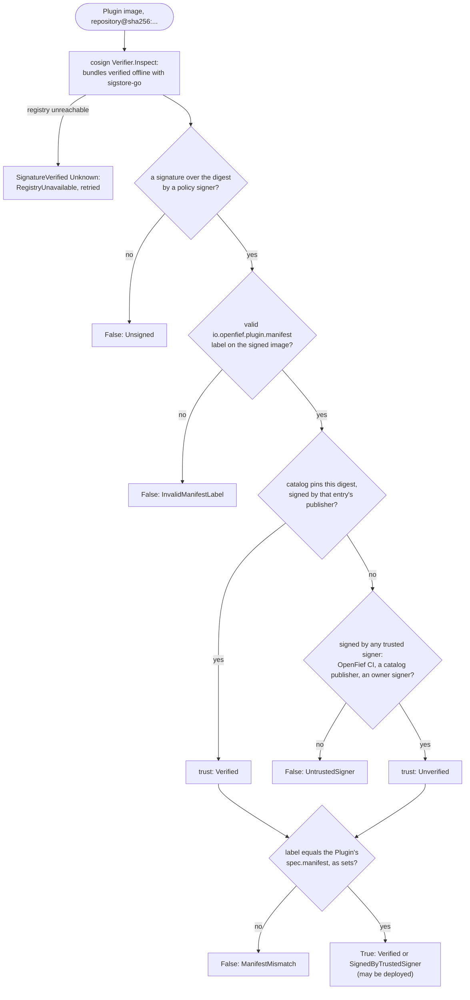
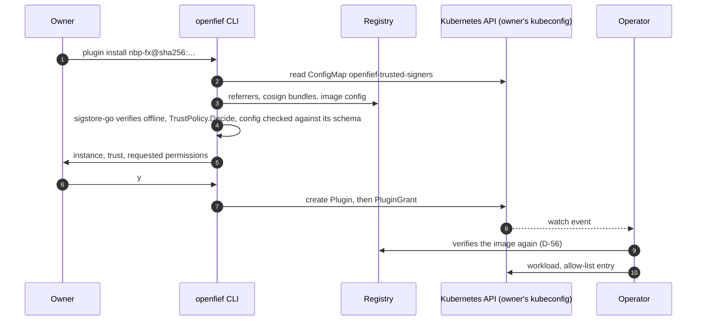
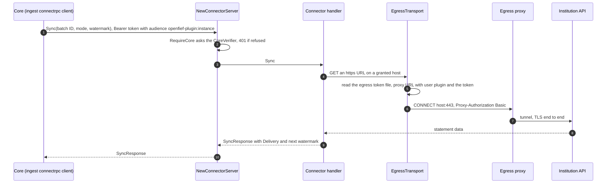

A plugin is how OpenFief reaches the outside world: a connector brings data in, a view shows the record somewhere else. Each plugin runs in its own container, out of the core's process, and gets only what its vendor asked for and its owner approved. This page explains that model, what the pure `plugins` package builds from it, and the connector contract and Go SDK a plugin is written with. The [Operator](operator.md) page covers how the operator applies it to a cluster, and [Egress](egress.md) covers the proxy that enforces plugins' outbound hosts.

## Concepts

**Plugin and instance.** A [plugin](../glossary.md) is one installed, named instance of a plugin image. The same image can be installed twice under two names, such as one instance per IBKR account, and each instance has its own config, Secrets, grant and [egress allow-list](../glossary.md) (D-48). Its ServiceAccount, objects, grant and allow-list entry are all keyed by its name. Secrets are the exception: their names come from the manifest, which must equal the image's signed label, so every instance of one image mounts the same Secret names (see [Decisions](#decisions)).

**Capability.** What a plugin may act as: `connector` or `view` in M0. A plugin that ends up with no approved [capability](../glossary.md) has nothing it may do, so it does not run.

**Manifest.** The [manifest](../glossary.md) is what a plugin declares: capabilities, [egress hosts](../glossary.md) (hostname and port), Secrets with the path to mount each at, [data tiers](../glossary.md), and a JSON Schema for its config. D-42 puts it in a label on the image config, so one signature covers both the code and the permissions it asks for, and it can be read from the container registry without running the image. The `Plugin` resource carries a copy, which must equal the signed label.

**Requested, granted and effective permissions.** The principle of least privilege (Saltzer and Schroeder, 1975) says every program should hold only the privileges its job needs. Capability-based security (Dennis and Van Horn, 1966) goes further: a permission is something you hold and can be shown, not something looked up from who you are. OpenFief splits a plugin's permissions in two (D-16). The `Plugin` resource carries what the vendor requests; the [grant](../glossary.md), a `PluginGrant` resource, carries what the [owner](../glossary.md) approved. Only what both hold is enforced: the plugin's [effective permissions](../glossary.md). A grant that approves more than requested adds nothing, and a request beyond the grant gets nothing.

**Pending approval and rollout.** When a new version of a plugin requests something its grant lacks, that difference is [pending approval](../glossary.md). The owner approves it by adding it to the grant. Until then the version that already ran keeps running, limited to the current grant. Which version runs, if any, is the plugin's [rollout](../glossary.md). Upgrades are always manual, even when the permissions don't change (D-47): the owner changes the image, nothing else does.

**Plugin identity.** Each instance runs as the ServiceAccount `plugin-<name>` in the `openfief` namespace and proves it with projected ServiceAccount tokens. That is its [plugin identity](../glossary.md). It presents a token with audience `openfief-core` to the core (D-27). A plugin with egress also gets a second token, audience `openfief-egress`, for the egress proxy, so the proxy never sees a token the core would accept (D-63). The [Egress](egress.md#concepts) page explains projected tokens.

**Image references and digest pinning.** A tag such as `:1.4` is a pointer that anyone who can push to the repository can move. A digest (`sha256:...`) is the hash of the image's OCI manifest, which in turn hashes every layer, so it names exactly one image. Pulling by digest has been possible since the Docker Registry v2 API (2015). Pinning by digest means the image the owner approved is the image that runs, and it is what a signature covers. An [image reference](../glossary.md) in OpenFief is always `repository@sha256:<hex>`, never a tag (D-17).

**Signatures and trusted signers.** [Sigstore](../glossary.md) is an open project, started in 2021, for signing software; cosign is its tool for container images. With keyless signing, the signer proves an identity such as a CI workflow through OpenID Connect, gets a short-lived certificate for it, and the signature is recorded in a public transparency log. A verifier checks *who* signed instead of guarding long-lived keys. The operator accepts three kinds of [trusted signer](../glossary.md): OpenFief's CI, publishers pinned in the catalog, and signers the owner adds (D-45). It checks every image itself, offline, with a bundled trust root (D-56). An image without a valid signature from a trusted signer is never deployed, with no override (D-57).

**Catalog and verified plugins.** The [catalog](../glossary.md) is one file in this repository, released with the product, that lists first-party and verified plugins (D-43). A [verified plugin](../glossary.md) is one whose catalog entry pins a version the author reviewed: the publisher's signed image digest and signer identity (D-44). Anything installed by image reference alone is shown as unverified. There are no subscribable third-party catalogs; R-12 records what happened to OpenClaw's open skill registry when anyone could publish to it.

**Workload.** The [workload](../glossary.md) is everything the operator creates for one plugin, compiled from its effective permissions: identity, token, Secret mounts, environment, NetworkPolicy and egress allow-list (D-11). The Kubernetes Deployment is only one part of it.

**Contracts.** Plugins speak protobuf contracts over [Connect RPC](../glossary.md), which serves one service as gRPC or as plain HTTP with JSON (D-11). A [connector](../glossary.md) serves the connector contract and the core calls it, to sync and to import files; the core owns the schedules, retries and [import batches](../glossary.md) (D-49). Only the core may call a plugin, and it proves that with a short-lived token whose audience is that plugin instance (D-59). The SDK hides both the serving side and the token handling from a plugin's author.

## How it works

Everything in [`internal/plugins`](../../internal/plugins/) is pure: no I/O, no Kubernetes types, no clock. The operator adapter in [`internal/plugins/operator`](../../internal/plugins/operator/) ([Operator](operator.md)) translates `Plugin` and `PluginGrant` resources into these types, asks them what to do, and turns the answer into Kubernetes objects.

| File | What it holds |
|---|---|
| [manifest.go](../../internal/plugins/manifest.go) | `Manifest`, `Capability`, `DataTier`, `SecretMount`; `Manifest.Validate`, `Manifest.Requested` |
| [permissions.go](../../internal/plugins/permissions.go) | `Permissions`, `Plugin`, `Grant`; `NeedsApproval` |
| [effective.go](../../internal/plugins/effective.go) | `EffectivePermissions` and its only constructor, `Effective` |
| [rollout.go](../../internal/plugins/rollout.go) | `PlanRollout`, `RolloutInput`, `Rollout`, `RolloutOutcome` |
| [compile.go](../../internal/plugins/compile.go) | `Compile`, `Topology`, `Workload` and its parts |
| [image.go](../../internal/plugins/image.go) | `ImageRef`, `ParseImageRef` |
| [egress_host.go](../../internal/plugins/egress_host.go) | `EgressHost`, `ParseEgressHost` |
| [allowlist.go](../../internal/plugins/allowlist.go), [allowlist_codec.go](../../internal/plugins/allowlist_codec.go) | `EgressAllowList.Allows`, `EncodeAllowLists`, `DecodeAllowLists` |
| [identity.go](../../internal/plugins/identity.go) | `Namespace`, `CoreAudience`, `EgressAudience`, `ServiceAccountName`, `PluginForServiceAccount` |
| [trust.go](../../internal/plugins/trust.go) | `Signer`, `SignerIdentity`, `TrustPolicy` and its `Decide`; `Verified` and `Unverified` |
| [catalog.go](../../internal/plugins/catalog.go), [catalog/](../../internal/plugins/catalog/catalog.go) | `Catalog`, `ParseCatalog`, `ParseOwnerSigners`; the embedded catalog file and `catalog.Load` |
| [manifest_label.go](../../internal/plugins/manifest_label.go) | `ManifestLabel`, `ParseManifestLabel`, `Manifest.Equal` |
| [install.go](../../internal/plugins/install.go) | What the `openfief` CLI decides: `ResolveInstallSource` and `DefaultInstanceName` read an install argument, `PlanInstall` builds the `Plugin` and its grant, `SecretsToDelete` picks the Secrets an uninstall removes; see [Installing with the CLI](#installing-with-the-cli) |
| [signing_keys.go](../../internal/plugins/signing_keys.go) | `SigningKeys`, `ParseSigningKeys`: the cluster's token issuer and public signing keys, checked before the operator publishes them for plugins |
| [errors.go](../../internal/plugins/errors.go) | Sentinel errors and `FieldError` |
| [app/install.go](../../internal/plugins/app/install.go) | The CLI's use cases: `Installer.Prepare`, `Install`, `PlanUninstall`, `Uninstall`, `Instances`, and the ports `ImageInspector` and `InstanceStore` they consume |
| [app/egress.go](../../internal/plugins/app/egress.go), [app/tokencache.go](../../internal/plugins/app/tokencache.go) | The egress proxy's use case, `app.Egress`, and its token cache, `app.CachingTokenReviewer`; see [Egress](egress.md) |

### From a plugin and its grant to a workload



**Validation.** `Plugin.Validate`, `Grant.Validate` and `Manifest.Validate` return every problem at once, joined, each a `*FieldError` that names its field (such as `manifest.egress[1]`) and wraps a sentinel from [errors.go](../../internal/plugins/errors.go) for `errors.Is`. The rules:

- A plugin name is a DNS label that starts with a letter. The CRD caps it at 56 characters, so `plugin-<name>` still fits Kubernetes' 63.
- A manifest has at least one capability, and only known ones. Lists may not repeat an entry.
- An egress host is a canonical hostname: lower-case ASCII, at least two labels, no trailing dot, other scripts in their `xn--` form, port 443 when none is written. IP literals, wildcards and single-label names such as `core` are refused, because the proxy, not the plugin, resolves names.
- A Secret name follows Kubernetes' rule. Its mount path is absolute and clean, isn't `/`, doesn't overlap another mount, and stays clear of `/var/run/secrets`, where tokens live.
- A data tier is 1 to 32 letters, digits, `-` or `_`. It is only a name: what a tier holds is undecided (P-33), and nothing enforces tiers yet.
- Config and config schema must be JSON. Checking the config against its schema needs a JSON Schema library, so the operator does it (`operator.ValidateConfig`, which lets `$ref` reach only the schema itself and the standard meta-schemas, never a file or URL).

**Images.** `ParseImageRef` accepts only `repository@sha256:<64 lower-case hex digits>`, with an optional registry host and port, following the OCI name grammar. A tag is refused even next to a digest, since an image named both ways is ambiguous. An `ImageRef` has unexported fields, so a parsed one is always valid.

**Effective permissions.** `Effective(p, g)` keeps the capabilities, egress hosts and data tiers that appear in both. Secrets match by name and keep the mount path the manifest asks for, so a vendor can move a mount without new approval. If no requested capability is granted it returns `ErrNoCapabilityGranted`. `EffectivePermissions` also has unexported fields and copying accessors: the only way to get one is through `Effective`.

**Compiling.** `Compile(e, topology)` is deterministic: every list is sorted, so the same input always gives the same `Workload`. It produces:

- a ServiceAccount `plugin-<name>` in `openfief` with `AutomountAPIToken` false and no Role: plugins never talk to the Kubernetes API;
- a projected token at `/var/run/secrets/openfief/token`, audience `openfief-core`, valid for an hour and refreshed by the kubelet;
- only when some egress host is granted, `EgressToken`: a second projected token at `/var/run/secrets/openfief-egress/token`, audience `openfief-egress` (D-63). The operator names its path in `OPENFIEF_EGRESS_TOKEN_FILE`;
- the granted Secrets, read-only;
- NetworkPolicy rules: ingress from the core on the plugin port; egress to the core's pod port, plus the egress proxy's pod port only when some egress host is granted. No rule ever allows DNS (D-32);
- `HTTPS_PROXY=http://<proxy ClusterIP>:<port>` and `NO_PROXY=<core ClusterIP>`, again only with egress hosts. `Topology` takes addresses, not names, because plugins have no DNS;
- the plugin's `EgressAllowList`: exactly its effective egress hosts.

The operator's `BuildObjects` maps this onto a ServiceAccount, a config ConfigMap, a ClusterIP Service, a NetworkPolicy that denies everything except those rules, and a single-replica Deployment with the `Recreate` strategy, so an old pod never runs beside a new one with other permissions.

### Planning which version runs

`PlanRollout` takes the version the `Plugin` asks for (`Current`), whether checks outside the package passed (`CurrentDeployable`), the version that runs now (`Previous`), and the grant. It returns the outcome, the effective permissions of whatever runs (`Run`), and `Pending`: exactly what `Current` requests beyond the grant, computed by `NeedsApproval`.



Because the previous version runs under the *current* grant, narrowing a grant takes effect at once, even while an upgrade waits. A first install that asks for more than its grant runs nothing.

The operator fills the input from the cluster: `Current` from `spec`, `nil` when the spec is invalid; `CurrentDeployable` only when the spec is valid, the config matches its schema and the image signature is verified; `Previous` from `status.deployed`. Before it runs the previous version it checks that image's signature again. It writes `Pending` to `status.pendingApproval` with an `ApprovalRequired` condition.

A typical upgrade, from the owner's side:



In a cluster, `CurrentDeployable` is false until the image passes the signature check in the next section, and a previous version runs only while its own image still passes it.

### Signatures, trusted signers and the catalog

Whether an image may run is decided by `TrustPolicy.Decide` in [trust.go](../../internal/plugins/trust.go), a pure function over what an adapter found in the registry: a `SignedImage` with the identities whose signatures over the digest verified, and the manifest from the image's signed label. The adapter, [`internal/plugins/cosign`](../../internal/plugins/cosign/doc.go), finds cosign bundles attached to the image as OCI referrers, verifies them offline with sigstore-go against an embedded Sigstore trust root, and reads the label only from a signed image. It and the operator's `PolicyVerifier`, which caches signed images by digest and retries an unreachable registry every minute, are on the [Operator](operator.md) page.



- **Signers.** A `Signer` has a name, one of D-45's three kinds (`SignerOpenFiefCI`, `SignerPublisher`, `SignerOwner`) and a `SignerIdentity`. A keyless identity is an `https` OIDC issuer plus either an exact subject or an RE2 `SubjectPattern` that must match the whole subject; a key identity is one PEM public key. `SignerIdentity.Matches` compares a verified signature's identity with it, and a malformed identity matches nothing.
- **OpenFief's CI** is always trusted: `OpenFiefCI()` is the GitHub Actions issuer with the exact subject of the `images.yml` workflow on `main`.
- **The catalog** is [plugins.json](../../internal/plugins/catalog/plugins.json), embedded in the operator binary with `go:embed` and read by `catalog.Load` (D-43). `ParseCatalog` reads it strictly: unknown fields, trailing data or any invalid entry refuse the whole file. An entry has a name, an image whose digest it pins, and a publisher with an exact identity, never a pattern (D-44). Only the digest counts, so a mirror of the same image is verified too. The file has no entries yet.
- **Owner signers** come from `ParseOwnerSigners`, with the same strictness; they may use a subject pattern or a public key. The operator reads them at start from the optional ConfigMap `openfief-trusted-signers` and refuses to start when the file is invalid.
- **The policy.** `NewTrustPolicy(catalog, owner)` trusts OpenFief's CI, every catalog publisher and every owner signer. `Decide` returns `ErrUnsigned` without signatures and `ErrUntrustedSigner` when none is by a trusted signer. Otherwise the image is `Verified` when a catalog entry pins its digest and that entry's publisher signed it, and `Unverified` when any other trusted signer did. With a declared manifest, it then returns `ErrManifestMismatch` unless `Manifest.Equal` holds. Nothing in the policy can admit an unsigned image (D-57).
- **The manifest label** is `io.openfief.plugin.manifest` on the image config. `ParseManifestLabel` reads the same fields as `spec.manifest`, refuses unknown fields and validates the result. `Manifest.Equal` compares capabilities, egress hosts, Secret mounts and data tiers as sets, and config schemas as JSON values with exact numbers.

### Handing allow-lists to the egress proxy

The operator publishes every running plugin's egress allow-list in the ConfigMap `openfief-egress-allowlist`. `EncodeAllowLists` writes one key per plugin, valued as sorted `host:port` lines, each ending in a newline; a plugin without egress hosts gets an empty value. `DecodeAllowLists` is strict, because the proxy refuses everything it cannot read: lower case, port always written, no duplicates. Each plugin's key is applied with its own server-side apply field manager, so one plugin's reconcile never touches another's entry. How the proxy uses the lists is on the [Egress](egress.md) page.

`ServiceAccountName` and `PluginForServiceAccount` map between a plugin name and its Kubernetes username. The reverse map accepts only `system:serviceaccount:openfief:plugin-<valid name>`, so another namespace, a prefix trick such as `openfief-x`, or the core's own ServiceAccount is never taken for a plugin.

### Installing with the CLI

The owner installs and uninstalls plugins with the `openfief` command-line tool and their own kubeconfig (D-46, D-58):

```
openfief plugin install <catalog-name|image@sha256:...> [--name NAME] [--config FILE]
                        [--trusted-signers FILE] [--yes] [--print]
openfief plugin uninstall <instance> [--yes]
openfief plugin list
```

Every command also takes `--kubeconfig` and `--context`. An install prints what it will apply and asks before applying it:

```
Instance:     nbp
Image:        ghcr.io/arkadiuss/openfief/nbp-fx@sha256:4ef5…
Trust:        unverified: signed by trusted signer openfief-ci (OpenFiefCI, …images.yml@refs/heads/main …); the catalog does not pin this image

It requests, and the PluginGrant will approve, exactly:
  Capabilities: connector
  Egress hosts: api.nbp.pl:443
  Secrets:      none
  Data tiers:   none
  Config:       start: string
                no other keys

Config given: none
Install nbp? [y/N]
```



The pieces, from the inside out. The decisions are pure functions in [install.go](../../internal/plugins/install.go):

- **What to install.** `ResolveInstallSource` takes either a catalog entry's name or an image reference. An argument containing `/`, `:` or `@` is an image reference and must be pinned by digest, so a tag is refused (D-17). An image whose digest the catalog pins resolves to that entry even from a mirror, as the trust check does (D-44). A name that several catalog entries share, one per reviewed version, is refused with the list of their images, since which version a bare name means is not decided.
- **The instance name.** Each install is a named instance (D-48). Without `--name`, `DefaultInstanceName` uses the catalog entry's name, or else the last path component of the image's repository; when neither is a valid name of at most 56 characters, the owner must give one.
- **What is applied.** `PlanInstall` builds a `Plugin` that requests exactly the image's signed manifest label (D-42), with the owner's config, and a grant of the same name that approves exactly what it requests. The owner confirms that list, so the grant is never wider than what was shown, and `NeedsApproval` finds nothing pending.
- **Which Secrets go.** `SecretsToDelete` takes the Secrets an uninstalled instance's manifest and grant name, and keeps any that another installed instance still names: Secret names come from the manifest, so instances of one image share them (see [Decisions](#decisions)).

The use cases in [app/install.go](../../internal/plugins/app/install.go) put these together around two ports. `Installer.Prepare` resolves the argument, has an `ImageInspector` read the image's signatures and signed manifest label, and lets the same `TrustPolicy` the operator uses decide (D-56): an image the operator would never deploy is refused with `ErrNotTrusted` before anything is shown (D-57). It then checks the config against the manifest's JSON Schema and returns a `Proposal`: the `Plugin`, the grant, and the trust decision with the signer that earned it. Nothing changes until the owner confirms and `Install` hands the proposal to the `InstanceStore`, which refuses a name that already has a `Plugin` or a grant: an upgrade is the owner's own edit (D-47). `PlanUninstall` finds the instance and its Secrets, and `Uninstall` asks the store to delete the grant, the `Plugin` and the Secrets no other instance names. Nothing in an uninstall reaches the ledger, so the data the instance brought in stays (D-18, D-58).

The command line itself is [internal/plugins/cli](../../internal/plugins/cli/cli.go). `Run` parses the arguments (flags may come before or after the argument), `RenderProposal` and `RenderUninstallPlan` describe what will change, and nothing changes unless the owner answers `y` or `yes` or passed `--yes`; any other answer, or no input at all, aborts. A config property is summarized by its type, its allowed values or `any`, and whether it is required; `--print` shows the full schema. `WriteInstances` writes `plugin list` as a table of each instance's image, the reason of its `SignatureVerified` condition (`Verified` or `SignedByTrustedSigner`), its `Ready` status, whether a grant exists and whether anything waits for approval.

What it trusts is exactly what the operator trusts (D-45, D-56): OpenFief's CI, the embedded catalog's publishers, and the owner's signers, read from the `openfief-trusted-signers` ConfigMap with the owner's kubeconfig, or from a `--trusted-signers` file. With `--print` the CLI doesn't contact the cluster at all: it writes the summary to standard error and the `Plugin` and `PluginGrant` as one YAML stream to standard output, and trusts only OpenFief's CI and the catalog unless `--trusted-signers` names a file. The signature check is the operator's own `cosign.Verifier` on the bundled trust root, reading the registry anonymously. `cmd/openfief` wires it, `operator.ValidateConfig` and the [kube](operator.md#packages-and-binaries) adapter's `Instances` store into the command line's `Env`.

Uninstalling deletes the `PluginGrant` first, so the operator stops the plugin at once, then the `Plugin`: the garbage collector removes the workload objects it owns, and the operator's reconcile of a deleted `Plugin` drops its allow-list key ([Operator](operator.md)). The CLI then deletes the Secrets no other instance names. It never creates Secrets: the summary lists the ones the owner has to create (D-29).

### The connector contract

[connector.proto](../../proto/openfief/connector/v1/connector.proto) defines `openfief.connector.v1.ConnectorService`, which a connector serves and the core calls (D-49):

- `Sync(SyncRequest)` pulls what the institution reported since the previous sync's `watermark`, an opaque string the connector returns and the core stores once the delivery is imported.
- `ImportFile(stream ImportFileRequest)` maps one statement file. The first message is a `FileHeader` (batch ID, [ingest mode](../glossary.md), file name as a hint, media type); every later one carries the next bytes.
- `ImportBondLots(ImportBondLotsRequest)` maps treasury [bond lots](../glossary.md) the owner entered by hand in the built-in UI, which the core hands on (D-9, D-49). Each `BondLot` is D-9's series code, quantity and purchase date, plus the series' first-period rate and margin as fractions and its early-redemption fee in PLN. It is always a transactions batch. A connector that takes no bond lots answers `UNIMPLEMENTED`, which every other first-party connector does through the generated `Unimplemented` handler; a lot it refuses, `INVALID_ARGUMENT` with the rule.

All three answer with a `Delivery`: the batch ID echoed back, the institution, and the connector's [mapping](../glossary.md) (transactions with their postings, balance assertions and [ingest problems](../glossary.md)), plus any prices, FX rates, index readings, [index levels](../glossary.md) (a market index's closing level, named by the connector's config, D-51) and `bond_terms`: a bond series' instrument with its [series terms](../glossary.md), which make the core value holdings of it as treasury bonds. `ImportBondLots`, `BondLot` and `bond_terms` were added to the contract after it was first published, as additions only, so `task proto:breaking` passes. The file's conventions keep money exact and the record clean: amounts, prices, rates and quantities are decimal strings, never floating point; dates are `YYYY-MM-DD`; currencies are ISO 4217 codes; `account_id` is OpenFief's own ID, never the institution's account number. Every call carries a batch ID the core generates and reuses on a retry, and the core prefixes each transaction's source with the instance's name, so one instance can never write over another's transactions.

`task proto:gen` generates the Go code into [sdk/go/gen](../../sdk/go/gen/), with `protoc-gen-go` and `protoc-gen-connect-go` pinned as local binaries ([buf.gen.yaml](../../buf.gen.yaml)). [buf.yaml](../../buf.yaml) lints the contract with Buf's `STANDARD` rules and checks breaking changes at `FILE` level; `task proto` runs lint, the breaking check against `PROTO_BASE` or `DOCS_BASE` (default `HEAD`), and a check that the generated code is up to date. The core's side of the contract, which translates deliveries into domain values, is on the [Ingest](ingest.md) page.

### The Go SDK

[sdk/go](../../sdk/go/) is its own Apache-2.0 module, `github.com/arkadiuss/openfief/sdk/go`, beside the AGPL core in `go.work` (D-5). Package [`openfief`](../../sdk/go/openfief/) gives a plugin what the operator set up for it:

- **Environment** ([env.go](../../sdk/go/openfief/env.go)): `CoreURL` from `OPENFIEF_CORE_ADDRESS` (a ClusterIP and port; plugins have no DNS), `ListenAddress` from `OPENFIEF_LISTEN_PORT`, `LoadConfig` from `OPENFIEF_CONFIG`.
- **Tokens** ([token.go](../../sdk/go/openfief/token.go)): `TokenFile` reads a token file on *every* call, through an `os.Root` of its directory, because the kubelet rotates projected tokens. Its default is `OPENFIEF_TOKEN_FILE`, then `/var/run/secrets/openfief/token`.
- **Serving the core** ([serve.go](../../sdk/go/openfief/serve.go)): `NewConnectorServer(addr, handler, verifier)` mounts the generated `ConnectorService` handler behind `RequireCore` and speaks HTTP/1.1 and HTTP/2 without TLS (h2c), since `ImportFile` streams. `RequireCore` answers `401` to any request whose `Authorization: Bearer` token the `CoreVerifier` refuses, before the handler sees it. The token's audience is `InstanceAudience(name)`, `openfief-plugin:<instance>`. `ReceiveFile` reads an `ImportFile` stream: exactly one header first, then chunks, up to a size limit the connector sets.
- **Verifying the core** ([verifier.go](../../sdk/go/openfief/verifier.go)): `NewCoreVerifier` builds the SDK's `CoreVerifier`, a `JWKSVerifier`, from `OPENFIEF_INSTANCE`, `OPENFIEF_CORE_SUBJECT` and `OPENFIEF_SA_JWKS_DIR` (default `/var/run/secrets/openfief-sa-jwks`), which the operator sets. It checks the token with [go-jose](https://github.com/go-jose/go-jose) v4 against the cluster's public keys in `jwks.json` and the issuer in `issuer`, both from the mounted `openfief-sa-jwks` ConfigMap (D-59). It allows only RS256, ES256, ES384 and ES512, the algorithms Kubernetes signs with, so `none` and HMAC are refused before any key is tried; it picks the key by the token's key ID and keeps only public RSA and EC signing keys from the set. The claims must name the mounted issuer, the core's ServiceAccount as subject and this instance's audience, and carry an expiry, checked with a one-minute leeway. The files are read on every call and parsed again only when they change, so a rotated key works as soon as the kubelet updates the mount.
- **Running** ([run.go](../../sdk/go/openfief/run.go)): `ServeConnector(ctx, handler)` is a connector's whole serving side: it reads the listen port, builds the `CoreVerifier` with `NewCoreVerifier`, serves until the context is done, then stops taking calls and lets the ones in flight finish for up to 20 seconds.
- **Calling the core** ([core.go](../../sdk/go/openfief/core.go)): `CoreHTTPClient` adds the current `openfief-core` token as a bearer token on every request and never uses a proxy.
- **Reaching an institution** ([egress.go](../../sdk/go/openfief/egress.go)): `NewEgressClient` reads `HTTPS_PROXY` and `OPENFIEF_EGRESS_TOKEN_FILE`. Its `EgressTransport` rebuilds the proxy URL for every request with user `plugin` and the current egress token as the password; Go's HTTP client sends that as a Basic `Proxy-Authorization` header on the CONNECT (D-63). It refuses plain `http` and refuses to send anything without a proxy.

A connector built on the SDK, answering one `Sync`:



### First-party plugins

First-party plugins live in [plugins/](../../plugins/), one directory per image: a thin `main.go` that wires an adapter from `internal/` to the SDK, a `manifest.json`, and a `Dockerfile`. CI builds and signs every `plugins/<name>/Dockerfile` as `ghcr.io/<owner>/<repo>/<name>`, like the core's images. The image's final stage carries the manifest as its `io.openfief.plugin.manifest` label (D-42), so the signature covers it. The image runs as the numeric user `65532:65532` (distroless's nonroot): the operator's plugin pods set `runAsNonRoot`, and the kubelet refuses to start a container whose image names its user, since it can't tell that a name isn't root. A third-party plugin image needs a numeric `USER` for the same reason. `manifest.json` is the source: `task plugins:labels` writes it, compacted, into the Dockerfile, and `task plugins:labels:check`, part of `task check`, fails when a label or a demo `Plugin`'s `spec.manifest` differs from it ([plugin-labels.sh](../../scripts/plugin-labels.sh)). Each plugin's `TestManifest` parses `manifest.json` with `ParseManifestLabel` and checks it asks for exactly what the plugin needs.

| Plugin | Serves | Egress | Secrets | Config |
|---|---|---|---|---|
| [nbp-fx](../../plugins/nbp-fx/) | `Sync`: NBP table A rates to PLN, through [valuation/nbp](../../internal/valuation/nbp/client.go) and `app.FetchRates`. `ImportFile` is `Unimplemented`. | `api.nbp.pl` | none | `start`, the first day of the first sync; by default the 93 days up to today |
| [ibkr-flex](../../plugins/ibkr-flex/) | `Sync`: the owner's Flex Query from the Flex Web Service; `ImportFile`: an uploaded Flex statement. Both map with [ingest/ibkrflex](../../internal/ingest/ibkrflex/mapper.go) in the mode the call names. | `ndcdyn.interactivebrokers.com` | `ibkr-flex-credentials`, files `token` and `query-id`, at `/etc/openfief/ibkr-flex` | `accounts`: each IBKR account ID to the OpenFief account it feeds |
| [ghostfolio](../../plugins/ghostfolio/) | Nothing: a [view](../glossary.md) that runs [internal/views/ghostfolio](../../internal/views/ghostfolio/sync.go)'s reconcile loop on its own timer, reading the read API with its projected token ([Ghostfolio view](ghostfolio.md)) | none yet (see [Not built yet](#not-built-yet)) | `ghostfolio-credentials`, file `security-token`, at `/etc/openfief/ghostfolio` | `url`, the owner's Ghostfolio; `interval`, `1h` by default; `listings`: each listed instrument's Ghostfolio `dataSource` and `symbol` by ISIN |
| [treasury-bonds](../../plugins/treasury-bonds/) | `ImportBondLots`: the owner's manual bond lots, mapped by [ingest/treasurybonds](../../internal/ingest/treasurybonds/mapper.go) into the configured account, with each series' terms (D-9). `Sync`: the [index readings](../glossary.md) the bonds need, CPI from GUS through [valuation/gus](../../internal/valuation/gus/client.go) and the NBP reference rate through [valuation/nbp](../../internal/valuation/nbp/refrate.go), picked by [ingest/treasurybonds](../../internal/ingest/treasurybonds/indices.go). `ImportFile` is `Unimplemented`. | `api-sdp.stat.gov.pl`, `static.nbp.pl` | none | `account`: the OpenFief account its lots go into; `start`, the first month of index readings, by default January 13 years back |
| [eodhd](../../plugins/eodhd/) | `Sync`: end-of-day closes of the configured instruments and levels of the configured market indices, from EODHD (D-22, D-51), through [valuation/eodhd](../../internal/valuation/eodhd/client.go). `ImportFile` is `Unimplemented`. | `eodhd.com` | `eodhd-credentials`, file `api-token`, at `/etc/openfief/eodhd` | `instruments`: each an `isin`, an optional EODHD `exchange` code and an optional ledger `symbol`; `indices`: each a `name` and an EODHD `ticker` such as `FAKE20.INDX`; `start`, the first day of a first sync, by default EODHD's whole history |

`nbp-fx`'s watermark is the date of the latest rates it delivered: a sync asks NBP for the days after it up to today (UTC), and keeps it when nothing new is published. `ibkr-flex`'s Flex Query sets its own period, and importing it again changes nothing (D-18), so it returns the watermark it was given. It reads the Flex token and query ID from their files on every sync and never logs them. Both answer `Unavailable` when the institution fails, so the core retries the batch, and `InvalidArgument` for input they can't read. They write their deliveries with [ingest/delivery](../../internal/ingest/delivery/delivery.go) ([Ingest](ingest.md)).

`treasury-bonds` takes its lots from the owner: neither the registry nor the bank that sells the bonds offers an API (R-5). It reads each lot with `delivery.BondLots`, maps the lots with `treasurybonds.Mapper` as of today in Warsaw, and writes the terms with `delivery.BondTerms`. A lot that doesn't parse or breaks a rule is `InvalidArgument`, naming the rule, and nothing is delivered. One instance serves one account, which its config names and which the owner binds it to ([Ingest](ingest.md#treasury-bond-lots)).

Its `Sync` delivers the [period index](../glossary.md) readings that set the bonds' rates after their first interest period, from two public sources reached anonymously, so it needs egress but no Secret:

- **CPI**, year on year, from GUS's SDP API (`api-sdp.stat.gov.pl`, anonymous requests limited to 5 a second and 100 in 15 minutes). `gus.Client.CPI` asks for one year per request: indicator 1832 up to 2025 and indicator 2728, GUS's COICOP 2018 series, from 2026; both are CPI for all of Poland with the same month a year before = 100. It returns each month's final value as a fraction (104.9 is `0.049`) and stops before the first month that is missing or only preliminary, estimated or forecast.
- **The NBP reference rate**, from NBP's archive of its base rates (`static.nbp.pl/dane/stopy/stopy_procentowe_archiwum.xml`, every change since 1998 with the day it took effect); NBP's Web API at `api.nbp.pl` serves no interest rates. `nbp.Archive.ReferenceRates` returns the changes in order, as fractions.

`treasurybonds.IndexSync` picks what to deliver. Its watermark holds the last month of each index, such as `cpi=2026-09;reference-rate=2026-11`, and a first sync starts at the configured `start`. CPI comes for the months after its mark, at most four years per sync so that a long history stays under GUS's limit, and a year GUS hasn't published in full ends it. The reference rate comes for each month after its mark whose reference-rate day (`pl.ReferenceRateDay`, the tenth [business day](../glossary.md) before the month) is over: the rate in force on that day (`pl.RateInForce`), as the reading of the month whose ROR and DOR interest periods it sets. NBP is asked only when such a month is due. `delivery.IndexReadings` dates every reading on its month's first day, and the core records it for that month ([Valuation](valuation.md#prices-fx-rates-and-index-readings)). A watermark it never wrote is `InvalidArgument`; GUS or NBP failing is `Unavailable`, so the core retries the batch with the same watermark.

`eodhd` is the market-data connector. The core's `SyncRequest` names no instruments, so the owner lists them in the instance's config, by ISIN, as `nbp-fx` decides for itself which rates to fetch. On each sync it reads the API key from its Secret, finds each instrument's listing with `eodhd.Pick` (the `exchange` decides between several), and fetches the closes after the instrument's mark up to today (UTC). It delivers each close as a [price](../glossary.md) of the instrument with the configured `symbol`, or EODHD's code, in the listing's currency, so the price matches the ledger's instrument only when the symbol does (D-35). Each index's levels go in the delivery's `index_levels`, under the configured name. Its watermark is JSON with one date per ISIN and per index name, such as `{"prices":{"XX00000SYNT3":"2025-01-03"},"indices":{"FAKE20":"2025-01-03"}}`, so an instrument added later starts at `start` while the others continue. An ISIN that isn't listed on a supported exchange, or is listed on several with no `exchange`, and a ticker EODHD doesn't know, become `unsupported` ingest problems and the rest is still delivered. A missing key is `FailedPrecondition`; EODHD failing otherwise is `Unavailable`. The demo doesn't run it, since it needs a key.

## Decisions

Implemented, fully or in the part named:

- **D-11** (part) Compiled manifests, a protobuf contract, the Go SDK. (RBAC compiles to none: a ServiceAccount without a Role.)
- **D-13, D-15** `Plugin` resource; operator confined to `openfief`.
- **D-16** Enforce only what request and grant share.
- **D-17** Images pinned by digest, signatures verified with cosign bundles.
- **D-27** (part) Plugins get, and the SDK sends, `openfief-core` tokens; the core accepts view plugins' tokens on the `AuthService` and the read API ([Identity](identity.md#in-the-core)).
- **D-32** (part) Plugins reach only core and proxy, no DNS.
- **D-42** Manifest in a signed image label; `spec.manifest` must match it.
- **D-43** (part) One catalog file, embedded in the operator; still empty.
- **D-44** Catalog entries pin a digest and the publisher's identity.
- **D-45** Three signer kinds: OpenFief CI, catalog publishers, owner signers.
- **D-46** The `openfief` CLI verifies, shows the request, and applies or prints the `Plugin` and an exactly matching grant.
- **D-47** Upgrades happen only when the owner edits.
- **D-48** (part) Every instance keyed by its own name, except Secrets.
- **D-49** (part) Connector contract: the core calls `Sync`, `ImportFile` and `ImportBondLots`.
- **D-56** Operator verifies offline; status tells verified from only signed and names the signer; the built-in UI shows it ([Built-in UI](ui.md#pages)).
- **D-57** No setting deploys an image the policy refuses.
- **D-58** Uninstall deletes the grant, the `Plugin` (and so the workload and allow-list entry) and unshared Secrets, and keeps the ledger data, which the read API marks as coming from a removed instance ([Read API](read-api.md#installed-plugins-and-removed-instances)).
- **D-59** Only the core reaches a plugin; the SDK verifies its TokenRequest token with the keys the operator publishes.
- **D-63** (part) Separate egress token, rebuilt into the proxy URL per request.
- **D-5** Contracts and Go SDK licensed Apache-2.0.

Worth knowing when you check the code against the decisions:

- **D-42:** the `Plugin` still carries the manifest in `spec.manifest`, and the operator compares it with the signed label instead of taking the label as the request. A `Plugin` that declares anything else is refused with `ManifestMismatch`, so the signed label is what counts.
- **D-44:** a catalog entry pins the digest, not the repository, so the same image pulled from a mirror is verified too.
- **D-45:** a catalog publisher is trusted for any image it signs; images the catalog doesn't pin show as unverified.
- **D-48** gives each instance its own Secrets, but Secret names come from the manifest, and D-42 makes the manifest the image's. Two instances of one image, such as one per IBKR account, therefore ask for the same Secret names, and nothing in the code gives each its own.

## Verification

Run `task test` from the repository root; it tests both Go modules, the core and `sdk/go`, and installs the API server and etcd for the operator's envtest suite. The pure tests alone run with `go test ./internal/plugins/...`, though the operator package then fails for lack of `KUBEBUILDER_ASSETS`; the SDK's run with `go test ./...` inside `sdk/go`. Requirement IDs come from kibi (`node_modules/.bin/kibi search "<question>"`); each test file is also a kibi test entity, such as `TEST-plugins-rollout`.

| Behavior | Tests | Requirement |
|---|---|---|
| Only what both request and grant hold is enforced; no capability means nothing | [effective_test.go](../../internal/plugins/effective_test.go): `TestEffective` ("partial grant enforces only the overlap", "grant approves more than requested", "no capability granted") | REQ-plugins-effective-intersection |
| An upgrade reports exactly what is unapproved; a new digest or moved mount is not new | [permissions_test.go](../../internal/plugins/permissions_test.go): `TestNeedsApproval` | REQ-plugins-upgrade-approval-diff |
| An upgrade asking for more keeps the previous version; a first install waits; a narrowed grant applies at once | [rollout_test.go](../../internal/plugins/rollout_test.go): `TestPlanRollout`, `TestPlanRolloutRefuses` | REQ-plugins-rollout-upgrade-waits, REQ-plugins-rollout-no-grant |
| Ingress only from the core, egress only to the core and, with egress hosts, the proxy; never DNS | [compile_test.go](../../internal/plugins/compile_test.go): `TestCompile`, `TestCompileNeverAllowsDNS` | REQ-plugins-network-policy-core-and-proxy |
| Proxy settings and allow-list only with egress hosts; same input, same workload | `TestCompile` ("no egress granted: ..."), `TestCompileDeterministic` | REQ-plugins-proxy-env-and-allow-list |
| Own ServiceAccount, no API token, `openfief-core` token, read-only Secrets | `TestCompile` | REQ-plugins-workload-identity-secrets |
| A second, `openfief-egress` token only with granted egress hosts | `TestCompile` | REQ-plugins-egress-token-projected |
| Images by digest only, tags refused | [image_test.go](../../internal/plugins/image_test.go): `TestParseImageRef` | REQ-plugins-image-digest-only |
| Every invalid manifest, plugin or grant field reported by name | [manifest_test.go](../../internal/plugins/manifest_test.go): `TestManifestValidate`; [permissions_test.go](../../internal/plugins/permissions_test.go): `TestPluginValidate`, `TestGrantValidate` | REQ-plugins-manifest-validation |
| Egress hosts canonical; IP literals, wildcards, single labels refused | [egress_host_test.go](../../internal/plugins/egress_host_test.go): `TestParseEgressHost` | REQ-plugins-egress-host-canonical |
| Only `plugin-<name>` in `openfief` maps to a plugin | [identity_test.go](../../internal/plugins/identity_test.go): `TestPluginForServiceAccount` | REQ-plugins-identity-service-account |
| Allow-list ConfigMap format, strict decoding | [allowlist_codec_test.go](../../internal/plugins/allowlist_codec_test.go): `TestEncodeAllowLists`, `TestDecodeAllowLists`, `TestAllowListsRoundTrip` | REQ-plugins-allow-list-configmap-format |
| The connector server serves only callers the verifier accepts; files arrive as one header, then chunks, within a limit | [serve_test.go](../../sdk/go/openfief/serve_test.go): `TestConnectorServerRequiresCore`, `TestConnectorServerSync`, `TestReceiveFile`, `TestInstanceAudience` | REQ-sdk-go-core-only, REQ-sdk-go-receive-file |
| Every egress request carries the current token as the proxy URL's password; plain http and a missing proxy or token are refused | [egress_test.go](../../sdk/go/openfief/egress_test.go): `TestEgressSendsCurrentTokenOnEveryConnect`, `TestEgressRefusals`, `TestNewEgressClient` | REQ-sdk-go-egress-proxy-url, REQ-plugins-sdk-token-per-request |
| Tokens are read from their file on every call, never cached | [token_test.go](../../sdk/go/openfief/token_test.go): `TestTokenFileRereadsRotatedToken`, `TestTokenFile`; [core_test.go](../../sdk/go/openfief/core_test.go): `TestCoreHTTPClientSendsCurrentToken` | REQ-sdk-go-token-rotation |
| Environment names match what the operator sets | [env_test.go](../../sdk/go/openfief/env_test.go): `TestCoreURL`, `TestListenAddress`, `TestLoadConfig`, `TestTokenFileFromEnv` | REQ-sdk-go-plugin-environment |
| Only the core's unexpired token for this instance, signed by a cluster key, passes; `none`, HMAC, other audiences, subjects and issuers fail; rotated keys apply at once | [verifier_test.go](../../sdk/go/openfief/verifier_test.go): `TestJWKSVerifier`, `TestJWKSVerifierKeySet`, `TestJWKSVerifierRotatedKeys`, `TestRequireCoreWithJWKSVerifier`, `TestNewCoreVerifier` | REQ-sdk-go-jwks-verifier |
| `ServeConnector` serves only the core's token and shuts down cleanly | [run_test.go](../../sdk/go/openfief/run_test.go): `TestServeConnector`, `TestServeConnectorNeedsEnvironment` | REQ-sdk-go-serve-connector |
| nbp-fx: each sync asks for the days after the watermark up to today and moves the watermark to the latest rates; NBP failing is `Unavailable`; no `ImportFile` | [nbp-fx connector_test.go](../../plugins/nbp-fx/connector_test.go): `TestSync`, `TestServedConnector`; [main_test.go](../../plugins/nbp-fx/main_test.go): `TestStartDate`, `TestManifest` | REQ-plugins-nbp-fx-sync |
| ibkr-flex: `Sync` and `ImportFile` map a Flex statement in the requested mode; credentials from the Secret, never in an error | [ibkr-flex connector_test.go](../../plugins/ibkr-flex/connector_test.go): `TestSync`, `TestSyncModes`, `TestImportFile`, `TestFetchCode`, `TestManifest` | REQ-plugins-ibkr-flex-connector |
| ghostfolio: the manifest asks for the view capability and the token Secret only; the config is checked; the timer loop | [ghostfolio main_test.go](../../plugins/ghostfolio/main_test.go): `TestManifest`, `TestConfigParse`, `TestReadSecretFile`, `TestNewSyncer`, `TestNewSyncerWith`, `TestLoop` | REQ-plugins-ghostfolio-plugin |
| treasury-bonds: `ImportBondLots` maps the owner's lots into the configured account, or is `InvalidArgument` naming the rule; only the core may call; `Sync` delivers the CPI and reference-rate readings after the watermark; the manifest asks for the connector capability and egress to GUS and NBP | [treasury-bonds connector_test.go](../../plugins/treasury-bonds/connector_test.go): `TestImportBondLots`, `TestImportBondLotsRefuses`, `TestSyncDeliversIndexReadings`, `TestSyncRefuses`; [main_test.go](../../plugins/treasury-bonds/main_test.go): `TestManifest`, `TestDateIn`, `TestStartDate` | REQ-plugins-treasury-bonds-connector, REQ-treasurybonds-index-sync |
| treasury-bonds' index sync: each index after its own watermark, the reference rate in force on each month's reference-rate day, CPI at most four years a sync | [indices_test.go](../../internal/ingest/treasurybonds/indices_test.go): `TestIndexWatermark`, `TestDefaultIndexStart`, `TestReferenceReadings`, `TestIndexSyncReadings`, `TestIndexSyncReadingsFails` | REQ-treasurybonds-index-sync, SCEN-treasurybonds-index-sync, TEST-treasurybonds-indices |
| eodhd: each sync delivers closes and index levels after each series' mark up to today; unlisted, ambiguous and unknown tickers are problems; EODHD failing is `Unavailable`, a missing key `FailedPrecondition`; no `ImportFile` | [eodhd connector_test.go](../../plugins/eodhd/connector_test.go): `TestSync`, `TestNextFrom`, `TestServedConnector`; [main_test.go](../../plugins/eodhd/main_test.go): `TestManifest`, `TestConfigParse`, `TestNewConnector`, `TestToday` | REQ-plugins-eodhd-sync, REQ-plugins-eodhd-config |
| Each Dockerfile's label equals its `manifest.json`, and so does a demo `Plugin`'s manifest | [plugin-labels.test.sh](../../scripts/tests/plugin-labels.test.sh) | REQ-plugins-first-party-manifest-label |
| Only an issuer and public RSA or EC keys with IDs are published | [signing_keys_test.go](../../internal/plugins/signing_keys_test.go): `TestParseSigningKeys`, `TestSigningKeysData` | REQ-plugins-signing-keys-published |
| Every plugin mounts the keys and gets its instance name and the core's username | `TestCompile` | REQ-plugins-workload-core-auth |
| Verified only when the catalog pins the digest and its publisher signed it; any other trusted signer gives unverified; unsigned, untrusted or a manifest mismatch is refused | [trust_test.go](../../internal/plugins/trust_test.go): `TestTrustPolicyDecide`, `TestNewTrustPolicy` | REQ-plugins-trust-decision, REQ-plugins-verified-entry-pins, REQ-plugins-trusted-signers-only, REQ-plugins-unsigned-never-deployed |
| A signature counts only for the exact issuer and an exact or fully matching subject, or the same key | `TestSignerIdentityMatches`, `TestSignerIdentityValidate`, `TestSignerValidate` | REQ-plugins-signer-identity-match |
| Catalog and owner signers parsed strictly; publishers need exact identities | [catalog_test.go](../../internal/plugins/catalog_test.go): `TestParseCatalog`, `TestCatalogValidate`, `TestParseOwnerSigners` | REQ-plugins-catalog-format |
| An install argument is one catalog entry or a digest-pinned image; tags, unknown and shared names are refused; the instance is named by default | [install_test.go](../../internal/plugins/install_test.go): `TestResolveInstallSource` | REQ-plugins-cli-install-source |
| An install requests the signed manifest and grants exactly that; names the CRD refuses are refused | `TestPlanInstall`, `TestPlanInstallRefuses` | REQ-plugins-cli-install-plan |
| An uninstall keeps Secrets another instance still names | `TestSecretsToDelete` | REQ-plugins-cli-uninstall-secrets |
| An install is verified with the operator's trust policy and refused when it would never deploy, when the schema rejects its config or when the name exists; uninstall keeps shared Secrets; list sorts by name | [app/install_test.go](../../internal/plugins/app/install_test.go): `TestInstallerPrepare`, `TestInstall`, `TestUninstall` | REQ-plugins-cli-install-verifies, REQ-plugins-cli-uninstall, REQ-plugins-cli-list |
| The summary shows trust, every requested permission and the config properties; uninstall plans and the list table read as intended | [cli/render_test.go](../../internal/plugins/cli/render_test.go): `TestRenderProposal`, `TestRenderProposalWithoutPermissions`, `TestRenderUninstallPlan`, `TestWriteInstances` | REQ-plugins-cli-permission-summary |
| Nothing changes without `y`, `yes` or `--yes`; `--print` never contacts the cluster; signers from the cluster or a file | [cli/cli_test.go](../../internal/plugins/cli/cli_test.go): `TestRun` | REQ-plugins-cli-confirmation, REQ-plugins-cli-owner-signers, REQ-plugins-cli-print-resources |
| The binary verifies a key-signed cosign bundle in a registry with the operator's verifier before installing, and refuses unsigned and untrusted images | [cmd/openfief/main_test.go](../../cmd/openfief/main_test.go): `TestInstallVerifiesSignatures`, `TestPrint`, `TestInstallListUninstall` | REQ-plugins-cli-install-verifies |
| The embedded catalog loads | [catalog/catalog_test.go](../../internal/plugins/catalog/catalog_test.go): `TestLoad` | REQ-plugins-catalog-in-repo |
| The manifest label parses strictly and must equal the declared manifest as sets | [manifest_label_test.go](../../internal/plugins/manifest_label_test.go): `TestParseManifestLabel`, `TestManifestEqual` | REQ-plugins-manifest-label-match, REQ-plugins-manifest-in-image |

The cosign adapter's bundle checks (REQ-plugins-cosign-bundle-verification) and the operator's use of the decision (REQ-operator-policy-verifier) are tested with the operator. The contract's message rules (REQ-connector-contract-messages) are verified by `TestConnectorServerSync` here and by the core's Connect adapter tests (`TEST-ingest-connectrpc-client`, `TEST-ingest-connectrpc-mapping`). To check by hand that an upgrade waits, read the "upgrade requesting a new host keeps the previous version" case in `TestPlanRollout`: the expected `Run` is the previous image with the old hosts, and `Pending` holds only the new host.

## Not built yet

- **Verified plugins (D-43, D-44).** The catalog file exists but lists no plugin, so every image that runs today is unverified.
- **Packaging the CLI.** `cmd/openfief` builds with `go build ./cmd/openfief`; no release step ships the binary yet, and `plugin install` can't upgrade an installed instance (D-47 leaves upgrades to the owner's own edit).
- **More contracts and SDKs (D-11).** A plugin serves only the connector contract. View plugins serve no contract of their own (P-9 outlines one, but it is a proposal): they are clients of the read API and of the core's services for view plugins (`AuthService`, `ModelPortfolioService`, `BondLotService`), whose Go code `sdk/go/gen` carries. There is no TypeScript SDK.
- **First-party plugins in the catalog (D-43).** `nbp-fx`, `ibkr-flex`, `eodhd`, `treasury-bonds`, `ghostfolio` and `ui` are built and signed by CI but not in the catalog, so they run as signed by a trusted signer, not verified.
- **The core naming what to price (D-22).** `eodhd` fetches the instruments its config lists; the core doesn't tell a market-data connector which instruments are held or which indices the model portfolio targets.
- **One Secret per IBKR instance (D-48).** `ibkr-flex`'s manifest names one Secret, `ibkr-flex-credentials`, so two instances of it, one per IBKR account, read the same credentials (see [Decisions](#decisions)).
- **Core side of plugin identity (D-27).** The core verifies view plugins' `openfief-core` tokens only; a connector's token is accepted nowhere, since the core calls connectors and not the other way round (D-49).
- **An owner-chosen egress host.** A manifest is the signed image label (D-42), so it can't request a host the owner picks at install, such as the [Ghostfolio view](ghostfolio.md#not-built-yet)'s Ghostfolio; how such a host enters the grant and the allow-list is not decided.
- **One Secret per instance on uninstall (D-48, D-58).** A Secret another installed instance names is kept, because instances of one image share Secret names.
- **Data tiers.** Carried from manifest to workload but enforced nowhere (P-33 is undecided).
