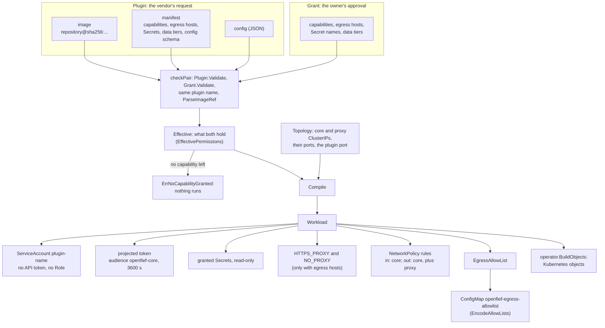
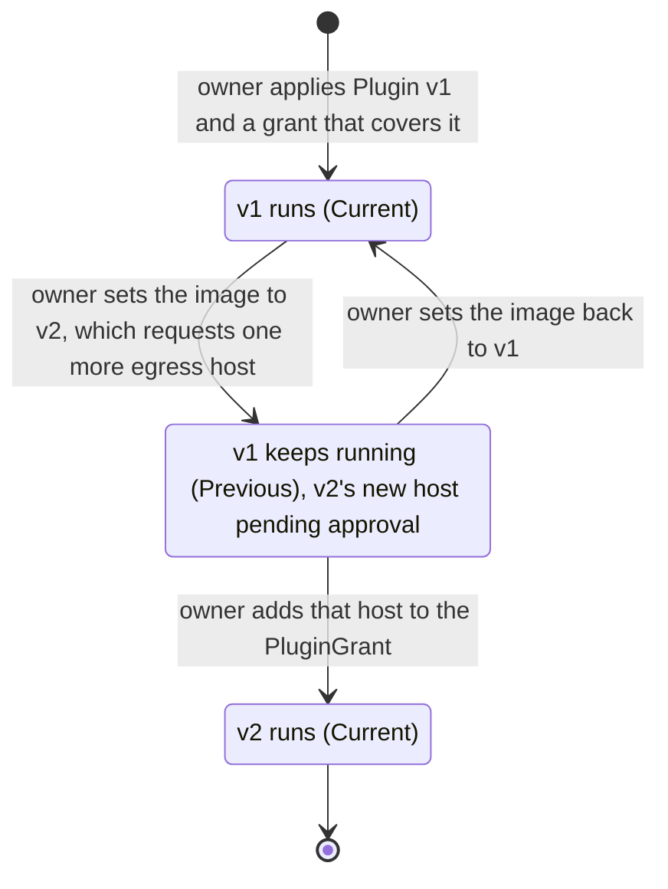

A plugin is how OpenFief reaches the outside world: a connector brings data in, a view shows the record somewhere else. Each plugin runs in its own container, out of the core's process, and gets only what its vendor asked for and its owner approved. This page explains that model and shows what the pure `plugins` package builds from it. The [Operator](operator.md) page covers how the operator applies it to a cluster, and [Egress](egress.md) covers the proxy that enforces plugins' outbound hosts.

## Concepts

**Plugin and instance.** A [plugin](../glossary.md) is one installed, named instance of a plugin image. The same image can be installed twice under two names, such as one instance per IBKR account, and each instance has its own config, Secrets, grant and [egress allow-list](../glossary.md) (D-48). Its ServiceAccount, objects, grant and allow-list entry are all keyed by its name. Secrets are the exception: their names come from the manifest, so two instances get different Secrets only if their manifests name different ones.

**Capability.** What a plugin may act as: `connector` or `view` in M0. A plugin that ends up with no approved [capability](../glossary.md) has nothing it may do, so it does not run.

**Manifest.** The [manifest](../glossary.md) is what a plugin declares: capabilities, [egress hosts](../glossary.md) (hostname and port), Secrets with the path to mount each at, [data tiers](../glossary.md), and a JSON Schema for its config. D-42 puts it in a label on the image config, so one signature covers both the code and the permissions it asks for, and the CLI can read it from the container registry without running the image.

**Requested, granted and effective permissions.** The principle of least privilege (Saltzer and Schroeder, 1975) says every program should hold only the privileges its job needs. Capability-based security (Dennis and Van Horn, 1966) goes further: a permission is something you hold and can be shown, not something looked up from who you are. OpenFief splits a plugin's permissions in two (D-16). The `Plugin` resource carries what the vendor requests; the [grant](../glossary.md), a `PluginGrant` resource, carries what the [owner](../glossary.md) approved. Only what both hold is enforced: the plugin's [effective permissions](../glossary.md). A grant that approves more than requested adds nothing, and a request beyond the grant gets nothing.

**Pending approval and rollout.** When a new version of a plugin requests something its grant lacks, that difference is [pending approval](../glossary.md). The owner approves it by adding it to the grant. Until then the version that already ran keeps running, limited to the current grant. Which version runs, if any, is the plugin's [rollout](../glossary.md). Upgrades are always manual, even when the permissions don't change (D-47): the owner changes the image, nothing else does.

**Plugin identity.** Each instance runs as the ServiceAccount `plugin-<name>` in the `openfief` namespace and proves it with a projected ServiceAccount token, audience `openfief-core` (D-27). That is its [plugin identity](../glossary.md). The [Egress](egress.md#concepts) page explains projected tokens.

**Image references and digest pinning.** A tag such as `:1.4` is a pointer that anyone who can push to the repository can move. A digest (`sha256:...`) is the hash of the image's OCI manifest, which in turn hashes every layer, so it names exactly one image. Pulling by digest has been possible since the Docker Registry v2 API (2015). Pinning by digest means the image the owner approved is the image that runs, and it is what a signature covers. An [image reference](../glossary.md) in OpenFief is always `repository@sha256:<hex>`, never a tag (D-17).

**Signatures and trusted signers.** [Sigstore](../glossary.md) is an open project, started in 2021, for signing software; cosign is its tool for container images. With keyless signing, the signer proves an identity such as a CI workflow through OpenID Connect, gets a short-lived certificate for it, and the signature is recorded in a public transparency log. A verifier checks *who* signed instead of guarding long-lived keys. The operator accepts three kinds of [trusted signer](../glossary.md): OpenFief's CI, publishers pinned in the catalog, and signers the owner adds (D-45). It checks every image itself, offline, with a bundled trust root (D-56). An image without a valid signature from a trusted signer is never deployed, with no override (D-57).

**Catalog and verified plugins.** The [catalog](../glossary.md) is one file in this repository, released with the product, that lists first-party and verified plugins (D-43). A [verified plugin](../glossary.md) is one whose catalog entry pins a version the author reviewed: the publisher's signed image digest and signer identity (D-44). Anything installed by image reference alone is shown as unverified. There are no subscribable third-party catalogs; R-12 records what happened to OpenClaw's open skill registry when anyone could publish to it.

**Workload.** The [workload](../glossary.md) is everything the operator creates for one plugin, compiled from its effective permissions: identity, token, Secret mounts, environment, NetworkPolicy and egress allow-list (D-11). The Kubernetes Deployment is only one part of it.

**Contracts.** Plugins speak protobuf contracts over [Connect RPC](../glossary.md), which serves one service as gRPC or as plain HTTP with JSON (D-11). The core calls connectors, not the other way round (D-49), and only the core may call a plugin (D-59).

## How it works

Everything in [`internal/plugins`](../../internal/plugins/) is pure: no I/O, no Kubernetes types, no clock. The operator adapter in [`internal/plugins/operator`](../../internal/plugins/operator/) ([Operator](operator.md)) translates `Plugin` and `PluginGrant` resources into these types, asks them what to do, and turns the answer into Kubernetes objects.

| File | What it holds |
|---|---|
| [manifest.go](../../internal/plugins/manifest.go) | `Manifest`, `Capability`, `DataTier`, `SecretMount`; `Manifest.Validate`, `Manifest.Requested` |
| [permissions.go](../../internal/plugins/permissions.go) | `Permissions`, `Plugin`, `Grant`; `NeedsApproval` |
| [effective.go](../../internal/plugins/effective.go) | `EffectivePermissions` and its only constructor, `Effective` |
| [rollout.go](../../internal/plugins/rollout.go) | `PlanRollout`, `RolloutInput`, `Rollout`, `RolloutOutcome` |
| [compile.go](../../internal/plugins/compile.go) | `Compile`, `Topology`, `Workload` and its parts |
| [image.go](../../internal/plugins/image.go) | `ImageRef`, `ParseImageRef` |
| [egress_host.go](../../internal/plugins/egress_host.go) | `EgressHost`, `ParseEgressHost` |
| [allowlist.go](../../internal/plugins/allowlist.go), [allowlist_codec.go](../../internal/plugins/allowlist_codec.go) | `EgressAllowList.Allows`, `EncodeAllowLists`, `DecodeAllowLists` |
| [identity.go](../../internal/plugins/identity.go) | `Namespace`, `CoreAudience`, `ServiceAccountName`, `PluginForServiceAccount` |
| [errors.go](../../internal/plugins/errors.go) | Sentinel errors and `FieldError` |
| [app/egress.go](../../internal/plugins/app/egress.go) | The egress proxy's use case, `app.Egress`; see [Egress](egress.md) |

### From a plugin and its grant to a workload

**Validation.** `Plugin.Validate`, `Grant.Validate` and `Manifest.Validate` return every problem at once, joined, each a `*FieldError` that names its field (such as `manifest.egress[1]`) and wraps a sentinel from [errors.go](../../internal/plugins/errors.go) for `errors.Is`. The rules:

- A plugin name is a DNS label that starts with a letter. The CRD caps it at 56 characters, so `plugin-<name>` still fits Kubernetes' 63.
- A manifest has at least one capability, and only known ones. Lists may not repeat an entry.
- An egress host is a canonical hostname: lower-case ASCII, at least two labels, no trailing dot, other scripts in their `xn--` form, port 443 when none is written. IP literals, wildcards and single-label names such as `core` are refused, because the proxy, not the plugin, resolves names.
- A Secret name follows Kubernetes' rule. Its mount path is absolute and clean, isn't `/`, doesn't overlap another mount, and stays clear of `/var/run/secrets`, where tokens live.
- A data tier is 1 to 32 letters, digits, `-` or `_`. It is only a name: what a tier holds is undecided (P-33), and nothing enforces tiers yet.
- Config and config schema must be JSON. Checking the config against its schema needs a JSON Schema library, so the operator does it (`operator.ValidateConfig`, which lets `$ref` reach only the schema itself and the standard meta-schemas, never a file or URL).

**Images.** `ParseImageRef` accepts only `repository@sha256:<64 lower-case hex digits>`, with an optional registry host and port, following the OCI name grammar. A tag is refused even next to a digest, since an image named both ways is ambiguous. An `ImageRef` has unexported fields, so a parsed one is always valid.

**Effective permissions.** `Effective(p, g)` keeps the capabilities, egress hosts and data tiers that appear in both. Secrets match by name and keep the mount path the manifest asks for, so a vendor can move a mount without new approval. If no requested capability is granted it returns `ErrNoCapabilityGranted`. `EffectivePermissions` also has unexported fields and copying accessors: the only way to get one is through `Effective`.

**Compiling.** `Compile(e, topology)` is deterministic: every list is sorted, so the same input always gives the same `Workload`. It produces:

- a ServiceAccount `plugin-<name>` in `openfief` with `AutomountAPIToken` false and no Role: plugins never talk to the Kubernetes API;
- a projected token at `/var/run/secrets/openfief/token`, audience `openfief-core`, valid for an hour and refreshed by the kubelet;
- the granted Secrets, read-only;
- NetworkPolicy rules: ingress from the core on the plugin port; egress to the core's pod port, plus the egress proxy's pod port only when some egress host is granted. No rule ever allows DNS (D-32);
- `HTTPS_PROXY=http://<proxy ClusterIP>:<port>` and `NO_PROXY=<core ClusterIP>`, again only with egress hosts. `Topology` takes addresses, not names, because plugins have no DNS;
- the plugin's `EgressAllowList`: exactly its effective egress hosts.

The operator's `BuildObjects` maps this onto a ServiceAccount, a config ConfigMap, a ClusterIP Service, a NetworkPolicy that denies everything except those rules, and a single-replica Deployment with the `Recreate` strategy, so an old pod never runs beside a new one with other permissions.

### Planning which version runs

`PlanRollout` takes the version the `Plugin` asks for (`Current`), whether checks outside the package passed (`CurrentDeployable`), the version that runs now (`Previous`), and the grant. It returns the outcome, the effective permissions of whatever runs (`Run`), and `Pending`: exactly what `Current` requests beyond the grant, computed by `NeedsApproval`.

Because the previous version runs under the *current* grant, narrowing a grant takes effect at once, even while an upgrade waits. A first install that asks for more than its grant runs nothing.

The operator fills the input from the cluster: `Current` from `spec`, `nil` when the spec is invalid; `CurrentDeployable` only when the spec is valid, the config matches its schema and the image signature is verified; `Previous` from `status.deployed`. Before it runs the previous version it checks that image's signature again. It writes `Pending` to `status.pendingApproval` with an `ApprovalRequired` condition.

A typical upgrade, from the owner's side:

This is what `PlanRollout` decides and its tests check. In a cluster today every path ends in "nothing runs", because the operator's signature verifier refuses every image (see [Not built yet](#not-built-yet)).

### Handing allow-lists to the egress proxy

The operator publishes every running plugin's egress allow-list in the ConfigMap `openfief-egress-allowlist`. `EncodeAllowLists` writes one key per plugin, valued as sorted `host:port` lines, each ending in a newline; a plugin without egress hosts gets an empty value. `DecodeAllowLists` is strict, because the proxy refuses everything it cannot read: lower case, port always written, no duplicates. Each plugin's key is applied with its own server-side apply field manager, so one plugin's reconcile never touches another's entry. How the proxy uses the lists is on the [Egress](egress.md) page.

`ServiceAccountName` and `PluginForServiceAccount` map between a plugin name and its Kubernetes username. The reverse map accepts only `system:serviceaccount:openfief:plugin-<valid name>`, so another namespace, a prefix trick such as `openfief-x`, or the core's own ServiceAccount is never taken for a plugin.

### Contracts and the Go SDK

The contract tooling is set up, but no contract exists yet: [proto/](../../proto/) holds only its Apache-2.0 license (D-5).

- [buf.yaml](../../buf.yaml) declares one Buf v2 module at `proto/`, linted with the `STANDARD` rules and checked for breaking changes at `FILE` level.
- [buf.gen.yaml](../../buf.gen.yaml) generates Go with `protoc-gen-go` and `protoc-gen-connect-go` into `sdk/go/gen`, in managed mode with the Go package prefix `github.com/arkadiuss/openfief/sdk/go/gen`. Both generators are pinned local binaries in `.bin/`, never remote Buf plugins, and their versions match the runtime libraries in `sdk/go/go.mod`.
- `task proto` runs `proto:lint` (lint and format), `proto:breaking` (against `PROTO_BASE` or `DOCS_BASE`, default `HEAD`; [scripts/proto-breaking.sh](../../scripts/proto-breaking.sh)) and `proto:check` (generated code up to date; [scripts/proto-check.sh](../../scripts/proto-check.sh)). `task proto:gen` regenerates. Each skips cleanly while there are no `.proto` files.
- [sdk/go](../../sdk/go/) is its own Apache-2.0 Go module, `github.com/arkadiuss/openfief/sdk/go`, listed in `go.work` beside the AGPL core. It requires `connectrpc.com/connect` and `google.golang.org/protobuf`, and so far holds only [package `openfief`'s doc comment](../../sdk/go/openfief/doc.go).

## Decisions

Implemented, fully or in the part named:

- **D-11** Manifests compile into NetworkPolicy, Secret mounts, allow-list. (RBAC compiles to none: a ServiceAccount without a Role.)
- **D-13, D-15** `Plugin` resource; operator confined to `openfief`.
- **D-16** Enforce only what request and grant share.
- **D-17** (part) Images pinned by digest; tags refused.
- **D-27** (part) Every plugin gets an `openfief-core` token.
- **D-32** (part) Plugins reach only core and proxy, no DNS.
- **D-47** Upgrades happen only when the owner edits.
- **D-48** Every instance keyed by its own name.
- **D-59** (part) Plugin ingress admitted from the core only.
- **D-5** Contracts and Go SDK licensed Apache-2.0.

Implemented differently:

- **D-42** says the manifest is a label on the image config. In the code it is `PluginSpec.Manifest`, a field of the `Plugin` resource ([types.go](../../internal/plugins/operator/v1alpha1/types.go)), and the operator never reads the image. Until that changes, a signature does not cover the permissions a plugin asks for, and whoever writes the `Plugin` writes its request.

## Verification

Run `task test` from the repository root; it also installs the API server and etcd for the operator's envtest suite. The pure tests alone run with `go test ./internal/plugins/...`, though the operator package then fails for lack of `KUBEBUILDER_ASSETS`. Requirement IDs come from kibi (`node_modules/.bin/kibi search "<question>"`); each test file is also a kibi test entity, such as `TEST-plugins-rollout`.

| Behavior | Tests | Requirement |
|---|---|---|
| Only what both request and grant hold is enforced; no capability means nothing | [effective_test.go](../../internal/plugins/effective_test.go): `TestEffective` ("partial grant enforces only the overlap", "grant approves more than requested", "no capability granted") | REQ-plugins-effective-intersection |
| An upgrade reports exactly what is unapproved; a new digest or moved mount is not new | [permissions_test.go](../../internal/plugins/permissions_test.go): `TestNeedsApproval` | REQ-plugins-upgrade-approval-diff |
| An upgrade asking for more keeps the previous version; a first install waits; a narrowed grant applies at once | [rollout_test.go](../../internal/plugins/rollout_test.go): `TestPlanRollout`, `TestPlanRolloutRefuses` | REQ-plugins-rollout-upgrade-waits, REQ-plugins-rollout-no-grant |
| Ingress only from the core, egress only to the core and, with egress hosts, the proxy; never DNS | [compile_test.go](../../internal/plugins/compile_test.go): `TestCompile`, `TestCompileNeverAllowsDNS` | REQ-plugins-network-policy-core-and-proxy |
| Proxy settings and allow-list only with egress hosts; same input, same workload | `TestCompile` ("no egress granted: ..."), `TestCompileDeterministic` | REQ-plugins-proxy-env-and-allow-list |
| Own ServiceAccount, no API token, `openfief-core` token, read-only Secrets | `TestCompile` | REQ-plugins-workload-identity-secrets |
| Images by digest only, tags refused | [image_test.go](../../internal/plugins/image_test.go): `TestParseImageRef` | REQ-plugins-image-digest-only |
| Every invalid manifest, plugin or grant field reported by name | [manifest_test.go](../../internal/plugins/manifest_test.go): `TestManifestValidate`; [permissions_test.go](../../internal/plugins/permissions_test.go): `TestPluginValidate`, `TestGrantValidate` | REQ-plugins-manifest-validation |
| Egress hosts canonical; IP literals, wildcards, single labels refused | [egress_host_test.go](../../internal/plugins/egress_host_test.go): `TestParseEgressHost` | REQ-plugins-egress-host-canonical |
| Only `plugin-<name>` in `openfief` maps to a plugin | [identity_test.go](../../internal/plugins/identity_test.go): `TestPluginForServiceAccount` | REQ-plugins-identity-service-account |
| Allow-list ConfigMap format, strict decoding | [allowlist_codec_test.go](../../internal/plugins/allowlist_codec_test.go): `TestEncodeAllowLists`, `TestDecodeAllowLists`, `TestAllowListsRoundTrip` | REQ-plugins-allow-list-configmap-format |

To check by hand that an upgrade waits, read the "upgrade requesting a new host keeps the previous version" case in `TestPlanRollout`: the expected `Run` is the previous image with the old hosts, and `Pending` holds only the new host.

## Not built yet

- **Signature verification (D-17, D-56, D-57).** The operator has an `ImageVerifier` seam, but the only implementation is `UnimplementedVerifier`, which reports every image as `Unknown` ([verify.go](../../internal/plugins/operator/verify.go)). So the operator currently deploys no plugin at all. No trust root is bundled, and the status does not yet tell "verified" from "signed by a trusted signer" (REQ-plugins-verified-status).
- **Trusted signers, catalog and verified plugins (D-43, D-44, D-45).** No catalog file and no `plugins.Catalog`, `plugins.Verified` or `plugins.Signer` types; the glossary's Go names for them are proposals.
- **Manifest from the image label (D-42).** Nothing reads image labels or the registry; the manifest is typed into the `Plugin` spec.
- **The `openfief` CLI (D-46).** There is no `cmd/openfief`; `Plugin` and `PluginGrant` are applied by hand.
- **Contracts and SDKs (D-11, D-49).** No `.proto` files, no connector or view service, no TypeScript SDK, and the Go SDK is an empty module. P-8 and P-9 outline the connector and view contracts, but they are proposals, not decisions.
- **Core-to-plugin auth (D-59).** The NetworkPolicy already admits ingress from the core alone. Missing: the core requesting per-instance tokens through TokenRequest, the SDK verifying them, and the operator publishing the cluster's token-signing keys in a ConfigMap.
- **Core side of plugin identity (D-27).** Plugins get `openfief-core` tokens, but no core exists yet to verify them.
- **Uninstall (D-58).** Deleting a `Plugin` removes its objects by garbage collection and drops its allow-list entry. Deleting its grant and Secrets, and marking its data as coming from a removed instance, are not built.
- **Data tiers.** Carried from manifest to workload but enforced nowhere (P-33 is undecided).
