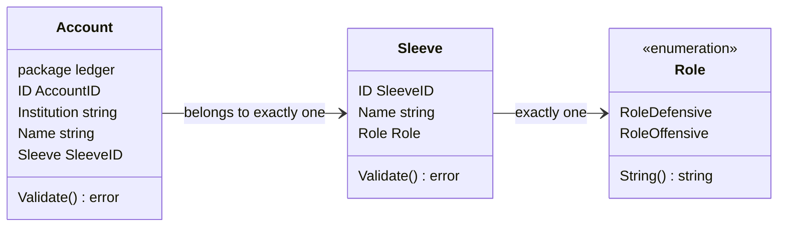
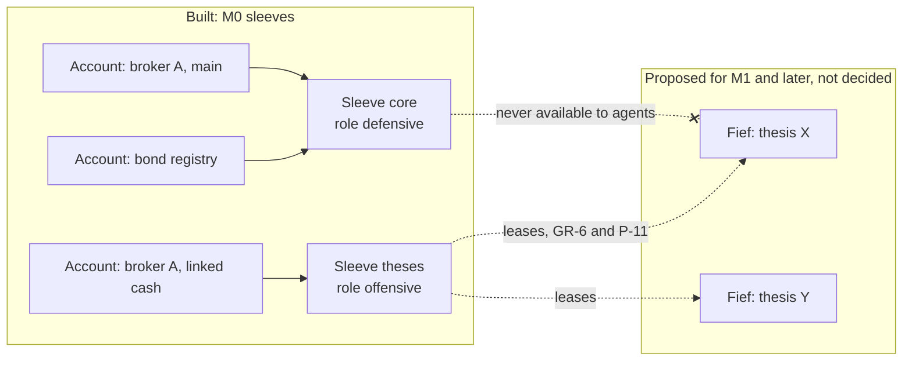

The portfolio context describes the portfolio as a whole: the parts it is divided into, and later the model it is compared with. Today it holds only [sleeves](../glossary.md). Every account belongs to exactly one sleeve, and each sleeve is either defensive or offensive. The [model portfolio](../glossary.md) is decided for M0 (D-52 to D-54, D-61, D-62) but not built.

## Concepts

**Sleeves.** In asset management, a sleeve is a part of a portfolio that is run separately, with its own mandate. In OpenFief a sleeve is a part of the portfolio with one role, and it is made of whole [accounts](../glossary.md). Section 3.1 of [DESIGN.md](../DESIGN.md) gives the reason the core keeps sleeve attribution itself: the later lease ledger reconciles against it.

**Why defensive and offensive.** The split resembles core-satellite investing: a large, diversified core held for the long run, plus smaller satellites for active bets. OpenFief turns that habit into a hard line for agents. GR-6 leases each thesis agent's budget only from the offensive part, and a defensive sleeve is never available to agents. Because a sleeve is made of accounts at institutions, the line can later be drawn by the broker too. P-11 (a), a proposal, puts each offensive sleeve in its own IBKR linked cash account, so even a compromised OpenFief host couldn't trade defensive accounts.

**Sleeves in future fiefs.** These are proposals in [control-plane.md](../proposals/control-plane.md), not decisions. A [fief](../glossary.md) is a revocable lease from the offensive sleeve to one agent. P-12 sweeps sale proceeds above the lease back to the offensive sleeve. P-11 (f) adds kill switches per agent, per sleeve and global. In P-24, a closed fief returns its capital to the offensive sleeve. Still open: whether there is one offensive sleeve or several (OQ-20, T-7), and who sets its size (OQ-12).

**The model portfolio.** A weighted basket of [targets](../glossary.md) for the whole portfolio, not per sleeve (D-52). A target is an instrument or an [index](../glossary.md) with a weight, and the weights sum to 100%. It is something to compare with; in M0 nothing trades. Its performance is a [backtest](../glossary.md): its value from end-of-day prices, as far back as every target has data, rebalanced to the target weights once a year (D-53). Rebalancing matters because weights drift as prices move; without it, a basket slowly becomes a bet on its best performer.

**Comparing like with like.** The portfolio's own line next to the model is its time-weighted return ([TWR](../glossary.md)), D-61. TWR chains daily returns across deposits and withdrawals, so new money doesn't count as performance. Transfers between the owner's own accounts are not cash flows, so moving money from a defensive account to an offensive one doesn't change the line. Both lines are in the [reporting currency](../glossary.md) (D-62), start at 100 on go-live (D-53), and M0 shows the [max drawdown](../glossary.md) of the model and of each target (D-54).

## How it works

### Built: sleeves

Package `portfolio` ([sleeve.go](../../internal/portfolio/sleeve.go), [doc.go](../../internal/portfolio/doc.go)) is pure domain code:

| Name | What it does |
|---|---|
| `Sleeve` | `ID`, `Name` and `Role`. `Validate` requires all three and a known role. |
| `SleeveID` | The string accounts use to refer to their sleeve. |
| `Role` | `RoleDefensive` or `RoleOffensive`. The zero `Role` is not a role, so a forgotten role fails validation instead of defaulting to one side. |
| `ParseRole`, `Role.String` | Convert to and from the stored words `defensive` and `offensive`, case-sensitively. |
| `ErrInvalidSleeve` | Wrapped by every validation and parse error. |

The portfolio context has no store of its own in M0, so the ledger keeps sleeves next to the accounts that refer to them ([0001_ledger.sql](../../internal/ledger/postgres/migrations/0001_ledger.sql)). Table `ledger.sleeves` has a `CHECK` that the role is one of the two words, and `ledger.accounts.sleeve_id` is a foreign key to it. `ledger.Account.Sleeve` is required ([account.go](../../internal/ledger/account.go)). `app.Ledger.SaveAccount` refuses an account whose sleeve isn't stored, with `ErrUnknownSleeve` ([ledger.go](../../internal/ledger/app/ledger.go)). Reading a stored role that doesn't parse is `ErrCorruptLog`. So the `ledger` package imports `portfolio` for `SleeveID`, not the other way round.

An example with synthetic names, and where proposals would take it:

### Not built: the model portfolio comparison

Every box below is planned and has no code yet. The Go names are the glossary's proposals.

## Decisions

- **GR-6**: sleeves have one role each, defensive or offensive. Built as `Role`; nothing uses the role yet, because agents come later.
- **D-52, D-53, D-54, D-61, D-62**: model portfolio, backtest, max drawdown, TWR, reporting currency. Not built.
- **D-30**: allocation chart by sleeve. Not built; no read API or UI exists.
- **Mismatch:** [doc.go](../../internal/portfolio/doc.go) line 3 says the model portfolio and its targets "arrive in a later milestone". D-52 and DESIGN.md's milestone table put the optional model portfolio in M0.
- **Open question in the code:** the comment on `RoleOffensive` says "the sleeve that fiefs are leased from", in the singular, but nothing limits how many offensive sleeves exist. OQ-20 is still open.

## Verification

| Behavior | Tests | kibi |
|---|---|---|
| A sleeve needs an ID, a name and exactly one known role; the zero role fails | `TestSleeveValidate` in [sleeve_test.go](../../internal/portfolio/sleeve_test.go) | REQ-portfolio-sleeve-role |
| Roles round-trip as `defensive` and `offensive`, case-sensitively | `TestParseRole` | REQ-portfolio-sleeve-role |
| An account needs a sleeve | `TestAccountValidate` in [account_test.go](../../internal/ledger/account_test.go) | REQ-ledger-account-sleeve |
| Invalid sleeves aren't stored; accounts need a stored sleeve | `TestSaveSleeve`, `TestSaveAccount` in [ledger_test.go](../../internal/ledger/app/ledger_test.go) | REQ-ledger-app-registry |
| Sleeves and accounts round-trip through PostgreSQL | `TestRegistryRoundTrip` in [store_test.go](../../internal/ledger/postgres/store_test.go) | REQ-ledger-pg-store |

Run `go test ./internal/portfolio/...` or `task test`; the PostgreSQL test runs with `task test:pg`. kibi already holds the model portfolio's requirements, with no tests yet: REQ-portfolio-model-optional, REQ-portfolio-model-weights, REQ-portfolio-backtest-yearly-rebalance, REQ-portfolio-max-drawdown, REQ-portfolio-twr-comparison, REQ-views-model-line-from-go-live and REQ-valuation-reporting-currency.

Two behaviors to keep in mind, from reading the code: saving a sleeve again with the same ID replaces its name and role, and saving an account again can move it to another sleeve. Nothing records or guards either change. That is harmless while no agent exists, but it will matter once fiefs are leased from the offensive sleeve.

## Not built yet

- **D-52**: `portfolio.Model` and `portfolio.Target`, the setting that turns the model portfolio on (off by default), entry in the built-in UI, and its place in the read API.
- **D-53**: `portfolio.Backtest`, and the model's line in the value-over-time chart (D-30).
- **D-54**: `portfolio.MaxDrawdown` for the model and each target.
- **D-61**: the portfolio's time-weighted return.
- **D-62**: the reporting currency setting and its default from the jurisdiction pack. The backtest also needs FX history into it, which starts no earlier than NBP's first rate on 2002-01-02.
- **D-30, D-6**: sleeves in the read API and the allocation chart by sleeve.
- No command, API or UI creates sleeves yet. Only tests call `SaveSleeve`.
