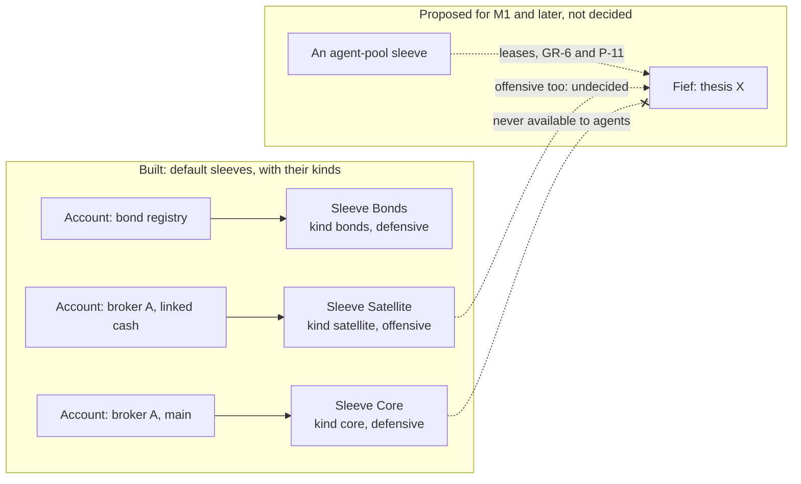
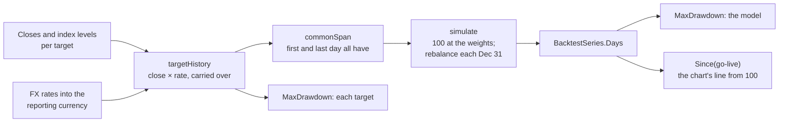
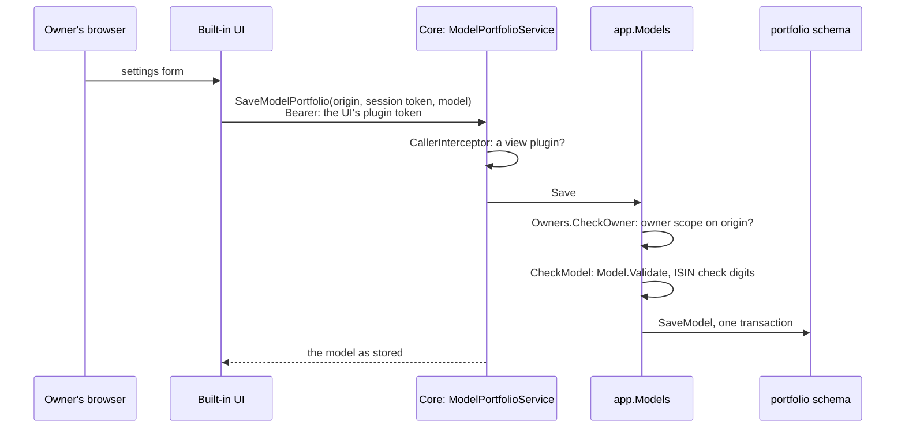

The portfolio context describes the portfolio as a whole: the parts it is divided into, and later the model it is compared with. It holds [sleeves](../glossary.md) and [sleeve kinds](../glossary.md): every account belongs to exactly one sleeve, every sleeve has one kind, and each sleeve is either defensive or offensive. It also holds the optional [model portfolio](../glossary.md) (D-52 to D-54): its [targets](../glossary.md), its [backtest](../glossary.md) and the [max drawdown](../glossary.md) of the model and of each target.

## Concepts

**Sleeves.** In asset management, a sleeve is a part of a portfolio that is run separately, with its own mandate. In OpenFief a sleeve is a part of the portfolio with one role, and it is made of whole [accounts](../glossary.md). Section 3.1 of [DESIGN.md](../DESIGN.md) gives the reason the core keeps sleeve attribution itself: the later lease ledger reconciles against it.

**Why defensive and offensive.** The split resembles core-satellite investing: a large, diversified core held for the long run, plus smaller satellites for active bets. OpenFief turns that habit into a hard line for agents. GR-6 leases each thesis agent's budget only from the offensive part, and a defensive sleeve is never available to agents. Because a sleeve is made of accounts at institutions, the line can later be drawn by the broker too. P-11 (a), a proposal, puts each offensive sleeve in its own IBKR linked cash account, so even a compromised OpenFief host couldn't trade defensive accounts.

**Sleeve kinds.** The role is a two-value switch that GR-6 relies on, so it stays fixed. A sleeve kind is the owner-facing label on top: emergency fund, bonds, retirement, core, satellite, agent pool, or one the owner adds. Each kind has a default role, and the allocation chart can group by kind (D-30). The owner may rename a kind, but its default role never changes, because every sleeve of that kind was checked against it. The role is stored on the sleeve itself, so renaming a kind can't change what agents may lease from. A sleeve may always be *more* defensive than its kind; making it offensive in a defensive kind needs an explicit override.

**Sleeves in future fiefs.** These are proposals in [control-plane.md](../proposals/control-plane.md), not decisions. A [fief](../glossary.md) is a revocable lease from the offensive sleeve to one agent. P-12 sweeps sale proceeds above the lease back to the offensive sleeve. P-11 (f) adds kill switches per agent, per sleeve and global. In P-24, a closed fief returns its capital to the offensive sleeve. Still open: whether there is one offensive sleeve or several (OQ-20, T-7), and who sets its size (OQ-12).

**The model portfolio.** A weighted basket of [targets](../glossary.md) for the whole portfolio, not per sleeve (D-52). A target is an instrument or an [index](../glossary.md) with a weight, and the weights sum to 100%. It is something to compare with; in M0 nothing trades. Its performance is a [backtest](../glossary.md): its value from end-of-day prices, as far back as every target has data, rebalanced to the target weights once a year (D-53). Without rebalancing, a basket slowly becomes a bet on its best performer. The portfolio's own line next to it is its time-weighted return ([TWR](../glossary.md), D-61), so deposits and withdrawals don't count as performance, and transfers between the owner's own accounts, defensive to offensive included, are not cash flows. Both lines are in the [reporting currency](../glossary.md) (D-62) and start at 100 on go-live (D-53); M0 also shows the [max drawdown](../glossary.md) of the model and of each target (D-54).

## How it works

### Sleeves and sleeve kinds

Package `portfolio` ([sleeve.go](../../internal/portfolio/sleeve.go), [kind.go](../../internal/portfolio/kind.go)) is pure domain code:

| Name | What it does |
|---|---|
| `Sleeve` | `ID`, `Name`, `Kind`, `Role` and `OffensiveOverride`. `Validate` checks the ID, name and role. |
| `Role`, `ParseRole` | `RoleDefensive` or `RoleOffensive`, stored as those words. The zero `Role` is not a role. |
| `Kind`, `KindKey` | A key of lowercase hyphenated words (at most 64 characters), a name and a `DefaultRole`. |
| `DefaultKinds` | The built-in kinds: `agent-pool` and `satellite` offensive; `bonds`, `core`, `emergency-fund` and `retirement` defensive. |
| `CheckKind` | A new key adds a kind, a known key renames it; changing a stored kind's default role is `ErrKindRoleChange`. |
| `CheckSleeve` | Checks a sleeve against the stored kinds and fills in a missing role (diagram below). |
| `DefaultSleeves`, `MissingDefaults` | An install's starting sleeves, Bonds, Core and Satellite, and which defaults are not stored yet. |
| `KindBySleeve` | Maps each sleeve to its kind, for an allocation grouped by kind (D-30). |

The portfolio context's own store, the `portfolio` schema, holds only the model portfolio, so the ledger keeps sleeves and kinds next to the accounts that refer to them, and the `ledger` package imports `portfolio`, not the other way round. [0002_sleeve_kinds.sql](../../internal/ledger/postgres/migrations/0002_sleeve_kinds.sql) creates `ledger.sleeve_kinds`, seeds the six built-in kinds, and adds a trigger that refuses any change to a kind's key or default role. Each sleeve gets a required `kind` and an `offensive_override` that a `CHECK` allows only on offensive sleeves; sleeves stored before kinds existed became `core` or `satellite`, whichever matches their role. In `internal/ledger/app`, `SaveKind` runs `CheckKind`, `SaveSleeve` runs `CheckSleeve`, and `SaveAccount` refuses an account whose sleeve isn't stored ([ledger.go](../../internal/ledger/app/ledger.go), [kinds.go](../../internal/ledger/app/kinds.go)). `EnsureDefaults` stores whichever default kinds and sleeves are missing, in one transaction, and never changes a stored one; `cmd/core` runs it on every start unless `--ensure-defaults=false`, so an install starts with the default sleeves.

### The model portfolio's rules

The rules are pure functions in package `portfolio` ([model.go](../../internal/portfolio/model.go), [backtest.go](../../internal/portfolio/backtest.go), [history.go](../../internal/portfolio/history.go), [drawdown.go](../../internal/portfolio/drawdown.go)):

| Name | What it does |
|---|---|
| `Model`, `Model.Validate` | `Enabled` (off is the zero value, D-52) and `Targets` in the owner's order. At most `MaxTargets` (50), none twice, weights summing to exactly 100%; an off model may have none, an on one needs some. |
| `Target`, `TargetKind`, `Target.Key` | `TargetInstrument`, named `ISIN/symbol` as prices are keyed, or `TargetIndex`, named as the market-data connector names it (such as `WIG20`) and with the currency of its levels. `Weight` is in percent, above 0 and at most 100, in steps of 0.01 (`WeightPlaces`). |
| `Backtest`, `BacktestInput`, `BacktestSeries` | The backtest (D-53), described below. |
| `TargetHistory`, `MissingData` | Each target's value in the reporting currency per day, or why it has none: `MissingCloses` or `MissingRates`. |
| `MaxDrawdown`, `Drawdown` | The worst fall from a peak to a later trough, with both dates and values and the depth as a fraction (D-54). |
| `Since` | A series rebased to 100 on its first day on or after a date: the model's line from go-live (D-53). |

**A target's history.** Each day from the target's first close (and, in a foreign currency, its first FX rate) to its last close is valued at the latest close times the latest rate on or before it, as holdings are valued. A close and a rate hold over days without one, such as weekends. Rates come in as `Rate` values into the reporting currency; with PLN reporting they are NBP's table A (D-20), which starts on 2002-01-02, so a foreign target's history starts no earlier (D-61).

**The backtest.** It starts on the first day every target has a history, at 100, holding each target at its weight: `units = weight / 100 × value / the target's value`. Each day's value is the sum of units times values. At the end of every December 31 before its last day it rebalances to the weights. Without rebalancing, a basket slowly becomes a bet on its best performer. It ends on the last day every target has a history. Units keep 18 decimal places and the index 12, both rounded half-even like the time-weighted return. A target without a history, or histories that don't overlap, give no days.

**Max drawdown.** `MaxDrawdown` walks the series once, keeping the highest value so far; each later value's fall from it is compared exactly, by cross-multiplying, and only the worst one's depth is divided, rounded half-even to 12 places. Of equal falls it keeps the earliest. A series that never falls has depth 0 with its first day as both peak and trough.

### Storing and entering the model

**Entry.** D-52 has the owner enter the model in the built-in UI, which hands it to the core like manual bond lots (D-49). The read API stays read-only (D-6), so the core serves a separate contract to view plugins only, `openfief.portfolio.v1.ModelPortfolioService` in [model.proto](../../proto/openfief/portfolio/v1/model.proto), with the `AuthService`'s conventions: the caller presents its plugin token, admitted by the identity context's `CallerInterceptor`, and the request carries the browser's origin and the owner's session token. `GetModelPortfolio` returns the stored model, on or off; `SaveModelPortfolio` replaces it whole. Only an owner-scoped session may call either: an invalid session is `UNAUTHENTICATED`, a read-scoped one or an origin off the allow-list `PERMISSION_DENIED`, a model breaking a rule `INVALID_ARGUMENT` with the rule it broke. No decision names this write path; it is the narrowest one that lets the UI hand the model over (see [Decisions](#decisions)).

| Package | What it holds |
|---|---|
| [`portfolio/app`](../../internal/portfolio/app/models.go) | `Models`: `Settings` and `Save` for the owner, `CheckModel` and `ParseInstrument`; `Report`, the backtest and drawdowns for the read API, only while the model is on. The ports `ModelStore`, `MarketData` (prices, index levels and FX rates, which `*valuation/postgres.Store` serves) and `Owners`, with `ErrNoSession` and `ErrNotOwner`. PLN is the only reporting currency, as in the read API. |
| [`portfolio/postgres`](../../internal/portfolio/postgres/store.go) | The `portfolio` schema ([0001_model.sql](../../internal/portfolio/postgres/migrations/0001_model.sql)): `model`, at most one row with `enabled`, and `model_targets` in the owner's order. No row is the zero `Model`, off (D-52). Saving replaces both in one transaction. Table checks repeat the per-target rules; the 100% sum is checked before saving. |
| [`portfolio/connectapi`](../../internal/portfolio/connectapi/service.go) | The generated handler, the conversion between messages and the domain, and the error mapping. |

`cmd/core` migrates the schema, implements `Owners` over the identity context (`ownerSessions`: the origin on `--auth-origin` and `Auth.Session` with owner scope) and mounts the service next to the `AuthService` ([model.go](../../cmd/core/model.go)).

**The report.** `Models.Report(through)` loads the model; while it is off it reads nothing else and says so. Otherwise it loads each instrument target's prices, keyed `ISIN/symbol` like the ledger's instruments, each index target's [index levels](../glossary.md), keyed by the name the market-data connector gives the index (stored since the EODHD connector, [Valuation](valuation.md)), and the FX rates of every currency they are in, all through `through`. It runs `Backtest`, then `MaxDrawdown` over the whole backtest and over each target's own history.

The read API serves the report as `GetModelPortfolio`, rebased to 100 on go-live, and answers 404 while the model is off ([Read API](read-api.md#the-model-portfolio)).

The [built-in UI](ui.md) draws it as the second line of the value-over-time chart, from go-live, both lines at 100 (D-106 moves it to a separate performance chart, not built yet), with the drawdowns in a table, and offers the form on its settings page.

## Decisions

- **GR-6**: one fixed role per sleeve; offensive in a defensive kind needs an override.
- **D-30**: the read API's allocation and the built-in UI's chart group by sleeve, and `ListSleeves` gives each sleeve's kind ([Read API](read-api.md)). `KindBySleeve` would let the allocation group by kind, but nothing calls it.
- **D-52, D-53, D-54**: the model's targets and weights, its backtest and max drawdowns are built as pure rules. When it rebalances (each December 31), the 0.01% weight step, the 50-target limit and the precision are this context's reading, not the author's.
- **D-61, D-62**: the backtest is in the reporting currency and a foreign target starts with its first FX rate.
- **D-52, D-49: how the UI hands the model to the core is not decided in detail.** The core serves `ModelPortfolioService` to view plugins only, with the `AuthService`'s caller check and owner-scoped sessions, as the narrowest write path that keeps the read API read-only. Manual bond lots now take the same shape, `BondLotService` ([Ingest](ingest.md#treasury-bond-lots)); whether this is the shape the author wants for owner entries is for the author.
- **A target's own drawdown (D-54) is in the reporting currency** over the target's history where it has both closes and FX rates. P-48, not decided, would compute it in the target's own currency over its whole history.
- **No decision ID for sleeve kinds.** The commit and the migration call them an "author decision", and the glossary defines the term, but DESIGN.md records no D-ID for the built-in kinds, the default sleeves or the override.
- **Which offensive sleeves agents may lease from.** The glossary makes every offensive sleeve "the part fiefs are leased from". [kind.go](../../internal/portfolio/kind.go) says only `agent-pool` is what fiefs are leased from and `satellite` holds the owner's own higher-risk positions, yet both are offensive and the default Satellite sleeve is offensive. Nothing in the code tells them apart; OQ-20 is still open.

## Verification

| Behavior | Tests | kibi |
|---|---|---|
| A sleeve needs an ID, a name and one known role | `TestSleeveValidate`, `TestParseRole` in [sleeve_test.go](../../internal/portfolio/sleeve_test.go) | REQ-portfolio-sleeve-role |
| Kind keys, the built-in kinds, fixed default roles, the override rules, the defaults and kind by sleeve | `TestKindValidate`, `TestDefaultKinds`, `TestCheckKind`, `TestCheckSleeve`, `TestDefaultSleeves`, `TestMissingDefaults`, `TestKindBySleeve` in [kind_test.go](../../internal/portfolio/kind_test.go) | REQ-portfolio-sleeve-kind, REQ-portfolio-default-kinds, REQ-portfolio-kind-role-fixed, REQ-portfolio-sleeve-role-override, REQ-portfolio-allocation-by-kind |
| The ledger checks kinds and sleeves before storing; defaults are ensured once | `TestSaveKind`, `TestEnsureDefaults` in [kinds_test.go](../../internal/ledger/app/kinds_test.go); `TestSaveSleeve`, `TestSaveAccount` in [ledger_test.go](../../internal/ledger/app/ledger_test.go) | REQ-ledger-app-sleeve-kinds, REQ-ledger-app-registry |
| PostgreSQL seeds the kinds, backfills old sleeves, refuses role changes and stray overrides | `TestMigrateStoresTheDefaultKinds`, `TestMigrateGivesStoredSleevesAKind`, `TestKindRoundTrip`, `TestSleeveKindConstraints`, `TestEnsureDefaultsOnPostgres` in [kinds_test.go](../../internal/ledger/postgres/kinds_test.go); `TestRegistryRoundTrip` | REQ-ledger-pg-sleeve-kinds, REQ-ledger-pg-store |
| An account needs a sleeve | `TestAccountValidate` in [account_test.go](../../internal/ledger/account_test.go) | REQ-ledger-account-sleeve |
| Targets, weights and the 100% sum | `TestModelValidate`, `TestTargetKind`, `TestTargetKey` in [model_test.go](../../internal/portfolio/model_test.go) | REQ-portfolio-model-targets, REQ-portfolio-model-weights |
| Histories in PLN, the start, the end, the year-end rebalance, gaps and bad history | `TestBacktest`, `TestBacktestTargetHistories`, `TestMissingDataString` in [backtest_test.go](../../internal/portfolio/backtest_test.go) | REQ-portfolio-backtest-history, REQ-portfolio-backtest-index, REQ-portfolio-backtest-yearly-rebalance |
| Max drawdown and rebasing | `TestMaxDrawdown`, `TestSince` in [drawdown_test.go](../../internal/portfolio/drawdown_test.go) | REQ-portfolio-drawdown-depth, REQ-portfolio-rebase, REQ-portfolio-max-drawdown |
| The owner reads and saves the model; other sessions are refused; invalid models and bad ISINs are refused; the report while on, nothing read while off | `TestSettingsAndSave`, `TestOwnerOnly`, `TestSaveRejects`, `TestReport`, `TestReportOff`, `TestReportMissingAndFailures` in [app/models_test.go](../../internal/portfolio/app/models_test.go) | REQ-portfolio-model-entry, REQ-portfolio-model-report, REQ-portfolio-model-optional |
| The service over Connect: callers, sessions, error codes, round trip | `TestSaveAndGet`, `TestErrors` in [connectapi/service_test.go](../../internal/portfolio/connectapi/service_test.go); `TestModelPortfolioService` in [cmd/core/model_test.go](../../cmd/core/model_test.go) under `task test:pg` | REQ-portfolio-model-entry |
| PostgreSQL: off by default, round trip, table checks | `TestModelRoundTrip`, `TestModelConstraints` in [postgres/store_test.go](../../internal/portfolio/postgres/store_test.go) under `task test:pg` | REQ-portfolio-model-store |
| Properties: one target is its price, price scale doesn't matter, the drawdown is the worst pair | `TestBacktestOfOneTargetIsItsPrice`, `TestBacktestIgnoresPriceScale`, `TestMaxDrawdownIsTheWorstPair` in [backtest_property_test.go](../../internal/portfolio/backtest_property_test.go) | REQ-portfolio-backtest-index, REQ-portfolio-drawdown-depth |

Run `go test ./internal/portfolio/... ./internal/ledger/app/...` or `task test`; the PostgreSQL tests run with `task test:pg`.

From reading the code: the override guards only one path to offensive. Saving a sleeve again with an offensive kind, such as moving Core to `agent-pool`, makes it offensive with no override, and saving an account again can move it to another sleeve. Nothing records either change. That is harmless while no agent exists, but it will matter once fiefs are leased from offensive sleeves.

## Not built yet

- **D-62**: the reporting currency setting and its default from the jurisdiction pack. The backtest also needs FX history into it, which starts no earlier than NBP's first rate on 2002-01-02.
- An allocation grouped by sleeve kind: `KindBySleeve` is unused, and the read API's dimensions are asset class, currency, institution and sleeve.
- Managing sleeves. Only `cmd/demo-seed` saves sleeves other than the defaults, for the demo dataset; no API or UI adds sleeves or kinds, renames them or sets the override.
