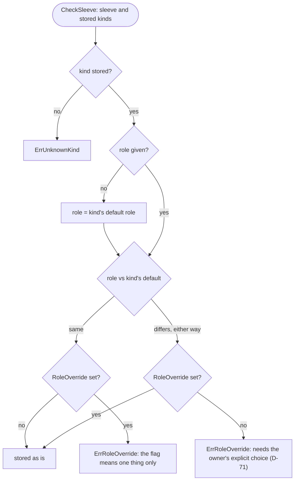
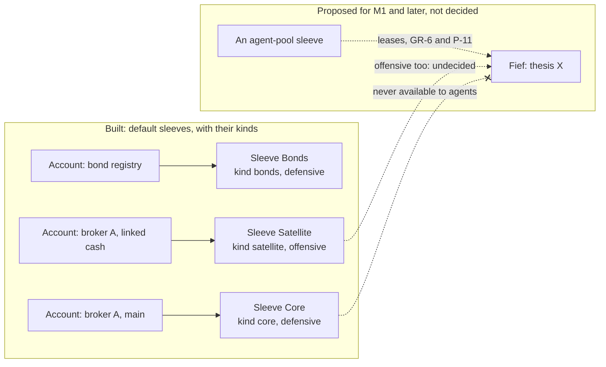
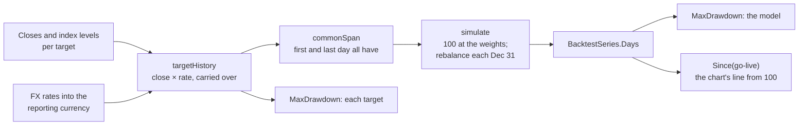
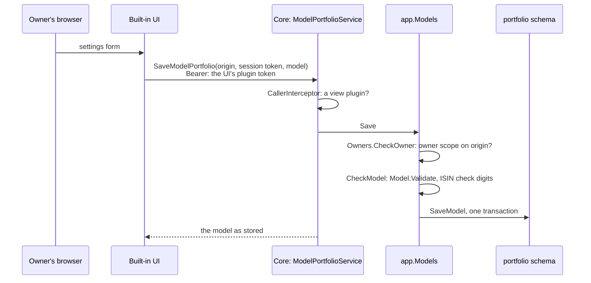
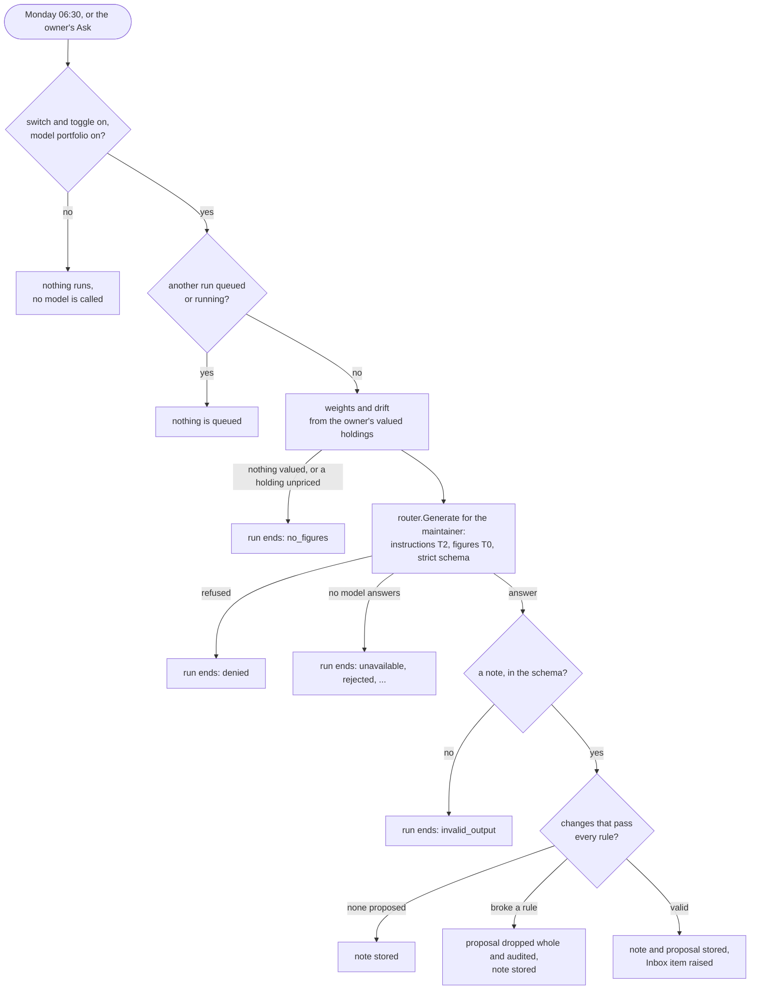

The portfolio context describes the portfolio as a whole: the parts it is divided into, and later the model it is compared with. It holds [sleeves](../glossary.md) and [sleeve kinds](../glossary.md): every account belongs to exactly one sleeve, every sleeve has one kind, and each sleeve is either defensive or offensive. It also holds the optional [model portfolio](../glossary.md) (D-52 to D-54): its [targets](../glossary.md), its [backtest](../glossary.md) and the [max drawdown](../glossary.md) of the model and of each target. With the models switch on, the [maintainer](../glossary.md) (D-204) writes a weekly note about how far the real portfolio has drifted from the model and may propose new targets, which the owner applies or dismisses.

## Concepts

**Sleeves.** In asset management, a sleeve is a part of a portfolio that is run separately, with its own mandate. In OpenFief a sleeve is a part of the portfolio with one role, and it is made of whole [accounts](../glossary.md). Section 3.1 of [DESIGN.md](../DESIGN.md) gives the reason the core keeps sleeve attribution itself: the later lease ledger reconciles against it.

**Why defensive and offensive.** The split resembles core-satellite investing: a large, diversified core held for the long run, plus smaller satellites for active bets. OpenFief turns that habit into a hard line for agents. GR-6 leases each thesis agent's budget only from the offensive part, and a defensive sleeve is never available to agents. Because a sleeve is made of accounts at institutions, the line can later be drawn by the broker too. P-11 (a), a proposal, puts each offensive sleeve in its own IBKR linked cash account, so even a compromised OpenFief host couldn't trade defensive accounts.

**Sleeve kinds.** The role is a two-value switch that GR-6 relies on, so it stays fixed. A sleeve kind is the owner-facing label on top (D-71): emergency fund, bonds, retirement, core, satellite, agent pool, or one the owner adds. Each kind has a default role, and the allocation chart can group by kind (D-30). The owner may rename a kind, but its default role never changes, because every sleeve of that kind was checked against it. The role is stored on the sleeve itself, so renaming a kind can't change what agents may lease from. A sleeve whose role differs from its kind's, either way, needs the owner's explicit choice, the *role override*.

**Sleeves in future fiefs.** These are proposals in [control-plane.md](../proposals/control-plane.md), not decisions. A [fief](../glossary.md) is a revocable lease from the offensive sleeve to one agent. P-12 sweeps sale proceeds above the lease back to the offensive sleeve. P-11 (f) adds kill switches per agent, per sleeve and global. In P-24, a closed fief returns its capital to the offensive sleeve. Still open: whether there is one offensive sleeve or several (OQ-20, T-7), and who sets its size (OQ-12).

**The model portfolio.** A weighted basket of [targets](../glossary.md) for the whole portfolio, not per sleeve (D-52). A target is an instrument or an [index](../glossary.md) with a weight, and the weights sum to 100%. It is something to compare with; in M0 nothing trades. Its performance is a [backtest](../glossary.md): its value from end-of-day prices, as far back as every target has data, rebalanced to the target weights once a year (D-53). Without rebalancing, a basket slowly becomes a bet on its best performer. The portfolio's own line next to it is its time-weighted return ([TWR](../glossary.md), D-61), so deposits and withdrawals don't count as performance, and transfers between the owner's own accounts, defensive to offensive included, are not cash flows. Both lines are in the [reporting currency](../glossary.md) (D-62) and start at 100 on go-live (D-53); M0 also shows the [max drawdown](../glossary.md) of the model and of each target (D-54).

**Drift and the maintainer.** The model is something to compare with, and the comparison is arithmetic: each instrument target's *current weight* is the value held in it as a share of the whole portfolio, cash included, and its [drift](../glossary.md) is that weight minus the target's, in percentage points (D-204). An index can't be held, so it has neither. OpenFief computes both as pure rules (`portfolio.DriftOf`); no model ever does. The maintainer is a role of the [model router](models.md) that sends a model those weights, and never an amount, and asks for a short note and, rarely, for changes to the targets. It has no tools and cannot trade: a proposal is a set of new target weights that lands in the Inbox's decisions with the figures behind it, and applying it changes the model portfolio's weights only. It runs every Monday morning and whenever the owner asks, one run at a time, and only while the models switch and the maintainer's toggle are on (D-212).

## How it works

### Sleeves and sleeve kinds

Package `portfolio` ([sleeve.go](../../internal/portfolio/sleeve.go), [kind.go](../../internal/portfolio/kind.go)) is pure domain code:

| Name | What it does |
|---|---|
| `Sleeve` | `ID`, `Name`, `Kind`, `Role` and `RoleOverride`. `Validate` checks the ID, name and role. |
| `Role`, `ParseRole` | `RoleDefensive` or `RoleOffensive`, stored as those words. The zero `Role` is not a role. |
| `Kind`, `KindKey` | A key of lowercase hyphenated words (at most 64 characters), a name and a `DefaultRole`. |
| `DefaultKinds` | The built-in kinds: `agent-pool` and `satellite` offensive; `bonds`, `core`, `emergency-fund` and `retirement` defensive. |
| `CheckKind` | A new key adds a kind, a known key renames it; changing a stored kind's default role is `ErrKindRoleChange`. |
| `CheckSleeve` | Checks a sleeve against the stored kinds and fills in a missing role (diagram below). |
| `DefaultSleeves`, `MissingDefaults` | An install's starting sleeves, Bonds, Core and Satellite, and which defaults are not stored yet: the built-in kinds always, the default sleeves only while no sleeve is stored. |
| `KeyFromName` | The key, sleeve ID or account ID made from a name the owner typed: lower case, Polish letters in ASCII, other runs of characters one hyphen, at most 64 characters (`ErrNoKey` when nothing is left). |
| `KindBySleeve` | Maps each sleeve to its kind, for an allocation grouped by kind (D-30). |

The portfolio context keeps the sleeve kinds, the sleeves and which account is in which sleeve in its own `portfolio` schema ([code-organization.md](../dev/code-organization.md)): the ledger knows nothing of sleeves, and nothing in `ledger` imports `portfolio`. An account is named by the ledger's account ID, as the valuation context names the accounts whose tax wrapper it keeps; no foreign key crosses into the ledger schema. [0002_sleeves.sql](../../internal/portfolio/postgres/migrations/0002_sleeves.sql) creates `portfolio.sleeve_kinds`, seeded with the six built-in kinds, with a trigger that refuses any change to a kind's key or default role; `portfolio.sleeves`, whose `kind` must be stored, with a trigger that refuses a sleeve whose `role_override` isn't set exactly when its role differs from its kind's (D-71); and `portfolio.account_sleeves`, one row per account with the sleeve it is in. Nothing was copied from the ledger schema, where sleeves used to live: what was stored before the first release is entered again, and the demo reseeded (D-161).

`portfolio/app.Registry` ([registry.go](../../internal/portfolio/app/registry.go)) runs the rules over its `RegistryStore` port, which `portfolio/postgres.Store` implements ([sleeves.go](../../internal/portfolio/postgres/sleeves.go)): `SaveKind` runs `CheckKind` and `SaveSleeve` runs `CheckSleeve` before storing. `PlaceAccount` puts an account in a sleeve, replacing the one it was in; it reads the account from the ledger through its `AccountReader` port, which `cmd/core` fills with `ledger/app.Ledger`, and refuses an account the ledger doesn't hold or a sleeve that isn't stored. `AccountSleeves` returns which sleeve each account is in, and `RemoveAccount` takes a deleted account out of its sleeve. `PlacementObserver`s, set by `cmd/core`, are told of each placement, each removal of an account and each deleted sleeve after it is stored, in the order they were added and each even when an earlier one failed: the SpiceDB syncer, when SpiceDB answers authorization, and the identity context's grants, which end the grants of a deleted account or sleeve so that a sleeve created later under the same ID inherits none ([Identity](identity.md)). A sleeve already gone is told again, so a retry after an observer failed finishes the job. When an observer fails, the change stays stored and `ErrPlacementNotObserved` says so, and the core's reconcile and sweep repair the copy. `EnsureDefaults` stores whichever built-in kinds are missing and, while no sleeve is stored at all, the default sleeves, in one transaction, and never changes a stored one; `cmd/core` runs it on every start unless `--ensure-defaults=false`, so an install starts with the default sleeves (D-71), and a sleeve the owner later moves or the demo dataset's own sleeves are never joined by the defaults again.

### The model portfolio's rules

The rules are pure functions in package `portfolio` ([model.go](../../internal/portfolio/model.go), [backtest.go](../../internal/portfolio/backtest.go), [history.go](../../internal/portfolio/history.go), [drawdown.go](../../internal/portfolio/drawdown.go)):

| Name | What it does |
|---|---|
| `Model`, `Model.Validate` | `Enabled` (off is the zero value, D-52) and `Targets` in the owner's order. At most `MaxTargets` (50), none twice, weights summing to exactly 100%; an off model may have none, an on one needs some. |
| `Target`, `TargetKind`, `Target.Key` | `TargetInstrument`, named `ISIN/symbol` as prices are keyed, or `TargetIndex`, named as the market-data connector names it (such as `WIG20`) and with the currency of its levels. `Weight` is in percent, above 0 and at most 100, in steps of 0.01 (`WeightPlaces`). |
| `Backtest`, `BacktestInput`, `BacktestSeries` | The backtest (D-53), described below. |
| `TargetHistory`, `MissingData` | Each target's value in the reporting currency per day, or why it has none: `MissingCloses` or `MissingRates`. |
| `MaxDrawdown`, `Drawdown` | The worst fall from a peak to a later trough, with both dates and values and the depth as a fraction (D-54). |
| `Since` | A series rebased to 100 on its first day on or after a date: the model's line from go-live (D-53). |

**A target's history.** Each day from the target's first close (and, in a foreign currency, its first FX rate) to its last close is valued at the latest close times the latest rate on or before it, as holdings are valued. A close and a rate hold over days without one, such as weekends. Rates come in as `Rate` values into the reporting currency; with PLN reporting they are NBP's table A (D-20), which starts on 2002-01-02, so a foreign target's history starts no earlier (D-61).

**The backtest.** It starts on the first day every target has a history, at 100, holding each target at its weight: `units = weight / 100 × value / the target's value`. Each day's value is the sum of units times values. At the end of every December 31 before its last day it rebalances to the weights. Without rebalancing, a basket slowly becomes a bet on its best performer. It ends on the last day every target has a history. Units keep 18 decimal places and the index 12, both rounded half-even like the time-weighted return. A target without a history, or histories that don't overlap, give no days.

**Max drawdown.** `MaxDrawdown` walks the series once, keeping the highest value so far; each later value's fall from it is compared exactly, by cross-multiplying, and only the worst one's depth is divided, rounded half-even to 12 places. Of equal falls it keeps the earliest. A series that never falls has depth 0 with its first day as both peak and trough.

### Storing and entering the model

**Entry.** D-52 has the owner enter the model in the built-in UI, which hands it to the core like manual bond lots (D-49). The read API stays read-only (D-6), so the core serves a separate contract to view plugins only, `openfief.portfolio.v1.ModelPortfolioService` in [model.proto](../../proto/openfief/portfolio/v1/model.proto), with the `AuthService`'s conventions: the caller presents its plugin token, admitted by the identity context's `CallerInterceptor`, and the request carries the browser's origin and the owner's session token. `GetModelPortfolio` returns the stored model, on or off; `SaveModelPortfolio` replaces it whole. Only an owner-scoped session may call either: an invalid session is `UNAUTHENTICATED`, a read-scoped one or an origin off the allow-list `PERMISSION_DENIED`, a model breaking a rule `INVALID_ARGUMENT` with the rule it broke. No decision names this write path; it is the narrowest one that lets the UI hand the model over (see [Decisions](#decisions)).

| Package | What it holds |
|---|---|
| [`portfolio/app`](../../internal/portfolio/app/models.go) | `Models`: `Settings` and `Save` for the owner, `CheckModel` and `ParseInstrument`; `MarketDataTargets`, the instruments and index names of the model while it is on, which the core asks market-data connectors to price (D-93, [Ingest](ingest.md#what-market-data-connectors-price)); `Report`, the backtest and drawdowns for the read API, only while the model is on. The ports `ModelStore`, `MarketData` (prices, index levels and FX rates, which `*valuation/postgres.Store` serves) and `Owners`, with `ErrNoSession` and `ErrNotOwner`. PLN is the only reporting currency, as in the read API. |
| [`portfolio/postgres`](../../internal/portfolio/postgres/store.go) | The `portfolio` schema ([0001_model.sql](../../internal/portfolio/postgres/migrations/0001_model.sql)): `model`, at most one row with `enabled`, and `model_targets` in the owner's order. No row is the zero `Model`, off (D-52). Saving replaces both in one transaction. Table checks repeat the per-target rules; the 100% sum is checked before saving. |
| [`portfolio/connectapi`](../../internal/portfolio/connectapi/service.go) | The generated handler, the conversion between messages and the domain, and the error mapping. |

`cmd/core` migrates the schema, implements `Owners` over the identity context (`ownerSessions`: the origin on `OPENFIEF_AUTH_ORIGINS` and `Auth.Session` with owner scope) and mounts the service next to the `AuthService` ([model.go](../../cmd/core/model.go)).

**The report.** `Models.Report(through)` loads the model; while it is off it reads nothing else and says so. Otherwise it loads each instrument target's prices, keyed `ISIN/symbol` like the ledger's instruments, each index target's [index levels](../glossary.md), keyed by the name the market-data connector gives the index (stored since the EODHD connector, [Valuation](valuation.md)), and the FX rates of every currency they are in, all through `through`. It runs `Backtest`, then `MaxDrawdown` over the whole backtest and over each target's own history.

The read API serves the report as `GetModelPortfolio`, rebased to 100 on go-live, and answers 404 while the model is off ([Read API](read-api.md#the-model-portfolio)).

When a treasury bond series held under its [provisional ISIN](../glossary.md) gets its [registry ISIN](../glossary.md) (D-214), `postgres.Store.RekeyInstrument` ([rekey.go](../../internal/portfolio/postgres/rekey.go)) renames the model's target of it in place; when the model already targets the registry's ISIN, the provisional target's weight joins that one's, since both name the same series, so the weights still sum to 100. Run again, it changes nothing.

### The maintainer

**The weights** ([drift.go](../../internal/portfolio/drift.go)). `DriftOf(model, values, total)` takes the value of each instrument held, by `ISIN/symbol`, and the whole portfolio's value, and gives each instrument target its current weight (`Quo` to two places, half-even), its drift and whether it is held, plus `Other`, the share outside every target. A portfolio worth nothing is `ErrNoPortfolioValue`. Everything is `kernel.Decimal`; nothing is a float. The values come from `Views.HeldValues` ([held.go](../../internal/views/app/held.go)): every account's holdings and cash valued gross in the reporting currency at the date every account is valued through, read as the owner, since the weights are of the whole portfolio. A holding with no price would skew every weight, so a valuation with any holding left out is no figures at all (`ErrNoHoldings`) and the run ends with the class `no_figures` before any model is asked.

**The prompt and the answer** ([maintainer.go](../../internal/portfolio/maintainer.go)). `BuildPrompt` writes the instructions, which quote nothing of the portfolio and go as public data (T2), and the figures, one line per target (`key | target | held now | drift`) and the share held outside the targets, which go as whole-portfolio data (T0, D-206). The router therefore sends the request only to a model the owner allowed for T0 and for T2, and the answer is asked for as strict structured output (`ResponseSchema`: a note and a list of changes of `target`, `currentTargetPercent`, `proposedTargetPercent` and `reason`), so a model without it is not a candidate. The model has no tools: the figures are in the prompt, which is simpler than a read tool and sends the same data. `ParseAnswer` is strict, and weights are decimal strings, never numbers:

- an answer that is not that JSON, or has no note or one over 2000 characters, is `ErrInvalidAnswer` and the run fails with the class `invalid_output`: no part of it is kept;
- changes are checked all together by `CheckChanges`, and one broken rule drops the whole proposal, never part of it, while the note stays: at least one change and no more than the model has targets; each names a target of the model, once, so none is added or removed; its "before" is the target's weight in the model and its "after" differs; its reason is one line of 1 to 200 characters; and the model with every change made passes `Model.Validate`, each weight above 0% with at most two decimal places and all of them summing to exactly 100%;
- a dropped proposal is audited (`maintainer_proposal_dropped`) and nothing of what the model wrote is logged or put in the error.

**The use cases** ([app/maintainer.go](../../internal/portfolio/app/maintainer.go)). `Maintainer` works over ports it declares: the store, the model's store, the `Gate` (the switch and the toggle), the `HoldingsReader`, the `Asker`, the `Decisions` (Inbox items), the `Auditor`, the `QueuedRun` (the job queue) and `Sessions`. `Ask` is the owner's and queues a run; `Weekly` is the schedule's turn; `Work` works a queued run. Every ending is a final state with its audit entry (`maintainer_run`, outcome `ok`, `refused` or `failed`, and the class: `unavailable`, `rejected`, `canceled`, `misconfigured`, `internal`, `denied`, `invalid_output` or `no_figures`), and the entry is written inside the transaction that stores the run, so a run the log can't record leaves no note. A model call is also audited by the router, role `maintainer`, as two entries like any other (D-211). The owner's `Apply` and `Dismiss` work the same way: the entry is written inside the transaction that changes the targets or closes the proposal, so a decision the log can't record is not made, and `Apply` checks the proposal against the model as it is now: a model the owner edited since is refused (`portfolio.ErrStaleProposal`, a `maintainer_proposal_applied` entry with outcome `refused`), and the owner dismisses it. Applying never trades: it is `SaveModel` with the new weights. A later run's proposal supersedes a pending one, so the Inbox holds one at a time.

**One at a time.** The store's unique index on runs that are queued or running lets only one exist; a second ask finds a run already queued (`started` false) and the weekly turn does nothing. A run still active after 30 minutes, which means its job died with the process, is closed as failed the next time one is queued, so a lost job never blocks the maintainer.

**The job** ([jobs](../../internal/portfolio/jobs/maintainer.go)). `RunMaintainer` is a River job on its own queue, `portfolio`, with one worker. The core registers it on the revaluation client ([Valuation](valuation.md)), since River keeps one leader per schema and only it enqueues periodic jobs: a client of its own would never be the one that did. A job with a run ID works the run the owner asked for, with three attempts, a retry taking over the run its earlier attempt left running; the periodic job, Monday at 06:30 in the core's time zone (`WeeklyAt`; the slot is fixed and has no setting), is the weekly turn, with three attempts (`WeeklyAttempts`, D-198's pattern): a run that ends without a note makes `Weekly` return an `AttemptFailedError` with its class, and River retries a quarter of an hour after the first attempt and an hour after the second (`Worker.NextRetry`). Each attempt is a run of its own, kept with its class and never its text. A failed job hands River a `JobError` that names the failure by its known errors or its innermost type, never a note or a figure.

**Failure.** With no route, a tier no model is allowed for, or every model down, there is no note: the run is `refused` or `failed` with its class, and the page shows the owner the latest failure. Only a scheduled week whose run ended without a note in all of its `WeeklyAttempts` attempts raises an attention item, `maintainer-failing` in the Inbox's decisions: a failed first attempt is a provider's bad hour, which the retries and the route's fallbacks cover, and a week with every attempt failed is a week with no note, which is the owner's to look at. The last attempt raises it, not a count of weeks. The owner's own asks don't count, since the owner sees them fail on the page and an ask is not retried; any run that leaves a note, or turning the maintainer off, clears it.

**What the owner and viewers see.** The note and its time and model show on the model portfolio's page ([Built-in UI](ui.md)); `MaintainerService.GetMaintainer` answers the owner and any session that may view every account (D-163), since the note speaks of the whole portfolio, and `maintainerSessions` ([maintainer.go](../../cmd/core/maintainer.go)) asks the authorizer account by account for any session that is not the owner's, treating an authorizer that can't tell as a refusal. Everything else, `AskMaintainer`, `GetProposal`, `ApplyProposal` and `DismissProposal`, is the owner's alone. Each proposal is an Inbox item of the kind `model-target-proposal`, subject its run's ID, which the Inbox draws with the figures behind it: for each change the target, its weight now and proposed, the weight held and the drift, and the model's one-line reason ([Attention](attention.md)).

| Package | What it holds |
|---|---|
| [`portfolio`](../../internal/portfolio/maintainer.go) | `DriftOf`, `BuildPrompt`, `ResponseSchema`, `ParseAnswer`, `CheckChanges` and `Proposal.Apply`: pure |
| [`portfolio/app`](../../internal/portfolio/app/maintainer.go) | `Maintainer` and its ports |
| [`portfolio/postgres`](../../internal/portfolio/postgres/maintainer.go) | [0003_maintainer.sql](../../internal/portfolio/postgres/migrations/0003_maintainer.sql): `maintainer_runs`, with the unique index of one active run and checks on the class, the note and the model, `maintainer_proposals` and `maintainer_changes` |
| [`portfolio/connectapi`](../../internal/portfolio/connectapi/maintainer.go) | `MaintainerService` ([maintainer.proto](../../proto/openfief/portfolio/v1/maintainer.proto)), served to view plugins only; every error a fixed text |
| [`portfolio/jobs`](../../internal/portfolio/jobs/maintainer.go) | The River job, its weekly schedule and the late-bound maintainer |
| [`cmd/core`](../../cmd/core/maintainer.go) | The `Asker` over the router, the `HoldingsReader` over the views, the audit entries over the identity context's log, the sessions and the Inbox items |

### Built: the owner's sleeve entries

The owner adds and renames kinds and adds and changes sleeves in the built-in UI, on its Sleeves page and in the first-run wizard (D-71, D-73). D-79 makes each kind of owner entry its own service, so the core serves `openfief.portfolio.v1.SleeveService` ([sleeves.proto](../../proto/openfief/portfolio/v1/sleeves.proto)) to view plugins only, with the `ModelPortfolioService`'s conventions: the caller's plugin token, the browser's origin and the owner's session in the request, owner scope only.

| Method | What it does |
|---|---|
| `AddSleeveKind` | A kind named by the owner, its key made from the name (`KeyFromName`), with a default role that never changes. A taken key is `ALREADY_EXISTS` |
| `RenameSleeveKind` | A new name for any kind, built-in ones too; key and default role stay |
| `AddSleeve` | A sleeve of a stored kind, its ID made from its name; no role takes the kind's, another role needs `role_override` (D-71) |
| `UpdateSleeve` | A new name, kind or role for a stored sleeve; its ID stays |

`portfolio/app.Sleeves` ([sleeves.go](../../internal/portfolio/app/sleeves.go)) checks the owner through the `Owners` port and stores through its `SleeveStore` port, which `cmd/core` fills with the `Registry`: it runs `CheckKind` and `CheckSleeve` before it stores one, so the rules hold whoever calls. The ingest context's `AccountService` puts each account it creates or changes in its sleeve through the same `Registry` ([Ingest](ingest.md#the-owners-accounts)). `portfolio/connectapi` ([sleeves.go](../../internal/portfolio/connectapi/sleeves.go)) maps a broken rule to `INVALID_ARGUMENT` with the rule, a taken key or ID to `ALREADY_EXISTS`, an unknown kind or sleeve to change to `NOT_FOUND`. The read API lists kinds as `ListSleeveKinds` and gives each sleeve its `role_override` ([Read API](read-api.md#sleeves-accounts-and-connectors)).

The [built-in UI](ui.md) draws it as the second line of the value-over-time chart, from go-live, both lines at 100 (D-106 moves it to a separate performance chart, not built yet), with the drawdowns in a table, and offers the form on its settings page.

## Decisions

- **GR-12**: its Connect services log a failure only through `kernel.LogSafe`: by the known errors in its chain, or else its innermost error's type, never its text, which may carry an amount, an ISIN or an account number; `TestFailuresLogNoValues` drives every sink with such failures against a deny-list.
- **D-180**: `New` takes the jurisdiction pack's currency, which the stored FX rates convert into, and refuses any other reporting currency, naming both (T-12); the backtest keeps only the rates whose base is the reporting currency.
- **GR-6**, **D-71**: one fixed role per sleeve; any role other than the kind's needs the owner's explicit choice. The built-in kinds, their default roles and the three default sleeves are D-71's.
- **D-120**: `SleeveService.DeleteSleeve` and `DeleteSleeveKind` (`Sleeves.DeleteSleeve`, `DeleteKind`, [deletions.go](../../internal/portfolio/app/deletions.go)) delete a sleeve with no accounts and a kind no sleeve has, built-in ones too, through the `SleeveDeletions` port the `Registry` implements, each checked and deleted in one statement; one in use is `FAILED_PRECONDITION` (`portfolio.ErrSleeveHasAccounts`, `ErrKindInUse`), an unknown one `NOT_FOUND`.
- **D-30**: the read API's allocation and the built-in UI's chart group by sleeve, and `ListSleeves` gives each sleeve's kind ([Read API](read-api.md)). `KindBySleeve` would let the allocation group by kind, but nothing calls it.
- **D-52, D-53, D-54**: the model's targets and weights, its backtest and max drawdowns are built as pure rules. When it rebalances (each December 31), the 0.01% weight step, the 50-target limit and the precision are this context's reading, not the author's.
- **D-61, D-62**: the backtest is in the reporting currency and a foreign target starts with its first FX rate.
- **D-52, D-49: how the UI hands the model to the core is not decided in detail.** The core serves `ModelPortfolioService` to view plugins only, with the `AuthService`'s caller check and owner-scoped sessions, as the narrowest write path that keeps the read API read-only. Manual bond lots now take the same shape, `BondLotService` ([Ingest](ingest.md#treasury-bond-lots)); whether this is the shape the author wants for owner entries is for the author.
- **A target's own drawdown (D-54) is in the reporting currency** over the target's history where it has both closes and FX rates. P-48, not decided, would compute it in the target's own currency over its whole history.
- **D-204**: OpenFief computes the weights and the drift; the maintainer's model writes the note and may propose target changes for the owner to apply or dismiss, and has no trading tools. How a run is gated, sent, checked, stored, failed and decided is above; the choices that are this context's reading are listed here.
- **D-204, D-206: the tiers of what the maintainer sends.** The figures are T0 and the instructions T2, as the Ask box's prompt is, so a route needs a model allowed for both. Only weights are sent, never an amount, an account or an institution.
- **D-204, D-198: the weekly retries.** The weekly run gets three attempts, a quarter of an hour and then an hour apart, and the Inbox says so when all three ended without a note (the author's answer, 2026-11-13, following D-198's pattern for connectors). An attempt that finds an owner's run under way ends the turn quietly instead of waiting.
- **D-204, D-165: who reads the note.** The owner, and a session the authorizer lets view every account. It is a whole-portfolio statement, so a viewer of one account does not read it, and the Inbox's proposal figures are the owner's alone.
- **D-204: a proposal moves only weights of targets already in the model.** It never adds or removes a target, since a model may name nothing it has no price for, and the model has no sleeve targets: D-52's targets are instruments and indices.
- **Which offensive sleeves agents may lease from.** The glossary makes every offensive sleeve "the part fiefs are leased from". [kind.go](../../internal/portfolio/kind.go) says only `agent-pool` is what fiefs are leased from and `satellite` holds the owner's own higher-risk positions, yet both are offensive and the default Satellite sleeve is offensive. Nothing in the code tells them apart; OQ-20 is still open.

## Verification

| Behavior | Tests | kibi |
|---|---|---|
| A sleeve needs an ID, a name and one known role | `TestSleeveValidate`, `TestParseRole` in [sleeve_test.go](../../internal/portfolio/sleeve_test.go) | REQ-portfolio-sleeve-role |
| A re-key renames the model's target of a provisional instrument, or joins its weight to the registry's, and changes nothing run again (D-214) | `TestRekeyInstrument` in [postgres/rekey_test.go](../../internal/portfolio/postgres/rekey_test.go) (`task test:pg`) | REQ-valuation-rekey-inputs, TEST-portfolio-postgres-rekey |
| Kind keys, the built-in kinds, fixed default roles, the override rules, the defaults and kind by sleeve | `TestKindValidate`, `TestDefaultKinds`, `TestCheckKind`, `TestCheckSleeve`, `TestDefaultSleeves`, `TestMissingDefaults`, `TestKindBySleeve` in [kind_test.go](../../internal/portfolio/kind_test.go) | REQ-portfolio-sleeve-kind, REQ-portfolio-default-kinds, REQ-portfolio-kind-role-fixed, REQ-portfolio-sleeve-role-override, REQ-portfolio-allocation-by-kind, REQ-portfolio-role-differs-explicit |
| Keys made from names | `TestKeyFromName` in [key_test.go](../../internal/portfolio/key_test.go) | REQ-portfolio-key-from-name |
| The owner's sleeve entries: keys from names, fixed roles, the override, taken and unknown IDs, owner only | `TestSleevesAddKind`, `TestSleevesRenameKind`, `TestSleevesAddAndUpdateSleeve`, `TestSleevesOwnerOnly`, `TestSleevesStoreFailure` in [app/sleeves_test.go](../../internal/portfolio/app/sleeves_test.go); `TestSleeveServiceRoundTrip`, `TestSleeveServiceErrors` in [connectapi/sleeves_test.go](../../internal/portfolio/connectapi/sleeves_test.go); `TestOnboardingServices` in [cmd/core](../../cmd/core/onboarding_test.go) under `task test:pg` | REQ-portfolio-sleeve-service, REQ-core-owner-entry-services, REQ-core-owner-entry-service-callers |
| The registry checks kinds and sleeves before storing; defaults are ensured once, the sleeves only on a fresh install; an account the ledger holds goes in one stored sleeve; nothing in use is deleted | `TestRegistrySaveSleeve`, `TestRegistrySaveKind`, `TestRegistryEnsureDefaults`, `TestRegistryEnsureDefaultsOnlyOnAFreshInstall`, `TestRegistryPlaceAccount`, `TestRegistryDeletes` in [app/registry_test.go](../../internal/portfolio/app/registry_test.go) | REQ-portfolio-registry-checks-sleeves, REQ-portfolio-defaults-on-fresh-install, REQ-portfolio-account-in-one-sleeve |
| PostgreSQL seeds the kinds, refuses role changes and stray or missing overrides, keeps which sleeve each account is in, and deletes only what nothing uses | `TestMigrateStoresTheDefaultKinds`, `TestKindRoundTrip`, `TestSleeveKindConstraints`, `TestSleevesAndAccountsRoundTrip`, `TestDeleteSleeves`, `TestEnsureDefaultsOnPostgres` in [postgres/sleeves_test.go](../../internal/portfolio/postgres/sleeves_test.go) under `task test:pg` | REQ-portfolio-pg-sleeves, REQ-portfolio-account-in-one-sleeve |
| Targets, weights and the 100% sum | `TestModelValidate`, `TestTargetKind`, `TestTargetKey` in [model_test.go](../../internal/portfolio/model_test.go) | REQ-portfolio-model-targets, REQ-portfolio-model-weights |
| Histories in PLN, the start, the end, the year-end rebalance, gaps and bad history | `TestBacktest`, `TestBacktestTargetHistories`, `TestMissingDataString` in [backtest_test.go](../../internal/portfolio/backtest_test.go) | REQ-portfolio-backtest-history, REQ-portfolio-backtest-index, REQ-portfolio-backtest-yearly-rebalance |
| Max drawdown and rebasing | `TestMaxDrawdown`, `TestSince` in [drawdown_test.go](../../internal/portfolio/drawdown_test.go) | REQ-portfolio-drawdown-depth, REQ-portfolio-rebase, REQ-portfolio-max-drawdown |
| The owner reads and saves the model; other sessions are refused; invalid models and bad ISINs are refused; the report while on, nothing read while off | `TestSettingsAndSave`, `TestOwnerOnly`, `TestSaveRejects`, `TestReport`, `TestReportOff`, `TestReportMissingAndFailures` in [app/models_test.go](../../internal/portfolio/app/models_test.go) | REQ-portfolio-model-entry, REQ-portfolio-model-report, REQ-portfolio-model-optional |
| The model's instruments and index names go to the market-data connectors only while it is on | `TestMarketDataTargets` in [app/models_test.go](../../internal/portfolio/app/models_test.go) | REQ-ingest-market-data-scope |
| The service over Connect: callers, sessions, error codes, round trip | `TestSaveAndGet`, `TestErrors` in [connectapi/service_test.go](../../internal/portfolio/connectapi/service_test.go); `TestModelPortfolioService` in [cmd/core/model_test.go](../../cmd/core/model_test.go) under `task test:pg` | REQ-portfolio-model-entry |
| PostgreSQL: off by default, round trip, table checks | `TestModelRoundTrip`, `TestModelConstraints` in [postgres/store_test.go](../../internal/portfolio/postgres/store_test.go) under `task test:pg` | REQ-portfolio-model-store |
| Properties: one target is its price, price scale doesn't matter, the drawdown is the worst pair | `TestBacktestOfOneTargetIsItsPrice`, `TestBacktestIgnoresPriceScale`, `TestMaxDrawdownIsTheWorstPair` in [backtest_property_test.go](../../internal/portfolio/backtest_property_test.go) | REQ-portfolio-backtest-index, REQ-portfolio-drawdown-depth |
| The weights and drift are exact decimals of the whole portfolio's value; an index is not held; nothing worth nothing is weighed | `TestDriftOf`, `TestDriftOfRefusals` in [drift_test.go](../../internal/portfolio/drift_test.go) | REQ-maintainer-weights-computed-not-modelled |
| The prompt holds the figures as weights and the instructions none; the answer is strict, its proposal all or nothing and the note kept | `TestBuildPrompt`, `TestResponseSchemaIsJSONAndStrict`, `TestParseAnswerAcceptsAndRefuses`, `TestParseAnswerDropsAProposalThatBreaksARule`, `TestParseAnswerFillsTheFiguresBehindEachChange`, `TestProposalApplyChangesOnlyTheNamedWeights`, `TestProposalApplyKeepsAModelThatIsOffOff`, `TestProposalApplyRefusesAModelThatChangedSince` in [maintainer_test.go](../../internal/portfolio/maintainer_test.go) | REQ-maintainer-proposals-checked-whole |
| Asking is the owner's, with the switch, the toggle and the model portfolio on, one run at a time; a run sends the figures once and stores the note; each ending is a state with its audit entry; the audit log failing fails the run; a retried job raises the item again | `TestAskQueuesOneRunAtATime`, `TestAskIsTheOwnersAndNeedsTheMaintainerOn`, `TestWorkSendsTheFiguresOnceAsThePromptSays`, `TestWorkStoresTheNoteWithItsAuditEntry`, `TestWorkEndsEveryRunInAState`, `TestWorkWithTheMaintainerTurnedOffMeanwhileCallsNoModel`, `TestWorkFailsClosedWhenTheAuditLogCannotBeWritten`, `TestWorkRetriedAfterTheItemFailedStillRaisesIt` in [app/maintainer_test.go](../../internal/portfolio/app/maintainer_test.go) | REQ-maintainer-off-runs-nothing, REQ-maintainer-one-run-at-a-time, REQ-maintainer-sends-figures-through-router |
| The schedule runs while nothing else does and does nothing when off; a week whose every attempt failed raises the item, the retries are kept with their class, and a note clears it | `TestWeeklyRunsOnTheSchedule`, `TestWeeklyWithTheMaintainerOffDoesNothingAtAll`, `TestWeeklyDoesNothingWhileARunIsActive`, `TestWeeklyTakesOverARunThatWasLost`, `TestTheFailingItemNeedsEveryAttemptOfTheWeekToFail`, `TestEveryAttemptIsKeptWithItsClass`, `TestAWeekThatSucceedsOnALaterAttemptRaisesNothing`, `TestAnOwnersFailedRunDoesNotCount`, `TestANoteClearsTheFailingItem`, `TestRefusedWeeklyAttemptsCountAsFailures`, `TestARetryAfterTheMaintainerWasTurnedOffRunsNothingAndClearsTheItem` in [app/maintainer_test.go](../../internal/portfolio/app/maintainer_test.go); `TestWeeklyAtNext`, `TestPeriodicWeeklyJobHasTheWeeksAttemptsAndNoRun`, `TestWeeklyTurnKnowsItsLastAttempt`, `TestAFailedAttemptReachesRiverAsItsClassAlone`, `TestWeeklyRetriesWaitAQuarterOfAnHourThenAnHour`, `TestWorkerRunsTheRunOrTheWeeklyTurn`, `TestWorkerWaitsUntilTheMaintainerIsBuilt`, `TestWorkerHandsRiverNoText` in [jobs/maintainer_test.go](../../internal/portfolio/jobs/maintainer_test.go) | REQ-maintainer-weekly-and-on-ask, REQ-maintainer-failure-no-note-attention |
| Apply changes the targets and trades nothing, a stale proposal and an unrecorded decision change nothing, dismiss leaves the model, a later proposal supersedes; the owner alone decides | `TestApplyChangesTheTargetsAndTradesNothing`, `TestApplyOfAProposalTheModelOutgrewIsRefusedAndAudited`, `TestApplyAndDismissFailClosedOnTheAuditLog`, `TestDismissLeavesTheModelAndIsAudited`, `TestANewProposalSupersedesThePendingOne`, `TestProposalCallsAreTheOwnersAlone` in [app/maintainer_test.go](../../internal/portfolio/app/maintainer_test.go) | REQ-maintainer-apply-dismiss-owner-audited |
| Who reads the note, and what only the owner sees | `TestOverviewByReader`, `TestOverviewRefusesWhoMayNotReadTheWholePortfolio`, `TestOverviewShowsRunningAndTheOwnersLastFailure` in [app/maintainer_test.go](../../internal/portfolio/app/maintainer_test.go); `TestMaintainerSessionsTellWhoMayReadTheWholePortfolio` in [cmd/core](../../cmd/core/maintainer_test.go) | REQ-maintainer-note-readers |
| The service over Connect: callers, sessions, figures, error codes with fixed texts | `TestGetMaintainerByReader`, `TestOnlyViewPluginsMayCallTheMaintainer`, `TestAskMaintainer`, `TestGetProposalReturnsTheFiguresToTheOwner`, `TestApplyAndDismissMapTheUseCasesErrors`, `TestAnUnknownProposalIsNotFound`, `TestProposalCallsAreTheOwnersAlone` in [connectapi/maintainer_test.go](../../internal/portfolio/connectapi/maintainer_test.go); `TestMaintainerServiceIsMountedForViewPluginsOnly` in [cmd/core](../../cmd/core/maintainer_test.go) | REQ-maintainer-apply-dismiss-owner-audited, REQ-maintainer-note-readers |
| The router carries the maintainer's request: T2 and T0, strict schema, no tools, the owner's session or the system as actor; refusals and failures are classes, never text | `TestMaintainerAskerSendsFiguresAsT0AndInstructionsAsT2`, `TestMaintainerAskerNamesTheAskingSession`, `TestMaintainerAskerNamesTheSystemWhenTheScheduleAsks`, `TestMaintainerAskerFailuresAreClassesAndNoText`, `TestAskClass`, `TestMaintainerGateIsTheSwitchAndTheToggle`, `TestMaintainerHoldingsReadAsTheOwnerAndRefuseAnIncompleteValuation`, `TestMaintainerAuditWritesTheEntriesOfD211`, `TestMaintainerOffRunsNothingOnARealCore` and `TestMaintainerRunsOnARealCore` (`task test:pg`) in [cmd/core](../../cmd/core/maintainer_test.go) | REQ-maintainer-sends-figures-through-router, REQ-maintainer-off-runs-nothing |
| PostgreSQL: one active run, stale runs abandoned, a run stored with its note and proposal whole or not at all, apply in one transaction, tables that refuse what the rules forbid | `TestOneRunIsQueuedOrRunningAtATime`, `TestAFinalRunIsNeitherFinishedNorStartedAgain`, `TestRunStuckForHalfAnHourIsAbandoned`, `TestFinishStoresTheNoteWhole`, `TestFinishStoresTheProposalWithItsFigures`, `TestFinishSupersedesEarlierPendingProposals`, `TestFinishStoresNothingWhenTheRecordFails`, `TestRefusedAndFailedRunsLeaveNoNote`, `TestRecentWeeklyIgnoresOwnerRunsAndActiveOnes`, `TestApplyProposalChangesTheTargetsInOneStep`, `TestADecidedProposalCannotBeDecidedAgain`, `TestApplyProposalChangesNothingWhenItCannotBeRecorded`, `TestApplyProposalChangesNothingWhenItIsStale`, `TestMaintainerTablesRefuseWhatTheRulesForbid`, `TestMaintainerChangesRefuseWhatTheRulesForbid` in [postgres/maintainer_test.go](../../internal/portfolio/postgres/maintainer_test.go) under `task test:pg` | REQ-maintainer-one-run-at-a-time, REQ-maintainer-apply-dismiss-owner-audited |

Run `go test ./internal/portfolio/...` or `task test`; the PostgreSQL tests run with `task test:pg`.

From reading the code: the override guards a role that differs from the kind's, not a change of kind. Saving a sleeve again with an offensive kind, such as moving Core to `agent-pool`, makes it offensive with that kind's default role and no override, and saving an account again can move it to another sleeve. Nothing records either change. That is harmless while no agent exists, but it will matter once fiefs are leased from offensive sleeves.

## Not built yet

- **D-62**: the reporting currency setting and its default from the jurisdiction pack. The backtest also needs FX history into it, which starts no earlier than NBP's first rate on 2002-01-02.
- An allocation grouped by sleeve kind: `KindBySleeve` is unused, and the read API's dimensions are asset class, currency, institution and sleeve.
- **The maintainer (D-204)** has no read tool and no end-to-end test: its figures are in the prompt, and its pieces are tested against fakes, the router with fake providers, the job's schedule and a real PostgreSQL. A cluster run needs the fake model provider image the models page also wants ([Models](models.md#not-built-yet)). Nothing sets the switch, the maintainer's toggle, the route or the tier lists in the UI yet.
- **The maintainer's own history.** The page shows the latest note only; older notes and decided proposals stay in `maintainer_runs` and the Inbox's done view, with no prune.
