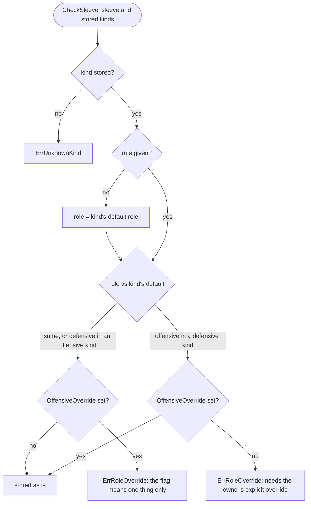
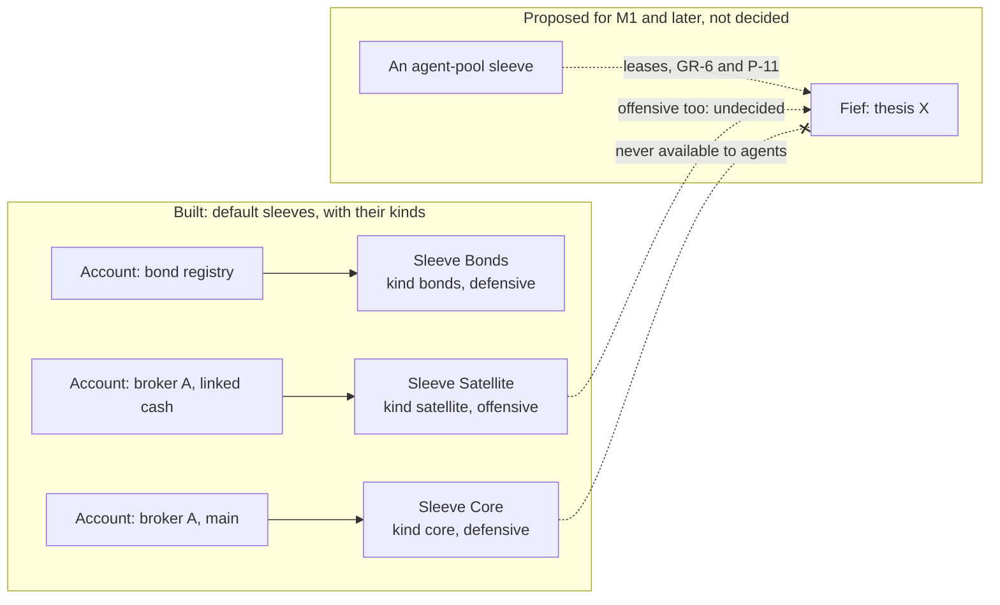
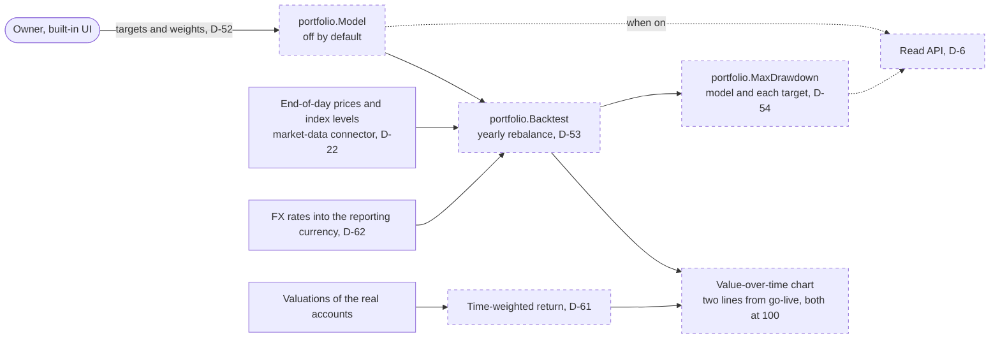

The portfolio context describes the portfolio as a whole: the parts it is divided into, and later the model it is compared with. Today it holds [sleeves](../glossary.md) and [sleeve kinds](../glossary.md). Every account belongs to exactly one sleeve, every sleeve has one kind, and each sleeve is either defensive or offensive. The [model portfolio](../glossary.md) is decided for M0 (D-52 to D-54, D-61, D-62) but not built.

## Concepts

**Sleeves.** In asset management, a sleeve is a part of a portfolio that is run separately, with its own mandate. In OpenFief a sleeve is a part of the portfolio with one role, and it is made of whole [accounts](../glossary.md). Section 3.1 of [DESIGN.md](../DESIGN.md) gives the reason the core keeps sleeve attribution itself: the later lease ledger reconciles against it.

**Why defensive and offensive.** The split resembles core-satellite investing: a large, diversified core held for the long run, plus smaller satellites for active bets. OpenFief turns that habit into a hard line for agents. GR-6 leases each thesis agent's budget only from the offensive part, and a defensive sleeve is never available to agents. Because a sleeve is made of accounts at institutions, the line can later be drawn by the broker too. P-11 (a), a proposal, puts each offensive sleeve in its own IBKR linked cash account, so even a compromised OpenFief host couldn't trade defensive accounts.

**Sleeve kinds.** The role is a two-value switch that GR-6 relies on, so it stays fixed. A sleeve kind is the owner-facing label on top: emergency fund, bonds, retirement, core, satellite, agent pool, or one the owner adds. Each kind has a default role, and the allocation chart can group by kind (D-30). The owner may rename a kind, but its default role never changes, because every sleeve of that kind was checked against it. The role is stored on the sleeve itself, so renaming a kind can't change what agents may lease from. A sleeve may always be *more* defensive than its kind; making it offensive in a defensive kind needs an explicit override.

**Sleeves in future fiefs.** These are proposals in [control-plane.md](../proposals/control-plane.md), not decisions. A [fief](../glossary.md) is a revocable lease from the offensive sleeve to one agent. P-12 sweeps sale proceeds above the lease back to the offensive sleeve. P-11 (f) adds kill switches per agent, per sleeve and global. In P-24, a closed fief returns its capital to the offensive sleeve. Still open: whether there is one offensive sleeve or several (OQ-20, T-7), and who sets its size (OQ-12).

**The model portfolio.** A weighted basket of [targets](../glossary.md) for the whole portfolio, not per sleeve (D-52). A target is an instrument or an [index](../glossary.md) with a weight, and the weights sum to 100%. It is something to compare with; in M0 nothing trades. Its performance is a [backtest](../glossary.md): its value from end-of-day prices, as far back as every target has data, rebalanced to the target weights once a year (D-53). Without rebalancing, a basket slowly becomes a bet on its best performer. The portfolio's own line next to it is its time-weighted return ([TWR](../glossary.md), D-61), so deposits and withdrawals don't count as performance, and transfers between the owner's own accounts, defensive to offensive included, are not cash flows. Both lines are in the [reporting currency](../glossary.md) (D-62) and start at 100 on go-live (D-53); M0 also shows the [max drawdown](../glossary.md) of the model and of each target (D-54).

## How it works

### Built: sleeves and sleeve kinds

Package `portfolio` ([sleeve.go](../../internal/portfolio/sleeve.go), [kind.go](../../internal/portfolio/kind.go)) is pure domain code:

| Name | What it does |
|---|---|
| `Sleeve` | `ID`, `Name`, `Kind`, `Role` and `OffensiveOverride`. `Validate` checks the ID, name and role. |
| `Role`, `ParseRole` | `RoleDefensive` or `RoleOffensive`, stored as those words. The zero `Role` is not a role. |
| `Kind`, `KindKey` | A key of lowercase hyphenated words (at most 64 characters), a name and a `DefaultRole`. |
| `DefaultKinds` | The built-in kinds: `agent-pool` and `satellite` offensive; `bonds`, `core`, `emergency-fund` and `retirement` defensive. |
| `CheckKind` | A new key adds a kind, a known key renames it; changing a stored kind's default role is `ErrKindRoleChange`. |
| `CheckSleeve` | Checks a sleeve against the stored kinds and fills in a missing role (diagram below). |
| `DefaultSleeves`, `MissingDefaults` | An install's starting sleeves, Bonds, Core and Satellite, and which defaults are not stored yet. |
| `KindBySleeve` | Maps each sleeve to its kind, for an allocation grouped by kind (D-30). |

The portfolio context has no store of its own in M0, so the ledger keeps sleeves and kinds next to the accounts that refer to them, and the `ledger` package imports `portfolio`, not the other way round. [0002_sleeve_kinds.sql](../../internal/ledger/postgres/migrations/0002_sleeve_kinds.sql) creates `ledger.sleeve_kinds`, seeds the six built-in kinds, and adds a trigger that refuses any change to a kind's key or default role. Each sleeve gets a required `kind` and an `offensive_override` that a `CHECK` allows only on offensive sleeves; sleeves stored before kinds existed became `core` or `satellite`, whichever matches their role. In `internal/ledger/app`, `SaveKind` runs `CheckKind`, `SaveSleeve` runs `CheckSleeve`, and `SaveAccount` refuses an account whose sleeve isn't stored ([ledger.go](../../internal/ledger/app/ledger.go), [kinds.go](../../internal/ledger/app/kinds.go)). `EnsureDefaults` stores whichever default kinds and sleeves are missing, in one transaction, and never changes a stored one.

### Not built: the model portfolio comparison

Every box below is planned and has no code yet. The Go names are the glossary's proposals.

## Decisions

- **GR-6**: one fixed role per sleeve; offensive in a defensive kind needs an override.
- **D-30**: `KindBySleeve` lets the allocation group by kind; the chart isn't built.
- **D-52, D-53, D-54, D-61, D-62**: model portfolio, backtest, max drawdown, TWR, reporting currency. Not built.
- **No decision ID for sleeve kinds.** The commit and the migration call them an "author decision", and the glossary defines the term, but DESIGN.md records no D-ID for the built-in kinds, the default sleeves or the override.
- **Which offensive sleeves agents may lease from.** The glossary makes every offensive sleeve "the part fiefs are leased from". [kind.go](../../internal/portfolio/kind.go) says only `agent-pool` is what fiefs are leased from and `satellite` holds the owner's own higher-risk positions, yet both are offensive and the default Satellite sleeve is offensive. Nothing in the code tells them apart; OQ-20 is still open.
- **Mismatch:** [doc.go](../../internal/portfolio/doc.go) says the model portfolio and its targets "arrive in a later milestone". D-52 and DESIGN.md's milestone table put the optional model portfolio in M0.

## Verification

| Behavior | Tests | kibi |
|---|---|---|
| A sleeve needs an ID, a name and one known role | `TestSleeveValidate`, `TestParseRole` in [sleeve_test.go](../../internal/portfolio/sleeve_test.go) | REQ-portfolio-sleeve-role |
| Kind keys, the built-in kinds, fixed default roles, the override rules, the defaults and kind by sleeve | `TestKindValidate`, `TestDefaultKinds`, `TestCheckKind`, `TestCheckSleeve`, `TestDefaultSleeves`, `TestMissingDefaults`, `TestKindBySleeve` in [kind_test.go](../../internal/portfolio/kind_test.go) | REQ-portfolio-sleeve-kind, REQ-portfolio-default-kinds, REQ-portfolio-kind-role-fixed, REQ-portfolio-sleeve-role-override, REQ-portfolio-allocation-by-kind |
| The ledger checks kinds and sleeves before storing; defaults are ensured once | `TestSaveKind`, `TestEnsureDefaults` in [kinds_test.go](../../internal/ledger/app/kinds_test.go); `TestSaveSleeve`, `TestSaveAccount` in [ledger_test.go](../../internal/ledger/app/ledger_test.go) | REQ-ledger-app-sleeve-kinds, REQ-ledger-app-registry |
| PostgreSQL seeds the kinds, backfills old sleeves, refuses role changes and stray overrides | `TestMigrateStoresTheDefaultKinds`, `TestMigrateGivesStoredSleevesAKind`, `TestKindRoundTrip`, `TestSleeveKindConstraints`, `TestEnsureDefaultsOnPostgres` in [kinds_test.go](../../internal/ledger/postgres/kinds_test.go); `TestRegistryRoundTrip` | REQ-ledger-pg-sleeve-kinds, REQ-ledger-pg-store |
| An account needs a sleeve | `TestAccountValidate` in [account_test.go](../../internal/ledger/account_test.go) | REQ-ledger-account-sleeve |

Run `go test ./internal/portfolio/... ./internal/ledger/app/...` or `task test`; the PostgreSQL tests run with `task test:pg`. kibi already holds the model portfolio's requirements, with no tests yet: REQ-portfolio-model-optional, REQ-portfolio-model-weights, REQ-portfolio-backtest-yearly-rebalance, REQ-portfolio-max-drawdown, REQ-portfolio-twr-comparison, REQ-views-model-line-from-go-live and REQ-valuation-reporting-currency.

From reading the code: the override guards only one path to offensive. Saving a sleeve again with an offensive kind, such as moving Core to `agent-pool`, makes it offensive with no override, and saving an account again can move it to another sleeve. Nothing records either change. That is harmless while no agent exists, but it will matter once fiefs are leased from offensive sleeves.

## Not built yet

- **D-52**: `portfolio.Model` and `portfolio.Target`, the setting that turns the model portfolio on (off by default), entry in the built-in UI, and its place in the read API.
- **D-53**: `portfolio.Backtest`, and the model's line in the value-over-time chart (D-30).
- **D-54**: `portfolio.MaxDrawdown` for the model and each target.
- **D-61**: the portfolio's time-weighted return.
- **D-62**: the reporting currency setting and its default from the jurisdiction pack. The backtest also needs FX history into it, which starts no earlier than NBP's first rate on 2002-01-02.
- **D-30, D-6**: sleeves and kinds in the read API, and the allocation chart.
- Nothing calls `EnsureDefaults`, because no core binary exists yet, so no install starts with the default sleeves. Only `cmd/demo-seed` saves sleeves, for the demo dataset. No API or UI adds kinds, renames them or sets the override.
