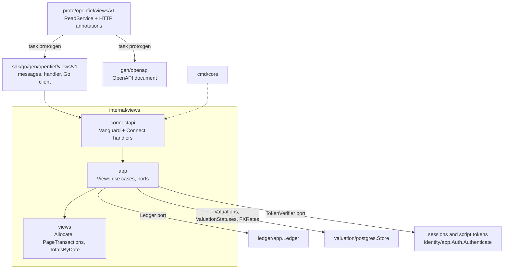
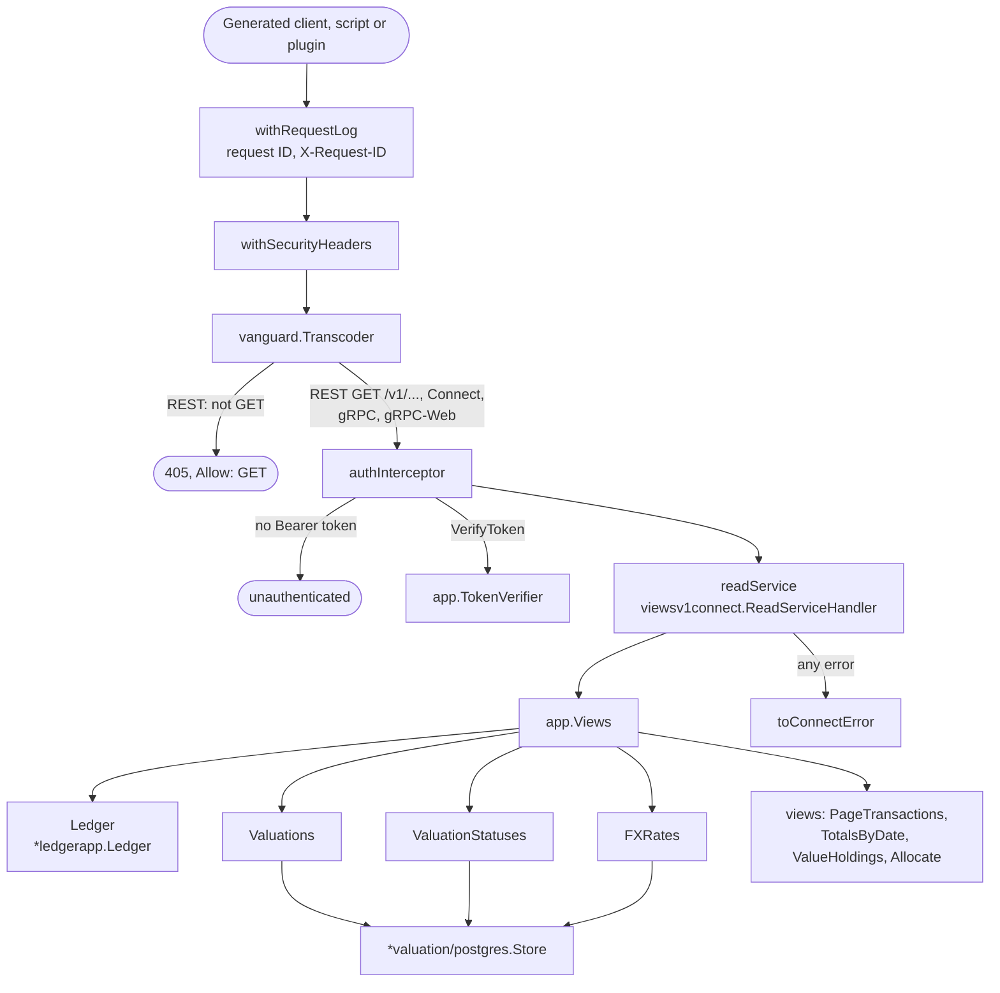
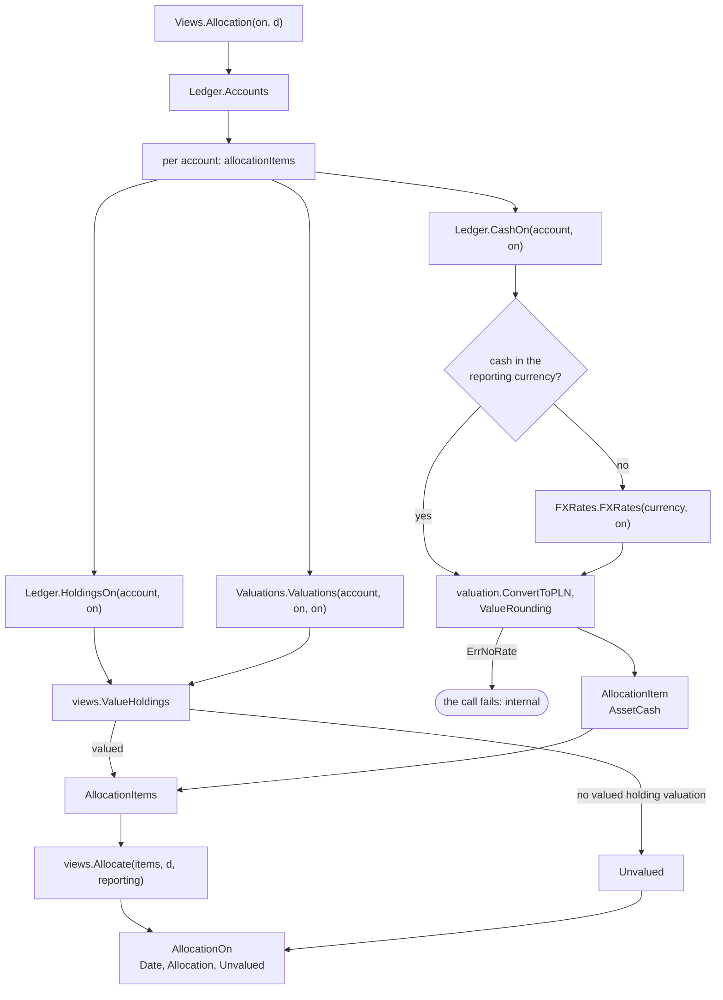
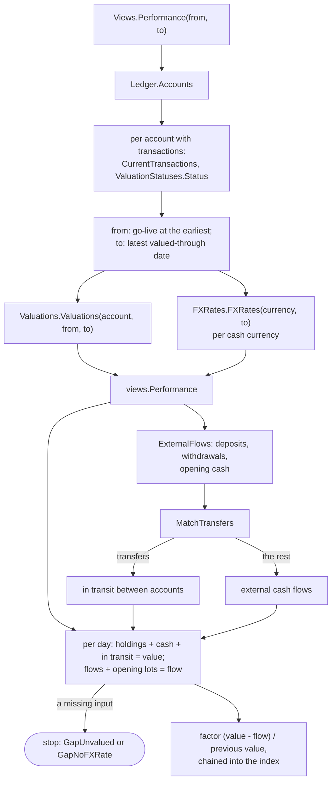

The [read API](../glossary.md) is how anything outside the core reads the record: sleeves, accounts, transactions, holdings, tax lots, cash, balance assertion checks, stored valuations, the allocation, the portfolio's [time-weighted return](../glossary.md) and, while it is on, the [model portfolio](../glossary.md). The [built-in UI](ui.md) reads through it, with the owner's session as its bearer token, every other view plugin is meant to, and so can the owner's own scripts. It only reads: data enters OpenFief through connectors, never through this API. This page explains the service, the pure rules behind its totals, the allocation and the performance series, and the HTTP adapter that serves it. The core service, `cmd/core`, serves it on Service `openfief-core`, port `http` (8080).

## Concepts

**A separate read side.** Bertrand Meyer's command-query separation (1988) says a method should either change state or answer a question, never both. Greg Young's CQRS (around 2010) applies the same split to whole systems: the write path and the read path get separate models. OpenFief uses a light version of it. Data enters only through connectors' ingest paths into the append-only transaction log (D-7, D-18). The read API answers from the ledger's queries and from stored valuations, which are a read model: rows derived from the log, prices and rates, rebuildable at any time (D-36).

**One service, two ways to call it.** The API is one protobuf service, `openfief.views.v1.ReadService`, in [read_service.proto](../../proto/openfief/views/v1/read_service.proto). Protobuf (Google, open-sourced 2008) describes messages and services once and generates code for many languages. Each method also carries a `google.api.http` annotation, Google's convention from its own APIs for mapping an RPC onto a REST path. Clients generated from the protobuf call the service over [Connect RPC](../glossary.md), gRPC or gRPC-Web. Everyone else calls plain REST with JSON under `/v1`, which Buf's [Vanguard](https://github.com/connectrpc/vanguard-go) library transcodes from the annotations into the same handlers. The OpenAPI 3.1 document, [read_service.openapi.yaml](../../gen/openapi/openfief/views/v1/read_service.openapi.yaml), is generated from the same definitions by `protoc-gen-connect-openapi`, with its title and bearer scheme from [read_service.openapi-base.yaml](../../proto/openfief/views/v1/read_service.openapi-base.yaml). So the Go types, the Connect service, the REST paths and the OpenAPI document can't disagree.

**Read-only by construction.** Every method is unary, declares `idempotency_level = NO_SIDE_EFFECTS`, and maps to a `GET` under `/v1` with no body. Over REST, any other HTTP method gets `405 Method Not Allowed` with `Allow: GET`, before the token is even looked at. The Connect protocol still accepts its usual `POST` for unary calls, and also its `GET` form, which the no-side-effects option enables.

| Method | REST | Parameters |
|---|---|---|
| `ListSleeves` | `GET /v1/sleeves` | |
| `ListAccounts` | `GET /v1/accounts` | |
| `GetAccount` | `GET /v1/accounts/{account_id}` | |
| `ListTransactions` | `GET /v1/accounts/{account_id}/transactions` | `pageSize` (1 to 500, 0 means 100), `pageToken` |
| `ListHoldings` | `GET /v1/accounts/{account_id}/holdings` | `date` |
| `ListLots` | `GET /v1/accounts/{account_id}/lots` | `date` |
| `ListCash` | `GET /v1/accounts/{account_id}/cash` | `date` |
| `ListAssertionChecks` | `GET /v1/accounts/{account_id}/balance-assertions` | `status`, such as `ASSERTION_STATUS_FLAGGED`; none for all |
| `ListAccountValuations` | `GET /v1/accounts/{account_id}/valuations` | `from`, `to` |
| `GetValuationStatus` | `GET /v1/accounts/{account_id}/valuation-status` | |
| `ListValuationTotals` | `GET /v1/valuations` | `from`, `to` |
| `ListValuationStatuses` | `GET /v1/valuation-status` | |
| `GetAllocation` | `GET /v1/allocation` | `date`, `by`, such as `ALLOCATION_DIMENSION_SLEEVE` |
| `GetPerformance` | `GET /v1/performance` | `from`, `to`, both optional |
| `GetModelPortfolio` | `GET /v1/model-portfolio` | `from`, `to`, both optional; `404` while the model portfolio is off |

**Money, quantities and dates on the wire.** [Money](../glossary.md) is a `Money` message: `amount` as a decimal string such as `"-1234.56"`, never a JSON number, and `currency` as an ISO 4217 code. A JSON number is a binary float in most clients, which can't hold every decimal amount exactly. Quantities are decimal strings too. Dates are `YYYY-MM-DD` strings with no time of day.

**Original and reporting currency.** Every amount keeps its original currency. Valuations, [date totals](../glossary.md) and the [allocation](../glossary.md) also carry a value in the [reporting currency](../glossary.md): fields named `value_reporting` and `total_reporting`, with a `reporting_currency` field on the valuation responses. Only PLN is accepted as the reporting currency today (see [Decisions](#decisions)).

**Valuations, totals and their gaps.** The API reads the [holding valuations](../glossary.md) the valuation context stores ([Valuation](valuation.md)); it computes no prices itself. A holding valuation that lacks an input (a price, an FX rate or an index reading) is left out of the account's valuation list and counts in no total. How far each account is complete is its [valued-through date](../glossary.md), which `GetValuationStatus` and `ListValuationStatuses` return with whether a revaluation is pending or running. An account never valued has an empty `valued_through`. Stored valuations cover holdings only, never cash, so `ListValuationTotals` doesn't include cash; the performance series' daily value does.

**Allocation.** The [allocation](../glossary.md) is the portfolio's value on one date split into groups by one dimension: [asset class](../glossary.md), currency, [institution](../glossary.md) or [sleeve](../glossary.md). Each [allocation item](../glossary.md) is one valued holding or one cash balance of an account. A holding counts at its stored valuation on that date; cash, which has no stored valuation, is converted here at the FX rate for the date. A holding with no valued holding valuation on the date is not counted but listed in `unvalued`, so a chart can say what it is missing instead of silently showing less. The asset class is `cash`, `treasury_bond` for a Polish ISIN whose venue symbol is a bond series code such as `EDO0536`, and `listed` for anything else. Groups come largest first, then by key.

**Time-weighted return.** How did the portfolio do, when the owner keeps adding and taking out money? Its value alone can't say: a deposit raises it without anyone earning anything. Peter Dietz's *Pension Funds: Measuring Investment Performance* (1966) gave a formula that takes cash flows out of a return, and the Bank Administration Institute's 1968 study for US pension funds recommended the time-weighted rate of return for comparing managers, because a manager doesn't choose when money arrives. The CFA Institute's Global Investment Performance Standards (GIPS, 1999, grown out of AIMR's 1993 standards) require it. The idea: split the time into sub-periods at every external cash flow, measure each sub-period's return on the money that was there, and multiply the returns. Where the portfolio isn't valued at each flow, the Modified Dietz method approximates a sub-period's return by weighting each flow by the part of the period it was invested; GIPS has required a valuation at every large cash flow since 2010, which makes each sub-period exact. OpenFief has a stored valuation for every day (D-36), so every day is a sub-period. Valuations are end-of-day, so a flow's time inside its day is a convention: OpenFief takes [external cash flows](../glossary.md) at the end of their day. Each day's factor is (V − F) / V′, where V is the portfolio's value at the end of the day, F the day's net external flow and V′ the value at the end of the day before, which is Modified Dietz for one day with the flow weighted zero. The [performance index](../glossary.md) starts at 100 and multiplies by each day's factor, so 105 means 5% up, whatever was deposited or withdrawn. Money moved between two of the owner's own accounts is a [transfer](../glossary.md), not a cash flow (D-61). The model portfolio's backtest is drawn next to this line (D-53); it starts at 100 on the same day.

**The model portfolio.** While the owner keeps the [model portfolio](portfolio.md) off, the default, `GetModelPortfolio` answers `NOT_FOUND` (`404` over REST) with the fixed text `no model portfolio`, and no other method mentions it (D-52). While it is on, the answer carries its targets, its [backtest](../glossary.md) as `days`, an index that is 100 on the first day of the range like the performance series, the first and last day every target has history (`backtest_start`, `backtest_end`), the [max drawdown](../glossary.md) of the model over its whole backtest and each target's history with its own max drawdown (D-54), in the reporting currency. The range resolves like `GetPerformance`'s: go-live to the latest valued-through date by default, so both chart lines cover the same days. A model whose backtest starts after go-live starts its line at 100 on its first day. The values of a drawdown are those of the series it was measured on: the backtest's index from 100 on `backtest_start` for the model, a target's value in the reporting currency per unit for a target.

**Paging transactions.** `ListTransactions` returns the current version of each transaction in date, then source, then external ID order. A page that has more after it returns a `nextPageToken`: an opaque cursor naming the last transaction's date and key, base64url-encoded. Passing it back starts the next page right after that transaction, so a client reads every current transaction once even if a page boundary falls between transactions on the same date. This is keyset paging: an offset ("skip 200") skips or repeats a row when rows arrive between two requests, while a cursor that names the last row read doesn't. The parameter names follow Google's API improvement proposal AIP-158.

**Bearer tokens.** Every call, over any protocol, needs an `Authorization: Bearer <token>` header. The token is a [session](../glossary.md) of the owner, of any scope, such as the one the built-in UI holds for the browser, or a [script token](../glossary.md); a plugin's projected ServiceAccount token ([plugin identity](../glossary.md)) is meant to be accepted too. The API asks a `TokenVerifier` whether the token may read. The core's verifier is the identity context's `Auth.Authenticate` ([Identity](identity.md)), which accepts sessions and read-scoped script tokens; plugins' tokens are not accepted yet. Logging in, and every other change, goes through the identity context's separate `AuthService`, never through this API.

## How it works

The views context follows the layering in [code-organization.md](../dev/code-organization.md):

| Package | Layer | Contents |
|---|---|---|
| `views` ([allocation.go](../../internal/views/allocation.go), [valuation.go](../../internal/views/valuation.go), [page.go](../../internal/views/page.go), [performance.go](../../internal/views/performance.go), [flows.go](../../internal/views/flows.go)) | Domain, pure | `Allocate`, `ValueHoldings`, `AssetClassOf`, `Dimension`, `AssetClass`; `TotalsByDate`, `ValidateRange`, `MaxRangeDays`; `PageTransactions`, `TransactionCursor`, `DefaultPageSize`, `MaxPageSize`; `Performance`, `PerformanceInput`, `PerformanceSeries`, `PerformanceDay`, `PerformanceGap`, `TWRPlaces`; `ExternalFlows`, `MatchTransfers`, `CashFlow`, `Transfer`, `TransferWindowDays`. The model portfolio's rules are the portfolio context's ([Portfolio](portfolio.md)) |
| `views/app` ([views.go](../../internal/views/app/views.go), [performance.go](../../internal/views/app/performance.go), [model.go](../../internal/views/app/model.go), [ports.go](../../internal/views/app/ports.go), [tokens.go](../../internal/views/app/tokens.go)) | Use cases and ports | `Views` and its queries, `Views.Performance` and `Views.ModelPortfolio` among them; the ports `Ledger`, `Valuations`, `ValuationStatuses`, `FXRates`, `TokenVerifier` and `ModelReports` (set with `WithModel`); `UnsupportedReportingCurrencyError`, `ErrModelOff` |
| `views/connectapi` ([handler.go](../../internal/views/connectapi/handler.go), [server.go](../../internal/views/connectapi/server.go), [auth.go](../../internal/views/connectapi/auth.go), [errors.go](../../internal/views/connectapi/errors.go), [convert.go](../../internal/views/connectapi/convert.go)) | Adapter | `New`, the HTTP handler; `readService`, the generated `ReadServiceHandler`; the auth interceptor, error mapping and conversion to the generated messages |

The generated Go code for the service lives with the other contracts in `sdk/go/gen/openfief/views/v1` ([Plugins](plugins.md#the-connector-contract)). From the contract to the ports:

### A request, from HTTP to the ports

`connectapi.New(views, verifier, opts...)` builds one `http.Handler`. The ports are declared in `views/app`, by the consumer. Each is shaped like a method the other contexts already have, and `cmd/core` passes `*ledgerapp.Ledger` as `Ledger` and `*valuation/postgres.Store` as `Valuations`, `ValuationStatuses` and `FXRates`.

The handler parses each request field: dates with `kernel.ParseDate`, the page token with `views.ParseTransactionCursor`, and enums against the domain's constants. An unspecified allocation dimension or an unknown assertion status is an invalid argument. `TestEnumsMatch` checks that every domain enum and its protobuf twin share their numbers.

### Errors, logs and headers

Errors never carry their own text to the client, because it can quote an account ID, an amount or what was asked. `toConnectError` maps them to Connect codes with fixed texts, and Vanguard turns the codes into HTTP statuses for REST:

| Cause | Code | REST | Client sees |
|---|---|---|---|
| `app.ErrUnknownAccount` | not found | 404 | `no such account` |
| `app.ErrModelOff` | not found | 404 | `no model portfolio` |
| `views.ErrInvalidRange`, `ErrInvalidCursor`, `ErrInvalidPageSize`, `ErrUnknownDimension`, a malformed field | invalid argument | 400 | a fixed sentence per cause |
| No bearer token, or one the verifier rejects | unauthenticated | 401 | a fixed sentence and a `WWW-Authenticate: Bearer` challenge |
| Anything else, including a token that can't be checked | internal | 500 | `the request failed; its request ID names it in the server log` and the request ID |

`withRequestLog` gives each request a random ID, returns it as `X-Request-ID`, and logs one line with only `request_id`, the HTTP `method` and the `status`. The path is never logged: it can name an account. A failure adds a line with `request_id` and `while` (`answering` or `verifying a token`), and not the error, for the same reason. `withSecurityHeaders` sets `Cache-Control: no-store`, `Content-Security-Policy: default-src 'none'; frame-ancestors 'none'`, `Cross-Origin-Resource-Policy: same-origin`, `Referrer-Policy: no-referrer`, `X-Content-Type-Options: nosniff` and `X-Frame-Options: DENY` on every response, errors and 405s included.

### Account queries

Sleeves, accounts, holdings, lots, cash and balance assertion checks come straight from the `Ledger` port; [Ledger](ledger.md) explains how they are derived. A query about an account the ledger doesn't store fails with `ErrUnknownAccount`. Any other store failure stays a failure, so a broken database never looks like a missing account. `AssertionChecks` filters to one status when asked. `Transactions` loads the current transactions and hands them to `PageTransactions`, which sorts a copy, starts after the cursor, and returns at most `size` of them with a cursor when more follow.

### Valuations and totals

`AccountValuations(account, from, to)` and `ValuationTotals(from, to)` first check the range with `ValidateRange`: `to` may not be before `from`, nor more than `MaxRangeDays` (3700, about ten years) after it. Then they load stored holding valuations through the `Valuations` port, for one account or for every account, and pass them to `TotalsByDate`. It sums, per date, each valued holding valuation's converted value exactly in the reporting currency, and its original-currency value per currency, in currency code order. A converted value in any other currency is `ErrNotReportingCurrency`. `AccountValuations` also returns the valued holding valuations themselves, each with its basis, source, original value and reporting value.

### The allocation

`ValueHoldings` pairs each holding with the valued holding valuation of the same account, instrument and date, and takes its asset class from `AssetClassOf`. Cash is converted with the latest stored rate on or before the date, rounded to grosze like holding values (`valuation.ValueRounding`, half up), so holdings and cash add up alike. A cash currency with no rate fails the whole call rather than leaving that cash out. `Allocate` groups the items by the dimension's key: the asset class name, the original currency code, the account's institution or its sleeve ID. It sums each group and the total exactly, and sorts the groups.

So on the same date the allocation's total includes cash and `ListValuationTotals` doesn't, and the allocation leaves out unvalued holdings that a later revaluation would add.

### The performance series

`Views.Performance(from, to)` loads every account's current transactions and valuation status, the stored valuations of the range and the FX rates of every currency the cash moves in, and hands them to the pure `views.Performance`. An empty `from` is go-live, the first transaction's date, and a `from` before go-live starts there, as the value-over-time chart does (D-30). An empty `to` is the latest valued-through date of any account. An account with transactions that was never valued counts as valued through the day before its first transaction. `revaluation_pending` says whether any account's revaluation is pending or running, so the series may still change.

For each day from `from` to `to`, `views.Performance` values the portfolio at the end of the day, in the reporting currency:

- **Holdings** at their stored valuations. The transactions up to the day give each account's holdings; each must have exactly one valued holding valuation of that quantity on the day.
- **Cash**: each account's balance per currency, summed from its cash postings, converted with the latest stored rate on or before the day and rounded to grosze half up like holding values (`valuation.ValueRounding`). This is how the series includes the cash that `ListValuationTotals` leaves out.
- **In transit**: the money of each transfer from the withdrawal's date to the day before the deposit's, at the day's rate. When the deposit is booked first, it counts negative until the withdrawal, so the money counts once.
- **Flow**: the day's external cash flows at the day's rate, plus each opening lot at its share of its holding's valuation that day. An account seeded after go-live brings its opening lots and opening cash in as flows, so they are not returns.

`MatchTransfers` reads a withdrawal from one account and a deposit into another as one transfer when they are exactly the same amount in the same currency, dated at most `TransferWindowDays` (five) days apart, in either order. Each withdrawal, in date order, takes the nearest unmatched deposit, the earliest of equally near ones. Opening cash is never a leg. Nothing in the record says that two such flows are the same money, so this is a heuristic; the response lists every transfer it matched, so a wrong match can be seen.

Each day's factor is (value − flow) / the previous day's value, rounded to `TWRPlaces` (12) decimal places half-even, and the running product is rounded the same way. A day that starts with a value of zero or less has no return: its factor is 1. The index is 100 times the product, exact. Half-even rounding doesn't lean one way, so a synthetic ten-year series stays within a few billionths of an index point of the exact value.

The series stops before the first day that lacks an input and says why in `gap`: `PERFORMANCE_GAP_UNVALUED` for a day after some account's valued-through date, or with a holding that has no valuation, an incomplete one, or one of a quantity the log no longer gives (a revaluation not yet run); `PERFORMANCE_GAP_NO_FX_RATE` for cash, a flow or money in transit in a currency with no rate yet. A chart then ends at the last day it can draw truthfully instead of drawing a drop.

### The model portfolio

`Views.ModelPortfolio(from, to)` resolves the range as `Performance` does, asks the `ModelReports` port (`*portfolio/app.Models`, which `cmd/core` passes with `WithModel`) for the report through `to`, and rebases the backtest with `portfolio.Since` to 100 on the first day on or after `from`. With nothing recorded, there is no go-live: the line starts on the backtest's first day and runs through all stored history. A core built without `WithModel`, or a model that is off, is `ErrModelOff`.

## Decisions

- **D-6**: the read-only public API under `/v1` with an OpenAPI spec. Built in this context; nothing calls it yet. MCP access is not part of it.
- **D-50**: protobuf with HTTP annotations, Connect plus REST through Vanguard, OpenAPI generated from the same definitions. Built as described above.
- **D-7**: data never enters through the public API. Enforced by the service definition and by REST answering 405 to anything but `GET`.
- **D-30**: the allocation by asset class, currency, broker or sleeve, and value over time. The code groups by institution where D-30 says broker, since the treasury bond registry is an institution and not a broker (see the glossary). Value over time is `ListValuationTotals`; the charts themselves are the UI's.
- **D-36**: the read API reports, per account, the valued-through date and whether a revaluation is pending or running. Built as `GetValuationStatus` and `ListValuationStatuses`; the UI part is not built.
- **D-61**: the portfolio's line is its time-weighted return, chained across deposits and withdrawals, with transfers between the owner's accounts not counted as cash flows. Built as `GetPerformance`. Which flows are transfers is not in the record; the matching rule above (same amount and currency, another account, at most five days apart) is this context's reading, not the author's.
- **D-52**: while the model portfolio is off, `GetModelPortfolio` answers `NOT_FOUND` and nothing else mentions it. The method itself is in the contract and the OpenAPI document either way; that it answers 404 rather than an empty response is this context's reading.
- **D-53**: the model's backtest as a second line, both starting at 100 on `from`. Built as `GetModelPortfolio`'s `days`.
- **D-62** and **T-12**: totals, the allocation and the performance series are in the reporting currency, next to each original currency. `app.New` refuses any reporting currency but PLN with an `*UnsupportedReportingCurrencyError`, because stored valuations and FX rates are against PLN only (D-20) and T-12 (proposal P-49) is open.
- **D-27**: the bearer tokens the API accepts. The core accepts the owner's sessions and script tokens ([Identity](identity.md)); plugins' projected tokens are not accepted yet.
- Half-up rounding of cash in the allocation and the performance series follows `valuation.ValueRounding`, which no decision fixes (see [Valuation](valuation.md#decisions)).
- Flows at the end of their day, 12 decimal places half-even for the factors and the five-day transfer window are this context's choices; no decision fixes them.

## Verification

| Behavior | Tests | kibi |
|---|---|---|
| Grouping by each dimension, largest first; asset classes; pairing holdings with their valuations | `TestAllocate`, `TestAllocateEdges`, `TestAllocateInAnyReportingCurrency`, `TestParseDimension`, `TestAssetClassOf`, `TestValueHoldings` in [allocation_test.go](../../internal/views/allocation_test.go) | REQ-views-allocation, SCEN-views-allocation, TEST-views-allocation |
| Exact totals per date and per currency; inputs that lack a value count nowhere; the 3700-day range | `TestTotalsByDate`, `TestTotalsByDateOtherCurrency`, `TestValidateRange` in [valuation_test.go](../../internal/views/valuation_test.go) | REQ-views-valuation-totals, SCEN-views-valuation-totals, TEST-views-valuation |
| Pages in date then key order, cursor round trip, page size 1 to 500 | `TestPageTransactions`, `TestPageTransactionsSize`, `TestTransactionCursor` in [page_test.go](../../internal/views/page_test.go) | REQ-views-transaction-pages, SCEN-views-transaction-pages, TEST-views-page |
| Use cases over the ports: allocation inputs, cash without a rate, valuations, totals, status, filters, unknown account versus store failure, PLN only | `TestAllocation`, `TestAllocationFailures`, `TestReportingCurrency`, `TestAccountValuations`, `TestValuationTotals`, `TestValuationStatus`, `TestAssertionChecks`, `TestTransactions`, `TestUnknownAccount`, `TestStoreFailure` in [views_test.go](../../internal/views/app/views_test.go) | REQ-views-app-queries, REQ-views-allocation-inputs, REQ-views-valuation-queries, REQ-views-valuation-status, REQ-views-reporting-currency, with their SCEN-views-* scenarios, TEST-views-app |
| Time-weighted return: a price move counts; a deposit, a withdrawal, a transfer between own accounts, in either order and at the day's rate, and an account seeded later don't; a missing valuation, a stale quantity, the valued-through date or a missing rate stops the series; transfer matching | `TestPerformance`, `TestPerformanceParts`, `TestPerformanceRejects`, `TestPerformanceGapString`, `TestMatchTransfers`, `TestExternalFlows` in [performance_test.go](../../internal/views/performance_test.go) | REQ-views-performance-twr, REQ-views-performance-value, REQ-views-performance-transfers, REQ-views-performance-gaps, with their SCEN-views-performance-* scenarios, TEST-views-performance |
| Properties over seeded random cases: the index is the same with an invested deposit of any size; cash alone stays at 100; the drift over 3700 days stays within its bound | `TestPerformanceIgnoresDepositSize`, `TestPerformanceOfCashIsFlat`, `TestPerformanceDrift` in [performance_property_test.go](../../internal/views/performance_property_test.go) | REQ-views-performance-twr, TEST-views-performance-properties |
| The performance query: go-live and valued-through defaults, a never-valued account, no transactions, pending revaluations, failures | `TestPerformance`, `TestPerformanceFailures` in [app/performance_test.go](../../internal/views/app/performance_test.go) | REQ-views-performance-query, SCEN-views-performance-query, TEST-views-app-performance |
| A generated Connect client and Connect's GET form; error codes; every method read-only in the descriptor; enums match the domain | `TestConnectQueries`, `TestConnectValuation`, `TestConnectPerformance`, `TestConnectPages`, `TestConnectErrors`, `TestConnectGET`, `TestServiceIsReadOnly`, `TestEnumsMatch` in [connect_test.go](../../internal/views/connectapi/connect_test.go) | REQ-views-api-contract, REQ-views-api-read-only, TEST-views-connectapi-connect |
| The model portfolio: its range, the rebased line, off and not served, a reversed range | `TestModelPortfolio`, `TestModelPortfolioRefusals` in [app/model_test.go](../../internal/views/app/model_test.go) | REQ-views-model-portfolio, REQ-views-model-line-from-go-live, REQ-portfolio-model-optional |
| The model portfolio over Connect and REST: the whole answer, 404 while off, the OpenAPI shape, enum numbers | `TestConnectModelPortfolio`, `TestModelPortfolioOff`, `TestRESTModelPortfolio`, `TestModelEnumsMatch` in [model_test.go](../../internal/views/connectapi/model_test.go) | REQ-views-model-portfolio, REQ-views-api-contract |
| REST responses validated against the generated OpenAPI; 405 with `Allow: GET`; tokens; headers; money as strings; a log without data | `TestREST`, `TestRESTInternalError`, `TestRESTUnauthenticated`, `TestRESTReadOnly`, `TestOpenAPIIsReadOnly`, `TestSecurityHeaders`, `TestMoneyIsADecimalString`, `TestLogNamesNoData`, `TestRESTPerformance` in [handler_test.go](../../internal/views/connectapi/handler_test.go) | REQ-views-api-contract, REQ-views-api-read-only, REQ-views-api-auth, REQ-views-api-logs, TEST-views-connectapi-rest |

These requirements refine the firm ones imported from D-6, D-7, D-30, D-36 #6, D-50 (REQ-views-read-api-protobuf) and D-61 (REQ-portfolio-twr-comparison). Every test runs over in-memory fakes of the ports with synthetic accounts and ISINs, offline, under `task test`. The REST tests go through the real Vanguard transcoder and check each response body against `gen/openapi` with kin-openapi. `task proto:check` fails when the generated Go or OpenAPI differs from what the protobuf produces. Over the real stores, `TestCoreServesTheReadAPI` in [cmd/core](../../cmd/core/core_test.go), under `task test:pg`, starts the core on a fresh PostgreSQL with part of the demo dataset, issues a script token with `core token issue`, decodes REST answers strictly into the protobuf messages, checks that the performance series runs from 100 through today with no gap once the demo data is valued, and gets 401 without a token or with an unknown or revoked one.

## Not built yet

- **D-27**: accepting plugins' projected ServiceAccount tokens (audience `openfief-core`); the core's verifier accepts sessions and script tokens only.
- **D-4**: the Ghostfolio view. The [built-in UI](ui.md) reads this API with the owner's session token for D-30's charts and D-36's valuation status.
- Cash in `ListValuationTotals`. Its totals stay sums of stored holding valuations; the value with cash is the performance series' `value_reporting`.
- **D-62**: a reporting currency other than PLN, waiting on T-12.
