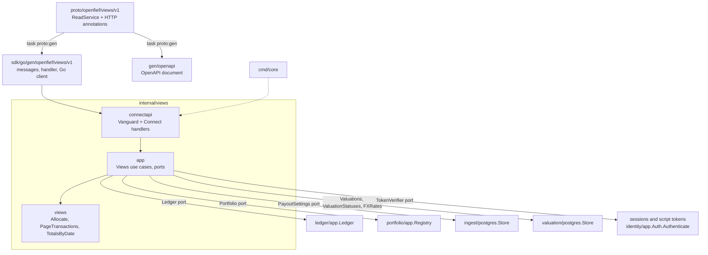
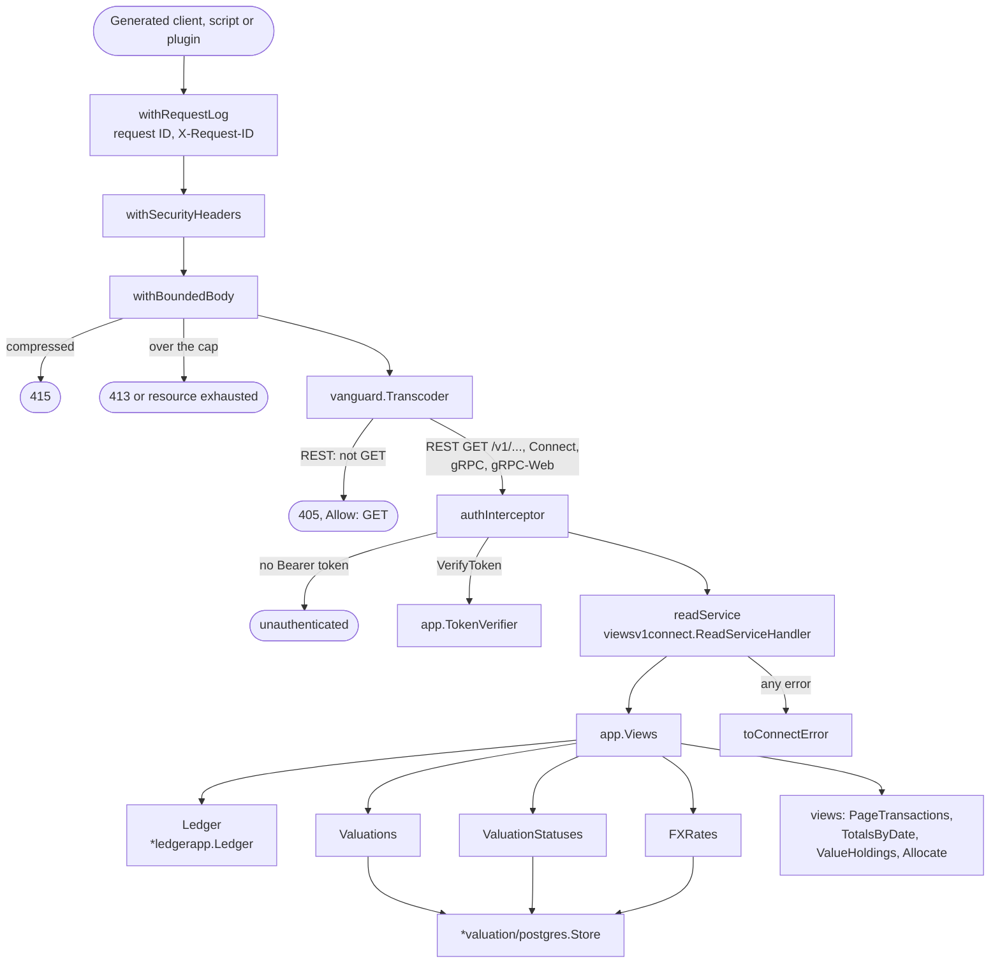
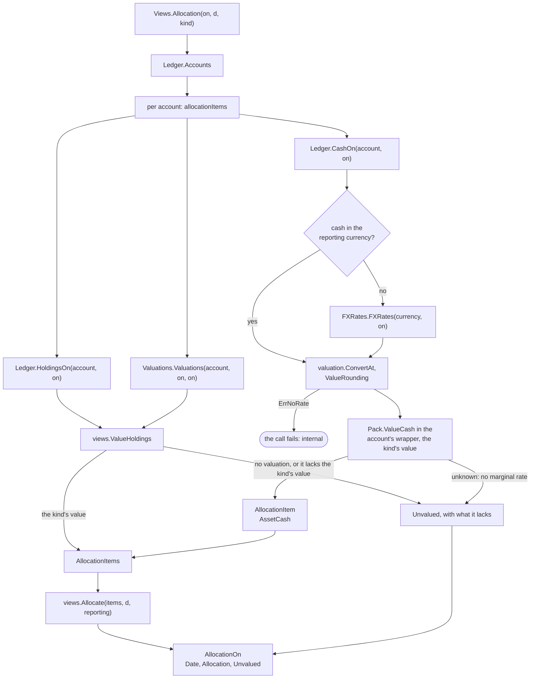
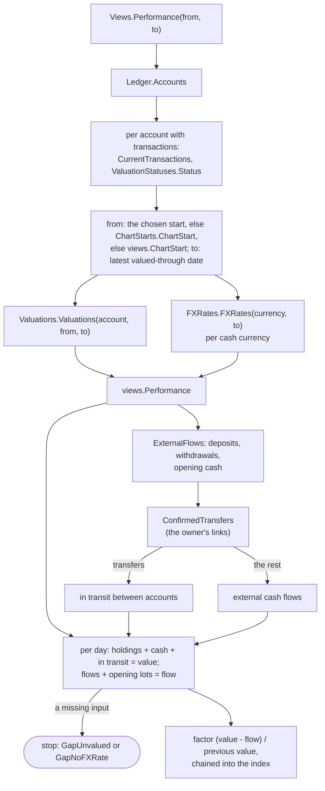

The [read API](../glossary.md) is how anything outside the core reads the record: sleeves, accounts, transactions, holdings, tax lots, cash, balance assertion checks, stored valuations, [price checks](../glossary.md), the allocation, the portfolio's [time-weighted return](../glossary.md) and, while it is on, the [model portfolio](../glossary.md). The [built-in UI](ui.md) reads through it, with the owner's session as its bearer token, every other view plugin is meant to, and so can the owner's own scripts. It only reads: data enters OpenFief through connectors, never through this API. This page explains the service, the pure rules behind its totals, the allocation and the performance series, and the HTTP adapter that serves it. The core service, `cmd/core`, serves it on both its ports (D-115): Service `openfief-core` port `http` (8080), where scripts and browsers arrive, and port `connect` (8081), where view plugins call it.

## Concepts

**A separate read side.** Bertrand Meyer's command-query separation (1988) says a method should either change state or answer a question, never both. Greg Young's CQRS (around 2010) applies the same split to whole systems: the write path and the read path get separate models. OpenFief uses a light version of it. Data enters only through connectors' ingest paths into the append-only transaction log (D-7, D-18). The read API answers from the ledger's queries and from stored valuations, which are a read model: rows derived from the log, prices and rates, rebuildable at any time (D-36).

**One service, two ways to call it.** The API is one protobuf service, `openfief.views.v1.ReadService`, in [read_service.proto](../../proto/openfief/views/v1/read_service.proto). Protobuf (Google, open-sourced 2008) describes messages and services once and generates code for many languages. Each method also carries a `google.api.http` annotation, Google's convention from its own APIs for mapping an RPC onto a REST path. Clients generated from the protobuf call the service over [Connect RPC](../glossary.md), gRPC or gRPC-Web. Everyone else calls plain REST with JSON under `/v1`, which Buf's [Vanguard](https://github.com/connectrpc/vanguard-go) library transcodes from the annotations into the same handlers. The OpenAPI 3.1 document, [read_service.openapi.yaml](../../gen/openapi/openfief/views/v1/read_service.openapi.yaml), is generated from the same definitions by `protoc-gen-connect-openapi`, with its title, bearer scheme and error responses from [read_service.openapi-base.yaml](../../proto/openfief/views/v1/read_service.openapi-base.yaml); [tools/openapierrors](../../tools/openapierrors/main.go) then assigns the error responses to the operations ([below](#errors-logs-and-headers)). So the Go types, the Connect service, the REST paths and the OpenAPI document can't disagree.

**Read-only by construction.** Every method is unary, declares `idempotency_level = NO_SIDE_EFFECTS`, and maps to a `GET` under `/v1` with no body. Over REST, any other HTTP method gets `405 Method Not Allowed` with `Allow: GET`, before the token is even looked at. The Connect protocol still accepts its usual `POST` for unary calls, and also its `GET` form, which the no-side-effects option enables.

| Method | REST | Parameters |
|---|---|---|
| `ListSleeves` | `GET /v1/sleeves` | |
| `ListAccounts` | `GET /v1/accounts` | |
| `GetAccount` | `GET /v1/accounts/{account_id}` | |
| `ListTransactions` | `GET /v1/accounts/{account_id}/transactions` | `pageSize` (1 to 500, 0 means 100), `pageToken` |
| `ListHoldings` | `GET /v1/accounts/{account_id}/holdings` | `date` |
| `ListLots` | `GET /v1/accounts/{account_id}/lots` | `date` |
| `ListCash` | `GET /v1/accounts/{account_id}/cash` | `date` |
| `ListAssertionChecks` | `GET /v1/accounts/{account_id}/balance-assertions` | `status`, such as `ASSERTION_STATUS_FLAGGED`; none for all. Each check's `entered` marks a cash checkpoint the owner entered (D-158) |
| `ListAccountValuations` | `GET /v1/accounts/{account_id}/valuations` | `from`, `to` |
| `GetValuationStatus` | `GET /v1/accounts/{account_id}/valuation-status` | |
| `ListValuationTotals` | `GET /v1/valuations` | `from`, `to` |
| `ListValuationStatuses` | `GET /v1/valuation-status` | |
| `ListPriceChecks` | `GET /v1/price-checks` | `status`, such as `PRICE_CHECK_STATUS_FLAGGED`; none for all; `isin` for one instrument's checks |
| `GetAllocation` | `GET /v1/allocation` | `date`, `by`, such as `ALLOCATION_DIMENSION_SLEEVE` |
| `GetPerformance` | `GET /v1/performance` | `from`, `to`, `account_id`, all optional |
| `GetModelPortfolio` | `GET /v1/model-portfolio` | `from`, `to`, both optional; `404` while the model portfolio is off |
| `ListPlugins` | `GET /v1/plugins` | `503` while the core can't read the cluster |
| `ListAttentionItems` | `GET /v1/attention-items` | `view` (`ATTENTION_VIEW_OPEN`, `_ACKNOWLEDGED`, `_DONE`; none for all), `accountId`, `isin`, `connectorInstance` |
| `ListActivity` | `GET /v1/activity` | `pageSize` (1 to 500, 0 means 100), `pageToken` |
| `ListSyncStatuses` | `GET /v1/sync-status` | |
| `ListSyncAttempts` | `GET /v1/connector-instances/{connector_instance}/sync-attempts` | `pageSize`, `pageToken` |
| `GetInstrument` | `GET /v1/instruments/{isin}` | |
| `ListInstrumentPrices` | `GET /v1/instruments/{isin}/prices` | `from`, `to` |
| `ListInstrumentHoldings` | `GET /v1/instruments/{isin}/holdings` | `date` |
| `ListInstrumentTransactions` | `GET /v1/instruments/{isin}/transactions` | `pageSize`, `pageToken` |

**Money, quantities and dates on the wire.** [Money](../glossary.md) is a `Money` message: `amount` as a decimal string such as `"-1234.56"`, never a JSON number, and `currency` as an ISO 4217 code. A JSON number is a binary float in most clients, which can't hold every decimal amount exactly. Quantities are decimal strings too. Dates are `YYYY-MM-DD` strings with no time of day.

**Original and reporting currency.** Every amount keeps its original currency. Valuations, [date totals](../glossary.md) and the [allocation](../glossary.md) also carry a value in the [reporting currency](../glossary.md): fields named `value_reporting` and `total_reporting`, with a `reporting_currency` field on the valuation responses. Only PLN is accepted as the reporting currency today (see [Decisions](#decisions)).

**Valuations, totals and their gaps.** The API reads the [holding valuations](../glossary.md) the valuation context stores ([Valuation](valuation.md)); it computes no prices itself. A holding valuation that lacks an input (a price, an FX rate or an index reading) is left out of the account's valuation list and counts in no total. How far each account is complete is its [valued-through date](../glossary.md), which `GetValuationStatus` and `ListValuationStatuses` return with whether a revaluation is pending or running. An account never valued has an empty `valued_through`. Stored valuations cover holdings only, never cash, so `ListValuationTotals` doesn't include cash; the performance series' daily value does.

**Allocation.** The [allocation](../glossary.md) is the portfolio's value on one date split into groups by one dimension: [asset class](../glossary.md), currency, [institution](../glossary.md) or [sleeve](../glossary.md). Each [allocation item](../glossary.md) is one valued holding or one cash balance of an account. A holding counts at its stored valuation on that date; cash, which has no stored valuation, is converted here at the FX rate for the date. A holding with no valued holding valuation on the date is not counted but listed in `unvalued`, so a chart can say what it is missing instead of silently showing less. The asset class is `cash`, `treasury_bond` for a Polish ISIN whose venue symbol is a bond series code such as `EDO0536`, and `listed` for anything else. Groups come largest first, then by key.

**Time-weighted return.** How did the portfolio do, when the owner keeps adding and taking out money? Its value alone can't say: a deposit raises it without anyone earning anything. Peter Dietz's *Pension Funds: Measuring Investment Performance* (1966) gave a formula that takes cash flows out of a return, and the Bank Administration Institute's 1968 study for US pension funds recommended the time-weighted rate of return for comparing managers, because a manager doesn't choose when money arrives. The CFA Institute's Global Investment Performance Standards (GIPS, 1999, grown out of AIMR's 1993 standards) require it. The idea: split the time into sub-periods at every external cash flow, measure each sub-period's return on the money that was there, and multiply the returns. Where the portfolio isn't valued at each flow, the Modified Dietz method approximates a sub-period's return by weighting each flow by the part of the period it was invested; GIPS has required a valuation at every large cash flow since 2010, which makes each sub-period exact. OpenFief has a stored valuation for every day (D-36), so every day is a sub-period. Valuations are end-of-day, so a flow's time inside its day is a convention: OpenFief takes [external cash flows](../glossary.md) at the end of their day. Each day's factor is (V − F) / V′, where V is the portfolio's value at the end of the day, F the day's net external flow and V′ the value at the end of the day before, which is Modified Dietz for one day with the flow weighted zero. The [performance index](../glossary.md) starts at 100 and multiplies by each day's factor, so 105 means 5% up, whatever was deposited or withdrawn. Money moved between two of the owner's own accounts is a [transfer](../glossary.md), not a cash flow (D-61). The model portfolio's backtest is drawn next to this line (D-53); it starts at 100 on the same day.

A hand-entered bond account whose coupons and maturities are paid out (D-135) books each as interest or a [redemption](../glossary.md), then a withdrawal of the same amount on the same day. The withdrawal is an external cash flow like any other, so the coupon still counts as return: the account's value doesn't change that day, and the money left is added back as a flow. The read API serves each account's [payout setting](../glossary.md) and the day it took effect with the account (`Account.bond_payout`, `bond_payout_since`, empty for the account's first setting, which covers its whole history, D-162), and a redemption as `TRANSACTION_KIND_REDEMPTION`.

[Cash income](../glossary.md), such as XTB's interest on uninvested cash or a closed CFD's result (D-152), is `TRANSACTION_KIND_CASH_INCOME`, posted against a ledger account of the kind `BOOK_KIND_INCOME`. It is no deposit or withdrawal, so it is no external cash flow: it raises or, for a loss, lowers the account's cash and the performance index with it, as a coupon does.

**The model portfolio.** While the owner keeps the [model portfolio](portfolio.md) off, the default, `GetModelPortfolio` answers `NOT_FOUND` (`404` over REST) with the fixed text `no model portfolio`, and no other method mentions it (D-52). While it is on, the answer carries its targets, its [backtest](../glossary.md) as `days`, an index that is 100 on the first day of the range like the performance series, the first and last day every target has history (`backtest_start`, `backtest_end`), the [max drawdown](../glossary.md) of the model over its whole backtest and each target's history with its own max drawdown (D-54), in the reporting currency. The range resolves like `GetPerformance`'s: the charts' start (D-138) to the latest valued-through date by default, so both chart lines cover the same days; a client that passes a chosen start passes the same `from` to both. A model whose backtest starts after the charts' start starts its line at 100 on its first day. The values of a drawdown are those of the series it was measured on: the backtest's index from 100 on `backtest_start` for the model, a target's value in the reporting currency per unit for a target.

**Paging transactions.** `ListTransactions` returns the current version of each transaction in date, then source, then external ID order. A transaction the owner deleted (D-100) has no current version and is left out; interest, such as a bond's coupon, has the kind `TRANSACTION_KIND_INTEREST` (D-101). A page that has more after it returns a `nextPageToken`: an opaque cursor naming the last transaction's date and key, base64url-encoded. Passing it back starts the next page right after that transaction, so a client reads every current transaction once even if a page boundary falls between transactions on the same date. This is keyset paging: an offset ("skip 200") skips or repeats a row when rows arrive between two requests, while a cursor that names the last row read doesn't. The parameter names follow Google's API improvement proposal AIP-158.

**Bearer tokens.** Every call, over any protocol, needs an `Authorization: Bearer <token>` header. The token is a [session](../glossary.md) of the owner, of any scope, such as the one the built-in UI holds for the browser, or a [script token](../glossary.md); or a view plugin's projected ServiceAccount token ([plugin identity](../glossary.md)), such as the [Ghostfolio view](ghostfolio.md)'s. The API asks a `TokenVerifier` whether the token may read. The core's verifier accepts sessions and read-scoped script tokens through the identity context's `Auth.Authenticate`, and view plugins' tokens through the same check as the `AuthService`'s callers ([Identity](identity.md#in-the-core)), and returns the [caller](../glossary.md) the token stands for. Logging in, and every other change, goes through the identity context's separate `AuthService`, never through this API.

**Only the accounts the caller may view.** Every query asks the [authorizer](../glossary.md) about the caller (D-163, [Identity](identity.md#authorization)). `ListAccounts` and `ListConnectorBindings` list only the accounts the caller may view, and the valuation totals, valuation statuses, the allocation, performance, transfers, yearly taxes and the model portfolio's range are computed over those accounts alone, so a total never counts an account its reader can't see. A query about one account the caller may not view answers `NOT_FOUND` (`404`) with the same fixed text as an account that isn't stored, so nobody learns that it exists. Whether a confirmed transfer is broken is judged over every account, so a leg in an account the caller can't see doesn't look deleted; such a pair is left out of the caller's transfers. When the authorizer can also list the accounts a caller may act on (`identityapp.AccountLister`, which the SpiceDB authorizer behind the core's `--authz=spicedb` is), the views take the list from one call, and a failed call refuses the request rather than answering for every account. Under today's rule every holder of read access views every account, so nothing is hidden yet; the second alpha's viewers will see only theirs. A viewer (D-65) is also shown only the sleeves that hold an account they may view, and only those sleeves' kinds (`ListSleeves`, `ListSleeveKinds`), so an empty sleeve or one of accounts they were not granted says nothing to them.

## How it works

The views context follows the layering in [code-organization.md](../dev/code-organization.md):

| Package | Layer | Contents |
|---|---|---|
| `views` ([allocation.go](../../internal/views/allocation.go), [valuation.go](../../internal/views/valuation.go), [page.go](../../internal/views/page.go), [performance.go](../../internal/views/performance.go), [flows.go](../../internal/views/flows.go), [values.go](../../internal/views/values.go), [stale.go](../../internal/views/stale.go)) | Domain, pure | `ValueKind`, `HoldingValue`, `CashValue`, `CashOnDays`, `RemovedBehindHoldings`, `RemovedBehindLots`, `Allocate`, `ValueHoldings`, `AssetClassOf`, `Dimension`, `AssetClass`; `TotalsByDate`, `ValidateRange`, `MaxRangeDays`; `PageTransactions`, `TransactionCursor`, `DefaultPageSize`, `MaxPageSize`; `Performance`, `PerformanceInput`, `PerformanceSeries`, `PerformanceDay`, `PerformanceGap`, `TWRPlaces`; `ExternalFlows`, `SuggestTransfers`, `ConfirmedTransfers`, `LinkedTransfers`, `CashFlow`, `Transfer`; `AccountHistory`, `HistoryOf`, `ChartStart`, `ChosenStart` ([chartstart.go](../../internal/views/chartstart.go)); `CheckBalance`, `CashTolerance`, `LatestBalanceChecks`, `SortBalanceChecks`, `LatestUnsupported`, `BalanceReport` ([balances.go](../../internal/views/balances.go)). The model portfolio's rules are the portfolio context's ([Portfolio](portfolio.md)) |
| `views/app` ([views.go](../../internal/views/app/views.go), [performance.go](../../internal/views/app/performance.go), [model.go](../../internal/views/app/model.go), [ports.go](../../internal/views/app/ports.go), [tokens.go](../../internal/views/app/tokens.go), [values.go](../../internal/views/app/values.go), [access.go](../../internal/views/app/access.go)) | Use cases and ports | `WithAuthorizer`, the identity context's `Authorizer` the views ask, `identityapp.Policy` without it; `Views` (with `AccountTerms`, `Settings`, `YearlyTaxes` and the `Terms` port) and its queries, `Views.Performance`, `Views.AccountPerformance` and `Views.ModelPortfolio` among them; the ports `Ledger`, `Valuations`, `ValuationStatuses`, `FXRates`, `TokenVerifier`, `ModelReports` (set with `WithModel`) and `Connections` (set with `WithConnections`, [connections.go](../../internal/views/app/connections.go)); `UnsupportedReportingCurrencyError`, `ErrModelOff`; `Views.BalanceReport` and `ErrOwnerOnly` ([balances.go](../../internal/views/app/balances.go)) |
| `views/cli` ([balances.go](../../internal/views/cli/balances.go)) | Adapter | `openfief check balances`: `Run`, the `Core` port, `CoreArgs`; the report's JSON shape `Report` with `NewReport`, `WriteJSON`, `ReadJSON` and `WriteTable` ([below](#the-owners-balance-check)) |
| `views/connectapi` ([handler.go](../../internal/views/connectapi/handler.go), [server.go](../../internal/views/connectapi/server.go), [auth.go](../../internal/views/connectapi/auth.go), [errors.go](../../internal/views/connectapi/errors.go), [convert.go](../../internal/views/connectapi/convert.go), [values.go](../../internal/views/connectapi/values.go)) | Adapter | `New`, the HTTP handler; `readService`, the generated `ReadServiceHandler`; the auth interceptor, error mapping and conversion to the generated messages |

The generated Go code for the service lives with the other contracts in `sdk/go/gen/openfief/views/v1` ([Plugins](plugins.md#the-connector-contract)). From the contract to the ports:



### A request, from HTTP to the ports

`connectapi.New(views, verifier, opts...)` builds one `http.Handler`. The ports are declared in `views/app`, by the consumer. Each is shaped like a method the other contexts already have, and `cmd/core` passes `*ledgerapp.Ledger` as `Ledger` and `*valuation/postgres.Store` as `Valuations`, `ValuationStatuses` and `FXRates`.



Nothing is decoded before its size is known to be bounded (D-184), and the token is checked only after the message is read, so the bounds come first. `withBoundedBody` refuses a compressed request, by `Content-Encoding`, `Connect-Content-Encoding` or `Grpc-Encoding` (`Compressed`), with 415 before reading it, since Vanguard would inflate a REST body without a limit; it answers 413 to a declared length over `MaxRequestBytes` (1 MiB) plus room for the envelope, and caps the body it reads there. The Connect handler reads a message of at most `MaxRequestBytes` and answers `resource exhausted` past it.

The handler parses each request field: dates with `kernel.ParseDate`, the page token with `views.ParseTransactionCursor`, and enums against the domain's constants. An unspecified allocation dimension or an unknown assertion status is an invalid argument. `TestEnumsMatch` checks that every domain enum and its protobuf twin share their numbers.

### Errors, logs and headers

Errors never carry their own text to the client, because it can quote an account ID, an amount or what was asked. `toConnectError` maps them to Connect codes with fixed texts, and Vanguard turns the codes into HTTP statuses for REST:

| Cause | Code | REST | Client sees |
|---|---|---|---|
| `app.ErrUnknownAccount`, for an account not stored or one the caller may not view | not found | 404 | `no such account` |
| `app.ErrModelOff` | not found | 404 | `no model portfolio` |
| `app.ErrUnknownInstrument`, for an ISIN no account the caller may view posts to and with no stored price | not found | 404 | `no such instrument` |
| `app.ErrUnknownInstance`, for a connector instance never synced | not found | 404 | `no such connector instance` |
| `app.ErrPluginsUnknown` | unavailable | 503 | `the installed plugins can't be read now` |
| `kernel.ErrAuthzUnavailable`, the authorization model can't answer, such as a SpiceDB that is down (D-164) | unavailable | 503 | `authorization is unavailable` |
| `views.ErrInvalidRange`, `ErrInvalidCursor`, `ErrInvalidPageSize`, `ErrUnknownDimension`, a malformed field | invalid argument | 400 | a fixed sentence per cause |
| No bearer token, or one the verifier rejects | unauthenticated | 401 | a fixed sentence and a `WWW-Authenticate: Bearer` challenge |
| `views.ErrTaxConversion`, a yearly tax whose FX rate isn't stored yet (D-127) | failed precondition | 400 | `an FX rate the yearly tax needs is not stored yet` |
| Anything else, including a token that can't be checked | internal | 500 | `the request failed; its request ID names it in the server log` and the request ID |

Over REST an error's body is the `google.rpc.Status` Vanguard writes, not Connect's own error JSON: `code` is the numeric gRPC code (3 invalid argument, 5 not found, 9 failed precondition, 16 unauthenticated), `message` the fixed text, and `details` always present, an empty list, as in `{"code":5,"message":"no such account","details":[]}`. Over Connect the same error is Connect's JSON, with the code as a string (`not_found`).

The OpenAPI document declares these responses (D-200 criterion 7). The generator writes each operation's success and, with its `with-google-error-detail` option, a `default` response holding the `google.rpc.Status` schema, which covers 500 and 503. The base file defines four named responses, each a `google.rpc.Status` whose `code` is limited to the codes that status carries: `BadRequest` (3 or 9), `Unauthorized` (16, with the `WWW-Authenticate` header), `NotFound` (5) and `ModelPortfolioOff` (5). [read_service.openapi-errors.yaml](../../proto/openfief/views/v1/read_service.openapi-errors.yaml) assigns them: 400 and 401 to every operation, 404 to every operation with an ID in its path (an account ID, an ISIN or a connector instance), and `ModelPortfolioOff` as `GetModelPortfolio`'s 404. The generator has no way to add a response to an operation from its options short of gnostic annotations in the protobuf, which would make the Go SDK import gnostic's Go module, so `task proto:gen` runs `tools/openapierrors` right after `buf generate`. The tool rewrites the document in place, keeping the generator's formatting, and fails on a response the base doesn't define, an operation the document lacks or a status the generator already declares; `proto:check` runs it too before comparing, so a stale document fails the check.

`withRequestLog` gives each request a random ID, returns it as `X-Request-ID`, and logs one line with only `request_id`, the HTTP `method` and the `status`. The path is never logged: it can name an account. A failure adds a line with `request_id` and `while` (`answering` or `verifying a token`), and not the error, for the same reason. `withSecurityHeaders` sets `Cache-Control: no-store`, `Content-Security-Policy: default-src 'none'; frame-ancestors 'none'`, `Cross-Origin-Resource-Policy: same-origin`, `Referrer-Policy: no-referrer`, `X-Content-Type-Options: nosniff` and `X-Frame-Options: DENY` on every response, errors and 405s included.

### Account queries

Accounts, holdings, lots, cash and balance assertion checks come straight from the `Ledger` port; [Ledger](ledger.md) explains how they are derived. Sleeves, their kinds and which sleeve each account is in come from the `Portfolio` port, which `cmd/core` fills with the portfolio context's `*portfolio/app.Registry` (`WithPortfolio`), and each account's payout setting from the `PayoutSettings` port, the ingest store (`WithPayoutSettings`): the ledger knows neither. `Views.AccountSettings` gives one account's sleeve and payout setting, and the allocation by sleeve groups each item by its account's sleeve (`AllocationItem.Sleeve`). A query about an account the ledger doesn't store fails with `ErrUnknownAccount`. Any other store failure stays a failure, so a broken database never looks like a missing account. `AssertionChecks` filters to one status when asked. `Transactions` loads the current transactions and hands them to `PageTransactions`, which sorts a copy, starts after the cursor, and returns at most `size` of them with a cursor when more follow. It then gives each one its origin, as the next section explains.

### Sleeves, accounts and connectors

What the owner manages in the built-in UI is listed here for any read caller: each `Account` with its [tax wrapper](../glossary.md) (D-76) and [fee rule](../glossary.md) (D-78), from `Views.AccountTerms`, the pack's default wrapper when none is recorded, and whether the owner marked it as opened on its seeding day (`opened_on_seeding_day`, D-168); `ListSleeveKinds` (`GET /v1/sleeve-kinds`) gives every [sleeve kind](../glossary.md) with its default role, `ListSleeves` each sleeve's `role_override` (D-71), `ListConnectorBindings` (`GET /v1/connector-bindings`) which connector instance may write to which account. Kinds come from the `Portfolio` port; bindings from the `Connections` port, which `cmd/core` fills with the ingest context's `*ingest/postgres.Store` (`WithConnections`); without it the list is empty. Broker account numbers are never served here (D-121). The read API has no method for them: D-157 removed `ListBrokerAccounts` (`GET /v1/broker-accounts`) and its messages from the contract, as the one breaking change `proto:breaking` let through ([Delivery pipeline](../dev/pipeline.md#breaking-contract-changes)), so its path and procedure are not found; the `Connections` port has no way to the broker accounts at all. The owner lists them through the `AccountService` ([Ingest](ingest.md#the-owners-accounts)).

### Installed plugins and removed instances

`ListPlugins` lists the installed [plugin](../glossary.md) instances (D-46, D-48), so the built-in UI can show them and how far each image is trusted (D-56). It only reads: nothing in the API installs, removes or approves a plugin, and the core can't change a grant (D-46). Each `Plugin` carries its instance name, its image and the image's digest, the capabilities its running version may use and those its manifest requests, `market_data` when it is a market-data connector that its grant approves and `requested_market_data` when its manifest declares one (D-123), so a viewer sees which plugin learns what the owner holds, `institutions`, the institutions its signed manifest declares it books for, from the `Plugin`'s `spec.manifest.institutions` (D-182), and `approved_institutions`, those of them its grant approves, from `status.effective.institutions`, which are the ones the core accepts deliveries for (D-185), a `trust` level with the signer's name, the operator's reason for it, and a `phase`: the operator's `Ready` reason, such as `Running` or `AwaitingApproval`, `Removing` while it is being uninstalled, or `Pending` before the operator reconciled it.

The record also carries the resource's `metadata.generation`, which the operator's applying a new spec raises, for the core's audit log of installs, upgrades and removals ([Identity](identity.md#plugin-installs-upgrades-and-removals)); the API does not serve it.

The [operator](operator.md#the-signature-and-manifest-check) records the trust in each `Plugin`'s status: the `SignatureVerified` condition and, while that is `True`, `status.signature` with the trust, the signer's kind and its name. `views.PluginOf` turns that into one `SignatureTrust` level:

| Status | Level |
|---|---|
| `True`, `status.signature.trust` `Verified` (a [verified plugin](../glossary.md), D-44) | `SIGNATURE_TRUST_VERIFIED` |
| `True`, signed by OpenFief's CI, a catalog publisher or a signer the owner added (D-45) | `SIGNATURE_TRUST_OPENFIEF_CI`, `_PUBLISHER`, `_OWNER` |
| `True` without `status.signature`, as an older operator writes it | `SIGNATURE_TRUST_TRUSTED_SIGNER`, or `_VERIFIED` when the reason is `Verified` |
| `False`: unsigned, an untrusted signer, a manifest that doesn't match (D-57) | `SIGNATURE_TRUST_REFUSED` |
| `Unknown` or no condition yet | `SIGNATURE_TRUST_NOT_CHECKED` |

The signer is named only for a trusted signature, so a refused image never shows one. An image refused because only signers the operator doesn't trust signed it, reason `UntrustedSigner`, carries those signers instead in `untrusted_signers`, from the `Plugin`'s `status.untrustedSigners`, so the owner can trust one or recognise a forgery (D-169); any other plugin carries none.

The list comes from the `Plugins` port, set with `WithPlugins`. `internal/views/kube` implements it: `kube.Plugins` (whose `OnRemoved` also tells the core when a Plugin is deleted, so it can end that view plugin's grants, [Identity](identity.md)) watches the `Plugin` resources of the `openfief` namespace with a client-go informer and reads the fields above from them as unstructured data (`RecordOf`), so the views context doesn't import the operator's Go types; a test converts an operator-written `v1alpha1.Plugin` to check the field names. `cmd/core serve` starts it in a cluster with the core's ServiceAccount, which already has `get`, `list` and `watch` on Plugins for connector discovery; PluginGrants aren't read, since the `Plugin`'s status holds the effective capabilities. Outside a cluster, or until the watch has synced, `Plugins` fails with `ErrPluginsUnknown`, which the API answers as `UNAVAILABLE` (`503`).

**A removed instance's transactions (D-58).** Uninstalling an instance keeps the data it brought in. A connector instance's transactions have the key source `plugin:<instance>:<source>` ([Ingest](ingest.md#calling-a-connector-plugin)), so `views.ConnectorInstance` reads the instance back from it. `Transactions` asks the `Plugins` port which instances are installed and gives each transaction an `Origin`: `connector_instance`, and `connector_instance_removed` when no `Plugin` of that name exists any more. The mark is derived each time it is read, never written: the transaction log stays append-only (D-18), and reinstalling an instance under the same name makes its transactions current again, as its syncs continue from its own keys and watermark. While the installed plugins are unknown, nothing is marked removed and the listing still answers. A source that no connector instance wrote, such as the demo dataset's, has no instance.

**Holdings and lots no longer updated (D-91).** `ListHoldings` and `ListLots` work out the same mark for what is derived from the log, when read. A holding is `no_longer_updated` when any of the account's current transactions dated on or before the date that posts to its holding ledger account came from a removed instance (`views.RemovedBehindHoldings`). A lot is when the transaction that opened it, or a disposal that consumed part of it and left it open, did (`views.RemovedBehindLots`, which replays the lots FIFO with acquisitions before disposals on a date, as `ledger.LotsOn` does, and notes which disposal cut which lot). Each carries `removed_instances`, the names in order. While the installed plugins are unknown nothing is marked.

### The audit log's contract values

`AuthService.ListAuditEntries` ([auth.proto](../../proto/openfief/identity/v1/auth.proto), not on the read API) names the actor kind `admin` (the administrator at the core's command line, ID `admin`), the action `connector_synced` (a sync the core started that changed state) and the reference kinds `import_batch` and `sync_count` (`transactions:12`, `prices:340`, `fx_rates:4`, `index_levels:250`, `index_readings:1`, `bond_terms:2`, counts and never amounts), next to the values of before ([Identity](identity.md#syncs-and-the-command-line)); the Audit log page words them.

### Valuations and totals

`AccountValuations(account, from, to)` and `ValuationTotals(from, to)` first check the range with `ValidateRange`: `to` may not be before `from`, nor more than `MaxRangeDays` (3700, about ten years) after it. Then they load stored holding valuations through the `Valuations` port and the cash of each day (`views.CashOnDays`, a running sum of the current transactions' cash postings), for one account or for every account, and pass them to `TotalsByDate`. Totals include cash (D-106). Each day's cash is converted at the latest FX rate on or before it, half up, and valued in its account's [tax wrapper](../glossary.md) by the jurisdiction pack's `ValueCash` (only an IKZE's cash is taxed: 10% net, the marginal rate if liquidated); cash in a currency with no rate yet counts in no total but `by_currency` and sets `cash_unconverted`. `TotalsByDate` sums, per date, the three values (D-77) exactly in the reporting currency, and every original-currency amount per currency, in currency code order. A holding valuation that lacks its net or liquidation value, or cash whose liquidation value needs the owner's unset marginal rate, leaves that total unset, never a partial sum. A converted value in any other currency is `ErrNotReportingCurrency`. `AccountValuations` also returns the valued holding valuations themselves, each with its basis, source, gross value in its own currency and in the reporting currency, and its net and liquidation values or the reason each is missing (`fx_rate`, `lots` or `marginal_rate`).

### Settings and yearly taxes

`GetSettings` (`GET /v1/settings`) gives any reader the reporting currency (D-62), the [number format](../glossary.md) to write amounts in (D-113), the owner's or the pack's default with `number_format_default`, and the pack's tax wrappers, the default first, with what each asks of an account (`wrapper_terms`): the forms an OKI account can have (D-147) and whether it takes earlier payments, as an IKE does (D-149). An account carries its `account_form` and its `earlier_payments` once entered. `ListYearlyTaxes` (`GET /v1/yearly-taxes?year=`) gives, for a year, each wrapper the pack taxes on its accounts' value: OKI for Poland (D-127). Before the act's year (2027) the tax says so (`in_force` false) and carries nothing else; under it, the views build each OKI account's days from its first transaction through the year's end or the earliest date the OKI accounts are valued through (`views.TaxDays`, [yearlytax.go](../../internal/views/yearlytax.go)): its valued holdings and cash per exemption class and its deposits and withdrawals, foreign amounts at the NBP rate of the day before; the pack computes the rest ([Valuation](valuation.md#okis-yearly-tax)). The tax carries `through`, `estimate` when it is counted through a day before the year's last, an estimate over the days so far (D-146), the averages and exempt parts per class (`averages`, `exempt`), shown to the grosz though the pack keeps them exact, the `taxed` base and the `tax`, both in whole złoty (D-144), and the `rate` (empty while the minister hasn't announced the year's rate or exempt amounts, D-145), and `unclassified_instruments`, the holdings the pack can't classify and the owner hasn't (D-132); the deprecated `limit` and `excess` stay unset. A missing rate is `FAILED_PRECONDITION`.

Every total, an account's (`ListAccountValuations`) or the portfolio's (`ListValuationTotals`), counts its net and liquidation values with each wrapper's tax on the whole (`views.TaxTotals`, [taxtotals.go](../../internal/views/taxtotals.go), D-128): PIT-38 offsetting across taxable accounts with the tax year's realized gains (`ledger.Sales`, `AccountTerms.RealizedGains`), an IKE's return taxed above its payments (`views.PaidIn`), IKZE on the whole. `net_offset_reporting` and `liquidation_offset_reporting` are the losses-offset line: the total less its rows, an account's holdings and cash, or the accounts' own totals for the portfolio. Both read the pack and the `Terms` port, which `cmd/core` fills with valuation's store through `WithJurisdiction`; without it there are no wrappers, the format is space-dot, cash is worth its amount in all three values and no yearly tax is listed.

### Price checks

`ListPriceChecks` serves D-22's cross-check: every [cross-check price](../glossary.md), such as IBKR's mark price, compared with the latest stored price of its instrument on or before its date (D-111). The `PriceChecks` port, which `cmd/core` fills with valuation's `CrossChecks` through `WithPriceChecks`, compares them ([Valuation](valuation.md#cross-checking-prices)); `Views.PriceChecks` only filters by status. Each `PriceCheck` carries the cross-check price's date, the instrument, both prices with the connector instance each came from, the price's own `price_date`, the `relative_difference`, (cross-check - price) / price as a decimal string rounded half-even to six places, its `status`, `matched`, `flagged` or `currency_mismatch` (no difference, D-111), the `threshold` it was flagged at, `"0.01"` or the owner's for the instrument (D-110), and whether the owner `acknowledged` it (D-112). The response's `threshold` is the default, `"0.01"`; without the port, outside `cmd/core`, it is empty and there are no checks. Prices aren't per account, so the method takes no account. `price_date`, `threshold`, `acknowledged` and `PRICE_CHECK_STATUS_CURRENCY_MISMATCH` were added after the method was first published; the owner changes thresholds and acknowledges checks through the `PriceCheckService`, not the read API.

### The allocation



`GetAllocation` takes `value`, `VALUE_KIND_GROSS` (also when unspecified, D-77's default), `_NET` or `_LIQUIDATION`, and answers with the kind it split. `ValueHoldings` pairs each holding with the holding valuation of the same account, instrument and date, takes that kind's value in the reporting currency (`views.HoldingValue`; grouping by currency still uses the gross value's original currency), and its asset class from `AssetClassOf`; a holding without a valuation, or whose valuation lacks that value, is `Unvalued` with its reason, as is cash whose value of that kind needs the unset marginal rate. Cash is converted with the latest stored rate on or before the date, rounded to grosze like holding values (`valuation.ValueRounding`, half up), so holdings and cash add up alike. A cash currency with no rate fails the whole call rather than leaving that cash out. `Allocate` groups the items by the dimension's key: the asset class name, the original currency code, the account's institution or its sleeve ID. It sums each group and the total exactly, and sorts the groups.

`Views.HeldValues` ([held.go](../../internal/views/app/held.go)) reads the same items for one more use that is not a method of the API: what each instrument held is worth, summed over the accounts the caller may view, with the whole portfolio's value, gross in the reporting currency at the date every account is valued through (`AllocationItem` names its instrument for it), which the model-portfolio maintainer weighs the model portfolio's targets against ([Portfolio](portfolio.md#the-maintainer)). `TestHeldValues` and `TestHeldValuesRefusals` ([held_test.go](../../internal/views/app/held_test.go)) cover it. It counts the holdings and balances left out for want of a price, and nothing recorded is `ErrNothingHeld`.

So on the same date the allocation's total and `ListValuationTotals` both include cash; the allocation leaves out unvalued holdings that a later revaluation would add.

### The performance series

`Views.Performance(from, to)` loads every account's current transactions and valuation status, the stored valuations of the range and the FX rates of every currency the cash moves in, and hands them to the pure `views.Performance`. `from` is the [charts' start](../glossary.md) the owner chose (D-138). An empty one is the start the owner stored as a setting (D-167), which the `ChartStarts` port reads (`cmd/core` fills it with valuation's store through `WithChartStarts`; the owner sets it through the `SettingsService`, [Valuation](valuation.md)), and the answer names it as `chosen_from`; without a stored start it is the default, `views.ChartStart`: the latest day an account was seeded from a starting balance (its latest opening lot or opening cash, D-23), before which that account's history is unknown, or the first transaction's date when no account was seeded. An account with its whole history, such as a bond account booked from its real purchases (D-98) or an XTB account started from its whole history (D-136), doesn't move it, however early or late it opened, and neither does a seeded account the owner marked as opened on its seeding day (`ledger.Account.OpenedOnSeedingDay`, D-168), whose history before its seeding is known to be empty. A `from` in the request previews another start over the stored one without changing it. A `from` before the first transaction starts there (`views.ChosenStart`). The answer names the default as `default_from`, also where tracking began, which the charts mark. An empty `to` is the latest valued-through date of any account. An account with transactions that was never valued counts as valued through the day before its first transaction. `revaluation_pending` says whether any account's revaluation is pending or running, so the series may still change.

With `account_id`, `Views.AccountPerformance` computes the same series for that account alone: its default start is its own first day (D-138), its stored start is the account's own (D-167), read only after the authorizer let the caller view the account, and none of the owner's transfer links apply, so a transfer from or to another account is a cash flow of this one. An unknown account is `NOT_FOUND`.



For each day from `from` to `to`, `views.Performance` values the portfolio at the end of the day, in the reporting currency:

- **Holdings** at their stored valuations. The transactions up to the day give each account's holdings; each must have exactly one valued holding valuation of that quantity on the day.
- **Cash**: each account's balance per currency, summed from its cash postings, converted with the latest stored rate on or before the day and rounded to grosze half up like holding values (`valuation.ValueRounding`). This is how the series includes the cash that `ListValuationTotals` leaves out.
- **In transit**: the money of each transfer from the withdrawal's date to the day before the deposit's, at the day's rate. When the deposit is booked first, it counts negative until the withdrawal, so the money counts once.
- **Flow**: the day's external cash flows at the day's rate, plus each opening lot at its share of its holding's valuation that day. An account seeded after the charts' start brings its opening lots and opening cash in as flows, so they are not returns.

Only a [transfer](../glossary.md) the owner confirmed is left out of the cash flows (D-105): `ConfirmedTransfers` takes the owner's current transfer links from the ledger and finds both legs among the day's deposits and withdrawals. A link counts only while its legs are still a withdrawal and a deposit of the opposite amount in different accounts; a correction that breaks that leaves the link out, and both legs are cash flows again. A pair that is only suggested, or that the owner rejected, is two cash flows. The response lists the confirmed transfers with a leg in the range.

Each day's factor is (value − flow) / the previous day's value, rounded to `TWRPlaces` (12) decimal places half-even, and the running product is rounded the same way. A day that starts with a value of zero or less has no return: its factor is 1. The index is 100 times the product, exact. Half-even rounding doesn't lean one way, so a synthetic ten-year series stays within a few billionths of an index point of the exact value.

The series stops before the first day that lacks an input and says why in `gap`: `PERFORMANCE_GAP_UNVALUED` for a day after some account's valued-through date, or with a holding that has no valuation, an incomplete one, or one of a quantity the log no longer gives (a revaluation not yet run); `PERFORMANCE_GAP_NO_FX_RATE` for cash, a flow or money in transit in a currency with no rate yet. A chart then ends at the last day it can draw truthfully instead of drawing a drop.

### Transfers

`ListTransfers` (`GET /v1/transfers`) is where the owner's confirmations start. `Views.Transfers` ([transfers.go](../../internal/views/app/transfers.go)) reads every account's current deposits and withdrawals and the ledger's current transfer links, and answers four lists:

- **Suggested** (`SuggestTransfers`): each withdrawal that is not a leg of a confirmed transfer, in date order, paired with the deposit into another account of exactly the same amount and currency, dated at most `ledger.TransferWindowDays` (five) calendar days before or after it, that is nearest in date, the earliest of equally near ones. The deposit must not be a leg of a confirmed transfer or of an earlier suggestion, and the pair must not be rejected; a rejected pair's withdrawal gets its next nearest deposit. Opening cash is never a leg.
- **Confirmed** and **rejected** (`LinkedTransfers`): the pairs whose current link has that decision and whose legs still match: a withdrawal and a deposit of the opposite amount in different accounts, neither opening cash, at most five days apart.
- **Broken** (`ledger.BrokenTransferLinks`, D-131): the confirmed pairs a correction broke, whose current legs no longer pass `ledger.CheckTransfer` or no longer exist. They count as cash flows again, like the suggested ones, until the owner rejects the pair or a correction makes the legs match, and the [attention items](attention.md) list each one. A leg that is no longer a deposit or withdrawal carries only its account, date and key, and the amount is the deposit's, minus the withdrawal's when only that leg is one, or unset.

Each `Transfer` names its legs' accounts, dates and transaction keys, so the UI can hand a pair back to the ledger's owner-only `TransferService` ([Ledger](ledger.md#concepts)), which records the decision. The read API itself never records anything (D-7).

### Attention items

`ListAttentionItems` (`GET /v1/attention-items`) lists every [attention item](attention.md) in ID order, open or not, each with its kind, subject, current state and detail, whether the owner may resolve it by hand (`owner_resolves`), and its history of changes with their reasons and RFC 3339 times; `open` counts the open ones. `Views.Attention` ([attention.go](../../internal/views/app/attention.go)) reads them through the `AttentionItems` port, which `cmd/core` fills with the attention context's `Items` through `WithAttention`; without it the list is empty. Any read caller sees them, script tokens and read sessions included, as they see the checks they come from; the owner acts on them through the `AttentionService`, never here. An unmapped broker account's item is stored with its instance and broker account number as its subject, but the read API serves only the instance (`attention.ReadSubject`), since read access never includes a broker account number (D-121, D-137); the owner finds the account on the accounts page. Each item also carries its group, what the owner does about it as the Inbox groups items (`ATTENTION_ITEM_GROUP_DATA_COMING_IN`, `_NUMBERS_TO_CHECK`, `_DECISIONS`, from `attention.GroupOf`), and its scope, the `account_id`, `isin` and `connector_instance` its kind and subject name (`attention.ScopeOf`), each empty when none, so a client links an item to its account or instrument and an account's page lists its own items (D-196). An item tied to no account names only its connector instance (D-165). The request selects a view, open, acknowledged or done (resolved), and an account, ISIN or instance to filter by; the response counts how many of the items the filters select are open, acknowledged and done, whatever the view, for the Inbox's views and the navigation's count. `account_ids` lists every account an item is tied to: its `account_id`, or, for a transfer a correction broke (D-131) or one suggested and not decided yet (`transfer-suggested`, D-105), both legs' accounts, the withdrawal's first, which is then its `account_id` too. `Views.Attention` reads them from the ledger's current transactions and transfer links (`views.PairAccounts` for decided pairs, `views.SuggestedPairAccounts` for suggested ones, [pairs.go](../../internal/views/pairs.go)) only when such a transfer is among the items, and an account filter matches any of them, so such an item shows in both accounts' banners (D-196). `Views.Attention` leaves out an item tied to an account the caller may not view (D-163), a transfer's unless the caller may view both accounts, as `ListTransfers` hides a pair with a hidden leg. One tied to no account the owner and today's other holders of read access see, script tokens, view plugins and demo sessions, and a viewer (D-65) never will (`unboundVisible` in [access.go](../../internal/views/app/access.go), D-165).

### Recent activity

`ListActivity` (`GET /v1/activity`) lists what happened lately, newest first, for the overview (D-193): each completed import batch (`ACTIVITY_KIND_IMPORT` for an upload, a manual entry or a file, `ACTIVITY_KIND_SYNC` for a connector sync), each failed sync attempt (`ACTIVITY_KIND_SYNC_FAILED`), each coupon booked (`ACTIVITY_KIND_COUPON`, the first version of an interest transaction, D-101) and each correction (`ACTIVITY_KIND_CORRECTION`, a later version of a transaction, a deletion included, D-18, D-100). An entry has its time and one of `batch` (the batch's source, mode, institution and counts: transactions mapped, new, corrected, failed balance assertions, rows left out and of them those OpenFief can't book yet; never an amount), `attempt` (as `ListSyncAttempts` gives it) or `change` (the transaction's account, key, version, kind and date; a coupon's instrument and the cash it brought). Imports and syncs name their connector instance, and the batch names the accounts it booked into (`account_ids`, every mapped account a statement of several accounts books, D-109, D-140), only those the caller may view, with each one's own counts (`accounts`, a `BatchAccount` each: transactions mapped, new, corrected, failed balance assertions); a batch that booked only into accounts the caller may not view is left out. A caller who may view only some of a batch's accounts sees that batch's counts as the sums of those accounts' counts alone, and no rows left out, which are tied to no account (`views.ScopeBatch`, D-199); a batch completed before the batch history kept its counts per account shows such a caller no counts. A batch that booked into none, such as a market-data sync or one completed before the batch history kept its accounts, and a failed sync attempt, are tied to their connector instance alone, so they are listed as the instance's syncs are (D-199, below). A coupon or a correction in an account the caller may not view is left out (D-163).

The three sources are read through their own ports: completed batches and failed attempts through `SyncHistory` (`*ingest/postgres.Store`, set with `WithSyncHistory`), coupons and corrections through `RecordedChanges` (`*ledger/postgres.Store`, `WithRecordedChanges`, [Ledger](ledger.md)); without a port its source is empty. `Views.Activity` ([activity.go](../../internal/views/app/activity.go)) reads up to one more than the page from each, after where each one's last page ended, and the pure `views.MergeActivity` ([activity.go](../../internal/views/activity.go)) merges them newest first, the batches first among entries at the same time, then the failures, then the ledger's. The page token is a `views.ActivityCursor`: for each source the time, in microseconds as PostgreSQL keeps it, and the ID or key of the last entry read, base64url-encoded JSON. A hidden change moves the cursor without being listed, and the merge stops where a source runs out of what it read while it may hold more, so a page can hold fewer than `pageSize` entries, even none, and still have a next page; nothing is skipped or repeated.

### Connector syncs

`ListSyncStatuses` (`GET /v1/sync-status`) gives, for each connector instance ever synced, where its syncs stand: when its latest attempt and its latest success ended, how many attempts in a row have failed since, when the first of them started, the latest one's error class, when the next is due, and `keeps_failing`, the core's reading of D-196's "a sync that keeps failing" (`ingest.SyncStatus.KeepsFailing`: three failures in a row spanning at least fifteen minutes, [Ingest](ingest.md)), which raises an attention item of kind `connector-sync-failing` ([Attention items](attention.md)). `ListSyncAttempts` (`GET /v1/connector-instances/{connector_instance}/sync-attempts`) is what that item shows: the instance's status and its attempts, newest first, a page at a time, each with its batch, mode, start and end, its error class (`SYNC_ERROR_CLASS_TIMEOUT`, `_UNAVAILABLE`, `_CONNECTOR_ERROR`, `_INVALID_DELIVERY`, `_REFUSED`, `_BOOKING`, `_INTERRUPTED`, `_OTHER`, `_DELIVERY_TIMEOUT`), how many attempts in a row had failed and when it scheduled the next. An error's text is never kept, so it is never served (GR-12). An attempt that went through also names the accounts its batch booked into that the caller may view, each with its counts (`accounts`, read from the batch history by the batches' IDs and scoped as the activity's batches are, D-199); a failed one names none. An instance never synced is `NOT_FOUND`. Both read the `SyncHistory` port; without it there are no statuses and every instance is unknown. The syncs name no account, but they belong to the accounts their instance feeds (D-199): `Views.SyncStatuses` lists, and `ListSyncAttempts` answers for, an instance bound to an account the caller may view (its connector bindings, read through the `Connections` port), and an instance bound to none, such as a market-data connector, only for the owner and today's other holders of read access, never a viewer (`unboundVisible`, as D-165 has for attention items); any other instance is `NOT_FOUND`, as one never synced. The recent activity's failed attempts and instance-only batches follow the same rule. Under today's authorizer every holder of read access views every account, so nothing is hidden yet.

### Instruments

An instrument has its own page (D-195), and four calls serve it, keyed by ISIN:

- `GetInstrument` (`GET /v1/instruments/{isin}`): its listings, the venue symbols the caller's viewable accounts post to and those only priced, in symbol order, each with the source its prices come from (`SourceOf`, D-94) and that source's latest price; its asset class as the allocation classes it; and its exemption class in each wrapper whose yearly tax tells assets apart, such as OKI's (D-127, D-132): the owner's when they chose one, otherwise the pack's, with `known` false when the pack can't tell and the owner hasn't chosen; and, for a treasury bond series, its stored terms (`bond_terms`, D-97): the series, the first-period rate and margin as fractions with `rates_source` `published` (the Ministry of Finance's data) or `entered`, the early-redemption fee with `fee_source` `table`, `assumed` (the reviewed table's latest fee carried forward, for the owner to confirm) or `entered`, and, for published rates, the data's `attribution` (publisher, dataset, licence, file, day made, time taken, processing), as its licence asks. A bond whose terms are not stored yet has none. An ISIN that no viewable account posts to and with no stored price is `NOT_FOUND`.
- `ListInstrumentPrices` (`GET /v1/instruments/{isin}/prices`): every stored price of its listings in the range, from every source, each marked `primary` when its source is the one its listing is valued at; the others only cross-check it (D-22, D-94). The range is checked like the valuations' (`ValidateRange`).
- `ListInstrumentHoldings` (`GET /v1/instruments/{isin}/holdings`): its holdings on the date in every account the caller may view, in account then symbol order, each with its open lots of that listing.
- `ListInstrumentTransactions` (`GET /v1/instruments/{isin}/transactions`): the current transactions that post to one of its holdings, across the viewable accounts, paged like `ListTransactions` with the same cursor; each `Transaction` now names its `account_id`.

Its price checks with their history are `ListPriceChecks` with `isin`. Every `Instrument` an answer names, and `InstrumentDetail`, carries the instrument's display name (`name`, D-197) when it has one: the `namesInterceptor` ([names.go](../../internal/views/connectapi/names.go)) walks each answer for those messages and, when it finds any, reads the names once through the `InstrumentNames` port (`*ledger/app.Names`, `WithInstrumentNames`, [app/names.go](../../internal/views/app/names.go)) and fills them in, so every method, now and later, names instruments the same way. The same walk sets `isin_provisional` (D-214, `markProvisional`): on an `Instrument` whose ISIN is its symbol's treasury bond series' provisional ISIN (`pl.IsProvisional`), and on an `InstrumentDetail` whose ISIN is any series' (`pl.ProvisionalSeries`), so a client can say a series still waits for its registry ISIN without knowing how one is built. A name is per ISIN and tied to no account; it is served only with an instrument the answer already names. `Views.Instrument` and the rest ([instrument.go](../../internal/views/app/instrument.go)) read the ledger per viewable account, as the account queries do, and prices through the `InstrumentPrices` port (`*valuation/postgres.Store`, `WithInstrumentPrices`, `PriceHistory`, `LatestPrices` and `SourceOf`); the pure parts are in [instrument.go](../../internal/views/instrument.go): `InstrumentTransactions`, `InstrumentListings`, `HoldingsOf`, `MarkPrimary`, `InstrumentClasses` and `AssetOf`. The ledger names no instrument, so the page shows the ticker and ISIN, not a name.

### The model portfolio

`Views.ModelPortfolio(from, to)` resolves the range as `Performance` does, asks the `ModelReports` port (`*portfolio/app.Models`, which `cmd/core` passes with `WithModel`) for the report through `to`, and rebases the backtest with `portfolio.Since` to 100 on the first day on or after `from`. With nothing recorded, there is no charts' start: the line starts on the backtest's first day and runs through all stored history. A core built without `WithModel`, or a model that is off, is `ErrModelOff`.

### The owner's balance check

D-200's first criterion asks the owner to check, on a private install with real accounts, that every balance an institution reported matches what OpenFief derives to 0.01 of the account's currency; it is never checked in CI, since no real data enters tests (GR-12). `openfief check balances` gives the owner that check as a [balance report](../glossary.md), and only the owner: it is not a read API method, so no script token, view plugin, demo session or viewer can ask for it.

- **The path.** The CLI ([views/cli](../../internal/views/cli/balances.go)) runs `/core check balances` in a ready core pod through Kubernetes exec, with the owner's own kubeconfig, as `openfief enroll` runs `core enroll-link` (D-80, [Identity](identity.md#the-first-passkey)): whoever may create `pods/exec` in `openfief` holds the owner's authority. The core's container already holds the database's DSN. `cmd/core` builds the views over the ledger and the ingest store and calls `Views.BalanceReport` as the owner, a caller with the owner holder; any other caller gets `ErrOwnerOnly`. The views still ask the authorizer which accounts the owner may view (D-163), as every read path does.
- **The checks.** For each account, the views read its [assertion checks](../glossary.md), the balance the ledger derived at each assertion's latest check, which every import into the account renews (`ledger/app`), and `views.CheckBalance` compares: the difference is reported minus derived, a cash assertion passes when it is at most `CashTolerance`, 0.01, either way, and a holding assertion only when the units are equal, since units carry no currency to measure 0.01 in. By default the report keeps the latest assertion of each account and ledger account (`LatestBalanceChecks`), what the institution reported last for each position and cash balance; `--all` lists every one. Cash checkpoints the owner entered (D-158) are listed too, marked `entered`.
- **Open CFDs.** An open XTB CFD position is not booked: the XTB mapping leaves its row out as an unsupported [ingest problem](../glossary.md) (D-24), and the ingest store keeps each batch's count of such rows, not the rows. So the report lists, under *flagged, unsupported*, each connector instance whose latest completed batch left rows out as unsupported, with that count (`LatestUnsupported`): open CFDs are among them, and so is any other row OpenFief can't book yet. An earlier batch's rows don't count once a later batch has none.
- **Where the values go.** The core writes the report as JSON (`WriteJSON`, `version` 1) to the exec's standard output, which reaches only the owner's terminal; the CLI reads it back strictly (`ReadJSON` refuses another version, an unknown field or counts that disagree with the checks) and prints a table (`WriteTable`), any text in it Go-quoted when it holds a character that doesn't print as itself, or the same JSON with `--json`. The core logs `balance check ran` with the counts only, never an account, an instrument or a value (GR-12); that line goes to the exec's standard error, which the CLI shows only when the command fails. The command exits with status 1 when any assertion fails (`ErrBalancesFailed`), after printing the whole report, and with 2 for arguments it doesn't take.

```text
$ openfief check balances
ACCOUNT   DATE        BALANCE            REPORTED  DERIVED  DIFFERENCE  RESULT
acc-ibkr  2026-03-02  cash USD           1250.4    1250.39  0.01        pass
acc-ibkr  2026-03-02  ETF1 IETEST000026  15        14       1           FAIL

FLAGGED, UNSUPPORTED: not checked (D-24); open XTB CFDs are among them
INSTANCE  INSTITUTION  LATEST BATCH  FINISHED              ACCOUNTS  ROWS
xtb-main  xtb          batch-7       2026-03-02T18:04:00Z  acc-xtb   2

2 balance assertions checked, 1 failed: cash passes within 0.01 of its currency, a holding with equal units.
openfief: check: balance assertions failed: 1 of 2
```

The values above are synthetic, like every value in the tests.

## Decisions

- **D-6**: the read-only public API under `/v1` with an OpenAPI spec. Built in this context; the [built-in UI](ui.md) and the [Ghostfolio view](ghostfolio.md) read through it. MCP is served only as D-213 allows (REQ-views-mcp-only-as-d213-allows), and nothing serves it yet.
- **D-50**: protobuf with HTTP annotations, Connect plus REST through Vanguard, OpenAPI generated from the same definitions. Built as described above.
- **D-7**: data never enters through the public API. Enforced by the service definition and by REST answering 405 to anything but `GET`.
- **D-30**: the allocation by asset class, currency, broker or sleeve, and value over time. The code groups by institution where D-30 says broker, since the treasury bond registry is an institution and not a broker (see the glossary). The built-in UI draws value over time from `GetPerformance`, as the time-weighted return index, rather than from `ListValuationTotals`; the charts themselves are the UI's.
- **D-36**: the read API reports, per account, the valued-through date and whether a revaluation is pending or running. Built as `GetValuationStatus` and `ListValuationStatuses`, which the built-in UI shows per account.
- **D-61**: the portfolio's line is its time-weighted return, chained across deposits and withdrawals, with transfers between the owner's accounts not counted as cash flows. Built as `GetPerformance`.
- **D-105**: transfers are suggested and confirmed; only confirmed ones are not cash flows. Built as `ListTransfers` and `ConfirmedTransfers`. **D-131**: a link whose legs no longer match after a correction counts for nothing and is listed as broken.
- **D-130**: the attention items, served as `ListAttentionItems`, additions only to the contract.
- **D-193**: the overview's recent activity, served as `ListActivity`: imports, syncs (completed and failed), coupons and corrections. Listing a failed sync attempt as its own entry, next to the completed syncs, is this context's reading.
- **D-197**: each instrument's display name, served as `Instrument.name` and `InstrumentDetail.name` wherever an answer names one; an addition to the contract. Filling it in one interceptor rather than in each method is this context's reading.
- **D-97**: a bond series' stored terms with each one's source and the published data's attribution, served as `InstrumentDetail.bond_terms`; an addition to the contract.
- **D-195**: the instrument page's data, served as `GetInstrument`, `ListInstrumentPrices`, `ListInstrumentHoldings`, `ListInstrumentTransactions` and `ListPriceChecks` with `isin`.
- **D-196**: each attention item's group and the Inbox's views, with counts, served by `ListAttentionItems`; a failing sync's timeline served as `ListSyncStatuses` and `ListSyncAttempts`. All additions only to the contract.
- **D-165**: an attention item, an import or a sync tied to no account names only its connector instance.
- **D-199**: a sync, its attempts and an import are the accounts' their instance is bound to or booked into: a caller sees them when it may view one of those accounts, and what is tied to an instance and no account only the owner and today's other holders of read access see, never a viewer. Reading "the accounts they may view" as any one of the instance's accounts, and treating script tokens, view plugins and demo sessions like the owner for instance-only records until viewers exist, are this context's readings. A batch or a sync attempt that names several accounts names to each caller only those it may view, with counts per account, and its totals are the sums over them, never totals across accounts it may not view: the design session's refinement of D-199.
- **D-137**: read access is what this API serves. A test enumerates every method of the contract and places it against D-137's list, checks that each declares no side effects and is a `GET`, and walks every message a served method returns for a field named like a secret, credential, passkey, session or token, or a broker account (`readaccess_test.go`). Every method needs its place, a deprecated one too, and the same test checks that what D-157 removed, `ListBrokerAccounts` and its three messages, is absent and that no method left is deprecated. The settings, yearly taxes and balance assertion checks are served though D-137's list doesn't name them, and owner sessions read too, as D-83 says ([Implementation questions](../implementation-questions.md)).
- **D-123**: `Plugin` says which plugin is a market-data connector, so the owner sees which one learns what they hold.
- **D-180**: stored valuations name their currency and FX rates their base, from the jurisdiction pack; `New` refuses a reporting currency other than the pack's with `UnsupportedReportingCurrencyError`, which names both (T-12).
- **D-179**: `Plugin` says whether the core stores the bond terms and index levels each plugin delivers (`bond_terms`, `index_levels`) and whether its manifest declares them (`requested_bond_terms`, `requested_index_levels`), additions only to the contract.
- **D-186**: the same of index readings (`index_readings`, `requested_index_readings`), also additions only.
- **D-52**: while the model portfolio is off, `GetModelPortfolio` answers `NOT_FOUND` and nothing else mentions it. The method itself is in the contract and the OpenAPI document either way, and the document declares its 404 as `ModelPortfolioOff`; that it answers 404 rather than an empty response is this context's reading.
- **D-53**: the model's backtest as a second line, both starting at 100 on `from`. Built as `GetModelPortfolio`'s `days`.
- **D-138**, **D-167**, **D-168**: `GetPerformance` and `GetModelPortfolio` start on the requested `from`, else the start the owner stored, else the default, which an account marked as opened on its seeding day doesn't move. That a request's `from` previews over the stored start, rather than being refused, is this context's reading, so a link can show another start without saving it.
- **D-62** and **T-12**: totals, the allocation and the performance series are in the reporting currency, next to each original currency. `app.New` refuses any reporting currency but PLN with an `*UnsupportedReportingCurrencyError`, because stored valuations and FX rates are against PLN only (D-20) and T-12 (proposal P-49) is open.
- **D-46**: the core only reads the installed plugins, with the `get`, `list` and `watch` on Plugins it already has; `ListPlugins` is how the UI shows them. Read sessions may list them too: no decision restricts it.
- **D-56**: the trust levels above. The task's split of "only signed" into OpenFief's CI, a catalog publisher and the owner needs `status.signature`, which the operator writes next to the condition; `refused` and `not checked` cover the images D-56's two levels don't.
- **D-58**, **D-91**: transactions of a removed instance stay and are marked, at read time from the plugin list, and so are the holdings and lots they are behind. Which transactions are behind a lot (its opening one and the disposals that cut it) is this context's reading. Balance assertions carry no mark.
- **D-77**, **D-106**: every valuation and total has gross, net and liquidation values; totals include cash; the allocation splits any of the three. A total with a missing value is left unset rather than summed over what has one.
- **D-76**, **D-78**, **D-113**, **D-147**, **D-149**: accounts carry their wrapper, fee rule, form and earlier payments, `GetSettings` the reporting currency, number format and what each wrapper asks of an account.
- **D-127**, **D-128**, **D-132**: `ListYearlyTaxes` OKI's yearly tax with its classes and unclassified instruments; every total taxed per wrapper with its losses-offset line.
- **D-22**, **D-51**: the cross-check, served as `ListPriceChecks`, additions only to the contract (a method, `PriceCheck`, `PriceCheckStatus` and the request and response). It serves every comparison with the threshold, and filters by status like `ListAssertionChecks`; the UI asks for the flagged ones.
- **D-27**: the bearer tokens the API accepts. The core accepts the owner's sessions and script tokens, and view plugins' projected tokens with audience `openfief-core` ([Identity](identity.md)). Connector plugins' tokens are refused: nothing decided gives a connector the read API.
- **D-200** (criterion 1), **D-24**: the owner's balance check above. Reaching it through exec into the core's pod rather than a read API method, so that it is the owner's alone, reading 0.01 of the account's currency as 0.01 of each cash assertion's own currency, matching holdings' units exactly, and counting open CFDs per instance's latest batch because the rows themselves aren't stored, are this context's readings, from the design session's request for the command.
- **D-200** (criterion 7): checked end to end on the data path's record ([readapi_test.go](../../test/e2e/readapi_test.go), [Delivery pipeline](../dev/pipeline.md#not-built-yet)): every operation of the OpenAPI document, which lists exactly `ReadService`'s routes, answers as the document describes and 401 without a valid token; `POST`, `PUT`, `PATCH` and `DELETE` answer 405, and no owner service takes a script token; and the Go SDK's Connect client answers the same as REST. The core doesn't serve the OpenAPI document: it is published in the repository, under `gen/openapi`, and the suite reads it from there. While the model portfolio is off, `GetModelPortfolio` answers 404 (D-52). Each error the suite meets, the 401s, that 404, a 404 for an account ID no account has and a 400 for a reversed date range, is a response its operation declares, and its `google.rpc.Status` body validates against the document.
- Half-up rounding of cash in the allocation and the performance series follows `valuation.ValueRounding`, which no decision fixes (see [Valuation](valuation.md#decisions)).
- Flows at the end of their day and 12 decimal places half-even for the factors were this context's choices; D-107 now records them.

## Verification

| Behavior | Tests | kibi |
|---|---|---|
| A treasury bond's stored terms over REST, each with its source and the published data's attribution, as the OpenAPI document says; none for an instrument that is no bond | `TestRESTBondTerms` in [connectapi/bondterms_test.go](../../internal/views/connectapi/bondterms_test.go) | REQ-views-bond-series-terms, SCEN-views-bond-series-terms, TEST-views-connectapi-bondterms |
| Grouping by each dimension, largest first; asset classes; pairing holdings with their valuations | `TestAllocate`, `TestAllocateEdges`, `TestAllocateInAnyReportingCurrency`, `TestParseDimension`, `TestAssetClassOf`, `TestValueHoldings` in [allocation_test.go](../../internal/views/allocation_test.go) | REQ-views-allocation, SCEN-views-allocation, TEST-views-allocation |
| Exact totals per date and per currency; inputs that lack a value count nowhere; the 3700-day range | `TestTotalsByDate`, `TestTotalsByDateOtherCurrency`, `TestValidateRange` in [valuation_test.go](../../internal/views/valuation_test.go) | REQ-views-totals-with-cash, SCEN-views-valuation-totals, TEST-views-valuation |
| The three values of a holding and of cash per kind; totals with cash and a missing value left unset; cash per day; the allocation of a kind | `TestValueKindNames`, `TestHoldingValue`, `TestCashValue`, `TestTotalsByDateWithCash`, `TestCashOnDays`, `TestValueHoldingsOfAKind` in [values_test.go](../../internal/views/values_test.go) | REQ-views-three-values, REQ-views-totals-with-cash, TEST-views-values |
| Holdings and lots behind a removed instance, the lot's opening and cutting transactions, none while unknown | `TestRemovedBehindHoldings`, `TestRemovedBehindLots` in [stale_test.go](../../internal/views/stale_test.go) | REQ-views-removed-instance-holdings-lots, REQ-views-holdings-lots-mark, TEST-views-stale |
| Account terms, settings, IKZE cash in totals with and without the marginal rate, the allocation of a kind, OKI's yearly tax with and without an act and without a rate, holding and lot marks over the ports | `TestAccountTerms`, `TestSettings`, `TestTotalsWithIKZECash`, `TestAllocationOfAKind`, `TestYearlyTaxes`, `TestYearlyTaxesWithoutARate`, `TestHoldingsAndLotsMarkRemovedInstances` in [app/values_test.go](../../internal/views/app/values_test.go) | REQ-views-three-values, REQ-views-settings, REQ-views-yearly-taxes, TEST-views-app-values |
| Totals taxed per wrapper with the losses-offset line, for an account and the portfolio; what an IKE was paid; an OKI account's days per class at the day-before rate, unclassified holdings | `TestTaxTotals`, `TestPaidIn` in [taxtotals_test.go](../../internal/views/taxtotals_test.go); `TestTaxDays` in [yearlytax_test.go](../../internal/views/yearlytax_test.go) | REQ-views-totals-losses-offset, REQ-views-oki-tax-days, TEST-views-taxes, TEST-views-yearly-tax |
| Settings, account terms, three values with cash, yearly taxes and the allocation of a kind over REST, against the OpenAPI document | `TestSettingsOverREST`, `TestValuesOverREST`, `TestYearlyTaxesOverREST`, `TestAllocationOfAKindOverREST` in [connectapi/values_test.go](../../internal/views/connectapi/values_test.go) | REQ-views-three-values, REQ-views-settings, TEST-views-connectapi-values |
| Pages in date then key order, cursor round trip, page size 1 to 500 | `TestPageTransactions`, `TestPageTransactionsSize`, `TestTransactionCursor` in [page_test.go](../../internal/views/page_test.go) | REQ-views-transaction-pages, SCEN-views-transaction-pages, TEST-views-page |
| Use cases over the ports: allocation inputs, cash without a rate, valuations, totals, status, filters, unknown account versus store failure, PLN only | `TestAllocation`, `TestAllocationFailures`, `TestReportingCurrency`, `TestAccountValuations`, `TestValuationTotals`, `TestValuationStatus`, `TestAssertionChecks`, `TestTransactions`, `TestUnknownAccount`, `TestStoreFailure` in [views_test.go](../../internal/views/app/views_test.go) | REQ-views-app-queries, REQ-views-allocation-inputs, REQ-views-valuation-queries, REQ-views-valuation-status, REQ-views-reporting-currency, with their SCEN-views-* scenarios, TEST-views-app |
| Time-weighted return: a price move and cash income, a loss included, count as return (D-152); a deposit, a withdrawal, a transfer between own accounts, in either order and at the day's rate, and an account seeded later don't; only a confirmed transfer is not a cash flow; a missing valuation, a stale quantity, the valued-through date or a missing rate stops the series | `TestPerformance`, `TestPerformanceParts`, `TestPerformanceRejects`, `TestPerformanceGapString`, `TestExternalFlows` in [performance_test.go](../../internal/views/performance_test.go) | REQ-views-performance-twr, REQ-views-performance-value, REQ-views-performance-confirmed-transfers, REQ-views-performance-gaps, REQ-portfolio-cash-income-counts-as-return, with their SCEN-views-performance-* scenarios, TEST-views-performance |
| Transfers: suggestions take the nearest free deposit within five days and skip taken, rejected and opening-cash legs; only confirmed links leave the cash flows, and a link whose legs no longer match counts for nothing; `GET /v1/transfers` matches the OpenAPI document | `TestSuggestTransfers`, `TestConfirmedTransfers` in [performance_test.go](../../internal/views/performance_test.go), `TestTransfers`, `TestTransfersFailWithTheLedger` in [app/transfers_test.go](../../internal/views/app/transfers_test.go), `TestRESTTransfers` in [connectapi/transfers_test.go](../../internal/views/connectapi/transfers_test.go) | REQ-views-transfer-suggestions, REQ-views-performance-confirmed-transfers, REQ-ledger-transfer-suggestion, REQ-portfolio-twr-confirmed-transfers-only |
| Properties over seeded random cases: the index is the same with an invested deposit of any size; cash alone stays at 100; the drift over 3700 days stays within its bound | `TestPerformanceIgnoresDepositSize`, `TestPerformanceOfCashIsFlat`, `TestPerformanceDrift` in [performance_property_test.go](../../internal/views/performance_property_test.go) | REQ-views-performance-twr, TEST-views-performance-properties |
| The performance query: the charts' default start (a later seeding moves it, an account with its whole history doesn't) and a chosen one, the valued-through default, a never-valued account, no transactions, pending revaluations, failures; one account's series from its own first day, an unknown account | `TestPerformance`, `TestPerformanceFailures`, `TestAccountPerformance`, `TestAccountPerformanceEdges` in [app/performance_test.go](../../internal/views/app/performance_test.go) | REQ-views-performance-query, REQ-ui-portfolio-chart-default-start, REQ-ui-account-chart-default-start, TEST-views-app-performance |
| The charts' start rules: an account's first and seeding days, the latest seeding as the portfolio's default, accounts with their whole history or marked as opened on their seeding day ignored, an unmarked seeded account moving it, a chosen start kept or moved to the first day | `TestHistoryOf`, `TestChartStart`, `TestChosenStart` in [chartstart_test.go](../../internal/views/chartstart_test.go) | REQ-ui-portfolio-chart-default-start, REQ-ui-portfolio-chart-start-ignores-full-history, REQ-ui-time-chart-start-owner-chosen, REQ-ui-opened-account-keeps-default-start, REQ-ui-unmarked-seeded-account-moves-start |
| The stored charts' start: the portfolio's when the query names none, a named one previewing over it, an account's own, a stored start before the first day, the mark of an account opened on its seeding day; the model's line from the stored start; an account's start read only for a caller who may view it, and a store failure | `TestPerformanceChartStart`, `TestChartStartReadAccess`, `TestModelPortfolioStoredStart` in [app/chartstart_test.go](../../internal/views/app/chartstart_test.go) | REQ-ui-charts-start-stored-setting, REQ-ui-opened-account-keeps-default-start, REQ-ui-unmarked-seeded-account-moves-start, REQ-identity-read-access-viewable-accounts-only |
| A generated Connect client and Connect's GET form; error codes; every method read-only in the descriptor; enums match the domain | `TestConnectQueries`, `TestConnectValuation`, `TestConnectPerformance`, `TestConnectAccountPerformance`, `TestConnectPages`, `TestConnectErrors`, `TestConnectGET`, `TestServiceIsReadOnly`, `TestEnumsMatch` in [connect_test.go](../../internal/views/connectapi/connect_test.go) | REQ-views-api-contract, REQ-views-api-read-only, TEST-views-connectapi-connect |
| The model portfolio: its range, the rebased line, off and not served, a reversed range | `TestModelPortfolio`, `TestModelPortfolioRefusals` in [app/model_test.go](../../internal/views/app/model_test.go) | REQ-views-model-portfolio, REQ-views-model-line-from-charts-start, REQ-portfolio-model-optional |
| The model portfolio over Connect and REST: the whole answer, 404 while off, the OpenAPI shape, enum numbers | `TestConnectModelPortfolio`, `TestModelPortfolioOff`, `TestRESTModelPortfolio`, `TestModelEnumsMatch` in [model_test.go](../../internal/views/connectapi/model_test.go) | REQ-views-model-portfolio, REQ-views-api-contract |
| Trust levels from the operator's status, phases, digests; reading the instance back from `ingest.ConnectorKeySource`; removed marks, and none while unknown | `TestPluginOf`, `TestImageDigest`, `TestConnectorInstance`, `TestOrigins` in [plugins_test.go](../../internal/views/plugins_test.go) | REQ-views-plugin-trust-level, REQ-views-removed-instance-mark, TEST-views-plugins |
| The plugin list in name order; unknown without the port or before the watch synced, and transactions still listed then; removed marks over the ports | `TestPlugins`, `TestPluginsUnknown`, `TestTransactionsMarkRemovedInstances` in [app/plugins_test.go](../../internal/views/app/plugins_test.go) | REQ-views-installed-plugins, REQ-views-removed-instance-mark, TEST-views-app-plugins |
| Plugins read from the operator's own `v1alpha1.Plugin`, its market-data declaration and approval (D-123) included, deleting ones included, other namespaces not, later ones once watched | `TestRecordOf`, `TestPlugins`, `TestStartGivesUp` in [kube/plugins_test.go](../../internal/views/kube/plugins_test.go) | REQ-views-installed-plugins, TEST-views-kube |
| Price checks filtered by status, with the threshold; none without the port; a failure passed on | `TestPriceChecks` in [app/pricechecks_test.go](../../internal/views/app/pricechecks_test.go) | REQ-views-price-checks, TEST-views-app-pricechecks |
| Every method placed against D-137's read access, none with side effects or a field named for a secret or a broker account; an unmapped broker account's attention item without its number; `ListBrokerAccounts` and its messages absent, no method deprecated (D-157) | `TestReadAccessMethods`, `TestReadAccessRemovedMethods`, `TestReadAccessReturnsNoSecrets`, `TestReadAccessAttentionNamesNoBrokerAccount` in [readaccess_test.go](../../internal/views/connectapi/readaccess_test.go); `TestReadSubject` in [readsubject_test.go](../../internal/attention/readsubject_test.go) | REQ-identity-read-access-scope, REQ-identity-read-access-no-secrets, REQ-identity-read-access-no-broker-account-numbers, REQ-identity-read-access-no-state-change |
| Attention items by view, account, instrument and instance, with counts; each with its scope and group; an item of an account the caller may not view left out | `TestAttentionViewsAndScopes`, `TestAttentionItemsCarryScopeAndGroup` in [app/uiv2_test.go](../../internal/views/app/uiv2_test.go) | REQ-views-attention-inbox, REQ-attention-item-scope |
| The activity merged newest first from batches, failed attempts and ledger changes, paged without gaps, a hidden account's change left out; cursors round trip | `TestActivity`, `TestActivityWithoutPortsAndFailures` in [app/uiv2_test.go](../../internal/views/app/uiv2_test.go); `TestMergeActivity`, `TestMergeActivityPages`, `TestActivityCursor`, `TestActivityKinds` in [activity_test.go](../../internal/views/activity_test.go) | REQ-views-activity |
| Sync statuses and an instance's attempts paged; an instance never synced | `TestSyncStatusesKeepFailing`, `TestSyncAttemptsPages`, `TestSyncAttemptsRefuses` in [app/uiv2_test.go](../../internal/views/app/uiv2_test.go) | REQ-views-sync-history |
| Every instrument an answer names carries its display name, one without a name none; GetInstrument's too; a names store that fails fails the answer | `TestRESTInstrumentNames` in [connectapi/names_test.go](../../internal/views/connectapi/names_test.go) | REQ-decision-d197-1-instrument-display-name, REQ-views-instrument-names |
| An instrument held under its series' provisional ISIN is marked `isin_provisional` in a holding and in its detail; a registry-like ISIN and another instrument's are not | `TestRESTProvisionalISIN` in [connectapi/names_test.go](../../internal/views/connectapi/names_test.go) | REQ-views-instrument-isin-provisional |
| A caller sees the syncs, attempts and instance-only activity of an instance bound to an account it may view; an instance bound to none, and an attention item tied to no account, never a viewer's (D-199, D-165) | `TestSyncsForViewers`, `TestUnboundItemsForViewers` in [app/viewers_test.go](../../internal/views/app/viewers_test.go) | REQ-decision-d199-1-viewer-syncs, REQ-views-syncs-for-viewers |
| A batch and a sync attempt that went through name only the accounts the caller may view, each with its counts, and a partial view's totals are the sums over them, without left-out rows (D-199) | `TestScopeBatch` in [scope_test.go](../../internal/views/scope_test.go); `TestBatchCountsPerViewableAccount` in [app/batchcounts_test.go](../../internal/views/app/batchcounts_test.go); `TestConnectActivityDetails` in [connectapi/uiv2_test.go](../../internal/views/connectapi/uiv2_test.go) | REQ-views-batch-counts-per-viewable-account |
| A suggested transfer's item tied to both legs' accounts, hidden from a caller who may not view both; each suggestion's accounts by pair | `TestSuggestedTransferItemTiedToBothAccounts` in [app/viewers_test.go](../../internal/views/app/viewers_test.go); `TestSuggestedPairAccounts` in [pairs_test.go](../../internal/views/pairs_test.go) | REQ-attention-transfer-suggested-item |
| An instrument's listings, sources, latest prices and classes; prices from every source with the primary marked; holdings, lots and transactions across viewable accounts only; its price checks | `TestInstrument`, `TestInstrumentPrices`, `TestInstrumentAcrossViewableAccounts`, `TestPriceChecksOfAnInstrument` in [app/uiv2_test.go](../../internal/views/app/uiv2_test.go); `TestInstrumentTransactionsAndListings`, `TestListingOf`, `TestHoldingsOf`, `TestAssetOf`, `TestInstrumentClasses`, `TestMarkPrimary` in [instrument_test.go](../../internal/views/instrument_test.go) | REQ-views-instrument-page |
| The Inbox, the activity, the syncs and the instrument over REST and Connect, against the OpenAPI document; 404s and 400s; enum numbers | `TestRESTAttentionInbox`, `TestRESTActivity`, `TestConnectActivityDetails`, `TestRESTSyncs`, `TestRESTSyncAttempts`, `TestRESTInstrument`, `TestRESTInstrumentPrices`, `TestRESTInstrumentHoldings`, `TestUIv2EnumsMatch` in [connectapi/uiv2_test.go](../../internal/views/connectapi/uiv2_test.go) | REQ-views-activity, REQ-views-sync-history, REQ-views-instrument-page, REQ-views-attention-inbox |
| `ListAttentionItems` over REST against the OpenAPI document, with and without the attention port; broken transfers listed apart | `TestRESTAttentionItems`, `TestRESTBrokenTransfers` in [attention_test.go](../../internal/views/connectapi/attention_test.go); `TestConfirmedTransfers` in [performance_test.go](../../internal/views/performance_test.go) | REQ-views-attention-items, REQ-ledger-transfer-broken-stops-counting |
| `ListPriceChecks` over Connect and REST, against the OpenAPI document; an unknown status refused; no token refused; enum numbers | `TestConnectListPriceChecks`, `TestRESTPriceChecks`, `TestPriceCheckEnumsMatch` in [pricechecks_test.go](../../internal/views/connectapi/pricechecks_test.go) | REQ-views-price-checks, SCEN-views-price-checks, TEST-views-connectapi-pricechecks |
| `ListPlugins` and the transaction origins over Connect and REST, against the OpenAPI document; 503 without the list; enum numbers | `TestConnectListPlugins`, `TestConnectTransactionOrigins`, `TestRESTPlugins`, `TestRESTTransactionOrigins`, `TestRESTPluginsUnavailable`, `TestPluginEnumsMatch` in [connectapi/plugins_test.go](../../internal/views/connectapi/plugins_test.go) | REQ-views-installed-plugins, REQ-views-removed-instance-mark, TEST-views-connectapi-plugins |
| Sleeve kinds and bindings over the ports, Connect and REST against the OpenAPI document; no broker account over either, and no `ListBrokerAccounts` path or procedure (D-121, D-157) | `TestConnections`, `TestConnectionsWithoutThePortOrFailing` in [app/connections_test.go](../../internal/views/app/connections_test.go); `TestConnectListConnections`, `TestRESTConnections`, `TestReadAPIServesNoBrokerAccounts` in [connectapi/connections_test.go](../../internal/views/connectapi/connections_test.go) | REQ-views-onboarding-lists, REQ-views-read-api-list-broker-accounts-removed, TEST-views-app-connections, TEST-views-connectapi-connections |
| Lists, totals, the allocation, valuation statuses and performance with an account the caller may not view equal those without it; every query about that account fails as for one not stored; transfers with a hidden leg left out, and a deleted leg still broken; an authorizer that can't tell fails the query; a request without a caller views nothing | `TestViewsComputeOverViewableAccounts`, `TestViewsRefuseAnAccountTheCallerMayNotView`, `TestViewsWhenTheAuthorizerFails`, `TestViewsWithoutACaller`, `TestTransfersOverViewableAccounts` in [app/access_test.go](../../internal/views/app/access_test.go) | REQ-identity-authz-per-account, REQ-views-authz-totals-over-viewable, REQ-views-authz-hidden-account-not-found, TEST-views-app-authz |
| Over REST, with an authorizer that lets the token's caller view acc-1 alone: the account list, and every account path of acc-2 answering byte for byte as for an account not stored | `TestRESTServesOnlyViewableAccounts` in [connectapi/authz_test.go](../../internal/views/connectapi/authz_test.go) | REQ-identity-authz-one-interface, REQ-views-authz-hidden-account-not-found, TEST-views-connectapi-authz |
| The balance check: cash within 0.01 either way, a holding only with equal units, the latest assertion of each ledger account, the unsupported rows of each instance's latest batch; only the owner gets the report, over the accounts the authorizer lets it view; the CLI's table, JSON and exit status, its refusals and escaping; the core's command on a real database logging counts only; exec needs a ready core pod | `TestCheckBalance`, `TestLatestBalanceChecks`, `TestLatestUnsupported` in [balances_test.go](../../internal/views/balances_test.go); `TestBalanceReportOwnerOnly`, `TestBalanceReport` in [app/balances_test.go](../../internal/views/app/balances_test.go); `TestRunTable`, `TestRunJSON`, `TestRunRefuses`, `TestWriteTableEscapes` in [cli/balances_test.go](../../internal/views/cli/balances_test.go); `TestCheckBalances` in [cmd/core](../../cmd/core/checkbalances_test.go) (`task test:pg`); `TestExecNeedsReadyCorePod` in [identity/kube](../../internal/identity/kube/firstpasskey_test.go) | REQ-views-balance-check-tolerance, REQ-views-balance-check-owner-only, REQ-views-balance-check-unsupported, REQ-views-cli-check-balances |
| Error responses as the OpenAPI document declares them: 401 without a valid token, 404 for an unknown account, instrument or connector instance and for the model portfolio off, 400 for invalid arguments, each body a `google.rpc.Status` the document accepts; every operation declares them; a body with another code fails | `TestRESTErrorsMatchContract`, `TestOpenAPIDeclaresErrors`, `TestOpenAPIRefusesWrongErrors` in [connectapi/errors_test.go](../../internal/views/connectapi/errors_test.go); `TestAddErrors`, `TestParseRules`, `TestRun` in [tools/openapierrors](../../tools/openapierrors/errors_test.go) | REQ-views-read-api-declared-errors, SCEN-views-read-api-declared-errors, TEST-views-connectapi-errors, TEST-tooling-openapierrors |
| REST responses, successes and errors, validated against the generated OpenAPI; 405 with `Allow: GET`; tokens; headers; money as strings; a log without data | `TestREST`, `TestRESTInternalError`, `TestRESTUnauthenticated`, `TestRESTReadOnly`, `TestOpenAPIIsReadOnly`, `TestSecurityHeaders`, `TestMoneyIsADecimalString`, `TestLogNamesNoData`, `TestRESTPerformance` in [handler_test.go](../../internal/views/connectapi/handler_test.go) | REQ-views-api-contract, REQ-views-api-read-only, REQ-views-api-auth, REQ-views-api-logs, TEST-views-connectapi-rest |

These requirements refine the firm ones imported from D-6, D-7, D-30, D-36 #6, D-50 (REQ-views-read-api-protobuf) and D-61 (REQ-portfolio-twr-comparison). Every test runs over in-memory fakes of the ports with synthetic accounts and ISINs, offline, under `task test`. The REST tests go through the real Vanguard transcoder and check each response body against `gen/openapi` with kin-openapi. `task proto:check` fails when the generated Go or OpenAPI differs from what the protobuf produces. Over the real stores, `TestCoreServesTheReadAPI` in [cmd/core](../../cmd/core/core_test.go), under `task test:pg`, starts the core on a fresh PostgreSQL with part of the demo dataset, issues a script token with `core token issue`, decodes REST answers strictly into the protobuf messages, checks that the performance series runs from 100 through today with no gap once the demo data is valued, and gets 401 without a token or with an unknown or revoked one.

## Not built yet

- **D-62**: a reporting currency other than PLN, waiting on T-12.
