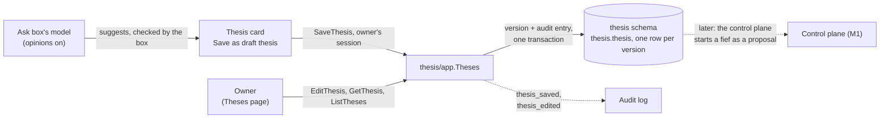

A [thesis](../glossary.md) is the claim an agent on an offensive sleeve would act on: what is expected of which instruments over what horizon, what would show it wrong, and what it rests on. The agents are not built yet. What is built is the first step of the road to them: with [opinions](models.md#how-it-works) on, the Ask box's model may suggest a thesis, and the owner may save the suggestion as a *draft* and edit it. A draft is only text. It has no agent, no fief and no lease, and no field for a lease's size; the control plane will later start a fief from a draft as a proposal that always needs the owner's approval (D-229, GR-6).

## Concepts

**A draft is the owner's alone.** Its text and the instruments it names are T1 data ([data tiers](models.md), D-206), and nothing but the owner reads or writes it. It is not a kind of record the read API serves (D-137), it belongs to no account, and a grant only ever lets its holder view accounts, sleeves or the household (D-209), so no script token, view plugin or demo session reaches one however it is granted, and a viewer's session is refused. The owner's calls go through `ThesisService` ([thesis.proto](../../proto/openfief/thesis/v1/thesis.proto)), which the core serves to view plugins on the plugin port, as it serves its other owner services, and every call carries the owner's session: a read-scoped session, a script token used as a session and a caller that is no view plugin are each refused. A model is never sent a draft today; when one is, it is T1.

**A thesis has no size.** A draft holds a statement, its instruments, a horizon (`long_term` or `short_term`, GR-5), its invalidation conditions and its sources, and nothing else: how much an agent may hold is the lease's, which the owner approves. Text that names a lease size is refused wherever it is written: the word "lease", a share of the portfolio, a sleeve or a budget, a position size, and an amount or percentage that a verb of sizing puts to work ("put 5000 PLN into it"). A price or a figure of the company's own ("closed at 46.15 USD") is not a size.

**Versions.** Saving a draft stores version 1. Editing stores the next version and keeps every earlier one; an edit made on a version that is no longer the latest is refused, so two tabs can't overwrite each other. The store never updates or deletes a version: a trigger refuses it.

**Every save and edit is audited.** A save writes `thesis_saved` and an edit `thesis_edited`, each naming the thesis and its version and never its text, inside the transaction that stores the version, so a version the log can't record is not stored ([Identity](identity.md)).

## How it works

**The context.** `internal/thesis` is its own bounded context ([code organization](../dev/code-organization.md)), separate from `portfolio`, with its own schema and migrations. The domain package holds the draft, its rules (`thesis.New` tidies a draft and refuses an incomplete or oversize one or one that names a lease size) and its versions. `thesis/app` holds the use cases (`Save`, `Edit`, `Get`, `List`), each checking the owner's session first, and the ports it declares: the store, the owner check, the audit entry and the ID source. `thesis/postgres` keeps one row per version in `thesis.thesis`; `thesis/connectapi` serves `ThesisService`; `cmd/core/thesis.go` wires them, with the audit entry enqueued in the core's outbox.

**The Ask box's card.** A thesis answer is drawn as a card under the answer: the statement, the horizon, the instruments, what would show it wrong and its sources, a note that it is a suggestion from an AI model and not investment advice and holds no lease size, and, for the owner, a *Save as draft thesis* button. The button posts the card's fields with htmx to `POST /settings/theses`, and the card's place says the draft was saved and links to it, so the conversation stays; without htmx it is a plain form that opens the draft. Nothing on the card starts an agent, a fief or a lease.

**The Theses page.** A tab of the settings navigation, for the owner only: the drafts, the most recently changed first; a draft's page with its latest version, a form that saves an edit as a new version, and its version history, each version folded; and the line "Start an agent: arrives with the control plane." A viewer's or a demo's pages have no link to it and it answers them 403.

## Decisions

D-229 (the thesis the model may suggest, saved as a draft the owner alone reads, edited into versions, every save and edit audited), D-225 (opinions), D-206 (a thesis is T1), D-137 and D-209 (no read path reaches it), D-211 (the audit entries), D-71 and GR-6 (a thesis is for an agent on an offensive sleeve, with a lease it never holds a size of), and GR-5 (the horizon).

## Verification

- The domain rules are table tests ([thesis_test.go](../../internal/thesis/thesis_test.go)); the use cases run against a fake store and audit ([theses_test.go](../../internal/thesis/app/theses_test.go)): every version kept, every save and edit audited, a refused edit stores and audits nothing, a log that can't take the entry keeps the version out, every call refused to a non-owner.
- The store is tested on a real PostgreSQL (`task test:pg`): versions kept, a stale or missing edit stored nothing, a failing hook rolls the version back, and the database refuses to change or remove a saved version.
- Through the real core ([thesis_test.go](../../cmd/core/thesis_test.go)): the owner saves, edits and reads; a viewer's session, a demo session and a script token as caller or as session are refused every call; and the read API has no method that serves a thesis. The audit test of every owner change drives both procedures and finds exactly one entry each.
- The page, the card and the forms are tested over the fakes ([thesis_test.go](../../internal/views/ui/thesis_test.go), [askopinions_page_test.go](../../internal/views/ui/askopinions_page_test.go)), and the browser checks drive them at 360 and 390 px.

## Not built yet

- The control plane: no agent, fief or lease starts from a draft, and no model is sent one.
- Deleting a draft. A draft can only be edited into a new version.
- Script-token access to drafts. It is refused outright, since D-137 names no such record; a later decision may give a token the owner allowed a read of them, which the model already marks T1.
