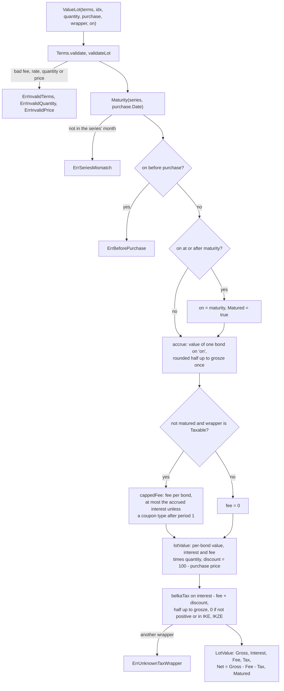
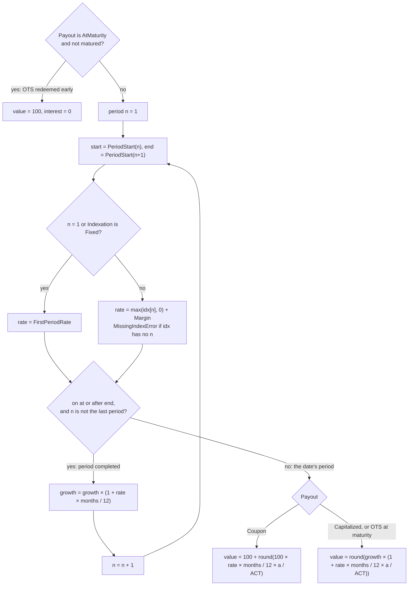

Polish retail treasury bonds (obligacje skarbowe) are not traded, so no market price exists for them. Their value on any day follows from the rules in each series' [issue letter](../glossary.md), and neither the registry nor the bank that sells them offers an API (R-5). Package `pl` computes that value as pure functions: a lot's gross accrued value and what it would pay if redeemed today. The [valuation](valuation.md) context then picks which of the two counts in totals.

## Concepts

### Bond types and series

Every bond has a nominal of 100 PLN. A [bond type](../glossary.md) is the product, named by three letters, and it fixes the term, the [interest period](../glossary.md), what sets the rate after the first period, and what happens to the interest:

| Bond type | Term | Interest period | Rate after the first period | Interest |
|---|---|---|---|---|
| OTS | 3 months | 3 months | Fixed | Paid at maturity only |
| ROR | 1 year | 1 month | NBP reference rate + margin | Coupon |
| DOR | 2 years | 1 month | NBP reference rate + margin | Coupon |
| TOS | 3 years | 1 year | Fixed | Capitalized |
| COI | 4 years | 1 year | CPI + margin | Coupon |
| EDO | 10 years | 1 year | CPI + margin | Capitalized |
| ROS | 6 years | 1 year | CPI + margin | Capitalized |
| ROD | 12 years | 1 year | CPI + margin | Capitalized |

ROS and ROD are family bonds. A [bond series](../glossary.md) code adds the maturity month and two-digit year to the type: EDO0536 is EDO maturing in May 2036. A series is sold during one calendar month, but each bond's term runs from its own purchase date. So a lot's purchase date plus the type's term must land in the series' month; if not, the lot was entered under the wrong series.

A bond is bought for cash at the nominal, or by exchange (zamiana) of maturing bonds at the series' [exchange price](../glossary.md), usually 99.90 PLN (100 PLN for OTS). The discount below the nominal is taxed along with the interest.

### Series terms

Each issue letter fixes three numbers for its series: the first-period rate, the [margin](../glossary.md) and the [early-redemption fee](../glossary.md). They change from issue to issue, so they are [series terms](../glossary.md) supplied as data, never constants. Rates are yearly fractions: 5.35% is `0.0535`.

### Interest periods and indexation

Interest periods count from the purchase date: a bond bought on 15 March has yearly periods starting each 15 March. Month steps land on the same day of the month, or on the last day of a shorter month, and always count from the purchase date itself. A bond bought on the 31st therefore returns to the 31st after February; this is the schedule the ROR issue letter prints.

The first period pays the first-period rate, and fixed-rate types (OTS, TOS) keep it for the whole term. Later periods pay the [period index](../glossary.md) reading plus the margin, with a negative reading counted as zero, so the rate never drops below the margin:

- **Inflation-indexed** (COI, EDO, ROS, ROD): the reading is [CPI](../glossary.md) year on year, as announced by [GUS](../glossary.md) in the month before the period's first month. GUS announces a month's CPI in the following month, so a period starting in March takes January's CPI. If that reading shows prices 5% higher than a year before, the period pays 5% plus the margin: the rate follows past inflation, a little late, plus a fixed extra.
- **ROR and DOR**: the reading is the [NBP reference rate](../glossary.md) in force on the tenth business day before the first day of the calendar month in which the period starts.

A reading is a yearly fraction too: a CPI of 104.9 (previous year = 100) is `0.049`.

### Capitalized interest and coupons

A capitalized type (TOS, EDO, ROS, ROD) adds each period's interest to the base of the next, so interest compounds and all of it is paid at redemption. A coupon type (ROR, DOR, COI) pays each period's interest out at the period's end, so its value counts only the current period's interest. OTS pays a fixed interest at maturity and none on early redemption, which returns the nominal.

### Early-redemption fee

Redeeming before maturity costs the series' fee per bond. It is capped at the bond's accrued interest, so the fee never cuts into the nominal, except for coupon types after their first period, where the full fee applies even if it does. There is no fee at or after maturity, and none on a withdrawal from IKE or IKZE. OTS has no fee, since early redemption already forfeits its interest.

### Belka tax

[Belka tax](../glossary.md) is Poland's flat 19% tax on capital income. For bonds it is withheld from the interest and the purchase discount (art. 30a of the personal income tax act). On an early redemption its base is interest minus the fee plus the discount, and a base of zero or less is not taxed. The tax ordinance (art. 63 § 1a) says to round such tax up to whole grosze, but the issuer's worked examples round half up. OpenFief follows the examples (D-37).

### Tax wrappers

The [tax wrapper](../glossary.md) is the tax regime of the account a lot sits in:

| Wrapper | Early-redemption fee | Belka tax |
|---|---|---|
| `Taxable` | Charged | Withheld |
| `IKE` | Not charged, assuming a withdrawal | None: exempt when the withdrawal conditions are met, which valuation assumes |
| `IKZE` | Not charged, assuming a withdrawal | None withheld; the reduced flat tax on IKZE withdrawals applies to the whole account and is not part of a bond's value |

The wrapper belongs to the account: the valuation context records it per account, and an account without one is taxable. The `IKE` doc comment notes that the issue letters offer only ROR, DOR, TOS, COI and EDO for IKE and IKZE, but nothing checks a lot's bond type against its wrapper.

### The tax FX rate date

Bond amounts are in PLN, but Polish tax converts foreign income, such as income at a foreign broker (R-9), at the NBP table A rate of the last business day before the income (art. 11a). `TaxRateCutoff(event)` returns the day before the event; the latest table on or before that day is the rate ([Valuation](valuation.md#converting-to-pln) shows the lookup). The rule lives here because it is Polish tax law (D-20).

### Gross accrued and net-if-redeemed

A [lot value](../glossary.md) has two answers. The gross accrued value is the nominal plus interest accrued and not yet paid out. The net-if-redeemed value is what redeeming the lot on that date would pay: gross minus the fee minus Belka tax. Net is the default in totals (D-25). The issuer's worked examples count interest to the fifth business day after the redemption order; `ValueLot` counts it to the date it is given.

## How it works

| File | Contents |
|---|---|
| [series.go](../../internal/jurisdiction/pl/series.go) | `BondType` and its `Structure` (term, period, `Indexation`, `Payout`); `Series` and `ParseSeries` |
| [terms.go](../../internal/jurisdiction/pl/terms.go) | `Nominal`, `Terms`, `Indices`, `Terms.PeriodRate`, `MissingIndexError` |
| [calendar.go](../../internal/jurisdiction/pl/calendar.go) | `Maturity`, `PeriodStart`, `CPIMonth` |
| [value.go](../../internal/jurisdiction/pl/value.go) | `Purchase`, `LotValue`, `ValueLot` |
| [tax.go](../../internal/jurisdiction/pl/tax.go) | `TaxWrapper`, `BelkaRate`, `BelkaTax`, `TaxRateCutoff` |

The package imports nothing from OpenFief but `kernel`, does no I/O and reads no clock; lint enforces that for domain packages. [doc.go](../../internal/jurisdiction/pl/doc.go) lists the issue letters, interest tables and statute articles the doc comments cite.

`ValueLot(terms, idx, quantity, purchase, wrapper, on)` values a whole lot:

Inside `accrue`, a capitalized bond's value before the fee follows the issue letters' early-redemption formula, N × (1 + r1) × … × (1 + r(k-1)) × (1 + rk × ak / ACT), where ak counts days from the start of period k (included) to the date (excluded) and ACT is the period's actual days. A coupon bond counts only the last factor's interest. The loop walks the periods from the first:

Here `months` is the period length (1, 3 or 12) and `a` is the days from the period's start to the date. All arithmetic is exact decimal until the single `Quo` that rounds half up to grosze; the lot amounts are the per-bond amounts times the quantity. Belka tax, by contrast, is computed once on the lot's total. On the day a coupon is paid, a coupon type has started a new period, so its accrued interest is zero.

`ValueLot` needs an index reading for every period up to the one the date falls in, coupon types included: their earlier periods were paid out and don't change the value, but without a reading `PeriodRate` still fails with `MissingIndexError`. `ValueLot` takes readings by period number. In a revaluation, [`valuation.LotIndices`](valuation.md#valuing-one-holding) picks them from the stored monthly readings: the CPI of `CPIMonth(start)` for inflation-indexed types, and for ROR and DOR the reference-rate reading recorded for the month the period starts. Which rate that is, the one in force on the tenth business day before the month, is left to whoever records it, because it needs Poland's holiday calendar, which neither package has. A missing reading makes the holding's stored row a gap (`index_reading`), not an error.

A synthetic EDO0334 lot shows the periods and a value on a date:

Worked example, from the synthetic cases in [value_test.go](../../internal/jurisdiction/pl/value_test.go): 10 bonds of EDO0334, first-period rate 6%, margin 2%, fee 2.00 PLN, in a taxable account, valued on 2024-09-15.

1. One bond: 100 × (1 + 0.06 × 184 / 365) = 103.0246…, rounded half up to 103.02 PLN.
2. The lot: gross 1030.20 PLN, of which 30.20 PLN is interest.
3. Fee: 2.00 PLN is less than the bond's 3.02 PLN of interest, so it isn't capped: 20.00 PLN for the lot.
4. Belka tax: 19% × (30.20 − 20.00) = 1.938, rounded half up to 1.94 PLN.
5. Net: 1030.20 − 20.00 − 1.94 = 1008.26 PLN.

The same lot in IKE is worth 1030.20 PLN net. Bought by exchange at 99.90 PLN, its 1.00 PLN discount is taxed too: tax 2.13, net 1008.07 PLN. A year later, with a period-2 CPI reading of `0.049`, one bond is worth 100 × 1.06 × (1 + 0.069 × 184 / 365) = 109.69 PLN gross.

## Decisions

- **D-9**: manual bond lots, valuation computed. `ValueLot` needs more than D-9's series, quantity and purchase date. In a revaluation the purchase date is the lot's open date and the price per bond its cost over its quantity; the series terms (per ISIN), the index readings and the account's tax wrapper are recorded separately.
- **D-20**: Polish tax uses NBP rates, from the day before (`TaxRateCutoff`).
- **D-25**: gross accrued and net-if-redeemed values. D-25 names only IKE, and only for tax ("no tax inside IKE"). The code also withholds no tax inside IKZE, and charges no fee in either wrapper because it assumes a withdrawal. The glossary's early-redemption fee entry backs the fee part; nothing in DESIGN.md decides the IKZE tax part.
- **D-37**: issuer tables and examples over the letter. Implemented as decided: the TOS base isn't rounded between years, and Belka tax rounds half up.
- **D-62**: the Polish pack may assume PLN for tax; `Nominal()` and all bond amounts are PLN.

## Verification

| Behavior | Tests | kibi |
|---|---|---|
| Series codes parse; each type's structure | `TestParseSeries`, `TestBondTypeStructure` in [series_test.go](../../internal/jurisdiction/pl/series_test.go) | REQ-pl-series-code, SCEN-pl-series-code, TEST-pl-series |
| Maturity; a lot under the wrong series fails | `TestMaturity` in [calendar_test.go](../../internal/jurisdiction/pl/calendar_test.go), `TestValueLotRejectsBadInput` | REQ-pl-series-code, SCEN-pl-series-code, TEST-pl-calendar, TEST-pl-value |
| Period dates from the purchase date, including rows of the ROR1027 issue letter | `TestPeriodStart` | REQ-pl-bond-accrual, SCEN-pl-bond-accrual, TEST-pl-calendar |
| CPI month two months before the period | `TestCPIMonth` | REQ-pl-cpi-indexation, SCEN-pl-cpi-indexation, TEST-pl-calendar |
| Index plus margin, negative readings floored, missing readings fail | `TestPeriodRate`, `TestPeriodRateNeedsTheIndexReading` in [terms_test.go](../../internal/jurisdiction/pl/terms_test.go) | REQ-pl-cpi-indexation, SCEN-pl-cpi-indexation, TEST-pl-terms |
| Lot values: accrual, fee cap, wrappers, discount, maturity | `TestValueLot`, `TestValueLotRejectsBadInput` | REQ-pl-bond-accrual, REQ-pl-early-redemption-fee-cap, REQ-pl-belka-tax, REQ-pl-tax-wrapper-exempt, TEST-pl-value |
| Matches the issuer's daily interest tables | `TestValueLotMatchesInterestTables` in [official_test.go](../../internal/jurisdiction/pl/official_test.go) | REQ-decision-d37-1-follow-issuer-tables, REQ-decision-d37-2-tos-base-unrounded, TEST-pl-official |
| Matches the issuer's worked early-redemption examples | `TestValueLotMatchesWorkedExamples` | REQ-decision-d37-1-follow-issuer-tables, REQ-decision-d37-3-belka-half-up, TEST-pl-official |
| Belka tax 19%, half up, none in IKE or IKZE | `TestBelkaTax`, `TestBelkaRate` in [tax_test.go](../../internal/jurisdiction/pl/tax_test.go) | REQ-pl-belka-tax, REQ-decision-d37-3-belka-half-up, SCEN-pl-belka-tax, TEST-pl-tax |
| Tax takes the rate from before the event | `TestTaxRateCutoff`; `TestTaxRateUsesTheTableBeforeTheEvent` in valuation | REQ-pl-tax-fx-rate-date, SCEN-pl-tax-fx-rate-date, TEST-pl-tax |

TEST-pl-value and TEST-pl-official also validate the firm requirements imported from D-9 and D-25: REQ-AUTO-30FD669113CEFE3B (bond lots are valued) and REQ-AUTO-E10BE8CE13E67657 (net-if-redeemed by default). Most cases are synthetic lots worked out by hand in each case's comment. `official_test.go` checks against published sources instead: the issuer's daily interest tables (EDO, TOS, COI and ROR series, held in IKE so that gross equals net) and the worked examples on the offer pages (EDO, TOS, ROS, DOR, ROR and OTS). Three of the table cases (two EDO1133 days and one TOS0128 day) are days where rounding the base after each year, as the TOS letter words it, would be one grosz off. No test compares with the open-source reference valuers listed in R-5. ROD is covered only by parsing and structure tests.

Run them with `task test`, or just this package with `go test ./internal/jurisdiction/pl/...`.

## Not built yet

- **D-9**: anything that fetches series terms, CPI or NBP reference rates (the DESIGN.md diagram's treasury bonds connector) and records them through `valuation/app.InputRecorder`; manual lot entry in the built-in UI (D-49); and an import of the bond service's export, if one exists (OQ-22).
- **D-9**: picking the NBP reference rate in force on the tenth business day before a month, which needs a business-day calendar.
- **D-62**, **GR-13**: the jurisdiction pack (`jurisdiction.Pack` in the glossary) that would make these rules pluggable and set PLN as the default reporting currency; today `pl` is a plain package.
