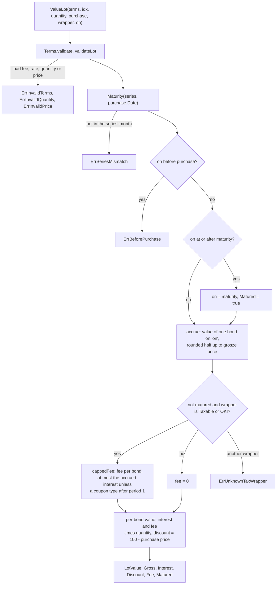
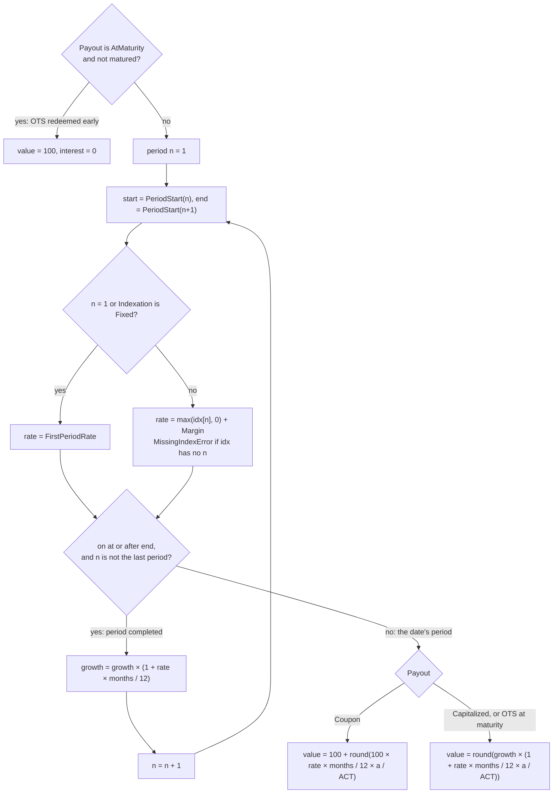
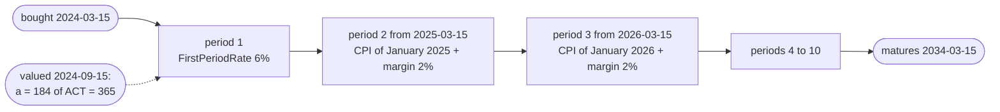
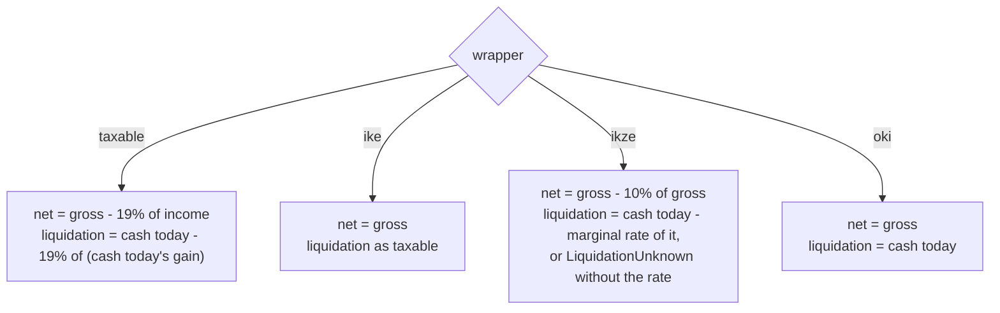

Polish retail treasury bonds (obligacje skarbowe) are not traded, so no market price exists for them. Their value on any day follows from the rules in each series' [issue letter](../glossary.md), and neither the registry nor the bank that sells them offers an API (R-5). Package `pl` computes that value as pure functions: a lot's gross accrued value, its interest and purchase discount, and the fee redeeming it today would charge. It is also the Polish [jurisdiction pack](../glossary.md) (D-70), which turns those parts, and any holding or cash, into the three values of D-77 in each [tax wrapper](../glossary.md); the [valuation](valuation.md) context stores all three.

## Concepts

### Bond types and series

Every bond has a nominal of 100 PLN. A [bond type](../glossary.md) is the product, named by three letters, and it fixes the term, the [interest period](../glossary.md), what sets the rate after the first period, and what happens to the interest:

| Bond type | Term | Interest period | Rate after the first period | Interest |
|---|---|---|---|---|
| OTS | 3 months | 3 months | Fixed | Paid at maturity only |
| ROR | 1 year | 1 month | NBP reference rate + margin | Coupon |
| DOR | 2 years | 1 month | NBP reference rate + margin | Coupon |
| TOS | 3 years | 1 year | Fixed | Capitalized |
| COI | 4 years | 1 year | CPI + margin | Coupon |
| EDO | 10 years | 1 year | CPI + margin | Capitalized |
| ROS | 6 years | 1 year | CPI + margin | Capitalized |
| ROD | 12 years | 1 year | CPI + margin | Capitalized |

ROS and ROD are family bonds. A [bond series](../glossary.md) code adds the maturity month and two-digit year to the type: EDO0536 is EDO maturing in May 2036. A series is sold during one calendar month, but each bond's term runs from its own purchase date. So a lot's purchase date plus the type's term must land in the series' month; if not, the lot was entered under the wrong series.

A bond is bought for cash at the nominal, or by exchange (zamiana) of maturing bonds at the series' [exchange price](../glossary.md), usually 99.90 PLN (100 PLN for OTS). The discount below the nominal is taxed along with the interest.

### Series terms

Each issue letter fixes three numbers for its series: the first-period rate, the [margin](../glossary.md) and the [early-redemption fee](../glossary.md). They change from issue to issue, so they are [series terms](../glossary.md) supplied as data, never constants. Rates are yearly fractions: 5.35% is `0.0535`.

### Interest periods and indexation

Interest periods count from the purchase date: a bond bought on 15 March has yearly periods starting each 15 March. Month steps land on the same day of the month, or on the last day of a shorter month, and always count from the purchase date itself. A bond bought on the 31st therefore returns to the 31st after February; this is the schedule the ROR issue letter prints.

The first period pays the first-period rate, and fixed-rate types (OTS, TOS) keep it for the whole term. Later periods pay the [period index](../glossary.md) reading plus the margin, with a negative reading counted as zero, so the rate never drops below the margin:

- **Inflation-indexed** (COI, EDO, ROS, ROD): the reading is [CPI](../glossary.md) year on year, as announced by [GUS](../glossary.md) in the month before the period's first month. GUS announces a month's CPI in the following month, so a period starting in March takes January's CPI. If that reading shows prices 5% higher than a year before, the period pays 5% plus the margin: the rate follows past inflation, a little late, plus a fixed extra.
- **ROR and DOR**: the reading is the [NBP reference rate](../glossary.md) in force on the tenth [business day](../glossary.md) before the first day of the calendar month in which the period starts.

A reading is a yearly fraction too: a CPI of 104.9 (previous year = 100) is `0.049`.

### Business days and the reference-rate day

The issue letters count business days (dni robocze) without Saturdays (ROR1027 letter, ust. 29) and without statutory days off work (ust. 33). Those are Sundays and the holidays art. 1 of the act on days off work lists: 1 and 6 January, Easter Sunday and Monday, 1 and 3 May, Pentecost Sunday, Corpus Christi, 15 August, 1 and 11 November, and 24 to 26 December. Easter and the days counted from it move every year; 6 January is a day off from 2011 and 24 December from 2025, so the calendar depends on the year. `IsBusinessDay` models the act from 1991 and fails with `ErrOutsideCalendar` before that. A day off the Prime Minister may declare during an epidemic (art. 1a) is not modeled, since none has been declared.

`ReferenceRateDay(year, month)` counts ten business days back from the month's first day, so the first counted is the last business day of the month before. For January 2026 it skips 24, 25 and 26 December and lands on 15 December 2025; for July 2025 it skips Corpus Christi (19 June) and lands on 16 June. `RateInForce` then picks, from the NBP's list of rate changes (`RateChange`, each with the day it takes effect), the latest one in force on that day, the day of a change included.

### Capitalized interest and coupons

A capitalized type (TOS, EDO, ROS, ROD) adds each period's interest to the base of the next, so interest compounds and all of it is paid at redemption. A coupon type (ROR, DOR, COI) pays each period's interest out at the period's end, so its value counts only the current period's interest. OTS pays a fixed interest at maturity and none on early redemption, which returns the nominal.

### Early-redemption fee

Redeeming before maturity costs the series' fee per bond. It is capped at the bond's accrued interest, so the fee never cuts into the nominal, except for coupon types after their first period, where the full fee applies even if it does. There is no fee at or after maturity, and none on a withdrawal from IKE or IKZE; a taxable account and OKI pay it, since the letters waive it for IKE and IKZE only. OTS has no fee, since early redemption already forfeits its interest.

### Belka tax

[Belka tax](../glossary.md) is Poland's flat 19% tax on capital income. For bonds it is withheld from the interest and the purchase discount (art. 30a of the personal income tax act). On an early redemption its base is interest minus the fee plus the discount, and a base of zero or less is not taxed. The tax ordinance (art. 63 § 1a) says to round such tax up to whole grosze, but the issuer's worked examples round half up. OpenFief follows the examples (D-37).

### Tax wrappers

The [tax wrapper](../glossary.md) is the tax regime of an account (D-76). The owner sets it when creating the account, from the pack's four:

| Wrapper | Key | Early-redemption fee | Belka tax inside | At the planned exit | Before it |
|---|---|---|---|---|---|
| Standard taxable account | `taxable` | Charged | Withheld | Belka tax on interest and discount, or on a sale's gain | The same, after the fee or sale cost |
| IKE | `ike` | Not charged on a withdrawal | None | Nothing: exempt once the withdrawal conditions are met (art. 21 ust. 1 pkt 58 of the PIT act) | A return (zwrot) is taxed at 19% on its gain |
| IKZE | `ikze` | Not charged on a withdrawal | None | 10% of the whole amount withdrawn (art. 30 ust. 1 pkt 13) | The whole amount at the owner's [marginal rate](../glossary.md) (D-78) |
| OKI (osobiste konto inwestycyjne) | `oki` | Charged | None (D-76) | Nothing; a yearly tax on the balance above the act's limit instead | The fee or sale cost only |

An account with no recorded wrapper is taxable, the pack's default. The `IKE` doc comment notes that the issue letters offer only ROR, DOR, TOS, COI and EDO for IKE and IKZE, but nothing checks a lot's bond type against its wrapper.

### Gross, net and liquidation

D-77 gives every holding three values, and the pack computes them per kind of product and wrapper:

- **Gross**, before any tax or fee: a lot's gross accrued value, a listed holding's market value, cash itself.
- **Net**, what the owner keeps at the planned exit (maturity, or a withdrawal once the wrapper's conditions are met), after the taxes due then and without early-exit fees.
- **Liquidation**, the cash in hand if it were sold or redeemed and withdrawn today, after every tax and fee due today.

The issuer's worked examples count interest to the fifth business day after the redemption order; `ValueLot` counts it to the date it is given. A taxable lot's liquidation value is what an early redemption pays.

### OKI's yearly tax

Inside OKI no Belka tax is due; instead, a yearly tax falls on the part of the average balance above a statutory limit, summed across all of the owner's OKI accounts (D-76). The limit, the rate and the day the act is in force from are the act's: `OKIAct` holds them as data. The code knows no act in force yet, so `CurrentOKIAct` has no date and no tax is ever computed ([Implementation questions](../implementation-questions.md)).

## How it works

| File | Contents |
|---|---|
| [series.go](../../internal/jurisdiction/pl/series.go) | `BondType` and its `Structure` (term, period, `Indexation`, `Payout`); `Series` and `ParseSeries` |
| [terms.go](../../internal/jurisdiction/pl/terms.go) | `Nominal`, `Terms`, `Indices`, `Terms.PeriodRate`, `MissingIndexError` |
| [calendar.go](../../internal/jurisdiction/pl/calendar.go) | `Maturity`, `PeriodStart`, `CPIMonth` |
| [businessday.go](../../internal/jurisdiction/pl/businessday.go) | `IsBusinessDay`, `ReferenceRateDay`, `RateChange`, `RateInForce`, `FirstCalendarYear`, `ErrOutsideCalendar` |
| [value.go](../../internal/jurisdiction/pl/value.go) | `Purchase`, `LotValue`, `ValueLot` |
| [tax.go](../../internal/jurisdiction/pl/tax.go) | `TaxWrapper`, `TaxWrappers`, `ParseTaxWrapper`, `BelkaRate`, `BelkaTax`, `TaxRateCutoff` |
| [pack.go](../../internal/jurisdiction/pl/pack.go) | `Pack` (the `jurisdiction.Pack`), `NewPack`, `RulesVersion`, `IKZEExitRate`, `OKIAct`, `CurrentOKIAct` |

The package imports nothing from OpenFief but `kernel` and the pack contract in `internal/jurisdiction` ([Valuation](valuation.md#the-jurisdiction-pack)), does no I/O and reads no clock; lint enforces that for domain packages. [doc.go](../../internal/jurisdiction/pl/doc.go) lists the issue letters, interest tables and statute articles the doc comments cite.

`ValueLot(terms, idx, quantity, purchase, wrapper, on)` values a whole lot:

Inside `accrue`, a capitalized bond's value before the fee follows the issue letters' early-redemption formula, N × (1 + r1) × … × (1 + r(k-1)) × (1 + rk × ak / ACT), where ak counts days from the start of period k (included) to the date (excluded) and ACT is the period's actual days. A coupon bond counts only the last factor's interest. The loop walks the periods from the first:

Here `months` is the period length (1, 3 or 12) and `a` is the days from the period's start to the date. All arithmetic is exact decimal until the single `Quo` that rounds half up to grosze; the lot amounts are the per-bond amounts times the quantity. Taxes, by contrast, are computed once on the lot's total, by the pack. On the day a coupon is paid, a coupon type has started a new period, so its accrued interest is zero.

`ValueLot` needs an index reading for every period up to the one the date falls in, coupon types included: their earlier periods were paid out and don't change the value, but without a reading `PeriodRate` still fails with `MissingIndexError`. `ValueLot` takes readings by period number. In a revaluation, [`valuation.LotIndices`](valuation.md#valuing-one-holding) picks them from the stored monthly readings: the CPI of `CPIMonth(start)` for inflation-indexed types, and for ROR and DOR the reference-rate reading recorded for the month the period starts. Which rate that is, the one in force on the tenth business day before the month, is picked when the reading is recorded, with `ReferenceRateDay` and `RateInForce`: the treasury-bonds connector fetches GUS's CPI and NBP's reference rate changes and delivers one reading per month ([Plugins](plugins.md#first-party-plugins)). A missing reading makes the holding's stored row a gap (`index_reading`), not an error.

A synthetic EDO0334 lot shows the periods and a value on a date:

### The pack's values

`Pack` implements `jurisdiction.Pack` for Poland: `ReportingCurrency` PLN (D-62), `NumberFormat` space-comma, `5 000,00 PLN` (D-113), `Wrappers` the four keys with `taxable` first, `TaxRateDate` is `TaxRateCutoff` (D-20), and `Version` is `pl/` with `RulesVersion`, which valuation records to revalue everything when the rules change. Three functions compute the values, every amount in PLN, every tax rounded half up to whole grosze and zero on a base that is not positive (`taxAt`, D-37's rounding):

| Function | Gross | Income taxed | Cash today |
|---|---|---|---|
| `ValueAccrued` (bond lots) | `LotValue.Gross` | interest + discount; minus the fee if redeemed today | gross - `LotValue.Fee` |
| `ValueListed` (priced at market) | market value | value - tax cost basis (the lots' cost at the NBP rate before purchase) | value - sale cost (the fee rule, [Valuation](valuation.md#the-jurisdiction-pack)) |
| `ValueCash` | the amount | nothing | the amount |

So cash is taxed only in IKZE, where any withdrawal is. A gain is taxed per holding: losses in one holding don't offset gains in another, and IKE's return is taxed on each holding's gain over its cost rather than on the account's withdrawals over its contributions ([Implementation questions](../implementation-questions.md)). `YearlyTax(oki, year, days)` averages the summed daily balances of the year's days on or after the act's in-force date, half up to grosze, and taxes the part above the limit at the rate; without an act in force for the year it returns `InForce` false and computes nothing. Any other wrapper is `jurisdiction.ErrNoYearlyTax`.

Worked example, from the synthetic cases in [value_test.go](../../internal/jurisdiction/pl/value_test.go) and [pack_test.go](../../internal/jurisdiction/pl/pack_test.go): 10 bonds of EDO0334, first-period rate 6%, margin 2%, fee 2.00 PLN, valued on 2024-09-15.

1. One bond: 100 × (1 + 0.06 × 184 / 365) = 103.0246…, rounded half up to 103.02 PLN.
2. The lot: gross 1030.20 PLN, of which 30.20 PLN is interest.
3. Fee in a taxable account: 2.00 PLN is less than the bond's 3.02 PLN of interest, so it isn't capped: 20.00 PLN for the lot.
4. Net in a taxable account: 1030.20 − 19% × 30.20 (5.738, half up 5.74) = 1024.46 PLN.
5. Liquidation in a taxable account: 1030.20 − 20.00 − 19% × (30.20 − 20.00) (1.938, half up 1.94) = 1008.26 PLN.

In IKE the lot nets 1030.20 and liquidates at 1024.46 PLN (no fee, Belka tax on a return); in IKZE it nets 927.18 PLN (10% of 1030.20 is 103.02), and liquidates at 906.58 PLN at a 12% marginal rate, or not at all until the owner sets one; in OKI it nets 1030.20 and liquidates at 1010.20 PLN, the fee only. Bought by exchange at 99.90 PLN, the 1.00 PLN discount is income too: taxable net 1024.27, liquidation 1008.07 PLN. A year later, with a period-2 CPI reading of `0.049`, one bond is worth 100 × 1.06 × (1 + 0.069 × 184 / 365) = 109.69 PLN gross.

## Decisions

- **D-9**: manual bond lots, valuation computed. `ValueLot` needs more than D-9's series, quantity and purchase date. In a revaluation the purchase date is the lot's open date and the price per bond its cost over its quantity; the series terms (per ISIN), the index readings and the account's tax wrapper are recorded separately. The owner enters a lot with its series' terms in the built-in UI, and the treasury-bonds connector delivers both ([Ingest](ingest.md#treasury-bond-lots)); the lot's rules reuse `ValueLot`: a lot is accepted only if it can be valued on its purchase date.
- **D-20**: Polish tax uses NBP rates, from the day before (`TaxRateCutoff`, the pack's `TaxRateDate`); the cost basis of a listed holding converts at it.
- **D-70**: `Pack` is the Polish jurisdiction pack, pure functions behind `jurisdiction.Pack`. Bond accrual (`ValueLot`) stays a Polish function that valuation calls directly, since only Polish bonds have series terms; the pack turns its parts into values.
- **D-76**: the four wrappers, no Belka tax inside OKI, and OKI's yearly tax computed only under an act in force. The act's date, limit and rate are unknown to the code, so nothing is computed yet; how the tax applies to days before an act takes effect mid-year, and averaging over the days given, are this package's narrow readings ([Implementation questions](../implementation-questions.md)).
- **D-77**: gross, net and liquidation per product kind and wrapper, as tabled above. The tax rules per wrapper are the narrowest reading of Polish tax law: IKE's exit untaxed and its return taxed on the gain, IKZE's 10% exit tax, per-holding gains without loss offsetting, rounding half up.
- **D-78**: an IKZE's liquidation value is `LiquidationUnknown` until the owner's marginal rate is set; a sale's cost comes from the account's fee rule, which valuation applies.
- **D-37**: issuer tables and examples over the letter. Implemented as decided: the TOS base isn't rounded between years, and Belka tax rounds half up.
- **D-62**, **D-113**: the pack's defaults are PLN and the space-comma number format. The Polish pack may assume PLN for tax; `Nominal()`, all bond amounts and every value the pack computes are PLN, and it refuses another currency (`ErrNotPLN`).

## Verification

| Behavior | Tests | kibi |
|---|---|---|
| Series codes parse; each type's structure | `TestParseSeries`, `TestBondTypeStructure` in [series_test.go](../../internal/jurisdiction/pl/series_test.go) | REQ-pl-series-code, SCEN-pl-series-code, TEST-pl-series |
| Maturity; a lot under the wrong series fails | `TestMaturity` in [calendar_test.go](../../internal/jurisdiction/pl/calendar_test.go), `TestValueLotRejectsBadInput` | REQ-pl-series-code, SCEN-pl-series-code, TEST-pl-calendar, TEST-pl-value |
| Period dates from the purchase date, including rows of the ROR1027 issue letter | `TestPeriodStart` | REQ-pl-bond-accrual, SCEN-pl-bond-accrual, TEST-pl-calendar |
| CPI month two months before the period | `TestCPIMonth` | REQ-pl-cpi-indexation, SCEN-pl-cpi-indexation, TEST-pl-calendar |
| Business days skip Saturdays, Sundays and each year's statutory holidays; the reference rate is the one in force on the tenth business day before the month | `TestIsBusinessDay`, `TestReferenceRateDay`, `TestRateInForce` in [businessday_test.go](../../internal/jurisdiction/pl/businessday_test.go) | REQ-pl-reference-rate-day, SCEN-pl-reference-rate-day, TEST-pl-businessday |
| Index plus margin, negative readings floored, missing readings fail | `TestPeriodRate`, `TestPeriodRateNeedsTheIndexReading` in [terms_test.go](../../internal/jurisdiction/pl/terms_test.go) | REQ-pl-cpi-indexation, SCEN-pl-cpi-indexation, TEST-pl-terms |
| Lot values: accrual, fee cap per wrapper, discount, maturity; a taxable lot's liquidation value | `TestValueLot`, `TestValueLotRejectsBadInput` | REQ-pl-bond-accrual, REQ-pl-early-redemption-fee-by-wrapper, SCEN-pl-early-redemption-fee-by-wrapper, TEST-pl-value |
| Gross, net and liquidation of a listed holding, a bond lot and cash in each wrapper; IKZE without the owner's rate; values never above gross (seeded property test); the pack's defaults | `TestPackDefaults`, `TestValueListed`, `TestValueAccrued`, `TestValueCash`, `TestValuesProperties` in [pack_test.go](../../internal/jurisdiction/pl/pack_test.go) | REQ-pl-values-per-wrapper, SCEN-pl-values-per-wrapper, REQ-pl-tax-wrappers, REQ-pl-oki-no-belka-tax, REQ-pl-ikze-early-withdrawal-tax, REQ-pl-ikze-liquidation-missing, REQ-jurisdiction-pl-number-format, TEST-pl-pack |
| OKI's yearly tax: none without an act in force; under a synthetic act, the average above the limit | `TestYearlyTax` | REQ-pl-oki-act-as-data, SCEN-pl-oki-act-as-data, REQ-pl-oki-yearly-tax, TEST-pl-pack |
| Matches the issuer's daily interest tables | `TestValueLotMatchesInterestTables` in [official_test.go](../../internal/jurisdiction/pl/official_test.go) | REQ-decision-d37-1-follow-issuer-tables, REQ-decision-d37-2-tos-base-unrounded, TEST-pl-official |
| Matches the issuer's worked early-redemption examples | `TestValueLotMatchesWorkedExamples` | REQ-decision-d37-1-follow-issuer-tables, REQ-decision-d37-3-belka-half-up, TEST-pl-official |
| Belka tax 19%, half up, none in IKE, IKZE or OKI; the wrappers' keys | `TestBelkaTax`, `TestBelkaRate`, `TestTaxWrapperNames` in [tax_test.go](../../internal/jurisdiction/pl/tax_test.go) | REQ-pl-values-per-wrapper, REQ-decision-d37-3-belka-half-up, REQ-pl-tax-wrappers, TEST-pl-tax |
| Tax takes the rate from before the event | `TestTaxRateCutoff`; `TestTaxRateUsesTheTableBeforeTheEvent` in valuation | REQ-pl-tax-fx-rate-date, SCEN-pl-tax-fx-rate-date, TEST-pl-tax |

TEST-pl-value and TEST-pl-official also validate the firm requirement REQ-AUTO-30FD669113CEFE3B (bond lots are valued, from D-9). Most cases are synthetic lots worked out by hand in each case's comment; a taxable case's tax and net columns are its liquidation value, through the pack. `official_test.go` checks against published sources instead: the issuer's daily interest tables (EDO, TOS, COI and ROR series, held in IKE, where no fee is charged) and the worked examples on the offer pages (EDO, TOS, ROS, DOR, ROR and OTS). Three of the table cases (two EDO1133 days and one TOS0128 day) are days where rounding the base after each year, as the TOS letter words it, would be one grosz off. No test compares with the open-source reference valuers listed in R-5. ROD is covered only by parsing and structure tests.

Run them with `task test`, or just this package with `go test ./internal/jurisdiction/pl/...`.

## Not built yet

- **D-9**: anything that fetches series terms (the owner types each series' terms with its lots); entering a lot bought by exchange at the [exchange price](../glossary.md), since entered lots are cash purchases at the nominal; and an import of the bond service's export, if one exists (OQ-22).
- **D-76**: OKI's yearly tax in practice: the act's in-force date, limit and rate.
