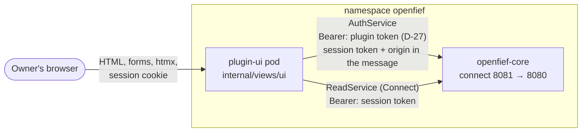
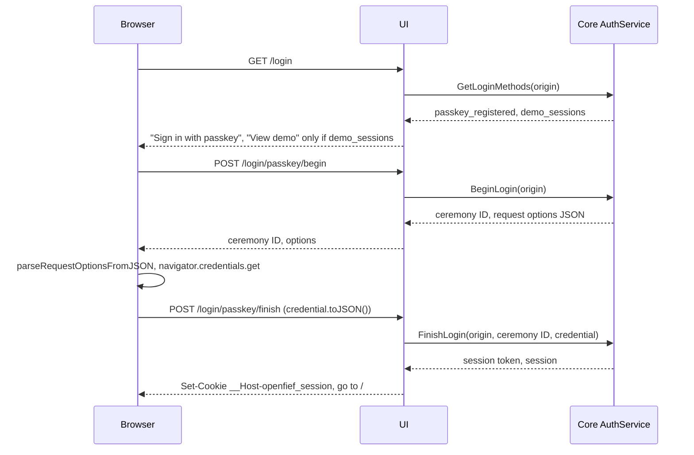

The built-in UI is OpenFief's default [view](../glossary.md) (D-3): a small website for the [owner](../glossary.md) that shows the record. It is a [plugin](../glossary.md) like any other, in its own pod, with the `view` capability and no egress host. It renders HTML on the server and reads the record only through the public [read API](../glossary.md) (D-6), the same API the owner's scripts use. This page explains how the browser, the UI and the core talk, how the owner signs in, what each page shows, and what is still missing.

## Concepts

**Backend for frontend.** The browser talks only to the UI, and the UI talks to the core. This split, called backend for frontend (Sam Newman, 2015), keeps every credential out of the browser's reach: the UI holds the plugin's own token, and the owner's session token sits in a cookie that no script can read. The browser never calls the core, so the core's API needs no browser-facing CORS rules, and the core's authentication service is never routed to the outside.

**Two tokens, two jobs.** The UI presents two different tokens to the core:

- To the core's `openfief.identity.v1.AuthService` ([auth.proto](../../proto/openfief/identity/v1/auth.proto)), its own projected ServiceAccount token with audience `openfief-core` (D-27), in the `Authorization` header. That proves the caller is a view plugin. The owner's session token travels in the request message, with the browser's origin.
- To the read API, the owner's session token as the bearer token, like a [script token](../glossary.md). The plugin's token never reaches the read API, and the session token never goes into an `Authorization` header to the AuthService.

Projected tokens rotate, so the UI reads its token from the file the operator mounts (`OPENFIEF_TOKEN_FILE`) on every call, through the Go SDK's `CoreHTTPClient` and `TokenFile`.

**Sessions and scopes.** The core issues a session after an authenticator proves who is at the browser: a passkey (WebAuthn, D-26) gives an `owner` session; the demo authenticator gives a `read` session, without credentials, only on a demo database with the core's `--demo-sessions` flag. A `read` session sees the record; only an `owner` session manages passkeys, script tokens and enrollment links. The UI hides the owner's actions from a `read` session, but the core enforces the scope either way.

**Passkeys and the relying party.** WebAuthn binds a passkey to a relying party ID, the host name it was made on (W3C Web Authentication, Level 1 in 2019; Level 3 added JSON helpers). So a passkey made on `localhost` doesn't work on `demo.openfief.dev`, and D-60 makes the owner create one per host: the first through a one-time link on `localhost` over `kubectl port-forward`, later ones through a link that a signed-in session issues. The UI passes the WebAuthn options and credentials through untouched, in the Level 3 JSON forms, so the browser parses and serializes them with `PublicKeyCredential.parseRequestOptionsFromJSON`, `parseCreationOptionsFromJSON` and `toJSON()` and the UI ships no WebAuthn library.

**Server-rendered pages with htmx.** Pages are Go `html/template` output. [htmx](../glossary.md) swaps parts of a page in place: the allocation's dimension switch and the "More transactions" button. Every htmx link is also a plain link, so the pages work without JavaScript, except passkeys and charts.

## How it works

The code is in [`internal/views/ui`](../../internal/views/ui/doc.go); [`plugins/ui`](../../plugins/ui/main.go) only wires it to the plugin's environment: the core's address (`OPENFIEF_CORE_ADDRESS`), the listen port (`OPENFIEF_LISTEN_PORT`) and the token file. Outside a cluster, against a core run locally, there is no projected token: the UI then presents `OPENFIEF_AUTH_CALLER_TOKEN`, the token the core was started with in the same variable, which the core accepts only outside a cluster.

| File | What it holds |
|---|---|
| [server.go](../../internal/views/ui/server.go) | `New` and `Config`, the routes, the security headers and the same-origin check |
| [session.go](../../internal/views/ui/session.go) | The browser's origin, the session cookie, `withSession` and `withOwner`, and how a failed call to the core becomes a page |
| [auth.go](../../internal/views/ui/auth.go) | The login page, the passkey login and registration relays, "View demo" and logout |
| [settings.go](../../internal/views/ui/settings.go) | Passkeys, script tokens and enrollment links |
| [overview.go](../../internal/views/ui/overview.go) | The overview, the allocation and the value over time |
| [account.go](../../internal/views/ui/account.go) | An account's page, its transactions' pages, the flagged balance assertions |
| [format.go](../../internal/views/ui/format.go) | Amounts, shares and labels for the templates |
| [templates.go](../../internal/views/ui/templates.go), [web/](../../internal/views/ui/web/templates/layout.html) | The embedded templates and static files |

### Signing in

- **The origin.** The UI tells the core the origin the browser uses: `https` when the proxy in front reports it in `X-Forwarded-Proto` (Traefik does), `http` otherwise, then the `Host`. The core checks it against its allow-list (`--auth-origin`), and its host is the relying party ID.
- **The cookie.** `__Host-openfief_session`: `HttpOnly`, `Secure`, `SameSite=Strict`, `Path=/`, expiring when the session does. The `__Host-` prefix makes the browser refuse it from any other host and with any `Domain`. Browsers treat `http://localhost` as a secure context and keep `Secure` cookies there, so the same cookie works through `kubectl port-forward`. On plain HTTP to any other host the browser drops it, and the login page says sign-in needs HTTPS.
- **"View demo"** posts to `/login/demo`, which calls `CreateDemoSession` and stores the `read` session the same way.
- **Enrollment.** An enrollment link is `<origin>/enroll#code=<code>`. The code is in the fragment, which the browser never sends, so it never reaches a request line, a log or a `Referer`. The page's script, [webauthn.js](../../internal/views/ui/web/static/webauthn.js), reads it, removes it from the address bar and history, and posts it to `/enroll/begin`; the UI hands it to `BeginRegistration`. Registering from an enrollment code also signs the owner in. "Add a passkey on this host" on the settings page runs the same ceremony with the owner's session instead of a code.
- **Every page** first asks the core `WhoAmI` with the cookie's session. No cookie, or a session the core no longer knows (`UNAUTHENTICATED`), drops the cookie and sends the browser to `/login`; an htmx request gets `HX-Redirect` instead. A read-scoped session gets 403 on the owner's pages before the UI calls the core.
- **Logout** revokes the session with `Logout` and drops the cookie, also when the core can't be reached.

### Browser security

- **Content Security Policy.** Every response carries `default-src 'none'; script-src 'self'; style-src 'self'; img-src 'self'; connect-src 'self'; form-action 'self'; frame-ancestors 'none'; base-uri 'none'`. Nothing is inline: scripts and the stylesheet are files the UI serves, chart data travels in `data-chart` attributes, and htmx runs with `allowEval`, `allowScriptTags` and its injected indicator styles off. A test checks every template for inline scripts, styles and handlers.
- **CSRF.** Every request that isn't `GET`, `HEAD` or `OPTIONS` must come from the UI's own origin: `Sec-Fetch-Site: same-origin` when the browser sends that header, otherwise an `Origin` equal to the UI's origin. A request with neither is refused with 403 before any handler runs. `SameSite=Strict` on the cookie is a second line.
- **Other headers.** `X-Content-Type-Options: nosniff`, `X-Frame-Options: DENY`, `Referrer-Policy: no-referrer`, `Cross-Origin-Opener-Policy` and `Cross-Origin-Resource-Policy: same-origin`, a `Permissions-Policy` that allows passkeys for the UI only, `Strict-Transport-Security` on HTTPS, and `Cache-Control: no-store` on pages, which hold the owner's record.
- **Vendored libraries.** htmx 2.0.11 (0BSD, 52 kB) and Chart.js 4.5.1 (MIT, 209 kB, its license header kept) are copied byte for byte from their npm releases into `web/static/vendor` and served by the UI; a test pins their SHA-256. Chart.js was chosen over uPlot because it draws both charts, the allocation's bars and the value line, with tooltips and no extra stylesheet.

### Pages

| Path | Shows | Read API calls |
|---|---|---|
| `/` | The total on a date in the reporting currency (D-62); each account with its institution, sleeve, holdings value and valuation status (D-36); the allocation; the value over time; how many balance assertions are flagged | `ListAccounts`, `ListValuationStatuses`, `GetAllocation`, `ListValuationTotals`, per account `ListAccountValuations` and `ListAssertionChecks` |
| `/allocation?by=&date=` | The allocation for one dimension, as an htmx fragment | `GetAllocation` |
| `/accounts/{id}` | Holdings with their stored values and basis, cash per currency, open lots, balance assertion checks, the first 50 transactions | `GetAccount`, `GetValuationStatus`, `ListHoldings`, `ListAccountValuations`, `ListLots`, `ListCash`, `ListAssertionChecks`, `ListTransactions` |
| `/accounts/{id}/transactions?page_token=` | The next page of transactions, as an htmx fragment | `ListTransactions` |
| `/assertions` | Every flagged balance assertion check, per account | `ListAccounts`, `ListAssertionChecks` |
| `/settings` | Passkeys (remove), script tokens (create, shown once; revoke), "Add a passkey on this host", enrollment links for another host. Owner scope only | AuthService only |

- **The date.** A page shows the date in its `date` parameter, otherwise the latest date any account is valued through, otherwise today.
- **The allocation** (D-30) is a horizontal bar chart and a table with each group's value and share. The switch picks asset class, currency, institution or sleeve; D-30's "broker" is the read API's institution. Holdings without a valuation on the date are listed under the chart, as the read API reports them.
- **The value over time** (D-30) asks `ListValuationTotals` for the 3650 days up to the date; the line starts at the first date with stored valuations, go-live (D-23). Stored valuations cover holdings only, so the line leaves out cash, and the page says so. The page also says "TWR: not built": the time-weighted return (D-61) needs a read API endpoint that doesn't exist yet, and the UI computes no performance itself.
- **Amounts** stay the read API's exact decimal strings. The UI only groups their digits; a share is computed with the kernel's `Decimal.Quo`, half-even to one decimal place. The chart script turns the strings into numbers only to place the marks, and its tooltips show the exact strings.

### The demo

[`deploy/demo/plugins/ui.yaml`](../../deploy/demo/plugins/ui.yaml) installs the instance `ui` with a grant for exactly the `view` capability. The operator runs it as Service `plugin-ui`, port `connect` (8080). The demo's Ingress, [`deploy/demo/routes/openfief.yaml`](../../deploy/demo/routes/openfief.yaml), sends `/v1` and `/openfief.views.v1.ReadService` to the core and everything else to `plugin-ui`; nothing routes to the AuthService. The operator's NetworkPolicy for a plugin admits only the core (D-59), so a demo-only policy, [`ui-from-traefik.yaml`](../../deploy/demo/openfief/ui-from-traefik.yaml), also admits k3s's Traefik, like `core-from-traefik`. The demo's core runs with `--auth-origin=https://demo.openfief.dev` next to the base's `http://localhost:8080`, and with `--demo-sessions`, so "View demo" works on the demo database.

## Decisions

- **D-3** makes the UI the default view; **D-6** says it reads through the public API like any view. `TestReadsOnlyThroughPublicAPI` keeps the package from importing anything of OpenFief's but the kernel and the SDK.
- **D-26** and **D-60**: passkeys only, per host, the first through a one-time link. **D-27**: the UI authenticates as a plugin with its projected token.
- **D-28**: the UI is a ClusterIP Service; only the demo routes to it.
- **D-30**, **D-36**, **D-62**: the two charts, the valuation status per account, the reporting currency.
- **D-52**: the model portfolio is off, so the UI shows none of it. **D-61**: TWR is not built, and the page says so.
- **Open question, D-59.** D-59 says only the core may call a plugin, and the operator's NetworkPolicy admits the core alone. A view plugin that serves browsers needs a second way in: on the demo, Traefik through `ui-from-traefik`; on an owner's installation, `kubectl port-forward`, which enters through the kubelet and needs no rule. The UI also doesn't check a core token on its pages, since browsers have none. Whether a view plugin's browser-facing port is an exception to D-59, and how an installation should admit its own Ingress, is for the author to decide; the operator's enforcement is unchanged.
- **The cookie is `Secure` on `http://localhost` too.** The AuthService contract says the cookie is Secure except on `http://localhost`. A `__Host-` cookie must be `Secure`, `gosec` (G124) refuses an insecure cookie, and current Chrome and Firefox keep `Secure` cookies on `localhost` as a secure context, so the UI sets one cookie everywhere. Safari's support for that is unverified here.
- **The origin comes from `X-Forwarded-Proto` and `Host`.** Only Traefik and `kubectl port-forward` reach the pod, and the core checks the origin against its allow-list; a forged origin can't use a passkey or session made for another host.

## Verification

| Behavior | Tests | Requirements |
|---|---|---|
| Login methods, passkey and demo sign-in, enrollment, logout, the plugin token on every AuthService call, the cookie, CSRF, CSP and headers, no inline code | [auth_test.go](../../internal/views/ui/auth_test.go) | REQ-ui-login-flows, REQ-ui-core-credentials, REQ-ui-session-cookie, REQ-ui-browser-security, REQ-AUTO-585F02DB972C1660 |
| Overview, allocation switch, value over time, account and transaction pages, flagged assertions, read scope, expired session, static files | [pages_test.go](../../internal/views/ui/pages_test.go) | REQ-ui-overview, REQ-ui-account-pages, REQ-ui-owner-actions, REQ-AUTO-68636F42D98D4CF7, REQ-AUTO-718AA30AAFD0E6E8, REQ-decision-d36-7-ui-valuation-status |
| Script tokens shown once, revoke, remove, the core's refusal, enrollment links | [settings_test.go](../../internal/views/ui/settings_test.go) | REQ-ui-owner-actions, REQ-identity-passkey-new-hostname |
| Amounts, shares, labels, the date, chart data, origin and cookie | [format_test.go](../../internal/views/ui/format_test.go) | REQ-ui-formatting, REQ-ui-overview |
| Imports only the kernel and the SDK; vendored libraries pinned | [boundary_test.go](../../internal/views/ui/boundary_test.go) | REQ-ui-read-boundary, REQ-ui-browser-security, REQ-AUTO-A04740EC43D6F6BA |
| The manifest asks for `view` only | [main_test.go](../../plugins/ui/main_test.go) | REQ-ui-plugin-packaging, REQ-AUTO-902181B0129A6321 |
| The UI's pod becomes ready on k3d and kind; `/login` answers through Traefik | [ui_test.go](../../test/e2e/ui_test.go) | REQ-ui-plugin-packaging |

The handler tests run the UI against both services as in-memory Connect servers, a fake AuthService and a fake read API over a synthetic record, with the AuthService client the plugin uses: the SDK's `CoreHTTPClient` over a token file the test rotates.

In the end-to-end suite the UI runs from a stand-in Deployment ([ui-standin.yaml](../../test/e2e/overlays/openfief/ui-standin.yaml)), because the operator never deploys the suite's unsigned images (D-57). WebAuthn needs a browser with an authenticator and is not exercised end to end.

## Not built yet

- The portfolio's time-weighted return (D-61) and the model portfolio's comparison and drawdowns (D-52 to D-54).
- File uploads and manual bond-lot entry, which the UI hands to the core (D-49), and the list of installed plugins with their signature status (D-46, D-56).
- A way to change the reporting currency or the bond basis from the UI.
