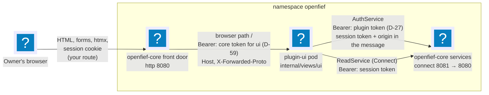
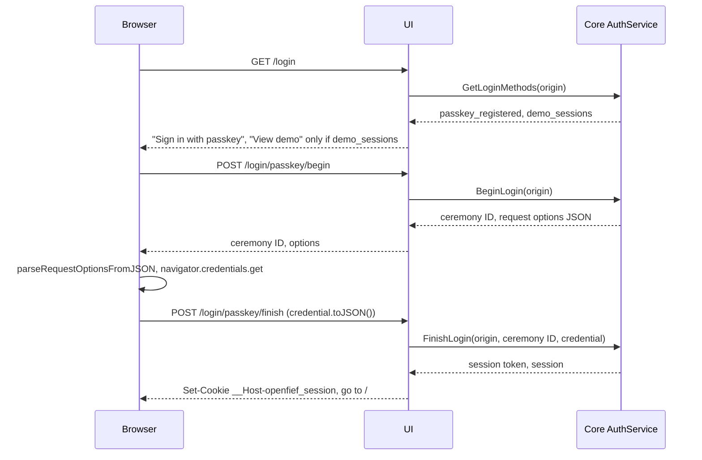

The built-in UI is OpenFief's default [view](../glossary.md) (D-3): a small website for the [owner](../glossary.md) that shows the record. It is a [plugin](../glossary.md) like any other, in its own pod, with the `view` capability and no egress host. It renders HTML on the server and reads the record only through the public [read API](../glossary.md) (D-6), the same API the owner's scripts use. This page explains how the browser, the UI and the core talk, how the owner signs in, what each page shows, and what is still missing.

## Concepts

**Backend for frontend.** The browser's application is the UI, and the UI talks to the core. This split, called backend for frontend (Sam Newman, 2015), keeps every credential out of the browser's reach: the UI holds the plugin's own token, and the owner's session token sits in a cookie that no script can read. The browser never calls the core's services itself, so the core's API needs no browser-facing CORS rules.

**The core is the front door.** Browsers reach the UI only through the core (D-81): the core is the only entry point for browsers, and it reverse-proxies every path the UI serves to the UI's pod, presenting its own token for that instance as it does to any plugin (D-59). So whatever route the owner adds, or a port-forward, reaches the core alone (D-28), and the UI, like every plugin, admits the core and nothing else. A reverse proxy is a server that forwards a client's request to another server and passes the answer back, so the client sees one origin. The UI's manifest declares the path prefix it serves, its [browser path](../glossary.md) `/`, and its grant approves it; `/` means every path the core doesn't serve itself.

**Two tokens, two jobs.** The UI presents two different tokens to the core:

- To the core's `openfief.identity.v1.AuthService` ([auth.proto](../../proto/openfief/identity/v1/auth.proto)), `openfief.portfolio.v1.ModelPortfolioService` ([model.proto](../../proto/openfief/portfolio/v1/model.proto)), `openfief.portfolio.v1.SleeveService` ([sleeves.proto](../../proto/openfief/portfolio/v1/sleeves.proto)), `openfief.ingest.v1.BondLotService` ([bond_lots.proto](../../proto/openfief/ingest/v1/bond_lots.proto)), `openfief.ingest.v1.StatementService` ([statements.proto](../../proto/openfief/ingest/v1/statements.proto)) and `openfief.ingest.v1.AccountService` ([accounts.proto](../../proto/openfief/ingest/v1/accounts.proto)), its own projected ServiceAccount token with audience `openfief-core` (D-27), in the `Authorization` header. That proves the caller is a view plugin. The owner's session token travels in the request message (for a statement upload, in the stream's first message), with the browser's origin.
- To the read API, the owner's session token as the bearer token, like a [script token](../glossary.md). The plugin's token never reaches the read API, and the session token never goes into an `Authorization` header to the AuthService.

Projected tokens rotate, so the UI reads its token from the file the operator mounts (`OPENFIEF_TOKEN_FILE`) on every call, through the Go SDK's `CoreHTTPClient` and `TokenFile`.

**Sessions and scopes.** The core issues a session after an authenticator proves who is at the browser: a passkey (WebAuthn, D-26) gives an `owner` session; the demo authenticator gives a `read` session, without credentials, only on a demo database with the core's `--demo-sessions` flag. A `read` session sees the record; only an `owner` session manages passkeys, script tokens, enrollment links and the model portfolio, adds bond lots and uploads statements. The UI hides the owner's actions from a `read` session, but the core enforces the scope either way.

**Passkeys and the relying party.** WebAuthn binds a passkey to a relying party ID, the host name it was made on (W3C Web Authentication, Level 1 in 2019; Level 3 added JSON helpers). So a passkey made on `localhost` doesn't work on `demo.openfief.dev`, and D-60 makes the owner create one per host: the first through a one-time link on `localhost` over `kubectl port-forward`, later ones through a link that a signed-in session issues. The UI passes the WebAuthn options and credentials through untouched, in the Level 3 JSON forms, so the browser parses and serializes them with `PublicKeyCredential.parseRequestOptionsFromJSON`, `parseCreationOptionsFromJSON` and `toJSON()` and the UI ships no WebAuthn library.

**Server-rendered pages with htmx.** Pages are Go `html/template` output. [htmx](../glossary.md) swaps parts of a page in place: the allocation's dimension switch and the "More transactions" button. Every htmx link is also a plain link, so the pages work without JavaScript, except passkeys and charts.

## How it works

The code is in [`internal/views/ui`](../../internal/views/ui/doc.go); [`plugins/ui`](../../plugins/ui/main.go) only wires it to the plugin's environment: the core's address (`OPENFIEF_CORE_ADDRESS`), the listen port (`OPENFIEF_LISTEN_PORT`) and the token file. There is no way to run it without a projected token, and no fixed token the core would accept instead (D-84): the UI is developed against a local cluster such as kind or k3d.

### The front door

`cmd/core` puts its front door, `withFrontDoor`, before every service it serves. A path the core serves itself goes to the core (`plugins.CoreServesPath`: `/healthz`, `/readyz`, `/v1` and below it, and every path whose first segment starts with `openfief.`, its Connect services). Every other path goes to [`browserproxy`](../../internal/views/browserproxy/proxy.go), which asks [`app.FrontDoor`](../../internal/views/app/browser.go) where it goes:

- **Routes.** [`kube.Browser`](../../internal/views/kube/browser.go) watches the `Plugin` resources and the plugins' Services. A plugin serves browsers when it is not being deleted, its `Ready` condition is `True`, `view` is among its effective capabilities and its status holds an effective browser path, the one its manifest declares and its grant approves. `views.RouteBrowserPath` ([browser.go](../../internal/views/browser.go)) picks the route with the longest prefix that covers the path, whole segments only; two instances on that same prefix get neither, rather than one picked at random.
- **The call.** The proxy sends the request to the instance's Service ClusterIP and `connect` port with the core's TokenRequest token for that instance (`identity/kube.CoreTokens`, the same as for connectors) in `Authorization`, replacing whatever the browser sent there. It keeps the browser's `Host`, sets `X-Forwarded-Proto` to the scheme the browser used (`https` on TLS or when the owner's Ingress in front says so, otherwise `http`) and `X-Forwarded-Host` to the `Host`, and drops every other `X-Forwarded-*` and `Forwarded` header a client sent. Bodies, uploads included, stream through.
- **Answers.** A path no plugin serves is 404. While the core hasn't read its cluster yet, or two plugins claim the path, 503. A plugin without an address, a token or an answer, 502. Outside a cluster there is nothing to proxy, and the read API answers such paths with 404.

The UI checks every request with the SDK's `RequireCore` and `NewCoreVerifier` (`requireCore` in [plugins/ui](../../plugins/ui/main.go)): a request without the core's token for the instance `ui` gets 401 before any page runs, so the `Host` and `X-Forwarded-Proto` it reads come from the core, which sets them. Only `GET /healthz` answers without the token, for probes; it shows nothing.

| File | What it holds |
|---|---|
| [server.go](../../internal/views/ui/server.go) | `New` and `Config`, the routes, the security headers and the same-origin check |
| [session.go](../../internal/views/ui/session.go) | The browser's origin, the session cookie, `withSession` and `withOwner`, and how a failed call to the core becomes a page |
| [auth.go](../../internal/views/ui/auth.go) | The login page, the passkey login and registration relays, "View demo" and logout |
| [settings.go](../../internal/views/ui/settings.go) | Passkeys, script tokens and enrollment links |
| [setup.go](../../internal/views/ui/setup.go), [sleeves.go](../../internal/views/ui/sleeves.go), [accounts.go](../../internal/views/ui/accounts.go) | The first-run wizard (D-73) and the Sleeves and Accounts pages (D-71, D-72): their forms, handed to the core's `SleeveService` and `AccountService`; the forms live in [onboarding.html](../../internal/views/ui/web/templates/fragments/onboarding.html) |
| [plugins.go](../../internal/views/ui/plugins.go) | The installed plugins with their signature trust, on their own page and the settings page (D-46, D-56) |
| [model.go](../../internal/views/ui/model.go) | The model portfolio's form on the settings page, read from and handed to the core's `ModelPortfolioService` (D-52) |
| [overview.go](../../internal/views/ui/overview.go), [performance.go](../../internal/views/ui/performance.go) | The overview, the allocation, and the value over time: the time-weighted return, the model portfolio's backtest and its drawdowns |
| [account.go](../../internal/views/ui/account.go) | An account's page, its transactions' pages, the flagged balance assertions |
| [pricechecks.go](../../internal/views/ui/pricechecks.go) | The flagged price checks (D-22) and their count on the overview |
| [bondlots.go](../../internal/views/ui/bondlots.go) | The "Add bond lot" form on a bond account's page, handed to the core's `BondLotService` (D-9, D-49) |
| [statements.go](../../internal/views/ui/statements.go) | The "Upload statement" form on an account's page: the multipart body streamed to the core's `StatementService` (D-7, D-49) |
| [format.go](../../internal/views/ui/format.go) | Amounts, shares and labels for the templates |
| [templates.go](../../internal/views/ui/templates.go), [web/](../../internal/views/ui/web/templates/layout.html) | The embedded templates and static files; [design.html](../../internal/views/ui/web/templates/fragments/design.html) holds the design system's parts: the Gate, Kasztan, the valuation status and trust badge pills |

### Signing in

- **The origin.** The UI tells the core the origin the browser uses: the scheme the core's front door reports in `X-Forwarded-Proto`, then the `Host` the core passed on. The core checks it against its allow-list (`--auth-origin`), and its host is the relying party ID.
- **The cookie.** `__Host-openfief_session`: `HttpOnly`, `Secure`, `SameSite=Strict`, `Path=/`, expiring when the session does. The `__Host-` prefix makes the browser refuse it from any other host and with any `Domain`. Browsers treat `http://localhost` as a secure context and keep `Secure` cookies there, so the same cookie works through `kubectl port-forward`, and D-85 keeps the prefix everywhere, `localhost` included. Chromium keeps it there, which the end-to-end suite checks; Safari's acceptance of it on `http://localhost` is still to verify, by hand, since no Safari runs in the suite. Only if Safari refuses it does D-85 allow a cookie without the prefix, on `localhost` alone, and that fallback is not built. On plain HTTP to any other host the browser drops the cookie, and the login page says sign-in needs HTTPS.
- **"View demo"** posts to `/login/demo`, which calls `CreateDemoSession` and stores the `read` session the same way.
- **Enrollment.** An enrollment link is `<origin>/enroll#code=<code>`. The code is in the fragment, which the browser never sends, so it never reaches a request line, a log or a `Referer`. The page's script, [webauthn.js](../../internal/views/ui/web/static/webauthn.js), reads it, removes it from the address bar and history, and posts it to `/enroll/begin`; the UI hands it to `BeginRegistration`. Registering from an enrollment code also signs the owner in. "Add a passkey on this host" on the settings page runs the same ceremony with the owner's session instead of a code.
- **Every page** first asks the core `WhoAmI` with the cookie's session. No cookie, or a session the core no longer knows (`UNAUTHENTICATED`), drops the cookie and sends the browser to `/login`; an htmx request gets `HX-Redirect` instead. A read-scoped session gets 403 on the owner's pages before the UI calls the core.
- **Logout** revokes the session with `Logout` and drops the cookie, also when the core can't be reached.

### Browser security

- **Content Security Policy.** Every response carries `default-src 'none'; script-src 'self'; style-src 'self'; font-src 'self'; img-src 'self'; connect-src 'self'; form-action 'self'; frame-ancestors 'none'; base-uri 'none'`. Nothing is inline: scripts and the stylesheet are files the UI serves, chart data travels in `data-chart` attributes, and htmx runs with `allowEval`, `allowScriptTags` and its injected indicator styles off. A test checks every template for inline scripts, styles and handlers.
- **CSRF.** Every request that isn't `GET`, `HEAD` or `OPTIONS`, a multipart upload too, must come from the UI's own origin: `Sec-Fetch-Site: same-origin` when the browser sends that header, otherwise an `Origin` equal to the UI's origin. A request with neither is refused with 403 before any handler runs. `SameSite=Strict` on the cookie is a second line.
- **Other headers.** `X-Content-Type-Options: nosniff`, `X-Frame-Options: DENY`, `Referrer-Policy: no-referrer`, `Cross-Origin-Opener-Policy` and `Cross-Origin-Resource-Policy: same-origin`, a `Permissions-Policy` that allows passkeys for the UI only, `Strict-Transport-Security` on HTTPS, and `Cache-Control: no-store` on pages, which hold the owner's record.
- **Vendored libraries.** htmx 2.0.11 (0BSD, 52 kB) and Chart.js 4.5.1 (MIT, 209 kB, its license header kept) are copied byte for byte from their npm releases into `web/static/vendor` and served by the UI; a test pins their SHA-256. Chart.js was chosen over uPlot because it draws both charts, the allocation's bars and the value line, with tooltips and no extra stylesheet.

### The look

The pages follow the [design system](../dev/design-system.md) and take every color, font, size and radius from its [`tokens.css`](../../design/tokens.css). The UI serves the design system's files itself, from the Go package [`design`](../../design/design.go) that embeds them, under `/static/design/`: the tokens, the self-hosted fonts, the favicon and Kasztan's poses. Nothing comes from another host, and nothing is copied out of `design/`. Every page loads the fonts, then the tokens, then the UI's own [`style.css`](../../internal/views/ui/web/static/style.css), which uses only semantic tokens, so dark mode follows the reader's system setting (or `data-theme` on `<html>`) without a line of its own.

- **Components.** One primary button per view, secondary outlined buttons, a quiet underlined "Sign out" and destructive red "Remove" and "Revoke"; status pills that always carry a word; tables with a sunken header row and monospace, right-aligned figures that always show their currency (D-20), scrolling inside their own box on a phone; a label above every field, help text under it and the unit inside amount fields.
- **Pills.** An account's valuation status (D-36) is a pill with the date it is *valued through* in monospace, and a *Revaluation pending* or *running* pill with a gold dot. A plugin's trust is one of D-87's four badges with the exact signer under it (see the installed plugins below).
- **Kasztan**, at most once per screen: on duty on the sign-in and enrollment pages; asleep in empty states (no accounts, no flagged balance assertions or price checks, no plugins); with the seal when a statement was imported; at the drawbridge on the error page and over flagged balance assertions, which need the owner.
- **Charts.** The series are vert, then or, kasztan, a grey and the vert tint (D-30's order in the design system): the time-weighted return is the first line and the model portfolio's backtest the second; each allocation bar takes the next color. [app.js](../../internal/views/ui/web/static/app.js) reads the colors and fonts from the page's CSS custom properties when it draws, and redraws when the reader's color scheme changes.

### Pages

| Path | Shows | Read API calls |
|---|---|---|
| `/` | The total on a date in the reporting currency (D-62); each account with its institution, sleeve, holdings value and valuation status (D-36); the allocation; the value over time as the time-weighted return, with the model portfolio's backtest and max drawdowns while it is on; how many balance assertions and price checks are flagged | `ListAccounts`, `ListValuationStatuses`, `GetAllocation`, `GetPerformance`, `GetModelPortfolio`, `ListPriceChecks`, per account `ListAccountValuations` and `ListAssertionChecks` |
| `/allocation?by=&date=` | The allocation for one dimension, as an htmx fragment | `GetAllocation` |
| `/accounts/{id}` | Holdings with their stored values and basis, cash per currency, open lots, balance assertion checks, the first 50 transactions with the connector instance each came from, marked when that instance is removed (D-58) | `GetAccount`, `GetValuationStatus`, `ListHoldings`, `ListAccountValuations`, `ListLots`, `ListCash`, `ListAssertionChecks`, `ListTransactions` |
| `POST /accounts/{id}/bond-lots` | Hands the posted [bond lot](../glossary.md) to the core's `BondLotService`, then back to the account's open lots. Owner scope only | `AddBondLot` (BondLotService) |
| `POST /accounts/{id}/statements` | Streams the posted [statement](../glossary.md) file to the core's `StatementService`, then shows the account's page with the import's counts and [ingest problems](../glossary.md). Owner scope only | `UploadStatement` (StatementService), then as `/accounts/{id}` |
| `/accounts/{id}/transactions?page_token=` | The next page of transactions, as an htmx fragment | `ListTransactions` |
| `/assertions` | Every flagged balance assertion check, per account | `ListAccounts`, `ListAssertionChecks` |
| `/price-checks` | Every flagged [price check](../glossary.md) (D-22): the date, the instrument, the price holdings are valued at and the institution's own price, each with the connector instance it came from, and the difference in percent, with the threshold. Any session | `ListPriceChecks` |
| `/setup?step=` | The first-run wizard (D-73), in three steps: `sleeves`, the sleeves and kinds with their forms; `accounts`, the account forms; `done`, where to go next. An owner session on an install with no account is sent here from `/`. Owner scope only | as `/sleeves`, `/accounts` |
| `/sleeves` | Sleeves with their kind and role, marked when the role differs from the kind's, and the kinds with their default roles; the owner's forms add a sleeve (`POST /sleeves`), change one (`POST /sleeves/{id}`), add a kind (`POST /sleeve-kinds`) and rename one (`POST /sleeve-kinds/{key}`). Any session | `ListSleeves`, `ListSleeveKinds`; SleeveService |
| `/accounts` | Unmapped broker accounts first, then the accounts with the connector instances bound to each, and every broker account with the account it is booked in; the owner's forms create an account (`POST /accounts`), for an unmapped broker account too, change one (`POST /accounts/{id}/edit`), bind a connector or map a broker account to an account (`POST /accounts/bind`). Any session | `ListAccounts`, `ListSleeves`, `ListConnectorBindings`, `ListBrokerAccounts`, `ListPlugins`; AccountService |
| `/plugins` | The installed plugins: each instance's capabilities, trust badge with its signature trust and signer, status and image digest. Any session | `ListPlugins` |
| `/settings` | Passkeys (remove), script tokens (create, shown once; revoke), "Add a passkey on this host", enrollment links for another host, the installed plugins as on `/plugins`, and the model portfolio: on or off, and its targets (`POST /settings/model`). Owner scope only | AuthService, ModelPortfolioService, `ListPlugins` |

- **The date.** A page shows the date in its `date` parameter, otherwise the latest date any account is valued through, otherwise today.
- **The allocation** (D-30) is a horizontal bar chart and a table with each group's value and share. The switch picks asset class, currency, institution or sleeve; D-30's "broker" is the read API's institution. Holdings without a valuation on the date are listed under the chart, as the read API reports them.
- **The value over time** (D-30) is the portfolio's [time-weighted return](../glossary.md) (D-61): `GetPerformance` from go-live (D-23) up to the date, drawn as an index that is 100 on go-live, so deposits, withdrawals and transfers between the owner's accounts don't move the line. Under it the page gives the value with cash on the last day, why the line stops early (`gap`) and whether a revaluation is pending. The UI computes no performance itself.
- **The model portfolio** appears only while it is on: `GetModelPortfolio` answers not found while it is off, and then the page shows nothing of it (D-52). While it is on, its backtest is the chart's second line over the same days, also 100 on go-live (D-53), aligned by date, and a table lists the max drawdown of the model and of each target with its peak and trough dates and the span it was measured over (D-54); a target without history says what it lacks. A `read` session sees it too, like the rest of the record.
- **The model portfolio's form** on the settings page shows the stored model, on or off, with three blank target rows. Each row is a kind (instrument or index), an instrument as `ISIN/symbol` or an index by the market-data connector's name, an index's currency and a weight in percent. The UI drops rows with neither an ID nor a weight, sends the rest as they are, and leaves every rule to the core: a refusal, such as weights not summing to 100%, shows the core's reason above the form as posted.
- **The "Add bond lot" form** appears to the owner only, and only on the page of an account at the treasury bond registry (institution `treasury-bonds`). It takes D-9's series code, number of bonds and purchase date, plus the series' first-year rate and margin in percent and its early-redemption fee per bond in PLN, from the issue letter. The UI trims the fields, upper-cases the series and leaves every rule to the core, which hands the lot to the connector bound to the account ([Ingest](ingest.md#treasury-bond-lots)). On success the browser goes back to the account's open lots, where the new lot is listed with its origin, and its value appears under holdings once the account is revalued. A refusal, such as a purchase date that doesn't match the series, shows the core's reason above the page with the form as posted (400); a connector that can't be reached does the same with 503, so the owner can send it again.
- **The "Upload statement" form** appears to the owner only, on every account's page: the UI doesn't know which connector is bound to an account, so the core and the connector decide, and a connector that takes no files is refused with its reason. It is a `multipart/form-data` form with the mode first (`transactions`, or `opening` for the statement that seeds the account at go-live) and then the file. The UI reads the body as a stream (`MultipartReader`), never parsing it into memory or onto disk: it checks the mode part, then sends the core the header (origin, session, account, the browser's file name, mode) and the file in 64 KiB chunks as it reads them, through a client with a five-minute timeout (`uploadClient`). The body may be 64 MiB plus 64 KiB for the form (`http.MaxBytesReader`); past that, or when the body breaks off, the UI cancels the call so the core imports nothing, and answers 413 or 400. On success the page shows the import batch, its transactions (new, new versions, unchanged), its balance assertions and how many failed, and the core's first 100 ingest problems with their kind, row and reason. A refusal, such as a file the connector can't read, shows the core's reason above the page (400, or 413 over the core's limit); a connector that can't be reached 503; a form without the mode first, with an unknown mode or without a file 400 without calling the core.
- **The first-run wizard** (D-73). The overview sends an owner session to `/setup?step=sleeves` while the install has no account, so the owner who just created the first passkey, which opens the overview, lands there; a read session gets the overview's empty state. The first step shows the three sleeves the install started with (D-71) and the kinds, with the same forms as `/sleeves`; the second the account forms of `/accounts`; the third Kasztan with the seal, links to the overview, Accounts and Sleeves, and that more plugins are installed with the `openfief` CLI (D-46). A numbered list of the steps, with the current one marked, links them in any order. Each form carries the page it returns to in `next`, which the UI accepts only for `/sleeves`, `/accounts` and the wizard's two form steps, so a form can't send the browser elsewhere.
- **The sleeve forms** leave every rule to the core. The role is "the kind's default", defensive or offensive, with a box for the owner's explicit choice of a role other than the kind's (D-71); a kind's default role is chosen once, when it is added. A refusal shows the core's reason above the forms, on the page the form was on.
- **The account forms** offer the broker accounts the connectors reported, unmapped ones only, as `instance/ID`, so the owner never types an account number (D-72): picking one also picks its connector instance, and an empty institution takes the broker account's. The connector instances offered are the installed plugins with the `connector` capability; when the core can't read its cluster, those it has seen in bindings and broker accounts, with a sentence saying so. An unmapped broker account gets "Create its account" and "Map to an account". The change forms are folded into `details` elements in each table row.
- **The installed plugins** (D-46, D-56) are a table: the instance, the capabilities its running version may use with those its manifest requests, its trust as one of D-87's four badges, *Verified* (in the catalog and reviewed), *Yours* (one of the owner's signers), *Unreviewed* (signed by OpenFief's CI, by a catalog publisher or by another trusted signer, but not in the catalog) or *Blocked* (refused, not checked yet, or a trust the UI doesn't know), with the read API's signature trust in full, the signer and the operator's reason under it, the operator's `Ready` reason as its status, and the image digest. Read sessions see it too on `/plugins`, linked from the navigation, since no decision restricts it; the owner also sees it on the settings page. It has no form or button: plugins are installed, approved and removed with the `openfief` CLI (D-46). When the core can't read its cluster, the table is replaced by a sentence and the rest of the page still works.
- **A removed instance's transactions** (D-58) stay in an account's list. The new Source column names the connector instance each came from, or the source for anything else, and marks "removed instance" when no plugin of that name is installed, as the read API reports it.
- **Flagged price checks** sit next to the flagged balance assertions: the overview's total card counts both and links each to its page, and the navigation links `/price-checks`. A price check is not an account's, so it has no column in the accounts table. The page only shows: holdings keep their valuation, and nothing in the UI changes a price. A relative difference is shown with `percent`, the decimal fraction times 100 exactly, every digit kept, such as `2.8232%`.
- **Amounts** stay the read API's exact decimal strings, always with their currency (D-20): a balance assertion's reported and derived balances carry their ledger account's currency, except a holding's, which are quantities. The UI only groups their digits, with a narrow no-break space and a decimal point, whatever the reader's locale; a share is computed with the kernel's `Decimal.Quo`, half-even to one decimal place. The chart script turns the strings into numbers only to place the marks, and its tooltips show the exact strings.

### The demo

[`deploy/demo/plugins/ui.yaml`](../../deploy/demo/plugins/ui.yaml) installs the instance `ui` with a grant for exactly the `view` capability and the browser path `/`. The operator runs it as Service `plugin-ui`, port `connect` (8080), which only the core may reach. The demo's Ingress, [`deploy/demo/routes/openfief.yaml`](../../deploy/demo/routes/openfief.yaml), sends every path to the core, Service `openfief-core`, port `http`, which serves the read API itself and proxies the rest to the UI; the demo-only `core-from-traefik` policy admits k3s's Traefik to the core, and nothing admits it to the UI. The core's other Connect services, the AuthService and the owner's entry services, are on the same port, as they are through `kubectl port-forward`, and answer only a view plugin's token. The demo's core runs with `--auth-origin=https://demo.openfief.dev` next to the base's `http://localhost:8080`, and with `--demo-sessions`, so "View demo" works on the demo database.

## Decisions

- **D-3** makes the UI the default view; **D-6** says it reads through the public API like any view. `TestReadsOnlyThroughPublicAPI` keeps the package from importing anything of OpenFief's but the kernel and the SDK.
- **D-26** and **D-60**: passkeys only, per host, the first through a one-time link. **D-27**: the UI authenticates as a plugin with its projected token.
- **D-28**, **D-81**: the UI is a ClusterIP Service that only the core calls; a route, a port-forward or the demo's Ingress reaches the core, which proxies the UI's browser path. Which browser path the UI takes is the narrowest that works with the core's own paths: `/`, so the UI's pages keep their paths and enrollment links stay `<origin>/enroll#code=...`.
- **D-84**: no fixed token: the UI only ever presents its projected token, and is developed against kind or k3d.
- **D-85**: the `__Host-` cookie everywhere, `localhost` included; Safari on `http://localhost` is still to verify (above).
- **D-30**, **D-36**, **D-62**: two of the three charts, the valuation status per account, the reporting currency. **D-106** is not built: value and performance are still one chart (below).
- **D-22**: the flagged price checks, on their own page linked from the overview, as the flagged balance assertions are. Where they show is the UI's reading; no decision places them.
- **D-9**, **D-49**: the owner enters bond lots on a bond account's page, and the UI hands each to the core's `BondLotService`, a contract for view plugins shaped like the `ModelPortfolioService`, which the core hands to the right connector. Which accounts get the form is the UI's narrow reading: the institution `treasury-bonds`, the one the treasury-bonds connector delivers under.
- **D-7**, **D-49**: the owner uploads a statement on an account's page, and the UI streams it to the core's `StatementService`, which hands it to the connector bound to the account. Showing the form on every account page, and letting the owner pick the mode, are the UI's narrow readings.
- **D-46**, **D-56**, **D-87**: the UI only shows the installed plugins and their signature trust, grouped into four badges; nothing in it installs, approves or removes one. **D-58**: transactions from a removed instance are marked, not hidden.
- **D-52**: while the model portfolio is off, the UI shows none of it; the owner turns it on and enters it on the settings page, which hands it to the core through the `ModelPortfolioService`, a contract for view plugins next to the AuthService. **D-53**, **D-54**: its backtest as the second line from go-live and its drawdowns. **D-61**: the value-over-time line is the time-weighted return.
- **Where Kasztan stands** is the UI's reading of the design system: the error page and the flagged balance assertions get the drawbridge, as things that need the owner; a finished statement import gets the seal. *Unreviewed* covers OpenFief's CI and catalog publishers too when the version is not in the catalog, as D-87's wording reads.
- **The value-over-time chart shows the index, not money.** D-30's value over time and D-53's two lines from 100 are one chart here: the time-weighted return index, with the value in money as a sentence under it. `ListValuationTotals`, which leaves out cash, is no longer drawn. D-106 splits this into a value chart in money, cash included, and a performance chart with the index and the model; that split, and totals with cash, are not built yet.
- **The cookie is `Secure` on `http://localhost` too.** The AuthService contract says the cookie is Secure except on `http://localhost`. A `__Host-` cookie must be `Secure`, `gosec` (G124) refuses an insecure cookie, and current Chrome and Firefox keep `Secure` cookies on `localhost` as a secure context, so the UI sets one cookie everywhere. Safari's support for that is still to verify; D-85 keeps the `__Host-` cookie everywhere and falls back on `localhost` alone only if Safari refuses it.
- **The origin comes from `X-Forwarded-Proto` and `Host`, as the core sets them.** Only the core reaches the pod, with its token. The core takes the scheme from TLS or from the owner's Ingress in front of it, and checks every origin against its allow-list, so a forged value can't use a passkey or session made for another host.

## Verification

| Behavior | Tests | Requirements |
|---|---|---|
| Login methods, passkey and demo sign-in, enrollment, logout, the plugin token on every AuthService call, the cookie, CSRF, CSP and headers, no inline code | [auth_test.go](../../internal/views/ui/auth_test.go) | REQ-ui-login-flows, REQ-ui-core-credentials, REQ-ui-session-cookie, REQ-ui-browser-security, REQ-AUTO-585F02DB972C1660 |
| The model portfolio on the overview and its form: the second line, drawdowns, saving with the plugin's token, the core's refusal with the posted rows, read scope and a malformed form refused | `TestOverviewModel`, `TestSettingsModel`, `TestSettingsModelRefusals` in [model_test.go](../../internal/views/ui/model_test.go) | REQ-ui-model-portfolio, REQ-views-model-line-from-go-live, REQ-portfolio-model-optional |
| The "Add bond lot" form: owner only, bond accounts only; a lot goes to the core with the plugin's token and the owner's session; a refusal and an unreachable connector show the reason with the lot as posted; a read session and a malformed form never reach the core | `TestAccountBondLotForm`, `TestAddBondLot`, `TestAddBondLotRefusals` in [bondlots_test.go](../../internal/views/ui/bondlots_test.go) | REQ-ui-bond-lot-entry, REQ-ingest-uploads-through-core |
| The "Upload statement" form: owner only, mode before file; a file goes whole to the core in chunks with the plugin's token, the owner's session and the mode, and the page shows the import's counts and problems; a refusal, an unreachable connector, a read session, a malformed form and a body over 64 MiB are answered without importing | `TestAccountUploadForm`, `TestUploadStatement`, `TestUploadStatementRefusals` in [statements_test.go](../../internal/views/ui/statements_test.go); `TestUploadClient` in [main_test.go](../../plugins/ui/main_test.go) | REQ-ui-statement-upload, REQ-ingest-uploads-through-core |
| The flagged price checks page, for any session, and their count and link on the overview; percentages exact | `TestPriceChecksPage`, `TestOverviewFlagsPriceChecks`, `TestPercent` in [pricechecks_test.go](../../internal/views/ui/pricechecks_test.go) | REQ-ui-price-checks, REQ-AUTO-7374F67D85269872 |
| Overview, allocation switch, value over time, account and transaction pages, flagged assertions, read scope, expired session, static files | [pages_test.go](../../internal/views/ui/pages_test.go) | REQ-ui-overview, REQ-ui-account-pages, REQ-ui-owner-actions, REQ-AUTO-68636F42D98D4CF7, REQ-AUTO-718AA30AAFD0E6E8, REQ-decision-d36-7-ui-valuation-status |
| Script tokens shown once, revoke, remove, the core's refusal, enrollment links | [settings_test.go](../../internal/views/ui/settings_test.go) | REQ-ui-owner-actions, REQ-identity-passkey-new-hostname |
| The sleeve and account pages and the first-run wizard: forms for the owner only, each reaching the core with the plugin's token and the session, refusals with the core's reason, `next` limited to the pages, the unmapped broker accounts, the owner sent to the wizard on an install with no account | `TestSleevesPage`, `TestSleeveForms`, `TestAccountsPage`, `TestAccountForms`, `TestFirstRunWizard`, `TestReturnTo` in [onboarding_test.go](../../internal/views/ui/onboarding_test.go) | REQ-ui-sleeve-and-account-pages, REQ-ui-first-run-wizard-steps, REQ-ui-first-run-wizard |
| The installed plugins for either scope on `/plugins` and on the owner's settings, with trust and status and no form; a sentence when the core can't read its cluster; a removed instance marked in an account's transactions | `TestPluginsPage`, `TestPluginsPageUnavailable`, `TestSettingsShowsPlugins`, `TestPluginsPageNeedsASession`, `TestTransactionsMarkRemovedInstance` in [plugins_test.go](../../internal/views/ui/plugins_test.go) | REQ-ui-installed-plugins, REQ-plugins-verified-status, REQ-plugins-uninstall-keeps-data |
| Amounts, shares, labels, the date, chart data, origin and cookie | [format_test.go](../../internal/views/ui/format_test.go) | REQ-ui-formatting, REQ-ui-overview |
| No color outside the design system's tokens in templates, scripts or the stylesheet; every token the stylesheet uses defined; every page loads the fonts, tokens and stylesheet in order; the design files served with their types; only the four Kasztan poses; D-87's badges | [design_test.go](../../internal/views/ui/design_test.go) | REQ-ui-design-system, REQ-ui-installed-plugins |
| Imports only the design system's files, the kernel and the SDK; vendored libraries pinned | [boundary_test.go](../../internal/views/ui/boundary_test.go) | REQ-ui-read-boundary, REQ-ui-browser-security, REQ-AUTO-A04740EC43D6F6BA |
| The manifest asks for `view` and the browser path `/` only | [main_test.go](../../plugins/ui/main_test.go) | REQ-ui-plugin-packaging, REQ-AUTO-902181B0129A6321 |
| Only the core's token reaches a page; probes reach `/healthz` | `TestRequireCore` in [core_test.go](../../plugins/ui/core_test.go) | REQ-plugins-core-only-caller |
| The front door: routing by the longest browser path, ambiguity refused; the plugin gets the core's token, the browser's `Host` and scheme and no client-set forwarding header; 404, 503 and 502 | [browser_test.go](../../internal/views/browser_test.go), [proxy_test.go](../../internal/views/browserproxy/proxy_test.go), [browser_test.go](../../internal/views/kube/browser_test.go) | REQ-core-reverse-proxies-view-plugins |
| Over the core's own server, `/login` reaches a fake UI with the core's token while `/v1`, the AuthService and `/healthz` stay the core's; outside a cluster 404 | `TestFrontDoor`, `TestFrontDoorOutsideACluster` in [frontdoor_test.go](../../cmd/core/frontdoor_test.go) (`task test:pg`) | REQ-core-browser-entry-point, REQ-core-reverse-proxies-view-plugins |
| The operator deploys the UI from its signed image with the browser path `/`; the core proxies `/login` to it, from a pod and through Traefik | [ui_test.go](../../test/e2e/ui_test.go) | REQ-ui-plugin-packaging, REQ-core-browser-entry-point |
| `openfief enroll` runs `core enroll-link` in the core's pod and forwards `localhost:8080` to the core; Chromium, with its virtual authenticator, creates the first passkey from the link, keeps the `__Host-` cookie on `http://localhost`, signs out and in again | [passkey_test.go](../../test/e2e/passkey_test.go), [passkey.mjs](../../test/e2e/passkey.mjs) | REQ-identity-first-passkey-command, REQ-identity-first-passkey-link, REQ-ui-session-cookie-host-prefix |

The handler tests run the UI against both services as in-memory Connect servers, a fake AuthService and a fake read API over a synthetic record, with the AuthService client the plugin uses: the SDK's `CoreHTTPClient` over a token file the test rotates.

In the end-to-end suite the operator deploys the demo's `ui` instance from the UI's image in the suite's registry, signed with the suite's key like `nbp-fx` (see [Operator](operator.md#verification)), and every browser check goes through the core.

## Not built yet

- The plugin port (D-115). The core serves the `AuthService` and the owner services on its one port, where browsers and routes arrive too; they answer only a view plugin's token. D-115 moves them to a second port that only plugin pods reach, and has the `connect` Service port target it.
- Removing a bond lot: entering the same series and day again replaces it, but nothing deletes one.
- A way to change the reporting currency or the bond basis from the UI.
- The number format (D-113): amounts are written `5 000.00 PLN` whatever the setting, and the charts' axes use Chart.js's own format.
- Safari's acceptance of the `__Host-` cookie on `http://localhost` is not verified yet (D-85), and the `localhost` fallback D-85 allows if it refuses is not built.
