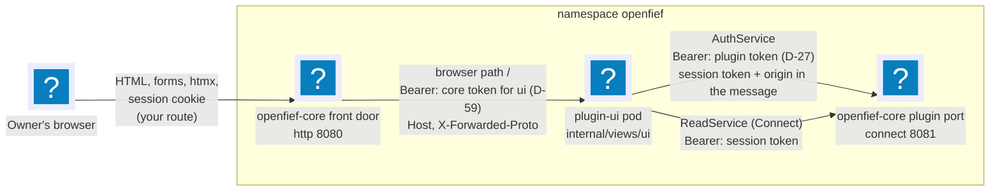
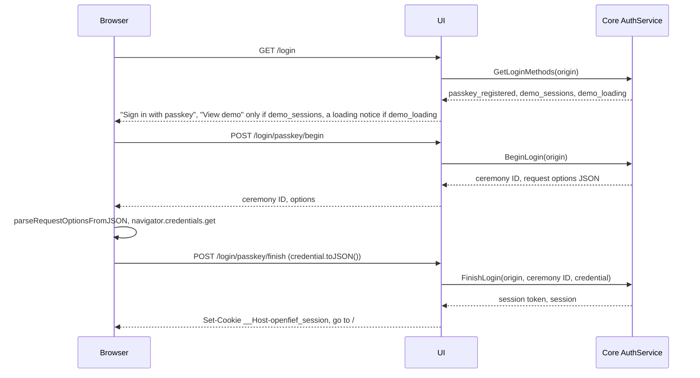

The built-in UI is OpenFief's default [view](../glossary.md) (D-3): a small website for the [owner](../glossary.md) that shows the record. It is a [plugin](../glossary.md) like any other, in its own pod, with the `view` capability and no egress host. It renders HTML on the server and reads the record only through the public [read API](../glossary.md) (D-6), the same API the owner's scripts use. This page explains how the browser, the UI and the core talk, how the owner signs in, what each page shows, and what is still missing.

## Concepts

**Backend for frontend.** The browser's application is the UI, and the UI talks to the core. This split, called backend for frontend (Sam Newman, 2015), keeps every credential out of the browser's reach: the UI holds the plugin's own token, and the owner's session token sits in a cookie that no script can read. The browser never calls the core's services itself, so the core's API needs no browser-facing CORS rules.

**The core is the front door.** Browsers reach the UI only through the core (D-81): the core is the only entry point for browsers, and it reverse-proxies every path the UI serves to the UI's pod, presenting its own token for that instance as it does to any plugin (D-59). So whatever route the owner adds, or a port-forward, reaches the core alone (D-28), and the UI, like every plugin, admits the core and nothing else. A reverse proxy is a server that forwards a client's request to another server and passes the answer back, so the client sees one origin. The UI's manifest declares the path prefix it serves, its [browser path](../glossary.md) `/`, and its grant approves it; `/` means every path the core doesn't serve itself.

**Two tokens, two jobs.** The UI presents two different tokens to the core:

- To the core's `openfief.identity.v1.AuthService` ([auth.proto](../../proto/openfief/identity/v1/auth.proto)), `openfief.portfolio.v1.ModelPortfolioService` ([model.proto](../../proto/openfief/portfolio/v1/model.proto)), `openfief.portfolio.v1.SleeveService` ([sleeves.proto](../../proto/openfief/portfolio/v1/sleeves.proto)), `openfief.ingest.v1.BondLotService` ([bond_lots.proto](../../proto/openfief/ingest/v1/bond_lots.proto)), `openfief.ingest.v1.StatementService` ([statements.proto](../../proto/openfief/ingest/v1/statements.proto)), `openfief.ingest.v1.AccountService` ([accounts.proto](../../proto/openfief/ingest/v1/accounts.proto)), `openfief.ingest.v1.TickerService` ([tickers.proto](../../proto/openfief/ingest/v1/tickers.proto)), `openfief.ingest.v1.SyncService` ([syncs.proto](../../proto/openfief/ingest/v1/syncs.proto)) and `openfief.valuation.v1.PriceCheckService` ([price_checks.proto](../../proto/openfief/valuation/v1/price_checks.proto)), its own projected ServiceAccount token with audience `openfief-core` (D-27), in the `Authorization` header. That proves the caller is a view plugin. The owner's session token travels in the request message (for a statement upload, in the stream's first message), with the browser's origin.
- To the read API, the owner's session token as the bearer token, like a [script token](../glossary.md). The plugin's token never reaches the read API, and the session token never goes into an `Authorization` header to the AuthService.

Projected tokens rotate, so the UI reads its token from the file the operator mounts (`OPENFIEF_TOKEN_FILE`) on every call, through the Go SDK's `CoreHTTPClient` and `TokenFile`.

**Sessions and scopes.** The core issues a session after an authenticator proves who is at the browser: a passkey (WebAuthn, D-26) gives an `owner` session; the demo authenticator gives a `read` session, without credentials, only on a demo database with the core's `--demo-sessions` flag. A `read` session sees the record; only an `owner` session manages passkeys, script tokens, enrollment links and the model portfolio, adds bond lots and uploads statements. The UI hides the owner's actions from a `read` session, but the core enforces the scope either way.

**Passkeys and the relying party.** WebAuthn binds a passkey to a relying party ID, the host name it was made on (W3C Web Authentication, Level 1 in 2019; Level 3 added JSON helpers). So a passkey made on `localhost` doesn't work on `demo.openfief.dev`, and D-60 makes the owner create one per host: the first through a one-time link on `localhost` over `kubectl port-forward`, later ones through a link that a signed-in session issues. The UI passes the WebAuthn options and credentials through untouched, in the Level 3 JSON forms, so the browser parses and serializes them with `PublicKeyCredential.parseRequestOptionsFromJSON`, `parseCreationOptionsFromJSON` and `toJSON()` and the UI ships no WebAuthn library.

**Server-rendered pages with htmx.** Pages are Go `html/template` output. [htmx](../glossary.md) swaps parts of a page in place: the allocation's dimension switch, the overview's chart card, the Ask box's answers and the "More transactions" button. Every htmx link is also a plain link, so the pages work without JavaScript, except passkeys and charts.

## How it works

The code is in [`internal/views/ui`](../../internal/views/ui/doc.go); [`plugins/ui`](../../plugins/ui/main.go) only wires it to the plugin's environment: the core's address (`OPENFIEF_CORE_ADDRESS`), the listen port (`OPENFIEF_LISTEN_PORT`) and the token file. There is no way to run it without a projected token, and no fixed token the core would accept instead (D-84): the UI is developed against a local cluster such as kind or k3d.

### The front door

`cmd/core` puts its front door, `withFrontDoor`, before what its browser port serves, the `http` port a route points at (D-115). A path the core serves itself goes to the core (`plugins.CoreServesPath`: `/healthz`, `/readyz`, `/v1` and below it, and every path whose first segment starts with `openfief.`, its Connect services). On this port that is the read API alone: the services only plugins call, the `AuthService` and the owner services, are on the plugin port, `connect`, and answer 404 here. Every other path goes to [`browserproxy`](../../internal/views/browserproxy/proxy.go), which asks [`app.FrontDoor`](../../internal/views/app/browser.go) where it goes:

- **Routes.** [`kube.Browser`](../../internal/views/kube/browser.go) watches the `Plugin` resources and the plugins' Services. A plugin serves browsers when it is not being deleted, its `Ready` condition is `True`, `view` is among its effective capabilities and its status holds an effective browser path, the one its manifest declares and its grant approves. At most one instance holds a browser path (D-114): the `openfief` CLI and the operator refuse a second ([Plugins](plugins.md), [Operator](operator.md)), because the core passes the browser's cookies, the owner's session among them, to the view. `views.RouteBrowserPath` ([browser.go](../../internal/views/browser.go)) sends a path to that one view when its prefix covers the path, whole segments only; should the core ever read more than one, it serves none rather than pick one.
- **The call.** The proxy sends the request to the instance's Service ClusterIP and `connect` port with the core's TokenRequest token for that instance (`identity/kube.CoreTokens`, the same as for connectors) in `Authorization`, replacing whatever the browser sent there. It keeps the browser's `Host`, sets `X-Forwarded-Proto` to the scheme the browser used (`https` on TLS or when the owner's Ingress in front says so, otherwise `http`) and `X-Forwarded-Host` to the `Host`, and drops every other `X-Forwarded-*` and `Forwarded` header a client sent. Bodies, uploads included, stream through.
- **Answers.** A path no plugin serves is 404. While the core hasn't read its cluster yet, or more than one view holds a browser path, 503. A plugin without an address, a token or an answer, 502. Outside a cluster there is nothing to proxy, and the read API answers such paths with 404.

The UI checks every request with the SDK's `RequireCore` and `NewCoreVerifier` (`requireCore` in [plugins/ui](../../plugins/ui/main.go)): a request without the core's token for the instance `ui` gets 401 before any page runs, so the `Host` and `X-Forwarded-Proto` it reads come from the core, which sets them. Only `GET /healthz` answers without the token, for probes; it shows nothing.

| File | What it holds |
|---|---|
| [server.go](../../internal/views/ui/server.go) | `New` and `Config`, the routes, the security headers and the same-origin check |
| [session.go](../../internal/views/ui/session.go) | The browser's origin, the session cookie, `withSession` and `withOwner`, and how a failed call to the core becomes a page |
| [auth.go](../../internal/views/ui/auth.go) | The login page, the passkey login and registration relays, "View demo" and logout |
| [settings.go](../../internal/views/ui/settings.go) | Passkeys, script tokens and enrollment links |
| [ownersettings.go](../../internal/views/ui/ownersettings.go) | The number format and the marginal PIT rate on the settings page, read from and handed to the core's `SettingsService` (D-78, D-113) |
| [taxes.go](../../internal/views/ui/taxes.go) | This year's yearly taxes on the settings page and the form that classifies an instrument for them (D-127, D-132) |
| [values.go](../../internal/views/ui/values.go), [valuechart.go](../../internal/views/ui/valuechart.go) | The three values (D-77): the value switches, missing reasons, tax wrappers and fee rules as words, the request's number format, and the value-over-time chart in money (D-106) |
| [setup.go](../../internal/views/ui/setup.go), [sleeves.go](../../internal/views/ui/sleeves.go), [accounts.go](../../internal/views/ui/accounts.go) | The first-run wizard (D-73) and the Sleeves and Accounts pages (D-71, D-72): their forms, handed to the core's `SleeveService` and `AccountService`; the forms live in [onboarding.html](../../internal/views/ui/web/templates/fragments/onboarding.html) |
| [plugins.go](../../internal/views/ui/plugins.go) | The installed plugins with their signature trust, on their own page and the settings page (D-46, D-56) |
| [model.go](../../internal/views/ui/model.go) | The model portfolio's form on the settings page, read from and handed to the core's `ModelPortfolioService` (D-52) |
| [marketdata.go](../../internal/views/ui/marketdata.go) | The ranking of market-data sources, the gap thresholds and each series' source on the settings page, read from and handed to the core's `MarketDataService` (D-94) |
| [overview.go](../../internal/views/ui/overview.go), [home.go](../../internal/views/ui/home.go), [overtime.go](../../internal/views/ui/overtime.go), [performance.go](../../internal/views/ui/performance.go) | The overview (D-193): its status sentence, the value card, the chart card's tabs, Needs you, the accounts by sleeve, the allocation's bars and Recent activity; the performance chart: the time-weighted return, the model portfolio's backtest and its drawdowns |
| [ask.go](../../internal/views/ui/ask.go), [askmatch.go](../../internal/views/ui/askmatch.go), [askanswer.go](../../internal/views/ui/askanswer.go), [ask.js](../../internal/views/ui/web/static/ask.js), [ask.html](../../internal/views/ui/web/templates/fragments/ask.html) | The Ask box (D-194): its commands, parsed and matched by pure functions, the answer cards built from the read API, the suggestion chips, the Inbox's side column, and "/" to focus it |
| [account.go](../../internal/views/ui/account.go), [accounttabs.go](../../internal/views/ui/accounttabs.go) | An account's page (D-195, D-196): its breadcrumb, pills and actions, the banner of its own open attention items, its figure cards and its six tabs, each a link and an htmx swap, and its transactions' pages |
| [instrument.go](../../internal/views/ui/instrument.go) | An instrument's page (D-195, D-197): its name, tickers and ISIN, its price history by source, its holdings and lots across accounts, its transactions, its price checks with the owner's forms returning to it, its yearly tax class, and the owner's rename handed to the core's `InstrumentService` |
| [holdings.go](../../internal/views/ui/holdings.go) | The holdings behind an allocation bar of an asset class or a currency (D-195) |
| [transfers.go](../../internal/views/ui/transfers.go) | The owner's decisions on transfers (D-105), handed to the core's `TransferService` from the Inbox, and the overview's count of suggestions |
| [attention.go](../../internal/views/ui/attention.go) | How the Inbox names each kind of [attention item](../glossary.md) and where it links one not settled in place, the owner's acknowledgements and resolutions handed to the core's `AttentionService`, and the open count for the navigation |
| [pricechecks.go](../../internal/views/ui/pricechecks.go) | Price checks grouped by instrument, the latest with its history (D-112), the owner's acknowledgements and per-instrument thresholds (D-110), and the overview's count of open ones |
| [bondlots.go](../../internal/views/ui/bondlots.go) | The "Add bond lot" form and each lot's *Delete* button on a bond account's page, handed to the core's `BondLotService` (D-9, D-49, D-100) |
| [statements.go](../../internal/views/ui/statements.go) | The "Upload statement" form on the page of an account whose connector takes files (D-109): the multipart body streamed to the core's `StatementService` (D-7, D-49) |
| [tickers.go](../../internal/views/ui/tickers.go) | The statement upload's route, and the owner's ISIN confirmations from the Inbox (D-116, D-170), handed to the core's `TickerService` |
| [inbox.go](../../internal/views/ui/inbox.go) | The Inbox (D-192, D-196): attention items by view and group with their evidence and in-place forms, the transfers to decide, the owner's "Retry now" handed to the core's `SyncService`, the removed check pages' redirects, and an account's own items for its banner |
| [pwa.go](../../internal/views/ui/pwa.go), [sw.js](../../internal/views/ui/web/pwa/sw.js), [layout.js](../../internal/views/ui/web/static/layout.js) | The installable app: the web app manifest, the service worker with its list of static files, and the offline page; the layout's script for the phone menu, the tables' cards and the worker's registration |
| [format.go](../../internal/views/ui/format.go) | The number format (D-113), amounts, shares and labels for the templates |
| [templates.go](../../internal/views/ui/templates.go), [web/](../../internal/views/ui/web/templates/layout.html) | The embedded templates and static files; [design.html](../../internal/views/ui/web/templates/fragments/design.html) holds the design system's parts: the Gate, Kasztan, the valuation status and trust badge pills |

### Signing in

- **The origin.** The UI tells the core the origin the browser uses: the scheme the core's front door reports in `X-Forwarded-Proto`, then the `Host` the core passed on. The core checks it against its allow-list (`OPENFIEF_AUTH_ORIGINS`), and its host is the relying party ID.
- **The cookie.** `__Host-openfief_session`: `HttpOnly`, `Secure`, `SameSite=Strict`, `Path=/`, expiring when the session does. The `__Host-` prefix makes the browser refuse it from any other host and with any `Domain`. Browsers treat `http://localhost` as a secure context and keep `Secure` cookies there, so the same cookie works through `kubectl port-forward`, and D-85 keeps the prefix everywhere, `localhost` included. Chromium keeps it there, which the end-to-end suite checks; Safari's acceptance of it on `http://localhost` is still to verify, by hand, since no Safari runs in the suite. Only if Safari refuses it does D-85 allow a cookie without the prefix, on `localhost` alone, and that fallback is not built. On plain HTTP to any other host the browser drops the cookie, and the login page says sign-in needs HTTPS.
- **"View demo"** posts to `/login/demo`, which calls `CreateDemoSession` and stores the `read` session the same way. On a demo whose data is still loading (`demo_loading`: demo sessions on, no demo marker yet), the page shows "Demo data is loading" with a *Refresh* button in its place, so a visitor waits for the demo instead of signing in to an empty install.
- **Enrollment.** An enrollment link is `<origin>/enroll#code=<code>`. The code is in the fragment, which the browser never sends, so it never reaches a request line, a log or a `Referer`. The page's script, [webauthn.js](../../internal/views/ui/web/static/webauthn.js), reads it, removes it from the address bar and history, and posts it to `/enroll/begin`; the UI hands it to `BeginRegistration`. Registering from an enrollment code also signs the owner in. "Add a passkey on this host" on the settings page runs the same ceremony with the owner's session instead of a code.
- **Every page** first asks the core `WhoAmI` with the cookie's session. No cookie, or a session the core no longer knows (`UNAUTHENTICATED`), drops the cookie and sends the browser to `/login`; an htmx request gets `HX-Redirect` instead. A read-scoped session gets 403 on the owner's pages before the UI calls the core.
- **Logout** revokes the session with `Logout` and drops the cookie, also when the core can't be reached. Dropping the cookie, on sign-out and whenever the core rejects the session, also answers with `Clear-Site-Data: "storage"`, so the browser deletes what the origin keeps, the service worker and its cache among it (D-151). htmx's history cache is off (`historyCacheSize` 0, with `refreshOnHistoryMiss`), so no snapshot of a page that was pushed into the history stays in `sessionStorage`. *Sign out everywhere* on the settings page posts to `/logout` too, with `everywhere=yes`, so the service worker empties its cache the same way; the UI calls `SignOutEverywhere`, which revokes every session (D-183), and drops the cookie. Unlike a plain sign-out, a refusal or an outage is shown and the cookie kept, so the owner never believes the other sessions ended when they didn't.
- **Confirm with your passkey** (D-183). When the core refuses an action for want of a recent [passkey check](../glossary.md), with `FAILED_PRECONDITION` and the `PasskeyCheckRequired` detail, the settings page shows *Confirm with your passkey* above everything, with a form that holds the refused action's path and fields: creating a script token, issuing an enrollment link or removing a passkey. Its button runs the check in [webauthn.js](../../internal/views/ui/web/static/webauthn.js), through `/passkey-check/begin` and `/passkey-check/finish` (`BeginPasskeyCheck`, `FinishPasskeyCheck`), then posts the form again. "Add a passkey on this host" gets `passkeyCheck: true` from `/enroll/begin`, runs the check and begins again, so the owner sees the passkey prompt twice. Removing the passkey that signed this session in signs the browser out.

### Browser security

- **Security headers through the core.** The core adds its own to every answer it proxies from a view plugin, and to its own refusals there (D-184, `browserproxy.SecurityHeaders`): a second `Content-Security-Policy`, `default-src 'self'; object-src 'none'; base-uri 'self'; form-action 'self'; frame-ancestors 'none'`, next to the view's, `X-Frame-Options: DENY`, `X-Content-Type-Options: nosniff` and `Referrer-Policy: no-referrer`, replacing whatever the view said about those three. A browser enforces every policy an answer carries, so the UI's own stricter policy below stays in force whole, and a third-party view without one, or with a looser one, is held to the core's.
- **Content Security Policy.** Every response carries `default-src 'none'; script-src 'self'; style-src 'self'; font-src 'self'; img-src 'self'; connect-src 'self'; manifest-src 'self'; form-action 'self'; frame-ancestors 'none'; base-uri 'none'`. Nothing is inline: scripts and the stylesheet are files the UI serves, chart data travels in `data-chart` attributes, and htmx runs with `allowEval`, `allowScriptTags` and its injected indicator styles off. A test checks every template for inline scripts, styles and handlers.
- **CSRF.** Every request that isn't `GET`, `HEAD` or `OPTIONS`, a multipart upload too, must come from the UI's own origin: `Sec-Fetch-Site: same-origin` when the browser sends that header, otherwise an `Origin` equal to the UI's origin. A request with neither is refused with 403 before any handler runs. `SameSite=Strict` on the cookie is a second line.
- **Other headers.** `X-Content-Type-Options: nosniff`, `X-Frame-Options: DENY`, `Referrer-Policy: no-referrer`, `Cross-Origin-Opener-Policy` and `Cross-Origin-Resource-Policy: same-origin`, a `Permissions-Policy` that allows passkeys for the UI only, `Strict-Transport-Security` on HTTPS, and `Cache-Control: no-store` on pages, which hold the owner's record.
- **Vendored libraries.** htmx 2.0.11 (0BSD, 52 kB) and Chart.js 4.5.1 (MIT, 209 kB, its license header kept) are copied byte for byte from their npm releases into `web/static/vendor` and served by the UI; a test pins their SHA-256. Chart.js was chosen over uPlot because it draws both charts, the allocation's bars and the value line, with tooltips and no extra stylesheet.

### The look

The pages follow the [design system](../dev/design-system.md) and take every color, font, size and radius from its [`tokens.css`](../../design/tokens.css). The UI serves the design system's files itself, from the Go package [`design`](../../design/design.go) that embeds them, under `/static/design/`: the tokens, the self-hosted fonts, the favicon and Kasztan's poses. Nothing comes from another host, and nothing is copied out of `design/`. Every page loads the fonts, then the tokens, then the UI's own [`style.css`](../../internal/views/ui/web/static/style.css), which uses only semantic tokens, so dark mode follows the reader's system setting (or `data-theme` on `<html>`) without a line of its own.

- **Components.** One primary button per view, secondary outlined buttons, a quiet underlined "Sign out" and destructive red "Remove" and "Revoke"; status pills that always carry a word; tables with a sunken header row and monospace, right-aligned figures that always show their currency (D-20), each row a card on a phone (below); a label above every field, help text under it and the unit inside amount fields.
- **Pills.** An account's valuation status (D-36) is a pill with the date it is *valued through* in monospace, and a *Revaluation pending* or *running* pill with a gold dot. A plugin's trust is one of D-87's four badges with the exact signer under it (see the installed plugins below).
- **Kasztan**, at most once per screen: on duty on the sign-in and enrollment pages; asleep in empty states (no accounts, no flagged balance assertions or price checks, no plugins); with the seal when a statement was imported; at the drawbridge on the error page and over flagged balance assertions, which need the owner.
- **Charts.** The series are vert, then or, kasztan, a grey and the vert tint (D-30's order in the design system): on the value chart the gross, net and liquidation lines in that order, on the performance chart the time-weighted return first and the model portfolio's backtest second; each allocation bar takes the next color. [app.js](../../internal/views/ui/web/static/app.js) reads the colors and fonts from the page's CSS custom properties when it draws, and redraws when the reader's color scheme changes.

### On a phone and as an app

The pages are laid out for a phone first and widen from there; at 360 px and up no page scrolls sideways.

- **The menu.** Below 640 px the navigation and the session's scope and "Sign out" fold behind a *Menu* button in the top bar, which opens them as a full-width list. The button is a plain `<button>` with `aria-expanded`; [layout.js](../../internal/views/ui/web/static/layout.js) toggles it, and Escape closes it.
- **Tables become cards.** Below 640 px each table row is a card, one line per cell: the column's header on the left, the value on the right. Amounts stay monospaced, right-aligned and with their currency (D-20). `layout.js` labels each cell with its column's header (`data-label`, shown by the stylesheet) and gives the table ARIA table roles, since a table laid out as blocks loses its meaning for some screen readers; it does the same for every table an htmx swap brings in.
- **Long identifiers wrap.** Monospaced figures don't break, but a signer's identity, such as a keyless signer's workflow URL with its issuer, can be longer than a phone is wide, so it wraps anywhere (`.mono.ident` in [style.css](../../internal/views/ui/web/static/style.css)) instead of pushing the page sideways; nothing is cut off.
- **Without JavaScript** the navigation stays open in the bar and wide tables scroll inside their own box, as before. `layout.js` loads in `<head>` without `defer`, so the page is marked as scripted before it first paints and the menu doesn't flash open.
- **Charts** take the width of their card and are shorter on a phone; Chart.js redraws them when the window changes size. **Forms** are one column, every field and button at least 44 px tall, and a form's buttons share the row. The top bar and the page keep clear of a phone's notch and rounded corners (`viewport-fit=cover` and the safe-area insets).

The UI is also an app the owner can install, a progressive web app:

- **The manifest**, [`/manifest.webmanifest`](../../internal/views/ui/pwa.go), names OpenFief, opens `/` in its own window (`display: standalone`, scope `/`), and takes its colors from [`tokens.css`](../../design/tokens.css) when the UI starts, so no color is written outside the tokens: the top bar's ground as the theme color and the page's ground behind the splash screen. Every page also sets `theme-color` for light and dark from the same tokens. The icons are the Seal, the design system's app icon, at 192 and 512 px, a maskable 512 px one and Apple's 180 px touch icon, generated by `task design:icons` ([Design system](../dev/design-system.md)). The CSP admits the UI's own manifest only (`manifest-src 'self'`); the service worker is a script, which `script-src 'self'` already covers.
- **The service worker**, `/sw.js`, is served at the root so its scope covers every page. The UI writes its configuration at the top of [sw.js](../../internal/views/ui/web/pwa/sw.js) when it starts: the exact list of files it may cache (every style, script, font, mark, icon and Kasztan pose under `/static/`, the manifest and the offline page) and a version, a hash of all of them, which names its one cache.
  - It **caches**: those files only, when it installs and again after a sign-in (`POST /login/passkey/finish`, `/login/demo`, `/enroll/finish`), and serves them from the cache. A listed file missing from the cache comes from the network and is not stored.
  - It **never caches** a page, an htmx fragment, a form's answer, the read API or anything else: those hold the owner's record and keep `Cache-Control: no-store`. A page always comes from the network; every other request passes through untouched.
  - **Offline**, a page the owner opens shows the static offline page, `/static/offline.html`: Kasztan asleep and one sentence, no data. The UI renders it once from the layout when it starts, with no session.
  - On **sign-out** (`POST /logout`) it empties its cache; a **new version**, any static file changed, installs a new worker, which drops the old cache when it takes over. The worker script and the manifest are `no-store`, so the browser sees a new version on the next page load.
- **Passkeys in the app.** The installed app is the same origin as the tab, so the relying party ID, the passkeys and the `__Host-` cookie are the same, and WebAuthn works in a standalone window in Chrome, Edge and Safari. Launching the app is a navigation the owner started, so the `SameSite=Strict` cookie goes with it. The limits: on iOS and iPadOS an app on the home screen keeps its own cookies apart from Safari, so the owner signs in once more inside the app (with the same passkey, synced by iCloud Keychain); an enrollment link opened from another app opens in the browser, not in the installed app, so a first passkey is made there; and a link into the UI from another site arrives without the `SameSite=Strict` cookie, as in a tab, and shows the sign-in page.

### Pages

| Path | Shows | Read API calls |
|---|---|---|
| `/?q=&over=&chart=&by=&value=&date=&start=` | The overview (D-193), described below: the status sentence and the Ask box, with the answer to `q` when given; the value card; the chart card; Needs you; Recent activity; the accounts by sleeve with the three values per account behind a disclosure; the allocation's bars | `ListAccounts`, `ListValuationStatuses`, `ListSleeves`, `ListConnectorBindings`, `ListAttentionItems`, `ListSyncStatuses`, `ListActivity`, `GetAllocation`, `ListValuationTotals`, `GetPerformance`, `GetModelPortfolio`, `ListTransfers`, `ListPriceChecks`, per account `ListAccountValuations` and `ListAssertionChecks`; and the answer's. The chart card's tabs are `over=performance`, `over=allocation` (with `by` and `value`) and `chart=all` |
| `/ask?q=` | The Ask box's answer to `q` as an htmx fragment, the question and its answer card; without htmx, a redirect to the overview with the answer. Read only: nothing it calls changes anything | as the command needs (below) |
| `/over-time?over=&chart=&date=&start=` | The overview's chart card showing one tab, as an htmx fragment; without htmx, a redirect to the overview | `GetPerformance`, `GetModelPortfolio`, `ListTransfers`, `ListValuationTotals` |
| `/allocation?by=&value=&date=` | The allocation for one dimension and value, as an htmx fragment | `GetAllocation` |
| `/value-chart?chart=&from=&date=` | The value-over-time chart of one value, or all three, as an htmx fragment | `ListValuationTotals` |
| `/accounts/{id}?tab=&date=&start=` | A breadcrumb (Overview / Accounts / the account), the name with its sleeve, tax wrapper, sync and valuation pills, and, for the owner, *Upload statement* where the account takes files and *Enter cash balance*, a link to the Cash tab's form (D-158); a banner of the account's own open attention items, each linked to its place in the Inbox, a broken transfer's on both legs' accounts (D-196); four figure cards: gross with cash, net, liquidation, and the time-weighted return since the charts' start with the day it is valued through; then six tabs, each a link with `tab=` and an htmx swap: *Holdings* (the default; each holding with its three values and basis, marked *no longer updated* behind a removed instance (D-91) and linked to its instrument's page, the total with cash and its losses offset in a disclosure, and *Over time*, the account's values and its own time-weighted return from the charts' start it takes as `start`, by default its first day (D-138), with transfers counted as its cash flows), *Transactions* (50 at a time with the connector instance each came from, marked when that instance is removed, D-58), *Lots* (open lots, and on a bond account the owner's lot forms), *Cash* (per currency, then the owner's [cash checkpoints](../glossary.md) with their differences, a *Book as a deposit* or *Book as a withdrawal* button on each that differs and, for the owner, the form for a new one), *Reconciliation* (balance assertion checks, the cash checkpoints marked) and *Account settings* (institution, sleeve, wrapper, fee rule and connector instances, changed on the Accounts page); the upload form under the tabs | `GetAccount`, `ListAttentionItems` (with `account_id`), `GetValuationStatus`, `GetPerformance` (with `account_id`), `ListAccountValuations`, `ListSleeves`, `ListConnectorBindings`, `ListSyncStatuses`, and the tab's: `ListHoldings`, `ListTransactions`, `ListLots`, `ListCash` with `ListAssertionChecks`, or `ListAssertionChecks` |
| `/accounts/{id}/tab?tab=` | The account's tabs showing one, as an htmx fragment; without htmx, the whole page on that tab | as `/accounts/{id}` |
| `/instruments/{isin}?account=&date=` | An instrument's page (D-195): a breadcrumb, through the account it was opened from when `account` names one; its display name (D-197), then its tickers and ISIN and its asset class; a banner of its open attention items; each listing's latest price and the source it is valued at; each listing's closing prices over the last year as a line per source, the primary one first and marked; its holdings and open lots across the accounts the caller may view; its transactions with their accounts, 50 at a time; its price checks, the latest with its history, with the owner's acknowledgement and threshold forms, which return to the page; its class in each yearly tax (OKI); and, for the owner, the rename form | `GetInstrument`, `ListValuationStatuses`, `ListAttentionItems` (with `isin`), `ListAccounts`, `ListInstrumentPrices`, `ListInstrumentHoldings`, `ListInstrumentTransactions`, `ListPriceChecks` (with `isin`) |
| `/instruments/{isin}/transactions?page_token=` | The instrument's next page of transactions, as an htmx fragment; without htmx, a redirect to its page at that page | `ListInstrumentTransactions`, `ListAccounts` |
| `POST /instruments/{isin}/name` | Hands the owner's display name for the instrument, trimmed, to the core, then back to its page saying it is saved; an empty name or one over 200 characters is refused with 400 before the core is called, and the core's refusal, such as a control character, shows on the page with the name as posted. Owner scope only | `RenameInstrument` (InstrumentService) |
| `/holdings?by=&key=&date=` | The holdings behind an allocation bar of an asset class or a currency (D-195): every valued holding in the group with its account, its three values and a link to its instrument's page, and the group's cash per account; any other dimension is 400 | `ListAccounts`, per account `ListAccountValuations` and `ListCash`, `GetInstrument` per instrument for its asset class |
| `POST /accounts/{id}/bond-lots` | Hands the posted [bond lot](../glossary.md) to the core's `BondLotService`, then back to the account's open lots. Owner scope only | `AddBondLot` (BondLotService) |
| `POST /accounts/{id}/bond-lots/delete` | Hands the series and purchase date of the lot whose *Delete* button was pressed to the core, which deletes it as a correction, then back to the account's open lots. Owner scope only | `DeleteBondLot` (BondLotService) |
| `POST /accounts/{id}/cash-checkpoints` | Hands the posted date, amount and currency to the core's `CashCheckpointService`, then back to the account's Cash tab at its cash checkpoints (D-158); a refusal shows the Cash tab again with the core's reason and the form as posted. Owner scope only | `RecordCashCheckpoint` (CashCheckpointService) |
| `POST /accounts/{id}/cash-checkpoints/book` | Hands the date and currency of the checkpoint whose *Book as a deposit* or *Book as a withdrawal* button was pressed to the core, which books the difference, then back to the account's cash checkpoints. Owner scope only | `BookCashDifference` (CashCheckpointService) |
| `POST /accounts/{id}/statements` | Streams the posted [statement](../glossary.md) file to the core's `StatementService`, then shows the account's page with the import's mode, counts, the accounts it booked, the unmapped [broker accounts](../glossary.md) and [ingest problems](../glossary.md), and, when rows wait for their [tickers'](../glossary.md) ISINs, how many with a link to the Inbox. Owner scope only | `UploadStatement` (StatementService), then as `/accounts/{id}` |
| `/inbox?view=` | The Inbox (D-192, D-196), everything that needs the owner in one place: a segmented filter of the views, `open` (the default), `acknowledged` and `done`, each with its count, then a card per group, *Data coming in*, *Numbers to check* and *Decisions*, each with its count. An item is a title, its detail with links to each account it is tied to (both of a broken transfer's) and to the page where a kind not settled here is settled, a status pill (*Needs you*, *Failing*, *Acknowledged*, *Done*), its evidence, the form that settles it in place and its history. Settled in place: a ticker's ISIN with D-170's trading-currency select; a flagged price check's two prices side by side with its history and threshold, acknowledged with the check itself; a broken transfer's legs, rejected; an unmapped broker account mapped to an account; a failing sync's timeline, its latest ten attempts with their error classes and next try, and *Retry now*; a flagged balance assertion's reported and derived balances; any open item acknowledged, and those the core lets the owner resolve resolved. A suggested transfer is an item of its own, `transfer-suggested` (D-105, D-130), among the decisions: its legs with their accounts, dates and amount, *Confirm* and *Not a transfer* for the owner, *Waiting for the owner* for a read session; once the pair is decided, the core's next sweep clears it. The done view adds the transfers already decided, to correct, and every instrument's price checks with their history and threshold forms, so nothing the removed pages showed is lost. Any session; acting owner scope only | `ListAttentionItems` (with `view`), and as the items need them `ListPendingTickers` (TickerService, owner only), `ListPriceChecks`, `ListTransfers`, `ListSyncAttempts`, `ListAssertionChecks`, `ListBrokerAccounts` (AccountService, owner only) and `ListAccounts` |
| `POST /inbox/acknowledge`, `/inbox/resolve` | Hands the owner's acknowledgement or resolution of the posted item to the core, then back to the Inbox; the core's refusal shows in it. Owner scope only | `AcknowledgeAttentionItem`, `ResolveAttentionItem` (AttentionService) |
| `POST /inbox/tickers/confirm` | Hands the owner's ISIN for one ticker, trimmed and in upper case, with the trading currency picked, if any, to the core, which books the rows waiting for it, then back to the Inbox saying how many; the core's refusal, such as a wrong check digit or a missing trading currency with its choices, shows in the Inbox, and an ISIN longer than 12 characters or a currency longer than 3 is refused before the core is called. Owner scope only | `ConfirmTicker` (TickerService) |
| `POST /inbox/transfers/confirm`, `/inbox/transfers/reject` | Hands the owner's decision on the posted pair to the core, then back to the Inbox in the view the form came from; a refusal, such as a deposit another confirmed transfer took, shows in it. Owner scope only | `ConfirmTransfer`, `RejectTransfer` (TransferService) |
| `POST /inbox/price-checks/acknowledge`, `/inbox/price-checks/threshold` | Acknowledges a flagged check (D-112), or sets an instrument's threshold from a percent, an empty field putting it back on 1% (D-110), then back to the Inbox. Owner scope only | `AcknowledgePriceCheck`, `SetPriceCheckThreshold` (PriceCheckService) |
| `POST /inbox/retry-sync` | Hands the owner's *Retry now* on a failing sync to the core, which starts one sync of the instance at once, then back to the Inbox saying it started; a refusal, such as a sync that runs now or a retry within the minute, shows in it. Owner scope only | `RetrySync` (SyncService) |
| `/attention`, `/tickers`, `/assertions`, `/price-checks`, `/transfers` | Redirect to `/inbox` for good (301), with or without a session: D-192 gives no check a page of its own | none |
| `/setup?step=` | The first-run wizard (D-73), in three steps: `sleeves`, the sleeves and kinds with their forms; `accounts`, the account forms; `done`, where to go next. An owner session on an install with no account is sent here from `/`. A demo, whose core runs with demo sessions on, has no wizard (D-191): every step redirects to `/`. Owner scope only | as `/sleeves`, `/accounts` |
| `/sleeves` | Sleeves with their kind and role, marked when the role differs from the kind's, and the kinds with their default roles; the owner's forms add a sleeve (`POST /sleeves`), change one (`POST /sleeves/{id}`), add a kind (`POST /sleeve-kinds`), rename one (`POST /sleeve-kinds/{key}`), and delete a sleeve (`POST /sleeves/{id}/delete`) or a kind (`POST /sleeve-kinds/{key}/delete`), which the core refuses while a sleeve has accounts or a kind has sleeves (D-120). Any session | `ListSleeves`, `ListSleeveKinds`; SleeveService |
| `/accounts` | For the owner, unmapped broker accounts first; then the accounts with the connector instances bound to each; and, for the owner, every broker account with the account it is booked in, from the AccountService's `ListBrokerAccounts`, so a read session never sees an account number (D-121); the owner's forms create an account (`POST /accounts`), for an unmapped broker account too, change one (`POST /accounts/{id}/edit`), each with its tax wrapper and sale fee rule, bind a connector or map a broker account to an account (`POST /accounts/bind`), delete an account (`POST /accounts/{id}/delete`) and remap a mapped broker account to another account or none (`POST /broker-accounts/remap`), which the core refuses while the account holds transactions, from that broker account's instance for a remap (D-120). Any session | `ListAccounts`, `ListSleeves`, `ListConnectorBindings`, `ListPlugins`; AccountService (`ListBrokerAccounts` too) |
| `/plugins` | The installed plugins: each instance's capabilities, whether it is a market-data connector that learns what the owner holds (D-123), the institutions a connector books for and those its grant doesn't approve yet (D-182, D-185), whether the bond terms and index levels (D-179) and index readings (D-186) it delivers are stored or dropped, trust badge with its signature trust and signer, status and image digest. Any session | `ListPlugins` |
| `/settings` | Passkeys (remove), script tokens (create, shown once; revoke), "Add a passkey on this host", enrollment links for another host, each asking to confirm with a passkey when the session's last check is over five minutes old (D-183), *Sign out everywhere*, the installed plugins as on `/plugins`, the model portfolio: on or off, and its targets (`POST /settings/model`), the ranking of market-data sources (`POST /settings/market-data`), each kind's gap threshold (`POST /settings/market-data/gap`) and each series' source (`POST /settings/market-data/series`), the number format (`POST /settings/number-format`), the marginal PIT rate (`POST /settings/marginal-rate`), this year's yearly taxes and the instruments to classify for them (`POST /settings/exemption-class`). Owner scope only | AuthService, ModelPortfolioService, MarketDataService, SettingsService, `ListPlugins` |

- **The date.** A page shows the date in its `date` parameter, otherwise the latest date any account is valued through, otherwise today.
- **The overview** (D-193) is one column of cards on a phone and a 12-column grid from 960 px. It opens with one sentence of status in the display face: the day everything is valued through, how many items need the owner, and each connector instance whose sync keeps failing (`statusLine`), with links to the Inbox's counts. Then the Ask box (below). The value card, on the brand's vert, shows the total's gross value large, linking to the accounts (D-195), its change since the last valued day before this month with the change in percent, and the time-weighted return since the end of last year (both read in `hero`: `ListValuationTotals` and `GetPerformance` from two weeks before the month and the year), then net and liquidation. The value card's change line says, in its tooltip and the note under it, that both figures are measured from the last valued day before the period, as a previous close. One chart card switches between *Value* (the value-over-time chart with its own switch of the three values), *Performance* (the time-weighted return and, while it is on, the model portfolio), *Allocation* (the allocation's bars with their switches, below) and *Gross · net · liquidation* (all three lines); the charts' start (D-138) sits in a disclosure under it, and the *Tracking began* mark stays. *Needs you* lists the first three open items with their status pill, context and one action: *Confirm* a ticker, *Review* a price or a balance, *Decide* a transfer, *Why?* for a failing sync, which asks the Ask box, and *Open* any other in the Inbox; *Open inbox (n)* links the Inbox, and with nothing open Kasztan sleeps. *Recent activity* lists `ListActivity`'s first entries, a day and one line each: imports and syncs with their instance and new transactions, each account linked with its own new transactions where the read API counts them per account (D-199), failed syncs with their error class, coupons with their instrument and amount, corrections and deletions, each with links to the accounts it touched. *Accounts* groups the accounts under their sleeves' eyebrows with each sleeve's gross total; each row, the whole row a link to the account, shows its name, institution and wrapper, a status pill (*Sync failing* when a connector instance bound to it keeps failing, *n to check* for its open items, *Valued* with the date, or *Not valued yet*), its gross value and its change since the end of last month. The three values per account, with the losses-offset line and the portfolio total (D-128), stay in a disclosure under them.
- **The Ask box** (D-194) understands a fixed set of commands and answers them from the read API alone, with the session's token; it holds no AI model and says so. The commands, matched by pure functions (`parseAsk`, case and closing punctuation aside): *what needs me* (also *inbox*, *todo*), answered with the open items; *show* an account, a sleeve or an instrument, by its name, ID, ticker or ISIN (`matchTarget`, exact first, then prefix, then substring; *show account …*, *sleeve …*, *instrument …* narrow it), answered with the account's largest holdings, the sleeve's accounts or the instrument's holdings and latest price; *why is … failing* (also *sync of …*), matched against the instances that synced (`matchInstance`, so *xtb* finds `xtb-main`), answered with its status and latest attempts, each with its error class and never its text (D-198); *allocation by* asset class, currency, institution (or broker) or sleeve; *performance* this year, this month, over the last 12 months, last year, in a year, since a date or since tracking began (`periodRange`), answered with the time-weighted return from the index's first to its last day; and *value* on an ISO or day.month.year date, today, yesterday or at the end of last month or last year. Each answer is a card (`answerCard`): a title, one sentence, a small table and one *Open …* link to the place it summarizes, the account, the Inbox, the allocation, the performance chart or the overview on that day; anything else gets the commands the box understands with an example of each. The answer shows as a conversation, the question in a bubble on the right and the card under it; the form asks `/ask` through htmx and works without it through the overview's `q`. The suggestion chips come from the current state (`askSuggestions`): what needs the owner while anything is open, why each failing sync fails, the first account and sleeve, the allocation by currency, this year's performance and the value at the end of last month. "/" focuses the box from anywhere but a field ([ask.js](../../internal/views/ui/web/static/ask.js)). The box changes nothing, and the question is never logged and never leaves the UI (GR-12): the UI logs a failed call by its method and code, the core's front door logs a path without its query (`TestProxyLogsNoQuery`), and the read API logs no path. `answerer` is the seam an agent can take over in M2 (P-57): it gets a question and gives a card; `commandAnswerer` is M0's.
- **The Inbox's side column** (D-194, D-196) offers Ask questions about the open items in the open view: what needs the owner, why each failing sync fails and each account an item is tied to (`inboxAsk`), each a link that asks it on the overview.
- **The three values** (D-77). The total card shows gross large, with net and liquidation under it; the accounts table and an account's holdings have a column for each, side by side. A value the read API leaves unset reads *missing*, and a holding's says why: no FX rate, its lots not known, or *needs your marginal PIT rate* for an IKZE before the owner sets it (D-78). An account's own *Value* card adds the cash in its total. Under the accounts table, a *Losses offset* line and the *Portfolio total* reconcile the accounts with the total, and an account's *Value* card shows its own losses offset (D-128): each row carries its own tax as if it alone were sold, a total counts tax as PIT-38 does.
- **Yearly taxes** (D-127, D-132). The settings page shows this year's OKI tax: each exemption class's average and exempt part, the taxed part, the rate and the tax, or *not known yet*, and the day it is counted through. Under it, each instrument a tax counted without a class, marked *not classified*, and each one the owner classified, with a choice of savings, investment or other assets; saving sends `SetExemptionClass`.
- **The allocation** (D-30) is a bar per group with its share and value, the bar an SVG track whose width is the share, since the content security policy allows no inline style, and the table of each group's value and share in a disclosure. It is the chart card's *Allocation* tab (D-193), and its switches keep the card on that tab. Each bar links to what is behind it (D-195): a sleeve's accounts on the overview, an institution's on the Accounts page, an asset class's or a currency's holdings on `/holdings`, each holding linked to its instrument. One switch picks gross, net or liquidation, starting on gross (D-77); the other picks asset class, currency, institution or sleeve; D-30's "broker" is the read API's institution. Holdings and cash without the value on the date are listed under the chart with the reason, as the read API reports them.
- **The charts' start** (D-138). A *Time charts* card above the two time charts has a date field, *Charts start on*, which reloads the overview with `start=YYYY-MM-DD`; *Back to the default* drops it. It is a view parameter in the page's URL, not a stored setting: D-138 lets the owner choose the date, unlike D-113's number format it doesn't call it a setting. Without it, `GetPerformance` resolves the default (the latest day an account was seeded from a starting balance) and names it as `default_from`; both charts start on the performance's first day and draw a dashed line, *Tracking began*, at `default_from` when it falls inside them ([app.js](../../internal/views/ui/web/static/app.js)), and the performance card says the date. The value chart's switch carries `start` and the mark along.
- **The value over time** (D-30, D-106) is a line of the portfolio's daily totals with cash, `ListValuationTotals` from the charts' start (the performance's first day, at most 3650 days back) to the date. Its switch picks gross, net, liquidation or all three lines, starting on gross; a day whose total lacks the value is a gap in the line, and the sentence under the chart counts those days.
- **The performance** (D-106) is the portfolio's [time-weighted return](../glossary.md) (D-61): `GetPerformance` from the charts' start (D-138) up to the date, drawn as an index that is 100 on it, so deposits, withdrawals and the transfers between the owner's accounts that the owner confirmed (D-105) don't move the line. Under it the page gives the value with cash on the last day, why the line stops early (`gap`), whether a revaluation is pending and, with a link to the Inbox, how many suggested transfers wait for the owner: until confirmed, their legs count as money in and out. The UI computes no performance itself.
- **The model portfolio** appears only while it is on: `GetModelPortfolio` answers not found while it is off, and then the page shows nothing of it (D-52). While it is on, its backtest is the performance chart's second line over the same days, `GetModelPortfolio` asked from the performance's first day, also 100 on it (D-53), aligned by date, and a table lists the max drawdown of the model and of each target with its peak and trough dates and the span it was measured over (D-54); a target without history says what it lacks. A `read` session sees it too, like the rest of the record.
- **The ranking of market-data sources** (D-94) on the settings page lists, for prices, exchange rates and index readings, each source the core knows in its rank: the connector instance, the institution it named, and a *default place* pill for one the owner hasn't placed. Each source has *Up* and *Down* buttons, and each kind *Back to the default order*. The form posts the kind, the sources in their current order and the button pressed; the UI moves that source one place, places every source in the new order, and hands it to `SetSourceRanking`, or an empty order for the default. A kind no connector has delivered says so. Each kind also has its gap threshold in days, a field with *Save gap threshold* that hands it to `SetGapThreshold`. Below, *Source of each instrument, rate and index* lists every series that has a source (`ListSeriesSources`): its kind, the instrument, currency or index, and a list of the sources with a value of it, the current one chosen, with a *your choice* or *from the ranking* pill; *Save* hands the chosen one to `SetSeriesSource`, which revalues what it affects. The page says that the ranking only chooses for what first needs a value and that a missing day takes the same source's latest earlier value (D-94). The core's refusal shows above the page with its reason. The attention page names a `market-data-gap` item *Market data stopped arriving* and links it to that list.
- **The model portfolio's form** on the settings page shows the stored model, on or off, with three blank target rows. Each row is a kind (instrument or index), an instrument as `ISIN/symbol` or an index by the market-data connector's name, an index's currency and a weight in percent. The UI drops rows with neither an ID nor a weight, sends the rest as they are, and leaves every rule to the core: a refusal, such as weights not summing to 100%, shows the core's reason above the form as posted.
- **The "Add bond lot" form** appears to the owner only, and only on the page of an account at the treasury bond registry (institution `treasury-bonds`). It takes D-9's series code, number of bonds and purchase date, how the bonds were bought (D-100: for cash at 100 PLN a bond, or by exchange of maturing bonds at 99.90 PLN), plus the series' first-year rate and margin in percent and its early-redemption fee per bond in PLN, from the issue letter. The connector books it on its purchase date as a deposit of its cost and a buy (D-98), so lots can be entered in any order. The UI trims the fields, upper-cases the series and leaves every rule to the core, which hands the lot to the connector bound to the account ([Ingest](ingest.md#treasury-bond-lots)). On success the browser goes back to the account's open lots, where the new lot is listed with its origin, and its value appears under holdings once the account is revalued. A refusal, such as a purchase date that doesn't match the series, shows the core's reason above the page with the form as posted (400); a connector that can't be reached does the same with 503, so the owner can send it again.
- **Cash checkpoints** (D-158) sit under the account's cash, at `#cash-checkpoints`. Each checkpoint the owner entered is listed with its date, the cash shown, the cash derived, the difference and a *differs* or *matches* pill; balance assertions mark it *cash checkpoint*. For the owner, a checkpoint that differs has *Book as a deposit* when the institution shows more cash and *Book as a withdrawal* when it shows less, and a matching one says there is nothing to book; below is **Enter cash checkpoint**, a date (today by default), the amount as 1250.00 and its currency (the account's first cash currency by default). The UI upper-cases the currency and leaves every rule to the core; a refusal, such as an amount that isn't a decimal, shows the core's reason above the page with the form as posted (400). The attention page names a `cash-checkpoint-mismatch` item *Cash checkpoint differs* and links it to these checkpoints on its account's page. Booking cash income instead waits for D-152's kind. A read session sees the checkpoints without the buttons or the form.
- **Deleting a bond lot.** On the same pages the owner's open lots table has a *Correction* column with a destructive *Delete* button per lot, whose hidden fields are the lot's series (the instrument's symbol) and its purchase date (the lot's open date). The core deletes the lot as a correction (D-100): its transactions are superseded and kept, so the lot leaves the table and entering it again brings it back. A refusal, such as a lot never entered, shows the core's reason above the page (400); an unreachable connector does the same with 503. A read session sees neither the column nor the button.
- **Interest.** A transaction of the kind `TRANSACTION_KIND_INTEREST`, such as a bond's coupon (D-101), is listed with the kind *interest*, as every kind is written from its name.
- **The "Upload statement" form** appears to the owner only, on the page of an account whose one bound connector instance runs and declares statement files in its manifest: the UI asks the core's `StatementService.ListStatementAccounts`, its owner service (D-109, D-79), and shows the form only on the accounts it lists, naming the instance. It is a `multipart/form-data` form with the mode first, then the opening cash fields when shown, then the file. While the core says the account's next upload is opening, the account hasn't started, and the form asks **How the account starts** (D-136): *From the holdings of a current statement (opening)*, preselected, with **Cash at the start**, an amount and its currency, which the owner enters once for a statement that holds no cash balance, such as an XTB export's open positions; or *From a statement of its whole history (transactions)*. Once the account has started, the mode is preselected as `auto`, which sends no mode so the core chooses transactions, and the owner may override it with `opening` or `transactions`; no cash field is shown. The UI reads the body as a stream (`MultipartReader`), never parsing it into memory or onto disk: it checks the mode part and the cash fields after it (`opening_cash`, `opening_cash_currency`, at most 64 bytes each), then sends the core the header (origin, session, account, the browser's file name, mode, and the opening cash in upper case when an amount was entered) and the file in 64 KiB chunks as it reads them, through a client with a five-minute timeout (`uploadClient`). The body may be 64 MiB plus 64 KiB for the form (`http.MaxBytesReader`); past that, or when the body breaks off, the UI cancels the call so the core imports nothing, and answers 413 or 400. On success the page shows the import batch and its mode, its transactions (new, new versions, unchanged), its balance assertions and how many failed, the accounts a statement of several accounts was booked into, linked, the broker accounts no account is mapped to, with a link to the accounts page to map them, and the core's first 100 ingest problems with their kind, row and reason. A refusal, such as a file the connector can't read, shows the core's reason above the page (400, or 413 over the core's limit); a connector that can't be reached 503; a form without the mode first, with an unknown mode, an unknown field or without a file 400 without calling the core.
- **The first-run wizard** (D-73, D-191). The overview sends an owner session to `/setup?step=sleeves` while the install has no account, so the owner who just created the first passkey, which opens the overview, lands there; a read session gets the overview's empty state. A demo never shows the wizard: its data comes from the demo loader, and a wizard's sleeves or accounts written before the loader marks the database would make the loader refuse it as a real one. So on a demo the overview keeps an owner without accounts, saying "Demo data is loading" while it is, `/setup` redirects to `/`, and the core refuses the forms' writes until the demo marker exists ([Demo](../dev/demo.md)). The first step shows the three sleeves the install started with (D-71) and the kinds, with the same forms as `/sleeves`; the second the account forms of `/accounts`; the third Kasztan with the seal, links to the overview, Accounts and Sleeves, and that more plugins are installed with the `openfief` CLI (D-46). A numbered list of the steps, with the current one marked, links them in any order. Each form carries the page it returns to in `next`, which the UI accepts only for `/sleeves`, `/accounts` and the wizard's two form steps, so a form can't send the browser elsewhere.
- **The sleeve forms** leave every rule to the core. The role is "the kind's default", defensive or offensive, with a box for the owner's explicit choice of a role other than the kind's (D-71); a kind's default role is chosen once, when it is added. A refusal shows the core's reason above the forms, on the page the form was on.
- **The account forms** take the account's tax wrapper from the read API's settings, the pack's default first, and its sale fee rule (D-78) with the commission and conversion rates typed in percent (`0,29` or `0.29` is 0.29%, sent as `0.0029`) and the minimum with its currency; leaving the fee fields empty keeps an account's rule, or zero for a new one. They offer the broker accounts the connectors reported, unmapped ones only, as `instance/ID`, so the owner never types an account number (D-72): picking one also picks its connector instance, and an empty institution takes the broker account's. The connector instances offered are the installed plugins with the `connector` capability; when the core can't read its cluster, those it has seen in bindings and broker accounts, with a sentence saying so. An unmapped broker account gets "Create its account" and "Map to an account". The change form of an account at the treasury bond registry also has its [payout setting](../glossary.md) (D-135): "Stay as the account's cash" or "Paid out", sent as `bond_payout` with `UpdateAccount`, and a date field, "Change takes effect from", sent as `bond_payout_from`: empty is today, and an earlier day makes the next sync book the coupons and maturities from then anew (D-162); other accounts' forms don't offer them, and the core refuses a paid-out setting for them. The change forms are folded into `details` elements in each table row.
- **The installed plugins** (D-46, D-56) are a table: the instance, the capabilities its running version may use with those its manifest requests, a *Market data* pill on a market-data connector with the sentence that each sync tells it every instrument the owner holds and the model portfolio's targets, or a note that its manifest asks for that and the grant doesn't approve it yet (D-123), a *Bond terms*, *Index levels* or *Index readings* pill when the core stores what it delivers of them, or a note that they are dropped until the grant approves them (D-179, D-186), its trust as one of D-87's four badges, *Verified* (in the catalog and reviewed), *Yours* (one of the owner's signers), *Unreviewed* (signed by OpenFief's CI, by a catalog publisher or by another trusted signer, but not in the catalog) or *Blocked* (refused, not checked yet, or a trust the UI doesn't know), with the read API's signature trust in full, the signer and the operator's reason under it, and for an image refused as signed only by signers the owner doesn't trust, those signers with what to do: add the signer to the trusted signers if it is theirs, otherwise the image may be forged (D-169), the operator's `Ready` reason as its status, and the image digest. Read sessions see it too on `/plugins`, linked from the navigation, since no decision restricts it; the owner also sees it on the settings page. It has no form or button: plugins are installed, approved and removed with the `openfief` CLI (D-46). When the core can't read its cluster, the table is replaced by a sentence and the rest of the page still works.
- **A removed instance's transactions** (D-58) stay in an account's list. The new Source column names the connector instance each came from, or the source for anything else, and marks "removed instance" when no plugin of that name is installed, as the read API reports it.
- **The navigation** (D-192) has four places: Overview, Accounts, Inbox and Settings. `withSession` reads the open count of attention items with the settings, one more read API call per page, and the Inbox link shows it as a gold pill; a core that can't count them leaves the count out and logs why, and the page still renders. Settings opens on the general settings for the owner and on the sleeves for a read session, whose settings page is the owner's only; the sleeves and the installed plugins sit under it, behind a segmented *General · Sleeves · Plugins* switch, so every earlier page stays reachable. The overview's counts of attention items, flagged balance assertions and price checks and suggested transfers link the Inbox. A suggested transfer is an attention item, so the open count includes it.
- **Price checks** are grouped by instrument (`latestPerInstrument`): the latest by date, then by source, the earlier ones newest first. A flagged one's Inbox item shows the price holdings are valued at and the institution's own price side by side with the difference and the threshold, and its history behind a disclosure; the done view lists every instrument's. Holdings keep their valuation, and nothing in the UI changes a price. The owner gets an *Acknowledge* button on every flagged check not yet acknowledged, and a threshold field per instrument in percent: `fractionOf` turns "2.5" into "0.025" exactly, an empty field clears the instrument's own threshold, and anything but a percent greater than 0 and less than 100 is refused with 400 before the core is called. A relative difference is shown with `percent`, the decimal fraction times 100 exactly, every digit kept, such as `2.8232%`; a currency mismatch has none.
- **Instruments** are named by their display name (D-197), when they have one, before the ticker and ISIN: `Synthetic Fund · SYN (XX0000000001)` (`instrumentLabel`). An Inbox item about an instrument, such as a flagged price check, links its page, and so does the Inbox's notice after the owner confirms a ticker's ISIN; the Ask box's answer about an instrument opens its page.
- **Amounts** stay the read API's exact decimal strings, always with their currency (D-20): a balance assertion's reported and derived balances carry their ledger account's currency, except a holding's, which are quantities. Every page writes them in the number format (D-113) that `GetSettings` gives: `withSession` reads it after `WhoAmI` and puts it in the request, and each render binds the templates' `money`, `amount` and `balance` to it. Only the separators change, never the digits, sign or currency; a space separator is written as a narrow no-break space so an amount never wraps, which gives `5 000,00 PLN` by the Polish default. A share is computed with the kernel's `Decimal.Quo`, half-even to one decimal place. Each chart's data carries the format's two separators, and the chart script writes the value axis's ticks and the tooltips with them; it turns the strings into numbers only to place the marks and tick values, and its tooltips show the exact strings.
- **The number format and the marginal rate** are set on the settings page, read from and handed to the core's `SettingsService`: the formats the pack offers, each shown as `5 000,00` written in it, marked as the pack's default until the owner picks one, and the marginal PIT rate in percent (`32` is sent as `0.32`), which an IKZE's liquidation value needs. The core refuses a key it doesn't offer or a rate outside 0 to 1, and the page shows its reason.

### The demo

[`deploy/demo/plugins/ui.yaml`](../../deploy/demo/plugins/ui.yaml) installs the instance `ui` with a grant for exactly the `view` capability and the browser path `/`. The operator runs it as Service `plugin-ui`, port `connect` (8080), which only the core may reach. The demo's Ingress, [`deploy/demo/routes/openfief.yaml`](../../deploy/demo/routes/openfief.yaml), sends every path to the core, Service `openfief-core`, port `http`, which serves the read API itself and proxies the rest to the UI; the demo-only `core-from-traefik` policy admits k3s's Traefik to the core, and nothing admits it to the UI. The core's other Connect services, the AuthService and the owner's entry services, are on its plugin port, `connect`, which only plugin pods reach: neither the Ingress nor `kubectl port-forward` to `http` gets to them (D-115). The demo's core accepts `https://demo.openfief.dev` next to the base's `http://localhost:8080` (`OPENFIEF_AUTH_ORIGINS`), and runs with `--demo-sessions`, so "View demo" works on the demo database.

## Decisions

- **GR-12**: a failed core call is logged by its Connect code, and a page that can't render or a response that can't be written by `kernel.LogSafe`, never by the error's text.
- **D-3** makes the UI the default view; **D-6** says it reads through the public API like any view. `TestReadsOnlyThroughPublicAPI` keeps the package from importing anything of OpenFief's but the kernel and the SDK.
- **D-26** and **D-60**: passkeys only, per host, the first through a one-time link. **D-27**: the UI authenticates as a plugin with its projected token.
- **D-28**, **D-81**: the UI is a ClusterIP Service that only the core calls; a route, a port-forward or the demo's Ingress reaches the core, which proxies the UI's browser path. Which browser path the UI takes is the narrowest that works with the core's own paths: `/`, so the UI's pages keep their paths and enrollment links stay `<origin>/enroll#code=...`.
- **D-84**: no fixed token: the UI only ever presents its projected token, and is developed against kind or k3d.
- **D-85**: the `__Host-` cookie everywhere, `localhost` included; Safari on `http://localhost` is still to verify (above).
- **D-193**: the overview's order and places, the status sentence, the value card, one chart card and the accounts by sleeve. The allocation is the chart card's third tab, as bars with their switches; the change this month counted from the last valued day before the month, the year's return from the last valued day before the year, a sleeve's total as its accounts' gross values with cash, and an account's pill's order are the UI's readings. **D-194**: the Ask box and its commands, read only, the question neither logged nor sent anywhere; the phrasings each command accepts, matching names by exact, prefix then substring, and answering on the overview without htmx are the UI's readings. **D-195**: the total links to its accounts, an account row to its account, a holding to its instrument, an allocation bar to the accounts or holdings behind it, and an instrument has its own page. The UI's readings: the account page's tabs and their order follow the design system's M0 screens; an instrument's prices are drawn for the last year; the holdings behind an asset class or currency bar are a page of their own (`/holdings`), since no read API call filters holdings by group; the breadcrumb goes through the account an instrument was opened from.
- **D-30**, **D-36**, **D-62**: the three charts, the valuation status per account, the reporting currency. **D-106**: value and performance are separate charts, and totals include cash. **D-77**, **D-78**, **D-91**, **D-113**: three values side by side with a switch on each money chart, the owner's fee rules and marginal rate, the no-longer-updated mark, the number format.
- **D-105**: the owner confirms or rejects each suggested transfer in the Inbox, and the UI hands each decision to the core's `TransferService`. Offering a rejection of a confirmed pair and a confirmation of a rejected one, as corrections, and counting the suggestions in the performance card are the UI's readings.
- **D-130**, **D-131**, **D-192**, **D-196**: the attention items in one place, the Inbox, grouped by what the owner does about them, with acknowledged and done items behind their own views, the open count in the navigation and on the overview, and an account's own items at the top of its page; no check has a page of its own, so the old pages redirect to the Inbox. An item one field or button settles is settled in place: confirming an ISIN, acknowledging a price check or an item, confirming, rejecting or correcting a transfer, mapping a broker account, retrying a sync. The UI's readings: a gold pill for the count; links to each account an item is tied to and to the instrument it is about; the done view also lists the decided transfers and every price check, so nothing the removed pages showed is lost; a read session's Settings link opens the sleeves.
- **D-22**, **D-110**, **D-112**: the price checks, the latest per instrument with its history, in the Inbox: a flagged one as an item, every one in the done view; the owner acknowledges a flagged check and sets an instrument's threshold there. Where they show, counting instruments whose latest check is open on the overview, and acknowledging only flagged checks, are the UI's readings.
- **D-9**, **D-49**: the owner enters bond lots on a bond account's page, and the UI hands each to the core's `BondLotService`, a contract for view plugins shaped like the `ModelPortfolioService`, which the core hands to the right connector. Which accounts get the form is the UI's narrow reading: the institution `treasury-bonds`, the one the treasury-bonds connector delivers under.
- **D-7**, **D-49**, **D-109**: the owner uploads a statement on the page of an account whose connector takes files, as the core's `StatementService` says, and the UI streams it to the core, which hands it to the connector bound to the account and chooses the mode unless the owner overrides it.
- **D-46**, **D-56**, **D-87**: the UI only shows the installed plugins and their signature trust, grouped into four badges; nothing in it installs, approves or removes one. **D-58**: transactions from a removed instance are marked, not hidden.
- **D-52**: while the model portfolio is off, the UI shows none of it; the owner turns it on and enters it on the settings page, which hands it to the core through the `ModelPortfolioService`, a contract for view plugins next to the AuthService. **D-53**, **D-54**: its backtest as the second line from the charts' start and its drawdowns. **D-138**: every time chart starts on a date the owner can choose, the portfolio's by default where tracking began, which it marks, an account's on its first day; keeping the choice in the URL rather than a setting is the UI's reading (implementation question 56). **D-61**: the value-over-time line is the time-weighted return.
- **Where Kasztan stands** is the UI's reading of the design system: the error page and the flagged balance assertions get the drawbridge, as things that need the owner; a finished statement import gets the seal. *Unreviewed* covers OpenFief's CI and catalog publishers too when the version is not in the catalog, as D-87's wording reads.
- **Rates are typed in percent.** D-78's fee rule and marginal rate are fractions in the core's contracts; the forms take percent, as statements and tax forms write them, and accept a decimal comma.
- **Every request reads the settings.** The number format can change from another tab, so each page asks `GetSettings` rather than caching it; it is one small read API call.
- **The cookie is `Secure` on `http://localhost` too.** The AuthService contract says the cookie is Secure except on `http://localhost`. A `__Host-` cookie must be `Secure`, `gosec` (G124) refuses an insecure cookie, and current Chrome and Firefox keep `Secure` cookies on `localhost` as a secure context, so the UI sets one cookie everywhere. Safari's support for that is still to verify; D-85 keeps the `__Host-` cookie everywhere and falls back on `localhost` alone only if Safari refuses it.
- **The origin comes from `X-Forwarded-Proto` and `Host`, as the core sets them.** Only the core reaches the pod, with its token. The core takes the scheme from TLS or from the owner's Ingress in front of it, and checks every origin against its allow-list, so a forged value can't use a passkey or session made for another host.

## Verification

| Behavior | Tests | Requirements |
|---|---|---|
| Login methods, passkey and demo sign-in, the demo's loading notice, enrollment, logout, the plugin token on every AuthService call, the cookie, CSRF, CSP and headers, no inline code | [auth_test.go](../../internal/views/ui/auth_test.go) | REQ-ui-login-flows, REQ-ui-core-credentials, REQ-ui-session-cookie, REQ-ui-browser-security, REQ-AUTO-585F02DB972C1660, REQ-ui-demo-no-wizard, REQ-demo-no-wizard-until-loaded |
| The model portfolio on the overview and its form: the performance chart's second line, drawdowns, saving with the plugin's token, the core's refusal with the posted rows, read scope and a malformed form refused | `TestOverviewModel`, `TestSettingsModel`, `TestSettingsModelRefusals` in [model_test.go](../../internal/views/ui/model_test.go) | REQ-ui-model-portfolio-performance-chart, REQ-views-model-line-from-charts-start, REQ-portfolio-model-optional |
| The charts' start: a chosen start reaches `GetPerformance` and `GetModelPortfolio` and starts the value chart, a link leads back to the default, the default start is marked; an account's page draws its own value and performance from its first day; a malformed start is refused | `TestOverviewChartStart`, `TestAccountCharts` in [chartstart_test.go](../../internal/views/ui/chartstart_test.go), `TestOverview` | REQ-ui-time-chart-start-owner-chosen, REQ-ui-account-chart-default-start, REQ-ui-time-chart-marks-tracking-start |
| The "Add bond lot" form: owner only, bond accounts only; a lot bought for cash or by exchange goes to the core with the plugin's token and the owner's session; a refusal and an unreachable connector show the reason with the lot as posted; a read session and a malformed form never reach the core | `TestAccountBondLotForm`, `TestAddBondLot`, `TestAddBondLotByExchange`, `TestAddBondLotRefusals` in [bondlots_test.go](../../internal/views/ui/bondlots_test.go) | REQ-ui-bond-lot-entry, REQ-ingest-bond-lot-purchase-kinds, REQ-ingest-uploads-through-core |
| Each open lot of a bond account has the owner's *Delete* button; its series and date go to the core; a refusal and an unreachable connector show the reason; a read session and a malformed form never reach the core | `TestAccountBondLotForm`, `TestDeleteBondLot` | REQ-ui-bond-lot-delete, REQ-ingest-bond-lot-delete-supersedes |
| The "Upload statement" form: owner only, only on accounts whose connector takes files, the core's mode preselected, mode before file; an account that hasn't started asks how it starts, with the cash entered once, which reaches the core with the opening upload (D-136); a file goes whole to the core in chunks with the plugin's token, the owner's session and the mode, none for the core's choice, and the page shows the import's mode, counts, accounts, unmapped broker accounts and problems; a refusal, an unreachable connector, a read session, a malformed form and a body over 64 MiB are answered without importing | `TestAccountUploadForm`, `TestUploadStatementCoreChooses`, `TestUploadStatement`, `TestUploadStatementRefusals`, `TestUploadStatementOpeningCash` in [statements_test.go](../../internal/views/ui/statements_test.go); `TestUploadClient` in [main_test.go](../../plugins/ui/main_test.go) | REQ-ui-statement-upload-file-connectors-only, REQ-ui-statement-upload-owner-form, REQ-ui-statement-upload-start, REQ-ingest-uploads-through-core |
| Tickers in the Inbox: the proposal to confirm or a field to type, a trading-currency choice on London, required without a proposed currency, for the owner only; a confirmation reaches the core trimmed and in upper case with the pick and says how many rows it booked; refusals shown, the choices among them; an upload whose rows wait links the Inbox | `TestInboxTickers`, `TestConfirmTicker`, `TestUploadWaitingForTickers` in [tickers_test.go](../../internal/views/ui/tickers_test.go) | REQ-ui-inbox-tickers, REQ-ui-inbox-settle-in-place |
| The Inbox: the four places in the navigation with the open count; items by group and view with their counts, linked to their accounts; the owner's acknowledgement and resolution back to the Inbox; a read session sees no forms and is refused; the core's refusal shown; a malformed form never reaches the core; a core that can't count leaves other pages working; a broken transfer with both accounts linked and *Reject the pair*; a failing sync's timeline and *Retry now*, a refused retry's reason; an unmapped broker account mapped in place; an account's banner of its own items; the removed pages redirect; Kasztan when nothing is open | `TestInboxSettlesAttentionItems`, `TestInboxRefusals`, `TestBrokenTransfer`, `TestAttentionKindOf` in [attention_test.go](../../internal/views/ui/attention_test.go); `TestInboxFailingSync`, `TestRemovedCheckPagesRedirect`, `TestNavigation`, `TestAccountBanner`, `TestInboxMapsBrokerAccount`, `TestInboxEmpty` in [inbox_test.go](../../internal/views/ui/inbox_test.go) | REQ-ui-four-places, REQ-ui-no-check-pages, REQ-ui-inbox-settle-in-place, REQ-ui-inbox-views-and-counts, REQ-ui-inbox-page, REQ-ui-removed-pages-redirect, REQ-ui-inbox-sync-timeline, REQ-ui-account-attention-banner, REQ-ui-attention-items-one-place |
| The account page's *Enter cash balance* link to its Cash tab; there the cash checkpoints with their differences and the button that books each, the owner's form for a new one, none of it but the list for a read session, and the checkpoints marked on the Reconciliation tab; the posted checkpoint and booking reach the core and come back to the Cash tab, a refusal shows the core's reason with the form as posted, a malformed form never reaches the core; a mismatched checkpoint's Inbox item links to the Cash tab | `TestCashCheckpointsOnTheAccountPage`, `TestCashCheckpointForms`, `TestCashCheckpointItemInTheInbox` in [cashcheckpoints_test.go](../../internal/views/ui/cashcheckpoints_test.go) | REQ-ledger-owner-enters-institution-cash, REQ-ledger-owner-cash-difference-booked, REQ-ui-cash-checkpoints |
| Price checks in the Inbox, the latest per instrument with its history, for any session; every instrument's in the done view; the owner's acknowledgements and thresholds in percent; the open ones counted on the overview; percentages exact | `TestInboxPriceChecks`, `TestPriceCheckForms`, `TestFractionOf`, `TestOverviewFlagsPriceChecks`, `TestPercent` in [pricechecks_test.go](../../internal/views/ui/pricechecks_test.go) | REQ-ui-inbox-price-checks, REQ-ui-price-check-latest-per-instrument |
| The overview's places: the status sentence with the open items and the failing sync, the Ask box and its chips, the value card, the chart card's tabs as a page and a fragment, Needs you, the accounts by sleeve, the allocation's bars, Recent activity; the Ask box's answers to each command, the unknown question answered with the commands, the answer on the overview without htmx, no question in the log; the Inbox's side column | `TestOverviewHome`, `TestOverTimeTabs`, `TestAskBox`, `TestAskNeverLogsTheQuestion`, `TestInboxAskColumn` in [home_test.go](../../internal/views/ui/home_test.go); `TestParseAsk`, `TestPeriodRange`, `TestMatchTarget`, `TestMatchInstance`, `TestAskSuggestions`, `TestKnownCommandsAreUnderstood`, `TestReturnPercent` in [ask_test.go](../../internal/views/ui/ask_test.go); `TestStatusSentence`, `TestMonthChange`, `TestYearReturn`, `TestGroupBySleeve`, `TestActivityLine` in [home_unit_test.go](../../internal/views/ui/home_unit_test.go); `TestProxyLogsNoQuery` in [logs_test.go](../../internal/views/browserproxy/logs_test.go) | REQ-decision-d193-1-overview, REQ-decision-d194-1-ask-box, REQ-ui-overview-places, REQ-ui-ask-commands, REQ-ui-ask-never-logged |
| An account's frame and tabs, each as a link and an htmx fragment, the sync pill; an instrument's page with its prices by source, holdings, transactions and their next page, price checks whose forms return to it, tax class and banner; the owner's rename and its refusals; the holdings behind an allocation bar | `TestAccountFrame`, `TestAccountTabFragment`, `TestSyncPill`, `TestHoldingsBehindBar` in [accounttabs_test.go](../../internal/views/ui/accounttabs_test.go); `TestInstrumentPage`, `TestInstrumentTransactionsPaging`, `TestRenameInstrument`, `TestPriceCheckFormsReturnToInstrument` in [instrument_test.go](../../internal/views/ui/instrument_test.go) | REQ-decision-d195-2-instrument-page, REQ-ui-instrument-page, REQ-ui-instrument-rename, REQ-ui-account-page-tabs, REQ-ui-allocation-bars-to-holdings |
| Overview, allocation switch, value over time, account and transaction pages, flagged assertions, read scope, expired session, static files | [pages_test.go](../../internal/views/ui/pages_test.go) | REQ-ui-overview-values, REQ-ui-account-pages, REQ-ui-owner-actions, REQ-AUTO-68636F42D98D4CF7, REQ-ui-value-chart-from-charts-start, REQ-ui-performance-chart-from-charts-start, REQ-decision-d36-7-ui-valuation-status |
| Three values, value switches with all three lines, the number format on pages and charts, the settings and account forms for values, the no-longer-updated mark | [values_test.go](../../internal/views/ui/values_test.go) | REQ-ui-three-values-shown, REQ-ui-value-switches, REQ-ui-formatting-number-format, REQ-ui-value-settings-forms, REQ-ui-three-values-tables, REQ-ui-money-charts-value-switch, REQ-ui-number-format-setting, REQ-ui-charts-number-format |
| Transfers in the Inbox: a suggestion's attention item with its legs among the decisions, counted in the navigation and done once decided, the owner's confirmation with the plugin's token and the session, the decided pairs in the done view, corrected there and back to it; a read session sees no buttons and is refused; the core's refusal shown; a malformed form never reaches the core; the overview counts the suggestions and links the Inbox | `TestInboxTransfers`, `TestTransfersRefusals`, `TestOverviewLinksSuggestedTransfers` in [transfers_test.go](../../internal/views/ui/transfers_test.go) | REQ-ui-inbox-transfers, REQ-ui-transfer-confirmation, REQ-ui-inbox-transfer-suggested-item |
| Script tokens shown once, revoke, remove, the core's refusal, enrollment links | [settings_test.go](../../internal/views/ui/settings_test.go) | REQ-ui-owner-actions, REQ-identity-passkey-new-hostname |
| The ranking of market-data sources on the settings page: each kind's sources in rank with their default place, moving one up or down, back to the defaults, a malformed form and the core's refusal | `TestSettingsShowsSourceRankings`, `TestRankSourcesForm` in [marketdata_test.go](../../internal/views/ui/marketdata_test.go) | REQ-ui-market-data-ranking, REQ-valuation-market-data-source-ranking |
| Each kind's gap threshold and each series' source on the settings page; the owner sets a threshold or switches a source, a malformed form and the core's refusal | `TestSettingsShowsSourceRankings`, `TestSeriesSourceForm`, `TestGapThresholdForm` in [marketdata_test.go](../../internal/views/ui/marketdata_test.go) | REQ-ui-market-data-series-sources, REQ-valuation-market-data-source-owner-switch |
| The sleeve and account pages and the first-run wizard: forms for the owner only, each reaching the core with the plugin's token and the session, refusals with the core's reason, deletes and remaps the core may refuse (D-120), broker account numbers for the owner only (D-121), `next` limited to the pages, the unmapped broker accounts, the owner sent to the wizard on an install with no account, and never on a demo | `TestSleevesPage`, `TestSleeveForms`, `TestAccountsPage`, `TestAccountForms`, `TestDeleteAndRemapForms`, `TestFirstRunWizard`, `TestNoWizardOnDemo`, `TestReturnTo` in [onboarding_test.go](../../internal/views/ui/onboarding_test.go) | REQ-ui-sleeve-and-account-pages, REQ-ui-delete-and-remap, REQ-ui-broker-accounts-owner-only, REQ-ui-first-run-wizard-steps-outside-demo, REQ-ui-first-run-wizard-outside-demo, REQ-ui-demo-no-wizard, REQ-demo-no-wizard-until-loaded |
| The installed plugins for either scope on `/plugins` and on the owner's settings, with trust and status and no form, an untrusted signer named (D-169), and the market-data connector marked as learning what the owner holds; a sentence when the core can't read its cluster; a removed instance marked in an account's transactions | `TestPluginsPage`, `TestPluginsPageMarketData`, `TestPluginsPageUnavailable`, `TestSettingsShowsPlugins`, `TestPluginsPageNeedsASession`, `TestTransactionsMarkRemovedInstance` in [plugins_test.go](../../internal/views/ui/plugins_test.go) | REQ-ui-installed-plugins, REQ-plugins-verified-status, REQ-plugins-uninstall-keeps-data |
| Amounts, shares, labels, the date, chart data, origin and cookie | [format_test.go](../../internal/views/ui/format_test.go) | REQ-ui-formatting-number-format, REQ-ui-overview-values, REQ-ui-charts-number-format |
| No color outside the design system's tokens in templates, scripts or the stylesheet; every token the stylesheet uses defined; every page loads the fonts, tokens and stylesheet in order; the design files served with their types; only the four Kasztan poses; D-87's badges | [design_test.go](../../internal/views/ui/design_test.go) | REQ-ui-design-system, REQ-ui-installed-plugins |
| Imports only the design system's files, the kernel and the SDK; vendored libraries pinned | The manifest and the service worker without a session, their content types, CSP and `no-store`; the worker's list holding only static files and the manifest, no page or API path; the offline page; every page linking the manifest, the layout's script and the menu; the theme colors from the tokens; a new version on any change | `TestManifest`, `TestServiceWorker`, `TestServiceWorkerCachesOnlyStaticFiles`, `TestOfflinePage`, `TestEveryPageIsInstallable`, `TestReadAppColors`, `TestWorkerVersion` in [pwa_test.go](../../internal/views/ui/pwa_test.go) | REQ-ui-installable-app, REQ-ui-service-worker-static-only, REQ-ui-responsive-layout |
| In Chromium over the fakes: every main page at 360 and 390 px in light and dark and at desktop width, none scrolling sideways, the overview with an answer and on its performance tab among them; the Ask box at 360 px taking "/", answering a chip, two commands and an unknown question in place, and switching the chart card; the Inbox's side column at 360 px; an account's six tabs wrapping and switching in place, an instrument's page with its rename, and the overview's allocation tab whose currency bar opens its holdings, at 360 px; the phone menu with the Inbox's open count; the removed check pages landing on the Inbox at 360 px with its in-place forms, and an account's banner linking there; installable with no manifest error; only static files cached; the offline page offline; no cache after sign-out; a protected action confirmed with a virtual authenticator's passkey (D-183). `task ui:browser`, not part of `task check` since it needs a browser; CI runs it on every change that can affect the UI and every push to `main`, and a release runs it before building anything ([ui-browser.yml](../../.github/workflows/ui-browser.yml)) | [ui-browser.mjs](../../scripts/ui-browser.mjs), `TestServeForBrowser` in [browser_test.go](../../internal/views/ui/browser_test.go) | REQ-ui-responsive-layout, REQ-ui-installable-app, REQ-ui-service-worker-static-only |
| Confirm with your passkey: each protected action refused for want of a recent check shows the prompt with its fields and does nothing, the check relays to the core, the action then goes ahead; registration tells the script to check first; removing this session's passkey signs out; *Sign out everywhere* revokes every session and drops the cookie, a refusal keeps it. In Chromium with a virtual authenticator, a script token is created after the prompt (`passkeyCheck` in ui-browser.mjs) | [passkeycheck_test.go](../../internal/views/ui/passkeycheck_test.go), [ui-browser.mjs](../../scripts/ui-browser.mjs) | REQ-ui-passkey-check-prompt, REQ-identity-sign-out-everywhere |
| [boundary_test.go](../../internal/views/ui/boundary_test.go) | REQ-ui-read-boundary, REQ-ui-browser-security, REQ-AUTO-A04740EC43D6F6BA |
| The manifest asks for `view` and the browser path `/` only | [main_test.go](../../plugins/ui/main_test.go) | REQ-ui-plugin-packaging, REQ-AUTO-902181B0129A6321 |
| Only the core's token reaches a page; probes reach `/healthz` | `TestRequireCore` in [core_test.go](../../plugins/ui/core_test.go) | REQ-plugins-core-only-caller |
| Every answer through the front door carries the core's security headers, the view's own stricter policy kept (D-184) | [proxy_test.go](../../internal/views/browserproxy/proxy_test.go): `TestProxySecurityHeaders` | REQ-views-proxied-pages-security-headers |
| The front door: a path goes to the one view holding a browser path when under it, to none while several hold one; the plugin gets the core's token, the browser's `Host` and scheme and no client-set forwarding header; 404, 503 and 502 | [browser_test.go](../../internal/views/browser_test.go), [proxy_test.go](../../internal/views/browserproxy/proxy_test.go), [browser_test.go](../../internal/views/kube/browser_test.go) | REQ-core-reverse-proxies-view-plugins, REQ-views-browser-route-longest-prefix |
| Over the core's own servers, `/login` on the browser port reaches a fake UI with the core's token while `/v1` and `/healthz` stay the core's and the AuthService and owner services answer 404; the plugin port serves those services and the read API, and no front door or health endpoint; outside a cluster 404 | `TestFrontDoor`, `TestFrontDoorOutsideACluster` in [frontdoor_test.go](../../cmd/core/frontdoor_test.go) (`task test:pg`) | REQ-core-only-browser-entry-point, REQ-core-browser-port-scope, REQ-core-plugin-port-scope |
| The operator deploys the UI from its signed image with the browser path `/`; the core proxies `/login` to it, from a pod and through Traefik | [ui_test.go](../../test/e2e/ui_test.go) | REQ-ui-plugin-packaging, REQ-core-only-browser-entry-point |
| `openfief enroll` runs `core enroll-link` in the core's pod and forwards `localhost:8080` to the core; Chromium, with its virtual authenticator, creates the first passkey from the link, keeps the `__Host-` cookie on `http://localhost`, signs out and in again | [passkey_test.go](../../test/e2e/passkey_test.go), [passkey.mjs](../../test/e2e/passkey.mjs) | REQ-identity-first-passkey-command, REQ-identity-enroll-localhost-forward, REQ-ui-session-cookie-host-prefix |

The handler tests run the UI against both services as in-memory Connect servers, a fake AuthService and a fake read API over a synthetic record, with the AuthService client the plugin uses: the SDK's `CoreHTTPClient` over a token file the test rotates.

In the end-to-end suite the operator deploys the demo's `ui` instance from the UI's image in the suite's registry, signed with the suite's key like `nbp-fx` (see [Operator](operator.md#verification)), and every browser check goes through the core.

## Not built yet

- *Enter cash balance* on an account's page (D-158): the core has no service that takes a cash balance yet, so the page offers only *Upload statement*.
- Offline beyond a static page: the app shows nothing of the record without the network, and no data is kept on the device.
- A way to change the reporting currency from the UI.
- OKI's yearly tax (D-76): the read API lists it, but the UI doesn't show it while no act is in force.
- Safari's acceptance of the `__Host-` cookie on `http://localhost` is not verified yet (D-85), and the `localhost` fallback D-85 allows if it refuses is not built.
