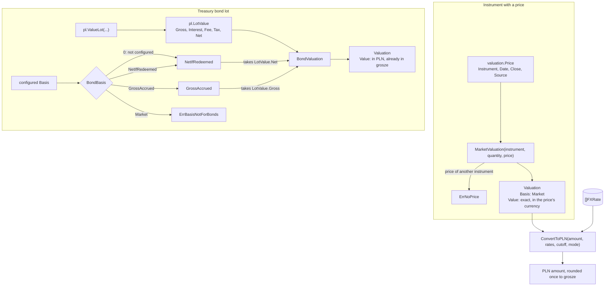
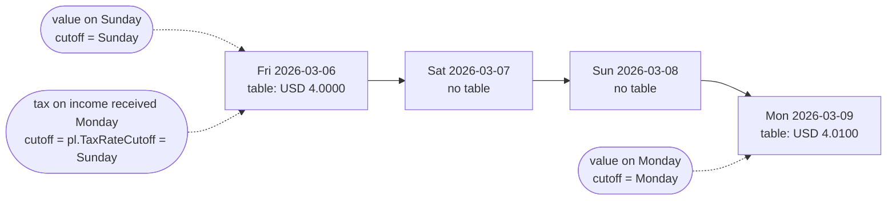
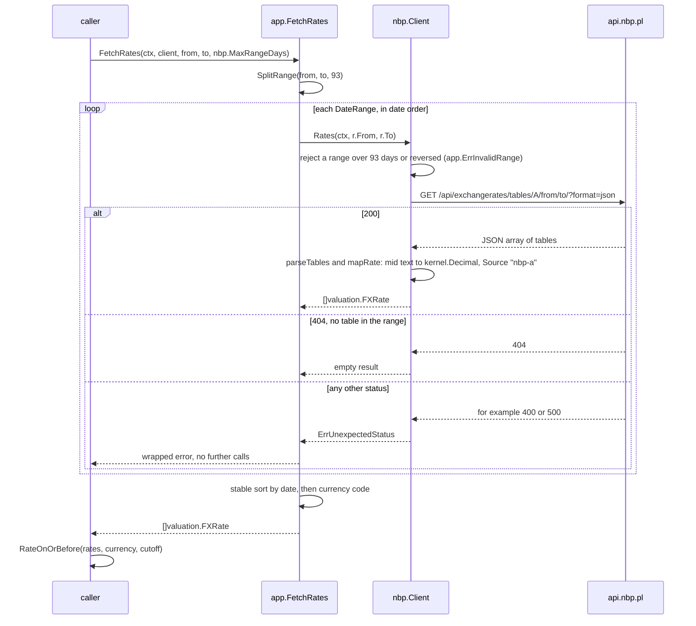

The valuation context turns holdings into money on a date. It holds end-of-day prices, exchange rates to PLN, the valuation bases, and the pure functions that combine them, plus an adapter that fetches rates from the National Bank of Poland (NBP). Treasury bond values come from the Polish rules described in [Treasury bonds](treasury-bonds.md); valuation only chooses which of those values counts.

## Concepts

### Prices

A [price](../glossary.md) is the end-of-day close of one unit of an [instrument](../glossary.md), in the currency it trades in, with the source it came from. M0 uses end-of-day prices only, no intraday data (D-21). They will come from a market-data connector that runs on the owner's own API key (D-22, D-51). That connector isn't built yet, so today the `Price` type exists but nothing fills it.

### FX rates and NBP table A

An [FX rate](../glossary.md) is the value in PLN of one unit of a currency on a date. [NBP table A](../glossary.md) is the central bank's daily table of average exchange rates, one "mid" rate per currency against PLN, published on business days. Polish tax law converts foreign income at these rates (R-9), and M0 uses them for every conversion to PLN (D-20). NBP's API serves table A from 2002-01-02 (R-17).

No table is published on weekends or holidays, so the rate for a date is the latest one dated on or before it. Polish tax shifts that cutoff one day earlier; see [the tax FX rate date](treasury-bonds.md#the-tax-fx-rate-date).

Every amount keeps its original currency ([money](../glossary.md)). Converting to PLN is a separate, explicit step that names the rate and a rounding mode, and rounds once.

### Valuations and valuation bases

A [valuation](../glossary.md) is the value of a holding on a date, with its [valuation basis](../glossary.md) and source. The basis says which value it is:

| Basis | Text form | Value | Used for |
|---|---|---|---|
| `Market` | `market` | Quantity times the end-of-day close, in the price's currency | Instruments with a price |
| `GrossAccrued` | `gross_accrued` | Nominal plus accrued interest, before any fee or tax | Treasury bonds |
| `NetIfRedeemed` | `net_if_redeemed` | What redeeming today would pay, after the early-redemption fee and Belka tax | Treasury bonds |

Polish retail treasury bonds are not traded, so they have no market price. They count in totals at gross accrued or net-if-redeemed, and net-if-redeemed, what a redemption today would actually pay, is the default (D-25).

### Revaluation

D-36 makes valuations stored rows, derived from the transaction log, prices, FX rates and index readings, and rebuilt through a job queue whenever one of those inputs changes. None of this exists yet (see [Not built yet](#not-built-yet)): today a valuation is a value computed on call and never stored.

## How it works

The context follows the layering in [code-organization.md](../dev/code-organization.md):

| Package | Layer | Contents |
|---|---|---|
| `valuation` ([valuation.go](../../internal/valuation/valuation.go), [fx.go](../../internal/valuation/fx.go)) | Domain, pure | `Price`, `FXRate`, `Basis`, `Valuation`; `MarketValuation`, `BondBasis`, `BondValuation`, `RateOnOrBefore`, `ToPLN`, `ConvertToPLN` |
| `valuation/app` ([rates.go](../../internal/valuation/app/rates.go)) | Use cases and ports | The `RateProvider` port, `SplitRange`, `FetchRates` |
| `valuation/nbp` ([client.go](../../internal/valuation/nbp/client.go)) | Adapter | `Client`, which implements `RateProvider` against `api.nbp.pl` |

`valuation` imports `jurisdiction/pl` for bond values and `kernel` for money, dates and decimals. Nothing outside these packages imports them yet: no binary in `cmd/` wires the NBP client, and there is no store.

### Computing a value

`MarketValuation` multiplies the quantity by the close exactly and keeps the price's currency and date; it fails with `ErrNoPrice` if the price belongs to another instrument. `BondValuation` takes the `pl.LotValue` that [`pl.ValueLot`](treasury-bonds.md#how-it-works) computed and picks `Net` or `Gross` through `BondBasis`. The conversion step at the bottom is the caller's: no code in the repository chains these functions yet.

`ParseBasis` reads the text forms in the table above, case-sensitively; anything else is `ErrUnknownBasis`.

### Converting to PLN

`RateOnOrBefore(rates, currency, cutoff)` skips other currencies and every rate dated after the cutoff, and returns the latest of the rest. No rate at all is `ErrNoRate`. Two rates for the same currency and date are fine if they are equal (the first is kept) and `ErrConflictingRates` if they differ. The function does not look at `Source`, so it uses whatever rates the caller passes.

`ToPLN(amount, rate, mode)` multiplies the amount by the rate exactly and rounds once to two decimal places with the caller's `kernel.RoundingMode` (half up, half even or down). The rate must be for the amount's own currency (`kernel.CurrencyMismatchError`) and positive (`ErrInvalidRate`). `ConvertToPLN` combines the two: it finds the rate with `RateOnOrBefore`, or, for an amount already in PLN, only rounds it.

The synthetic rates of [fx_test.go](../../internal/valuation/fx_test.go) show the "on or before" rule and the tax cutoff:

A worked example with the synthetic numbers of the tests: 12.5 units of `SYNTH-ETF` closing at 101.37 USD on Monday 2026-03-09 have a market valuation of exactly 1267.125 USD. `ConvertToPLN` on that Monday takes the 4.0100 rate: 1267.125 × 4.0100 = 5081.17125, which rounds half up to 5081.17 PLN.

### Fetching NBP rates

`app.RateProvider` is the swappable rate source of D-20: `Rates(ctx, from, to)` returns every rate published in that inclusive range, and a range with no table is an empty result, not an error. A provider may cap how many days one call covers, so `FetchRates` cuts the range with `SplitRange` into consecutive pieces of at most `maxDays` days. The split depends only on its arguments, so replayed requests stay the same.

The adapter keeps NBP's JSON shape inside the package. It reads `mid` as a `json.Number` and parses its text into a `kernel.Decimal`, so no rate passes through a float; a rate such as 0.00025276 keeps every digit. It rejects, as `ErrMalformedTable`, a body that is not JSON, a table other than `A`, a bad effective date, a currency code that isn't three upper-case letters, and a rate that isn't positive. It sends `User-Agent: openfief`, because `api.nbp.pl` answers 403 to Go's default one, and reads at most 4 MiB of body. The caller passes the `http.Client`, so its timeout, transport and proxy (`HTTPS_PROXY` in a plugin) are the caller's choice; the client reads no environment. Table A's API gives every rate per one unit of the currency, so no scaling applies.

## Decisions

- **D-20**: NBP table A to PLN, swappable rate provider. Two gaps: D-20 and DESIGN.md's M0 diagram make NBP an FX plugin, but today it is only a package of the core module (`internal/valuation/nbp`) with no plugin around it; and "tax always uses NBP rates" is not enforced, since `RateOnOrBefore` ignores `Source`.
- **D-21**: end-of-day prices only.
- **D-25**: configurable bond basis, net-if-redeemed by default. D-25 says "no tax inside IKE"; the code also withholds no tax inside IKZE (see [Treasury bonds](treasury-bonds.md#decisions)).
- **D-62** and **T-12**: the code converts to PLN only. `FXRate`, `PLN()`, `ToPLN` and `ConvertToPLN` assume PLN in the valuation context, while D-62 allows that only in the Polish pack's tax rules. It matches the glossary's FX rate and D-20's "in M0"; T-12 (proposal P-49) is the open question.
- **R-17**: NBP's history starts on 2002-01-02; nothing in the code checks this date.

## Verification

| Behavior | Tests | kibi |
|---|---|---|
| Basis names round-trip; unknown text fails | `TestBasisNames` in [valuation_test.go](../../internal/valuation/valuation_test.go) | REQ-valuation-bond-basis, TEST-valuation-valuation |
| Market value is exact, in the price's currency | `TestMarketValuation` | REQ-valuation-market-value, SCEN-valuation-market-value, TEST-valuation-valuation |
| Bonds default to net-if-redeemed; market is rejected | `TestBondBasis`, `TestBondValuation` | REQ-valuation-bond-basis, SCEN-valuation-bond-basis, TEST-valuation-valuation |
| Latest rate on or before a date; missing and conflicting rates fail | `TestRateOnOrBefore`, `TestRateOnOrBeforeConflicts` in [fx_test.go](../../internal/valuation/fx_test.go) | REQ-valuation-fx-rate-lookup, SCEN-valuation-fx-rate-lookup, TEST-valuation-fx |
| Tax takes the table before the event | `TestTaxRateUsesTheTableBeforeTheEvent` | REQ-pl-tax-fx-rate-date, SCEN-pl-tax-fx-rate-date, TEST-valuation-fx |
| Conversion rounds once with the stated mode | `TestToPLN`, `TestToPLNNeedsTheAmountsCurrency`, `TestConvertToPLN` | REQ-valuation-pln-conversion, SCEN-valuation-pln-conversion, TEST-valuation-fx |
| Ranges split per provider limit, results merged and sorted | `TestSplitRange`, `TestFetchRates`, `TestFetchRatesStopsAtTheFirstFailure` in [rates_test.go](../../internal/valuation/app/rates_test.go) | REQ-valuation-fx-range-splitting, SCEN-valuation-fx-range-splitting, TEST-valuation-app-rates |
| No table in a range is an empty result | `TestFetchRatesWithNoTables`, `TestRatesNoData` | REQ-valuation-fx-no-data, SCEN-valuation-fx-no-data, TEST-valuation-app-rates, TEST-valuation-nbp-client |
| NBP rates parse exactly; bad tables and statuses fail | `TestRatesTableA`, `TestRatesKeepsEveryDigit`, `TestRatesRejects` in [client_test.go](../../internal/valuation/nbp/client_test.go) | REQ-valuation-nbp-decimal-exact, SCEN-valuation-nbp-decimal-exact, TEST-valuation-nbp-client |
| NBP requests stay within 93 days and carry their own User-Agent | `TestRatesRejects`, `TestRatesSendsItsOwnUserAgent` | REQ-valuation-nbp-request, SCEN-valuation-nbp-request, TEST-valuation-nbp-client |

The same kibi tests also validate the firm requirements imported from D-20, D-21 and D-25: REQ-AUTO-5769411DB9663682 (NBP table A), REQ-AUTO-D1568676DF81CAF7 (swappable provider), REQ-AUTO-5CB834BAA25E2C4C (original currency), REQ-AUTO-A129ED289B2239A8 (end-of-day prices) and REQ-AUTO-0C90AD924924F4F6 (configurable bond basis). `TestRatesTableA` and `TestRatesNoData` replay [hypert](https://github.com/areknoster/hypert) recordings of the public `api.nbp.pl` from `nbp/testdata/`, checking each request against its recording; they use no network. Re-recording is a manual step (`recordNBP` in the test, and the `hypert-recording` skill). The other tests use synthetic rates and stub transports.

Run them with `task test`, or just this context with `go test ./internal/valuation/...`.

One behavior is not tested and differs from its doc comment. `RateOnOrBefore` says two different rates are an error "on the chosen date", but it checks for conflicts while scanning, against the latest date seen so far. A conflict on an earlier date therefore fails the lookup when it comes before the chosen date in the slice, and is ignored when it comes after. `FetchRates` returns rates sorted by date, so with its output any conflict on or before the cutoff fails.

## Not built yet

- **D-36**: stored valuation rows, the River job queue, coalescing per account from the earliest affected date, valuation status in the read API and UI, and revaluing everything when the basis changes. River is not a dependency yet. The ledger has the seams: `app.ImportHook` runs in the import's database transaction, `ImportSummary.EarliestAffected` gives the earliest changed date per account, and the PostgreSQL store's `WithTx` hands over that transaction ([import.go](../../internal/ledger/app/import.go)).
- **D-22**, **D-51**: the EODHD market-data connector that would supply prices, and the cross-check against IBKR Flex prices.
- **D-62**: the reporting currency setting (`valuation.ReportingCurrency` in the glossary), with its default from the jurisdiction pack.
- **D-52**, **D-53**: index levels (`valuation.Index` in the glossary) for model portfolio targets and backtests.
- **D-20**, **D-11**: NBP rates delivered by a connector plugin, and anything that stores fetched rates or runs the fetch on a schedule.
