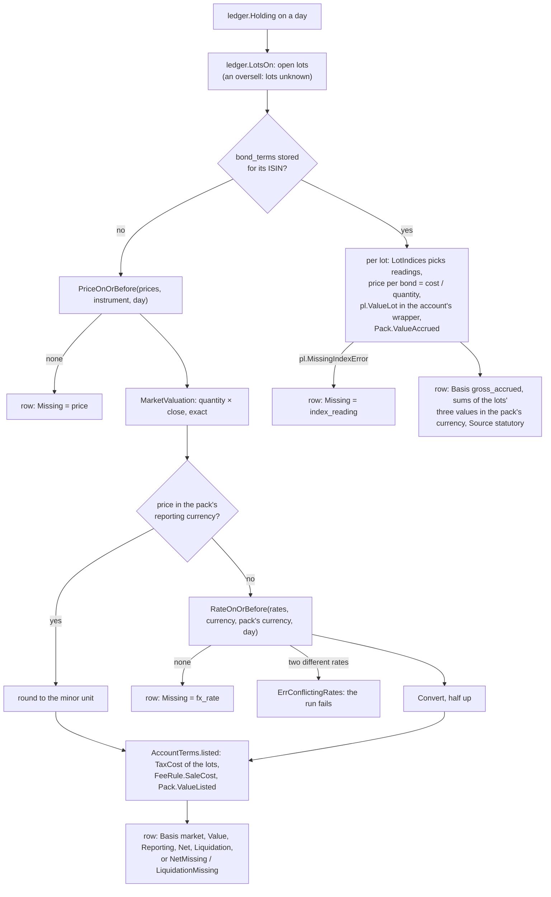
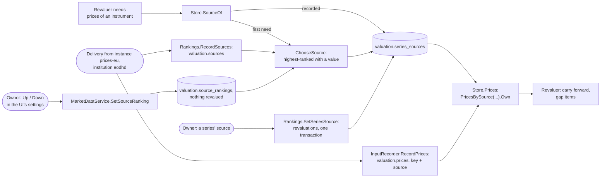
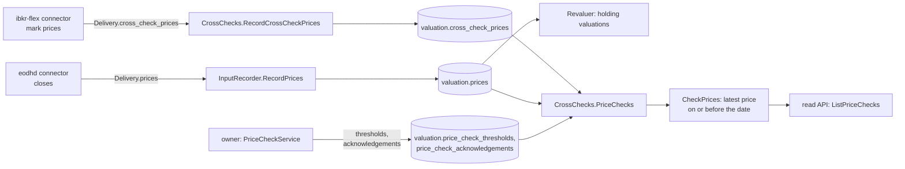
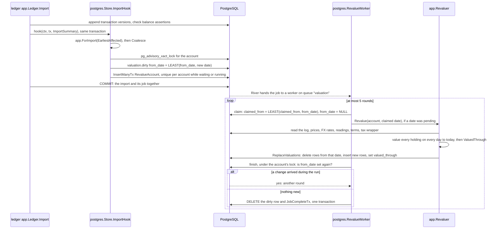
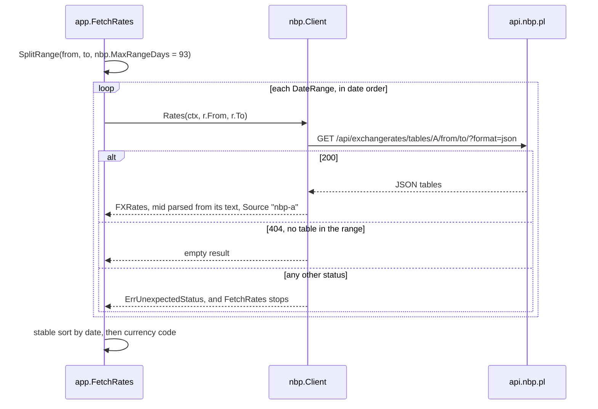
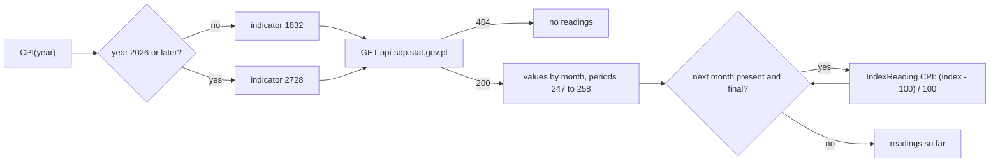
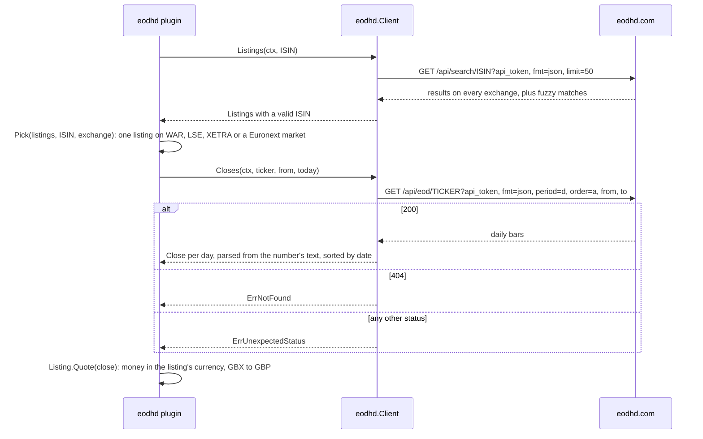

The valuation context turns holdings into money. For each account it stores the value of every holding on every day, in the instrument's currency and in PLN, with its [net and liquidation values](../glossary.md) (D-77), and rebuilds those rows whenever one of their inputs changes. The inputs are end-of-day prices, exchange rates from the National Bank of Poland (NBP), period index readings for treasury bonds, the ledger's transaction log, and the account's [tax wrapper](../glossary.md) and [fee rule](../glossary.md) with the owner's settings. The taxes and fees come from the [jurisdiction pack](../glossary.md), the Polish one in [Treasury bonds](treasury-bonds.md#the-packs-values); valuation hands it the parts and stores what it returns.

## Concepts

### Prices, FX rates and index readings

A [price](../glossary.md) is the end-of-day close of one unit of an [instrument](../glossary.md), in the currency it trades in, with its source. M0 uses end-of-day prices only (D-21), from a market-data connector on the owner's own API key (D-22, D-51).

An [FX rate](../glossary.md) is the value in PLN of one unit of a currency on a date. [NBP table A](../glossary.md) is the central bank's daily table of average exchange rates against PLN, published on business days. Polish tax law converts foreign income at these rates (R-9), and M0 uses them for every conversion to PLN (D-20). There is no table on weekends or holidays, so the rate for a date is the latest one dated on or before it. NBP's API serves table A from 2002-01-02 (R-17).

A period index reading is one month's published value of a [period index](../glossary.md): CPI from GUS, or the NBP reference rate. Treasury bonds need them for interest periods after the first. A CPI reading is keyed by the month it measures; a reference-rate reading by the month whose ROR and DOR interest periods it sets, holding the rate in force on that month's reference-rate day ([Treasury bonds](treasury-bonds.md#business-days-and-the-reference-rate-day)). The treasury-bonds connector fetches both ([Plugins](plugins.md#first-party-plugins)).

### One source per series

Several connectors can deliver the same kind of market data: two price sources for one instrument, or a second FX connector beside NBP's. D-94 gives each [market-data series](../glossary.md) exactly one [series source](../glossary.md): each instrument's prices, each currency's FX rates to PLN, and each period index's readings, CPI and the NBP reference rate, take every value from one connector instance (D-124). The source is chosen when the series first needs a value, from the owner's [source ranking](../glossary.md) for that kind: the highest-ranked source that has a value of the series. It is recorded and kept, so a new ranking only chooses for series that first need a value after it, and the owner can change the source of one series. A day the source has no value for takes its latest earlier value, as NBP's rate for a Saturday is Friday's; a value never comes from another source on the days the chosen one lacks, so a series never switches source silently. Every other source's values are stored too, as cross-checks (D-22). When a series a holding needs has had no value from its source for longer than the kind's [gap threshold](../glossary.md), an [attention item](../glossary.md) says so (D-130), until values resume.

A source the owner hasn't placed in the ranking follows the placed ones in its default place: the first-party connector of its kind first, by the institution it names on its deliveries (`eodhd` for prices, `nbp` for FX rates, `treasury-bonds` for index readings), then by name. The core stores a delivery only when its connector's signed manifest declares the institution it names (D-182, [Ingest](ingest.md#calling-a-connector-plugin)), so a source takes that default place only for an institution its manifest declares. Cross-check prices, such as IBKR's mark prices, are never a source: they only check (D-124).

"Index" in D-94 means a period index whose readings value treasury bonds: CPI and the NBP reference rate, ranked like prices and FX rates. Market index levels, such as WIG20's, which only the model portfolio's index targets use (D-53), are a different thing: D-124 gives them no ranking and no series source, and each index and date keeps the level delivered last.

Every amount keeps its original currency ([money](../glossary.md)). Converting to PLN is an explicit step that names the rate and a rounding mode, and rounds once.

### Cross-check prices and price checks

D-22 makes IBKR's own prices a cross-check of the market-data connector's, and D-51 adds a reason: EODHD's closes are aggregated across venues rather than each exchange's official close. A [cross-check price](../glossary.md) is such an institution's own end-of-day price, such as the mark price of a position in an IBKR Flex statement. It is stored beside the prices, never among them: no holding is valued from it, and recording one revalues nothing. It is never a series source (D-124), and D-112 lets only a connector that declares it send them.

A [price check](../glossary.md) compares a cross-check price with the latest stored price of the same instrument on or before its date (D-111), so a mark dated on a Sunday is checked against Friday's close. The price is one from the instrument's series source, and every other source's price is checked against it like a cross-check price (D-94). Its relative difference is (cross-check price - price) / price. A check whose difference is beyond 1% of the price, in either direction, is flagged for the owner to look at (D-110); it changes no valuation and no price. The owner can set another threshold for a single instrument, such as a thinly traded Warsaw listing. When the two prices are in different currencies, the pair is shown with its own status, a currency mismatch, rather than skipped: the market-data connector may be pricing another listing than the one held (D-111). The owner can acknowledge a flagged check; each acknowledgement is recorded append-only, and covers the check only while both prices stay the same (D-112).

### Valuations and the three values

A [valuation](../glossary.md) is the value of a holding on a date, with its [valuation basis](../glossary.md) and source. The basis says how its gross value was found:

| Basis | Text form | Gross value | Used for |
|---|---|---|---|
| `Market` | `market` | Quantity times the end-of-day close, in the price's currency | Instruments with a price |
| `GrossAccrued` | `gross_accrued` | Nominal plus accrued interest, before any fee or tax | Treasury bonds |

Polish retail treasury bonds are not traded, so they have no market price. D-77 gives every holding, account and total three values side by side: [gross](../glossary.md), before any tax or fee; [net](../glossary.md), what the owner keeps at the planned exit after the taxes due then; and [liquidation](../glossary.md), the cash in hand if everything were sold or redeemed and withdrawn today. The old choice of one bond basis for totals (`net_if_redeemed`) is gone: a bond's net-if-redeemed value is now its liquidation value in a taxable account.

### The jurisdiction pack

A [jurisdiction pack](../glossary.md) is one country's rules behind one interface (D-70), `jurisdiction.Pack` in [pack.go](../../internal/jurisdiction/pack.go). Valuation computes nothing country-specific itself: it hands the pack each holding's parts and stores what comes back.

| Part | Go name | What it is |
|---|---|---|
| Tax wrapper | `jurisdiction.Wrapper` | A pack's key, such as `ike`; `Pack.Wrappers` lists them, the default first (D-76) |
| Three values | `jurisdiction.Values` | `Gross`, `Net`, `Liquidation`, and `LiquidationUnknown` when an owner setting it needs is unset (D-78) |
| Kinds of product | `Listed`, `Accrued`, `Cash` | A holding priced at market (gross, tax cost basis, sale cost), a bond or deposit (gross, taxable income, early fee), cash |
| Owner's settings | `jurisdiction.Settings` | The marginal income tax rate, `ValidateMarginalRate`: above 0 and below 1 |
| [Fee rule](../glossary.md) | `jurisdiction.FeeRule` ([fee.go](../../internal/jurisdiction/fee.go)) | An account's rate with a minimum and a conversion rate (D-78); `SaleCost` gives the rate of the value but at least the minimum, plus the conversion rate for an instrument in a foreign currency, half up to the minor unit; the zero rule, every account's until set, charges nothing |
| [Number format](../glossary.md) | `jurisdiction.NumberFormat` ([numberformat.go](../../internal/jurisdiction/numberformat.go)) | A group separator (space, comma, full stop, apostrophe or none) and a decimal separator (comma or full stop), keyed like `space-comma` (D-113) |
| Totals | `Pack.Totals`, `jurisdiction.AccountRows` ([yearlytax.go](../../internal/jurisdiction/yearlytax.go)) | A total's three values with each wrapper's tax counted on the whole, not row by row (D-128) |
| Yearly tax | `Pack.YearlyTax`, `TaxAccount`, `TaxDay` | A wrapper's tax on its accounts' value for a year, such as OKI's (D-127), from each account's days split by exemption class |
| Exemption class | `Pack.ExemptionClasses`, `Pack.ExemptionClass`, `jurisdiction.Asset` | The classes a yearly tax tells assets apart by, and an asset's class, or false when the pack can't tell (D-132) |

The pack also names the default reporting currency (D-62), the date whose exchange rate converts an amount for tax (`TaxRateDate`, D-20) and the version of its rules (`Version`). `cmd/core` uses the Polish pack, `pl.NewPack()`, the only one. `Totals`, `ExemptionClasses`, `ExemptionClass` and `YearlyTax` sit in the embedded `jurisdiction.TaxRules`.

### Taxes on totals

A holding's net and liquidation values carry its own tax as if it alone were sold (D-128). A total doesn't add those taxes up: `pl.Pack.Totals` ([totals.go](../../internal/jurisdiction/pl/totals.go)) counts each wrapper's tax on the whole.

- **Taxable accounts** count it as PIT-38 does: the unrealized gains and losses of every holding priced at market, over their cost basis for tax, and the tax year's realized gains and losses of every taxable account in the total offset each other. The base is rounded to whole złoty, under 50 groszy down and from 50 up (art. 63 § 1 of the tax ordinance), and so is 19% of it (`PIT38Tax`); a base that isn't positive pays nothing. For the liquidation value the gain is the proceeds after the sale cost. A bond keeps its own row's tax, which the issuer withholds outside PIT-38. Losses carried from earlier years are not counted.
- **IKE**: net is gross; liquidation is an early return of the whole account, its proceeds after sale costs taxed at 19% on what they exceed what was paid in, rounded half up to grosze.
- **IKZE**: 10% of the account's gross at the planned exit; the owner's marginal rate on its proceeds before it, missing until the rate is set.
- **OKI**: the rows' sum.

Worked example (in `TestTotals`): a taxable account holds A, worth 10,000 PLN at a cost of 8,000 (its own tax 380, net 9,620), and B, worth 5,000 at a cost of 6,000 (net 5,000), with 1,000 of cash; the rows' net values sum to 15,620. Offset, the base is 15,000 − 14,000 = 1,000 and the tax 190, so the net total is 16,000 − 190 = 15,810: the losses-offset line is +190.

Valuation gives a total what it needs: each stored row of a holding priced at market keeps, with its net value, its cost basis for tax and its sale cost in the reporting currency the row names (`HoldingValuation.TaxCost`, `SaleCost`, [0007_taxes.sql](../../internal/valuation/postgres/migrations/0007_taxes.sql)); `AccountTerms.RealizedGains` ([realized.go](../../internal/valuation/realized.go)) turns the ledger's sales (`ledger.Sales`) into gains for tax, the proceeds less the fees at the NBP rate of the day before the sale less the consumed lots' costs at the rate of the day before each was opened; and `RealizedInYear` sums a tax year's through a day. The [read API](read-api.md) applies the pack to every total it serves (`views.TaxTotals`) and reports the losses-offset line, the total less its rows: an account's holdings and cash, or for the portfolio the accounts' own totals.

### OKI's yearly tax

`pl.Pack.YearlyTax` ([oki.go](../../internal/jurisdiction/pl/oki.go)) computes OKI's tax on asset value under the act on OKI as data (`pl.OKIAct`, D-127): in force from 2027-01-01, 0.85% for 2027, and later years' rates from `OKIRate`, 19% of the NBP reference rate in force on 31 October of the year before, at least 0.1%, rounded down to two decimal places of a percent (5.75% gives 1.09%). The exempt amounts are 25,000 PLN of savings assets and 100,000 PLN of investment assets, at most 100,000 PLN together, savings first, raised from 2030 by the year's CPI index and rounded down to whole hundreds (`IndexOKIExemption`). A later year's tax waits for its reference rate, and from 2030 for its CPI index: `CurrentOKIAct` knows neither yet, so such a year reports its averages and, with the exemptions known, the taxed part, but no rate and no tax.

- Each account's average value is the sum of its end-of-day values over the days of the year it was held, plus, for each day, its payments in up to that day's withdrawals, divided by those days. Split by exemption class (art. 26 ust. 3), each class's average takes the payments in proportion to its share of the account's summed values, and is rounded half up to grosze.
- The base is the sum over the owner's OKI accounts. Savings assets are exempt up to their amount, then investment assets up to theirs and to what is left of the total; other assets aren't exempt. The tax is the rate of the rest, rounded half up to grosze.

The classes are `pl.Savings`, `pl.Investment` and `pl.Other` (`pl.OKIClasses`). The pack classifies a treasury savings bond as savings, PLN cash as savings on an account that held such bonds in the year and as investment on any other, and cash in another currency as other. It holds no data on what a holding priced at market is, so it can't classify any: such a holding counts as other until the owner classifies it, so the estimate errs high (D-132).

Worked example (in `TestOKIYearlyTax`): 30,000 PLN of savings assets and 90,000 of investment assets held all of 2027. Savings are exempt up to 25,000, investment up to 100,000 − 25,000 = 75,000; 20,000 is taxed at 0.85%: 170 PLN.

The views compute it when read (`app.Views.YearlyTaxes`, [taxes.go](../../internal/views/app/taxes.go)) from the stored valuations, cash and deposits and withdrawals of every OKI account, from its first transaction through the year's end or the earliest date the OKI accounts are valued through, with foreign amounts at the NBP rate of the day before each day (`views.TaxDays`); an amount with no such rate fails the read with `FAILED_PRECONDITION`. The owner's classifications are stored per instrument (`valuation.exemption_classes`) and set through `SettingsService.SetExemptionClass`. A revaluation of an account in a wrapper with a yearly tax raises an attention item of kind `instrument-unclassified`, subject the ISIN, for each holding the pack can't classify and the owner hasn't, and clears it once the owner has, through `app.AttentionRaiser` (`Raise` and `Clear`, idempotent, the attention store's shape; `valuationpg.Config.Attention`). `cmd/core` adapts the port to the [attention items](attention.md) (`valuationAttention` in [unclassified.go](../../cmd/core/unclassified.go)), so the item lands in the attention store and on the Attention page.

### Stored valuations and revaluation

D-36 makes valuations stored rows rather than values computed on each read, each holding all three values of D-77. A stored row, `HoldingValuation`, is one holding of one account on one day on one basis: its quantity, its gross value in the instrument's currency and in PLN, its net and liquidation values in PLN, its source, and the dates of the price and rate it used. When an input is missing, the row says which one (`price`, `fx_rate` or `index_reading`) and why, and has no value. A row with its gross value can still lack its net or liquidation value: `NetMissing` and `LiquidationMissing` say why (`fx_rate` for a lot's cost or the fee rule's minimum, `lots` for a holding with no lots, such as a short one, `marginal_rate` for IKZE without the owner's rate). A gap is recorded, not raised as an error.

Every row derives from the transaction log and the stored inputs, so it can be rebuilt at any time. A revaluation rebuilds one account's rows from a date to today. Any change to an input enqueues one, in the same database transaction as the change. Pending revaluations of one account coalesce into one, from the earliest affected date.

An account's valued-through date is the last day whose holdings all have a valuation: the day before its first missing input, or today. Together with "pending" and "running", it tells a reader how current the account's numbers are.

## How it works

The context follows the layering in [code-organization.md](../dev/code-organization.md):

| Package | Layer | Contents |
|---|---|---|
| `valuation` ([valuation.go](../../internal/valuation/valuation.go), [fx.go](../../internal/valuation/fx.go), [index.go](../../internal/valuation/index.go), [revaluation.go](../../internal/valuation/revaluation.go), [crosscheck.go](../../internal/valuation/crosscheck.go), [ranking.go](../../internal/valuation/ranking.go), [series.go](../../internal/valuation/series.go)) | Domain, pure | Prices, FX rates, bases, index readings; valuing one holding; `HoldingValuation`, `ValuedThrough`, `Revaluation`, `Coalesce`; `CrossCheckPrice`, `Thresholds`, `CheckPrice`, `CheckPrices`, `PriceCheckAcknowledgement`, `Acknowledge`; `MarketDataKind`, `Source`, `Ranking`, `RankSources`; `Series`, `SeriesSource`, `ChooseSource`, `PricesBySource`, `FXRatesBySource`, `IndexReadingsBySource`, `OtherSourceChecks`, `GapThresholds`, `GapOf` ([series.go](../../internal/valuation/series.go)) |
| `valuation/app` ([plan.go](../../internal/valuation/app/plan.go), [record.go](../../internal/valuation/app/record.go), [revalue.go](../../internal/valuation/app/revalue.go), [ports.go](../../internal/valuation/app/ports.go), [status.go](../../internal/valuation/app/status.go), [rates.go](../../internal/valuation/app/rates.go), [crosscheck.go](../../internal/valuation/app/crosscheck.go), [ranking.go](../../internal/valuation/app/ranking.go), [series.go](../../internal/valuation/app/series.go), [gaps.go](../../internal/valuation/app/gaps.go)) | Use cases and ports | `Planner`, `InputRecorder`, `Revaluer`, `ValuationStatus`, `FetchRates`, `CrossChecks`, `Rankings`, `NeededSeries` |
| `valuation/postgres` ([store.go](../../internal/valuation/postgres/store.go), [queue.go](../../internal/valuation/postgres/queue.go), [worker.go](../../internal/valuation/postgres/worker.go), [status.go](../../internal/valuation/postgres/status.go), [crosscheck.go](../../internal/valuation/postgres/crosscheck.go), [ranking.go](../../internal/valuation/postgres/ranking.go), [series.go](../../internal/valuation/postgres/series.go), [0001_valuation.sql](../../internal/valuation/postgres/migrations/0001_valuation.sql)) | Adapter | The `valuation` schema, the River queue and its workers |
| `valuation/connectapi` ([service.go](../../internal/valuation/connectapi/service.go)) | Adapter | `MarketDataService` for view plugins: the owner's source rankings, series sources and gap thresholds ([market_data.proto](../../proto/openfief/valuation/v1/market_data.proto)); `PriceCheckService` ([pricechecks.go](../../internal/valuation/connectapi/pricechecks.go)): the owner's price check thresholds and acknowledgements ([price_checks.proto](../../proto/openfief/valuation/v1/price_checks.proto)); `SettingsService` ([settings.go](../../internal/valuation/connectapi/settings.go)): the owner's settings ([settings.proto](../../proto/openfief/valuation/v1/settings.proto)) |
| `valuation/nbp` ([client.go](../../internal/valuation/nbp/client.go), [refrate.go](../../internal/valuation/nbp/refrate.go)) | Adapter | `Client`, which fetches table A for the `RateProvider` port; `Archive`, which reads NBP's reference rate changes |
| `valuation/gus` ([client.go](../../internal/valuation/gus/client.go)) | Adapter | `Client`, which fetches GUS's year-on-year CPI of a year as `IndexReading`s |
| `valuation/eodhd` ([client.go](../../internal/valuation/eodhd/client.go), [listing.go](../../internal/valuation/eodhd/listing.go)) | Adapter | `Client`, which finds an ISIN's listings, or a ticker's code on one exchange (`Search`), and fetches end-of-day closes from EODHD; `Pick` and `Listing.Quote`, which choose a listing and quote its closes; `CountryExchange` and `FindByCode`, which propose the ISIN of a ticker a broker named without one (D-116) |

### Valuing one holding

`Revaluer.Revalue(account, from)` loads the account's log, derives its holdings for each day with `ledger.HoldingsOn`, and values each one:

`ValueMarketHolding` takes the latest price on or before the day, multiplies it by the quantity exactly, and converts with the latest FX rate on or before the day, rounding half up (`ValueRounding`): the gross value. `AccountTerms.listed` then finds the cost basis (`TaxCost`: each open lot's cost converted at the latest rate on or before the pack's `TaxRateDate` of its open date, the NBP rate of the day before for Poland, D-20), the sale cost under the account's fee rule (its minimum converted at the day's rate; foreign when the price's currency isn't the pack's), and asks the pack's `ValueListed` for net and liquidation. `ValueBondHolding` values each open lot with `pl.ValueLot`: purchase date is the lot's open date, price per bond its PLN cost over its quantity, and `LotIndices` supplies a reading for each started period after the first (CPI of `pl.CPIMonth`, or the reference rate recorded for the month the period starts); the pack's `ValueAccrued` turns each lot's gross value, interest plus discount and fee into three values, and the holding sums them. An account's terms (`AccountTerms`) are its recorded wrapper, the pack's default when none is, its fee rule, the zero rule when none is, and the owner's settings.

Every amount converts into the jurisdiction pack's reporting currency, never an assumed PLN (D-180): `ValueMarketHolding`, `TaxCost`, the fee minimum and realized gains take it from `AccountTerms.Pack.ReportingCurrency()`, and `ConvertAt(m, to, rates, cutoff, mode)` converts into the currency its caller names. Each `FXRate` names its `Base`, the currency it is quoted in (NBP's table A: PLN, `nbp.Base`), and `RateOnOrBefore` skips rates into another base, other currencies and later dates. No rate is `ErrNoRate`; equal duplicates are fine; different rates for one date are `ErrConflictingRates`. With synthetic rates of 4.0000 on Friday 2026-03-06 and 4.0100 on Monday 2026-03-09, a Sunday valuation takes Friday's rate. Tax on income received that Monday also takes Friday's, because `pl.TaxRateCutoff` moves the cutoff to Sunday ([the tax FX rate date](treasury-bonds.md#the-tax-fx-rate-date)).

### Recording inputs and planning revaluations

`InputRecorder` stores each input through the `Recorder` port, which writes it and enqueues its revaluations in one transaction. It rejects bad input with `ErrInvalidInput`: a price that names no instrument or isn't positive, an FX rate for PLN or not positive, an unknown index kind or month, bond terms without an ISIN, a wrapper the pack doesn't have, a fee rule or marginal rate out of range, a number format with one separator twice or none for decimals. The `Planner` decides which accounts each change affects, by fixed rules:

| Change | Entry point | Accounts | From |
|---|---|---|---|
| Prices | `RecordPrices` | Each account whose log ever held the instrument | The earliest price's date per instrument |
| FX rates | `RecordFXRates` | Every account with a log | The earliest rate's date |
| Index readings | `RecordIndexReadings` | Every account with a log | The first day of the earliest reading's month |
| Bond series terms | `RecordBondTerms` | Each account whose log ever held that ISIN | Its first transaction |
| Tax wrapper | `RecordTaxWrapper` | That account | Its first transaction |
| Fee rule | `RecordFeeRule` | That account | Its first transaction |
| The owner's marginal rate | `RecordMarginalRate` | Every account | Its first transaction |
| The owner's number format | `RecordNumberFormat` | None: no value depends on it | |
| Rules version | `ApplyRules` at start-up | Every account, only if the pack's rules version or valuation's source rules version changed | Its first transaction |
| A series' source, by the owner | `Rankings.SetSeriesSource` | For prices, each account whose log ever held the instrument; for an FX rate or an index, every account; only if the source changed | Its first transaction |
| Ledger import | `postgres.Store.ImportHook` | Each account the import changed | `ImportSummary.EarliestAffected` |
| End of day | `EndOfDay` River job | Every account with a log | Its valued-through date, or its first transaction |

The `valuation` schema keys prices by instrument, date and source, rates by currency, date and source, readings by kind, month and source ([0004_ranked_sources.sql](../../internal/valuation/postgres/migrations/0004_ranked_sources.sql)), and terms by ISIN; recording one again for the same source replaces it. An instrument whose ISIN has stored terms is valued as a bond.

### One source per series, as built

`Store.Prices`, `FXRates` and `IndexReadings`, which the `Revaluer`, the read API and the model portfolio's backtest read, return the values of each series' one source only (`PricesBySource`, `FXRatesBySource`, `IndexReadingsBySource`, `Own`). They find it with `Store.SourceOf(series)`: the source recorded in `valuation.series_sources` ([0008_series_sources.sql](../../internal/valuation/postgres/migrations/0008_series_sources.sql)), or, the first time the series needs a value, the highest-ranked of the sources with a value of it (`ChooseSource` over the kind's ranking, `RankSources` of `valuation.sources` and `valuation.source_rankings`), recorded with `ON CONFLICT DO NOTHING`, so two revaluations choosing at once keep the first choice. A series no source has a value of has no source yet and no values; its holdings are stored with the missing input. A source the ranking doesn't name ranks after it by name, so a value from a source never recorded still counts. The day lookups (`PriceOnOrBefore`, `RateOnOrBefore`) take the latest value on or before the day, so a missing day carries the source's own latest earlier value forward. The read API's instrument page reads every source instead (D-94, D-195): `Store.PriceHistory` returns all the stored prices of an ISIN's listings in a date range, from every source, in listing, date and source order, and `Store.LatestPrices` the latest price of each listing from each source ([pricehistory.go](../../internal/valuation/postgres/pricehistory.go)); the read API marks the prices of the source `SourceOf` names.

- **Recording sources.** `ingest`'s `Connectors` records the delivering instance with its institution as a source of each kind a delivery carries, through `Rankings.RecordSources`, before storing the values. Cross-check prices are no source.
- **The owner's ranking.** `Rankings.RankSources` (owner only: `Owners` answers with `ErrNoSession` or `ErrNotOwner`) checks the order with `ValidateRanking` (each source once, 1 to 64 characters) and `Store.SaveSourceRanking` replaces the stored order. It changes no recorded source, so nothing is revalued. An empty order puts every source back in its default place. `Rankings.SourceRankings` returns each kind's ranking with each source's institution, whether the owner placed it, and the kind's gap threshold.
- **The owner's choice for one series.** `Rankings.SetSeriesSource` checks the series (`Series.Validate`: an instrument, a currency other than PLN or an index kind, as the key) and that the source has a value of it (`Store.AvailableSources`), plans the revaluations of the table above, and `Store.SaveSeriesSource` records the source with `by_owner` and enqueues them in one transaction, only when the source changed (D-36). `Rankings.SeriesSources` lists every series with a source, each with the sources that have a value of it.
- **A new value.** Recording a price, rate or reading revalues from its date whatever its source, as before; a value from another source than the series' changes nothing in the rows.
- **Gaps.** After storing its rows, `Revaluer.Revalue` takes the series the account's holdings valued on today need (`NeededSeries`: a market holding's prices and, unless they are in the pack's reporting currency, its currency's FX rates; a bond's CPI or reference rate, by its type's indexation, none for a fixed-rate one). For each, `GapOf` measures the days from the source's latest value on or before today to today; longer than the kind's threshold (`GapThresholds.For`, the owner's or `DefaultGapThreshold`: 7 days for prices and FX rates, which covers a long weekend with holidays, 92 for index readings, which covers CPI published in the middle of the month after the one it measures) raises an attention item of kind `market-data-gap` through `AttentionRaiser`, its subject the account and the series, such as `acc-1/prices/XX00000SYNT3/SYNT`, its detail the source and its latest value's date. Every other series the revaluation read is cleared, so the item resolves when values resume or no holding needs the series any more. The subject names the account, so one account's revaluation never clears another's item for a shared currency. The detail names no day valued, so a lasting gap doesn't open its item again each day. `Rankings.SetGapThreshold` sets a kind's threshold, 1 to 3660 days, in `valuation.gap_thresholds`; it applies from the next revaluation, the end-of-day one at the latest.
- **Moving to one source.** Data stored before was valued under D-94's earlier rule, the highest-ranked source with a value on each date. The migration adds the tables empty, so a series held then gets its source on its first need after it, from the ranking, like any new series. `InputRecorder.RulesVersion` now includes valuation's `SourceRulesVersion` next to the pack's version (`pl/2 sources/2`), so the first start-up after the upgrade revalues every account from its first transaction (`ApplyRules`), and every stored row comes from one source per series.
- **The service.** `cmd/core` serves `MarketDataService` (`ListSourceRankings`, `SetSourceRanking`, `ListSeriesSources`, `SetSeriesSource`, `SetGapThreshold`) to view plugins next to the AuthService, as the owner's entry service for market-data sources (D-79); the built-in UI's settings page uses it ([UI](ui.md#pages)).

[Index levels](../glossary.md) (`valuation.IndexLevel`, [level.go](../../internal/valuation/level.go)) are the end-of-day closing levels of market indices such as WIG20 (D-51), keyed by the index's name as the market-data connector names it and by date, in `valuation.index_levels` ([0002_index_levels.sql](../../internal/valuation/postgres/migrations/0002_index_levels.sql)). A level has no currency; the model portfolio's index target carries it. `InputRecorder.RecordIndexLevels` checks each level (`IndexLevel.Validate`: a name of at most 64 characters, a date, a positive level) and `Store.SaveIndexLevels` upserts them; no holding is valued from an index, so they enqueue no revaluation. `Store.IndexLevels(index, through)` reads them for the model portfolio's backtest (D-53, [Portfolio](portfolio.md)).

### Cross-checking prices

`CrossChecks.RecordCrossCheckPrices` checks each cross-check price (`CrossCheckPrice.Validate`: an instrument, a date, a positive close and a source) and `Store.SaveCrossCheckPrices` upserts them into `valuation.cross_check_prices` ([0003_cross_check_prices.sql](../../internal/valuation/postgres/migrations/0003_cross_check_prices.sql)), keyed by instrument, date and source, so two connector instances that report one instrument both keep theirs. Nothing is enqueued, and `valuation.prices` is never touched: the `Revaluer` reads only the prices.

`CrossChecks.PriceChecks` reads every cross-check price, every price from a source other than its instrument's series source as one (`OtherSourceChecks`), and the series source's prices of the same instruments (`Store.CrossCheckedPrices`, which chooses an instrument's source on first need like `Store.Prices`), with the owner's thresholds and acknowledgements, and hands them to `CheckPrices`. For each cross-check price it takes the latest price of the instrument's source dated on or before it; with none, there is no check. In the same currency, `CheckPrice` computes the relative difference with `Decimal.Quo`, half-even to six decimal places (`DifferencePlaces`), for display. Whether the check is flagged doesn't depend on that rounding: it compares |cross-check - price| with threshold × price exactly, and a difference equal to the threshold is matched. In two currencies, the check has the status `PriceCurrencyMismatch` and no difference. Each check carries its threshold, `Thresholds.For(instrument)`: the owner's for the instrument, or `DefaultPriceCheckThreshold`, 0.01. The checks come in date, instrument and source order. With synthetic prices, a close of 100 USD and IBKR's mark of 101 USD are matched at the default 1% threshold, and a mark of 101.0001 USD is flagged (`TestCheckPrice`).

The owner changes them through `PriceCheckService` ([price_checks.proto](../../proto/openfief/valuation/v1/price_checks.proto)), which the core serves on its plugin port to view plugins, for an owner session, like the `MarketDataService`:

- `SetPriceCheckThreshold` sets one instrument's threshold, a fraction greater than 0 and less than 1 (`CheckThreshold`), or with an empty threshold puts it back on 1% (`CrossChecks.SetThreshold`). `valuation.price_check_thresholds` keeps one row per instrument ([0006_price_check_settings.sql](../../internal/valuation/postgres/migrations/0006_price_check_settings.sql)). There is no core-wide setting: D-110 fixes 1%.
- `AcknowledgePriceCheck` names a check by instrument, the cross-check price's date and its source. `CrossChecks.Acknowledge` recomputes the checks, refuses one that isn't flagged (`ErrNotFlagged`) or doesn't exist (`ErrUnknownPriceCheck`), and appends a `PriceCheckAcknowledgement`: the instrument, the cross-check price's date, source and close, and the date and close of the price it was compared with. `valuation.price_check_acknowledgements` refuses every update, delete and truncate with a trigger, as the ledger's log does. An acknowledgement acknowledges a check (`PriceCheckAcknowledgement.Acknowledges`) only while all of those are the same, so a mark delivered again with another close, or a newer price, is flagged anew.
- Errors: no valid session `UNAUTHENTICATED`; a read-scoped session or another origin `PERMISSION_DENIED`; no instrument, a malformed threshold or date, or a check that isn't flagged `INVALID_ARGUMENT`; no such check `NOT_FOUND`.

### The revaluation queue and worker

Revaluations run on [River](https://github.com/riverqueue/river), a job queue that keeps its jobs in PostgreSQL, so a job can be inserted in the same transaction as the change that causes it. River's tables live in the `river` schema, and `postgres.Migrate` creates both schemas. River's migrator takes no lock of its own, so `Migrate` holds a session advisory lock of its own (`riverMigrationLock`) around it, on a connection it keeps for the purpose: the core and the demo loader migrating one database at once wait for each other instead of one failing on a duplicate key (`TestConcurrentMigrations`). The sequence for a ledger import:

Coalescing has two halves. River keeps at most one `RevalueAccount` job per account among waiting and running jobs (unique by its args, which name only the account). The date lives beside it in `valuation.dirty`, and every enqueue lowers it with `LEAST`. Enqueueing and finishing take the same per-account advisory lock, so a change either lands before `finish` checks (and the job goes another round) or after the job completed (and River accepts a new job). A failed run returns an error and River retries it; `claimed_from` keeps the date. After five rounds of fresh changes the job snoozes and runs again at once without using up an attempt.

`Revalue` starts at `from`, or at the account's first transaction when that is later, and runs to `today()`. It replaces every stored row dated on or after `from` in one transaction, so running it again gives the same rows. `ValuedThrough` keeps an earlier stored date if it lies before the day before the start, since that gap was not revisited.

Worked example, from the synthetic `TestWorkerRevaluesEndToEnd`: 10 units of a USD ETF are bought on 2026-03-02 and today is 2026-03-04. A USD rate of 4 is recorded for 2026-03-02 and a close of 100 USD for 2026-03-03. The run stores 2026-03-02 as missing a price, then 4000 PLN on both later days, so the account is valued through 2026-03-01. When a close of 99 USD for 2026-03-02 arrives, its own revaluation stores 3960 PLN for that day and the account is valued through 2026-03-04.

### Status and configuration

`postgres.Store.Statuses` returns an `app.ValuationStatus` per account: `ValuedThrough` from `valuation.account_status` (zero if never revalued); `Pending` when a change waits unclaimed, a job is waiting or retryable, or claimed work has no running job; `Running` when a job runs now.

`postgres.Config` holds what D-36 makes configurable, `Concurrency` (River workers on the queue) and `EndOfDay` (a daily time in a time zone), with the `Pack` the workers value with and the `Today` date source. `NewClient` rejects invalid settings, no pack included, and builds the River client with both workers and the periodic end-of-day job. `ApplyRules` at start-up records the pack's rules version (`pl/2` since stored rows keep their cost basis and sale cost, D-128) in `valuation.settings` and revalues every account only when it changed, so a release that changes the rules rebuilds every stored value once.

### Account terms and the owner's settings

[0005_values.sql](../../internal/valuation/postgres/migrations/0005_values.sql) adds the net and liquidation columns with their missing reasons, removes the rows stored on the old basis (the start-up `ApplyRules` rebuilds them), lets `valuation.tax_wrappers` hold any key the pack accepted, and adds `valuation.fee_rules`. `valuation.settings` keeps the rules version, the owner's marginal rate and number format ([terms.go](../../internal/valuation/postgres/terms.go)).

`Settings` ([settings.go](../../internal/valuation/app/settings.go)) are the owner's settings use cases, behind the owner check of the market-data rankings (`Owners`, D-79): `Display` gives anyone the reporting currency and the number format, the pack's default (`space-comma` for Poland) until the owner chooses one, and the read API serves it; `Owner` gives the owner every setting with the pack's wrappers and the marginal rate; `SetNumberFormat` and `SetMarginalRate` change them for the owner, through the `InputRecorder`. `cmd/core` serves them to view plugins as `openfief.valuation.v1.SettingsService` ([settings.proto](../../proto/openfief/valuation/v1/settings.proto), [settings.go](../../internal/valuation/connectapi/settings.go)), next to the `MarketDataService` and with its conventions: `GetOwnerSettings` returns the reporting currency, the number format with whether it is the default, the formats on offer, the wrappers and the marginal rate (empty until set); `SetNumberFormat` takes one of the offered formats' keys; `SetMarginalRate` a decimal fraction. A key not on offer or a rate out of range is `INVALID_ARGUMENT`. The account's wrapper and fee rule are recorded with the account itself ([Ingest](ingest.md)).

### Fetching NBP rates

`app.RateProvider` is D-20's swappable rate source. `FetchRates` splits a range with `SplitRange` into pieces of at most the provider's limit, calls them in date order, stops at the first failure, and sorts the result by date and currency.

The adapter keeps NBP's JSON shape inside the package. It parses `mid` from the number's text into a `kernel.Decimal`, never through a float. It rejects, as `ErrMalformedTable`, a body that isn't JSON, a table other than `A`, a bad date or currency code, and a rate that isn't positive. It sends `User-Agent: openfief`, because `api.nbp.pl` answers 403 to Go's default, and reads at most 4 MiB. The caller supplies the `http.Client`, including its proxy.

NBP's Web API serves no interest rates. `nbp.Archive.ReferenceRates` reads the archive NBP publishes at `static.nbp.pl/dane/stopy/stopy_procentowe_archiwum.xml` instead: one `pozycje` element per change, dated by the day it took effect (`obowiazuje_od`), with each base rate in percent and a decimal comma. It strips the file's byte order mark, keeps the `ref` rate of each change as a fraction (`5,75` is `0.0575`), leaves out changes of other rates only, and sorts by date. A document that isn't the archive, a bad date or rate, two changes on one day or no reference rate at all is `ErrMalformedArchive`.

### Fetching GUS CPI

`gus.Client.CPI(year)` asks GUS's SDP API (`api-sdp.stat.gov.pl`) for one year of the CPI indicator: `/api/indicators/indicator-data-indicator?id-wskaznik=…&id-rok=…`. GUS moved CPI to the COICOP 2018 classification with January 2026's data, and the API keeps the two series apart: indicator 1832 holds years up to 2025, indicator 2728 years from 2026, and each answers 404 for the other's years. Both are CPI for all of Poland with the same month a year before = 100 (way of presentation 5).

Each value's index is parsed from the number's text, never a float, and becomes a fraction: 104.9 is `0.049`. Months come in order and stop before the first that is missing, has no value, or carries GUS's flag for an estimate, a forecast or preliminary data, so a later month never arrives ahead of an earlier one. A period that isn't a month is skipped; a value for another year or in another presentation, two values for one month, or an index that isn't a positive number is `ErrMalformedData`. The API takes anonymous requests, up to 5 a second and 100 in 15 minutes; the client needs no key and sends none.

### Fetching EODHD closes

D-51 makes [EODHD](../glossary.md) the first market-data source, on the owner's own API key (D-22). The `eodhd` package is its adapter; the [eodhd plugin](plugins.md#first-party-plugins) runs it. EODHD names a listing by a ticker, its code plus an exchange code, such as `SYNT.XETRA`, and finds listings by ISIN through its search.

`Pick` keeps the listings of the asked ISIN on a supported exchange (`SupportedExchange`: `WAR`, `LSE`, `XETRA`, and Euronext's `PA`, `AS`, `BR`, `LS`, `IR`, `MI`, `OL`), on the asked exchange when one is named, each ticker once. None is `ErrNotListed`; more than one, with no exchange named, is `ErrAmbiguous`, which names the tickers. `Quote` turns a close into money in the listing's currency. EODHD quotes most LSE listings in pence, `GBX`, which is not an ISO 4217 code: such a close is divided by 100 exactly and becomes pounds. Any other currency must be a valid code, or the result is `ErrQuoteCurrency`.

**Proposing an ISIN (D-116).** A broker such as XTB names an instrument by ticker and market only ([Ingest](ingest.md#tickers-without-an-isin)). `Search` sends the same search for the ticker's code with `exchange` set to the supported exchange of its market's country (`CountryExchange`: `PL` is `WAR`, `GB` `LSE`, `DE` `XETRA`, and Euronext's countries their markets; any other country has none), and `FindByCode` keeps the listings of that exact code on that exchange, ignoring case: one ISIN among them is the proposal, with the listing's `Name`; none or several give none. The search's replays cover the ISIN search only; the `exchange` parameter has no recording yet.

`Closes` uses the `close` field, not `adjusted_close`, which EODHD back-adjusts for splits and dividends; a stored price is what the instrument closed at that day. It leaves out a day whose close is null or not positive, and asks for the whole history when `from` is zero. The adapter keeps EODHD's JSON inside the package, parses every close from its text into a `kernel.Decimal`, and rejects, as `ErrMalformedResponse`, a body that isn't the documented array, a bad date or a close that isn't a number. The API key travels as the `api_token` query parameter, so the client strips the request URL from transport errors: no error it returns contains the key. It sends `User-Agent: openfief` and reads at most 16 MiB. The caller supplies the `http.Client`, including its proxy.

## Decisions

- **GR-12**: its Connect services log a failure only through `kernel.LogSafe`: by the known errors in its chain, or else its innermost error's type, never its text, which may carry an amount, an ISIN or an account number; `TestFailuresLogNoValues` drives every sink with such failures against a deny-list. The revaluation workers hand River the same: River logs a failed job's error in full and keeps it in `river_job.errors`, so `RevalueWorker` and `EndOfDayWorker` return a `JobError` naming the job and the failure's kind only ([joberror.go](../../internal/valuation/postgres/joberror.go)), and pass River's own snooze through; `TestFailedJobsKeepNoValues` runs real River workers on a revaluation that fails with an amount, an ISIN and an account number, and checks River's log lines and the stored job errors against the deny-list.
- **D-22**, **D-51**: the EODHD adapter, on the owner's API key, for the Warsaw Stock Exchange, LSE, Xetra and Euronext; and the cross-check of the stored prices against cross-check prices, which the IBKR connector delivers from its Flex statements ([Ingest](ingest.md#mapping-a-flex-statement)).
- **D-110**, **D-111**, **D-112**: price checks flagged beyond 1% unless the owner set another threshold for the instrument; compared with the latest stored price on or before the cross-check price's date, a currency mismatch shown with its own status; the owner's acknowledgements recorded append-only. Narrow readings, not decided: only a flagged check can be acknowledged; another source's price is checked like a cross-check price, against the series source's latest price on or before its date.
- **D-142**: an acknowledgement covers one flagged check, those two prices on their dates, so a changed or newer price is checked anew (`PriceCheckAcknowledgement.Acknowledges`); an instrument's threshold is a fraction greater than 0 and less than 1 (`CheckThreshold`), and clearing it restores 1% (`CrossChecks.SetThreshold` with none, `Thresholds.For`). Thresholds are per instrument, not per account, so setting one asks only that the caller is the owner.
- **D-36**: stored valuations with all three values, River queue, coalescing, fixed triggers, configurable concurrency and end of day. Built in the valuation context. `cmd/core` migrates the schemas, wires the import hook, records the rules version with `ApplyRules` and runs the River client, with `--workers` and `--end-of-day` as its settings ([core.go](../../cmd/core/core.go)); the [read API](read-api.md) serves each account's status and the [built-in UI](ui.md) shows it. `cmd/demo-seed` runs the same pieces to value the demo dataset.
- **D-20**: NBP table A to PLN, swappable rate provider. The NBP adapter stays a package of the core module (`internal/valuation/nbp`); the [nbp-fx plugin](plugins.md#first-party-plugins) is the FX connector that serves it, and the core syncs it like any connector. One gap remains: "tax always uses NBP rates" isn't enforced, since `RateOnOrBefore` ignores `Source`.
- **D-21**: end-of-day prices only.
- **D-180**: a stored valuation names its reporting currency (`holding_valuations.reporting` with `reporting_currency`, which the net, liquidation, cost basis and sale cost are in too) and a stored FX rate its base (`fx_rates.base`, part of its key), both from the jurisdiction pack (migration 0010). No valuation code, query or codec spells out PLN (`TestNoAssumedPLN`); a reporting currency other than the pack's stays refused by the read API and the model portfolio until T-12 is resolved. Valuations and rates stored before 0010 named no currency; they were dropped rather than converted (D-161), and the rules version with them, so the core revalues every account at start-up, and an installation syncs its FX connector again from its start. The demo reseeds itself.
- **D-179**: bond series terms and market index levels are stored with the connector instance that delivered them (`valuation.bond_terms.source`, `valuation.index_levels.source`, migration 0009), and `RecordBondTerms` refuses terms of an ISIN that isn't Polish (`pl.CheckBondISIN`) or without an instance, `RecordIndexLevels` a level without one. Which connector may deliver them is ingest's check ([Ingest](ingest.md#decisions)). Terms stored before 0009 named no instance; they were dropped rather than converted (D-161).
- **D-186**: each index reading is stored with the connector instance that delivered it (`valuation.index_readings.source`, which migration 0011 makes non-empty), and `RecordIndexReadings` refuses a reading without one. Which connector may deliver them is ingest's check, as for D-179.
- **D-94**, **D-124**: one source per series, chosen from the ranking on first need and recorded, the owner's choice for one series, a missing day carried forward from the same source only, a gap longer than the owner's threshold raising an attention item, every other source's values kept as cross-checks, the default ranking by institution, all through `MarketDataService`; cross-check prices never a source; market index levels unranked, the last delivered kept. Narrow readings, not decided: "first needs a value" is the first read of the series' values (a revaluation, a read API call, the model portfolio's backtest or the price checks), and the source chosen is the highest-ranked one with a value of the series, so a top-ranked source that doesn't carry an instrument is passed over; "index" in D-94 is the period indices, CPI and the NBP reference rate, while market index levels follow D-124; the owner may choose only a source with a value of the series; the gap threshold is one per kind of market data, in days, 7 for prices and FX rates and 92 for index readings by default, measured from the source's latest value to today for the series a holding needs today, with one item per account and series; a change of ranking revalues nothing; already-held series get their source on first need after the upgrade, which a new source rules version revalues from the start.
- **D-70**: the jurisdiction pack contract in `internal/jurisdiction`, the Polish pack behind it; valuation reaches taxes and fees only through it. Bond accrual stays `pl.ValueLot`, a Polish function, since only Polish bonds have series terms.
- **D-77**: every stored valuation has gross, net and liquidation values, computed by the pack per product kind and wrapper. Narrow readings: a lot's cost converts at the tax rate of its open date; the fee rule's minimum at the day's rate; a value the inputs can't give is stored as missing with its reason, without failing the revaluation or moving the valued-through date.
- **D-76**, **D-78**: the account's wrapper and fee rule are inputs recorded with the account; the owner's marginal rate is a setting through `Settings`, and until it is set an IKZE's liquidation value is stored as missing (`marginal_rate`).
- **D-120**: a deleted account's wrapper, fee rule, stored valuations, status and pending revaluation go with it (`Store.ForgetAccount`, [forget.go](../../internal/valuation/postgres/forget.go)); it held no transactions, so they derive from nothing.
- **D-113**: the number format is stored here, next to the reporting currency, with the pack's default.
- **D-127**: OKI's yearly tax per the act, computed from stored daily valuations when read ([OKI's yearly tax](#okis-yearly-tax)). Narrow readings, listed in [Implementation questions](../implementation-questions.md): the averages and the tax round half up to grosze; an account is held from its first transaction; a year in progress is counted through the date the accounts are valued through; PLN cash counts as savings only on an account that held treasury bonds in the year; later years' reference rate and CPI index are data the pack doesn't have yet.
- **D-128**: totals count tax per wrapper on the whole, with a losses-offset line ([Taxes on totals](#taxes-on-totals)). Narrow readings: realized gains are sells only, at the lots' cost without the buy fee, as the rows count it; an IKE's payments in are its deposits less its withdrawals plus the cost of the lots it was seeded with.
- **D-129**: the fee rule's minimum converts at the valuation day's rate, the commission applies only to holdings priced at market, foreign means priced in another currency than the pack's, and the minimum lifts the commission before the conversion fee is added (`FeeRule.SaleCost`, `AccountTerms.listed`).
- **D-132**: an instrument the pack can't classify counts as other, the owner's class stays with the instrument; the attention item waits for D-130's store.
- **D-14**: PostgreSQL holds the `valuation` and `river` schemas.
- **D-62** and **T-12**: conversion targets PLN only, and every stored row has a PLN value; D-62 allows assuming PLN only in the Polish pack's tax rules. T-12 (proposal P-49) is open.
- Rounding market values half up to grosze (`ValueRounding`) is not decided anywhere; its doc comment borrows D-37's bond rounding.

## Verification

| Behavior | Tests | kibi |
|---|---|---|
| OKI's yearly tax: payments up to withdrawals, classes sharing payments, accounts opened mid-year, a leap year, exemptions straddling savings and investment, indexed from 2030, rounding, rates from the reference rate, refusals; the pack's classes | `TestOKIYearlyTax`, `TestOKIYearlyTaxNotDue`, `TestOKIRate`, `TestIndexOKIExemption`, `TestCurrentOKIAct`, `TestOKIExemptionClass` in [oki_test.go](../../internal/jurisdiction/pl/oki_test.go) | REQ-pl-oki-tax-base-average-value, REQ-pl-oki-tax-exemptions, REQ-pl-oki-tax-rate, REQ-pl-oki-act-in-force-2027, REQ-pl-oki-exemptions-cpi-indexed, REQ-pl-oki-exemption-class, TEST-pl-oki |
| Totals per wrapper: PIT-38 offsetting with the year's realized gains, whole złoty, bonds apart; IKE above its payments; IKZE on the whole; OKI as it is | `TestTotals`, `TestTotalsErrors`, `TestPIT38Tax`, `TestTotalsProperties` in [totals_test.go](../../internal/jurisdiction/pl/totals_test.go) | REQ-pl-totals-tax-pit38, REQ-pl-ike-early-return-above-payments, REQ-pl-totals-earlier-losses-not-counted, TEST-pl-totals |
| An instrument's price history from every source, and the latest price per listing and source | `TestPriceHistory` ([postgres/pricehistory_test.go](../../internal/valuation/postgres/pricehistory_test.go), `task test:pg`) | REQ-valuation-instrument-price-history |
| A sale's gain for tax at the day-before rates; a tax year's sum | `TestRealizedGains` in [realized_test.go](../../internal/valuation/realized_test.go) | REQ-valuation-realized-gains, TEST-valuation-realized |
| The fee rule's minimum before the conversion fee, in any currency at the day's rate | `TestFeeRuleSaleCost` in [fee_test.go](../../internal/jurisdiction/fee_test.go), `TestValueMarketHoldingValues` in [revaluation_test.go](../../internal/valuation/revaluation_test.go) | REQ-valuation-sale-fee-minimum-before-conversion, REQ-valuation-sale-fee-minimum-any-currency, REQ-valuation-sale-fee-foreign-currency, REQ-valuation-sale-fee-market-priced-only |
| A revaluation raises an attention item for each instrument the pack can't classify; the owner classifies it, refused otherwise; classes round-trip | `TestRevalueRaisesUnclassified`, `TestSetExemptionClass`, `TestOfferedClasses` in [exemptionclass_test.go](../../internal/valuation/app/exemptionclass_test.go); `TestExemptionClasses` in [store_test.go](../../internal/valuation/postgres/store_test.go) (`task test:pg`) | REQ-valuation-unclassified-attention, REQ-valuation-owner-exemption-class, TEST-valuation-app-exemption-class |
| Market value is exact; the bases are market and gross accrued | `TestBasisNames`, `TestMarketValuation` in [valuation_test.go](../../internal/valuation/valuation_test.go) | REQ-valuation-market-value, TEST-valuation-valuation |
| A sale's cost under a fee rule; fee rules and number formats checked; a pack's wrappers and the marginal rate | `TestFeeRuleValidate`, `TestFeeRuleSaleCost`, `TestSaleCostProperties`, `TestFeeRuleIsZero` in [fee_test.go](../../internal/jurisdiction/fee_test.go); `TestNumberFormatKeys`, `TestNumberFormatValidate`, `TestParseNumberFormatRejects` in [numberformat_test.go](../../internal/jurisdiction/numberformat_test.go); `TestPackWrappers`, `TestValidateMarginalRate` in [pack_test.go](../../internal/jurisdiction/pack_test.go) | REQ-jurisdiction-fee-rule-sale-cost, REQ-jurisdiction-number-format-choices, REQ-valuation-sale-fee-rule, REQ-valuation-sale-fee-rule-zero, REQ-ui-number-format-separators-only, REQ-jurisdiction-in-process, TEST-jurisdiction-fee, TEST-jurisdiction-number-format, TEST-jurisdiction-pack |
| Latest rate on or before a date; tax takes the day before; conversion rounds once | `TestRateOnOrBefore`, `TestRateOnOrBeforeConflicts`, `TestTaxRateUsesTheTableBeforeTheEvent`, `TestConvert`, `TestConvertAt` in [fx_test.go](../../internal/valuation/fx_test.go) | REQ-valuation-fx-rate-lookup, REQ-pl-tax-fx-rate-date, REQ-valuation-pln-conversion, TEST-valuation-fx |
| Each started period gets its CPI or reference-rate reading | `TestIndexKindNames`, `TestLotIndices` in [index_test.go](../../internal/valuation/index_test.go) | REQ-valuation-lot-indices, SCEN-valuation-lot-indices, TEST-valuation-index |
| Index levels need a name, a date and a positive level; they are stored and read back by index and date, replace an earlier one and revalue nothing | `TestIndexLevelValidate` in [level_test.go](../../internal/valuation/level_test.go); `TestRecordInputs`, `TestRecordRejectsInvalidInputs` in [plan_test.go](../../internal/valuation/app/plan_test.go); `TestIndexLevelsRoundTrip` in [postgres/level_test.go](../../internal/valuation/postgres/level_test.go) | REQ-valuation-index-levels, TEST-valuation-index-level, TEST-valuation-postgres-index-levels |
| Holdings valued at market or as bond lots, with their net and liquidation values per wrapper and fee rule, or what those lack; gaps become rows; valued-through rule; coalescing | `TestPriceOnOrBefore`, `TestValueMarketHolding`, `TestValueMarketHoldingValues`, `TestValueMarketHoldingConflictingRates`, `TestValueBondHolding`, `TestValueBondHoldingRejects`, `TestValuedThrough`, `TestCoalesce` in [revaluation_test.go](../../internal/valuation/revaluation_test.go) | REQ-valuation-market-holding, REQ-valuation-holding-three-values, REQ-valuation-bond-holding-values, REQ-valuation-three-values, REQ-valuation-missing-input, REQ-valuation-coalesce, TEST-valuation-revaluation |
| Fixed trigger rules, the account's terms and the owner's settings as inputs, input validation, a rules version change, the source rules version in it | `TestPlanner`, `TestRecordInputs`, `TestRecordRejectsInvalidInputs`, `TestApplyRules` in [plan_test.go](../../internal/valuation/app/plan_test.go) | REQ-valuation-revaluation-triggers, REQ-valuation-account-terms-inputs, REQ-valuation-input-validation, REQ-valuation-rules-version-revalues, REQ-valuation-source-rules-version, TEST-valuation-app-plan |
| The display settings for anyone, the owner's settings and their changes for the owner only | `TestSettingsDisplay`, `TestOwnerSettings`, `TestChangeSettings` in [settings_test.go](../../internal/valuation/app/settings_test.go); `TestSettingsService` in [cmd/core](../../cmd/core/settings_test.go) (`task test:pg`) | REQ-valuation-owner-settings, REQ-valuation-settings-service, REQ-ui-number-format-setting, TEST-valuation-app-settings, TEST-core-settings |
| A revaluation rebuilds rows idempotently from its start and keeps an earlier gap; bonds in each wrapper; the fee rule and short holdings | `TestRevalueStoresMarketValues`, `TestRevalueIsIdempotent`, `TestRevalueStartsAtTheFirstTransaction`, `TestRevalueKeepsAnEarlierGap`, `TestRevalueMissingInputs`, `TestRevalueBonds`, `TestRevalueFeeRuleAndShortHoldings` in [revalue_test.go](../../internal/valuation/app/revalue_test.go) | REQ-valuation-revaluation-rows, SCEN-valuation-revaluation-rebuild, REQ-valuation-holding-three-values, TEST-valuation-app-revalue |
| Inputs and imports enqueue in their own transaction; coalescing in `dirty`; status flags | `TestSaveEnqueuesInTheSameTransaction`, `TestEnqueueCoalescesFromTheEarliestDate`, `TestImportHookEnqueuesInTheImportsTransaction`, `TestSaveRulesVersionRevaluesOnlyOnAChange`, `TestStatuses` in [queue_test.go](../../internal/valuation/postgres/queue_test.go) | REQ-valuation-enqueue-same-transaction, REQ-valuation-river-jobs, REQ-valuation-status, REQ-valuation-rules-version-revalues, TEST-valuation-postgres-queue |
| Inputs and valuations round-trip, three values or each one's missing reason; replacing rows; fee rules, the marginal rate and the number format round-trip | `TestInputsRoundTrip`, `TestReplaceValuations` in [store_test.go](../../internal/valuation/postgres/store_test.go); `TestAccountTermsRoundTrip` in [terms_test.go](../../internal/valuation/postgres/terms_test.go) | REQ-valuation-schema, REQ-decision-d36-9-three-values-stored, REQ-valuation-account-terms-inputs, TEST-valuation-postgres-store, TEST-valuation-postgres-terms |
| Cross-check prices need an instrument, a date, a positive close and a source; a price check against the latest price on or before its date, flagged beyond 1% or the instrument's threshold, exactly, its difference rounded half-even to six places; another currency has its own status; an acknowledgement covers one check and lapses when a price changes (D-142) | `TestCrossCheckPriceValidate`, `TestCheckThreshold`, `TestPriceCheckStatusNames`, `TestThresholdsFor`, `TestCheckPrice`, `TestCheckPrices`, `TestAcknowledge` in [crosscheck_test.go](../../internal/valuation/crosscheck_test.go) | REQ-valuation-price-check-latest-price, REQ-valuation-price-check-one-percent, REQ-valuation-price-check-currency-mismatch, REQ-valuation-price-check-rounding, TEST-valuation-crosscheck |
| Cross-check prices are validated and stored whole or not at all; checks use the owner's thresholds; the owner sets and clears one, acknowledges only a flagged check, refused otherwise | `TestCrossChecksThreshold`, `TestRecordCrossCheckPrices`, `TestPriceChecks`, `TestSetThreshold`, `TestAcknowledgePriceCheck` in [app/crosscheck_test.go](../../internal/valuation/app/crosscheck_test.go) | REQ-valuation-cross-check-prices, REQ-valuation-price-check-instrument-threshold, REQ-valuation-price-check-acknowledge, REQ-valuation-price-check-threshold-fraction-range, REQ-valuation-price-check-threshold-clear-restores-default, TEST-valuation-app-crosscheck |
| Cross-check prices round-trip by instrument, date and source, are read with their instruments' series source's prices, enqueue nothing and leave the prices alone | `TestCrossCheckPricesRoundTrip` in [postgres/crosscheck_test.go](../../internal/valuation/postgres/crosscheck_test.go) | REQ-valuation-cross-check-prices, SCEN-valuation-cross-check-prices, TEST-valuation-postgres-crosscheck |
| Thresholds set, replaced and cleared per instrument; acknowledgements read back in order and never changed or deleted | `TestPriceCheckSettings` in [postgres/pricecheck_test.go](../../internal/valuation/postgres/pricecheck_test.go) (`task test:pg`) | REQ-valuation-price-check-acknowledge, REQ-valuation-price-check-instrument-threshold, TEST-valuation-postgres-price-check-settings |
| The core serves `PriceCheckService` to view plugins for the owner: a Sunday mark against Friday's price, acknowledged, then matched at the owner's 5%; each refusal with its code | `TestPriceCheckService` in [cmd/core](../../cmd/core/pricechecks_test.go) (`task test:pg`) | REQ-valuation-price-check-service, TEST-core-price-checks |
| Kinds and their default first sources; the owner's order first, the rest by default | `TestMarketDataKindNames`, `TestRankSources`, `TestValidateRanking` in [ranking_test.go](../../internal/valuation/ranking_test.go) | REQ-valuation-market-data-default-ranking, REQ-valuation-ranked-source-order, TEST-valuation-ranking |
| A series' key; its source chosen as the highest-ranked with a value; only the source's own values, the others as cross-checks; a missing day takes the source's latest earlier value, never another's; gap thresholds and gaps | `TestSeries`, `TestChooseSource`, `TestPricesBySource`, `TestMissingDayCarriesForward`, `TestFXRatesAndReadingsBySource`, `TestOtherSourceChecks`, `TestGapThresholds`, `TestValidateGapThreshold`, `TestGapOf` in [series_test.go](../../internal/valuation/series_test.go) | REQ-valuation-market-data-one-source, REQ-valuation-market-data-source-chosen-on-first-need, REQ-valuation-market-data-missing-day-carries-forward, REQ-valuation-market-data-never-other-source, REQ-valuation-market-data-other-sources-cross-checks, REQ-valuation-gap-threshold-default, TEST-valuation-series |
| The owner ranks sources, refused otherwise, and a change revalues nothing; the owner switches one series' source, revaluing what it affects, or is refused; gap thresholds; a revaluation raises and clears gap items; the series a holding needs | `TestRankSources`, `TestRankSourcesRefuses`, `TestRecordSourcesRefuses` in [app/ranking_test.go](../../internal/valuation/app/ranking_test.go); `TestSetSeriesSource`, `TestSetGapThreshold`, `TestRevalueRaisesGaps`, `TestNeededSeries` in [app/series_test.go](../../internal/valuation/app/series_test.go); `TestMarketDataService`, `TestMarketDataSeriesSources` in [cmd/core](../../cmd/core/marketdata_test.go) (`task test:pg`) | REQ-valuation-market-data-source-ranking, REQ-valuation-series-source-recorded, REQ-valuation-series-source-owner-choice, REQ-valuation-gap-item-per-account, REQ-valuation-market-data-gap-attention-item, TEST-valuation-app-ranking, TEST-valuation-app-series, TEST-core-market-data |
| Every source's values stored; reads return the series source's only, chosen on first need and kept through a new ranking; the owner's switch; other sources' prices as cross-checks; gap thresholds stored | `TestOneSourcePerSeries`, `TestRatesAndReadingsOneSource` in [postgres/ranking_test.go](../../internal/valuation/postgres/ranking_test.go) (`task test:pg`) | REQ-valuation-market-data-one-source, REQ-valuation-series-source-recorded, REQ-valuation-other-source-price-checks, REQ-valuation-cross-check-prices-never-source, TEST-valuation-postgres-ranking |
| Real River workers revalue, close a gap, run end of day; settings checked, the pack included | `TestWorkerRevaluesEndToEnd`, `TestNewClientChecksTheConfig`, `TestDailyAt` in [worker_test.go](../../internal/valuation/postgres/worker_test.go) | REQ-valuation-revaluation-config, SCEN-valuation-river-jobs, TEST-valuation-postgres-worker |
| EODHD: one listing per ISIN on a supported exchange; closes exact and in the listing's currency, pence to pounds; the API key never in an error | [listing_test.go](../../internal/valuation/eodhd/listing_test.go): `TestSupportedExchange`, `TestPick`, `TestTicker`, `TestQuote`; [client_test.go](../../internal/valuation/eodhd/client_test.go): `TestListings`, `TestListingsNone`, `TestCloses`, `TestClosesWholeHistory`, `TestClosesUnknownTicker`, `TestClosesParsesExactly`, `TestClientRejects`, `TestClientNeverReturnsTheKey` | REQ-valuation-eodhd-listing, REQ-valuation-eodhd-closes-exact, REQ-valuation-eodhd-request, TEST-valuation-eodhd-listing, TEST-valuation-eodhd-client |
| NBP's reference rate archive: every change, in order, as an exact fraction | `TestReferenceRatesArchive`, `TestReferenceRatesParsesTheArchive`, `TestReferenceRatesRejects` in [refrate_test.go](../../internal/valuation/nbp/refrate_test.go) | REQ-valuation-nbp-reference-rates, SCEN-valuation-nbp-reference-rates, TEST-valuation-nbp-refrate |
| GUS CPI: final months only, as exact fractions, from the indicator of the year | `TestCPIFullYear`, `TestCPIYearSoFar`, `TestCPINothingPublished`, `TestCPIStopsAtTheFirstMonthNotFinal`, `TestCPIRejects` in [client_test.go](../../internal/valuation/gus/client_test.go) | REQ-valuation-gus-cpi, SCEN-valuation-gus-cpi, TEST-valuation-gus-client |
| Rate ranges split per provider limit; NBP parses exactly, no table is empty | `TestSplitRange`, `TestFetchRates` in [rates_test.go](../../internal/valuation/app/rates_test.go); `TestRatesTableA`, `TestRatesNoData`, `TestRatesKeepsEveryDigit`, `TestRatesRejects` in [client_test.go](../../internal/valuation/nbp/client_test.go) | REQ-valuation-fx-range-splitting, REQ-valuation-nbp-decimal-exact, REQ-valuation-nbp-request, TEST-valuation-app-rates, TEST-valuation-nbp-client |

These kibi tests also validate the firm D-36 requirements (REQ-decision-d36-*), those imported from D-20, D-21 and D-22, and D-77's and D-78's (REQ-valuation-three-values, -gross-value, -net-value, -liquidation-value, -sale-fee-rule and -sale-fee-rule-zero). The two status requirements are validated elsewhere: REQ-decision-d36-6-api-valuation-status by TEST-views-app ([Read API](read-api.md)), REQ-decision-d36-7-ui-valuation-status by TEST-ui-pages ([Built-in UI](ui.md)). The app tests use in-memory fakes. The NBP tests replay [hypert](https://github.com/areknoster/hypert) recordings of the public `api.nbp.pl` and `static.nbp.pl` from `nbp/testdata/`, and the GUS tests real recordings of the public SDP API from `gus/testdata/` (no key; the session cookie dropped), with no network. The EODHD tests replay `eodhd/testdata/` the same way, but those files are synthetic: recording needs an API key, so they were written by hand in the response shape EODHD documents for `/api/search` and `/api/eod`, with made-up ISINs (`XX00000SYNT3`), tickers and prices, and the key replaced by `SANITIZED` in both the stored and the replayed request. They follow EODHD's documentation, not a real response.

`task test` runs everything offline; the PostgreSQL tests skip there, because `OPENFIEF_PG_DSN` is unset. `task test:pg` runs every `internal/*/postgres` package against a disposable server: the one `OPENFIEF_PG_DSN` names, or a throwaway cluster started from local PostgreSQL binaries on a Unix socket. Each test creates its own database with every valuation and River migration applied, and drops it.

One behavior differs from its doc comment. `RateOnOrBefore` says two different rates are an error "on the chosen date", but it checks while scanning, against the latest date seen so far: a conflict on an earlier date fails the lookup if it comes first in the slice. Stored rates are unique per currency and date, so a revaluation can't meet it.

## Not built yet

- **D-51**: checking the adapter against a real EODHD response; its recordings are synthetic.
- **D-94**: a gap is checked on today only, so a gap earlier in the history that later closed raises nothing; and a gap item of a series an account no longer reads, such as an instrument sold before the revaluation's start date, stays open until a revaluation of that account from an earlier date clears it.
- **D-62**: the reporting currency setting (`valuation.ReportingCurrency` in the glossary).
