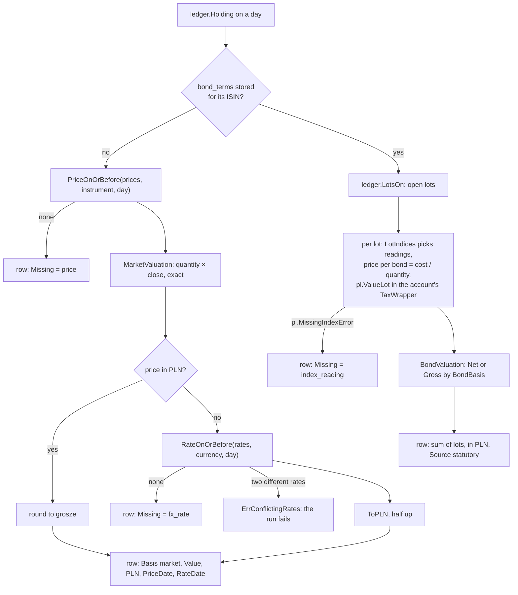
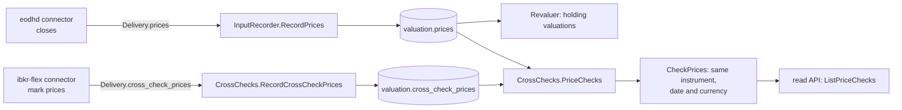
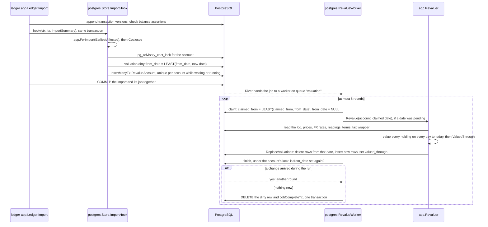
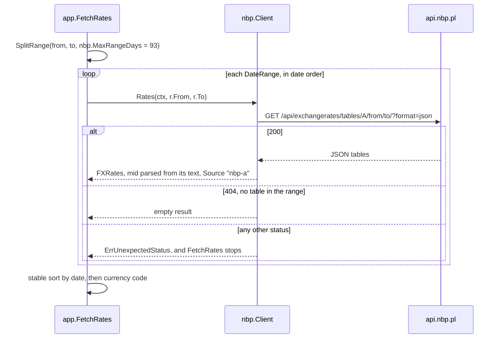
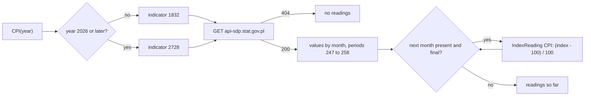
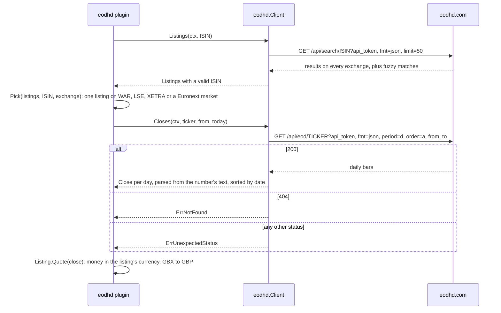

The valuation context turns holdings into money. For each account it stores the value of every holding on every day, in the instrument's currency and in PLN, and rebuilds those rows whenever one of their inputs changes. The inputs are end-of-day prices, exchange rates from the National Bank of Poland (NBP), period index readings for treasury bonds, and the ledger's transaction log. Bond values come from the Polish rules in [Treasury bonds](treasury-bonds.md); valuation picks which of them counts and adds them up.

## Concepts

### Prices, FX rates and index readings

A [price](../glossary.md) is the end-of-day close of one unit of an [instrument](../glossary.md), in the currency it trades in, with its source. M0 uses end-of-day prices only (D-21), from a market-data connector on the owner's own API key (D-22, D-51).

An [FX rate](../glossary.md) is the value in PLN of one unit of a currency on a date. [NBP table A](../glossary.md) is the central bank's daily table of average exchange rates against PLN, published on business days. Polish tax law converts foreign income at these rates (R-9), and M0 uses them for every conversion to PLN (D-20). There is no table on weekends or holidays, so the rate for a date is the latest one dated on or before it. NBP's API serves table A from 2002-01-02 (R-17).

A period index reading is one month's published value of a [period index](../glossary.md): CPI from GUS, or the NBP reference rate. Treasury bonds need them for interest periods after the first. A CPI reading is keyed by the month it measures; a reference-rate reading by the month whose ROR and DOR interest periods it sets, holding the rate in force on that month's reference-rate day ([Treasury bonds](treasury-bonds.md#business-days-and-the-reference-rate-day)). The treasury-bonds connector fetches both ([Plugins](plugins.md#first-party-plugins)).

Every amount keeps its original currency ([money](../glossary.md)). Converting to PLN is an explicit step that names the rate and a rounding mode, and rounds once.

### Cross-check prices and price checks

D-22 makes IBKR's own prices a cross-check of the market-data connector's, and D-51 adds a reason: EODHD's closes are aggregated across venues rather than each exchange's official close. A [cross-check price](../glossary.md) is such an institution's own end-of-day price, such as the mark price of a position in an IBKR Flex statement. It is stored beside the prices, never among them: no holding is valued from it, and recording one revalues nothing.

A [price check](../glossary.md) compares a cross-check price with the price of the same instrument, on the same date and in the same currency. Its relative difference is (cross-check price - price) / price. A check whose difference is beyond the price check threshold, in either direction, is flagged for the owner to look at; it changes no valuation and no price. The threshold is a setting of the core, 1% unless configured (see [Decisions](#decisions)).

### Valuations and valuation bases

A [valuation](../glossary.md) is the value of a holding on a date, with its [valuation basis](../glossary.md) and source:

| Basis | Text form | Value | Used for |
|---|---|---|---|
| `Market` | `market` | Quantity times the end-of-day close, in the price's currency | Instruments with a price |
| `GrossAccrued` | `gross_accrued` | Nominal plus accrued interest, before any fee or tax | Treasury bonds |
| `NetIfRedeemed` | `net_if_redeemed` | What redeeming today would pay, after the early-redemption fee and Belka tax | Treasury bonds |

Polish retail treasury bonds are not traded, so they have no market price. They count at gross accrued or net-if-redeemed, what a redemption today would actually pay; today net-if-redeemed is the default in totals. D-77 replaces that choice with three values for every holding, shown side by side: gross, net and liquidation.

### Stored valuations and revaluation

D-36 makes valuations stored rows rather than values computed on each read. A stored row, `HoldingValuation`, is one holding of one account on one day on one basis: its quantity, its value in the instrument's currency and in PLN, its source, and the dates of the price and rate it used. When an input is missing, the row says which one (`price`, `fx_rate` or `index_reading`) and why, and has no value. A gap is recorded, not raised as an error.

Every row derives from the transaction log and the stored inputs, so it can be rebuilt at any time. A revaluation rebuilds one account's rows from a date to today. Any change to an input enqueues one, in the same database transaction as the change. Pending revaluations of one account coalesce into one, from the earliest affected date.

An account's valued-through date is the last day whose holdings all have a valuation: the day before its first missing input, or today. Together with "pending" and "running", it tells a reader how current the account's numbers are.

## How it works

The context follows the layering in [code-organization.md](../dev/code-organization.md):

| Package | Layer | Contents |
|---|---|---|
| `valuation` ([valuation.go](../../internal/valuation/valuation.go), [fx.go](../../internal/valuation/fx.go), [index.go](../../internal/valuation/index.go), [revaluation.go](../../internal/valuation/revaluation.go), [crosscheck.go](../../internal/valuation/crosscheck.go)) | Domain, pure | Prices, FX rates, bases, index readings; valuing one holding; `HoldingValuation`, `ValuedThrough`, `Revaluation`, `Coalesce`; `CrossCheckPrice`, `CheckPrice`, `CheckPrices` |
| `valuation/app` ([plan.go](../../internal/valuation/app/plan.go), [record.go](../../internal/valuation/app/record.go), [revalue.go](../../internal/valuation/app/revalue.go), [ports.go](../../internal/valuation/app/ports.go), [status.go](../../internal/valuation/app/status.go), [rates.go](../../internal/valuation/app/rates.go), [crosscheck.go](../../internal/valuation/app/crosscheck.go)) | Use cases and ports | `Planner`, `InputRecorder`, `Revaluer`, `ValuationStatus`, `FetchRates`, `CrossChecks` |
| `valuation/postgres` ([store.go](../../internal/valuation/postgres/store.go), [queue.go](../../internal/valuation/postgres/queue.go), [worker.go](../../internal/valuation/postgres/worker.go), [status.go](../../internal/valuation/postgres/status.go), [crosscheck.go](../../internal/valuation/postgres/crosscheck.go), [0001_valuation.sql](../../internal/valuation/postgres/migrations/0001_valuation.sql)) | Adapter | The `valuation` schema, the River queue and its workers |
| `valuation/nbp` ([client.go](../../internal/valuation/nbp/client.go), [refrate.go](../../internal/valuation/nbp/refrate.go)) | Adapter | `Client`, which fetches table A for the `RateProvider` port; `Archive`, which reads NBP's reference rate changes |
| `valuation/gus` ([client.go](../../internal/valuation/gus/client.go)) | Adapter | `Client`, which fetches GUS's year-on-year CPI of a year as `IndexReading`s |
| `valuation/eodhd` ([client.go](../../internal/valuation/eodhd/client.go), [listing.go](../../internal/valuation/eodhd/listing.go)) | Adapter | `Client`, which finds an ISIN's listings and fetches end-of-day closes from EODHD; `Pick` and `Listing.Quote`, which choose a listing and quote its closes |

### Valuing one holding

`Revaluer.Revalue(account, from)` loads the account's log, derives its holdings for each day with `ledger.HoldingsOn`, and values each one:

`ValueMarketHolding` takes the latest price on or before the day, multiplies it by the quantity exactly, and converts with the latest FX rate on or before the day, rounding half up (`ValueRounding`). `ValueBondHolding` values each open lot with `pl.ValueLot`: purchase date is the lot's open date, price per bond its PLN cost over its quantity, and `LotIndices` supplies a reading for each started period after the first (CPI of `pl.CPIMonth`, or the reference rate recorded for the month the period starts). An account's tax wrapper is `Taxable` unless one was recorded. The bond basis is the one the `Revaluer` was built with (`BondBasis`: net-if-redeemed when unset, `Market` rejected).

`RateOnOrBefore` skips other currencies and later dates. No rate is `ErrNoRate`; equal duplicates are fine; different rates for one date are `ErrConflictingRates`. With synthetic rates of 4.0000 on Friday 2026-03-06 and 4.0100 on Monday 2026-03-09, a Sunday valuation takes Friday's rate. Tax on income received that Monday also takes Friday's, because `pl.TaxRateCutoff` moves the cutoff to Sunday ([the tax FX rate date](treasury-bonds.md#the-tax-fx-rate-date)).

### Recording inputs and planning revaluations

`InputRecorder` stores each input through the `Recorder` port, which writes it and enqueues its revaluations in one transaction. It rejects bad input with `ErrInvalidInput`: a price that names no instrument or isn't positive, an FX rate for PLN or not positive, an unknown index kind or month, bond terms without an ISIN, an unknown tax wrapper. The `Planner` decides which accounts each change affects, by fixed rules:

| Change | Entry point | Accounts | From |
|---|---|---|---|
| Prices | `RecordPrices` | Each account whose log ever held the instrument | The earliest price's date per instrument |
| FX rates | `RecordFXRates` | Every account with a log | The earliest rate's date |
| Index readings | `RecordIndexReadings` | Every account with a log | The first day of the earliest reading's month |
| Bond series terms | `RecordBondTerms` | Each account whose log ever held that ISIN | Its first transaction |
| Tax wrapper | `RecordTaxWrapper` | That account | Its first transaction |
| Bond basis | `ApplyBondBasis` | Every account, only if the basis changed | Its first transaction |
| Ledger import | `postgres.Store.ImportHook` | Each account the import changed | `ImportSummary.EarliestAffected` |
| End of day | `EndOfDay` River job | Every account with a log | Its valued-through date, or its first transaction |

The `valuation` schema keys prices by instrument and date, rates by currency and date, readings by kind and month, and terms by ISIN; recording one again replaces it. An instrument whose ISIN has stored terms is valued as a bond.

[Index levels](../glossary.md) (`valuation.IndexLevel`, [level.go](../../internal/valuation/level.go)) are the end-of-day closing levels of market indices such as WIG20 (D-51), keyed by the index's name as the market-data connector names it and by date, in `valuation.index_levels` ([0002_index_levels.sql](../../internal/valuation/postgres/migrations/0002_index_levels.sql)). A level has no currency; the model portfolio's index target carries it. `InputRecorder.RecordIndexLevels` checks each level (`IndexLevel.Validate`: a name of at most 64 characters, a date, a positive level) and `Store.SaveIndexLevels` upserts them; no holding is valued from an index, so they enqueue no revaluation. `Store.IndexLevels(index, through)` reads them for the model portfolio's backtest (D-53, [Portfolio](portfolio.md)).

### Cross-checking prices

`CrossChecks.RecordCrossCheckPrices` checks each cross-check price (`CrossCheckPrice.Validate`: an instrument, a date, a positive close and a source) and `Store.SaveCrossCheckPrices` upserts them into `valuation.cross_check_prices` ([0003_cross_check_prices.sql](../../internal/valuation/postgres/migrations/0003_cross_check_prices.sql)), keyed by instrument, date and source, so two connector instances that report one instrument both keep theirs. Nothing is enqueued, and `valuation.prices` is never touched: the `Revaluer` reads only the prices.

`CrossChecks.PriceChecks` reads every cross-check price and the prices of the same instruments and dates (`Store.CrossCheckedPrices`) and hands them to `CheckPrices`. For each cross-check price with a price of the same instrument, date and currency, `CheckPrice` computes the relative difference with `Decimal.Quo`, half-even to six decimal places (`DifferencePlaces`), for display. Whether the check is flagged doesn't depend on that rounding: it compares |cross-check - price| with threshold × price exactly, and a difference equal to the threshold is matched. A cross-check price with no price that day, or only one in another currency, gives no check. The checks come in date, instrument and source order. With synthetic prices, a close of 100 USD and IBKR's mark of 101 USD are matched at the default 1% threshold, and a mark of 101.0001 USD is flagged (`TestCheckPrice`).

`NewCrossChecks` takes the threshold: zero means `DefaultPriceCheckThreshold`, 0.01; anything else must be greater than 0 and less than 1 (`CheckThreshold`).

### The revaluation queue and worker

Revaluations run on [River](https://github.com/riverqueue/river), a job queue that keeps its jobs in PostgreSQL, so a job can be inserted in the same transaction as the change that causes it. River's tables live in the `river` schema, and `postgres.Migrate` creates both schemas. The sequence for a ledger import:

Coalescing has two halves. River keeps at most one `RevalueAccount` job per account among waiting and running jobs (unique by its args, which name only the account). The date lives beside it in `valuation.dirty`, and every enqueue lowers it with `LEAST`. Enqueueing and finishing take the same per-account advisory lock, so a change either lands before `finish` checks (and the job goes another round) or after the job completed (and River accepts a new job). A failed run returns an error and River retries it; `claimed_from` keeps the date. After five rounds of fresh changes the job snoozes and runs again at once without using up an attempt.

`Revalue` starts at `from`, or at the account's first transaction when that is later, and runs to `today()`. It replaces every stored row dated on or after `from` in one transaction, so running it again gives the same rows. `ValuedThrough` keeps an earlier stored date if it lies before the day before the start, since that gap was not revisited.

Worked example, from the synthetic `TestWorkerRevaluesEndToEnd`: 10 units of a USD ETF are bought on 2026-03-02 and today is 2026-03-04. A USD rate of 4 is recorded for 2026-03-02 and a close of 100 USD for 2026-03-03. The run stores 2026-03-02 as missing a price, then 4000 PLN on both later days, so the account is valued through 2026-03-01. When a close of 99 USD for 2026-03-02 arrives, its own revaluation stores 3960 PLN for that day and the account is valued through 2026-03-04.

### Status and configuration

`postgres.Store.Statuses` returns an `app.ValuationStatus` per account: `ValuedThrough` from `valuation.account_status` (zero if never revalued); `Pending` when a change waits unclaimed, a job is waiting or retryable, or claimed work has no running job; `Running` when a job runs now.

`postgres.Config` holds what D-36 makes configurable: `Concurrency` (River workers on the queue), `EndOfDay` (a daily time in a time zone), `BondBasis` and the `Today` date source. `NewClient` rejects invalid settings and builds the River client with both workers and the periodic end-of-day job. The basis is fixed per process: `ApplyBondBasis` at start-up records it in `valuation.settings` and revalues every account only when it changed.

### Fetching NBP rates

`app.RateProvider` is D-20's swappable rate source. `FetchRates` splits a range with `SplitRange` into pieces of at most the provider's limit, calls them in date order, stops at the first failure, and sorts the result by date and currency.

The adapter keeps NBP's JSON shape inside the package. It parses `mid` from the number's text into a `kernel.Decimal`, never through a float. It rejects, as `ErrMalformedTable`, a body that isn't JSON, a table other than `A`, a bad date or currency code, and a rate that isn't positive. It sends `User-Agent: openfief`, because `api.nbp.pl` answers 403 to Go's default, and reads at most 4 MiB. The caller supplies the `http.Client`, including its proxy.

NBP's Web API serves no interest rates. `nbp.Archive.ReferenceRates` reads the archive NBP publishes at `static.nbp.pl/dane/stopy/stopy_procentowe_archiwum.xml` instead: one `pozycje` element per change, dated by the day it took effect (`obowiazuje_od`), with each base rate in percent and a decimal comma. It strips the file's byte order mark, keeps the `ref` rate of each change as a fraction (`5,75` is `0.0575`), leaves out changes of other rates only, and sorts by date. A document that isn't the archive, a bad date or rate, two changes on one day or no reference rate at all is `ErrMalformedArchive`.

### Fetching GUS CPI

`gus.Client.CPI(year)` asks GUS's SDP API (`api-sdp.stat.gov.pl`) for one year of the CPI indicator: `/api/indicators/indicator-data-indicator?id-wskaznik=…&id-rok=…`. GUS moved CPI to the COICOP 2018 classification with January 2026's data, and the API keeps the two series apart: indicator 1832 holds years up to 2025, indicator 2728 years from 2026, and each answers 404 for the other's years. Both are CPI for all of Poland with the same month a year before = 100 (way of presentation 5).

Each value's index is parsed from the number's text, never a float, and becomes a fraction: 104.9 is `0.049`. Months come in order and stop before the first that is missing, has no value, or carries GUS's flag for an estimate, a forecast or preliminary data, so a later month never arrives ahead of an earlier one. A period that isn't a month is skipped; a value for another year or in another presentation, two values for one month, or an index that isn't a positive number is `ErrMalformedData`. The API takes anonymous requests, up to 5 a second and 100 in 15 minutes; the client needs no key and sends none.

### Fetching EODHD closes

D-51 makes [EODHD](../glossary.md) the first market-data source, on the owner's own API key (D-22). The `eodhd` package is its adapter; the [eodhd plugin](plugins.md#first-party-plugins) runs it. EODHD names a listing by a ticker, its code plus an exchange code, such as `SYNT.XETRA`, and finds listings by ISIN through its search.

`Pick` keeps the listings of the asked ISIN on a supported exchange (`SupportedExchange`: `WAR`, `LSE`, `XETRA`, and Euronext's `PA`, `AS`, `BR`, `LS`, `IR`, `MI`, `OL`), on the asked exchange when one is named, each ticker once. None is `ErrNotListed`; more than one, with no exchange named, is `ErrAmbiguous`, which names the tickers. `Quote` turns a close into money in the listing's currency. EODHD quotes most LSE listings in pence, `GBX`, which is not an ISO 4217 code: such a close is divided by 100 exactly and becomes pounds. Any other currency must be a valid code, or the result is `ErrQuoteCurrency`.

`Closes` uses the `close` field, not `adjusted_close`, which EODHD back-adjusts for splits and dividends; a stored price is what the instrument closed at that day. It leaves out a day whose close is null or not positive, and asks for the whole history when `from` is zero. The adapter keeps EODHD's JSON inside the package, parses every close from its text into a `kernel.Decimal`, and rejects, as `ErrMalformedResponse`, a body that isn't the documented array, a bad date or a close that isn't a number. The API key travels as the `api_token` query parameter, so the client strips the request URL from transport errors: no error it returns contains the key. It sends `User-Agent: openfief` and reads at most 16 MiB. The caller supplies the `http.Client`, including its proxy.

## Decisions

- **D-22**, **D-51**: the EODHD adapter, on the owner's API key, for the Warsaw Stock Exchange, LSE, Xetra and Euronext; and the cross-check of the stored prices against cross-check prices, which the IBKR connector delivers from its Flex statements ([Ingest](ingest.md#mapping-a-flex-statement)). The threshold is not decided anywhere: it is the core's `--price-check-threshold`, 1% unless set, and comparing only prices of the same date and currency is the narrowest reading of D-22 ([Implementation questions](../implementation-questions.md)).
- **D-36**: stored valuations, River queue, coalescing, fixed triggers, configurable settings, basis change revalues all. Built in the valuation context. `cmd/core` migrates the schemas, wires the import hook, records the bond basis with `ApplyBondBasis` and runs the River client, with `--workers`, `--end-of-day` and `--bond-basis` as its settings ([core.go](../../cmd/core/core.go)); the [read API](read-api.md) serves each account's status and the [built-in UI](ui.md) shows it. `cmd/demo-seed` runs the same pieces to value the demo dataset.
- **D-20**: NBP table A to PLN, swappable rate provider. The NBP adapter stays a package of the core module (`internal/valuation/nbp`); the [nbp-fx plugin](plugins.md#first-party-plugins) is the FX connector that serves it, and the core syncs it like any connector. One gap remains: "tax always uses NBP rates" isn't enforced, since `RateOnOrBefore` ignores `Source`.
- **D-21**: end-of-day prices only.
- **D-77**: **partly built.** Every holding has its gross value, and bonds have a configurable basis between gross accrued and net-if-redeemed (net-if-redeemed by default). Not built: net and liquidation for every product, storing all three in each valuation, and the charts' switch (see [Treasury bonds](treasury-bonds.md#decisions)).
- **D-76**, **D-78**: not built beyond the bond wrappers: no per-account tax wrapper the owner sets, no OKI, no fee rule and no PIT-rate setting.
- **D-14**: PostgreSQL holds the `valuation` and `river` schemas.
- **D-62** and **T-12**: conversion targets PLN only, and every stored row has a PLN value; D-62 allows assuming PLN only in the Polish pack's tax rules. T-12 (proposal P-49) is open.
- Rounding market values half up to grosze (`ValueRounding`) is not decided anywhere; its doc comment borrows D-37's bond rounding.

## Verification

| Behavior | Tests | kibi |
|---|---|---|
| Market value is exact; bond basis defaults to net and rejects market | `TestBasisNames`, `TestMarketValuation`, `TestBondBasis`, `TestBondValuation` in [valuation_test.go](../../internal/valuation/valuation_test.go) | REQ-valuation-market-value, REQ-valuation-bond-basis, TEST-valuation-valuation |
| Latest rate on or before a date; tax takes the day before; conversion rounds once | `TestRateOnOrBefore`, `TestRateOnOrBeforeConflicts`, `TestTaxRateUsesTheTableBeforeTheEvent`, `TestToPLN`, `TestConvertToPLN` in [fx_test.go](../../internal/valuation/fx_test.go) | REQ-valuation-fx-rate-lookup, REQ-pl-tax-fx-rate-date, REQ-valuation-pln-conversion, TEST-valuation-fx |
| Each started period gets its CPI or reference-rate reading | `TestIndexKindNames`, `TestLotIndices` in [index_test.go](../../internal/valuation/index_test.go) | REQ-valuation-lot-indices, SCEN-valuation-lot-indices, TEST-valuation-index |
| Index levels need a name, a date and a positive level; they are stored and read back by index and date, replace an earlier one and revalue nothing | `TestIndexLevelValidate` in [level_test.go](../../internal/valuation/level_test.go); `TestRecordInputs`, `TestRecordRejectsInvalidInputs` in [plan_test.go](../../internal/valuation/app/plan_test.go); `TestIndexLevelsRoundTrip` in [postgres/level_test.go](../../internal/valuation/postgres/level_test.go) | REQ-valuation-index-levels, TEST-valuation-index-level, TEST-valuation-postgres-index-levels |
| Holdings valued at market or as bond lots; gaps become rows; valued-through rule; coalescing | `TestPriceOnOrBefore`, `TestValueMarketHolding`, `TestValueMarketHoldingConflictingRates`, `TestValueBondHolding`, `TestValueBondHoldingRejects`, `TestValuedThrough`, `TestCoalesce` in [revaluation_test.go](../../internal/valuation/revaluation_test.go) | REQ-valuation-market-holding, REQ-valuation-bond-holding, REQ-valuation-missing-input, REQ-valuation-coalesce, TEST-valuation-revaluation |
| Fixed trigger rules, input validation, basis change | `TestPlanner`, `TestRecordInputs`, `TestRecordRejectsInvalidInputs`, `TestApplyBondBasis` in [plan_test.go](../../internal/valuation/app/plan_test.go) | REQ-valuation-revaluation-triggers, REQ-valuation-input-validation, REQ-valuation-basis-change, TEST-valuation-app-plan |
| A revaluation rebuilds rows idempotently from its start and keeps an earlier gap | `TestRevalueStoresMarketValues`, `TestRevalueIsIdempotent`, `TestRevalueStartsAtTheFirstTransaction`, `TestRevalueKeepsAnEarlierGap`, `TestRevalueMissingInputs`, `TestRevalueBonds` in [revalue_test.go](../../internal/valuation/app/revalue_test.go) | REQ-valuation-revaluation-rows, SCEN-valuation-revaluation-rebuild, TEST-valuation-app-revalue |
| Inputs and imports enqueue in their own transaction; coalescing in `dirty`; status flags | `TestSaveEnqueuesInTheSameTransaction`, `TestEnqueueCoalescesFromTheEarliestDate`, `TestImportHookEnqueuesInTheImportsTransaction`, `TestSaveBondBasisRevaluesOnlyOnAChange`, `TestStatuses` in [queue_test.go](../../internal/valuation/postgres/queue_test.go) | REQ-valuation-enqueue-same-transaction, REQ-valuation-river-jobs, REQ-valuation-status, TEST-valuation-postgres-queue |
| Inputs and valuations round-trip; replacing rows | `TestInputsRoundTrip`, `TestReplaceValuations` in [store_test.go](../../internal/valuation/postgres/store_test.go) | REQ-valuation-schema, TEST-valuation-postgres-store |
| Cross-check prices need an instrument, a date, a positive close and a source; a price check's relative difference and its flag at the threshold, exact; only the same instrument, date and currency are compared; the threshold is a fraction in (0, 1), 1% by default | `TestCrossCheckPriceValidate`, `TestCheckThreshold`, `TestPriceCheckStatusNames`, `TestCheckPrice`, `TestCheckPrices` in [crosscheck_test.go](../../internal/valuation/crosscheck_test.go) | REQ-valuation-price-check, SCEN-valuation-price-check, TEST-valuation-crosscheck |
| Cross-check prices are validated, stored whole or not at all, and compared at the configured threshold | `TestNewCrossChecks`, `TestRecordCrossCheckPrices`, `TestPriceChecks` in [app/crosscheck_test.go](../../internal/valuation/app/crosscheck_test.go) | REQ-valuation-cross-check-prices, REQ-valuation-price-check-threshold, TEST-valuation-app-crosscheck |
| Cross-check prices round-trip by instrument, date and source, are read with the prices of the same days, enqueue nothing and leave the prices alone | `TestCrossCheckPricesRoundTrip` in [postgres/crosscheck_test.go](../../internal/valuation/postgres/crosscheck_test.go) | REQ-valuation-cross-check-prices, SCEN-valuation-cross-check-prices, TEST-valuation-postgres-crosscheck |
| Real River workers revalue, close a gap, run end of day; settings checked | `TestWorkerRevaluesEndToEnd`, `TestNewClientChecksTheConfig`, `TestDailyAt` in [worker_test.go](../../internal/valuation/postgres/worker_test.go) | REQ-valuation-settings, SCEN-valuation-river-jobs, TEST-valuation-postgres-worker |
| EODHD: one listing per ISIN on a supported exchange; closes exact and in the listing's currency, pence to pounds; the API key never in an error | [listing_test.go](../../internal/valuation/eodhd/listing_test.go): `TestSupportedExchange`, `TestPick`, `TestTicker`, `TestQuote`; [client_test.go](../../internal/valuation/eodhd/client_test.go): `TestListings`, `TestListingsNone`, `TestCloses`, `TestClosesWholeHistory`, `TestClosesUnknownTicker`, `TestClosesParsesExactly`, `TestClientRejects`, `TestClientNeverReturnsTheKey` | REQ-valuation-eodhd-listing, REQ-valuation-eodhd-closes-exact, REQ-valuation-eodhd-request, TEST-valuation-eodhd-listing, TEST-valuation-eodhd-client |
| NBP's reference rate archive: every change, in order, as an exact fraction | `TestReferenceRatesArchive`, `TestReferenceRatesParsesTheArchive`, `TestReferenceRatesRejects` in [refrate_test.go](../../internal/valuation/nbp/refrate_test.go) | REQ-valuation-nbp-reference-rates, SCEN-valuation-nbp-reference-rates, TEST-valuation-nbp-refrate |
| GUS CPI: final months only, as exact fractions, from the indicator of the year | `TestCPIFullYear`, `TestCPIYearSoFar`, `TestCPINothingPublished`, `TestCPIStopsAtTheFirstMonthNotFinal`, `TestCPIRejects` in [client_test.go](../../internal/valuation/gus/client_test.go) | REQ-valuation-gus-cpi, SCEN-valuation-gus-cpi, TEST-valuation-gus-client |
| Rate ranges split per provider limit; NBP parses exactly, no table is empty | `TestSplitRange`, `TestFetchRates` in [rates_test.go](../../internal/valuation/app/rates_test.go); `TestRatesTableA`, `TestRatesNoData`, `TestRatesKeepsEveryDigit`, `TestRatesRejects` in [client_test.go](../../internal/valuation/nbp/client_test.go) | REQ-valuation-fx-range-splitting, REQ-valuation-nbp-decimal-exact, REQ-valuation-nbp-request, TEST-valuation-app-rates, TEST-valuation-nbp-client |

These kibi tests also validate the firm D-36 requirements (REQ-decision-d36-*), and those imported from D-20, D-21 and D-22, and the bond-basis requirement that predates D-77. The two status requirements are validated elsewhere: REQ-decision-d36-6-api-valuation-status by TEST-views-app ([Read API](read-api.md)), REQ-decision-d36-7-ui-valuation-status by TEST-ui-pages ([Built-in UI](ui.md)). The app tests use in-memory fakes. The NBP tests replay [hypert](https://github.com/areknoster/hypert) recordings of the public `api.nbp.pl` and `static.nbp.pl` from `nbp/testdata/`, and the GUS tests real recordings of the public SDP API from `gus/testdata/` (no key; the session cookie dropped), with no network. The EODHD tests replay `eodhd/testdata/` the same way, but those files are synthetic: recording needs an API key, so they were written by hand in the response shape EODHD documents for `/api/search` and `/api/eod`, with made-up ISINs (`XX00000SYNT3`), tickers and prices, and the key replaced by `SANITIZED` in both the stored and the replayed request. They follow EODHD's documentation, not a real response.

`task test` runs everything offline; the PostgreSQL tests skip there, because `OPENFIEF_PG_DSN` is unset. `task test:pg` runs every `internal/*/postgres` package against a disposable server: the one `OPENFIEF_PG_DSN` names, or a throwaway cluster started from local PostgreSQL binaries on a Unix socket. Each test creates its own database with every valuation and River migration applied, and drops it.

One behavior differs from its doc comment. `RateOnOrBefore` says two different rates are an error "on the chosen date", but it checks while scanning, against the latest date seen so far: a conflict on an earlier date fails the lookup if it comes first in the slice. Stored rates are unique per currency and date, so a revaluation can't meet it.

## Not built yet

- **D-51**: checking the adapter against a real EODHD response; its recordings are synthetic.
- **D-62**: the reporting currency setting (`valuation.ReportingCurrency` in the glossary).
