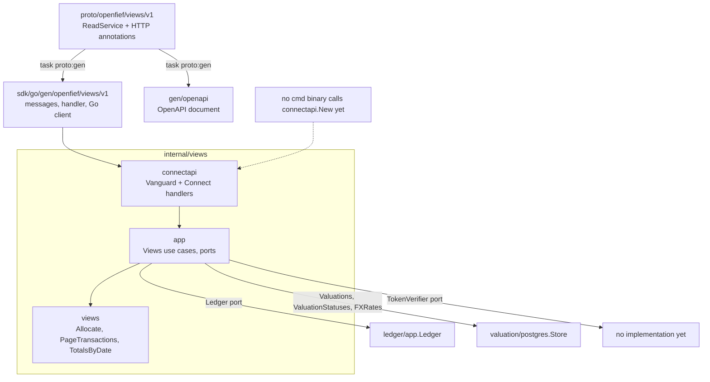
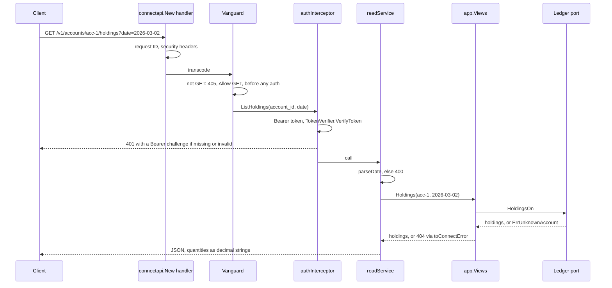
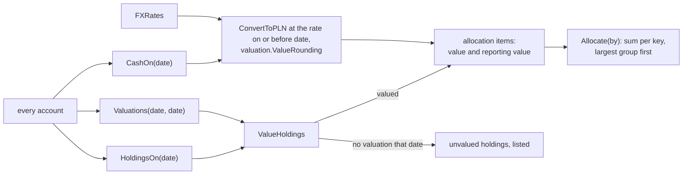

The [read API](../glossary.md) is how everything outside the core sees OpenFief's record: scripts, view plugins, and later the built-in UI (D-6). It only reads. It is defined once in protobuf and served from one set of handlers as Connect and as plain REST under `/v1` (D-50), with values in their original currency plus the [reporting currency](../glossary.md) (D-62). The handlers, use cases and contract are built and tested, but no binary serves them yet.

## Concepts

**A separate read side.** Bertrand Meyer's command-query separation (1988) says a method should either change state or answer a question, never both. Greg Young's CQRS (around 2010) applies that to whole systems: the write path and the read path are separate models. OpenFief does a light version of this. Data enters only through connectors' ingest paths into the append-only transaction log (D-7, D-18). The read API composes answers from the ledger's queries and from stored [valuations](../glossary.md), which are a read model: rows derived from the log, prices and rates, rebuildable at any time (D-36). Nothing the API offers can change the record, so every method declares no side effects and maps to a `GET`.

**One contract, two protocols.** The API is the protobuf service `openfief.views.v1.ReadService` with `google.api.http` annotations, the HTTP mapping Google's API design guide uses. Connect, by Buf, serves a protobuf service as gRPC, gRPC-Web, or its own HTTP protocol with JSON, so generated Go and TypeScript clients get typed calls. Vanguard, also by Buf, *transcodes*: it turns a REST request such as `GET /v1/accounts/acc-1/holdings?date=…` into a call to the same Connect handler, and its response back into JSON. The OpenAPI document is generated from the same definitions. One source means the Connect API, the REST API and the spec can't drift apart, and a script can still use `curl`.

**Original and reporting currency.** Every amount keeps its original currency (D-20). Totals, valuations and the allocation also carry their value in the reporting currency, a setting whose default comes from the jurisdiction pack (D-62). Stored valuations convert to PLN, and cross rates for other currencies are undecided (T-12), so only PLN is accepted today. Money crosses the wire as `{amount, currency}` with the amount as a decimal string, never a JSON number, so no client rounds it through a float.

**Allocation groupings.** The allocation chart (D-30) splits the portfolio's value on one date by one dimension: asset class (`cash`, `treasury_bond`, `listed`), original currency, institution, or sleeve. A holding counts at its stored valuation on that date; cash is converted at the FX rate dated on or before it. A holding with no valuation on that date is listed as unvalued instead of guessed, so the total is honest about what it leaves out.

**Paging with a cursor.** Transactions come in pages. An offset ("skip 200") breaks when rows are added between two requests: a row is skipped or read twice. A *keyset* cursor names the last row read, here its date, source and external ID, and the next page starts after it, wherever new rows landed. Google's API improvement proposals (AIP-158) give the shape: `page_size` and `page_token` in, `next_page_token` out, the token opaque to the client.

## How it works

### Packages

| Path | What it holds |
|---|---|
| `internal/views` | Pure rules: `Allocate`, `AssetClassOf`, `ValueHoldings` ([allocation.go](../../internal/views/allocation.go)); `PageTransactions` and `TransactionCursor` ([page.go](../../internal/views/page.go)); `TotalsByDate`, `ValidateRange` ([valuation.go](../../internal/views/valuation.go)) |
| `internal/views/app` | `Views`, the use cases ([views.go](../../internal/views/app/views.go)); the ports it reads through, `Ledger`, `Valuations`, `ValuationStatuses` and `FXRates` ([ports.go](../../internal/views/app/ports.go)); `TokenVerifier` ([tokens.go](../../internal/views/app/tokens.go)) |
| `internal/views/connectapi` | The adapter: `New` builds the HTTP handler ([handler.go](../../internal/views/connectapi/handler.go)); one method per call ([server.go](../../internal/views/connectapi/server.go)); bearer-token check ([auth.go](../../internal/views/connectapi/auth.go)); error mapping ([errors.go](../../internal/views/connectapi/errors.go)); domain to protobuf ([convert.go](../../internal/views/connectapi/convert.go)) |
| `proto/openfief/views/v1` | The contract ([read_service.proto](../../proto/openfief/views/v1/read_service.proto)) and what is merged into the OpenAPI document ([read_service.openapi-base.yaml](../../proto/openfief/views/v1/read_service.openapi-base.yaml)) |
| `sdk/go/gen/openfief/views/v1` | Generated by `task proto:gen`: messages, the Connect handler and the Go client `viewsv1connect.NewReadServiceClient`; the OpenAPI document goes to [gen/openapi](../../gen/openapi/openfief/views/v1/read_service.openapi.yaml) |

Dependencies point inward, as [code-organization.md](../dev/code-organization.md) asks: the adapter imports the use cases, the use cases import the pure rules, and the ports are declared where they are consumed. `*ledgerapp.Ledger` and `valuation/postgres.Store` have the ports' methods, but nothing in the code asserts it yet.

### One request

The same handler also answers Connect, gRPC and gRPC-Web at `/openfief.views.v1.ReadService/`. `toConnectError` maps an unknown account to not found, a bad date, range, page token, page size or dimension to invalid argument, and anything else to internal; Vanguard turns these into 404, 400 and 500. A client sees fixed texts and the request ID, never the error's own text, which could quote an account or an amount. The log records only the request ID, method, status and failing step, not the path, because a path names an account. Every response carries `Cache-Control: no-store`, `nosniff`, `X-Frame-Options: DENY`, `no-referrer` and a `default-src 'none'` content security policy.

The calls, all `GET`:

| REST path | Answers |
|---|---|
| `/v1/sleeves`, `/v1/accounts`, `/v1/accounts/{id}` | Sleeves with their kind and role; accounts with their institution and sleeve |
| `/v1/accounts/{id}/transactions` | Current versions, paged: `pageSize` 1 to 500, default 100; `pageToken` |
| `/v1/accounts/{id}/holdings`, `/lots`, `/cash` | As of the end of `date` |
| `/v1/accounts/{id}/balance-assertions` | Latest checks, optionally only `MATCHED` or `FLAGGED` |
| `/v1/accounts/{id}/valuations`, `/v1/valuations` | Stored valuations from `from` to `to` (at most 3700 days), with totals per date |
| `/v1/accounts/{id}/valuation-status`, `/v1/valuation-status` | Valued through which date; revaluation pending or running (D-36) |
| `/v1/allocation` | The allocation on `date`, grouped `by` one dimension, with the unvalued holdings |

### The allocation

`AssetClassOf` calls an instrument a treasury bond when its ISIN starts with `PL` and its symbol parses as a [bond series](../glossary.md), such as EDO0536, and listed otherwise. A sum in any currency other than the reporting one is an error (`ErrNotReportingCurrency`), never a silent mix. `app.New` returns `*UnsupportedReportingCurrencyError` for anything but PLN.

## Decisions

- **D-6**: read-only `/v1` REST/JSON with OpenAPI. It also serves sleeves, cash, balance assertions, valuation status and the allocation.
- **D-7**: data never enters through the API; non-`GET` gets 405.
- **D-50**: protobuf contract, Connect plus REST via Vanguard, generated OpenAPI. **Gap:** D-50 names generated Go *and TypeScript* clients; only the Go client is generated, and `sdk/ts` doesn't exist.
- **D-62**: values in the reporting currency next to the original. **Partly:** the currency is a constructor argument that must be PLN (T-12); no setting or jurisdiction-pack default exists.
- **D-30**: allocation by asset class, currency, institution or sleeve. D-30 says "broker"; the code uses the glossary's [institution](../glossary.md). There is no grouping by [sleeve kind](../glossary.md), though `ListSleeves` returns each sleeve's kind.
- **D-36**: valuation status per account served, as D-36 asks.
- **D-20**: every amount keeps its original currency.
- **D-27**: every call needs a bearer token, but no `TokenVerifier` implementation exists.
- **Mismatch:** [doc.go](../../internal/views/doc.go) lines 6-8 say the HTTP adapter is `internal/views/restapi`, which doesn't exist; REST is `connectapi` through Vanguard.
- **Worth checking:** `/v1/valuations` totals sum stored holding valuations only, and the valuation context values no cash. `/v1/allocation` adds cash. For the same date the two totals differ by the cash balance, and a value-over-time line built from `/v1/valuations` (D-30, D-61) would leave cash out.

## Verification

| Behavior | Tests | kibi |
|---|---|---|
| Groups and sums per dimension, largest first; other currencies refused; asset classes | `TestAllocate`, `TestAllocateEdges`, `TestAllocateInAnyReportingCurrency`, `TestParseDimension`, `TestAssetClassOf`, `TestValueHoldings` in [allocation_test.go](../../internal/views/allocation_test.go) | REQ-views-allocation |
| Paging reads every transaction once; cursor round-trips; sizes 1 to 500 | `TestPageTransactions`, `TestPageTransactionsSize`, `TestTransactionCursor` in [page_test.go](../../internal/views/page_test.go) | REQ-views-transaction-pages |
| Totals per date, exact, per currency; ranges checked | `TestTotalsByDate`, `TestTotalsByDateOtherCurrency`, `TestValidateRange` in [valuation_test.go](../../internal/views/valuation_test.go) | REQ-views-valuation-totals |
| Use cases: allocation inputs, PLN only, valuations, status, unknown account, store failure | `TestAllocation`, `TestAllocationFailures`, `TestReportingCurrency`, `TestAccountValuations`, `TestValuationTotals`, `TestValuationStatus`, `TestAssertionChecks`, `TestTransactions`, `TestUnknownAccount`, `TestStoreFailure` in [views_test.go](../../internal/views/app/views_test.go) | REQ-views-allocation-inputs, REQ-views-reporting-currency, REQ-views-valuation-queries, REQ-views-valuation-status, REQ-views-app-queries |
| Connect calls, pages, errors, `GET` support; unary and side-effect free; enums match the domain | `TestConnectQueries`, `TestConnectValuation`, `TestConnectPages`, `TestConnectErrors`, `TestConnectGET`, `TestServiceIsReadOnly`, `TestEnumsMatch` in [connect_test.go](../../internal/views/connectapi/connect_test.go) | REQ-views-api-contract, REQ-views-api-read-only |
| REST answers match the generated OpenAPI; 405 before auth; tokens; headers; money as strings; logs without data | `TestREST`, `TestRESTInternalError`, `TestRESTUnauthenticated`, `TestRESTReadOnly`, `TestOpenAPIIsReadOnly`, `TestSecurityHeaders`, `TestMoneyIsADecimalString`, `TestLogNamesNoData` in [handler_test.go](../../internal/views/connectapi/handler_test.go) | REQ-views-read-api-protobuf, REQ-views-api-auth, REQ-views-api-logs |

`TestREST` checks every 200 response against [read_service.openapi.yaml](../../gen/openapi/openfief/views/v1/read_service.openapi.yaml) with kin-openapi, so the REST shape and the spec agree. Run `go test ./internal/views/...` or `task test`; `task proto:check` fails if `sdk/go/gen` or `gen/openapi` differ from what `task proto:gen` writes.

What the tests don't show: every test runs over fakes of the ports, never the real ledger or the PostgreSQL valuation store, and no test starts a server on a port.

REQ-views-allocation-inputs says cash rounds half-even, but the code rounds half up with `valuation.ValueRounding`; the tests use amounts where the two agree, so neither notices. A cash currency with no FX rate on or before the date fails the whole allocation call with an internal error (500) instead of leaving that cash out.

## Not built yet

- **No binary serves the API.** No `cmd/` binary calls `connectapi.New`; the commands are `demo-seed`, `egress-proxy`, `operator` and `sigstore-trusted-root`. There is no core binary, Service or `kubectl port-forward` path (D-28).
- **D-27**: a `TokenVerifier` for script tokens and plugins' projected tokens; the identity context doesn't exist.
- **D-50**: the TypeScript client.
- **D-3, D-30**: the built-in UI and its two charts; **D-4, D-64**: the Ghostfolio view plugin.
- **D-62**: the reporting-currency setting, its default from the jurisdiction pack, and any currency but PLN (T-12).
- **D-52**: the model portfolio in the read API.
