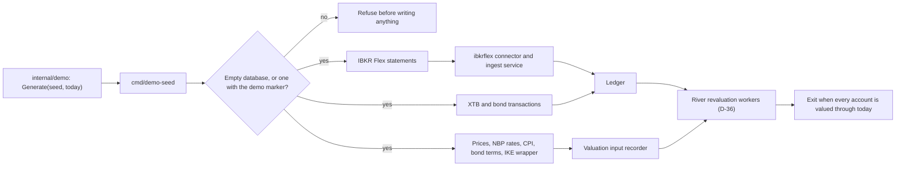

**(P)** This page is a Claude Code proposal, written for the author's request for committed automation that makes it easy to create and recreate demo machines within about €10 a month. The rules it serves are in [sdlc.md](sdlc.md#ci-and-environments): a Hetzner machine running k3s, deployed from `main` and from beta releases, holding synthetic data only (GR-12). Commands live in `Taskfile.yml`.

A demo is one Hetzner Cloud server running k3s. cloud-init installs pinned k3s and Flux, and Flux pulls everything else from `deploy/demo` in this repository. Nothing holds state outside Hetzner, Cloudflare and git: every Hetzner resource carries the labels `app=openfief` and `env=<name>`, every DNS record the comment `managed-by=openfief-demo env=<name>`, and the scripts find resources by those labels and comments. So any session with the token can create, inspect or destroy a demo, and `up` never creates something twice. The data in a demo is a generated, synthetic dataset ([Demo data](#demo-data)).

## Before the first demo

1. **API token.** In the Hetzner Cloud console, open the project, then Security > API tokens, and create a Read & Write token. Export it only in the shell that runs the commands: `read -rs HCLOUD_TOKEN && export HCLOUD_TOKEN`. If a session has it as `HETZNER_API_TOKEN`, the scripts read that name when `HCLOUD_TOKEN` is unset (or run `HCLOUD_TOKEN="$HETZNER_API_TOKEN" task demo:up ENV=demo`). The scripts never print it or write it to disk, and they ignore any `hcloud` CLI context you have stored.
2. **Cloudflare token (for DNS).** Create a custom API token in the Cloudflare dashboard with Zone > Zone > Read and Zone > DNS > Edit, limited to the zone `DEMO_DOMAIN` (`openfief.dev`), and export it the same way as `CLOUDFLARE_API_TOKEN`. Without it, `up` only prints the record to create ([DNS](#dns)).
3. **SSH key, or none.** Upload your public key with the label the scripts look for: `hcloud ssh-key create --name <you> --public-key-from-file ~/.ssh/id_ed25519.pub --label openfief-ssh=true`, or label an existing key with `hcloud ssh-key add-label <key> openfief-ssh=true`. Every key with that label is installed on new demos. Without one, the demo gets a throwaway key nobody holds and has no SSH at all ([SSH](#ssh)).
4. **Where you connect from.** Set `DEMO_SSH_CIDRS` to your address, such as `203.0.113.7/32`; several CIDRs are separated by commas. With no value, the firewall allows no SSH. HTTP and HTTPS are open to everyone by default (`DEMO_HTTP_CIDRS`), since a demo holds synthetic data only.
5. **Hard spending cap (optional).** Hetzner Cloud has no spending-limit API, so the budget check below lives in the scripts. For a hard cap, ask Hetzner support to lower the project's server limit to 1: no script or token can then create a second server.

## Commands

| Command | What it does |
|---|---|
| `task demo:plan ENV=demo` | Lists what `up` would create, how SSH would be set up, what it would change in DNS, and the monthly cost against the budget. Changes nothing. |
| `task demo:up ENV=demo` | Creates the firewall and the server if they're missing, updates the firewall rules from `DEMO_SSH_CIDRS` and `DEMO_HTTP_CIDRS`, and creates or updates the demo's DNS records. Refuses to go over the budget, and prints the demo's URL. |
| `task demo:status ENV=demo` | Shows the server, its IPv4, the firewall, the DNS records and the project's monthly cost. |
| `task demo:down ENV=demo CONFIRM=demo` | Deletes every resource labelled `app=openfief,env=demo`, server first, then the demo's throwaway SSH key and its DNS records. |
| `task demo:recreate ENV=demo CONFIRM=demo` | `down`, then `up`: a fresh machine from the current cloud-init and pins. The DNS records stay and follow the new machine. |
| `task dns:site:plan`, `task dns:site` | Shows, then makes, the website's records at the apex and `www` ([DNS](#dns)). |

`ENV` names the demo: `task demo:up ENV=try-beta` makes a second, separate one (`openfief-try-beta`), if the budget allows it. Settings come from the shell or the command line:

| Setting | Default | Meaning |
|---|---|---|
| `HCLOUD_TOKEN` | none (required) | The project's API token; `HETZNER_API_TOKEN` is read when it's unset. |
| `CLOUDFLARE_API_TOKEN` | none | The Cloudflare token for the DNS records; without it, `up` prints the record to create ([DNS](#dns)). |
| `DEMO_SSH` | `auto` | `keys`, `off`, or `auto` to pick between them ([SSH](#ssh)). |
| `DEMO_SSH_CIDRS` | empty: no SSH | Sources allowed to reach SSH (22/tcp). |
| `DEMO_HTTP_CIDRS` | `0.0.0.0/0,::/0` | Sources allowed to reach HTTP and HTTPS (80 and 443/tcp); `none` closes them. |
| `DEMO_ACME` | `prod` | Let's Encrypt `prod` or `staging` ([URL and TLS](#url-and-tls)). |
| `DEMO_DOMAIN` | `openfief.dev` | The demo `ENV` is served at `<ENV>.<DEMO_DOMAIN>`, such as `demo.openfief.dev`; `none` uses the machine's sslip.io name instead ([URL and TLS](#url-and-tls)). |
| `DEMO_DNS_AAAA` | `off` | `on` also publishes an AAAA record for the server's IPv6 ([DNS](#dns)). |
| `DEMO_BUDGET_EUR` | `10` | Maximum monthly gross cost of everything labelled `app=openfief` in the project. |
| `DEMO_SERVER_TYPE` | `cax11` | Hetzner server type; `cax*` types are Arm64. |
| `DEMO_LOCATION` | `nbg1` | Hetzner location. |
| `DEMO_IMAGE` | `ubuntu-24.04` | Server image. |
| `DEMO_GIT_BRANCH` | `main` | Branch Flux follows; another branch suits a throwaway demo of a change. |
| `DEMO_GIT_URL` | `https://github.com/arkadiuss/openfief` | Public repository Flux pulls from, with no credentials. |

## Size and cost

Before it creates anything, `up` fetches the live price list, adds up the monthly gross price of every resource labelled `app=openfief` in the project (servers with their IPv4 and backups, unattached primary IPs, floating IPs, volumes, snapshots and load balancers), adds what it would create, and refuses if the total is over `DEMO_BUDGET_EUR`. It prints each line, so you can check the sum. Prices are rounded up, never down.

One demo is a CAX11: 2 Arm64 vCPUs, 4 GB of RAM and 40 GB of disk, with one primary IPv4. It needs an IPv4 because GitHub and GHCR, which Flux and k3s pull from, have no IPv6. There's no floating IP, volume or load balancer. Hetzner's list prices on 2026-10-28, excluding VAT:

| Item | Net per month | Gross at 19% VAT | Gross at 23% VAT |
|---|---|---|---|
| CAX11 server | €6.49 | €7.72 | €7.98 |
| Primary IPv4 (about €0.50) | €0.50 | €0.60 | €0.62 |
| **Total** | **€6.99** | **€8.32** | **€8.60** |

The API reports gross prices at the account's VAT rate, and the scripts use those, so the check matches the invoice. Servers are billed by the hour up to the monthly price, so a deleted demo stops costing money. A CX23 (x86, 4 GB) is €0.50 cheaper and works the same way (`DEMO_SERVER_TYPE=cx23`). A CAX21 (8 GB, €10.99 net) is already over the budget alone.

Why 4 GB is enough: Ubuntu plus k3s (API server, SQLite datastore, kubelet, flannel, CoreDNS, local-path, metrics-server) uses about 1 GB; Flux's controllers about 0.4 GB; Traefik about 0.1 GB; cert-manager's three controllers are capped at 0.5 GB together; the CloudNativePG operator and PostgreSQL are capped at 256 MB and 512 MB in `deploy/demo`; and the OpenFief operator, egress proxy and core are capped at 256 MB each, with the one-off demo-seed Job at 512 MB. That is about 3.3 GB at the limits, which leaves room for a few small plugins.

## What the machine runs

`deploy/demo/cloud-init.yaml` is a template. `up` fills in the versions and sha256 checksums pinned in `Taskfile.yml`, and refuses to send it while any value is missing or malformed. It contains no secrets. On first boot it:

- allows SSH with keys only: no passwords, a locked root password, and root login by key only (with `DEMO_SSH=off`, the only key is one nobody holds);
- turns on unattended security upgrades, rebooting at 04:00 UTC when an upgrade needs it;
- installs the pinned k3s release binary and install script, each checked against its pinned sha256, keeping k3s's bundled Traefik and servicelb (the demo's HTTP entry, on the machine's own IPv4 with no paid load balancer), flannel and k3s's NetworkPolicy controller (D-12), local-path storage, and Secrets encrypted at rest in the datastore (D-29);
- reads its public IPv4 from Hetzner's metadata service and writes the ConfigMap `flux-system/demo-settings` with `DEMO_HOST` (`<ENV>.<DEMO_DOMAIN>`, or `<ipv4-with-dashes>.sslip.io` with `DEMO_DOMAIN=none`) and `DEMO_ACME_SERVER`, which Flux substitutes into the demo's TLS and route layers;
- places Flux's pinned `install.yaml` (checked against its sha256), plus a `GitRepository` and `Kustomization` for `./deploy/demo`, in k3s's auto-deploy manifests directory, so even the bootstrap is declared rather than applied by hand.

Flux then applies `deploy/demo/stack.yaml` in dependency order: the namespace and CRDs (`deploy/crds`), the CloudNativePG operator from a pinned Helm chart, a one-instance PostgreSQL cluster whose password CloudNativePG generates in the cluster, cert-manager and its Let's Encrypt issuer, the HTTP routes ([URL and TLS](#url-and-tls)), and finally the OpenFief operator, egress proxy, core and demo-seed Job from the signed artifact CI publishes, with images pinned by digest (D-17; see [Deploys](#deploys)). The same artifact holds the demo's plugin instances from `deploy/demo/plugins`: one `nbp` instance of the first-party NBP FX connector, with a `PluginGrant` for the connector capability and `api.nbp.pl`, and one `ui` instance of the [built-in UI](../concepts/ui.md), with a `PluginGrant` for the view capability. Table A is public data, so it fits a synthetic demo; IBKR's plugin needs a real account's credentials and is not deployed. `deploy/demo/openfief/image-fields.yaml` tells kustomize that a `Plugin`'s `spec.image` is an image, so the `images:` list pins it like a container's.

The Hetzner disk isn't encrypted by us, so a demo must only ever hold synthetic data: never real broker credentials, account numbers or portfolio data (GR-12).

## URL and TLS

OpenFief itself ships Services only (D-28): `deploy/crds`, `deploy/operator`, `deploy/egress-proxy` and the future `deploy/core` hold no Ingress, and a test in `internal/plugins/operator` keeps it that way. The demo installation adds its own routes on k3s's bundled Traefik, in `deploy/demo/routes`:

- **URL.** `https://<ENV>.<DEMO_DOMAIN>`: `https://demo.openfief.dev` for the demo named `demo`. `task demo:up` prints it, and with `CLOUDFLARE_API_TOKEN` points the name at the machine's IPv4 ([DNS](#dns)); without the token, it prints the `A` record to create by hand, not proxied, so Let's Encrypt's HTTP-01 check reaches the machine. A recreated machine usually gets a new IPv4, and `up` moves the record to it. With `DEMO_DOMAIN=none`, the URL is `https://<ipv4-with-dashes>.sslip.io` instead, such as `https://192-0-2-10.sslip.io` for 192.0.2.10: sslip.io answers that name with the IP inside it, so no DNS record is needed, and the URL changes with the IPv4.
- **Routes.** The read API goes to Service `openfief-core`, port `http`: REST under `/v1` and Connect under `/openfief.views.v1.ReadService/` (D-50). Everything else goes to the [built-in UI](../concepts/ui.md), Service `plugin-ui`, port `connect`, which the operator creates for the `ui` instance. Nothing routes to the core's AuthService or its health endpoints. Demo-only NetworkPolicies in `deploy/demo/openfief` let Traefik, in `kube-system`, reach the core's port and the UI's; the core's own policy admits only plugins, and the operator's policy for a plugin only the core (D-59). Every read API call needs a script token ([Use the read API](#use-the-read-api)).
- **TLS.** cert-manager, from a pinned Helm chart, requests the certificate from Let's Encrypt with an HTTP-01 challenge on port 80 through Traefik. `DEMO_ACME=prod` (the default) gives a browser-trusted certificate; `DEMO_ACME=staging` gives an untrusted one under much higher rate limits. Use staging while you recreate demos repeatedly: production allows only 5 certificates a week for the same set of names, and a demo on `DEMO_DOMAIN` keeps its name across recreations. The ACME account has no email address, so no personal data goes to Let's Encrypt and no expiry mail comes back; cert-manager renews on its own.
- **Firewall.** 80 and 443/tcp are open to `DEMO_HTTP_CIDRS` (everyone by default); SSH stays limited to `DEMO_SSH_CIDRS`. There's no paid load balancer: servicelb binds Traefik to the machine's own IPv4.

## DNS

With a `DEMO_DOMAIN` (not `none`) and `CLOUDFLARE_API_TOKEN`, the scripts manage the demo's records in that Cloudflare zone, at `<ENV>.<DEMO_DOMAIN>`:

| Record | Value | Why |
|---|---|---|
| A | the server's IPv4 | DNS-only, not proxied, with a 60-second TTL: Let's Encrypt's HTTP-01 check and TLS end on the machine. |
| CAA | `0 issue "letsencrypt.org"` | Only Let's Encrypt may issue certificates for the name. |
| AAAA | the server's IPv6 (`<network>::1`) | Only with `DEMO_DNS_AAAA=on`. k3s on the demo is IPv4-only, so by default there's no AAAA record to send IPv6 clients, Let's Encrypt among them, to a port nothing listens on. |

Each record carries the comment `managed-by=openfief-demo env=<ENV>`, the DNS counterpart of the labels. `plan` lists what would change; `up` creates or updates records until they match the server, so a second `up` changes nothing; `status` lists them; `down` deletes only records with that comment; `recreate` keeps them and points them at the new machine. No record without the comment is ever changed or deleted: if one occupies the demo's name, `plan` and `up` refuse before creating anything. The token reaches curl on its standard input, never as an argument. Without the token, `up` prints the record to create; with `DEMO_DOMAIN=none`, the scripts skip DNS entirely.

The website shares the zone: GitHub Pages serves the landing page at `https://<DEMO_DOMAIN>/` and the docs under `/docs/` ([docs.md](docs.md#build-and-publishing)). `task dns:site` keeps its records, each DNS-only (GitHub Pages issues its own certificate, so the names must resolve to GitHub) and with the comment `managed-by=openfief-site`; `task dns:site:plan` shows what it would change and changes nothing.

| Record | Value | Why |
|---|---|---|
| A, AAAA at `<DEMO_DOMAIN>` | GitHub Pages' four IPv4 and four IPv6 addresses | The apex can't be a CNAME. The list is `site_pages_addresses` in [demo.sh](../../scripts/demo/demo.sh), copied from GitHub's [custom domain page](https://docs.github.com/en/pages/configuring-a-custom-domain-for-your-github-pages-site/managing-a-custom-domain-for-your-github-pages-site#configuring-an-apex-domain). |
| CNAME at `www.<DEMO_DOMAIN>` | `arkadiuss.github.io` (`SITE_PAGES_OWNER`) | Pages redirects `www` to the apex. |
| TXT at `_github-pages-challenge-arkadiuss.<DEMO_DOMAIN>` | `GITHUB_PAGES_CHALLENGE` | Only when that variable is set: the value GitHub shows under account Settings > Pages > Verified domains. Verifying the domain stops other accounts from claiming it. Without the variable the record is skipped, and one that exists is left as it is. |

The address records are reconciled as a set: a missing address is created, then an address of ours that is no longer listed is deleted. Only records with the site's comment are changed; a record without it at the apex or `www` with the same type, or a CNAME in the way, makes `dns:site` refuse before changing anything, while the apex's other records, such as MX, are left alone. It also deletes any record still commented `managed-by=openfief-docs`: the retired `docs.<DEMO_DOMAIN>` CNAME, because a CNAME to github.io that no Pages site claims can be taken over by whoever claims it. No `docs.` record exists or is created any more. A redirect from `docs.<DEMO_DOMAIN>` to `/docs/` would need a Cloudflare Single Redirect rule (and a proxied record for it to act on); the token has no Rulesets permission, so that isn't automated. The demo's records and the site's have different comments, so `demo:down` never deletes a site record and `dns:site` never touches a demo's.

## SSH

`DEMO_SSH` decides how a new server gets its SSH key. Hetzner needs one: without a key, it sets a root password and emails it.

- `keys` installs every project key labelled `openfief-ssh=true`, and refuses when there's none.
- `off` installs a throwaway Ed25519 key. openssl generates it in a pipe, and only the public half leaves the pipe; the private half is never written anywhere. The public half is uploaded as `openfief-<ENV>-throwaway`, labelled `app=openfief`, `env=<ENV>` and `openfief-ssh=throwaway`. So there's no root password, nobody can log in, and the demo changes only through git and Flux. A later `up` reuses the key; `down` deletes it, and never a key labelled `openfief-ssh=true`. `off` refuses a non-empty `DEMO_SSH_CIDRS`.
- `auto`, the default, is `keys` when a labelled key exists and `off` when none does and `DEMO_SSH_CIDRS` is empty; it refuses SSH sources without a key.

## Reach the demo

For anything that isn't routed, there is SSH from `DEMO_SSH_CIDRS`. The simplest way in is kubectl on the machine:

```bash
ip="$(hcloud server ip openfief-demo)"
ssh root@"$ip" k3s kubectl get kustomizations -n flux-system   # is Flux in sync?
ssh root@"$ip" k3s kubectl get pods -A
```

To use your own kubectl or a browser, tunnel the API server and port-forward a service:

```bash
ssh -N -L 6443:127.0.0.1:6443 root@"$ip" &
ssh root@"$ip" cat /etc/rancher/k3s/k3s.yaml >~/.kube/openfief-demo.yaml   # cluster-admin: keep it local, never commit it
KUBECONFIG=~/.kube/openfief-demo.yaml kubectl -n openfief port-forward svc/<service> 8080:<port>
```

The tunnelled kubeconfig points at `127.0.0.1`, which `task e2e` takes for a local cluster. Keep it in its own file and never run the end-to-end tests with it.

## Use the read API

The core serves the read API (D-50) at `https://demo.openfief.dev`: REST under `/v1` and Connect under `/openfief.views.v1.ReadService/`. Every call needs a [script token](../glossary.md) (D-27). The core's `/healthz` and `/readyz` are not routed: reach them through `kubectl port-forward`. The core's image has no shell, so issue a token by running the binary itself in its pod:

```bash
ssh root@"$ip" k3s kubectl -n openfief exec deploy/openfief-core -- /core token issue --name demo --ttl 168h
```

It prints the secret, `ofs_...`, once on the first line; the database keeps only its hash, so copy it then. Keep it in your shell, never in a file in the repository:

```bash
read -rs OPENFIEF_TOKEN && export OPENFIEF_TOKEN
curl -fsS -H "Authorization: Bearer $OPENFIEF_TOKEN" https://demo.openfief.dev/v1/accounts
curl -fsS -H "Authorization: Bearer $OPENFIEF_TOKEN" https://demo.openfief.dev/v1/valuation-status
curl -fsS -H "Authorization: Bearer $OPENFIEF_TOKEN" "https://demo.openfief.dev/v1/accounts/demo-xtb/holdings?date=$(date +%F)"
curl -fsS -H "Authorization: Bearer $OPENFIEF_TOKEN" "https://demo.openfief.dev/v1/valuations?from=2026-10-01&to=$(date +%F)"
curl -fsS -H "Authorization: Bearer $OPENFIEF_TOKEN" "https://demo.openfief.dev/v1/allocation?date=$(date +%F)&by=ALLOCATION_DIMENSION_SLEEVE"
curl -fsS https://demo.openfief.dev/readyz
```

A call without a token, or with an unknown, expired or revoked one, gets 401. `/core token list` shows every token with its status, and `/core token revoke <id>` revokes one. Without the route, `kubectl -n openfief port-forward svc/openfief-core 8080:http` serves the same API at `http://localhost:8080`.

## Deploys

Deploys are automatic GitOps pulls: a merge to `main` reaches the demo with no manual step, and nothing outside the machine holds a credential for the cluster. Flux follows two sources:

- **git, for the platform.** The namespace and CRDs, the CloudNativePG operator and the database follow `main` directly (`deploy/crds`, `deploy/demo/cnpg`, `deploy/demo/database`).
- **A signed OCI artifact, for OpenFief itself.** After CI pushes and signs the images on `main`, or a beta release does, the `deploy demo` job runs `task deploy:demo`. It verifies each image in `deploy/demo/openfief/kustomization.yaml` with cosign, against the keyless identity of this repository's `images.yml` workflow on `main`, and writes the digest that verified. It then renders the directory, pushes it to `ghcr.io/<owner>/<repo>/demo-manifests` tagged with the commit or the version, signs it keylessly, and moves the `demo` tag to it. Flux checks the artifact's signature against `deploy-demo.yml` on `main` before it applies anything, and polls every two minutes.

The committed digests in `deploy/demo/openfief` stay placeholders (all zeros): CI fills them in on its own checkout every time, so no deploy commit is ever needed. Until the first artifact exists, `demo-openfief` waits for its source while the other layers run. `task demo:validate` (part of `task check`) builds every layer and fails if an image isn't pinned by digest or an OCI source doesn't require a cosign signature.

The job runs on every push to `main` and every real beta, with no on/off setting: publishing the artifact is harmless when no machine exists, because nothing pulls it. To stop deploys, suspend Flux on the machine or remove the demo with `task demo:down`. For the demo to pick the artifact up, the owner:

1. creates the GitHub Environment `demo` (Settings > Environments) with deployment branches limited to `main` and a required reviewer (see [From the pipeline](#from-the-pipeline));
2. creates the machine, with `task demo:up ENV=demo` or the Demo infrastructure workflow;
3. after the first push to `main`, makes the GHCR packages `operator`, `egress-proxy`, `core`, `demo-seed`, `nbp-fx` and `demo-manifests` public (the package's settings > Change visibility), so the cluster pulls them without credentials. A public repository doesn't make its packages public: on 2026-10-28 GHCR refused anonymous pulls of `operator`, `egress-proxy` and `demo-seed`, and `demo-manifests` didn't exist yet. `curl -s "https://ghcr.io/token?scope=repository:arkadiuss/openfief/operator:pull"` returns a token only for a public package.

Every push to `main` and every beta then deploys on its own. A required reviewer on `demo` also gates these deploy jobs; leave it off if deploys should never wait for approval, since the deploy job can't touch the machine itself.

## Demo data

A demo holds only the [demo dataset](../glossary.md#m0): a synthetic portfolio with about a year of history, generated by `internal/demo` and loaded by `cmd/demo-seed`. It exists to show OpenFief's real pipelines working on fake data (GR-12).

Exchange rates are the exception: the demo's rate source is its real `nbp-fx` connector instance, which writes NBP's published rates, and the dataset writes none. NBP rates are public, so GR-12 holds, and the demo shows a connector working live (D-94).

**The dataset.** `demo.Generate(seed, today)` is a pure function: the same seed and date always give the same dataset, and prices come from integer arithmetic, so every value is exact. It contains:

- two [sleeves](../glossary.md#m0), `demo-offensive` and `demo-defensive`, and three accounts: `demo-ibkr` and `demo-xtb` in the offensive sleeve, and `demo-bonds-ike`, treasury bonds in an [IKE](../glossary.md#other-terms-and-abbreviations), in the defensive one;
- six market-priced instruments and three treasury bond series, all with synthetic ISINs: the check digit is valid, and `TESTD` follows the country code, so no one can take them for real securities;
- seeded random-walk prices on business days, from a week before go-live (365 days before today) up to today;
- the IBKR history as synthetic [Flex Query](../glossary.md#other-terms-and-abbreviations) statements for the placeholder account `U0000000`: an opening statement, then one per month. XTB and the bond registry have no connector yet, so their history is ledger transactions.

The only real figures are public ones: the published terms of the EDO1133, COI0128 and TOS0128 series, GUS consumer price index readings from January 2023 to September 2026, and NBP table A exchange rates. Every balance assertion in the history matches the balance its transactions give.

**The loader.** `demo-seed` reads the database URL from `OPENFIEF_DEMO_DSN` and loads the dataset through the paths real data takes. It exits once every account is valued through today.



Before it writes anything, the loader checks the database. It refuses a database that holds ledger or valuation data without the [demo marker](../glossary.md#m0), with or without `--reset-demo`, so it can't overwrite a real portfolio. It marks an empty database before loading, and a PostgreSQL advisory lock keeps two loaders apart. Loading the same seed and day again changes nothing; loading another day needs `--reset-demo`, which first empties a database that carries the marker. The loader logs internal IDs and counts, never amounts.

| Flag | Default | Meaning |
|---|---|---|
| `--reset-demo` | off | Empty a database marked as a demo before loading. |
| `--today` | today in Europe/Warsaw | The dataset's today, `YYYY-MM-DD`. |
| `--seed` | `20261028` | Seed of the history and prices. |
| `--offline` | off | Use the committed NBP rates (`cmd/demo-seed/nbp-table-a.csv`) instead of fetching them. |
| `--nbp-url` | NBP's Web API | Where to fetch NBP rates. If the fetch fails, the loader falls back to the committed rates. |
| `--wait` | `10m` | How long to wait for the revaluations. |

**The Job.** `deploy/demo-data` is a kustomize base with one Job, `demo-seed`, in the `openfief` namespace. The base runs the loader with `--reset-demo` (the demo drops it, below) and reads the URL from the key `uri` of `openfief-db-app`, the app secret CloudNativePG creates for the demo's `openfief-db` cluster. It retries up to six times while the database starts, gives up after 30 minutes, and runs as non-root with a read-only root filesystem and a 512 MiB memory limit. CI builds and signs its image, `ghcr.io/<owner>/<repo>/demo-seed`, like the others.

**On the demo.** `deploy/demo/openfief` includes `deploy/core` and `deploy/demo-data`, pins both images by digest like the others, and patches each so they can start together on a fresh database:

- The Job runs **without** `--reset-demo`. A reset drops the ledger, valuation and River schemas, and the running core's River workers would lose their tables under them. Without it, the loader marks and loads an empty database, and loading the same day again changes nothing.
- The core runs with `--ensure-defaults=false`. Its default sleeves would be ledger data without the demo marker, and the loader would then refuse the database as a real one. The demo dataset brings its own sleeves.
- Both migrate under advisory locks and both run River workers on the same queue, which River allows; the core serves whatever is loaded so far, and its workers keep the valuations current from then on, end of day included.

Each deploy that changes the Job's image re-creates it (the annotation `kustomize.toolkit.fluxcd.io/force: enabled`, since a Job's pod template can't change). On a later day that run fails with "run with --reset-demo" and leaves the loaded data alone. To refresh the data to today, pause Flux, stop the core so nothing uses the schemas, empty them (the script tokens in the `identity` schema stay), and let Flux start the Job and the core again on the empty database:

```bash
k() { ssh root@"$ip" k3s kubectl "$@"; }
k -n flux-system patch kustomization demo-openfief --type=merge -p '{"spec":{"suspend":true}}'
k -n openfief scale deploy/openfief-core --replicas=0
k -n openfief exec openfief-db-1 -- psql -d openfief -c 'DROP SCHEMA IF EXISTS demo, ledger, valuation, river CASCADE'
k -n openfief delete job demo-seed --ignore-not-found
k -n flux-system patch kustomization demo-openfief --type=merge -p '{"spec":{"suspend":false}}'
```

Flux re-applies the layer within its interval, which re-creates the Job and scales the core back to one replica. Or replace the machine: `task demo:recreate ENV=demo CONFIRM=demo` gives a fresh machine whose empty database the Job loads for the new day.

**How it's tested.** `task test` runs the dataset's tests (TEST-demo-dataset): it's deterministic, every ISIN is synthetic, the IBKR statements map with only the intended skipped summary rows, the other accounts' balance assertions match, and bond coupons follow the published rates. It also runs the loader's flag and rate tests (TEST-demo-seed-unit). `task test:pg` loads the dataset end to end into a throwaway PostgreSQL (TEST-demo-seed-load). That test checks that every account has holdings valued through today with no flagged balance assertion, that a second load of the same day changes nothing, and that a database that isn't a demo is refused.

## From the pipeline

`.github/workflows/demo-infra.yml` (Actions > Demo infrastructure > Run workflow) runs the same targets as a terminal: `task demo:<action> ENV=<env>`, with the same budget check. It's started by hand only, one run per demo name at a time, and it runs in the GitHub Environment `demo`:

- add the environment secret `HCLOUD_TOKEN` (the project's API token), and `CLOUDFLARE_API_TOKEN` for the DNS records;
- add a required reviewer, so every run that can spend money or delete a demo waits for approval;
- optionally set the environment variables `DEMO_SSH`, `DEMO_SSH_CIDRS`, `DEMO_HTTP_CIDRS`, `DEMO_ACME`, `DEMO_DOMAIN`, `DEMO_DNS_AAAA`, `DEMO_BUDGET_EUR`, `DEMO_SERVER_TYPE` and `DEMO_LOCATION`.

For `down` and `recreate`, type the demo's name again in the `confirm` input; it's passed on as `CONFIRM`.

## Recreate and destroy

`task demo:recreate ENV=demo CONFIRM=demo` replaces the machine. Everything in the cluster comes back from git and the signed artifact, and the database starts empty; the demo-seed Job loads the [demo dataset](#demo-data) for the new day on its own. Issue a new script token afterwards ([Use the read API](#use-the-read-api)): tokens live in the database. `up` doesn't change an existing server's cloud-init, so a new k3s or Flux pin takes effect only on recreate. `task demo:down ENV=demo CONFIRM=demo` removes the demo and stops its cost. Both refuse without `CONFIRM` set to the demo's name.

## Update the pinned versions

k3s and Flux versions sit in `Taskfile.yml` with their checksums. Renovate proposes the version bumps but can't compute the checksums, so a bump needs them too, from the release's own files:

- k3s: `K3S_SHA256_ARM64` and `K3S_SHA256_AMD64` from `sha256sum-arm64.txt` and `sha256sum-amd64.txt` of the release (the lines for `k3s-arm64` and `k3s`), and `K3S_INSTALL_SHA256` as the sha256 of `https://raw.githubusercontent.com/k3s-io/k3s/<version>/install.sh` (with `+` written as `%2B`);
- Flux: `FLUX_INSTALL_SHA256` as the sha256 of the release's `install.yaml`.

A wrong checksum stops the machine's bootstrap at that download, so it fails safe. The CloudNativePG chart version is pinned in `deploy/demo/cnpg/helmrelease.yaml`.
