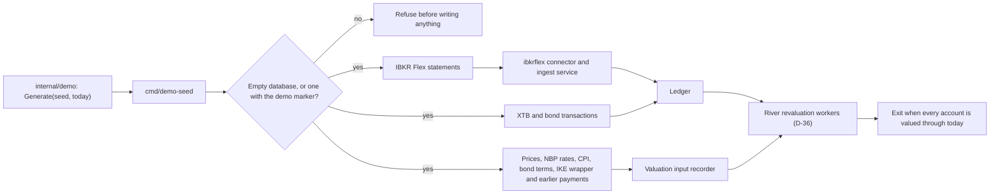
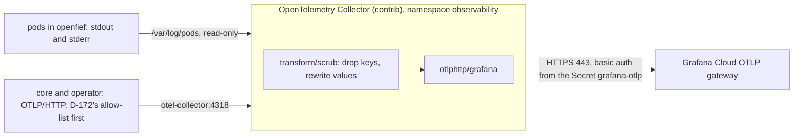

**(P)** This page is a Claude Code proposal, written for the author's request for committed automation that makes it easy to create and recreate demo machines within about €10 a month. The rules it serves are in [sdlc.md](sdlc.md#ci-and-environments): a Hetzner machine running k3s, deployed from `main` and from alpha and beta releases, holding synthetic data only (GR-12). Commands live in `Taskfile.yml`.

A demo is one Hetzner Cloud server running k3s. cloud-init installs pinned k3s and Flux, and Flux pulls everything else from `deploy/demo` in this repository. State lives in Hetzner, Cloudflare, git and, once the author has made a stack, Grafana Cloud, which holds the demo's logs, traces and metrics, scrubbed of visitors' personal data, for its retention period ([Telemetry](#telemetry)). Nothing else holds any. Every Hetzner resource carries the labels `app=openfief` and `env=<name>`, every DNS record the comment `managed-by=openfief-demo env=<name>`, and the scripts find resources by those labels and comments. So any session with the token can create, inspect or destroy a demo, and `up` never creates something twice. The data in a demo is a generated, synthetic dataset ([Demo data](#demo-data)).

## Before the first demo

1. **API token.** In the Hetzner Cloud console, open the project, then Security > API tokens, and create a Read & Write token. Export it only in the shell that runs the commands: `read -rs HCLOUD_TOKEN && export HCLOUD_TOKEN`. If a session has it as `HETZNER_API_TOKEN`, the scripts read that name when `HCLOUD_TOKEN` is unset (or run `HCLOUD_TOKEN="$HETZNER_API_TOKEN" task demo:up ENV=demo`). The scripts never print it or write it to disk, and they ignore any `hcloud` CLI context you have stored.
2. **Cloudflare token (for DNS).** Create a custom API token in the Cloudflare dashboard with Zone > Zone > Read and Zone > DNS > Edit, limited to the zone `DEMO_DOMAIN` (`openfief.dev`), and export it the same way as `CLOUDFLARE_API_TOKEN`. Without it, `up` only prints the record to create ([DNS](#dns)).
3. **SSH key, or none.** Upload your public key with the label the scripts look for: `hcloud ssh-key create --name <you> --public-key-from-file ~/.ssh/id_ed25519.pub --label openfief-ssh=true`, or label an existing key with `hcloud ssh-key add-label <key> openfief-ssh=true`. Every key with that label is installed on new demos. Without one, the demo gets a throwaway key nobody holds and has no SSH at all ([SSH](#ssh)).
4. **Where you connect from.** Set `DEMO_SSH_CIDRS` to your address, such as `203.0.113.7/32`; several CIDRs are separated by commas. With no value, the firewall allows no SSH. HTTP and HTTPS are open to everyone by default (`DEMO_HTTP_CIDRS`), since a demo holds synthetic data only.
5. **Hard spending cap (optional).** Hetzner Cloud has no spending-limit API, so the budget check below lives in the scripts. For a hard cap, ask Hetzner support to lower the project's server limit to 1: no script or token can then create a second server.

## Commands

| Command | What it does |
|---|---|
| `task demo:plan ENV=demo` | Lists what `up` would create, how SSH would be set up, what it would change in DNS, and the monthly cost against the budget. Changes nothing. |
| `task demo:up ENV=demo` | Creates the firewall and the server if they're missing, updates the firewall rules from `DEMO_SSH_CIDRS` and `DEMO_HTTP_CIDRS`, and creates or updates the demo's DNS records. Refuses to go over the budget, and prints the demo's URL. |
| `task demo:status ENV=demo` | Shows the server, its IPv4, the firewall, the DNS records and the project's monthly cost. |
| `task demo:down ENV=demo CONFIRM=demo` | Deletes every resource labelled `app=openfief,env=demo`, server first, then the demo's throwaway SSH key and its DNS records. |
| `task demo:recreate ENV=demo CONFIRM=demo` | `down`, then `up`: a fresh machine from the current cloud-init and pins. The DNS records stay and follow the new machine. |
| `task dns:site:plan`, `task dns:site` | Shows, then makes, the website's records at the apex and `www` ([DNS](#dns)). |

`ENV` names the demo: `task demo:up ENV=try-beta` makes a second, separate one (`openfief-try-beta`), if the budget allows it. Settings come from the shell or the command line:

| Setting | Default | Meaning |
|---|---|---|
| `HCLOUD_TOKEN` | none (required) | The project's API token; `HETZNER_API_TOKEN` is read when it's unset. |
| `CLOUDFLARE_API_TOKEN` | none | The Cloudflare token for the DNS records; without it, `up` prints the record to create ([DNS](#dns)). |
| `DEMO_SSH` | `auto` | `keys`, `off`, or `auto` to pick between them ([SSH](#ssh)). |
| `DEMO_SSH_CIDRS` | empty: no SSH | Sources allowed to reach SSH (22/tcp). |
| `DEMO_HTTP_CIDRS` | `0.0.0.0/0,::/0` | Sources allowed to reach HTTP and HTTPS (80 and 443/tcp); `none` closes them. |
| `DEMO_ACME` | `prod` | Let's Encrypt `prod` or `staging` ([URL and TLS](#url-and-tls)). |
| `DEMO_DOMAIN` | `openfief.dev` | The demo `ENV` is served at `<ENV>.<DEMO_DOMAIN>`, such as `demo.openfief.dev`; `none` uses the machine's sslip.io name instead ([URL and TLS](#url-and-tls)). |
| `DEMO_DNS_AAAA` | `off` | `on` also publishes an AAAA record for the server's IPv6 ([DNS](#dns)). |
| `DEMO_BUDGET_EUR` | `10` | Maximum monthly gross cost of everything labelled `app=openfief` in the project. |
| `DEMO_SERVER_TYPE` | `cax11` | Hetzner server type; `cax*` types are Arm64. |
| `DEMO_LOCATION` | `nbg1` | Hetzner location. |
| `DEMO_IMAGE` | `ubuntu-24.04` | Server image. |
| `DEMO_GIT_BRANCH` | `main` | Branch Flux follows; another branch suits a throwaway demo of a change. |
| `DEMO_GIT_URL` | `https://github.com/arkadiuss/openfief` | Public repository Flux pulls from, with no credentials. |

## Size and cost

Before it creates anything, `up` fetches the live price list, adds up the monthly gross price of every resource labelled `app=openfief` in the project (servers with their IPv4 and backups, unattached primary IPs, floating IPs, volumes, snapshots and load balancers), adds what it would create, and refuses if the total is over `DEMO_BUDGET_EUR`. It prints each line, so you can check the sum. Prices are rounded up, never down.

One demo is a CAX11: 2 Arm64 vCPUs, 4 GB of RAM and 40 GB of disk, with one primary IPv4. It needs an IPv4 because GitHub and GHCR, which Flux and k3s pull from, have no IPv6. There's no floating IP, volume or load balancer. Hetzner's list prices on 2026-10-28, excluding VAT:

| Item | Net per month | Gross at 19% VAT | Gross at 23% VAT |
|---|---|---|---|
| CAX11 server | €6.49 | €7.72 | €7.98 |
| Primary IPv4 (about €0.50) | €0.50 | €0.60 | €0.62 |
| **Total** | **€6.99** | **€8.32** | **€8.60** |

The API reports gross prices at the account's VAT rate, and the scripts use those, so the check matches the invoice. Servers are billed by the hour up to the monthly price, so a deleted demo stops costing money. A CX23 (x86, 4 GB) is €0.50 cheaper and works the same way (`DEMO_SERVER_TYPE=cx23`). A CAX21 (8 GB, €10.99 net) is already over the budget alone.

Why 4 GB is enough: Ubuntu plus k3s (API server, SQLite datastore, kubelet, flannel, CoreDNS, local-path, metrics-server) uses about 1 GB; Flux's controllers about 0.4 GB; Traefik about 0.1 GB; cert-manager's three controllers are capped at 0.5 GB together; the CloudNativePG operator and PostgreSQL are capped at 256 MB and 512 MB in `deploy/demo`; and the OpenFief operator, egress proxy, core and SpiceDB are capped at 256 MB each, with the one-off demo-seed Job at 512 MB. The telemetry collector is capped at 192 MB. That is about 3.8 GB at the limits, which leaves room for a few small plugins; SpiceDB is idle there (below), and its pod uses about a third of its cap.

## What the machine runs

`deploy/demo/cloud-init.yaml` is a template. `up` fills in the versions and sha256 checksums pinned in `Taskfile.yml`, and refuses to send it while any value is missing or malformed. It contains no secrets. On first boot it:

- allows SSH with keys only: no passwords, a locked root password, and root login by key only (with `DEMO_SSH=off`, the only key is one nobody holds);
- turns on unattended security upgrades, rebooting at 04:00 UTC when an upgrade needs it;
- installs the pinned k3s release binary and install script, each checked against its pinned sha256, keeping k3s's bundled Traefik and servicelb (the demo's HTTP entry, on the machine's own IPv4 with no paid load balancer), flannel and k3s's NetworkPolicy controller (D-12), local-path storage, and Secrets encrypted at rest in the datastore (D-29);
- reads its public IPv4 from Hetzner's metadata service and writes the ConfigMap `flux-system/demo-settings` with `DEMO_HOST` (`<ENV>.<DEMO_DOMAIN>`, or `<ipv4-with-dashes>.sslip.io` with `DEMO_DOMAIN=none`) and `DEMO_ACME_SERVER`, which Flux substitutes into the demo's TLS and route layers;
- places Flux's pinned `install.yaml` (checked against its sha256), plus a `GitRepository` and `Kustomization` for `./deploy/demo`, in k3s's auto-deploy manifests directory, so even the bootstrap is declared rather than applied by hand.

Flux then applies `deploy/demo/stack.yaml` in dependency order: the namespace and CRDs (`deploy/crds`), the CloudNativePG operator from a pinned Helm chart, a one-instance PostgreSQL cluster whose password CloudNativePG generates in the cluster, cert-manager and its Let's Encrypt issuer, the telemetry collector ([Telemetry](#telemetry), from git, with nothing waiting for it), the HTTP routes ([URL and TLS](#url-and-tls)), and finally the OpenFief operator, egress proxy, core, SpiceDB and demo-seed Job from the signed artifact CI publishes (SpiceDB runs next to the core with its database and role in the demo's cluster and its credentials generated by a Job, and answers the core's authorization checks as on every install, `--authz=spicedb`, D-164: the demo's read-only demo sessions hold the household grant there, D-163, and since the demo-seed Job reloads the ledger next to the running core, the demo's core reads its accounts every 15 seconds and reconciles SpiceDB when they changed, so a reseed's accounts reach it within about a poll, with a reconcile every five minutes as a backstop), with images pinned by digest (D-17; see [Deploys](#deploys)). The same artifact holds the demo's plugin instances from `deploy/demo/plugins`: one `nbp` instance of the first-party NBP FX connector, with a `PluginGrant` for the connector capability, `api.nbp.pl`, the institution `nbp` it books for (D-185) and its optional extra CA bundle Secret `nbp--ca-bundle`, which the demo never creates, so the plugin runs without it and calls NBP's real API; it picks no in-cluster service, which the manifest asks for as optional (D-74), and one `ui` instance of the [built-in UI](../concepts/ui.md), with a `PluginGrant` for the view capability and the browser path `/` (D-81). Table A is public data, so it fits a synthetic demo; IBKR's plugin needs a real account's credentials and is not deployed. `deploy/demo/openfief/image-fields.yaml` tells kustomize that a `Plugin`'s `spec.image` is an image, so the `images:` list pins it like a container's.

The Hetzner disk isn't encrypted by us, so a demo must only ever hold synthetic data: never real broker credentials, account numbers or portfolio data (GR-12).

## URL and TLS

OpenFief itself ships Services only (D-28): `deploy/crds`, `deploy/operator`, `deploy/egress-proxy` and the future `deploy/core` hold no Ingress, and a test in `internal/plugins/operator` keeps it that way. The demo installation adds its own routes on k3s's bundled Traefik, in `deploy/demo/routes`:

- **URL.** `https://<ENV>.<DEMO_DOMAIN>`: `https://demo.openfief.dev` for the demo named `demo`. `task demo:up` prints it, and with `CLOUDFLARE_API_TOKEN` points the name at the machine's IPv4 ([DNS](#dns)); without the token, it prints the `A` record to create by hand, not proxied, so Let's Encrypt's HTTP-01 check reaches the machine. A recreated machine usually gets a new IPv4, and `up` moves the record to it. With `DEMO_DOMAIN=none`, the URL is `https://<ipv4-with-dashes>.sslip.io` instead, such as `https://192-0-2-10.sslip.io` for 192.0.2.10: sslip.io answers that name with the IP inside it, so no DNS record is needed, and the URL changes with the IPv4.
- **Routes.** Every path goes to Service `openfief-core`, port `http`: the core is the only entry point for browsers (D-81). It serves the read API itself, REST under `/v1` and Connect under `/openfief.views.v1.ReadService/` (D-50), and proxies every path it doesn't serve to the [built-in UI](../concepts/ui.md), whose granted browser path is `/`, with its own token for the `ui` instance (D-59). The core's other Connect services, the AuthService and the owner's entry services, are on the same port but answer only view plugins' tokens. One demo-only NetworkPolicy, `core-from-traefik` in `deploy/demo/openfief`, lets Traefik, in `kube-system`, reach the core's port; nothing reaches the UI but the core, as the operator's policy for every plugin says (D-59). Every read API call needs a script token ([Use the read API](#use-the-read-api)).
- **TLS.** cert-manager, from a pinned Helm chart, requests the certificate from Let's Encrypt with an HTTP-01 challenge on port 80 through Traefik. `DEMO_ACME=prod` (the default) gives a browser-trusted certificate; `DEMO_ACME=staging` gives an untrusted one under much higher rate limits. Use staging while you recreate demos repeatedly: production allows only 5 certificates a week for the same set of names, and a demo on `DEMO_DOMAIN` keeps its name across recreations. The ACME account has no email address, so no personal data goes to Let's Encrypt and no expiry mail comes back; cert-manager renews on its own.
- **Firewall.** 80 and 443/tcp are open to `DEMO_HTTP_CIDRS` (everyone by default); SSH stays limited to `DEMO_SSH_CIDRS`. There's no paid load balancer: servicelb binds Traefik to the machine's own IPv4.

## DNS

With a `DEMO_DOMAIN` (not `none`) and `CLOUDFLARE_API_TOKEN`, the scripts manage the demo's records in that Cloudflare zone, at `<ENV>.<DEMO_DOMAIN>`:

| Record | Value | Why |
|---|---|---|
| A | the server's IPv4 | DNS-only, not proxied, with a 60-second TTL: Let's Encrypt's HTTP-01 check and TLS end on the machine. |
| CAA | `0 issue "letsencrypt.org"` | Only Let's Encrypt may issue certificates for the name. |
| AAAA | the server's IPv6 (`<network>::1`) | Only with `DEMO_DNS_AAAA=on`. k3s on the demo is IPv4-only, so by default there's no AAAA record to send IPv6 clients, Let's Encrypt among them, to a port nothing listens on. |

Each record carries the comment `managed-by=openfief-demo env=<ENV>`, the DNS counterpart of the labels. `plan` lists what would change; `up` creates or updates records until they match the server, so a second `up` changes nothing; `status` lists them; `down` deletes only records with that comment; `recreate` keeps them and points them at the new machine. No record without the comment is ever changed or deleted: if one occupies the demo's name, `plan` and `up` refuse before creating anything. The token reaches curl on its standard input, never as an argument. Without the token, `up` prints the record to create; with `DEMO_DOMAIN=none`, the scripts skip DNS entirely.

The website shares the zone: GitHub Pages serves the landing page at `https://<DEMO_DOMAIN>/` and the docs under `/docs/` ([docs.md](docs.md#build-and-publishing)). `task dns:site` keeps its records, each DNS-only (GitHub Pages issues its own certificate, so the names must resolve to GitHub) and with the comment `managed-by=openfief-site`; `task dns:site:plan` shows what it would change and changes nothing.

| Record | Value | Why |
|---|---|---|
| A, AAAA at `<DEMO_DOMAIN>` | GitHub Pages' four IPv4 and four IPv6 addresses | The apex can't be a CNAME. The list is `site_pages_addresses` in [demo.sh](../../scripts/demo/demo.sh), copied from GitHub's [custom domain page](https://docs.github.com/en/pages/configuring-a-custom-domain-for-your-github-pages-site/managing-a-custom-domain-for-your-github-pages-site#configuring-an-apex-domain). |
| CNAME at `www.<DEMO_DOMAIN>` | `arkadiuss.github.io` (`SITE_PAGES_OWNER`) | Pages redirects `www` to the apex. |
| TXT at `_github-pages-challenge-arkadiuss.<DEMO_DOMAIN>` | `GITHUB_PAGES_CHALLENGE` | Only when that variable is set: the value GitHub shows under account Settings > Pages > Verified domains. Verifying the domain stops other accounts from claiming it. Without the variable the record is skipped, and one that exists is left as it is. |

The address records are reconciled as a set: a missing address is created, then an address of ours that is no longer listed is deleted. Only records with the site's comment are changed; a record without it at the apex or `www` with the same type, or a CNAME in the way, makes `dns:site` refuse before changing anything, while the apex's other records, such as MX, are left alone. It also deletes any record still commented `managed-by=openfief-docs`: the retired `docs.<DEMO_DOMAIN>` CNAME, because a CNAME to github.io that no Pages site claims can be taken over by whoever claims it. No `docs.` record exists or is created any more. A redirect from `docs.<DEMO_DOMAIN>` to `/docs/` would need a Cloudflare Single Redirect rule (and a proxied record for it to act on); the token has no Rulesets permission, so that isn't automated. The demo's records and the site's have different comments, so `demo:down` never deletes a site record and `dns:site` never touches a demo's.

## SSH

`DEMO_SSH` decides how a new server gets its SSH key. Hetzner needs one: without a key, it sets a root password and emails it.

- `keys` installs every project key labelled `openfief-ssh=true`, and refuses when there's none.
- `off` installs a throwaway Ed25519 key. openssl generates it in a pipe, and only the public half leaves the pipe; the private half is never written anywhere. The public half is uploaded as `openfief-<ENV>-throwaway`, labelled `app=openfief`, `env=<ENV>` and `openfief-ssh=throwaway`. So there's no root password, nobody can log in, and the demo changes only through git and Flux. A later `up` reuses the key; `down` deletes it, and never a key labelled `openfief-ssh=true`. `off` refuses a non-empty `DEMO_SSH_CIDRS`.
- `auto`, the default, is `keys` when a labelled key exists and `off` when none does and `DEMO_SSH_CIDRS` is empty; it refuses SSH sources without a key.

## Reach the demo

For anything that isn't routed, there is SSH from `DEMO_SSH_CIDRS`. The simplest way in is kubectl on the machine:

```bash
ip="$(hcloud server ip openfief-demo)"
ssh root@"$ip" k3s kubectl get kustomizations -n flux-system   # is Flux in sync?
ssh root@"$ip" k3s kubectl get pods -A
```

To use your own kubectl or a browser, tunnel the API server and port-forward a service:

```bash
ssh -N -L 6443:127.0.0.1:6443 root@"$ip" &
ssh root@"$ip" cat /etc/rancher/k3s/k3s.yaml >~/.kube/openfief-demo.yaml   # cluster-admin: keep it local, never commit it
KUBECONFIG=~/.kube/openfief-demo.yaml kubectl -n openfief port-forward svc/<service> 8080:<port>
```

The tunnelled kubeconfig points at `127.0.0.1`, which `task e2e` takes for a local cluster. Keep it in its own file and never run the end-to-end tests with it.

## Use the read API

The core serves the read API (D-50) at `https://demo.openfief.dev`: REST under `/v1` and Connect under `/openfief.views.v1.ReadService/`. Every call needs a [script token](../glossary.md) (D-27). The core's `/healthz` and `/readyz` answer through the same route without a token and return no data. The core's image has no shell, so issue a token by running the binary itself in its pod:

```bash
ssh root@"$ip" k3s kubectl -n openfief exec deploy/openfief-core -- /core token issue --name demo --ttl 168h
```

It prints the secret, `ofs_...`, once on the first line; the database keeps only its hash, so copy it then. Keep it in your shell, never in a file in the repository:

```bash
read -rs OPENFIEF_TOKEN && export OPENFIEF_TOKEN
curl -fsS -H "Authorization: Bearer $OPENFIEF_TOKEN" https://demo.openfief.dev/v1/accounts
curl -fsS -H "Authorization: Bearer $OPENFIEF_TOKEN" https://demo.openfief.dev/v1/valuation-status
curl -fsS -H "Authorization: Bearer $OPENFIEF_TOKEN" "https://demo.openfief.dev/v1/accounts/demo-xtb/holdings?date=$(date +%F)"
curl -fsS -H "Authorization: Bearer $OPENFIEF_TOKEN" "https://demo.openfief.dev/v1/valuations?from=2026-10-01&to=$(date +%F)"
curl -fsS -H "Authorization: Bearer $OPENFIEF_TOKEN" "https://demo.openfief.dev/v1/allocation?date=$(date +%F)&by=ALLOCATION_DIMENSION_SLEEVE"
curl -fsS https://demo.openfief.dev/readyz
```

A call without a token, or with an unknown, expired or revoked one, gets 401. `/core token list` shows every token with its status, and `/core token revoke <id>` revokes one. Without the route, `kubectl -n openfief port-forward svc/openfief-core 8080:http` serves the same API at `http://localhost:8080`.

## Deploys

Deploys are automatic GitOps pulls: a merge to `main` reaches the demo with no manual step, and nothing outside the machine holds a credential for the cluster. Flux follows two sources:

- **git, for the platform.** The namespace and CRDs, the CloudNativePG operator, the database, cert-manager and its issuer, and the telemetry collector follow `main` directly (`deploy/crds`, `deploy/demo/cnpg`, `deploy/demo/database`, `deploy/demo/cert-manager`, `deploy/demo/ingress`, `deploy/demo/telemetry`).
- **A signed OCI artifact, for OpenFief itself.** After CI pushes and signs the images on `main`, or an alpha or beta release does, the `deploy demo` job runs `task deploy:demo`. It verifies each image in `deploy/demo/openfief/kustomization.yaml` with cosign, against the keyless identity of this repository's `images.yml` workflow on `main`, and writes the digest that verified. It then renders the directory into the artifact's `app/`, `deploy/demo/routes` into its `routes/` and the egress audit into its `audit/`, pushes it to `ghcr.io/<owner>/<repo>/demo-manifests` tagged with the commit or the version, signs it keylessly, and moves the `demo` tag to it. Flux checks the artifact's signature against `deploy-demo.yml` on `main` before it applies anything, and polls every two minutes. The routes ship in the same artifact as the core they point at: when they followed git, the change that made the core the browsers' entry point (D-81) reached the demo's Ingress about 25 minutes before the core that serves it, and `/login` answered 404 in between.

**The egress audit.** The artifact's third path, `audit/`, is `deploy/demo/audit` rendered by `scripts/demo/render-audit.sh`: a Job that runs `egress-proxy audit` with the egress proxy's image at the digest that just verified, stamped with the deploy's tag so each deploy re-creates it. Flux's `demo-egress-audit` layer applies it after `demo-openfief` and waits for it. The Job reads the proxy's logs and the `PluginGrant`s, and only reads them, and fails when the proxy allowed a request to a host outside the asking instance's grant, such as anything but `api.nbp.pl` for `nbp`, or logged more of a request than who asked, where to and the decision (D-200 criterion 16, GR-12; [Egress](../concepts/egress.md#auditing-the-log)). A failed audit shows as that layer failing (`flux get kustomizations`), and `kubectl -n openfief logs job/egress-audit` names the instance and host. The deploy job never sees it: it holds no credential for the cluster.

The committed digests in `deploy/demo/openfief` and `deploy/demo/audit` stay placeholders (all zeros): CI fills them in on its own checkout every time, so no deploy commit is ever needed. Until the first artifact exists, `demo-openfief` and `demo-routes` wait for their source while the other layers run; a layer whose path an older artifact lacks fails and keeps what it applied last. The Job that generates SpiceDB's credentials is named for the core's image there (`openfief-init-credentials-` and the first 12 hex digits of its digest, set by `pin-images.sh`; the placeholder is 12 zeros), so a deploy that changes the image makes a new Job and Flux prunes the old one, with no force annotation. `task demo:validate` (part of `task check`) builds every layer and fails if an image isn't pinned by digest or an OCI source doesn't require a cosign signature.

The job runs on every push to `main` and every real alpha and beta, with no on/off setting: publishing the artifact is harmless when no machine exists, because nothing pulls it. To stop deploys, suspend Flux on the machine or remove the demo with `task demo:down`. For the demo to pick the artifact up, the owner:

1. creates the GitHub Environment `demo` (Settings > Environments) with deployment branches limited to `main` and a required reviewer (see [From the pipeline](#from-the-pipeline));
2. creates the machine, with `task demo:up ENV=demo` or the Demo infrastructure workflow;
3. after the first push to `main`, makes the GHCR packages `operator`, `egress-proxy`, `core`, `demo-seed`, `nbp-fx` and `demo-manifests` public (the package's settings > Change visibility), so the cluster pulls them without credentials. A public repository doesn't make its packages public: on 2026-10-28 GHCR refused anonymous pulls of `operator`, `egress-proxy` and `demo-seed`, and `demo-manifests` didn't exist yet. `curl -s "https://ghcr.io/token?scope=repository:arkadiuss/openfief/operator:pull"` returns a token only for a public package.

Every push to `main` and every alpha and beta then deploys on its own. A required reviewer on `demo` also gates these deploy jobs; leave it off if deploys should never wait for approval, since the deploy job can't touch the machine itself.

## Demo data

A demo holds only the [demo dataset](../glossary.md#m0): a synthetic portfolio with about a year of history, generated by `internal/demo` and loaded by `cmd/demo-seed`. It exists to show OpenFief's real pipelines working on fake data (GR-12).

Exchange rates are the exception: they are NBP's published rates, never synthetic. The dataset holds none; the loader records NBP table A from two weeks before the earliest IBKR lot was opened, well before go-live, because a lot's cost converts at the tax rate of the business day before its open date (D-20, `Dataset.FXFrom`). Without those older rates every IBKR holding has a gross value but no net or liquidation value, and so do the account's and the portfolio's totals. From then on the demo's real `nbp-fx` connector instance keeps the rates current. Its Plugin declares the institution `nbp`, as the image's signed manifest does, since the core refuses a delivery naming an institution the manifest doesn't declare (D-182). The loader records its rates as from that instance, `nbp` (`--fx-source`, [nbp.yaml](../../deploy/demo/plugins/nbp.yaml)): they are the same NBP table A rates the instance delivers, and each currency's rates take every value from one source (D-94), so the history loaded here and the instance's later syncs are one series. Under another source name, a currency would keep whichever of the two it first needed, and the other's rates would only cross-check it. NBP rates are public, so GR-12 holds, and the demo shows a connector working live. Prices and index readings each come from one source in the dataset already. A demo left on a day's dataset raises a `market-data-gap` attention item per account and instrument once its synthetic prices are more than 7 days old, as any installation whose price source stopped would.

The dataset also carries synthetic cross-check prices, one of them beyond the threshold, so the demo shows a flagged price check (D-110).

**The dataset.** `demo.Generate(seed, today)` is a pure function: the same seed and date always give the same dataset, and prices come from integer arithmetic, so every value is exact. It contains:

- two [sleeves](../glossary.md#m0), `demo-offensive` and `demo-defensive`, and three accounts: `demo-ibkr` and `demo-xtb` in the offensive sleeve, and `demo-bonds-ike`, treasury bonds in an [IKE](../glossary.md#other-terms-and-abbreviations), in the defensive one, seeded at go-live, with its [earlier payments](../glossary.md) entered as its bonds' cost plus its opening cash (`demo.BondsEarlierPayments`, D-149), so its liquidation value is taxed above them;
- six market-priced instruments and three treasury bond series, all with synthetic ISINs: the check digit is valid, and `TESTD` follows the country code, so no one can take them for real securities;
- seeded random-walk prices on business days, from a week before go-live (365 days before today) up to today;
- IBKR's synthetic mark prices as [cross-check prices](../glossary.md#m0) from the `ibkr` source: each instrument held at the end of each monthly statement, at the latest demo close on or before that day, and the latest statement's first instrument 3% above it, so the price checks page shows one flagged check (D-110, D-111). `demo-seed` records them through valuation's `CrossChecks`;
- the IBKR history as synthetic [Flex Query](../glossary.md#other-terms-and-abbreviations) statements for the placeholder account `U0000000`: an opening statement, then one per month. XTB and the bond registry have no connector yet, so their history is ledger transactions.

The only real figures are public ones: the published terms of the EDO1133, COI0128 and TOS0128 series, GUS consumer price index readings from January 2023 to September 2026 (recorded, like the series' terms, with the `treasury-bonds` instance as their source, D-179, D-186), and NBP table A exchange rates. Every balance assertion in the history matches the balance its transactions give.

**The loader.** `demo-seed` reads the database URL from `OPENFIEF_DEMO_DSN` and loads the dataset through the paths real data takes. It exits once every account is valued through today.



Before it writes anything, the loader checks the database. It refuses a database that holds sleeves, ledger or valuation data without the [demo marker](../glossary.md#m0), with or without `--reset-demo`, so it can't overwrite a real portfolio. It marks an empty database before loading, and a PostgreSQL advisory lock keeps two loaders apart. Loading the same seed and day again changes nothing; loading another day needs `--reset-demo`, which first empties a database that carries the marker. The marker also records the loader's build, the SHA-256 of its own executable: a demo database another build filled is emptied and loaded again without the flag, so a deploy of changed code reseeds the demo rather than migrating what an older build stored (D-161). A reset drops the ledger, valuation and portfolio schemas, the last with the sleeves and which account is in which, and deletes the revaluations still queued, and leaves River's schema, so a core running on the database keeps its workers. Without it, a load of another day first records again the valuation inputs of the dataset the marker names (its seed and day), then fails asking for `--reset-demo`. Every input is keyed, so this changes nothing an earlier load wrote, but a demo an older loader filled gets the inputs a newer one adds, such as the cross-check prices or older FX rates; the ledger stays as it is, and the running core's workers work the revaluations those inputs enqueue. The loader logs internal IDs and counts, never amounts.

| Flag | Default | Meaning |
|---|---|---|
| `--reset-demo` | off | Empty a database marked as a demo before loading. |
| `--today` | today in Europe/Warsaw | The dataset's today, `YYYY-MM-DD`. |
| `--seed` | `20261028` | Seed of the history and prices. |
| `--offline` | off | Use the committed NBP rates (`cmd/demo-seed/nbp-table-a.csv`, from 2024-08-01) instead of fetching them. |
| `--nbp-url` | NBP's Web API | Where to fetch NBP rates. If the fetch fails, the loader falls back to the committed rates. |
| `--fx-source` | `nbp` | The NBP connector instance the rates are recorded as from: the demo's, so its syncs continue them (D-94). |
| `--wait` | `10m` | How long to wait for the revaluations. |
| `--db-wait` | `3m` | How long to wait for PostgreSQL to accept connections before loading, retrying with a backoff from 0.5 s doubling to 5 s, so a Job started with its database doesn't use up an attempt on a server still starting. |

**The Job.** `deploy/demo-data` is a kustomize base with one Job, `demo-seed`, in the `openfief` namespace. The base runs the loader with `--reset-demo` (the demo drops it, below) and reads the URL from the key `uri` of `openfief-db-app`, the app secret CloudNativePG creates for the demo's `openfief-db` cluster. It retries up to six times while the database starts, gives up after 30 minutes, and runs as non-root with a read-only root filesystem and a 512 MiB memory limit. CI builds and signs its image, `ghcr.io/<owner>/<repo>/demo-seed`, like the others.

**On the demo.** `deploy/demo/openfief` includes `deploy/core` and `deploy/demo-data`, pins both images by digest like the others, and patches each so they can start together on a fresh database:

- The Job runs **without** `--reset-demo`. It marks and loads an empty database, loading the same day again with the same build changes nothing, and a new build reseeds the demo (above). The reseed runs under the running core: the core's requests during the few milliseconds between dropping the schemas and migrating them again fail, and its River workers keep running.
- The core runs with `--ensure-defaults=false`. Its default sleeves, in the portfolio schema, would be data without the demo marker, and the loader would then refuse the database as a real one. The demo dataset brings its own sleeves.
- The core runs with `--demo-sessions`, which makes it a demo: it never shows the first-run wizard (D-73, D-191). Until the Job has written the demo marker, the demo data is still loading: the login page says "Demo data is loading" with a *Refresh* button instead of "View demo", the overview says the same to an owner who signed in with a passkey, `/setup` redirects to the overview, and the core refuses every change through its `SleeveService` and `AccountService` with failed precondition (`refuseWhileDemoLoads` in [onboarding.go](../../cmd/core/onboarding.go)). A visitor who enrolled a passkey on the fresh database can't create the sleeves or accounts that would leave data without the marker, which the loader would refuse as a real database, leaving the demo stuck without "View demo". Once the marker exists, the login page offers "View demo" and the owner's forms work again until the next reseed, but the wizard stays away (D-191).
- Both migrate under advisory locks and both run River workers on the same queue, which River allows; the core serves whatever is loaded so far, and its workers keep the valuations current from then on, end of day included.

Each deploy that changes the Job's image re-creates it (the annotation `kustomize.toolkit.fluxcd.io/force: enabled`, since a Job's pod template can't change). A new image is a new build of the loader, so that run reseeds the demo for today: the demo's data always matches the code deployed (D-161). A Job run again with the same image on a later day records the loaded dataset's valuation inputs again, as above, fails with "run with --reset-demo" and leaves the ledger alone. To refresh the data to today without a deploy, pause Flux, stop the core so nothing uses the schemas, empty them (the script tokens in the `identity` schema stay), and let Flux start the Job and the core again on the empty database:

```bash
k() { ssh root@"$ip" k3s kubectl "$@"; }
k -n flux-system patch kustomization demo-openfief --type=merge -p '{"spec":{"suspend":true}}'
k -n openfief scale deploy/openfief-core --replicas=0
k -n openfief exec openfief-db-1 -- psql -d openfief -c 'DROP SCHEMA IF EXISTS demo, ledger, valuation, river CASCADE'
k -n openfief delete job demo-seed --ignore-not-found
k -n flux-system patch kustomization demo-openfief --type=merge -p '{"spec":{"suspend":false}}'
```

Flux re-applies the layer within its interval, which re-creates the Job and scales the core back to one replica. Or replace the machine: `task demo:recreate ENV=demo CONFIRM=demo` gives a fresh machine whose empty database the Job loads for the new day.

**How it's tested.** `task test` runs the dataset's tests (TEST-demo-dataset): it's deterministic, every ISIN is synthetic, the IBKR statements map with only the intended skipped summary rows, the other accounts' balance assertions match, bond coupons, booked as interest (D-101), follow the published rates, and the FX rates asked for reach back to the earliest foreign lot. It also runs the loader's flag and rate tests (TEST-demo-seed-unit). `task test:pg` loads the dataset end to end into a throwaway PostgreSQL (TEST-demo-seed-load). That test checks that every account has holdings valued through today with all three values and no flagged balance assertion, that the price checks flag exactly one of IBKR's cross-check prices, that a second load of the same day changes nothing, that a load of another day records the loaded dataset's missing inputs and is still refused, that a load by another build of the loader reseeds the demo without the flag, and that a database that isn't a demo is refused. TEST-demo-seed-unit also checks that a build is named by its executable's digest, and TEST-demo-dataset's `TestDecideLoad` when a marked database is reseeded.

## Market prices on the demo

The demo answers from its synthetic data alone (D-226): the Ask box's market price tool is off there. The demo installs no market-data connector with a provider key, only the NBP FX one, and the core, started with `--demo-sessions`, gives its views no quote source at all, so `GetMarketQuote` is a failed precondition and `GetSettings` says `market_quotes` is false even if someone installed the EODHD connector on it. The Ask box then does not offer the tool, and a price is what the dataset stores: `show` gives a held instrument's last stored price, from the seeded prices, which are synthetic. The other choice, a synthetic quote source that answers for the seeded instruments, would have shown the card but taught nothing `show` does not already, and would have put a fake connector between the demo and the code that is real on an owner's install; the demo's demonstration of the tool is the bench's fake connector ([Models](../concepts/models.md)).

## The demo model

The demo's model is included and off. D-207 picks it: the cheapest model on OpenRouter, reached through its OpenAI-compatible API, that passes the Ask box's eval (D-217, D-219), on the hosts that passed it; a cheaper one replaces it only by passing too. The route is `openai/gpt-oss-120b` on `deepinfra/bf16` alone (D-221), the one member the bench's runs 16-2 and 17 passed under scorer version 3. The live demo includes the layer, so it has the provider instance, the route and the tier lists and the guards below; its switch and the Ask box's toggle are still off (D-212), which only the owner turns on, so it makes no model call until then: the box answers its commands, and says "I can't answer that yet" to the rest ([Models](../concepts/models.md)). The layer is `deploy/demo/model`, a kustomize Component that `deploy/demo/openfief` lists, and `task demo:validate` builds the live demo and checks it. It holds:

- **`openrouter.yaml`**, the provider instance `openrouter` of the first-party `model-openai` plugin and its `PluginGrant`: the `model-provider` capability, the one egress host `openrouter.ai` (D-75, which the egress audit checks the proxy's log against) and the instance's one Secret, `openrouter--api-key`, named and never valued. Its config is the base URL `https://openrouter.ai/api/v1`, a third-party cloud with no retention and no training (the owner's own statement, shown on the Models page; DeepInfra's Terms section 7(b), [R-33](../research.md)), and one model entry: `openai/gpt-oss-120b` with tools, structured output and reasoning `low`, USD 0.037 in and 0.17 out per million tokens (OpenRouter's listing for `deepinfra/bf16`), pinned to the host `deepinfra/bf16` with no fallback to other hosts (`provider.order`, `allow_fallbacks` false, [Models](../concepts/models.md)) and with `dataCollection: deny`. No context or output limit is set, so the plugin's default of none applies, and the Ask box asks for at most 800 output tokens itself (D-208).
- **`settings.json`**, the route of the role `ask`, the model above alone, and the models allowed for each data tier, the same model for T0, TF, T1 and T2, since the demo's data is synthetic (D-206). There is no route for the maintainer, and the file has no member for the switch or a toggle.
- **`kustomization.yaml`**, which also holds D-208's guards on the demo ([The spend guards](#the-spend-guards)): the core's flags, the built-in UI's config and its grant's one egress host and Secret, as patches. It brings the rest into the demo: the Component turns the file into the ConfigMap `demo-model-settings` and patches the `demo-seed` Job to mount it and to set `OPENFIEF_DEMO_MODEL_SETTINGS` (an environment variable and not an argument, because `deploy/demo/openfief` replaces the Job's arguments after a Component's patches run). `task demo:validate` builds `deploy/demo/openfief`, which is the demo with the Component on, checks that every image is pinned by digest (the plugin's `images:` entry is there, with a zero digest that `scripts/demo/pin-images.sh` pins) and that the settings name only entries the instance lists, and that every Plugin's PluginGrant approves each Secret its manifest asks for. The instance's grant approves both of its optional Secrets, `openrouter--api-key` and `openrouter--ca-bundle` (which the demo never creates, as with `nbp--ca-bundle`): the operator keeps a Plugin AwaitingApproval, never Ready, while its grant leaves out any Secret the manifest names.

**The UI's manifest.** `deploy/demo/plugins/ui.yaml` carries the built-in UI's manifest as the image signs it (`task plugins:labels:check`), and that manifest now has an optional config: the limits of one Ask box question (`askToolRounds`, `askToolCalls`, `askOutputTokens`, `askDeadline`, D-208's defaults when unset) and Cloudflare Turnstile in front of the Ask box's model (`turnstileSiteKey` and `turnstileVerifyUrl`, set together), with, for Turnstile, one egress host taken from `turnstileVerifyUrl` (D-75) and the optional Secret `ui--turnstile-secret`. The live demo sets none of them, so what runs is what ran: the instance has no config and no egress host. Its grant does approve the Secret `ui--turnstile-secret`, because the operator holds a plugin until its grant approves every Secret the manifest names, optional or not (D-89); the mount is optional, so until `task demo:turnstile-secret` creates it the pod starts without it. The model layer is what sets them ([Turning the model on](#turning-the-model-on)).

**There is no fallback model.** The route has one member. A second one waits for another host to become a D-221 member (Crusoe is not yet), and then goes into `openrouter.yaml` as an entry and into `settings.json` after the first, in the route and in the four tiers; the validation fails when the settings name an entry the instance doesn't list. Until then, if DeepInfra is down the Ask box still answers its fixed commands (D-203) and says the model is unavailable for the rest: the router has no model left to try.

**How the route reaches the database.** The route and the tier lists are owner settings in the `modelrouter` schema, and the demo had no way to seed them. `demo-seed` now takes `--model-settings` (or `OPENFIEF_DEMO_MODEL_SETTINGS`): after the dataset is loaded it migrates that schema (the core does too, under the same advisory lock) and stores the file's routes and tier lists only when the database holds none of either, so what the owner sets in Settings, or an earlier run stored, is never overwritten and a Job that runs on every deploy changes nothing the second time. It refuses a file with any member besides `routes` and `tiers`, so a seed can't turn a model on. Seeding the route and the tier lists is outside the audit log, like a migration and like the synthetic dataset around it: it is the loader building a demo's initial state, run by the pipeline on every deploy and holding no owner session to name as the actor, and the audit log records who changed a setting in a running install (D-211), which is the owner's work. What stays an audited owner action is turning the model on: *Turn agents and models on* and the Ask box's toggle each write their own entry, so nothing a seed stored makes a call until the owner does that. A reseed drops the ledger, valuation and portfolio schemas and not `modelrouter`, so the settings outlast it. Without the file, which is the live demo's case, the Job does what it did.

### The spend guards

D-208 puts four guards between a visitor and the key's balance. They are in the Component, which the live demo includes, and every one of the core's is off in the core's own defaults, so only a demo with the layer has them; they matter once the owner turns the model on. [Models](../concepts/models.md#how-it-works) says how each works; this is what the demo sets and what to check before it is on.

| Guard | The demo's value | Where it is set |
|---|---|---|
| The provider's own limit | a prepaid OpenRouter key with a monthly credit limit and no automatic top-up | the owner, at OpenRouter: not code, the first and the hard guard |
| A daily budget | `--model-daily-budget-usd=0.25`, **the author's setting**: about 2,200 questions a day at the entry's measured cost of about USD 0.000115 a question | the core's flag, in the Component |
| Questions to the model per session and per address | 10 an hour and 30 a day, each | `--ask-questions-per-hour=10`, `--ask-questions-per-day=30` |
| Calls at once | 3, a fourth waits up to 5 seconds and is then refused as busy | `--ask-concurrent-calls=3`, `--ask-queue-wait=5s` |
| The loop's bounds | 5 rounds that may call tools, 10 tool calls, 800 output tokens, 2 minutes | the UI plugin's config, `askToolRounds`, `askToolCalls`, `askOutputTokens`, `askDeadline` |
| Cloudflare Turnstile | the widget in front of the Ask box, its siteverify call by the UI plugin | the UI's config (`turnstileSiteKey`, `turnstileVerifyUrl`), its grant (egress `challenges.cloudflare.com`, Secret `ui--turnstile-secret`) and `--allow-turnstile` |
| The maintainer | only on its weekly schedule, with no route on the demo | the settings file has no route for it |

`task demo:validate` checks that the layer sets every one of them, that the limits are D-208's (10, 30, 3, and the loop's), that the budget is a positive amount, that the grant approves the host of `turnstileVerifyUrl` and names the Secret, and that the live demo doesn't hold the placeholder site key; `scripts/tests/demo-validate.test.sh` has a case for each.

**Where the counts are kept.** In the core's database, not in memory: the budget in `modelrouter.daily_usage` and the questions in `modelrouter.ask_questions`, so a restart does not give a visitor a fresh allowance and a second replica sees the same counts. Calls at once are counted in the process, which is the demo's one replica. The day of the budget is the core's `--time-zone`, Europe/Warsaw, so it starts over at that midnight. A question stopped by a guard writes no model audit entry beyond the refusal of a call (class `budget` or `busy`); a question stopped before any call, by a limit or by Turnstile, is counted by nothing but the session's and the address's own counts.

**The address, and whom the core believes (security).** The limit per address counts what the core's front door finds, and a header any browser can write is no evidence. The core therefore believes a forwarding header only when the connection comes from a proxy it is told to trust (`--trusted-proxies`), reads `X-Forwarded-For` from its right end, past the trusted proxies, and hands the UI one value, `X-Openfief-Client-Ip`, replacing whatever a browser sent. On the demo the DNS records are not proxied (`scripts/demo/demo.sh` makes DNS-only records, so Let's Encrypt and TLS end on the machine), so a browser reaches k3s's Traefik directly and Traefik writes the address it saw, the core trusts k3s's default pod network `10.42.0.0/16` where Traefik runs, and a browser that reaches the core by the plugin port or any other path is not one the core finds an address for: the connection's, which is not a trusted proxy's. If the author puts Cloudflare's proxy in front, the header becomes `CF-Connecting-IP` and the trusted proxies Traefik's pods, and the machine's firewall should admit only Cloudflare's ranges, or anyone who finds the machine's address can write that header. What can go wrong is bounded: a forged address can only dodge the address limit; the session limit, the budget and Turnstile don't depend on it, and the core never logs an address.

**Check the address before turning the model on.** Whether the address that arrives is the visitor's depends on how k3s's service load balancer forwards the connection, which can't be settled from here. Open the demo from two networks (a phone off the Wi-Fi is one) with a "View demo" session each and ask the model questions: if the second network is stopped as "Too many questions from your network" by the first one's questions, every visitor arrives as one address, which would put the whole demo under one limit of 10 an hour; in that case do not turn the model on, and set the Traefik service's `externalTrafficPolicy: Local` or put Cloudflare's proxy in front, then repeat. If the address never arrives (a header the core can't read), the core leaves the address limit out and keeps the session's.

**The content security policy (security).** The built-in UI allows scripts and frames from its own origin alone, and the core adds the same to every page it proxies; a browser enforces both. Turnstile's widget is the only third-party script D-208 allows, so with `--allow-turnstile` and the UI's Turnstile config each policy adds `https://challenges.cloudflare.com` to `script-src` and `frame-src` and nothing else, and without them neither is touched. `task ui:browser` runs the page against a fake of Cloudflare's script and finds no policy violation; it can't run Cloudflare's own widget, so **whether the real widget works under exactly these two policies is checked in a browser when the model is turned on**: open the Ask box in a private window with the console open, and if Cloudflare's widget needs another source (a `connect-src`, for one), add that one origin to both policies in a reviewed change, not a wildcard.

**What the author must do.** (1) In Cloudflare, Turnstile, add a widget for `demo.openfief.dev` (the hostname the widget is for), in the managed mode, and copy its site key and secret key. (2) Put the site key in `deploy/demo/model/kustomization.yaml`, replacing the placeholder `turnstileSiteKey` (done: the widget for `demo.openfief.dev` exists and its public site key is in), and decide the budget. (3) Create the two Secrets, `task demo:model-secret` for the OpenRouter key and `task demo:turnstile-secret` for the Turnstile secret key ([Turning the model on](#turning-the-model-on)). Nothing here changes Cloudflare's DNS, and no session did.

### Turning the model on

Step 1 is done, and none of the rest is for a session to do: it needs the author's key and the author's quality bar. The order is: the guards on `main` (they are), a reviewed change to the Component that sets the Turnstile site key and the budget and includes it (done), the two Secrets, and the owner's switch last, an audited owner action.

1. **Review the Component and include the layer, once (done).** The Turnstile site key (the widget's public key, [The spend guards](#the-spend-guards)) and the budget, `--model-daily-budget-usd=0.25` (the author's setting), are set in `deploy/demo/model/kustomization.yaml`. `scripts/demo/validate.sh` had failed a live demo that included the layer ("it is switched on only on purpose"); the same reviewed change removed that check, and with it `deploy/demo/with-model`, which would now apply the Component twice. `deploy/demo/openfief/kustomization.yaml` lists `components: [../model]` and has the `images:` entry for `ghcr.io/arkadiuss/openfief/model-openai` (a zero digest like the others, which `scripts/demo/pin-images.sh` pins). Make the GHCR package `model-openai` public (its settings > Change visibility), as for the other images ([Deploys](#deploys)). After the deploy the instance runs, the route and the tier lists are stored, and the switch is still off: no call is made and the Ask box is as before. The Models page lists the provider and its entry; a call before the Secret exists is refused by OpenRouter and ends as every model down, so do step 2 before step 3. The layer included does not turn anything on: the switch is the owner's, in step 3.
2. **Create the Secrets, out of band.** The key never goes in git, in the manifests, in cloud-init or in a log (GR-12, D-29). Use a prepaid OpenRouter key with a monthly credit limit and no automatic top-up, which is D-208's first guard. `task demo:model-secret` reads the key on your machine, in the shell that runs it, with `read -rs` (nothing is echoed), pipes it over SSH on standard input and creates or replaces the Secret with `k3s kubectl -n openfief create secret generic openrouter--api-key --from-file=api-key=/dev/stdin --dry-run=client -o yaml | k3s kubectl apply -f -`, so the key is in no argument, no file and no log, and nothing prints it. It needs SSH to the machine, so it runs with `DEMO_SSH=keys` and needs your address in the firewall ([SSH](#ssh)); SSH can go back off afterwards:

   ```bash
   task demo:up ENV=demo DEMO_SSH=keys DEMO_SSH_CIDRS=<your address>/32   # opens SSH to you; reads HCLOUD_TOKEN
   task demo:model-secret ENV=demo DEMO_SSH=keys                           # asks for the key, or reads OPENROUTER_API_KEY
   task demo:up ENV=demo DEMO_SSH_CIDRS=                                   # closes SSH again
   ```

   `task demo:turnstile-secret ENV=demo DEMO_SSH=keys` does the same for the widget's secret key, the Secret `ui--turnstile-secret` that the UI plugin reads on every question (it is mounted at `/etc/openfief/turnstile`); do it between the same two `demo:up` lines. Rotating either is running its line again. The plugin reads the key on every call, so a rotated Secret works at once; if the plugin's pod started before the Secret existed and still sends no key, restart the pod. A new machine (`task demo:recreate`) has no Secret: create it again. `scripts/tests/demo-secret.test.sh` runs the script against a fake `ssh` and a fake `hcloud` and checks that the value reaches `ssh` on standard input and appears in no argument, log or output. No SSH key is added to CI and no secret reaches the pipeline.
3. **Turn it on.** The owner signs in with a passkey and opens the Models page in Settings (`/settings/models`): *Turn agents and models on*, then *Turn on* for the Ask box. The Ask box's model then answers what its commands don't; with the models down it still answers its commands, and says the model didn't answer to the rest.

With the guards built, what stands between a visitor and the key's balance is the provider's credit limit, the daily budget, the limits per session and per address, the calls at once, the loop's bounds and Turnstile ([The spend guards](#the-spend-guards)). Check the address and the widget in a browser first, as that section says.

**Delivering the key from the pipeline (a proposal, nothing created).** `HCLOUD_TOKEN` and `CLOUDFLARE_API_TOKEN` are secrets of the GitHub Environment `demo`, which the Demo infrastructure workflow uses behind a required reviewer ([From the pipeline](#from-the-pipeline)). The matching pattern for the key is a third environment secret, `OPENROUTER_API_KEY`, and a workflow action next to `up` and `recreate` that runs `demo:model-secret ENV=demo` (built, step 2) with the key in the job's environment and never in a log, so a rebuilt machine gets its Secret from the same approval. The deploy job can't do it: it has no access to the cluster, which pulls (Flux). It needs the workflow to hold an SSH key the machine accepts, which it doesn't today.

The demo never gives opinions or suggests a thesis (D-225, R-7): the core runs a demo when it runs with `--demo-sessions`, turning opinions on there is refused, and the box keeps the prompt that declines to recommend, whatever is stored ([Models](../concepts/models.md)). The Theses page is the owner's alone, so a demo's visitors have no drafts to see.

## Telemetry

The demo ships its logs, traces and metrics to Grafana Cloud, so the orchestrator can read what the demo does without SSH to the machine. This is demo operations, approved by the design session, and no product decision: an installation's own telemetry is still D-172's (off until the owner sets an OTLP endpoint, [Send traces to a collector](../guides/tracing.md)). **Grafana Cloud now holds the demo's logs, traces and metrics for its retention period** (the plan's: check it on the stack's page), which is the one place the demo's state lives outside Hetzner, Cloudflare and git. The layer is `deploy/demo/telemetry`, applied by Flux as `demo-telemetry`:



- **The collector.** The upstream OpenTelemetry Collector, contrib distribution, `0.164.0` pinned by tag and digest in [daemonset.yaml](../../deploy/demo/telemetry/daemonset.yaml) (Renovate moves both, like SpiceDB's), one pod per node as a DaemonSet in its own namespace `observability`. The namespace is the one with the privileged Pod Security level, because the collector reads the node's pod logs from read-only hostPath mounts of `/var/log/pods` and runs as root (containerd writes those files readable by root only); `openfief` stays restricted. The pod has no capability, no privilege escalation, a read-only root filesystem and no API token, and keeps its read positions in one hostPath directory of its own, `/var/lib/openfief-otel`, so a restart repeats and skips nothing. Its configuration, [collector.yaml](../../deploy/demo/telemetry/collector.yaml), becomes the ConfigMap it mounts.
- **What goes in.** The core's and the operator's OTLP/HTTP: the live demo includes the [tracing component](../guides/tracing.md#with-the-tracing-component) (`deploy/tracing`) and sets its endpoint to `http://otel-collector.observability:4318`, with the core's policy reaching that collector's port 4318 and nothing else. The core also exports its metrics there, with the UI's two meters of client events (D-227, `openfief.ui.client_events` and `openfief.ui.turnstile.token_seconds`) which the UI plugin sends to the core, never to the collector ([Metrics](../guides/tracing.md#metrics)); the plugin's NetworkPolicy still reaches nothing but the core and the egress proxy. And the standard output of every container in the namespace `openfief`, through the filelog receiver, which reads OpenFief's JSON log lines into a record with the message as its body and the other fields as attributes. D-172 keeps logs on standard output: they reach Grafana by being read there, not by being exported.
- **What comes out.** One exporter, `otlphttp/grafana`, to Grafana Cloud's OTLP gateway, over HTTPS with basic auth. The gateway's endpoint, the stack's instance ID and the token come from the Secret `grafana-otlp`, so nothing account-specific is in git: the configuration has no Grafana address, which `task demo:validate` checks. A short queue and a bounded retry: when Grafana is down, the collector drops what it can't hold.

### What never leaves (GR-12)

No visitor's personal data leaves the demo, whatever the code upstream does. The processor `transform/scrub` is in the logs, traces and metrics pipelines, right after the memory limiter, so every record passes it before the exporter, and it fails closed (`error_mode: propagate`: a failing statement drops the batch). In every place a signal's attributes live (resource, scope, span, span event, log record, metric data point), and in the log body, the span's name and its status message:

| It drops the keys | It rewrites the values |
|---|---|
| a client address in any spelling (`client.address`, `client_ip`, `remote_addr`, `net.peer.ip`, `x-real-ip`, `x-forwarded-for`, `k8s.pod.ip`, `host.ip`, any key with an `ip` segment) | an IPv4 or IPv6 address, in any form, with or without a port |
| a session or token ID and secrets (`session`, `session_id`, `sid`, `token`, `token_id`, `api_key`, `secret`, `password`, `credential`, `jwt`, `csrf`) | the openfief token prefixes `ofs_`, `ofsess_` and `ofenroll_`, with whatever follows |
| `authorization`, `cookie`, `set-cookie`, every other HTTP header attribute, the user agent | `Bearer` and `Basic` credentials, JSON web tokens |
| anything named like `question`, `q`, `prompt`, `query`, `answer` or `completion` (D-203 already bans a question's text; this is the guard) | any run of 40 or more characters of a token alphabet |

A log record's attributes are flattened first (`flatten(log.attributes)`): the key and value rules read only the top level of a map, and a JSON log's nested object, such as Postgres's `record` with its `session_id`, would otherwise pass them; flattened, it is `record.session_id`, which the key rule drops. A rewritten value becomes `[redacted]`. The scrub over-scrubs on purpose: a hex digest is a long run, so an image digest in a log line is rewritten, and four dotted numbers read as an address. It is defence in depth. The first line is the core's own allow-list (D-172) and the rule that nothing logs an address or a token (GR-12); the scrub is what is left if one of them fails.

One limit: the body rewrite runs only `where IsString(log.body)`, so a log record whose body is a map or a slice would pass the body rewrite unscrubbed; its attributes, flattened, are still scrubbed. Nothing in OpenFief emits such a body today: slog writes `msg` as a string, and neither the core nor the operator sends OTLP logs. It is a known limit of the demo's operations, not of the product, so the release notes leave it out.

The scrub is tested at three levels. `internal/demo/scrub_test.go` (TEST-demo-telemetry-scrub) reads the statements out of the committed configuration, refuses any form of statement it doesn't understand, and runs each on sample records in every context with Go's regexp, the engine the collector uses: the dropped and kept keys, each address form, each token and credential, and the values that must survive (times, versions, routes, UUIDs, `offset_ms`); it also checks that every context carries the same patterns and that each pipeline lists the scrub before its one exporter. It can't run OTTL itself without the collector's binary, which a test must not download, so it does not prove that the collector accepts the statements; `task demo:validate` checks the built layer's structure (every pipeline runs the scrub with nothing but the memory limiter before it, the one exporter, the fail-closed mode, the statement for each context, the keys and patterns named, no credential or Grafana address in the file), and the author ran the real collector, contrib `0.164.0`, on records full of addresses, tokens and headers when the layer was written, and the output held none of them. Run it again when the statements change: unpack the image's `/otelcol-contrib`, swap the exporter for the file exporter and the log path for a directory laid out as `/var/log/pods/openfief_<pod>_<uid>/<container>/0.log`.

### The network

The collector's NetworkPolicy ([networkpolicy.yaml](../../deploy/demo/telemetry/networkpolicy.yaml)) admits the core and the operator, in `openfief`, on port 4318 and nothing else, and lets it out to DNS and to HTTPS (443/tcp) on the public internet, with the private, shared, link-local and loopback ranges left out so it can't reach a pod, a Service or the node. **It can't say "only Grafana's host":** a NetworkPolicy selects by pod, namespace and address, never by hostname, and Grafana's gateway addresses change and are shared ([Egress](../concepts/egress.md)). What fixes the host is the exporter's one endpoint, taken from the Secret, which `task demo:grafana-secret` accepts only as an `https://` address on `grafana.net`, and the configuration, which has no other exporter (`task demo:validate` checks that). The egress proxy isn't used: it serves plugin pods, authenticated by the operator's projected token and checked against a `PluginGrant`, and the collector is not a plugin, so the egress audit has nothing to say about it.

### The Secret, and a missing one

The Secret `grafana-otlp` in namespace `observability` holds three keys, `endpoint` (the gateway's address, such as `https://otlp-gateway-prod-eu-west-0.grafana.net/otlp`), `instance-id` (the stack's number) and `token`. `task demo:grafana-secret` creates it like `demo:model-secret` creates the OpenRouter key ([Turning the model on](#turning-the-model-on)): it reads the three values on your machine, the endpoint and the ID visibly and the token with `read -rs` (or reads `GRAFANA_OTLP_ENDPOINT`, `GRAFANA_INSTANCE_ID` and `GRAFANA_OTLP_TOKEN` from the environment, or three lines from a pipe), refuses an endpoint that isn't an HTTPS address on `grafana.net`, an ID that isn't a number and a token that doesn't look like one, and sends them over SSH on standard input as an env file into `kubectl create secret generic grafana-otlp --from-env-file=/dev/stdin --dry-run=client -o yaml | kubectl apply -f -`, then restarts the collector, so no value is in an argument, a file, a log or git. It needs SSH like the other Secret tasks, and rotating is running it again. `scripts/tests/demo-secret.test.sh` checks it against a fake `ssh`.

**Without the Secret, the collector waits.** The pod takes the three values from the Secret's keys as required, so until the Secret exists it stays in `CreateContainerConfigError`: no container runs, nothing is read or sent, and nothing is logged by it, so there is no crash loop. Kubelet starts the pod by itself once the Secret exists. The layer doesn't wait for the pod (Flux's `demo-telemetry` is ready without it), so a missing Secret doesn't show as a failing layer; `kubectl -n observability get pods` shows the waiting pod and `describe` says `secret "grafana-otlp" not found`. Meanwhile the core and the operator, which already send to the collector's Service, log a failed export when they have spans to send, and run on, as [Send traces to a collector](../guides/tracing.md) says of any unreachable collector. Logs the pods wrote before the collector started are read from the start of the files kubelet still keeps, once, when it starts.

### What the author must do

1. **Create the stack.** In Grafana Cloud, create a stack (the free plan is enough), in the region you want. Its page, under *OpenTelemetry* > *Configure*, shows the OTLP endpoint (`https://otlp-gateway-<zone>.grafana.net/otlp`) and the instance ID, and offers to generate a token.
2. **Make the collector's token.** An access policy for that stack with the scopes `metrics:write`, `logs:write` and `traces:write` (the page's *Generate now* makes one), and a token of it. It can write and not read.
3. **Make the Secret.** With SSH open to you, as for the other Secrets ([Turning the model on](#turning-the-model-on)):

   ```bash
   task demo:up ENV=demo DEMO_SSH=keys DEMO_SSH_CIDRS=<your address>/32   # opens SSH to you; reads HCLOUD_TOKEN
   task demo:grafana-secret ENV=demo DEMO_SSH=keys                         # asks for the endpoint, the instance ID and the token
   task demo:up ENV=demo DEMO_SSH_CIDRS=                                   # closes SSH again
   ```

   A new machine (`task demo:recreate`) has no Secret: create it again. Check `kubectl -n observability get pods` shows the collector running, and that Grafana's *Explore* shows logs of `service.name="core"` within a minute or two.
4. **Make the reading token, for the orchestrator.** In the stack's Grafana, *Administration* > *Users and access* > *Service accounts*: add one with the Viewer role and a token. Give the orchestrator the token as the environment secret `GRAFANA_READ_TOKEN` and the stack's Grafana address (`https://<stack>.grafana.net`) as `GRAFANA_URL`. It reads logs, metrics and traces through the Grafana API; it can't write, and it is never in git.

### Grafana

What the stack shows and alerts on is code too, in [deploy/grafana](../../deploy/grafana), and `task grafana:apply` puts it into the stack. Nothing else holds the stack's settings: a dashboard or rule changed in Grafana's UI is replaced by the next apply, so change the JSON.

| File | What it is |
|---|---|
| `folder.json` | The folder `openfief-demo` (uid `openfief-demo`), where everything below lives. |
| `dashboards/demo.json` | The dashboard **OpenFief demo** (uid `openfief-demo`): stats for the core's log lines in 5 minutes (zero means the telemetry is silent), its errors in an hour, whether the authorization model answers and the MCP 401s; the Ask box's client events per second by kind and by browser; Turnstile's time to token at p50 and p95 and its errors by code; the MCP endpoint's refused requests; the authorization model's availability and its changes; the log volume of the core and the operator; and their error logs. |
| `notifications.json` | Where the alerts go: the IRM integration's name, its Slack channel's ID and the contact point's uid and name. No URL: the integration's link is a credential. |
| `alerts/*.json` | Three alert rules in the rule group `openfief-demo`, each with a fixed uid: **Turnstile errors spike** (more than 10 `turnstile-error` events in 10 minutes), **Core error logs above threshold** (more than 10 error records of the core in 15 minutes) and **Demo telemetry is silent** (no log record from any pod of the namespace `openfief` in 30 minutes, where no data counts as firing; an idle core logs nothing for long stretches, while Postgres and SpiceDB log every few minutes). |

The queries use the stack's own datasources by uid (`grafanacloud-prom`, `grafanacloud-logs`, `grafanacloud-traces`) and the five metrics the core exports ([Metrics](../guides/tracing.md#metrics)) under the names Grafana Cloud gives OTLP metrics: dots become underscores, a counter gets `_total` and a histogram `_bucket`, `_sum` and `_count`. Logs are `service_name` `core` or `operator`, the container's name the collector gives each record, and a record's level is Loki's `detected_level`. The core exports no metric for an authorization decision's denial, so the dashboard shows the model's availability and its changes instead, which are what the allow-list holds. The collector's own metrics are off, so there is no collector `up` metric: the *Log lines, last 30 minutes* stat, over every pod of the namespace, is its sign of life. The alert rules go to Grafana IRM and on to Slack **#openfief-demo**: the notification policy has one first-level route, for alerts in the folder `OpenFief demo`, to the contact point `OpenFief demo (IRM → Slack)` (uid `openfief-demo-irm`, type `oncall`), which posts to the IRM integration `OpenFief demo`, whose default route is that Slack channel. [notifications.json](../../deploy/grafana/notifications.json) holds the integration's name, the channel's ID (not a secret) and the contact point's uid and name. **The integration's link is a credential**: whoever has it can raise alerts in the channel. It is kept only in Grafana (in the integration, and in the contact point's settings); apply reads it from the OnCall API's answer and passes it straight into the contact point's request, so it is never printed, logged, written to a file or committed, and `task grafana:check` fails a notifications file that holds a URL. The rules are applied with `X-Disable-Provenance`, so Grafana's UI doesn't lock them (a provisioned rule is otherwise read-only there); the next apply replaces any edit, as it does a dashboard.

```bash
export GRAFANA_URL=https://<stack>.grafana.net          # the stack's address: no default, and only https on grafana.net is accepted
read -rs GRAFANA_CLOUD_TOKEN && export GRAFANA_CLOUD_TOKEN   # a service account token of the stack, Admin role
task grafana:apply
```

`task grafana:apply` runs the offline check, then upserts by uid: the folder (created, or updated), each dashboard (`POST /api/dashboards/db`, overwriting) and each rule (`PUT` by uid, `POST` when the stack answers 404), and then the notifications, and prints one line each with its name and HTTP status, and nothing of a response. The notifications are, in order: the IRM integration, found by name through the OnCall API (its address is `jsonData.onCallApiUrl` of `GET /api/plugins/grafana-irm-app/settings`, accepted only as https on `grafana.net`, plus `/api/v1/`; the headers are `Authorization: <token>` and `X-Grafana-URL`), created when absent and given the channel as its default route when that differs; the contact point (`PUT` by uid, `POST` on 404, with `X-Disable-Provenance`); and the first-level route of the policy tree, read, inserted first or replaced where it stands (matched by receiver name) and written back with every other route and the default receiver as found. A second run changes nothing. It refuses a missing `GRAFANA_URL` or token and any address that isn't `https://<name>.grafana.net` with no path, port or credentials, before it calls anything, because the token must go nowhere else. The token reaches curl in a header read from a pipe, never in an argument or a file. `task grafana:check` is the offline half, and part of `task check`: valid JSON, a fixed `openfief-` uid for each dashboard and rule (a file is named for its uid without the prefix), no database id, only the stack's datasources, only the five metrics a query may name, and nothing that looks like a token, an address or the stack's own name. [grafana.test.sh](../../scripts/tests/grafana.test.sh) runs both against a fake curl.

Two tokens, two jobs. The **apply token** above writes the stack's dashboards and rules, so it is an Admin service account's; make it for the apply and keep it in the shell that runs it. The **reading token** of [What the author must do](#what-the-author-must-do), step 4, is a Viewer's, and is the one the orchestrator holds: it reads logs, metrics and traces and can't write, so it never applies this folder. Neither is in git, and neither is the collector's write token.

### Turning it off

- **Stop sending, keep the layer.** Delete the Secret and the pod: `kubectl -n observability delete secret grafana-otlp`, then `kubectl -n observability delete pod -l app.kubernetes.io/name=otel-collector`. The new pod waits, as above. Revoke the collector's token in Grafana Cloud too, so a copy of it is useless.
- **Remove it.** Delete the `demo-telemetry` Kustomization from [stack.yaml](../../deploy/demo/stack.yaml) and `deploy/demo/telemetry`, and the tracing component and its two patches from [deploy/demo/openfief/kustomization.yaml](../../deploy/demo/openfief/kustomization.yaml), in one reviewed change; Flux prunes the layer, and `task demo:validate` says the stack no longer applies it, so the change updates that check in the same commit. The `/var/lib/openfief-otel` directory stays on the machine until `task demo:recreate`.
- **What is already in Grafana** stays for the plan's retention period; deleting the stack removes it at once.

## From the pipeline

`.github/workflows/demo-infra.yml` (Actions > Demo infrastructure > Run workflow) runs the same targets as a terminal: `task demo:<action> ENV=<env>`, with the same budget check. It's started by hand only, one run per demo name at a time, and it runs in the GitHub Environment `demo`:

- add the environment secret `HCLOUD_TOKEN` (the project's API token), and `CLOUDFLARE_API_TOKEN` for the DNS records;
- add a required reviewer, so every run that can spend money or delete a demo waits for approval;
- optionally set the environment variables `DEMO_SSH`, `DEMO_SSH_CIDRS`, `DEMO_HTTP_CIDRS`, `DEMO_ACME`, `DEMO_DOMAIN`, `DEMO_DNS_AAAA`, `DEMO_BUDGET_EUR`, `DEMO_SERVER_TYPE` and `DEMO_LOCATION`.

For `down` and `recreate`, type the demo's name again in the `confirm` input; it's passed on as `CONFIRM`.

## Recreate and destroy

`task demo:recreate ENV=demo CONFIRM=demo` replaces the machine. Everything in the cluster comes back from git and the signed artifact, and the database starts empty; the demo-seed Job loads the [demo dataset](#demo-data) for the new day on its own. Issue a new script token afterwards ([Use the read API](#use-the-read-api)): tokens live in the database. `up` doesn't change an existing server's cloud-init, so a new k3s or Flux pin takes effect only on recreate. `task demo:down ENV=demo CONFIRM=demo` removes the demo and stops its cost. Both refuse without `CONFIRM` set to the demo's name.

## Update the pinned versions

k3s and Flux versions sit in `Taskfile.yml` with their checksums. Renovate proposes the version bumps but can't compute the checksums, so a bump needs them too, from the release's own files:

- k3s: `K3S_SHA256_ARM64` and `K3S_SHA256_AMD64` from `sha256sum-arm64.txt` and `sha256sum-amd64.txt` of the release (the lines for `k3s-arm64` and `k3s`), and `K3S_INSTALL_SHA256` as the sha256 of `https://raw.githubusercontent.com/k3s-io/k3s/<version>/install.sh` (with `+` written as `%2B`);
- Flux: `FLUX_INSTALL_SHA256` as the sha256 of the release's `install.yaml`.

A wrong checksum stops the machine's bootstrap at that download, so it fails safe. The CloudNativePG chart version is pinned in `deploy/demo/cnpg/helmrelease.yaml`.
