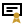
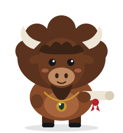
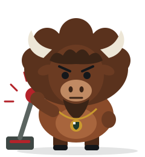
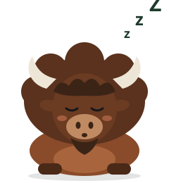
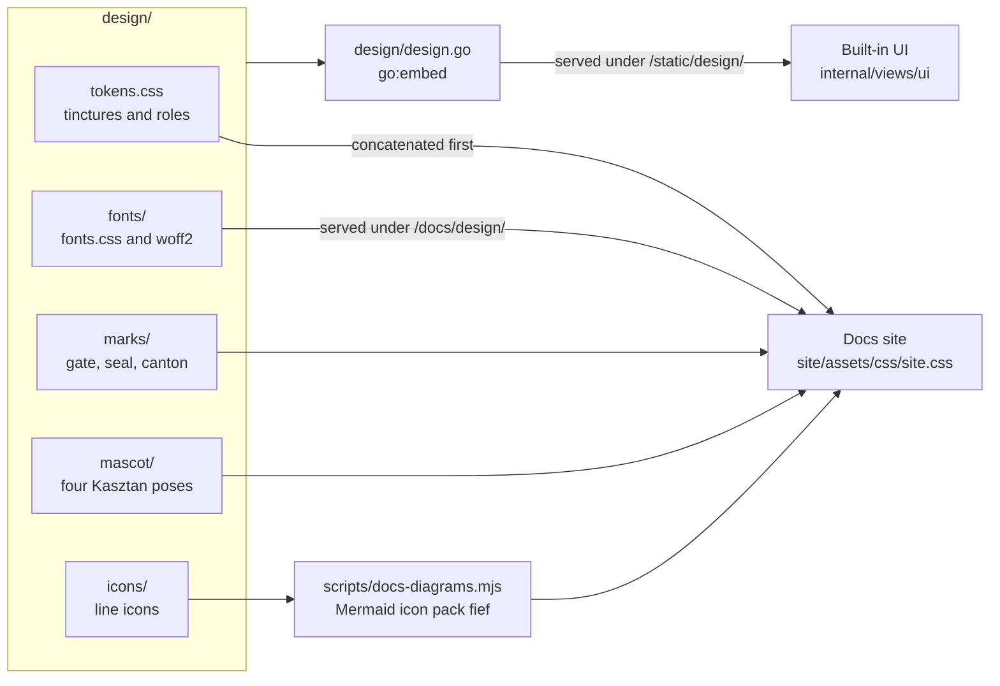

Everything OpenFief shows people (the docs site, the landing page and the built-in UI) draws from one design system. Its files live in [`design/`](../../design/), and this page is the rule book for them. The author chose this direction; the parts marked **(P)** are Claude Code proposals awaiting the author's approval.

## Concepts

**The metaphor is the product.** A [fief](../glossary.md) is land a lord grants a vassal on conditions, taken back when they break. OpenFief's visual language follows that feudal deal and nothing else: a gate the agent's orders pass through, a carved-out corner of a shield for each lease, a seal for the owner's approval, and a drawbridge for the kill switch. When the metaphor gets in the way of a plain label, the plain label wins.

**Puszcza, the Polish forest.** OpenFief is built for Polish investors first, and the palette and mascot come from Białowieża: a royal hunting forest whose żubr (European bison) Polish kings put under crown protection in the 16th century. The żubr lives inside a guarded domain under rules it can't argue with, which is exactly what an agent's fief is. The żubr is also a heraldic charge already: the Pomian coat of arms carries a bison's head.

**Tinctures, and the rule of tincture.** Heraldry names its colors *tinctures* and splits them into metals (or, gold; argent, silver) and colors (vert, gules, sable). Its oldest rule says never put a metal on a metal or a color on a color. That rule existed so a shield could be told apart across a battlefield, and it is a contrast rule. The tokens keep both the names and the rule: gold and silver go on vert, sable or gules, never gold on a light ground.

## The marks

| Mark | File | Means | Use for | Smallest |
|---|---|---|---|---|
|  Gate | [`gate.svg`](../../design/marks/gate.svg), [`gate-reversed.svg`](../../design/marks/gate-reversed.svg), [`favicon.svg`](../../design/marks/favicon.svg) | OpenFief itself: the gateway every order passes, with the fief, in gold, inside its arch | Wordmark lockup, favicon, navigation, anything that names the product | 16 px |
|  Seal | [`seal.svg`](../../design/marks/seal.svg), [`seal-reversed.svg`](../../design/marks/seal-reversed.svg) | The gate on the shield: the gateway acting for the owner | App icon, docs hero, approval requests, stickers | 32 px |
|  Canton | [`canton.svg`](../../design/marks/canton.svg) | One fief: in heraldry a canton is the square set apart in the shield's upper corner | The glyph for a lease in the UI: fief chips, fief cards. Grey when revoked | 14 px |

- The Gate is the logo. The Canton is never used as the logo, and the Seal never below 32 px, where its gate turns to mush.
- The wordmark is `openfief`, lower case, in the display face at weight 800, to the right of the Gate, which is as tall as the word's cap height plus descender.
- Keep clear space of a quarter of the mark's width around it. On a dark or vert ground, use the reversed file.
- The square inside the gate is always gold. It is the one fixed point of the brand.
- The app icons, `marks/app-icon-*.png`, are the Seal on argent, rendered from `seal.svg` and the `--argent` token by [`app-icons.mjs`](../../scripts/app-icons.mjs) (`task design:icons`): 180 px for Apple's touch icon, 192 and 512 px, and a maskable 512 px one whose seal stays inside the central circle a platform's mask keeps. They are the only raster files in `design/`; regenerate them, never edit them.

## Icons

The icons in [`design/icons/`](../../design/icons/) draw OpenFief's parts in diagrams, on the landing page and, later, in the UI. They are drawn like the marks: on a 24 px grid, with a 2 px stroke and square joins. Strokes are `currentColor`, so an icon takes the color of the text around it. Gold appears only where it means what it means in the marks, the fief or the owner's seal: the gate's square, the canton, the seal's center, the bond's rosette and the agent's eyes, since an agent holds a fief.

| Group | For | Icons |
|---|---|---|
| OpenFief's parts | the core, its operator and proxy, the plugin kinds, and the walls between them |  `gate`  `operator`  `egress`  `connector`  `view`  `agent`  `wall`  `route` |
| The money | what the record holds and how it is valued |  `ledger`  `chart`  `fx`  `bond`  `statement`  `database`  `fief` |
| People and the outside | who and what OpenFief talks to |  `owner`  `browser`  `script`  `phone`  `institution`  `globe` |
| Trust and control | signatures, credentials and the levers that stop things |  `seal`  `key`  `secret`  `image`  `cluster`  `clock`  `killswitch` |

- An icon labels a thing; it never replaces its name. Every icon in a diagram or a card has its text next to it.
- One icon means one thing everywhere. The `gate` is OpenFief's core, as the Gate mark is OpenFief; `connector`, `view` and `agent` are the plugin kinds; `institution` is any bank, broker or data publisher.
- In a Mermaid diagram, an icon is a node shape from the pack `fief`, which the docs build registers from this folder: `core@{ icon: "fief:gate", form: "square", label: "Core", pos: "b", h: 40 }`. Use them for diagrams of parts and how they connect; diagrams of code stay plain ([Documentation](docs.md#writing-a-concept-page)).
- A new icon is one more file in the folder, on the same grid, with a `<title>`. The docs build picks it up by its file name.

## Color

Tinctures are the palette; components use the semantic tokens built on them, so dark mode redefines only those. The values live in [`tokens.css`](../../design/tokens.css), the only place a hex code is written.

| Tincture | Token | Light | Dark ground | Role |
|---|---|---|---|---|
| Vert | `--vert` | `#1E3A2B` | `#3F7A5A` (`--vert-bright`) | The brand: primary fills, the hero, current page |
| Or | `--or` | `#C99A2E` | `#D9AE4A` (`--or-bright`) | The fief: the gate's square, the canton, the seal, focus rings |
| Gules | `--gules` | `#B4232A` | `#E0575C` (`--gules-bright`) | Revoking, cancelling, errors |
| Kasztan | `--kasztan` | `#8A4B2A` | | The mascot's coat; small labels and eyebrows |
| Sable | `--sable` | `#14171A` | | Text; text on gold |
| Argent | `--argent` | `#F3F4EF` | | Light ground; text and marks on vert |

Semantic tokens, by job: `--bg`, `--surface`, `--sunken` for grounds; `--text`, `--muted`, `--border` for content; `--accent` and `--on-accent` for the primary action; `--highlight` for gold fills and `--highlight-text` for the rare gold text; `--danger` and `--on-danger`; `--link`; `--label` for small uppercase labels (kasztan, lightened on dark); `--focus`; and a soft background with its text color for each status (`--ok-*`, `--warn-*`, `--danger-*`, `--neutral-*`).

- Body text meets WCAG 2.1's 4.5:1 contrast, small grey labels included. Gold (`--or`) on a light ground is about 2.5:1, so it is never text there.
- Status is never color alone: every pill carries a word, and an icon when it matters (verified, unverified).
- Dark mode follows the reader's system setting. A page can force one scheme with `data-theme="light"` or `data-theme="dark"` on `<html>`.

## Type

| Role | Family | Weights | Token |
|---|---|---|---|
| Display: headlines, the wordmark, empty states | Bricolage Grotesque | 700, 800 | `--font-display` |
| Interface: everything read and clicked | IBM Plex Sans | 400, 500, 600 | `--font-sans` |
| Figures: amounts, quantities, IDs, code | IBM Plex Mono | 400, 500 | `--font-mono` |

- The fonts are self-hosted in [`design/fonts/`](../../design/fonts/), loaded by [`fonts.css`](../../design/fonts/fonts.css), with Latin Extended so Polish names render. All three are under the SIL Open Font License 1.1, whose text sits beside them. Nothing loads from another host.
- Amounts are always monospace with tabular figures (`font-variant-numeric: tabular-nums`), so columns line up, and always show their currency, because every amount keeps its original currency (D-20). Write them in the owner's number format (D-113), whose Polish default is `5 000,00 PLN`.
- Headings are tight (`letter-spacing: -0.02em`), body text is 16 px at 1.6 line height, and lines stay under about 75 characters.

## Space and shape

- Spacing steps on a 4 px base: `--space-1` to `--space-7` are 4, 8, 12, 16, 24, 32 and 48 px. Lay out sibling groups with flex or grid and a gap.
- Corners are near-square, like a shield's edge: 2 px for inputs, 6 px (`--radius`) for cards and buttons, and fully round only for pills.
- Touch targets are at least 44 px. Focus is a 2 px `--focus` ring with a 2 px offset, never removed.
- Motion is limited to state changes, under 200 ms, and off under `prefers-reduced-motion`.

## Components

The pattern library, as drawn. M0 needs only the first group; the rest belong to the agent milestones and are not built (M1 and later).

**M0, tracker and built-in UI ([UI](../concepts/ui.md)):**

- **Buttons.** Primary: `--accent` fill, `--on-accent` text. Secondary: 1.5 px `--accent` outline. Quiet: underlined text. Destructive: `--danger` fill. One primary per view.
- **Status pills.** A plugin's trust badge (D-56, D-87): *Verified* (ok, check icon), *Yours* (neutral), *Unreviewed* (warn), *Blocked* (danger, cross icon), with the exact signer under it. Valuation state (D-36): *Revaluation pending* or *running* (neutral pill with a gold dot), and *valued through* a date in monospace.
- **Tables.** Holdings and transactions: monospace, right-aligned figures; a sunken header row; no zebra stripes. On a phone each row becomes a card, one line per cell with its column's header on the left and the value on the right, figures still monospaced, right-aligned and with their currency **(P)**; where that can't be done (no script), wide tables scroll inside their own box.
- **Navigation.** On a phone it folds behind a *Menu* button in the top bar and opens as a full-width list **(P)**.
- **Inputs.** A label above every field, a 1.5 px `--border-strong` border with the 2 px input radius, a currency suffix inside amount fields, and help text under the field in `--muted`.
- **Charts.** The allocation and value-over-time charts (D-30) use vert, then or, kasztan, a grey and the vert tint, in that order, with direct labels where they fit.
- **Empty states.** Kasztan asleep, one line saying what's missing, and the action that fills it.

**Later, agent surfaces (not built):**

- **Fief card.** The canton, the agent's name and thesis, an *Active* or *Revoked* pill, a meter of the lease in use split into holdings and open orders, and the lease's rules as chips.
- **Approval request.** On the owner's phone: the seal, the proposed order, the agent's "wrong if" condition, the gateway's checks (within lease, rules pass, separate account), and *Reject* beside *Seal it*.
- **Kill switch.** A sable panel titled *Raise the drawbridge*, saying what revoking does, with a `--danger` button that names the agent. Hold-to-confirm for two seconds **(P)**.

## Kasztan, the mascot

Kasztan is a żubr in a castellan's gold chain of office. A *kasztelan* kept a castle and its rules for the crown; *kasztan* is also Polish for chestnut, the color of his coat. He appears in four poses, one per system state:

| Pose | File | Shown when |
|---|---|---|
|  On duty | [`kasztan-on-duty.svg`](../../design/mascot/kasztan-on-duty.svg) | Sign-in, about, the landing page: everything is normal |
|  The seal | [`kasztan-seal.svg`](../../design/mascot/kasztan-seal.svg) | Success: an approval went through, an import finished |
|  Drawbridge | [`kasztan-drawbridge.svg`](../../design/mascot/kasztan-drawbridge.svg) | A fief was revoked, or something needs the owner now |
|  Asleep | [`kasztan-asleep.svg`](../../design/mascot/kasztan-asleep.svg) | Empty states: no accounts, no fiefs yet |

- Kasztan appears in empty, success, error and onboarding states, at most once per screen. Never in a data table, a chart, or next to a loss.
- Place him on `--argent` or `--sunken`; the poses are drawn for a light ground.
- The poses are a flat-vector draft. A final illustration should keep the proportions, the chain and the four states.

## Voice

- **Plain first, feudal second.** Data views use the [glossary](../glossary.md)'s terms exactly: holding, not position; instrument, not ticker. The feudal words (gate, seal, drawbridge, charter) go in headings, empty states and the landing page, never in place of a domain term.
- Say what happens, with the consequence: "Revokes trading rights and cancels open orders. The rest of your portfolio is untouched."
- No exclamation marks in the UI, and no emoji. Kasztan carries the warmth.

## How it works

`design/` is the single source; the docs site and the built-in UI consume it and never copy a value out of it.

- Hugo mounts `design/` twice ([`site/hugo.toml`](../../site/hugo.toml)): into the assets, where [`head.html`](../../site/layouts/_partials/head.html) concatenates `tokens.css` before [`site.css`](../../site/assets/css/site.css), and into the static files under `/docs/design/`, which serves the fonts, the favicon and the images on this page. So this page's images work both on GitHub and on the site.
- The site's own stylesheet uses only semantic tokens. The Gate in its top bar is inline SVG ([`mark.html`](../../site/layouts/_partials/mark.html)) in `currentColor` with a gold square, so the content security policy needs no image source for it.
- The built-in UI serves the same files. [`design/design.go`](../../design/design.go) is a Go package with one embedded file system holding `tokens.css`, `fonts/`, `marks/` and `mascot/` at their own paths, because Go's `embed` can't reach files outside its package's directory. The UI serves it under `/static/design/`, and every page loads `fonts.css`, then `tokens.css`, then the UI's own [`style.css`](../../internal/views/ui/web/static/style.css), which uses only semantic tokens. Nothing is copied, so there is no copy to drift; the UI's image build copies `design/` next to `internal/`, and Hugo's mounts leave `design.go` out of the site. The Gate in the UI's top bar is inline SVG, as on the site; Kasztan and the favicon are images from the same files, which the UI's content security policy allows as its own (`img-src 'self'`, `font-src 'self'`).
- The UI's charts take their colors from the tokens at runtime: `style.css` maps the five series onto semantic tokens (`--series-1` is `--accent`, then `--highlight`, `--label`, `--border-strong` and `--accent-soft`), and the chart script reads them as computed CSS custom properties, so the charts follow light, dark and `data-theme`, and redraw when the reader's scheme changes. Tests in [`design_test.go`](../../internal/views/ui/design_test.go) fail on any color written outside `tokens.css` in the UI's templates, scripts or stylesheet, on a custom property the stylesheet uses that nothing defines, and on a page that doesn't load the design system.
- Mermaid diagrams render in the same palette: [`docs-diagrams.mjs`](../../scripts/docs-diagrams.mjs) passes a light and a dark set of tincture-based theme variables, and registers the icons as the Mermaid icon pack `fief`, swapping their gold for `--or-bright` in the dark rendering. The landing page inlines its feature icons, so they take the text color. The built-in UI doesn't use the icons yet, so `design.go` doesn't embed them.

## Not built yet

- Direct labels on the UI's charts. Chart.js draws none without a plugin, so the value-over-time chart names its two lines in a legend, and the allocation's bars are labelled on their axis.
- The agent surfaces above wait for their milestones.
- Kasztan's final illustration.
