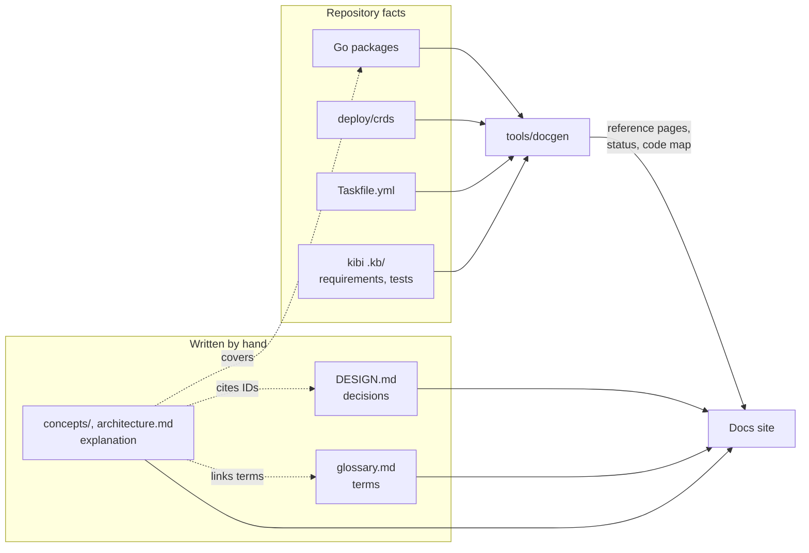
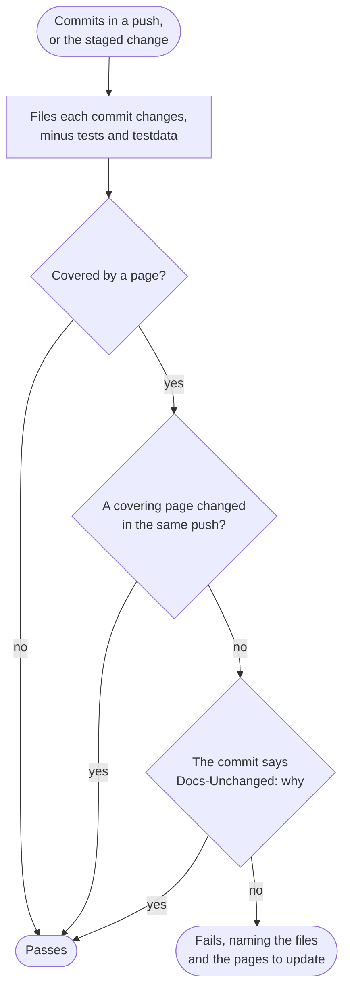
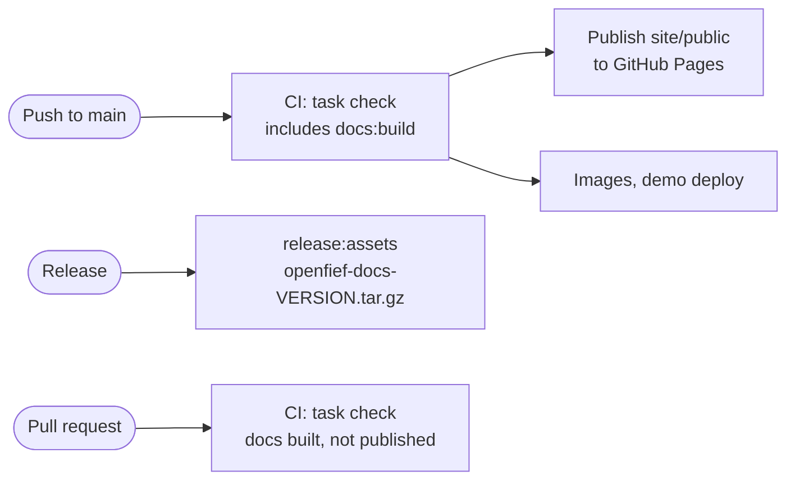

Most of OpenFief is written by coding agents, and the author verifies their work by reading. A page that describes code which has since changed is worse than no page. So the docs are treated like code: what can be generated is generated on every build, and what has to be written by hand is tied to the code it explains, so neither can drift without a check failing.

The idea is "living documentation" (Cyrille Martraire's book of that name, 2019), on top of the "docs as code" practice of the Write the Docs community: docs live in the repository, change in the same commits as the code, and go through the same pipeline.

## Kinds of pages

The pages follow Diátaxis (Daniele Procida, grown out of the Divio documentation system around 2017), which splits documentation by what the reader needs. Each kind has one source of truth and one mechanism that keeps it true.

| Kind | What it answers | Where | Kept true by |
|---|---|---|---|
| Explanation | Why is it like this, and how does it work? | [concepts/](../concepts/), [architecture.md](../architecture.md), [pipeline.md](pipeline.md) | The staleness gate below |
| Reference | What exactly is there? | Generated at build time: code map, custom resources, tasks, [status](/status/), [requirements report](/requirements/) | Regenerated on every build; never committed |
| Decisions | What did the author decide? | [DESIGN.md](../DESIGN.md), [proposals/](../proposals/), [research.md](../research.md) | The design-docs skill and `task docs:check` |
| Rules | What must contributors and agents do? | [dev/](./) and [AGENTS.md](../../AGENTS.md) | Review |
| How-to guides and tutorials | How do I do a task? | Added with the first installable release | Tested in the end-to-end suite **(P)** |



## One fact, one place

- **Decisions** live in DESIGN.md. Other pages cite their IDs, such as D-18, and never restate them.
- **Terms** live in the glossary. Other pages link to it on first use and never redefine a term.
- **Requirements and their evidence** live in kibi. The status page renders them; no page copies them.
- **Code facts** such as package lists, custom-resource fields and task names are generated, never typed.

## Writing a concept page

A concept page explains one area as built. It starts with front matter:

```yaml
---
title: Ledger
description: One plain sentence saying what the page explains.
covers:
  - internal/ledger/**
---
```

- `covers` lists the code the page explains, as paths with `*` (one path segment) and `**` (any depth). It is what the staleness gate checks.
- The body has no H1; the title is rendered as one. The sections are **(P)**: an introduction, then `Concepts`, `How it works`, `Decisions`, `Verification` and `Not built yet`.
- Concepts are explained for a newcomer, with where the idea comes from when that helps.
- Every concept page has at least one diagram, and the names in it match the code.
- Link source files and other docs with relative links. The build resolves each one and fails on a broken one.
- Synthetic data only, as everywhere in the repository.

## The staleness gate

A commit that changes a file a page covers must also change a page that covers that file, in the same push, or say why not in a commit trailer:

```
Docs-Unchanged: renamed a private helper; behavior is the same
```

- Tests (`_test.go`) and test data (`testdata/`) never trigger the gate: they don't change behavior.
- Every Go package must be covered by at least one page, so new code can't arrive undocumented.
- The gate runs in the `commit-msg` hook on the staged changes, and in CI over every pushed range. CI checks pushes as well as pull requests because agents merge straight to `main`.

The gate compares paths, not meaning: it can't tell whether the new text is right. Review still decides that. What the gate guarantees is that nobody changes covered code without looking at the page that explains it.



## Build and publishing

`task docs:build` builds the site into `site/public`:

1. `tools/docgen` writes the reference pages from the Go packages, the custom-resource definitions, the Taskfile and kibi's coverage report. kibi also renders its requirements report.
2. Hugo's first pass collects every Mermaid block on every page, DESIGN.md and proposals included.
3. `scripts/docs-diagrams.mjs` renders each block to a light and a dark SVG in headless Chromium. Each diagram is cached by a hash of its source.
4. Hugo's second pass builds the site with the SVGs inlined. The site runs no JavaScript and loads nothing from other hosts.

The build fails on a diagram that doesn't render, a relative link that resolves to nothing, or a link to a heading that doesn't exist. `task docs:serve` previews the site locally.



- Every pull request and every push builds the docs as part of `task check`, so a broken page fails CI like a failing test.
- Each push to `main` publishes the site to GitHub Pages from the same CI run that deploys the demo. It is served at [docs.openfief.dev](https://docs.openfief.dev/): the custom domain set in the repository's Pages settings, with a DNS `CNAME` from `docs` to `arkadiuss.github.io`. The landing page at the apex domain and the demo at `demo.openfief.dev` are separate.
- Each release attaches `openfief-docs-<version>.tar.gz`, the site as it was at that version, for self-hosters who run that release.
- Every link and asset is relative to its page (Hugo's `relativeURLs`). So one build works at the custom domain, at the GitHub Pages fallback address, and opened straight from disk out of the tarball. Docs pages link to generated pages by site path, such as `/status/`.

The site is [Hugo](https://gohugo.io), pinned in the Taskfile like the other tools. Its small theme lives in `site/`: no theme dependency, no CDN, and a strict content security policy. `docs/` is mounted into the site unchanged, so every page reads the same on GitHub and on the site.

## Verifying the implementation

The docs double as the author's verification tool:

- **[Status](/status/)** lists every decision with the kibi requirements derived from it, how many implementing symbols and tests each has, and its evidence level. A decision with no implemented requirement is visibly not built.
- **[Code map](/reference/code-map/)** draws the as-built dependencies between bounded contexts from the Go imports. Compare it with the designed context map in [code-organization.md](code-organization.md).
- **Concept pages** end with `Verification` (which tests prove which behavior) and `Not built yet` (decided but missing).
