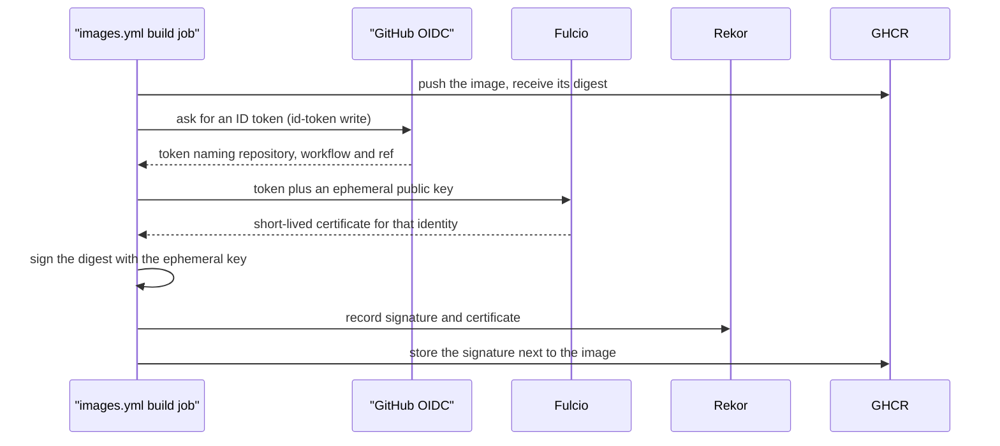
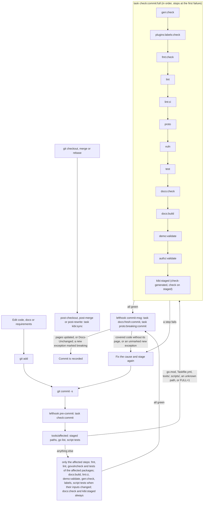
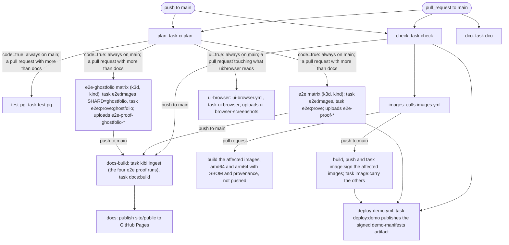
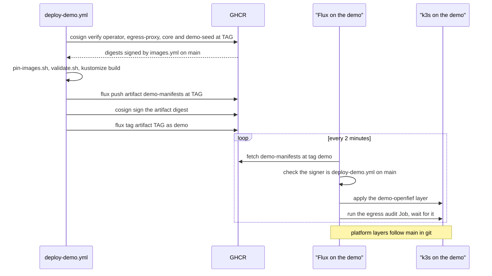
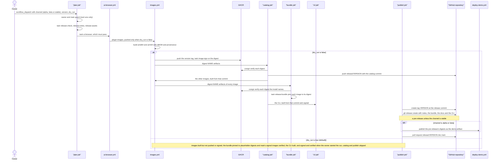

This page explains the machinery that takes a change from a commit on a branch to signed container images, a tagged release and the demo environment. It describes what the repository contains today, file by file. The rules this machinery enforces are in [sdlc.md](sdlc.md) and aren't repeated here. Where the two disagree, [Not built yet](#not-built-yet) says so.

## Concepts

**One entry point.** Make, written by Stuart Feldman at Bell Labs in 1976, gave a project one file that names every build step. [Task](https://taskfile.dev) follows the same idea, with YAML instead of Makefile syntax. In OpenFief, [Taskfile.yml](../../Taskfile.yml) is the only place a command is written down. A developer, a git hook and a CI job all run `task <target>`, so they can't drift into three slightly different scripts. The Taskfile also pins the version of every tool it calls.

**Shift-left checks.** "Shift left" (Larry Smith, 2001) means running a check earlier, when a failure is still cheap. In git, the earliest point is the pre-commit hook: the commit doesn't exist until its checks pass. [lefthook](https://github.com/evilmartians/lefthook) manages the hooks. It writes small scripts into `.git/hooks` that read [lefthook.yml](../../lefthook.yml).

**Conventional Commits.** A commit subject has the form `type(scope)!: summary`, as in `feat(ledger): add lots`. The convention grew out of the Angular project's commit guidelines. The type tells a machine what kind of change a commit is, and `!` or a `BREAKING CHANGE:` footer marks a breaking one. Here, the type decides which section of the release notes a commit goes in.

**CalVer and SemVer.** Semantic Versioning (`MAJOR.MINOR.PATCH`) is a compatibility promise: only a new major version may break you. That matters to code that depends on an API. Calendar Versioning puts the date in the number, as Ubuntu's `24.04` does, which tells a user how recent a release is. The product uses CalVer (`2026.11.0`). The protobuf contracts and SDKs are meant to use SemVer.

**DCO.** The [Developer Certificate of Origin](../glossary.md#other-terms-and-abbreviations) came from the Linux kernel in 2004, after the SCO lawsuits made the origin of code a legal question. Each commit carries a `Signed-off-by: Name <email>` trailer (`git commit -s`), by which the author certifies they may contribute it. It's lighter than a contributor licence agreement: there's nothing to sign beyond the commit itself. D-5 in [DESIGN.md](../DESIGN.md) requires it.

**Keyless signing.** [cosign](../glossary.md#other-terms-and-abbreviations) is the signing tool of Sigstore, a Linux Foundation project launched in 2021. Classic signing needs a long-lived private key that someone must guard and rotate. Keyless signing replaces the key with an identity. The CI job asks GitHub for an OIDC token that names the repository, workflow and ref. Sigstore's certificate authority, Fulcio, exchanges it for a certificate that is valid for about ten minutes. cosign signs with a throwaway key and records the signature in Rekor, a public append-only log. A verifier checks who signed (the workflow identity) rather than which key.



**Digest pinning.** An image tag such as `:main` is a movable pointer. A digest (`@sha256:...`) is the hash of the content, so it changes if one byte changes. Pinning a digest means you run exactly what was tested and signed. Here, GitHub Actions are pinned by commit SHA, Dockerfile base images by digest, and cosign signs the digest the build produced. D-17 requires plugin images to be pinned by digest.

**GitOps.** In a push deploy, CI holds a credential for the cluster and runs `kubectl apply`. GitOps, a name Weaveworks gave the practice in 2017, turns this around: an agent inside the cluster pulls the desired state from a versioned source and keeps the cluster matching it. [Flux](https://fluxcd.io), a CNCF project that grew out of Weaveworks, is such an agent. Nothing outside the cluster needs a way in, and the source's history is the deploy log. The demo's Flux pulls from git and from a signed OCI artifact: a registry entry that holds manifests instead of an image.

**Supply-chain hygiene with Renovate.** Exact pins stop surprise upgrades, but they go stale. [Renovate](https://docs.renovatebot.com) is a bot that finds pinned versions and opens pull requests to bump them, so each upgrade is a reviewed and tested change. It can't see a pin it can't parse, so the Taskfile and workflows mark versions with `# renovate:` comments.

**Affected-only checks.** In a repository with many packages, most commits touch a few of them. Build systems such as Bazel and Pants (and `go test` itself, through its cache) avoid repeating work whose inputs didn't change: they know each target's inputs and rerun only the targets downstream of a change. OpenFief does the same with a small selector, [tools/affected](../../tools/affected/main.go). Go's import graph (`go list`) says which packages a changed package reaches; the selector reruns lint and tests for those, and nothing else. A change it can't place, or one that every check reads, such as `go.mod`, runs everything: a check skipped wrongly costs more than a check run needlessly.

**Traceability gate.** In safety-critical engineering, a traceability matrix links each requirement to the code that implements it and the test that verifies it. [kibi](kibi.md) keeps that record in `.kb/` and checks it with Prolog rules. Its gate in the pre-commit hook refuses a commit whose behavioral code has no owning requirement or no covering test.

## How it works

### The Taskfile

Every step is a task target, and `task --list` shows them with descriptions. Three conventions recur:

- **Pinned tools in `.bin/`.** The `vars` block pins golangci-lint, govulncheck, lefthook, Task itself, actionlint, controller-gen, Hugo, buf and its three generators (Go, Connect and the read API's OpenAPI), zed (SpiceDB's CLI, for the authorization schema), and for the demo hcloud, kustomize and gojq. The internal `tool:*` targets `go install` them into `.bin/`, and a `status` check skips the install unless the version changed. Go tools are built with the toolchain in `go.mod` (`GO_TOOLCHAIN`, now `go1.27.4`), because golangci-lint refuses code that targets a newer Go than it was built with. The envtest API server and etcd come from [envtest-assets.sh](../../scripts/envtest-assets.sh), which checks each archive against a pinned SHA-512. The flux CLI can't be built with `go install`, so `tool:flux` downloads its release archive and checks a pinned sha256. The k3s and Flux versions a demo machine installs are pinned here too, with their sha256 sums, and rendered into its cloud-init. `CNPG_VERSION` with `CNPG_MANIFEST_SHA256`, the sha256 of CloudNativePG's release manifest, pins the manifest every release bundle ships and the end-to-end suite installs: the internal `cnpg:manifest` target downloads it from CloudNativePG's GitHub release into `.bin/cnpg/` and checks the sum, and the install guide gives the same version and sum, which the release bundle's script test checks. The end-to-end suite also reads `K3S_VERSION` again, as the k3s image of the k3d cluster (`task e2e:k3s-image`). Every download of ours goes through [retry.sh](../../scripts/retry.sh), and CI caches `.bin/` by these versions ([Download retries and the tool cache](#download-retries-and-the-tool-cache)).
- **Explicit paths.** Tasks call `{{.BIN}}/golangci-lint`, not `golangci-lint`, so a global install can't shadow the pin.
- **Skip until it exists.** Some targets print "skipping" and succeed while their input is missing: `GO_GUARD` (no `go.mod`) and `PROTO_GUARD` (no `.proto` files). The pipeline was built ahead of the product. Today nothing skips: `go.mod` and the contracts in `proto/` exist, and `e2e` runs the suite in `test/e2e`.

Two targets drive a browser and are in no check, since a check must not need Chromium: `task design:icons` renders the built-in UI's app icons from the Seal with [app-icons.mjs](../../scripts/app-icons.mjs) ([Design system](design-system.md)), and `task ui:browser` runs [ui-browser.mjs](../../scripts/ui-browser.mjs), which serves the UI over its in-memory fakes and checks it at phone and desktop width, the Inbox and the check pages D-192 removed landing on it at 360 px, an account's tabs, an instrument's page with its rename and the overview's allocation tab at 360 px, its service worker, the overview it keeps offline (D-151), and a protected action confirmed with a passkey from Chromium's virtual authenticator (D-183), saving screenshots to `SHOTS` ([Built-in UI](../concepts/ui.md#verification)). `ui:browser` still runs in CI and gates every release ([testing.md](testing.md)): [ui-browser.yml](../../.github/workflows/ui-browser.yml) runs it with the runner image's Chrome, called by ci.yml's `ui-browser` job and by release.yml (see [CI on pull requests and main](#ci-on-pull-requests-and-main) and [Releases](#releases)). Both find Chromium the way docs-diagrams.mjs does, and `ui:browser` installs the npm packages first (`kibi:install`) for playwright-core.

`task setup` runs once per clone. It installs the tools, runs `npm ci` for kibi, whose `postinstall` has patch-package apply the repository's kibi patch ([The kibi gate](#the-kibi-gate)), installs the lefthook hooks, and registers kibi's merge driver for the `.kb` files named in [.gitattributes](../../.gitattributes). CI runs `task setup:ci` instead, which skips lefthook and the merge driver and compiles the branch's knowledge base.

`check` (CI) and `check:commit:full` run the same steps in the same order, with two differences: CI also runs the docs staleness gate over the pushed range (`docs:fresh`; the hook's version runs at `commit-msg`), and the kibi step at the end differs. The hook's `check:commit` runs only the steps of `check:commit:full` that the staged change can affect, and falls back to all of them when in doubt ([Affected checks](#affected-checks)). Task runs a `cmds` list in sequence and stops at the first failure. "Each module" below means `GO_MODULES`: the core (`.`) and the Go SDK (`sdk/go`).

| Step | What it runs | Fails when |
|---|---|---|
| `gen:check` | `task gen` (controller-gen writes deepcopy code, [CRDs](../glossary.md#other-terms-and-abbreviations) and the operator's Role), then [gen-check.sh](../../scripts/gen-check.sh) | a regenerated file differs from the git index or is untracked |
| `plugins:labels:check` | [plugin-labels.sh](../../scripts/plugin-labels.sh) `check`; `task plugins:labels` writes the labels | a first-party plugin's `io.openfief.plugin.manifest` Dockerfile label, or a demo `Plugin`'s `spec.manifest`, differs from its `plugins/<name>/manifest.json` (D-42) |
| `fmt:check` | `golangci-lint fmt --diff` in each module (gofumpt with extra rules, goimports) | a file would be reformatted |
| `lint` | `lint:config` (`golangci-lint config verify`), then `lint:go` (`golangci-lint run`) in each module, with the `e2e` and `spicedb` build tags so the end-to-end suite and the SpiceDB contract test are linted too | any finding; [.golangci.yml](../../.golangci.yml) enables every linter except a commented list |
| `lint:ci` | actionlint on the workflows, with its shellcheck and pyflakes integrations off | a workflow error |
| `proto` | `buf lint`, `buf format --diff`, [proto-breaking.sh](../../scripts/proto-breaking.sh) (with the base's own `buf.lock`), [proto-check.sh](../../scripts/proto-check.sh) | a lint or format issue, a breaking change against the base that no new exception excuses ([below](#breaking-contract-changes)), or a stale `sdk/go/gen` or `gen/openapi` (the read API's OpenAPI document, generated from its protobuf and `read_service.openapi-base.yaml`, with the error responses [tools/openapierrors](../../tools/openapierrors/main.go) adds as `read_service.openapi-errors.yaml` assigns them; `proto:gen` and the check both run it after `buf generate`) |
| `vuln` | [vulncheck.sh](../../scripts/vulncheck.sh): govulncheck in each module, then `npm audit --audit-level=high` | a finding, or an unreachable vulnerability database |
| `test` | `test:go` (`go test ./...` with the envtest binaries) in each module, then `test:script` for each of the twenty-four `scripts/tests/*.test.sh` | any failure |
| `docs:check` | [check-docs.sh](../../scripts/check-docs.sh) | an undefined or duplicate GR, D, P, T, OQ or R ID, or a changed ground-rule line |
| `docs:build` | [docgen](../../tools/docgen/main.go) writes the reference pages, then Hugo and [docs-diagrams.mjs](../../scripts/docs-diagrams.mjs) build the site ([docs.md](docs.md)) | a broken link, a diagram that doesn't render, or a docs page naming a kibi ID or task that doesn't exist |
| `docs:fresh` (CI only) | `git log` over the range from `DOCS_BASE`, piped into `docgen fresh` | covered code changed without a page covering it and without a `Docs-Unchanged:` trailer, or a Go package no page covers |
| `demo:validate` | [validate.sh](../../scripts/demo/validate.sh): `kustomize build` of `deploy/demo`, of every git path its Flux Kustomizations apply, and of `deploy/demo/openfief` | a layer doesn't build, an image isn't pinned by digest, an OCI source doesn't require a cosign signature, or a substituting layer uses a variable cloud-init doesn't define |
| `authz:validate` | `zed validate authz/validation.yaml`, offline: the authorization model's SpiceDB schema ([authz/schema.zed](../../authz/schema.zed), D-164) against its relationships and assertions | the schema doesn't parse, or an assertion fails |

`task test:authz` is outside `task check`: it runs the authorization contract test ([test-authz.sh](../../scripts/test-authz.sh), build tag `spicedb`) against a real SpiceDB in testing mode, which must answer every holder and action as `identity.MayAct` does. SpiceDB is pinned as `SPICEDB_VERSION` and built from its module into `.bin/` on first use (`tool:spicedb`, through retry.sh), which takes minutes, so `task tools` doesn't install it.
| `kibi:check` or `kibi:staged` | `kibi check` through kibi-check.sh (CI); `kibi check-generated --staged --changed-only` and `kibi check --staged` through kibi-staged.sh (hook) | a knowledge-base rule violation |

Two steps compare against a base revision: the ground-rule check reads `DOCS_BASE`, and `proto:breaking` reads `PROTO_BASE`, then `DOCS_BASE`. Both default to `HEAD`, which locally means "against the last commit". CI sets `DOCS_BASE` to the pull request's base.

Until the first beta, a contract change marked breaking (`!` or a `BREAKING CHANGE:` footer) may break the contracts ([sdlc.md](sdlc.md#releases)). From the first beta, a breaking contract change goes in only when an author decision names it, as D-157 removes the read API's `ListBrokerAccounts`. `proto:breaking` excuses exactly what that decision names, in the change that makes it, and still fails on every other breaking change; once the change is on the base, later comparisons no longer see it. The commit marks it breaking (`!` or a `BREAKING CHANGE:` footer), so the release notes list it.

### Breaking contract changes

Which rule applies comes from the repository's tags (`tools/protobreak stage`, [stage.go](../../tools/protobreak/stage.go)): until a tag names a beta (`YYYY.M.N-beta.K`) or a stable release (`YYYY.M.N`), the check is before the first beta, and alpha tags don't change that. CI checks out the whole history with its tags, so it sees the same tags a clone does.

**Before the first beta**, any breaking change goes in, in a commit marked breaking (`!` or a `BREAKING CHANGE:` footer), so the release notes list it; it needs no exception. The check isn't off for that: `judge` reports each finding no entry excuses as allowed, then [proto-breaking.sh](../../scripts/proto-breaking.sh) compares each non-merge commit in the range that touches the contracts with its parent, and fails on one that breaks them without the mark. Locally the commit isn't written yet, so the `commit-msg` hook's `task proto:breaking:commit` does it for the staged contracts and the message being written. Exceptions entries are checked as below all the same.

**From the first beta**, only what an author decision names breaks:

[proto-breaking-exceptions.txt](../../scripts/proto-breaking-exceptions.txt) lists the removals author decisions approved, one a line: the decision, the buf rule it excuses and the removed element, fully qualified, as in `D-157 RPC_NO_DELETE openfief.views.v1.ReadService.ListBrokerAccounts`. [proto-breaking.sh](../../scripts/proto-breaking.sh) runs `buf breaking --error-format json` against the base. When buf finds nothing and the file is as on the base, it passes as before, without building anything else. Otherwise it builds the base's contracts into a buf image and hands buf's findings, the file now and at the base, and [DESIGN.md](../DESIGN.md) to `tools/protobreak judge` ([judge.go](../../tools/protobreak/judge.go)), which passes only when all of these hold:

- Every entry cites a decision that exists, and a method's entry cites one that names the method as code, such as `` `ListBrokerAccounts` ``.
- An entry excuses anything only while it is new, absent from the base's file. An entry already on the base never excuses a later removal, and the check is never off.
- Only removals of a method (`RPC_NO_DELETE`) or a top-level message (`MESSAGE_NO_DELETE`) can be excused. A new message entry must name a message the base has that a method removed under the same decision holds: its request, its response, or a message they hold. So D-157 excuses `ListBrokerAccounts`, `ListBrokerAccountsRequest`, `ListBrokerAccountsResponse` and `BrokerAccount`, and nothing else.
- Every finding is excused by a new entry, and every new entry excuses a finding. A field whose type changed next to the removal still fails, and so does an entry added before its removal or without one, so the file can't grow silently.

Commits are checked too, before and after the first beta. In the range from the base, every commit that adds an entry must be marked breaking (`tools/protobreak marked`). Locally, where the base is `HEAD` and the commit isn't written yet, the `commit-msg` hook runs `task proto:breaking:commit`, which does the same for the staged file and the message being written; it skips merge commits, whose commits the range check sees one by one. Removing an entry needs no mark. The entries stay in the file as the record of what was approved; once on the base, they excuse nothing.

### Affected checks

`task check:commit` runs [check-commit.sh](../../scripts/check-commit.sh). It writes the staged changes (`git diff --cached --name-status`) and both modules' package listings ([go-packages.sh](../../scripts/go-packages.sh): `go list -json`, once with the `e2e` tag and once without) to a temporary directory, and runs `tools/affected hook` on them. The tool prints the plan and the reason for every step it runs or skips, and lists the task targets on standard output; the script runs them in order, prints each one's time (`check-commit: <task>: 41s`) and the total, also after a failure, and stops at the first failure. If the tool fails, the commit fails. A merge needs no special case: while it is being committed the staged diff is the merge's diff against its first parent (`HEAD`), so the selection covers what the merge brings in, and merging a branch that only changes tests runs those tests and their lint, not the full check; `kibi check --staged` already leaves out files the merge takes unchanged from the other branch. `task check:plan` prints the plan without running it, and `FULL=1` (`FULL=1 git commit ...`, or `task check:commit FULL=1`) runs `check:commit:full`. The tool itself never runs git, go or task: the scripts collect their output, as docgen's Taskfile targets do.

The tool sorts each changed path by the first rule that matches it, in [classify.go](../../tools/affected/classify.go):

| Change | What the hook runs |
|---|---|
| `go.mod`, `go.sum`, `go.work`, `go.work.sum` (both modules), `.golangci.yml`, `Taskfile.yml`, `lefthook.yml`, `tools/`, `scripts/`, `proto/`, `buf.*`, generated code (`gen/`, `sdk/go/gen/`), `design/`, `authz/`, `package.json`, `package-lock.json`; a file in no rule, package or test's reach; a Go file in a directory that is no package (a package removed or not yet listed); a path with whitespace | everything: `check:commit:full` |
| A Go file | its package is changed. Lint and `govulncheck` run on it and on every package that imports it, directly or not (reverse imports from `go list`); tests run on those and on every package whose tests import one of them. A package with no files without a build tag, such as `test/e2e`, is only linted: govulncheck and `go test` build without tags. `fmt:check:files` checks the staged Go files. |
| A file a package embeds (`go:embed`, from `go list`'s `EmbedFiles`) | the same as a Go file of that package |
| Any other file under a package's directory (test data, a Dockerfile) | that package's tests |
| A path a package's Go files name as a relative literal (`"../../deploy/crds"`, `filepath.Join("..", "deploy")`) | that package's tests |
| A path a script test names as `$root/<path>`, `$root/.github/workflows` included | that script test (`test:script`) |
| `docs/`, `site/`, root `*.md` and `LICENSE` | `docs:build` |
| `.kb/` | `docs:build` (its status pages read kibi) |
| `.github/` | `lint:ci` |
| `deploy/` | `demo:validate`; `gen:check` for `deploy/crds` and `deploy/operator` |
| A plugin's `manifest.json` or `Dockerfile`, or `deploy/demo/` | `plugins:labels:check` |
| `.claude/`, `.mcp.json`, `renovate.json` | nothing more: no check reads them |
| Operator code, through its imports | `gen:check` |
| A deleted file | `docs:build`, since a page may link to it |

`docs:check` (a second) and `kibi:staged` always run, and the commit-msg hook's `docs:fresh:commit` is unchanged. So a commit of docs or requirements alone runs `docs:check`, `docs:build`, `kibi:staged` and the staleness gate, and no Go step. Collecting the inputs and compiling the tool take a few seconds. Measured with `task check:commit` on this repository's 66 packages, a warm Go cache and other work on the machine:

| Staged change | Steps | Time (kibi 2.42) | Time (kibi 2.36) |
|---|---|---|---|
| One plugin's `main.go` | fmt, lint, govulncheck and tests of that plugin; plugin-labels.test.sh; kibi:staged | 22 seconds (kibi 13) | about the same |
| `internal/ledger` (about 50 packages import it) | fmt, lint, govulncheck and tests of 50 packages, kibi:staged | 37 seconds | about 1 minute |
| A page under `docs/`, or a record under `.kb/` | docs:check, docs:build, kibi:staged | 90 to 100 seconds, almost all in docs:build | 3 minutes or more; 20 to 25 minutes with `.kb/` staged |
| `Taskfile.yml` or `go.mod`: check:commit:full | everything | 170 seconds (the kibi upgrade commit) | 35 to 38 minutes |

The architecture tests ([tools/archtest](../../tools/archtest/doc.go), [code-organization.md](code-organization.md#architecture-tests)) read the whole repository, and name the directories they walk as relative literals (`"../../internal"`, `"../../plugins"` and the others), so the hook reruns them for a change under any of those directories. A new bounded context is added to the tests' context map (`tools/archtest/layout.go`) with the table in code-organization.md; a test that skips without PostgreSQL is listed in `exceptions.txt` with its reason.

The hook is less strict than CI by design: CI's `task check` stays whole, and runs on every pull request and every push to `main`. Linting a subset of packages can miss a finding that needs other packages (`dupl` compares code across packages), and a test that reads a file through a path built at run time, rather than a literal, isn't rerun when that file changes. [testing.md](testing.md#stability) asks tests to name such files with literal paths.

### Download retries and the tool cache

Every download CI makes of its own goes through [retry.sh](../../scripts/retry.sh): the envtest archives ([envtest-assets.sh](../../scripts/envtest-assets.sh)), the flux CLI (`tool:flux`), CloudNativePG's manifest (`cnpg:manifest`), the Envoy Gateway and Gateway API manifests ([e2e-gateway.sh](../../scripts/e2e-gateway.sh)), the `go install` of every pinned tool and of Task itself, `npm ci` (`kibi:install`) and `gh release download` in the release smoke test. The script runs the command again when its error text says a later try can work: HTTP 429 or 5xx, a curl connection, DNS or timeout error, a Go or npm network error. It never retries anything else: a 4xx answer other than 429, a certificate problem, a failed checksum or a compile error is final at once. The first failure is followed by up to five more tries, after 2, 4, 8, 16 and 32 seconds, and each wait and its reason are printed. The checksum checks stay in the callers, after the download, exactly as strict as before. `tool:envtest` once failed with curl's exit 22 on a 504; curl's own `--retry 3` waited a few seconds in all.

Keyless signing goes through it too: `image:sign`, `deploy:demo`'s signature of the demo's manifests and `release:cli:sign`. It retries only the failures above and one of cosign's own, GitHub's token service answering an error page where cosign expects its OIDC token as JSON; a refusal by Fulcio or Rekor stays final (`image:sign` keeps its one extra run for Rekor's 409). The cosign installer is a third-party action, which a script can't wrap. The local composite action [install-cosign](../../.github/actions/install-cosign/action.yml) runs `sigstore/cosign-installer` (pinned as before), again after 15 seconds and a last time after 45 if it fails, the first two failures being only warnings; it retries any installer failure, since the action can't say why it failed. All eight workflow steps that installed cosign call it. The other third-party actions that fetch things (setup-go, setup-node, the cluster actions) aren't wrapped.

The setup action caches `.bin/` (without `.bin/e2e`, the e2e job's own state) with `actions/cache`, keyed by runner, job and a hash of the Taskfile's `*_VERSION` and checksum variables plus `go.mod`'s `go` and `toolchain` lines. The tool targets skip an install whose binary is already at the pinned version, so a hit makes `task setup:ci` nearly free, and a bumped version builds a new cache.

### Git hooks

[lefthook.yml](../../lefthook.yml) defines five hooks. Each calls task targets with `.bin/` first on `PATH`, so the pinned Task runs:

- `pre-commit` runs `task check:commit`, which runs only the checks the staged change affects ([Affected checks](#affected-checks)).
- `commit-msg` runs `task docs:fresh:commit` with the message file: the docs staleness gate on the staged files. It skips merge commits; CI checks the merged commits one by one. It also runs `task proto:breaking:commit`, which fails a commit that adds a breaking-change exception, or before the first beta breaks a contract, without marking itself breaking ([Breaking contract changes](#breaking-contract-changes)), and skips merges the same way.
- `post-checkout` runs `task kibi:sync` for a branch checkout (lefthook's `{3}` argument is `1`), not for a file checkout.
- `post-merge` runs `task kibi:sync`.
- `post-rewrite` runs `task kibi:sync` after a rebase, not after an amend.

kibi compiles one store per branch, and the sync hooks keep it in step with the branch you're on. kibi's own git hooks stay uninstalled, so lefthook alone owns `.git/hooks`.

The hook checks the working tree, not a clean copy of the index. Go tests, lint and the docs check read files on disk, so an unstaged edit can make a commit pass locally and fail in CI. Only `gen:check` and the kibi gate compare against the index.



### The kibi gate

On commit, `kibi:staged` runs two commands. `kibi check-generated --staged --changed-only` regenerates kibi's symbol manifest from the staged bytes and compares it with what is staged; it skips the work when no staged path can affect a symbol. `kibi check --staged` then runs kibi's rules on the staged change, including the rule that blocks a behavioral symbol with no `implements` requirement or no `covered_by` test. kibi's own help marks `--staged` as experimental.

[kibi-staged.sh](../../scripts/kibi-staged.sh) runs both. First it removes the throwaway stores (`/tmp/kibi-precommit-<pid>-*`, tens of megabytes each) that earlier `kibi check --staged` runs left behind when they were killed, only those whose process is gone. `kibi check --staged` builds one such knowledge base per run, in a Prolog process of its own, to apply the staged symbols to the branch's records; a local kibi patch keeps that store off the disk ([Setup notes in kibi.md](kibi.md#setup-notes)), which is what keeps the step at about 30 seconds for a one-file commit.

In CI, the setup action sets `KIBI_BRANCH`, because `actions/checkout` leaves a detached HEAD and kibi won't write a store without a branch name. `setup:ci` then runs `kibi sync`, and `task check` ends with `kibi check` over the whole knowledge base. CI is therefore stricter than the hook: it also catches problems outside the staged change.

kibi's `kibi sync` ends its compiling Prolog process with a SIGTERM right after detaching the store, and publishes the store straight after, the suspected cause of stores published without some of their records under load ([Not built yet](#not-built-yet)). [patches/kibi-cli+2.42.0.patch](../../patches/kibi-cli+2.42.0.patch), applied by patch-package on every `npm ci` (package.json's `postinstall`, with `--error-on-fail --error-on-warn`, so a patch that no longer applies, or a kibi-cli at another version, fails the install), makes the sync wait up to 60 seconds for that process to halt on its own after `kb_detach`, and refuses to publish when the detach failed or the process had to be signalled. `task kibi:check` also runs `kibi check` through [kibi-check.sh](../../scripts/kibi-check.sh), as a stopgap kept until kibi fixes the defect upstream: the patch makes the defect rarer, not gone. When the check fails naming a compile defect, an authored relationship "missing from the compiled KB" or a duplicate row in the paginated entity projection, the script compiles the store again from the same files with `kibi sync --rebuild` and checks once more; that check's result is final. Any other failure is final at once, and a real authored problem, such as an endpoint declared in a file Git doesn't track, survives the recompile and still fails. The same applies after a merge: run `kibi sync --rebuild`, then `task kibi:check`.

The same defect publishes stores with records stored twice, which multiplies the answers of kibi's requirement proofs until a query passes kibi's 120-second limit. [patches/kibi-core+0.31.0.patch](../../patches/kibi-core+0.31.0.patch) removes exact duplicate triples when the engine attaches a store, and the kibi-cli patch prints how many it removed on the next kibi command's stderr; under GitHub Actions the line is a `::warning::` workflow command, so it shows on the run's summary page whichever job's command meets it first. The same patch reports a query stopped at the limit as stopped, which kibi's own message didn't. `task docs:gen` asks for the coverage report 300 requirements at a time through [kibi-coverage.sh](../../scripts/kibi-coverage.sh), and runs each page through [kibi-timed.sh](../../scripts/kibi-timed.sh), which prints how long it took and, from 90 seconds, three quarters of the limit, warns, again as a workflow warning in CI; a cheap query before the first page takes the store's attach and dedupe out of its limit. Outside CI the joined report is reused while the `.kb` files, kibi's versions and its patches are unchanged, so the pre-commit hook doesn't pay about four minutes on every docs commit; in CI, where `CI` and `GITHUB_ACTIONS` are `true`, it is always regenerated ([docs.md](docs.md#build-and-publishing)). [kibi.md](kibi.md#setup-notes) has the measurements.

### CI on pull requests and main

[ci.yml](../../.github/workflows/ci.yml) runs on pull requests to `main`, on pushes to `main`, and by hand (`workflow_dispatch`), which runs like a push. The workflow starts from `permissions: {}`, and each job asks only for what it needs. A newer push supersedes a running pull-request run, but runs on `main` always finish, one at a time, so every merge is built.

Each job first calls the composite [setup action](../../.github/actions/setup/action.yml). It installs Go from `go.mod`, installs Task at the Taskfile's `TASK_VERSION` and sets `KIBI_BRANCH`. Task is the one tool installed outside a task target, since no target can run before Task exists; its install goes through retry.sh like the tool targets'. The action also restores `.bin/` from a cache ([Download retries and the tool cache](#download-retries-and-the-tool-cache)). By default the action also installs Node and runs `task setup:ci`; jobs that only need Task pass `tools: 'false'`.

- `plan` runs `task ci:plan`: `tools/affected ci` reads `git diff --name-status <base> HEAD` and prints `code=false` for a pull request whose every path is docs, requirements or agent configuration (`docs/`, `site/`, `.kb/`, root `*.md`, `LICENSE`, `.claude/`, `.mcp.json`, `renovate.json`), and `code=true` otherwise and on every push. `test-pg`, `e2e` and `e2e-ghostfolio` run only with `code=true`. It also prints `ui=true` on every push, and for a pull request that changes anything `ui:browser` reads: `internal/views` (the UI, its templates and static files, and the views it renders), `plugins/ui`, `design/`, `scripts/ui-browser.mjs`, the workflows and setup action that run it, the npm packages and their patches, `Taskfile.yml`, `go.mod` and `go.sum`; `ui-browser` runs only with `ui=true`. So a push to `main` always runs the whole suite.
- `check` runs `task check` with full history, whatever changed. `DOCS_BASE` is the pull request's base SHA, or the previous `main` (`github.event.before`) on a push.
- `test-pg` runs `task test:pg`. [test-pg.sh](../../scripts/test-pg.sh) starts a throwaway PostgreSQL from the runner's binaries on a Unix socket, each test creates a fresh database with every migration applied, and the server is removed afterwards. The same run loads the demo dataset end to end through `cmd/demo-seed`, and starts `cmd/core` on a fresh database to call its read API with a script token.
- `ui-browser` calls [ui-browser.yml](../../.github/workflows/ui-browser.yml), which runs `task ui:browser` with Node and the runner image's Chrome, as the e2e passkey test finds it, so a page that scrolls sideways at 360 or 390 px in either theme, a phone menu that doesn't fold, a UI that isn't installable or a service worker that caches a page fails the run. It uploads the screenshots, pass or fail, as `ui-browser-screenshots`, kept seven days.
- `dco` runs on pull requests and on pushes to `main`: `task dco BASE=<base sha> HEAD=<head sha>`, from the pull request's base or the push's previous head (its last commit alone when the push creates the branch). [dco-check.sh](../../scripts/dco-check.sh) walks each non-merge commit in the range and requires a `Signed-off-by` trailer that matches the commit's author name and email exactly. The `commit-msg` hook runs the same check on the commit being made (`task dco:message`, `dco-check.sh --message`: the author from `git var GIT_AUTHOR_IDENT`, a merge exempt), so a commit without its author's sign-off is refused before it exists and a push that skipped the hook still shows red.
- `e2e` is a matrix over `k3d` and `kind` (D-12), and one failure doesn't cancel the other; it has 40 minutes. A third-party action creates the cluster. The k3d cluster runs the demo machine's k3s: the image `task e2e:k3s-image` names from `K3S_VERSION`, with flannel, k3s's built-in kube-router NetworkPolicy controller, the bundled Traefik and servicelb, and `--secrets-encryption`, as the machine's cloud-init sets it, plus [traefik-gateway.yaml](../../test/e2e/testdata/traefik-gateway.yaml) in k3s's manifests directory, which turns on Traefik's Gateway API provider for the exposure test; the demo machine doesn't get it. kind runs its default CNI, kindnet, which also enforces NetworkPolicy. `task e2e:images CLUSTER=<k3d|kind>` then builds the `core`, `operator`, `egress-proxy` and `demo-seed` images, the built-in UI plugin's `ui` image, the `nbp-fx`, `xtb`, `ibkr-flex`, `eodhd` and `treasury-bonds` plugins and, twice, the suite's synthetic connector ([test/e2e/connector](../../test/e2e/connector/main.go), never released: `e2e-connector` and `e2e-connector-egress`, each labelled with its own manifest, the second asking for the egress host `example.org` too) and the suite's institution fixture server ([test/e2e/fixture](../../test/e2e/fixture/main.go), never released: `fixture`, see below) from the checkout with `docker build` ([e2e-images.sh](../../scripts/e2e-images.sh)), tags them `openfief.test/<name>:e2e` and loads all but the plugins into the cluster (`k3d image import`, `kind load docker-image`), so a pull request tests its own code. The plugins go to the suite's registry instead: a `registry:3.0.0` container, pinned by digest, on the cluster's Docker network and published on `127.0.0.1:5000`. The operator reads it at its private address on that network over plain HTTP; containerd pulls plain HTTP only from localhost, so the script pulls each plugin image into every node with `ctr --plain-http` under the name the operator deploys, which asks for `IfNotPresent`. The `core`, `operator` and `egress-proxy` images go to the registry too, and into the nodes the same way, for the suite's install from the release bundle, which names every image by digest. It writes both registry addresses, and those three images at their digests as the cluster names them, to `.bin/e2e/registry.env`, which `task e2e` reads. `task e2e:gateway CLUSTER=<k3d|kind>` ([e2e-gateway.sh](../../scripts/e2e-gateway.sh)) then gives the cluster a Gateway API implementation for the exposure test: on kind, Envoy Gateway from its release manifest, pinned in the Taskfile by version (`ENVOY_GATEWAY_VERSION`, with a Renovate comment) and sha256, and the GatewayClass `openfief-e2e` for it; on k3d, Traefik's provider with its GatewayClass `traefik`, after installing the Gateway API's standard CRDs, pinned the same way (`GATEWAY_API_VERSION`), only when k3s's Traefik CRD chart brought none. The job sets up Node too, and `task e2e` installs the npm packages (`kibi:install`), for playwright-core. The job runs the suite as `task e2e:prove`: it compiles the branch's knowledge base and runs `kibi prove --integration e2e`, which records the workspace snapshot, runs `task e2e` (the command `.kb/proof/integrations.json` names for the `e2e` integration) and turns its exit code into a passing or failing receipt for each end-to-end test with a proof contract. kibi judges the run as a whole, so one failing end-to-end test fails every receipt of that run. The job uploads the run's `kibi.proof-run.v1` artifact, `.kb/proof/runs/e2e.json`, as `e2e-proof-k3d` or `e2e-proof-kind`, kept seven days. `task e2e` runs [assert-local-cluster.sh](../../scripts/assert-local-cluster.sh), which refuses any API server not on `127.0.0.1`, `localhost`, `0.0.0.0` or `[::1]`, fetches the CloudNativePG manifest, renders the release bundle of the three registry images into `.bin/e2e/bundle` with [release-bundle.sh](../../scripts/release-bundle.sh) (see [Releases](#releases)), and runs `go test -tags e2e -v ./test/e2e/...` twice, with the pinned kustomize first on `PATH`. The bundle run sets `OPENFIEF_E2E_BUNDLE` and runs only the `TestBundle` tests: its `TestMain` deletes the `openfief` namespace if an earlier run left one, then applies, unchanged and in the [install guide](../guides/install.md)'s order, the bundle's CloudNativePG manifest, its CRDs file, its `openfief-db` cluster and its install file. Between the CRDs and the install it signs the plugin images in the registry with a key made for the run and adds it to `openfief-trusted-signers`, as an owner who signs with their own key does (D-45), since this checkout's UI can't carry the release pipeline's signature; and it builds the `openfief` CLI from the checkout into `.bin/e2e/openfief` the way the release builds it from its release commit (D-88), with a catalog that pins the UI's digest in the suite's registry to that key as its publisher, which `go build -overlay` reads in place of `plugins.json`, so the checkout is never changed (`buildCLI` in [firstrun_test.go](../../test/e2e/firstrun_test.go)). The tests then check that every Deployment in the bundle runs its images by digest from the suite's registry, exactly as the cluster runs them; that the operator, the egress proxy and the core become available; through a port-forward to the core like the one `openfief enroll` opens, that `/readyz` answers, that a script token from `/core token issue` lists accounts, and that a call without one gets 401; and the owner's first run with the CLI built from the checkout, run as its own process (`TestBundleFirstRun` in [firstrun_test.go](../../test/e2e/firstrun_test.go)): `openfief plugin install ui`, as the install guide gives it, answered `y`, after which the operator runs it with its browser path, then `openfief enroll`, whose link the runner's Chrome uses through [passkey.mjs](../../test/e2e/passkey.mjs) to create the first passkey, sign out and sign in again, and Ctrl-C, after which the CLI exits cleanly. Two more bundle tests check what the install may do and what it exposes: `TestBundleOperatorScope` ([scope_test.go](../../test/e2e/scope_test.go)) sends a SubjectAccessReview for the operator's ServiceAccount, with its groups, for every verb on Secrets, pods and the other kinds an escaped operator would reach for, in `openfief`, `default`, `kube-system` and `cnpg-system`, and on cluster-scoped kinds, and expects exactly what [role.yaml](../../deploy/operator/role.yaml) grants in `openfief` and nothing anywhere else; `TestBundleExposure` ([exposure_test.go](../../test/e2e/exposure_test.go)) checks that the bundle and the namespace hold no Ingress, Gateway or route, DaemonSet or StatefulSet, only ClusterIP Services, no pod on the host's network or ports and no pod outside the bundle's Deployments, the plugins' and the database's, then applies the HTTPRoute component's route and NetworkPolicy from `deploy/gateway` with their placeholders replaced, attaches them to a Gateway it creates with a certificate from a CA made for the run, and gets `/readyz`, the read API's 401 and the UI's login page over HTTPS, verified against that CA, by port-forwarding to the Gateway's data plane and naming the test hostname, as `curl --resolve` does. Its last part waits until every other bundle test has finished, since it restarts the core they use: each of them registers before `t.Parallel`, so the wait can't start before they all have, and Go's default `-parallel` leaves them slots to run in. It then applies the component's patch of the core's auth origins, read from `deploy/gateway` with the placeholder hostname replaced as the guide's overlay replaces it, waits until the patched core runs alone, and runs `openfief enroll --origin https://<test hostname>` with the CLI built from the checkout, which prints a one-time link for that hostname without a port-forward. The runner's Chrome, through [passkey.mjs](../../test/e2e/passkey.mjs), then opens it on `https://<test hostname>`: `--host-resolver-rules` sends the hostname to the Gateway's port-forward, and `--ignore-certificate-errors-spki-list` makes Chrome accept the keys of the run's CA and the Gateway's certificate, which it serves with its chain, and no others besides its own roots, so the page is a secure context with a certificate that verifies, as passkeys need; Chrome creates a passkey on the hostname, keeps the `__Host-` cookie there, signs out and signs in again ([routepasskey_test.go](../../test/e2e/routepasskey_test.go)). It deletes the namespace again afterwards, whatever happened, so the demo run, which skips the `TestBundle` tests, starts from an empty namespace. A failed bundle run doesn't stop the demo run; `task e2e` fails if either failed.

  The suite installs what the demo machine runs, in the order of its Flux layers: CloudNativePG at the operator version of the demo's chart, `deploy/crds`, the demo's database `deploy/demo/database` (on kind, a copy of the default storage class named `local-path`), the demo's app layer `deploy/demo/openfief` through `test/e2e/overlays/openfief`, which swaps the images, admits the suite's client pod like `core-from-traefik` and starts the core with `--authz=spicedb`, so the whole suite runs under SpiceDB (a script token the suite issues holds the household grant, and a view plugin it installs is granted the household by the owner's session), with the demo's `ui` instance pointed at the UI's signed image in the suite's registry, and on k3s the demo's Ingress through `test/e2e/overlays/routes` (no TLS, a `.test` host). Before the app layer it signs the plugin images in the registry with a key made for the run (`cosigntest.Key`) and adds the public key to the `openfief-trusted-signers` ConfigMap, so the operator starts trusting it. It then checks that the core becomes available and answers `/readyz` through its Service and, on k3s, through Traefik; that a pod no policy admits can't connect; that the `demo-seed` Job completes; that a script token from `/core token issue` lists the three demo accounts, each valued through today; that a call without a token gets 401; and that the operator deploys `nbp-fx` with a `Plugin` and `PluginGrant`, verified and reported in its status, hardened, reachable from the core only, with an allow-list of the granted host, and gone again with its allow-list key once the `Plugin` is deleted; that the operator refuses two synthetic images the suite pushes to its registry, one unsigned, with `SignatureVerified=False/Unsigned`, and one signed with a second key made for the test and never trusted, with `SignatureVerified=False/UntrustedSigner` naming the key's fingerprint in the message and `status.untrustedSigners` (D-169), each with no workload and a `Warning` event; that the operator deploys the UI with its browser path and the core proxies `/login` to it, from a pod and, on k3s, through Traefik (D-81); that plugins are isolated ([isolation_test.go](../../test/e2e/isolation_test.go), D-200's criteria 10, 16 and 17): with the `xtb` connector and a second `nbp-fx` instance installed, it adds an ephemeral container running the client pods' curl image to their pods and the core's, which shares the pod's network and so its NetworkPolicy, and checks that the XTB pod reaches only the core's plugin port, not the egress proxy, the core's browser port, another plugin, the API server's own address or DNS, and that the operator gave it no proxy rule, egress token or allowed host; that the proxy answers 407 to the granted plugin's CONNECTs to hosts outside its effective grant, without a token or with another plugin's, and to a plain HTTP request, while direct connections and name lookups from the plugin pods fail, with the outsider pod reaching the same API server address and name as the control; that the proxy's log holds a decision line with instance, host and decision for each of those requests and nothing of their path, query, headers, body or token, and allowed no CONNECT to a host off its instance's allow-list, checked with the audit the demo and the release smoke test run (`smokescreen.AuditLog`, [Egress](../concepts/egress.md#auditing-the-log)); that the connector answers the core's token for its instance and refuses, with 401, no token, a malformed one, the core's token for another instance and its own, while no other pod reaches it; that no plugin pod, client pod or outsider can open a connection to SpiceDB's port while the core's pod can ([spicedb_test.go](../../test/e2e/spicedb_test.go), D-164); that SpiceDB, which the demo's app layer deploys next to the core, runs with the Secrets its Job generated, its `Database` applied and its role reconciled, and logs neither credential; that, with the core switched to `--authz=spicedb` for one serial test, a script token with no grant lists none of the accounts the policy lets it list, a stopped SpiceDB makes the read API refuse (HTTP 5xx) while the core's `/healthz` still answers, and a restarted one makes it answer again, after which the test returns the core to the policy; and that `openfief enroll` forwards `localhost:8080` to the core and prints the first passkey's link, with which the runner's Chrome, driven by [passkey.mjs](../../test/e2e/passkey.mjs) with its virtual authenticator, creates a passkey, keeps the `__Host-` cookie on `http://localhost`, signs out and signs in again (D-80, D-85); that the operator verifies a `Plugin` without a `PluginGrant` but runs nothing until the grant is applied; that the API server refuses an image named by tag alone and the operator one with a tag next to its digest (`InvalidImage`); that an upgrade of the synthetic connector to its image that asks for `example.org` keeps the old version running, with the host pending approval and off the allow-list, until the grant approves it; that the `nbp-fx` image the embedded catalog pins, copied with its CI signatures from GHCR into the suite's registry at the same digest, is `Verified` with the catalog's publisher, while the one this checkout built and the suite's key signed is `Unverified`, signed by the owner ([trust_test.go](../../test/e2e/trust_test.go)); and, with the CLI the demo run builds too, that the synthetic connector, bound to the demo's XTB account with a synthetic credential in its Secret `e2e-books--credentials`, has that Secret mounted into its own pod only, that after a sync books its deposit the credential is in no ConfigMap, pod spec, `Plugin`, `PluginGrant` or `pg_dumpall` of the database, and that `openfief plugin uninstall` removes the `Plugin`, its grant, its Secret, its workload and its allow-list entry while the read API keeps the deposit, marked `connector_instance_removed` ([connector_test.go](../../test/e2e/connector_test.go)). On a failure the test logs lines starting `diagnostics:`: every pod and event, the core's NetworkPolicies, EndpointSlices and the Ingresses, the Plugins, PluginGrants, plugin Deployments, the allow-list and the trusted signers, the spec and status of the core's pods and of every pod that isn't ready, and the logs (with the previous run's) of every pod in `openfief`, `cnpg-system` and the clients' namespace, and of Traefik. A failed installation prints the same before any test runs.
- `e2e-ghostfolio` is the Ghostfolio shard, D-200's criterion 9 against a real Ghostfolio, in a job of its own so the `e2e` jobs don't grow: the same matrix over `k3d` and `kind`, created the same way but without `traefik-gateway.yaml`, and 40 minutes. `task e2e:images CLUSTER=<k3d|kind> SHARD=ghostfolio` builds only what the shard runs, `core`, `operator`, `egress-proxy` and `demo-seed`, and the `ui` and `ghostfolio` plugins, with no bundle images, and `task e2e:gateway` doesn't run. `task e2e:prove:ghostfolio` runs `kibi prove --integration e2e-ghostfolio`, whose command is `task e2e:ghostfolio`: the same `TestMain` install of the demo's stack as `task e2e`'s demo run, with `OPENFIEF_E2E_SHARD=ghostfolio`, so it signs only the two plugin images it has, then `TestGhostfolio` alone ([ghostfolio_test.go](../../test/e2e/ghostfolio_test.go), [ghostfolio_setup_test.go](../../test/e2e/ghostfolio_setup_test.go)); `task e2e` skips that test. It uploads its proof run as `e2e-proof-ghostfolio-<cluster>`. It runs Ghostfolio from [testdata/ghostfolio.yaml](../../test/e2e/testdata/ghostfolio.yaml) in the namespace `openfief-e2e-ghostfolio`: the `ghostfolio/ghostfolio` image of 3.93.0 and Redis 7.2.17 by digest, and a one-instance CloudNativePG cluster from the operator the suite already installed, on the same default PostgreSQL image as `openfief-db`, so the only images it pulls beyond the main run's are Ghostfolio's and Redis's. The test makes the JWT key, access token salt and Redis password at random for each run, and the user's security token comes from Ghostfolio's own anonymous sign-up, so nothing is a credential. The shard reuses the demo dataset rather than the data path: the demo already holds IBKR, XTB and treasury bond accounts with fees, coupons and cash in several currencies, so it costs no fixture, connectors or browser, and the view projects the demo's record end to end all the same.
- `images` waits for `check` and calls [images.yml](../../.github/workflows/images.yml) with `select`, so only the images the change affects are built, and with `push` true only on `main`. A manual run with `all_images` rebuilds every image.
- `docs-build` runs on a push to `main` once `check` passed and the `e2e` and `e2e-ghostfolio` jobs finished, passed or not, with `contents: read` only. It downloads the four `e2e-proof-*` artifacts into `.kb/proof/runs/ci`, which Git ignores and kibi leaves out of the workspace snapshot, and runs `task kibi:ingest`: [kibi-ingest-proofs.sh](../../scripts/kibi-ingest-proofs.sh) hands each artifact to `kibi ingest-proof`, oldest first, since kibi keeps a test's receipts in the order their runs finished. kibi accepts an artifact only when it was made from the same workspace snapshot, by the configured command, so the receipts come from the real runs of this commit. `task docs:build` then renders the site, kibi's requirements report included, and the job uploads `site/public` as a Pages artifact. A failing end-to-end run still publishes the site, with its failed receipts in the requirements report: an honest red receipt hides less than a site stuck at an older commit.
- `docs` publishes that artifact with GitHub's `deploy-pages` action to the `github-pages` environment ([docs.md](docs.md)); only this job has `pages: write` and `id-token: write`. It needs the repository's Pages source set to "GitHub Actions", with the custom domain `openfief.dev`. With "Deploy from a branch", the deploy fails with a 404 and GitHub serves the repository root through Jekyll instead.
- `deploy-demo` runs on every push to `main`, after `check`, `e2e` and `images` succeed. It has no on/off variable: publishing the artifact is harmless without a demo machine, because nothing pulls it. It calls [deploy-demo.yml](../../.github/workflows/deploy-demo.yml), described in [The demo](#the-demo).



**Images.** The `discover` job runs `task ci:images`. It lists each `cmd/<name>/Dockerfile` and `plugins/<name>/Dockerfile` as a JSON matrix and lowercases the registry prefix; today that is `core`, `demo-seed`, `egress-proxy` and `operator`, and the plugins `eodhd`, `ghostfolio`, `ibkr-flex`, `nbp-fx`, `treasury-bonds` and `ui`. An empty list skips `build` rather than failing it.

With `select` (CI, never a release), `discover` runs `task ci:images:select` instead ([ci-images-select.sh](../../scripts/ci-images-select.sh)), which hands `tools/affected images` the matrix, the package listings and, per image, an earlier build to compare with. An image is affected by its Dockerfile, by a non-test Go file of any package its binary imports, directly or not (from `go list`, so not from paths alone), by a file one of those packages embeds, and by the inputs every image shares: both modules' `go.mod` and `go.sum`, `go.work`, `go.work.sum`, `.dockerignore`, images.yml, the setup action, ci-images.sh and `tools/affected`. A Go file in no package rebuilds every image.

- On a pull request (`base`), the earlier build is the pull request's base: the affected images are built, not pushed, and the rest are skipped.
- On `main` (`reuse`), the earlier build is the newest of HEAD's last 20 first-parent commits whose `sha-<commit>` tag carries a signature that `cosign verify` accepts from images.yml on `main`, the identity [pin-images.sh](../../scripts/demo/pin-images.sh) trusts. Comparing with that commit, not with the push's `before`, means a cancelled run or a failed build can't hide a change: the next run diffs against the last image that was really signed. An image with no such build is built.
- An unaffected image on `main` is carried: the `carry` job runs `task image:carry` ([image-carry.sh](../../scripts/image-carry.sh)) per image. It verifies the earlier digest's signature, tags that digest `sha-<commit>` and `main` with `crane tag` (pinned as `CRANE_VERSION`), which adds a tag without touching the manifest, and verifies that the new `sha-<commit>` tag resolves to the same signed digest. Nothing new is signed: the signature from images.yml on `main` belongs to the digest. So after every push, every image has a `sha-<commit>` tag on a digest images.yml signed, and the demo deploy finds one for each image as before. A carry that fails fails the run, and the deploy with it.

In a release (a `version` given), `build` fails fast: the first image that fails cancels the builds still running, so they don't push under a version that won't be released. CI runs let every image finish, so one failure doesn't hide another. `discover` prints its decision and the reason for each image in the job log, such as `carry nbp-fx: no input changed since 1a2b3c4` or `build core: internal/ledger/ledger.go is in internal/ledger, which it imports since 1a2b3c4`. `build` runs once per image. Buildx builds `linux/amd64` and `linux/arm64` from the repository root, attaches an SBOM and a full (`mode=max`) provenance attestation, and caches layers per image. The Dockerfiles copy `go.work`, `go.work.sum` and `sdk/go` and build in workspace mode, as the repository does locally, because the core imports the SDK module, which a private repository can't serve as a module version. They cross-compile Go on the build machine and copy the binary into a distroless base pinned by digest. When pushing, the job logs in to GHCR with the job's token, pushes, and runs `task image:sign IMAGE=<image>@<digest>`, so cosign signs the digest just pushed, never a tag. cosign v3 stores the signature as a Sigstore bundle attached to the digest as an OCI referrer. The operator verifies plugin images in that format and trusts `images.yml` on `main` as OpenFief's own signer, so signing has to stay in that workflow. The tags depend on the caller:

| Caller | Built | Pushed and signed | Tags |
|---|---|---|---|
| Pull request | the affected images | no | none |
| Push to `main` | the affected images; the others are carried | yes; a carried image keeps its signed digest | `sha-<short sha>` and `main`, on a new or a carried digest |
| Manual run with `all_images` | every image | on `main` | `sha-<short sha>` and `main` |
| Release | every image | yes, unless `dry_run` | the version, such as `2026.11.0-beta.1` |

### The demo

The demo is one Hetzner Cloud server running k3s, holding synthetic data only (GR-12). [demo.md](demo.md) is the operator's guide; it's a proposal, and this section only explains the machinery. The pipeline touches the demo in two ways.

**The machine.** `demo:plan`, `demo:up`, `demo:status`, `demo:down` and `demo:recreate` all run [demo.sh](../../scripts/demo/demo.sh) with the pinned hcloud CLI. They run from a terminal, or from [demo-infra.yml](../../.github/workflows/demo-infra.yml), a hand-started workflow in the GitHub Environment `demo`, which holds `HCLOUD_TOKEN` and `CLOUDFLARE_API_TOKEN`. The script keeps no state: it finds Hetzner resources by the labels `app=openfief` and `env=<name>`, and Cloudflare DNS records by the comment `managed-by=openfief-demo env=<name>`, so `up` creates only what is missing and `down` deletes only what is the demo's. With the Cloudflare token, `up` points `demo.openfief.dev` (an A and a CAA record) at the server, through curl and gojq; without it, `up` prints the record to create, and `DEMO_DOMAIN=none` falls back to an sslip.io name. `task dns:site` (`demo.sh dns-site`) keeps the website's records at `openfief.dev` and `www` the same way, under its own comment `managed-by=openfief-site`, and deletes the retired `docs.` record. When the project has no SSH key labelled `openfief-ssh=true`, `up` installs a throwaway public key whose private half is never stored, so Hetzner sets no root password. Before it creates anything, it prices the server and its IPv4 from Hetzner's price list in integer micro-euros. It refuses if the monthly total of all OpenFief resources would exceed `DEMO_BUDGET_EUR`, which defaults to 10 EUR. `down` and `recreate` need `CONFIRM` set to the demo's name. The server boots from [cloud-init.yaml](../../deploy/demo/cloud-init.yaml), filled in with the Taskfile's pins. It installs k3s and Flux, checking each download's sha256, and points Flux at `deploy/demo` on `main`.

**Deploys.** Nothing outside the machine holds a credential for the cluster. Flux follows two kinds of source, declared in [stack.yaml](../../deploy/demo/stack.yaml). The platform layers follow `main` in git: the CRDs, the CloudNativePG operator and database, cert-manager and the Let's Encrypt issuer. OpenFief itself, today the operator, the egress proxy, the core, the demo's plugin instances and the `demo-seed` Job that loads the synthetic demo dataset ([demo.md](demo.md#demo-data)), follows a signed OCI artifact, and so do the demo's routes to it, so a route never changes before the core it points at. [deploy-demo.yml](../../.github/workflows/deploy-demo.yml) publishes it by running `task deploy:demo TAG=<tag> REPO=<owner/repo>`, where the tag is `sha-<short commit>` for `main` or the version for a beta:

1. [pin-images.sh](../../scripts/demo/pin-images.sh) runs `cosign verify` on each image at that tag. It accepts only a signature from `images.yml` on `main`, and writes the verified digest over the all-zeros placeholder in `deploy/demo/openfief/kustomization.yaml`. It also names the Job that generates the platform's credentials (D-216) `openfief-init-credentials-<the first 12 hex digits of the core's digest>`, since a Job's pod template can't change: each new core image is a new Job, and Flux prunes the old one, with no force annotation. One unverified image fails the deploy. A carried image's `sha-<commit>` tag points at a digest an earlier run signed, so it verifies like a fresh one.
2. validate.sh checks the result, and kustomize renders it into the artifact's `app/`, and `deploy/demo/routes` into its `routes/`; [render-audit.sh](../../scripts/demo/render-audit.sh) renders the egress audit, `deploy/demo/audit`, into its `audit/`, with the egress proxy's digest that just verified and the deploy's tag on the Job, so every deploy re-creates it.
3. `flux push artifact` pushes the manifests to `ghcr.io/<owner>/<repo>/demo-manifests:<tag>`. cosign signs that digest keylessly, and `flux tag artifact` moves the `demo` tag to it.
4. Flux on the machine checks the `demo` tag every two minutes. It applies a new artifact only if the signature comes from `deploy-demo.yml` on `main`.
5. After the app layer, Flux's `demo-egress-audit` layer runs the audit Job and waits for it: `egress-proxy audit` reads the egress proxy's logs and the `PluginGrant`s, read-only, and fails when the proxy allowed a request to a host outside the asking instance's grant, or a log line holds more than who asked, where to and the decision (D-200 criterion 16, GR-12; [Egress](../concepts/egress.md#auditing-the-log)). The demo's `nbp` instance reaches NBP's real API, so this is where real traffic is audited. A failed audit fails that layer on the machine; the deploy job doesn't see it.

The deploy job runs in the `demo` environment with `packages: write` and `id-token: write` and no secret. A concurrency group makes deploys queue instead of overlapping.



### Releases

[release.yml](../../.github/workflows/release.yml) only starts by hand (`workflow_dispatch`) and takes three inputs: `channel` (`alpha`, `beta` or `stable`), `version`, and `dry_run`, which defaults to `true`. Only one release runs at a time. An alpha is published exactly like a beta: a GitHub pre-release, deployed to the demo.

1. `plan` refuses a real run unless the actor is the repository owner and the ref is `main`. It then runs three tasks on full history. `release:check` calls [release-version.sh](../../scripts/release-version.sh): stable must be `YYYY.M.N`, beta `YYYY.M.N-beta.K` and alpha `YYYY.M.N-alpha.K`, with no `v`, no leading zeros, a month from 1 to 12, `K` from 1 up, and no existing tag. Given a release commit (`COMMIT`, which only `release:publish` passes), a tag already at that commit passes too, so a publish can resume; a tag anywhere else is still refused. The author picks `N` and `K`: `K` counts the pre-releases of one `YYYY.M.N`, so the first alpha of November 2026 is `2026.11.0-alpha.1` and the next `2026.11.0-alpha.2`; the script checks the form and that the tag is new, not that `K` follows the last one. `release:notes` writes the notes to the run's summary page. `release:assets` builds the docs site into `dist/openfief-docs-<version>.tar.gz`; this copy is only a trial and is discarded.
2. `ui-browser` calls [ui-browser.yml](../../.github/workflows/ui-browser.yml), as CI does, on the run's ref, dry runs included: a release needs the UI's browser checks green ([testing.md](testing.md)). `plugin-images` needs it, and every later job needs `plugin-images` or a job after it, so nothing is built, signed or published until they pass.
3. `plugin-images` calls images.yml with `kind: plugins`: only `plugins/*/Dockerfile`, with the version as the tag, pushed and signed only on a real run. Each pushed image's digest becomes an artifact, `digest-<name>`.
4. `catalog` runs only on a real run (D-88). `task release:catalog` ([release-catalog.sh](../../scripts/release-catalog.sh)) checks each digest's keyless signature by `images.yml` on `main` with `cosign verify`, then adds one entry per first-party plugin to [plugins.json](../../internal/plugins/catalog/plugins.json): its name, the release version, `ghcr.io/<repo>/<name>@<digest>` and the publisher `openfief` with OpenFief's CI identity. It refuses a plugin without a digest and a name and version already listed. The job commits the file on a new branch, `release/<version>`, and pushes it; that commit is the release commit.
5. `images` calls images.yml with `kind: commands` and `ref` set to the release commit, so the operator and core embed the catalog that pins this release's plugins. On a dry run there is no release commit and it builds the dispatching commit.
6. `bundle` renders the release's bundle from the release commit with `task release:bundle` ([release-bundle.sh](../../scripts/release-bundle.sh)) into the run's `bundle` artifact: `openfief-crds-<version>.yaml`, the `openfief` namespace, its LimitRange and the CRDs from `deploy/crds`; `openfief-install-<version>.yaml`, the operator, the egress proxy, the core and SpiceDB from `deploy/operator`, `deploy/egress-proxy`, `deploy/core` and `deploy/spicedb`; and the database the install brings by default (D-14): `openfief-db-<version>.yaml`, the minimal CloudNativePG cluster in `deploy/database`, with SpiceDB's `Database` and managed role (D-164) and a header that says what the owner may edit, and `cnpg-<CNPG_VERSION>.yaml`, CloudNativePG's release manifest byte for byte, which `cnpg:manifest` downloads and the script refuses unless its sha256 is the Taskfile's `CNPG_MANIFEST_SHA256`. An image the base already names by tag and digest is a third party's (SpiceDB, D-164; Authzed publishes no signature for it, so the digest pin is all there is to check): the script leaves it as the base pins it, neither takes nor verifies a digest for it, and `release-smoke.sh` and `release-verify.sh` check it is pinned instead of signed; a third party's image by tag alone is refused like ours. Renovate updates that image and the Taskfile's `SPICEDB_VERSION` together, and `release-bundle.test.sh` fails if they differ. The Job that generates the platform's credentials (D-216) runs the core's own image, which the script pins and `release-verify.sh` checks like any image of ours, and the script names that Job `openfief-init-credentials-<version>` (the version lowercased, its dots as dashes, at most 63 characters in all) under the stable label `app.kubernetes.io/name=openfief-init-credentials`, since an upgrade can't change a Job's pod template, and refuses a bundle without exactly that Job; the same test fails unless the Role of that Job is the only Role or ClusterRole in the install that grants `create` on Secrets, and grants nothing else. The script also refuses a `deploy/database` that isn't exactly the Cluster `openfief/openfief-db`. The digests come from the signing step itself: on a real run the job downloads every `digest-<name>` artifact the two image jobs wrote after `task image:sign`, and for each image the install names, it pins `ghcr.io/<repo>/<name>@<digest>` with kustomize's `images:`, after `cosign verify` (through [verified-digest.sh](../../scripts/verified-digest.sh)) confirms that `images.yml` on `main` signed that very digest. Files for images the install doesn't run, the plugins and `demo-seed`, are ignored: plugins come through the catalog (D-88) and the CLI (D-46). It refuses an image the install names without a digest, a digest that isn't sha256, an image that doesn't verify, and a base in `deploy/` that names its image with a tag or digest, and checks that the rendered install runs no other image. The files depend only on `deploy/`, the digests and the CloudNativePG manifest, so the same inputs give the same bytes. A dry run pushes and signs nothing, so it pins every image at an all-zeros placeholder digest (`PLACEHOLDER=1`) and checks the rest. Then `task release:images:verify` ([release-verify.sh](../../scripts/release-verify.sh)) checks the install file's images exactly as the [install guide](../guides/install.md#3-verify-the-images) tells the owner to, with `cosign verify` against `images.yml` on `main`: on a real run each pinned digest, on a dry run each image's `main` tag, which `images.yml` signed in main's last build, so a dry run exercises the guide's verification against real signatures too. `task e2e` renders the same bundle from the suite's registry and installs it ([CI on pull requests and main](#ci-on-pull-requests-and-main)); `task release:bundle VERSION=<v> IMAGES="<repository>@sha256:<digest> ..."` renders it locally from any set of images.
7. `cli` builds the `openfief` CLI from the release commit with `task release:cli` ([release-cli.sh](../../scripts/release-cli.sh)): static binaries for Linux and macOS on amd64 and arm64, `openfief-<version>-<os>-<arch>`, each stamped with the version (`-X main.version`, refused unless it holds only a version's characters) and built with `-buildvcs`, so `openfief version` prints the version and the release commit, a CycloneDX SBOM from `cyclonedx-gomod` (pinned in the Taskfile) and `openfief-<version>-SHA256SUMS`. `task release:cli:sign` then signs every file keylessly with `cosign sign-blob`, writing a Sigstore bundle, `<file>.sigstore.json`, next to it; the certificate names `release.yml` at the ref the run started from, `refs/heads/main` for a real run. `task release:cli:verify` checks `SHA256SUMS` and each file's signature as the [install guide](../guides/install.md#2-verify-the-cli) does, at the run's ref. A dry run signs and verifies too when the repository owner started it, so the signing is exercised for real before anything is published; all that leaves the run is the signature's entry in Sigstore's public Rekor log. Anyone else's dry run builds the CLI unsigned, so that a CLI signed as `release.yml` on `main` was always built by a run the owner started. The files are the run's `cli` artifact.
8. `publish` runs only on a real run, on the release commit, after `bundle` and `cli`. `task release:publish` repeats the version check with `COMMIT=HEAD`, checks that the four bundle files are there, rebuilds the docs tarball and the notes, and runs [release-publish.sh](../../scripts/release-publish.sh), which creates the tag at that commit through the GitHub API. Every channel gets the same assets: the notes, the four bundle files, the docs tarball and the CLI files; a stable release is a GitHub release, anything else a pre-release. It then opens a pull request from `release/<version>` to `main`, so the catalog reaches `main` through review rather than a direct commit. That needs the repository setting **Allow GitHub Actions to create and approve pull requests** (Settings, Actions, General, Workflow permissions): without it `gh pr create` fails with "GitHub Actions is not permitted to create or approve pull requests", after the tag and the release are already published, as it did for `2026.11.0-alpha.1`.

   Publishing is resumable. When `publish` fails part-way, **Re-run failed jobs** runs `publish` and then `deploy-demo` again on the same release commit, since the earlier jobs' outputs are kept. Each step checks what an earlier attempt already did: a tag already at the release commit is kept, and one at any other commit fails the version check; an existing release is not created again, and only the assets it lacks, compared by name, are uploaded (an asset whose upload never finished counts as missing and is replaced); an open or merged pull request from `release/<version>` is not opened again, while a closed, unmerged one doesn't count. Re-running the whole workflow instead doesn't resume, and isn't meant to: it would rebuild the images with new digests that no longer match the existing tag, so `plan` refuses the existing tag and the catalog step refuses an existing `release/<version>` branch, and both say to re-run the failed jobs to resume.
9. `deploy-demo` runs after every real alpha and beta. It publishes the beta's verified digests as the demo artifact, as above, with the version as the tag.
10. `smoke` runs after every real publish, alongside `deploy-demo`: it calls [release-smoke.yml](../../.github/workflows/release-smoke.yml) with the version, which installs the release just published the way the [install guide](../guides/install.md) tells the owner to, from the GitHub release's own assets and nothing the run built, and then audits the egress proxy's log against the `PluginGrant`s with `egress-proxy audit` built from the checkout, as the demo does after a deploy; the smoke test runs no connector, so the audit sees no allowed request, only that every line keeps to host, decision and instance. It runs after `publish`, so a failure doesn't hold the release back; it marks the run failed, and **Re-run failed jobs** runs it again.

[release-smoke.yml](../../.github/workflows/release-smoke.yml) also starts by hand (`workflow_dispatch`) for any published release: `version`, and `cli_version` (default `true`), which is `false` for a release that predates `openfief version`, `2026.11.0-alpha.1`. It asks only for `contents: read`, since the assets and the images are public, and uses no secret beyond the run's `GITHUB_TOKEN`. One job checks out the workflow's ref, for the harness only, installs cosign, creates a kind cluster (pinned like ci.yml's, with a `# renovate:` comment) and runs `task release:smoke`, which refuses a cluster that isn't local, installs the npm packages for playwright-core and runs [release-smoke.sh](../../scripts/release-smoke.sh) in a new, empty directory under `.bin`. The script follows the guide's steps with the guide's own commands: it downloads the assets with `gh release download`; verifies the CLI, `SHA256SUMS` and the SBOM with `cosign verify-blob` as `release.yml` on `main`, checks the checksums, and checks that cosign refuses the CLI under `images.yml`'s identity; puts the CLI on `PATH` and checks that `openfief version` prints the version and the commit the tag points at (read with `gh api`); verifies every image the install file names, each by digest, with `cosign verify` as `images.yml` on `main`, and checks that cosign refuses one under `release.yml`'s identity; checks CloudNativePG's manifest against the Taskfile's `CNPG_MANIFEST_SHA256` and applies it; applies the CRDs, the database and the install, waiting for the database and every rollout as the guide does; runs `openfief plugin install ui --yes` and waits for the UI's Plugin to be `Ready`; then starts `openfief enroll`, reads the one-time link it prints, has the runner's Chrome create the first passkey and sign in again with [passkey.mjs](../../test/e2e/passkey.mjs), the end-to-end suite's ceremony, and stops the CLI with SIGTERM, which it handles as Ctrl-C, expecting a clean exit. When a step on the cluster fails it prints the pods, events, plugins, the Cluster and the deployments' logs, never a Secret. The one-time link stays out of the log. Run it against a published release by hand with

```sh
gh workflow run release-smoke.yml --ref main -f version=2026.11.0-alpha.1 -f cli_version=false
```

[release-notes.sh](../../scripts/release-notes.sh) finds the previous release with `git describe`, limited to tags that start with four digits. A stable release skips alpha and beta tags, so its notes cover the whole cycle; a pre-release, alpha or beta, starts after the newest release of any channel. Each non-merge commit goes into Breaking changes (`!` or a `BREAKING CHANGE:` footer), Features (`feat`), Fixes (`fix`), Performance (`perf`) or Other changes, which also takes anything not in Conventional Commit form. A release's known limits go in `.github/release-notes/<version>/known-limits.md`, committed to `main` before the release starts: when the release commit has that file, its Markdown, the section's body without a heading, becomes a Known limits section ahead of the changes. A version without the file gets no such section, and an empty file fails the notes.



### Pins and Renovate

[renovate.json](../../renovate.json) enables four managers: Go modules, npm, GitHub Actions, and a regex manager for `# renovate:` comments in Taskfile.yml and `.github/`. `rangeStrategy: pin` keeps versions exact, and `helpers:pinGitHubActionDigestsToSemver` pins each action to a commit SHA with the version as a comment. Updates are grouped into one PR each for Actions, kibi, Taskfile tools, CI toolchains and Go modules. Renovate commits as `build(deps): ...` with a `Signed-off-by` line, so its PRs pass the DCO check and land under Other changes in the release notes.

| What | Pinned in | Kept current by |
|---|---|---|
| Go toolchain | `toolchain go1.27.4` in both `go.mod` files and `go.work`; `golang:1.27.4` by digest in the Dockerfiles | Renovate for `go.mod`; nothing for the Dockerfiles |
| Go dev tools, including Hugo, hcloud, kustomize and gojq | Taskfile `vars` | Renovate, "Taskfile tools" |
| kibi, Mermaid, playwright-core, patch-package | exact versions in [package.json](../../package.json), plus `package-lock.json` | Renovate (npm); kibi as one group, and a kibi-cli bump fails `npm ci` until the patch in `patches/` is moved to it or dropped |
| flux CLI; k3s and Flux on the demo machine | Taskfile `vars`, each with sha256 sums | Renovate bumps the version; the sums by hand ([demo.md](demo.md#update-the-pinned-versions)) |
| Demo Helm charts (CloudNativePG, cert-manager) | `deploy/demo/*/helmrelease.yaml` | nothing |
| Actions | a commit SHA in each `uses:` | Renovate, "GitHub Actions" |
| Node, k3d, kind | the setup action, ci.yml and release-smoke.yml, with `# renovate:` comments | Renovate, "CI toolchains" |
| envtest binaries | `ENVTEST_K8S_VERSION` plus SHA-512 sums in envtest-assets.sh | by hand |
| Protobuf dependencies (googleapis, for the read API's HTTP rules) | `buf.lock`, by commit and digest; buf fetches them from the Buf Schema Registry | by hand (no Renovate manager for buf) |
| Sigstore trust root the operator verifies against | `internal/plugins/cosign/trusted_root.json` | `task trustroot:update`, by hand: it fetches the root through TUF, and the diff is reviewed |
| Base images | digests in `cmd/*/Dockerfile` | nothing (see below) |
| kubectl, gh, Buildx, QEMU, Chrome (docs diagrams, `ui:browser`), PostgreSQL (`test:pg`) | the runner image and the actions' defaults | not pinned here |

## Verification

The pipeline's decisions live in shell scripts, and each script that decides something non-trivial has a test in [scripts/tests](../../scripts/tests). Each test works in a throwaway directory or git repository from `mktemp`. The git tests also clear `GIT_DIR` and its siblings, which a hook exports, so they can't touch the real repository. Each test is a kibi test record that covers a tooling requirement. `task test` runs all twenty-two in CI; the hook runs those that read a changed path, and all of them when `scripts/` changes. The selector's own decisions are table tests in [tools/affected](../../tools/affected/plan_test.go): change sets mapped to hook steps, images built or carried, and CI jobs (TEST-tooling-affected-plan, TEST-tooling-affected-images, TEST-tooling-affected-inputs). So are the breaking-change exceptions' in [tools/protobreak](../../tools/protobreak/judge_test.go): an approved removal with its new entries passes; a removal without them, another breaking change beside it, an entry already on the base, an entry that excuses nothing, a message the removed method never held, and a decision that is missing or doesn't name the method each fail; and an added entry needs `!` or a `BREAKING CHANGE:` footer; before the first beta, which only a beta or stable tag ends, a finding no entry excuses is allowed while the entries are still checked (TEST-tooling-protobreak).

| Test | Proves |
|---|---|
| `check-docs.test.sh` (TEST-tooling-docs-check) | Unchanged docs pass; a reference to an undefined ID, an edited ground-rule line, an ID defined twice and a base revision that isn't a commit each fail with the right message. |
| `vulncheck.test.sh` (TEST-tooling-vuln-offline) | A high npm finding fails, an unreachable npm registry fails, and a govulncheck that can't reach `vuln.go.dev` fails. Stubs keep it offline. |
| `ci-images.test.sh` (TEST-tooling-ci-images) | No Dockerfile gives `[]`; two Dockerfiles give the expected matrix with a lowercased prefix; `plugins` and `commands` list one kind each and an unknown kind fails; a duplicate or invalid image name fails. |
| `plugin-labels.test.sh` (TEST-tooling-plugin-labels) | The committed labels pass; a manifest changed without its label fails and names the Dockerfile; a demo `Plugin` declaring another manifest fails; `write` brings the label in step, keeps backslashes as they are, appends the label to a Dockerfile without one, and refuses a single quote or a missing Dockerfile. |
| `release-catalog.test.sh` (TEST-tooling-release-catalog) | Each plugin enters the catalog with its digest, the version and OpenFief's CI as publisher, lowercased; a plugin without a digest, a digest that isn't one and a name and version already listed fail; a next version keeps the earlier entries. |
| `release-cli.test.sh` (TEST-tooling-release-cli) | With stand-ins for go and cyclonedx-gomod: four static builds, Linux and macOS on amd64 and arm64, named by version, each stamped with `-X main.version` and built with `-buildvcs`, an SBOM, and a SHA256SUMS that lists and verifies them all; a version holding a space is refused before any build. |
| `release-smoke.test.sh` (TEST-tooling-release-smoke) | With stand-ins for gh, cosign, kubectl and node and a fake release whose CLI is a script: a release that verifies runs the guide's steps in its order and passes, gives the passkey ceremony the enrolment link and keeps the link out of the log; a wrong identity accepted, a tampered SBOM, an unsigned image or one by tag, a CloudNativePG manifest that isn't the pinned one (before anything touches the cluster), a CLI reporting another version, no link, a failed passkey, an enrol that doesn't stop cleanly and a failed egress audit each fail it, and the audit runs last; a failed rollout prints diagnostics that read no Secret; a work directory that isn't empty is refused. It also checks that the guide and the script run the same commands and that release.yml calls the workflow. |
| `dco-check.test.sh` (TEST-tooling-dco) | A commit signed off by its author passes; a sign-off by someone else and a missing sign-off both fail and name the commit. With `--message`: a message signed off by the author passes; one signed off by someone else fails naming the author; one with no sign-off, or with one only in its body, fails; a merge being committed passes. |
| `release-version.test.sh` (TEST-tooling-release-version) | 35 table cases and a check of the existing-tag refusal: valid stable, beta and alpha versions pass; a `v` prefix, leading zeros, month 13, `beta.0` and `alpha.0`, an alpha without `K` or in upper case, the wrong or an unknown channel, and an existing tag fail. Given a release commit, a lightweight or annotated tag already at it passes, and a tag at another commit or an unknown commit fails. The refusal of an existing tag says to re-run the failed jobs to resume. |
| `release-publish.test.sh` (TEST-tooling-release-publish) | With a stand-in `gh` that runs `--jq` through gojq: a first publish tags HEAD, creates the release with every asset (a pre-release unless stable) and opens the pull request; a re-run keeps a tag at HEAD and a complete release and opens only the pull request; uploads only the missing assets and replaces an unfinished one; opens no pull request when an open or merged one exists, but does when only a closed one does; and writes nothing when everything is done. A tag at another commit, a missing bundle file or CLI, and a release it can't read fail. |
| `release-bundle.test.sh` (TEST-tooling-release-bundle) | Against the real `deploy/` and a throwaway one: the install pins exactly the operator, egress proxy and core to the given digests, from arguments or images.yml's digest files, or to placeholders; the bundle holds the Cluster `openfief/openfief-db` with its database and owner, its own requests (100m CPU, 256Mi) and memory limit (1Gi) (D-182), and a synthetic CloudNativePG manifest byte for byte; the credentials Job is named for the version, with its label; the same images in another order give the same bytes; a missing or malformed digest, an image by tag, an image the install doesn't name, a base naming its image by tag, a missing, misnamed or differently summed CloudNativePG manifest and a database the install doesn't read are refused, and a failed run writes nothing; the install guide names the pinned CloudNativePG version and sha256. |
| `release-verify.test.sh` (TEST-tooling-release-verify) | With a fake cosign: a CLI signed as `release.yml` on `main` verifies, one signed at another ref or by another workflow, a changed binary, a missing bundle or `SHA256SUMS` fail; an install's images verify by digest as `images.yml` on `main`, and a dry run's placeholders at a tag; an unsigned or mismatched digest and an image by tag fail. The [install guide](../guides/install.md) names exactly the two identities the script derives and GitHub's issuer, the operator's `OpenFiefCISubject` equals the images identity, and release.yml and images.yml are where the CLI and the images are signed. |
| `release-notes.test.sh` (TEST-tooling-release-notes) | Stable notes start after the previous stable, beta notes after the previous release of either channel, a first release covers all history, and both `!` and `BREAKING CHANGE:` count as breaking. The version's known-limits file becomes a Known limits section ahead of the changes, another version's file is ignored, and an empty file fails. |
| `proto-breaking.test.sh` (TEST-tooling-proto-breaking) | A base without contracts passes; adding a field passes; changing a field's type fails and names it; `PROTO_BASE` and `DOCS_BASE` both select the base. With only an alpha tag, a field's type change passes the working-tree check saying it was allowed, and fails at `commit-msg` and against the base until its commit is marked breaking. From a beta tag on, a synthetic decision's method removal fails without its exceptions and passes with them, saying what it excused; a field type changed beside it still fails, and so does an entry whose decision doesn't name the method; at `commit-msg` and against the base, a commit adding entries must be marked breaking; once committed, the entries excuse neither a later removal nor themselves again. Needs `buf` and `go` on `PATH`. |
| `demo.test.sh` (TEST-tooling-demo) | 199 checks against a fake hcloud with synthetic prices, and a fake curl that plays the Cloudflare DNS API on a record file. DNS records are created, updated in place on a new IPv4, left alone on a second run, and deleted only when they carry the demo's comment; a record set by hand at the demo's name is refused; without a Cloudflare token the demo falls back to sslip.io. Without a labelled SSH key, only a throwaway Ed25519 public key is uploaded, and `down` deletes it. `demo.sh dns-site` creates the apex's Pages A and AAAA records and the `www` CNAME, changes nothing on a second run or over matching records made by hand with its comment, reconciles a changed address list exactly, adds the verification TXT only with `GITHUB_PAGES_CHALLENGE`, deletes the retired `managed-by=openfief-docs` record, refuses a foreign record at the apex or `www`, and never touches the demo's records, nor the demo its records. A missing token is refused before any API call. `plan` prices the server and IPv4 and creates nothing. `up` over budget is refused, counting existing resources; otherwise it creates the firewall before the server, with labels, keys and rules, and a second `up` creates nothing. `down` needs the matching `CONFIRM`. The rendered cloud-init pins k3s for the CPU, leaves no placeholder and holds no token. |
| `demo-pin-images.test.sh` (TEST-tooling-demo-pin-images) | With a fake cosign: signed images get their digests, the demo's `Plugin`s, `nbp` and `ui`, render with their pinned plugin images, the credentials Job is named for the core's digest, and comments survive; only `images.yml` on `main` is trusted; an unsigned image fails and keeps its placeholder; a malformed tag or digest is refused. |
| `demo-render-audit.test.sh` (TEST-tooling-demo-render-audit) | On a copy of `deploy/demo` pinned as pin-images.sh leaves it: the audit Job runs `egress-proxy audit` at the egress proxy's pinned digest, once, as its own ServiceAccount, with the deploy's tag on its template and Flux's force annotation; its Role only lists pods and grants and reads pod logs; the committed directory keeps its placeholder; a placeholder or missing egress proxy digest and a bad tag each fail. |
| `demo-validate.test.sh` (TEST-tooling-demo-validate) | The committed manifests pass; an OCI source without cosign verification, an image pinned by tag only, a Flux path that doesn't build and an undefined substitution variable each fail. |
| `retry.test.sh` (TEST-tooling-retry) | With a fake flaky command and a fake sleep: a 429, a 5xx, a curl connection error, a timeout, go's proxy answering 503, npm's reset and gh's HTTP 502 are retried, waiting 2, 4, 8, 16 and 32 seconds, and give up after six tries; a 400, 401, 403, 404, 410, a certificate problem and a failure that isn't the network's are final at once; arguments with spaces arrive whole. |
| `ci-gate.test.sh` (TEST-tooling-ci-gate) | The real workflows and scripts, read with gojq: its `check` job runs `task check` with no condition, no workflow uses the cosign installer except through the retrying `install-cosign` action (eight steps), the Taskfile, the download scripts and the setup action download only through retry.sh, and the tool cache is keyed by the pinned versions without `.bin/e2e`; a synthetic script with a bare download is refused. |
| `check-commit.test.sh` (TEST-tooling-check-commit) | With a fake go and task: the plan's steps run in order, a variable with spaces stays one argument, and a step reading standard input can't swallow the next; the tool gets the staged changes and both modules' listings; a failing step stops the rest and fails the hook; a failing selector runs nothing; `FULL` runs the full check, and a merge being committed is planned from its staged diff like any commit; each step's time and the total are printed; `DRY_RUN` runs nothing. |
| `ci-images-select.test.sh` (TEST-tooling-ci-images-select) | With a fake cosign and go: `reuse` finds each image's newest signed `sha-<commit>` build, HEAD first, stops at the first, finds none for an image never signed, and hands over the diff since; `base` compares every image with the base and verifies nothing; `all` compares with nothing; a bad repository, revision or mode is refused. |
| `kibi-check.test.sh` (TEST-tooling-kibi-check) | With a fake kibi: a valid KB passes with one check; an authored violation fails at once; a missing compiled relationship or a duplicate projection row recompiles once and the second check decides; a defect that survives the recompile fails, with no third try. |
| `kibi-ingest-proofs.test.sh` (TEST-tooling-kibi-ingest-proofs) | With a fake kibi: no artifact fails without calling kibi; two clusters' artifacts are ingested whole, each with its own snapshot, the earlier finished first; an artifact kibi refuses fails the script before the next one. |
| `image-carry.test.sh` (TEST-tooling-image-carry) | With a fake crane, cosign and registry: a signed digest gets `sha-<commit>` and `main`, checked after tagging; an unsigned digest is refused before any tag is written; a tag that resolves to another digest fails; malformed arguments are refused before anything runs. |
| `network-policies.test.sh` (TEST-deploy-network-policies) | The install's bases build with the NetworkPolicies D-184 asks for: the database admits the core on 5432, its own instances on 5432 and 8000 and CloudNativePG's operator on 8000, and nothing else; the demo loader brings its own admission; the egress proxy admits plugin pods on 4750 alone, reaches DNS, the API server on 6443 and the internet without the private, shared, link-local and loopback ranges, and is told its node's address; the operator admits nothing. |
| `gateway.test.sh` (TEST-deploy-gateway-component) | The overlay [Expose OpenFief](../guides/expose.md) shows, with the Gateway component, builds: one HTTPRoute to the core's `http` port on the owner's Gateway and hostname, a NetworkPolicy admitting the Gateway's proxies to port 8080 alone, the route's origin in `OPENFIEF_AUTH_ORIGINS` next to localhost; the core base alone has no route, accepts localhost alone and has no origin flag, and admits plugin pods to port 8081 only (D-28, D-115). |
| `reusable-signing-guard.test.sh` (TEST-tooling-reusable-signing-guard) | Every job of a workflow with a `workflow_call` trigger that may request an OIDC token (`id-token: write`, `write-all`, or the workflow's own permissions) requires `github.repository == 'arkadiuss/openfief'` in its `if`, as a conjunct; the real reusable signing workflows are exactly `images.yml` and `deploy-demo.yml`, and both pass; synthetic workflows with no guard, the guard inside an `||`, another repository, and a job inheriting the workflow's permission fail, while guarded jobs, jobs that don't sign and workflows no other repository can call pass (D-181). |

To run them and the other self-checks:

```sh
task check:plan                # what the hook would run for the staged change, and why
task test                      # Go tests plus the twenty-four script tests
bash scripts/tests/dco-check.test.sh
PATH="$PWD/.bin:$PATH" bash scripts/tests/demo.test.sh
task lint:ci                   # actionlint over the workflows
task gen:check                 # regenerate, then fail on drift
task proto                     # buf lint, breaking and generated-code checks
task demo:validate             # build every demo layer offline; digests and signatures
task authz:validate            # the authorization schema's assertions (zed validate)
task demo:plan ENV=demo        # read-only Hetzner (and Cloudflare) API calls; needs HCLOUD_TOKEN
task ci:images PREFIX=ghcr.io/arkadiuss/openfief
task release:check CHANNEL=alpha VERSION=2026.11.0-alpha.1
task release:notes VERSION=2026.11.0
task dco BASE=origin/main HEAD=HEAD
```

actionlint checks the workflows only statically. To exercise the release workflow without publishing, dispatch a dry run from `main` with `gh workflow run release.yml --ref main -f channel=alpha -f version=2026.11.0-alpha.1 -f dry_run=true` (`dry_run` defaults to `true`, but say it), read the notes on the run's summary page, and download the `bundle` and `cli` artifacts. It creates no tag, release, release branch, catalog commit or pushed image, and moves no `latest`; the only thing it writes outside the run is the CLI's signature in Rekor. Run from another branch, the CLI's certificate names that branch. To check what was published, verify the signatures with the identities the pipeline itself trusts, and read an image's SBOM:

```sh
cosign verify ghcr.io/arkadiuss/openfief/operator:main \
  --certificate-oidc-issuer https://token.actions.githubusercontent.com \
  --certificate-identity https://github.com/arkadiuss/openfief/.github/workflows/images.yml@refs/heads/main \
  --certificate-github-workflow-repository arkadiuss/openfief \
  --certificate-github-workflow-ref refs/heads/main
cosign verify ghcr.io/arkadiuss/openfief/demo-manifests:demo \
  --certificate-oidc-issuer https://token.actions.githubusercontent.com \
  --certificate-identity https://github.com/arkadiuss/openfief/.github/workflows/deploy-demo.yml@refs/heads/main
docker buildx imagetools inspect ghcr.io/arkadiuss/openfief/operator:main --format '{{ json .SBOM }}'
```

pin-images.sh trusts the first identity and Flux the second. Both assume that Fulcio names the reusable workflow that ran the job, not the workflow that called it; this page hasn't been checked against a real certificate. Because of that, the first also pins the repository and ref of the run, as every script that verifies an image or the CLI does ([verified-digest.sh](../../scripts/verified-digest.sh), [release-verify.sh](../../scripts/release-verify.sh), [release-catalog.sh](../../scripts/release-catalog.sh)): any repository may call `images.yml`. Flux's `matchOIDCIdentity` matches only the issuer and subject, so the demo's second identity can't pin them. Two layers keep both safe (D-181). First, every reusable workflow that signs, `images.yml` and `deploy-demo.yml`, runs its signing job only when `github.repository` is `arkadiuss/openfief`; in a called workflow that is the caller's repository, so another repository calling them gets the job skipped and no certificate naming the workflow. [reusable-signing-guard.test.sh](../../scripts/tests/reusable-signing-guard.test.sh) fails if any workflow with a `workflow_call` trigger has a job with `id-token: write` whose `if` doesn't require it. Second, Flux pulls only from this repository's GHCR package, which other repositories can't push to. On the machine, `flux get sources oci` and `flux get kustomizations` show what Flux verified and applied ([demo.md](demo.md#reach-the-demo)).

Nothing tests [assert-local-cluster.sh](../../scripts/assert-local-cluster.sh), gen-check.sh, proto-check.sh, envtest-assets.sh, test-pg.sh or go-packages.sh, a demo machine's boot, or the tasks only CI runs: `image:sign`, `deploy:demo` as a whole and `release:publish` (release-publish.sh, which it ends with, is tested against a stand-in `gh`). `crane tag` and the carry job have only run against fakes here; that `crane tag` keeps the digest is what crane documents, and image-carry.sh checks it on every carry.

## Not built yet

These are the gaps between [sdlc.md](sdlc.md) or [testing.md](testing.md) and the files, plus things that look broken.

- **Local green isn't always CI green** (sdlc.md:10). The hook runs only the checks a change affects ([Affected checks](#affected-checks)), and ends with `kibi:staged`, while CI runs the whole `task check` and checks the whole knowledge base. The PostgreSQL tests run only in CI; the `commit-msg` hook runs the DCO check and the docs gate. The hook reads the working tree, so unstaged edits count. Vulnerability databases change between runs.
- **A failing PostgreSQL test or browser check doesn't stop the demo deploy.** `deploy-demo` needs `check`, `e2e` and `images`, but not `test-pg` or `ui-browser`.
- **Not everything goes through a task target** (sdlc.md:17). Docker's actions build and push images inside images.yml; only `e2e:images` builds images through a task target, for the local cluster. Third-party actions also create the e2e clusters and publish the docs site.
- **Not every tool is pinned in the Taskfile** (sdlc.md:18). Node, k3d and kind are pinned in the workflows, the demo's Helm charts in `deploy/demo`, the e2e client image (curl) and the Ghostfolio shard's Ghostfolio and Redis images by digest in `test/e2e/testdata`, and the e2e registry image by digest in `scripts/e2e-images.sh`. The k3d cluster's k3s image is named by tag from `K3S_VERSION`, not by digest, and CloudNativePG's manifest, pinned by sha256, names its operator image by tag. kubectl, gh, Buildx, QEMU, the Chrome that renders docs diagrams and runs `ui:browser`, and the PostgreSQL that `test:pg` starts come from the runner image or the actions' defaults.
- **`task vuln` ignores low and moderate npm findings** (sdlc.md:19 says any finding). vulncheck.sh:24 passes `--audit-level=high`, and the test covers only a high finding.
- **Conventional Commits aren't enforced** (sdlc.md:25). Nothing lints commit messages or PR titles, and a non-conforming commit lands under Other changes.
- **No PR template** asks which requirements a PR implements or how it was verified (sdlc.md:26).
- **The institution fixture server serves the data path only.** [test/e2e/fixture](../../test/e2e/fixture/main.go) is a small HTTPS server that stands in for the institutions the network connectors call (testing.md: "External institutions are fixture servers in the cluster"): IBKR's Flex Web Service below `/ibkr/AccountManagement/FlexWebService` (`SendRequest` hands out a made-up reference code, `GetStatement` returns a synthetic statement, a copy of the ibkrflex adapter's test one, and a token other than `-flex-token` gets IBKR's error 1015), EODHD below `/eodhd` (the search knows the statement's two synthetic ISINs, and the end-of-day API gives a constant close on each weekday of January 2 to March 13, 2026, for `TSTA.LSE`, `TSTB.XETRA` and `FAKE20.INDX`; an API token other than `-eodhd-token` gets 401), and NBP's table A below `/nbp` (USD and EUR at constant made-up rates on the same weekdays, 404 for a range without one, 400 over 93 days). For the end-to-end data path it also serves, in [datapath.go](../../test/e2e/fixture/datapath.go), three more synthetic Flex statements of account U0000002, each for its own query ID: an opening statement of lot-level positions in GBP and CHF on March 6, 2026, the week after it, and the same week with one row corrected, the deposit's amount under the same transaction ID; EODHD listings and closes of their instruments and of the XTB ticker TSTJ on Oslo's exchange; and, below `/nbp-datapath`, an NBP table A of GBP, CHF and NOK alone, whose rates rise each weekday, so a conversion at the wrong day's rate shows. No other dataset of the suite holds those currencies, so their rates have one source. For the data path's `treasury-bonds` instance it serves, in [bonds.go](../../test/e2e/fixture/bonds.go), GUS's SDP API below `/gus` with the demo dataset's CPI readings (public GUS statistics the demo already seeds, so the run's CPI agrees with the demo's whichever source the core values bonds from, D-94), a synthetic NBP interest rate archive below `/nbp-static`, and the Ministry of Finance's retail bond data: the gov.pl page below `/gov` linking a "Dane dotyczące obligacji detalicznych" attachment, dane.gov.pl's resource list of dataset 805 below `/dane`, and the .xls file both name, written record by record at start-up ([xls.go](../../test/e2e/fixture/xls.go), BIFF8 in a compound file, as the treasury-bonds reader's own tests write theirs), whose TOS, COI and EDO sheets list TOS0329, COI1029 and EDO0534 with synthetic registry ISINs in "Kod ISIN" and made-up rates and margins. It withholds the ministry's data, answering 404, until a POST to `/control/ministry` publishes it, so lots entered before then are booked under their provisional ISINs and a later sync re-keys them (D-214). It reads its certificate and key from `-cert` and `-key`, which the suite is to sign with a CA it makes for each run and give the connectors as their extra CA bundle, `<instance>--ca-bundle`, with their `baseUrl` config pointing at it. Its unit tests ([handler_test.go](../../test/e2e/fixture/handler_test.go), [bonds_test.go](../../test/e2e/fixture/bonds_test.go)) drive it with the connectors' own adapters (`ibkrflex.Client`, `eodhd.Client`, `nbp.Client`, `nbp.Archive`, `gus.Client`, `treasurybonds.MinistryClient`). [datapath_test.go](../../test/e2e/datapath_test.go) runs it (`TestDataPath`): it deploys the fixture in its own namespace, `openfief-e2e-fixture`, as the HTTPS Service `fixture` with a certificate for `fixture.openfief-e2e-fixture.svc` from a CA it makes for the run, and the Flex and EODHD tokens it makes up as the only ones the fixture takes. The fixture's Service has a private address, which the egress proxy refuses (D-32, D-184), so each network connector instance picks it as its in-cluster service (D-74, `--cluster-service`), with its base URL naming the fixture's DNS name and path and the run's CA in `<instance>--ca-bundle`: the connector reaches it directly over HTTPS, outside the proxy ([Plugins](../concepts/plugins.md#endpoints-base-url-and-extra-ca-bundle)). The other tests still call no institution: the demo's `nbp` instance never runs, and the earlier tests' `nbp-fx` instances ask for nothing.
- **End-to-end tests cover the demo stack and a bare bundle only** (testing.md, sdlc.md:11 and :31). The suite runs the plugins through the operator (`nbp-fx`, configured to call nothing outside, `xtb`, the UI and the suite's synthetic connector, which calls nothing either, and, in the data path, `nbp-fx`, `eodhd`, `ibkr-flex` and `treasury-bonds` against the institution fixture), a real Ghostfolio only in its own shard (`e2e-ghostfolio`), and only on the demo's manifests. The data path's `treasury-bonds` instance reads CPI from 2025 on (`start`), all its series need. The bundle run checks that the release bundle, with its own database, starts, answers the read API and takes the owner's first run (the UI installed with the CLI, the first passkey); the UI there is signed with the suite's key, not the release pipeline's, and the CLI's catalog is the run's, not a release's; nothing in the suite signs or verifies the bundle's own images, since nothing in the cluster verifies them: the release checks their signatures before it pins them. The demo loader fetches NBP rates from api.nbp.pl when the runner reaches it and falls back to its committed rates otherwise, so the suite isn't hermetic; the catalog test copies the catalog's `nbp-fx` image from GHCR, and Envoy Gateway's proxy comes from Docker Hub by the tag its pinned manifest names. kind has no Traefik, so the route through Traefik is checked on k3d only. The local-cluster guard has no test, though REQ-tooling-e2e-local-only has a scenario.
- **Most of M0's exit criteria aren't verified end to end** (D-200, kibi.md, testing.md). Each criterion becomes a scenario verified end to end on its firm requirement. Each criterion is a firm requirement, REQ-m0-exit-01-consolidation to REQ-m0-exit-19-model-portfolio, imported from D-200; the first is the author's own check on a private install, with no scenario. Today the suite verifies all of thirteen (2, 3, 4, 5, 6, 7, 8, 9, 10, 12, 13, 17 and 19) and parts of four, each a scenario on its end-to-end test with an `acceptance:p10-<n>` tag. `TestDataPath` ([datapath_test.go](../../test/e2e/datapath_test.go)) installs nbp-fx, eodhd, ibkr-flex, treasury-bonds and xtb with the CLI built from the checkout, each network one against the fixture, signs the owner in with a passkey in Chromium through `localhost` ([owner.mjs](../../test/e2e/owner.mjs), which sends the UI's own forms from the signed-in page), and has the owner create an IBKR account mapped to the statement's broker account, an XTB account and a treasury bond account. It checks: 2, double-entry: after an IBKR Flex sync, an XTB upload of a synthetic export and a bond lot, `core check ledger` finds every version of every transaction, the demo's included, balanced and the whole log summing to zero per currency, and each data path transaction's postings in the read API sum to zero per currency (SCEN-e2e-double-entry-whole-log); 3, idempotent versioned imports: syncing the same Flex statement, uploading the same export and entering the same bond lot again leave each account's versions as they were, and IBKR's corrected deposit, served for the same transaction ID once the query ID in the instance's Secret names the corrected statement, is a second version, the first kept and superseded, shown at its corrected amount by the read API (SCEN-e2e-reimport-idempotent, SCEN-e2e-correction-new-version); 4, opening lots: the IBKR account seeded from lot-level positions and the XTB account from an export of open positions, its ticker confirmed in the UI, have their lots with open dates, units and costs, and net values whose tax cost converts each lot at NBP's rate of the day before its open date, compared with hand-computed values (SCEN-e2e-opening-lots-pln-cost); 5, bonds ([bonds_test.go](../../test/e2e/bonds_test.go)): while the fixture withholds the ministry's data the owner enters a TOS0329 and an EDO0534 lot with their terms, booked under their provisional ISINs; once it publishes the data, a sync re-keys both to the registry's ISINs, each buy superseded by a version naming the registry's (D-214), and a COI1029 lot entered with its terms left to the connector takes the published rates, with their attribution, and the fee table's fee (D-97), and a sync books its first coupon as interest; each series' gross accrued value on 2026-03-31 and 2026-11-02, each in a period set by CPI for EDO and COI, matches the reference valuer, github.com/maciekmm/obligacje (MIT) at commit 8e1c495, run offline on the same terms (COI's current period as a one-period bond), and the hand calculation from the issue letters' formulas, and each series' net and liquidation values and the account's three totals match the hand calculation, which exercises the fee cap on TOS and COI's full fee after its first period (SCEN-e2e-bond-values-reference, SCEN-e2e-bond-net-if-redeemed); and the read API shows each series under its registry ISIN with its terms and where they came from (SCEN-e2e-bond-registry-isin-and-terms). Under D-77 the read API serves every value on all three bases and has no basis setting, so the account's totals carry all three values, as criterion 5 asks; 6, prices and FX: each PLN value and the cash in PLN match the fixture's NBP rates of their day, the prices are EODHD's closes from the eodhd instance, and IBKR's mark 1.96% off EODHD's close is flagged while one 0.48% off matches (SCEN-e2e-nbp-rates-every-conversion, SCEN-e2e-eodhd-prices, SCEN-e2e-cross-check-flagged). The fixture's NBP rates of GBP, CHF and NOK rise each weekday, so a conversion at another day's rate would not match. 7, the read API ([readapi_test.go](../../test/e2e/readapi_test.go)), through a port-forward to the core's browser port with a script token, on the data path's record: the OpenAPI document this checkout publishes, `gen/openapi` (the core doesn't serve it), lists exactly the routes of `ReadService`'s `google.api.http` annotations, and the SDK's generated client has every method (SCEN-e2e-read-api-every-resource); each operation, called over REST with the data path's three account IDs, its three ISINs, its IBKR connector instance, the IBKR week's dates and every allocation dimension and value kind, answers 200 with a body that kin-openapi validates against the document's schema for that operation and that decodes strictly into the response message, accounts, transactions, tax lots, holdings and valuations each listing the data path's, while the model portfolio, off until 19's checks at the end of the run, answers 404, and each answers 401 without a token and with one the core never issued (SCEN-e2e-read-api-openapi-conformance); each of those 401s, the model portfolio's 404, a 404 for an account ID no account has and a 400 for a date range that ends before it starts is the response the document declares for that operation and status, not only its default, with a `google.rpc.Status` body kin-openapi validates and that decodes strictly with the declared code (SCEN-views-read-api-declared-errors); the document has only `GET` operations without a body, every `ReadService` method is unary with no side effects, `POST`, `PUT`, `PATCH` and `DELETE` on each operation's path answer 405 with `Allow: GET`, with the token and without, and every method of every other service under `proto/`, the owner services among them, refuses the script token over Connect: 404 on the browser port, `permission_denied` on the plugin port, reached through a port-forward to the core's pod, and 404 for the connector and model-provider contracts, which plugins serve and the core doesn't (SCEN-e2e-read-api-no-write); and each call through the SDK's generated Connect client decodes to the same message as over REST, made again up to five times while the record changes between the two (SCEN-e2e-read-api-connect-equals-rest). [apicontract](../../test/e2e/apicontract/apicontract.go), unit-tested under `task test`, lists the document's operations and the service's routes, builds each call's REST target and Connect request from the same fields, decodes a REST error body strictly as a `google.rpc.Status` and names the response an operation declares for an error status. 8, the built-in UI: the first passkey is created and used on `localhost` (SCEN-e2e-first-passkey-localhost), and in the bundle run, once the route passkey has run, the exposure test's [secondhost.mjs](../../test/e2e/secondhost.mjs) signs in on `localhost` with a passkey from `openfief enroll`, has the settings page's *Passkey on another host* form create a one-time link for the route's hostname, confirming with the passkey first when the page asks (D-183), and on that hostname, through the Gateway, creates a passkey with the link, signs out and signs in again, the settings page there listing passkeys on both hosts (SCEN-e2e-passkey-second-host-settings-link, [settingslink_test.go](../../test/e2e/settingslink_test.go)); at the end of the data path, owner.mjs opens the overview's value chart, gross and all three values, its performance and its allocation by every dimension of every value, the IBKR, XTB and bond accounts' pages and the three instruments' pages, and what each Chart.js chart holds once `app.js` drew it, and each allocation bar's value, share and width, equals what the read API answers the script token for the same days, worked out as the UI asks ([chartcheck](../../test/e2e/chartcheck/chartcheck.go), unit-tested under `task test`), each page looked at again up to five times while the record changes (SCEN-e2e-charts-match-read-api); and the core's log, over the spans in which the UI drew those pages, shows the `ui` plugin calling nothing outside the read API but the AuthService, StatementService's `ListStatementAccounts` and TickerService's `ListConfirmedTickers`, none of which answers a number, with read API requests logged in each span, while the UI's NetworkPolicy lets it reach the core's plugin port alone and it has no proxy, egress token or allowed host (SCEN-e2e-charts-only-read-api, [charts_test.go](../../test/e2e/charts_test.go)). 9, Ghostfolio, in its own shard (`task e2e:ghostfolio`): `TestGhostfolio` ([ghostfolio_test.go](../../test/e2e/ghostfolio_test.go)) runs a real Ghostfolio 3.93.0 in the cluster, signs an anonymous user up, sets its base currency to PLN and gives the account Ghostfolio made an activity and a cash balance of the owner's own, then installs the Ghostfolio view with the CLI, the user's security token in its Secret and Ghostfolio's Service as its in-cluster service (D-74), with no listings, over the demo's record. Each sync it checks is the pass a new pod of the view runs at start, as its JSON log reports it. The first pass creates every owned account, imports every projected activity and sets every projected balance, leaving out only transactions of listed instruments; the owned accounts then hold exactly the view's projection of what the read API answers a script token (the view's own `MakePlan` between the two plans nothing), and, against the read API alone, each activity's comment names a current transaction of its account, each treasury bond series' units on its `MANUAL` asset are the read API's holding, and each owned account's cash is the read API's cash in its currency (SCEN-e2e-ghostfolio-holds-projection); a second pass reports no change and leaves every activity and balance as it was, IDs included (SCEN-e2e-ghostfolio-second-sync-unchanged); and after the owner adds a unit to one owned activity through Ghostfolio's API, its comment kept, the next pass imports one activity and deletes one, the edited one, the owned accounts hold the projection again, and the owner's own account still holds exactly their activity and balance (SCEN-e2e-ghostfolio-edit-reverted). [ghostfoliocheck](../../test/e2e/ghostfoliocheck/ghostfoliocheck.go), unit-tested under `task test`, reads the view's log and what Ghostfolio holds. The rest: 10, plugin isolation: each plugin in its own pod, the XTB parser without egress, a host outside the grant refused by the proxy, and a direct connection and a DNS lookup failing (SCEN-e2e-xtb-no-egress, SCEN-e2e-egress-outside-grant-refused, SCEN-e2e-egress-bypass-fails); 11, a `Plugin` without a grant isn't run (SCEN-e2e-plugin-no-grant-not-deployed), an image named by tag is refused (SCEN-e2e-plugin-tag-refused), an upgrade asking for a new host waits for its grant (SCEN-e2e-plugin-upgrade-waits-for-grant), an image without a valid signature from a trusted signer, unsigned or signed by an untrusted key, is refused (SCEN-e2e-plugin-unsigned-refused, SCEN-e2e-plugin-untrusted-signer-refused), and only a catalog-pinned image is `Verified` (SCEN-e2e-plugin-verified-when-catalog-pinned); the CLI previews the operator's check (D-56), so `openfief plugin install` of an unsigned image, one signed by an untrusted key, one named by tag and one naming a tag next to its digest ([refusal_cli_test.go](../../test/e2e/refusal_cli_test.go)) exits non-zero, applies no Plugin or PluginGrant and prints the refusal the operator records for the same image applied with plain `kubectl` (Unsigned, UntrustedSigner naming the key, InvalidImage; the API server refuses a tag alone as invalid), whose Plugin exists with Ready False and nothing deployed (SCEN-e2e-cli-refusal-matches-operator); 12, the operator's ServiceAccount may do nothing outside `openfief` and only its Role's verbs inside it (SCEN-e2e-operator-namespace-scoped); 13, the default install exposes nothing (SCEN-e2e-default-install-exposes-nothing), the HTTPRoute component reaches the core and the UI over HTTPS through a Gateway (SCEN-e2e-httproute-https-through-gateway), and with its auth-origin patch a passkey created through `openfief enroll --origin` works on the route's hostname (SCEN-e2e-passkey-on-route-hostname, which also covers 8's second hostname); 14, a connector's credentials are only in its Secret (SCEN-e2e-credentials-only-in-secrets), mounted only into its own pod (SCEN-e2e-credentials-mounted-only-in-granted-plugin), and over the whole namespace ([secrets_test.go](../../test/e2e/secrets_test.go), run in the data path with its five instances): every Secret has a declared rule, with each key classified as sensitive or public, so a new credential fails the suite until it is declared; the Secrets' users among the pods are exactly those the rules allow (the core, the demo-seed Job and CloudNativePG's pods for the database's, SpiceDB's pod for its password and with the core for the preshared key, each instance's own pods for its Secrets, and never the operator, the UI, the proxy or the Job that made SpiceDB's two); and no sensitive value of eight bytes or more is in a ConfigMap, a pod spec of the namespace, a Plugin or PluginGrant or, for the connectors' credentials, the database (SCEN-e2e-secrets-audit-every-secret); 16, the proxy refuses what is off a grant and its logs show each request without its contents (SCEN-e2e-egress-proxy-log and the two isolation scenarios before it), an allowed connection to the test-only exempt fixture host is made and logged, and a granted host of the same private range is still refused (SCEN-e2e-egress-allowed-connection, D-215), and, outside the suite, the demo's real traffic and the release smoke test's install are audited against their grants (SCEN-plugins-egress-audit-demo, SCEN-plugins-egress-audit-release-smoke); 17, only the core reaches a connector's pod and only with its token for that instance, and the core refuses a plugin's call without a valid view plugin token (SCEN-e2e-plugin-only-core-calls, SCEN-e2e-connector-refuses-bad-core-token, SCEN-e2e-core-refuses-bad-plugin-tokens); 18, deleting a plugin removes its workload and allow-list entry (SCEN-e2e-plugin-uninstalled), and `openfief plugin uninstall` removes its grant and Secret too while its transactions stay, marked as from a removed instance (SCEN-e2e-uninstall-keeps-data), also when a second deposit was booked from it under a changed config, and no pod of it and no Secret labelled as its own, of any role, is left, which the data path's instances are checked for after their CLI uninstall too (SCEN-e2e-uninstall-leaves-no-pod-or-secret); 19, the model portfolio ([model_test.go](../../test/e2e/model_test.go)), last in the data path, after 7 and 8's checks, which run with it off: with nothing saved, and again with the targets saved but the box unchecked, the read API answers 404 and the overview's performance chart draws the time-weighted return alone with no model portfolio section (SCEN-e2e-model-portfolio-off-shows-nothing); then the owner saves, with the settings page's form, a model of two index targets in PLN, MODA at 60% and MODB at 40%, and turns it on, an eodhd sync fetches the levels of both from the fixture, [modelseries](../../test/e2e/modelseries/modelseries.go)' two synthetic series (MODA from Monday, December 1, 2025, MODB from Wednesday, December 3, each a round level that changes on a few weekdays, to the end of the IBKR week), and the read API's answer from December 3, 2025 and from March 6, 2026 equals the hand calculation of [modelcheck](../../test/e2e/modelcheck/modelcheck.go): the backtest's index on every day, worked out as a table of the basket's value from the levels, with the one yearly rebalance on December 31, to 12 places; the model's max drawdown, 0.35 from January 20 to February 16, and each target's, MODA's 0.25 from January 15 to February 2 and MODB's 0.55 from December 12 to February 16, each with its peak and trough dates and values, chosen so that the basket's, each series' and the earlier falls differ and a wrong peak or a missed rebalance shows; and the overview's performance chart draws the model as a second line over the same days, rebased on the performance's first day, with the three drawdowns in the table under it as the read API gives them; turned off again, the model is gone from both (SCEN-e2e-model-portfolio-backtest-hand-calculation). `modelcheck`, unit-tested under `task test`, checks its hand table against `portfolio.Backtest` and `portfolio.MaxDrawdown` over the same series, so the table and the code agree. Index targets keep it free of FX: an instrument target's backtest through EODHD prices and NBP rates is covered by the portfolio package's unit tests only. Not built: 1 consolidation. Criterion 9 is checked with no listings, so listed instruments' trades and dividends, which Ghostfolio would price from a data provider outside the cluster, are left out of the projection and never reach Ghostfolio in the suite; bonds, fees, coupons and cash do. The shard's syncs see no record change between them, so a correction in OpenFief reaching Ghostfolio is covered only by the view's own tests. Criterion 8's "only the read API" is observed from the core's log by time: the core logs every call of a service only plugins reach with its procedure and plugin, and every read API request without its caller, so a call another test made through the UI in the same span would count too, and a read API request in a span may be another caller's. Criterion 7 is checked over the Go SDK's Connect client only, since there is no TypeScript SDK yet, and only on the demo run's core, not the bundle's. 15, the whole acceptance suite on kind and k3d, holds for today's suite only. Criterion 16 is checked end to end on the decision lines of the run's own requests, including an allowed one (D-215). The proxy refuses every private address (D-184), and a cluster's Services are private, so the suite's install gives the proxy, and only in the end-to-end overlay, `-refused-range-exempt-host` for the Service of a fixture of its own (`egress-fixture.openfief-e2e-egress.svc.cluster.local`, at its ClusterIP, which the suite reads before it applies the application layer), and [the overlay's NetworkPolicy patch](../../test/e2e/overlays/openfief/kustomization.yaml) lets the proxy reach that fixture's pods on their port. `TestPluginIsolation` grants that host to an `nbp-fx` instance through its `baseUrl`, makes one CONNECT through the proxy with the instance's token (200, and an allowed decision line with no error), and checks that a second instance, granted another Service of the same pods, which the same policy would let the proxy reach, is refused for its address (502, and a log line saying so), that the proxy's start log holds the exemption warning, and that the audit finds an allowed destination with every allowed line on its instance's allow-list. The exemption covers one host at exactly its address ([exemption.go](../../internal/plugins/egress/exemption.go)); the Ghostfolio shard sets none. The release bundle's script test fails a bundle that sets the flag or its environment variable, so a shipped install has none. The check that every allowed CONNECT is on its instance's allow-list reads the allow-lists at the end of the test, not as they were at each request. No plugin in the suite reaches a real host: the demo and the smoke audits still check real destinations. Real allowed traffic is audited on the demo, against the grants, after each deploy, but that is no `kibi prove` receipt and CI never sees its result; the release smoke test's audit sees no allowed request, since it installs no connector. Both read the proxy's logs as they are when they run, so a restarted proxy pod's earlier lines aren't audited. The exposure test's route passkey waits for the other bundle tests in its own slot, each registered as a file under `.bin/e2e/holds-core`, so with `-parallel 1` it would wait out its 15 minutes and fail.
- **The demo serves no product yet** (sdlc.md:12 and :32). The deploy path is built, but whether it runs depends on settings outside the repository: the `demo` environment and public GHCR packages. The app layer holds the operator and the egress proxy, and `demo-routes` stays suspended until a core service exists (deploy/demo/stack.yaml:107). The demo database stays empty too: deploy/demo-data/kustomization.yaml:2 says `deploy/demo` includes the seed Job, but nothing under `deploy/demo` refers to it, and `deploy/demo/openfief` doesn't pin the `demo-seed` image.
- **The guide's downloads and verifications are tested only after a release** (testing.md). The bundle run installs from the bundle's files and runs the CLI built from the checkout, as testing.md asks; downloading the assets and the CLI from a release, and the guide's `cosign` and `sha256sum` checks, stay outside the suite. The release smoke test runs them, on kind only, once the release is published, so a wrong step is found after the release, not before it, and its result is no kibi proof: it is a workflow run, not a `kibi prove` receipt. Its harness, the script and passkey.mjs, comes from the workflow's ref, not from the release's commit.
- **The dry run is per run, not a gate** (sdlc.md:42). A run with `dry_run: false` validates in `plan` and runs the UI's browser checks (`ui-browser`), then pushes and signs images straight away. Nothing requires an earlier dry run of the same commit, or checks that the commit passed CI. A release's image builds fail fast, which cancels the builds still running when one fails, but an image already pushed stays, under a version that is never released, and the plugin images are pushed before the other images are built.
- **No SDK or contract releases** (sdlc.md:43). There's no `sdk/go/vX.Y.Z` tagging and no TypeScript SDK. `buf breaking` now has contracts to check (the connector contract and the read API) and runs on every change, not only before an SDK release.
- **Renovate misses some pins** (sdlc.md:47). `enabledManagers` (renovate.json:5) lacks `dockerfile`, yet cmd/operator/Dockerfile:3, cmd/egress-proxy/Dockerfile:3 and cmd/demo-seed/Dockerfile:5 say Renovate updates them, so `golang:1.27.4` can drift from `go.mod`'s toolchain. No manager reads the demo's Helm chart versions. For k3s and Flux, Renovate bumps the version but not the sha256 sums beside it: a stale flux CLI sum fails the next deploy job, while stale k3s or Flux install sums show up only when a machine boots and stops at that download.
- **kibi's compile isn't deterministic.** On an unchanged tree, `kibi sync --rebuild` followed by `kibi check` failed 3 times in 30 runs here, with three clones of the same commit compiling at once on four CPUs: each time one to three relationships present in `.kb/relationships/` were missing from the published store (for example `verified_by SCEN-ledger-seed-concurrent->TEST-ledger-app-seed`). Rechecking the same store, on the same engine or after `kibi engine stop`, failed the same way, so the store on disk is wrong, not the running engine; the next compile of the same files passed. Each clone has its own store and its own engine socket (keyed by workspace and branch under `/tmp/kibi-runtime`), so worktrees don't share state: load, not sharing, is what the failures had in common. The CI failure on eaf5189 (`Full KB paginated entity projection returned duplicate entity ID`) reads as the same defect from the other side: `kb_query_entities` sorts unique ids, so a duplicate row means the store held one entity twice. The suspected cause was that `kibi sync` ends its compiling Prolog process with a SIGTERM right after `kb_save` and `kb_detach` (`terminate()` with no grace period) and publishes the staging directory straight after. The repository's patch ([The kibi gate](#the-kibi-gate)) lets that process halt on its own first, and in the same stress run, three clones each looping `kibi sync --rebuild` and `kibi check` twelve times, failures fell from 9 of 36 checks without the patch to 2 of 36 with it, every one of them a relationship missing from the compiled store. The patch makes the defect rarer but doesn't remove it, so the termination isn't the only cause; the sync's own count of the staging store before saving matched the authored files even in failing runs, which puts the loss between saving the store and the next check reading it. kibi-check.sh therefore stays: it recompiles once on such a failure, so a defect fails the gate only when two compiles in a row hit it. The defect's other face, records stored twice, became the rule rather than the exception at 08788ac (every rebuild, 9,000 to 10,000 entities twice), and the kibi-core patch removes those duplicates at attach time ([The kibi gate](#the-kibi-gate)); three rebuilds here removed 193,000 to 229,000 duplicate triples each. The report for kibi's author, with both patches as partial fixes, waits for the author's review before it is filed.
- **Smaller issues.** The setup action's "no go.mod yet" step is dead now that `go.mod` exists (action.yml:22-28). cmd/demo-seed/Dockerfile:3-4 still says that go.mod alone builds the image, though every Dockerfile now builds the Go workspace with `sdk/go`. `proto:gen`'s description says "no remote BSR", which holds for the plugins, but buf now fetches googleapis from the Buf Schema Registry, so the proto steps need the network until buf has cached it.
